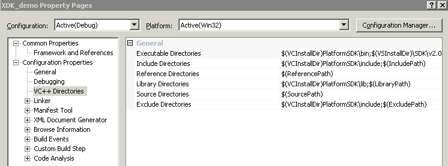
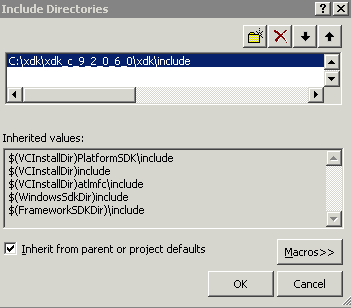
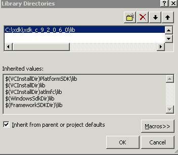
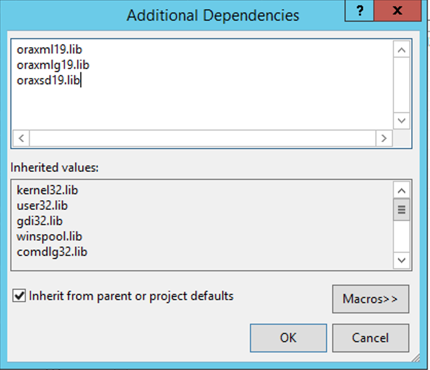

An explanation is given of how to get started with Oracle XML Developer's Kit (XDK) for C.

### 3.1 Installing XDK for C Components

XDK for C components are the building blocks for reading, manipulating, transforming, and validating Extensible Markup Language (XML). The XDK for C components are included with Oracle Database.

**Caution:**

Using the components of Oracle XML Developer’s Kit (XDK) to build software programs enables some powerful but potentially dangerous features, such as external entity expansion and recursive expansion. Refer to [Security Considerations for Oracle XML Developer's Kit](security-considerations-oracle-xml-developers-kit.md) for information about how to use XDK securely.

This chapter assumes that you have installed XDK with Oracle Database and also installed the demo programs on the Oracle Database Examples media. See [About Installing XDK](introduction-to-XDK.md) for installation instructions and a description of the XDK directory structure.

The following set of examples shows the UNIX directory structure for the XDK demos and the libraries used by the XDK components. The subdirectories contain sample programs and data files for the XDK for C components.

Example 3-1 lists the main directories under the Oracle home directory for C.

The contents of each subdirectory under this main directory are listed individually.

The `bin` directory contains these components:

             schema
             xml
             xmlcg
             xsl
             xvm

The `lib` directory contains these components:

             libcore19.a
             libcoresh19.so
             libnls19.a
             libunls19.dll
             libxml19.a
             libxmlsh19.a

The `xdk` directory contains this `demo` subdirectory:

             | demo/
                | - c/
                     | - dom/
                     | - parser/
                     | - sax/
                     | - schema/
                     | - webdav/
                     | - xslt/
                     | - xsltvm/

The `/xdk/demo/c` subdirectories contain sample programs and data files for XDK for C components. The chapters in [Oracle XML Developer's Kit for C](XDK-for-C.md) explain how to use these programs to gain an understanding of the most important C features.

The `xdk` directory also contains this `include` subdirectory:

             | include/
                oratypes.h
                oraxml.h
                oraxmlcg.h
                oraxsd.h
                xml.h
                xmlerr.h
                xmlotn.h
                xmlproc.h
                xmlsch.h
                xmlxptr.h
                xmlxsl.h
                xmlxvm.h

Table 3-4 in Setting Up and Testing the XDK C Compile-Time Environment on UNIX describes the C header files.

Example 3-1 Oracle XML Developer's Kit for C Libraries, Header Files, Utilities, and Demos

    - $ORACLE_HOME
        | - bin/
        | - lib/
        | - xdk/

**Related Topics**

- [Overview of XDK](introduction-to-XDK.md)

### 3.2 Configuring the UNIX Environment for XDK for C Components

Topics here include component dependencies, environment variables, the runtime and compile-time environments, and the component version.

#### 3.2.1 XDK for C Component Dependencies on UNIX

The C libraries described in this section are located in `$ORACLE_HOME/lib`.

XDK for C and C++ components are contained in this library:

    libxml19.a

The following XKD components are contained in the library:

- XML parser, which checks an XML document for well-formedness, optionally validates it against a document type definition (DTD) or XML Schema, and supports Document Object Model (DOM) and Simple API for XML (SAX) interfaces for programmatic access

- Extensible Stylesheet Language Transformation (XSLT) processor, which transforms an XML document into another XML document

- XSLT compiler, which compiles XSLT stylesheets into byte code for use by the XSLT Virtual Machine (XSLT VM)

- XSLTVM, which is an XSLT transformation engine

- XML Schema processor, which validates XML files against an XML schema

Table 3-1 describes the Common Oracle Runtime Environment (CORE) and Globalization Support libraries on which XDK for C components (UNIX) depend.

Table 3-1 Dependent Libraries of Oracle XML Developer's Kit for C Components on UNIX

| Component                                 | Library          | Description                                                                                                                                                                                               |
|:------------------------------------------|:-----------------|:----------------------------------------------------------------------------------------------------------------------------------------------------------------------------------------------------------|
| CORE library                              | `libcore19.a`    | Contains the C runtime functions that enable portability across platforms.                                                                                                                                |
| CORE Dynamic linking library              | `libcoresh19.so` | C runtime library that supports dynamic linking on UNIX platforms.                                                                                                                                        |
| Globalization Support common library      | `libnls19.dll`   | Supports the 8-bit encoding of Unicode (UTF-8), 16-bit encoding of Unicode (UTF-16), and ISO-8859-1 character sets. This library depends on the environment to locate encoding and message files.         |
| Globalization Support library for Unicode | `libunls19.a`    | Supports the character sets described in [Oracle Database Globalization Support Guide](../nlspg/appendix-A-locale-data.md). This library depends on the environment to locate encoding and message files. |

#### 3.2.2 Setting Up XDK for C Environment Variables on UNIX

The UNIX environment variables required for use with XDK for C components is described.

Table 3-2 UNIX Environment Settings for Oracle XML Developer's Kit for C Components

| Variable        | Description                                                                                                                                                                                                                 | Setting                                                                                                                    |
|:----------------|:----------------------------------------------------------------------------------------------------------------------------------------------------------------------------------------------------------------------------|:---------------------------------------------------------------------------------------------------------------------------|
| `$ORA_NLS10`    | Sets the location of the Globalization Support character-encoding definition files. The encoding files represent a subset of character sets available in Oracle Database.                                                   | Set to the location of the Globalization Support data files. Set the variable: `setenv ORA_NLS10 $ORACLE_HOME/nls/data` |
| `$ORA_XML_MESG` | Sets the location of the XML error message files. Files ending in `.msb` are machine-readable and required at run time. Files ending in `.msg` are human-readable and contain cause and action descriptions for each error. | Set to the path of the `mesg` directory. For example: `setenv ORA_XML_MESG $ORACLE_HOME/xdk/mesg`                       |
| `$PATH`         | Sets the location of the XDK for C executables.                                                                                                                                                                             | Set the `PATH`: `setenv PATH ${PATH}:${ORACLE_HOME}/bin`                                                                |

#### 3.2.3 Testing the XDK for C Runtime Environment on UNIX

You can test XDK for C in your UNIX runtime environment by running a number of utilities.

These utilities are described in Table 3-3.

Table 3-3 Oracle XML Developer's Kit for C/C++ Utilities on UNIX

| Executable | Directory          | Description            |
|:-----------|:-------------------|:-----------------------|
| `schema`   | `$ORACLE_HOME/bin` | C XML Schema validator |
| `xml`      | `$ORACLE_HOME/bin` | C XML parser           |
| `xmlcg`    | `$ORACLE_HOME/bin` | C++ class generator    |
| `xvm`      | `$ORACLE_HOME/bin` | C XVM processor        |

Run these utilities with no options to display the usage help. Run the utilities with the `-hh` flag for complete usage information.

**Related Topics**

- [Using the C XML Schema Processor Command-Line Utility](using-XML-schema-processor-for-C.md)
- [Using the C XML Parser Command-Line Utility](using-XML-parser-for-C.md)
- [Using the XML C++ Class Generator Command-Line Utility](using-XML-class-generator-for-C-plus-plus.md)
- [Using the XVM Processor Command-Line Utility](using-XSLT-and-XVM-processors-for-C.md)

#### 3.2.4 Setting Up and Testing the XDK C Compile-Time Environment on UNIX

How to set up and test the XDK C compile-time UNIX environment is described.

Table 3-4 describes the header files required for compilation of XDK for C components. These files are located in `$ORACLE_HOME/xdk/include`. Your runtime environment must be set up before you can compile your code.

Table 3-4 Header Files in the Oracle XML Developer's Kit for C Compile-Time Environment

| Header File  | Description                                                                                                                                                                  |
|:-------------|:-----------------------------------------------------------------------------------------------------------------------------------------------------------------------------|
| `oratypes.h` | Includes the private Oracle C data types.                                                                                                                                    |
| `oraxml.h`   | Includes the Oracle9i XML Open Reporting Application (ORA) data types and the public ORA APIs included in `libxml.a` (only for backward compatibility). Use `xml.h` instead. |
| `oraxmlcg.h` | Includes the C APIs for the C++ class generator (only for backward compatibility).                                                                                           |
| `oraxsd.h`   | Includes the Oracle9i XML schema definition (XSD) validator data types and application programming interfaces (APIs), for backward compatibility only.                       |
| `xml.h`      | Handles the unified DOM APIs transparently, whether you use them through Oracle Call Interface (OCI) or standalone. It replaces `oraxml.h`, which is deprecated.             |
| `xmlerr.h`   | Includes the XML errors and their numbers.                                                                                                                                   |
| `xmlotn.h`   | Includes the other headers depending on whether you compile standalone or use OCI.                                                                                           |
| `xmlproc.h`  | Includes the Oracle XML data types and XML public parser APIs in `libxml19.a`.                                                                                               |
| `xmlsch.h`   | Includes the Oracle XSD validator public APIs.                                                                                                                               |
| `xmlptr.h`   | Includes the XPointer data types and APIs, which are not currently documented or supported.                                                                                  |
| `xmlxsl.h`   | Includes the XSLT processor data types and public APIs.                                                                                                                      |
| `xmlxvm.h`   | Includes the XSLT compiler and VM data types and public APIs.                                                                                                                |

##### 3.2.4.1 Testing the XDK for C Compile-Time Environment on UNIX

The simplest way to test XDK for C in your compile-time environment is to run the `make` utility on the sample programs, which are located on the Examples media rather than on the Oracle Database CD.

After installing the demos, they are located in `$ORACLE_HOME/xdk/demo/c`. A `README` in the same directory provides compilation instructions and usage notes.

Build and run the sample programs by executing these commands at the system prompt:

    cd $ORACLE_HOME/xdk/demo/c
    make

#### 3.2.5 Verifying the XDK for C Component Version on UNIX

How to determine which version of XDK you have is explained.

To get the version of XDK you are working with, change to directory `$ORACLE_HOME/lib` and run this command:

    strings libxml19.a | grep -i developers

### 3.3 Configuring the Windows Environment for XDK C Components

Topics here include component dependencies, setting environment variables, testing the runtime environment, setting up and testing the compile-time environment, and Visual C++ in Microsoft Visual Studio.

#### 3.3.1 XDK for C Component Dependencies on Windows

The C libraries described in this section are located in `%ORACLE_HOME%\bin`.

XDK for C components are contained in this library:

    libxml19.dll

The following XDK components are contained in the library:

- XML parser

- XSLT processor

- XSLT compiler

- XSLT VM

- XML Schema processor

Table 3-5 describes the Oracle CORE and Globalization Support libraries on which XDK for C components (Windows) depend.

Table 3-5 Dependent Libraries of Oracle XML Developer's Kit for C Components on Windows

| Component                                 | Library         | Description                                                                                                                                                                                             |
|:------------------------------------------|:----------------|:--------------------------------------------------------------------------------------------------------------------------------------------------------------------------------------------------------|
| CORE library                              | `libcore19.dll` | Contains the runtime functions that enable portability across platforms.                                                                                                                                |
| Globalization Support common library      | `libnls19.dll`  | Supports the UTF-8, UTF-16, and ISO-8859-1 character sets. This library depends on the environment to find encoding and message files.                                                                  |
| Globalization Support library for Unicode | `libunls19.dll` | Supports the character sets described in [Oracle Database Globalization Support Guide](../nlspg/appendix-A-locale-data.md). This library depends on the environment to find encoding and message files. |

#### 3.3.2 Setting Up XDK for C Environment Variables on Windows

The Windows environment variables required for use with the XDK for C components are described.

Table 3-6 Windows Environment Settings for Oracle XML Developer's Kit for C Components

| Variable         | Description                                                                                                                                                                                                                 | Setting                                                                                                                                        |
|:-----------------|:----------------------------------------------------------------------------------------------------------------------------------------------------------------------------------------------------------------------------|:-----------------------------------------------------------------------------------------------------------------------------------------------|
| `%ORA_NLS10%`    | Sets the location of the Globalization Support character-encoding definition files. The encoding files represent a subset of character sets available in Oracle Database.                                                   | This variable must be set to the location of the Globalization Support data files. Set the variable: `set ORA_NLS10=%ORACLE_HOME%\nls\data` |
| `%ORA_XML_MESG%` | Sets the location of the XML error message files. Files ending in `.msb` are machine-readable and required at run time. Files ending in `.msg` are human-readable and contain cause and action descriptions for each error. | Set to the path of the `mesg` directory. For example: `set ORA_XML_MESG=%ORACLE_HOME%\xdk\mesg `                                            |
| `%PATH%`         | Sets the location of the XDK for C data definition languages (DLLs) and executables.                                                                                                                                        | Set the `PATH`: `path %path%;%ORACLE_HOME%\bin`                                                                                             |

#### 3.3.3 Testing the XDK for C Runtime Environment on Windows

You can test XDK in your Microsoft Windows runtime environment by running a number of utilities.

These are described in Table 3-7.

Table 3-7 Oracle XML Developer's Kit for C/C++ Utilities on Windows

| Executable   | Directory           | Description                                                                                                                            |
|:-------------|:--------------------|:---------------------------------------------------------------------------------------------------------------------------------------|
| `schema.exe` | `%ORACLE_HOME%\bin` | C XML Schema validator See also [Using the C XML Schema Processor Command-Line Utility](using-XML-schema-processor-for-C.md)        |
| `xml.exe`    | `%ORACLE_HOME%\bin` | C XML parser See also [Using the C XML Parser Command-Line Utility](using-XML-parser-for-C.md)                                      |
| `xmlcg.exe`  | `%ORACLE_HOME%\bin` | C++ class generator See also [Using the XML C++ Class Generator Command-Line Utility](using-XML-class-generator-for-C-plus-plus.md) |
| `xvm.exe`    | `%ORACLE_HOME%\bin` | C XVM processor See also [Using the XVM Processor Command-Line Utility](using-XSLT-and-XVM-processors-for-C.md)                     |

Run these utilities with no options to display the usage help. Run the utilities with the `-hh` flag for complete usage information.

**Related Topics**

- [Using the C XML Schema Processor Command-Line Utility](using-XML-schema-processor-for-C.md)
- [Using the C XML Parser Command-Line Utility](using-XML-parser-for-C.md)
- [Using the XML C++ Class Generator Command-Line Utility](using-XML-class-generator-for-C-plus-plus.md)
- [Using the XVM Processor Command-Line Utility](using-XSLT-and-XVM-processors-for-C.md)

#### 3.3.4 Setting Up and Testing the XDK for C Compile-Time Environment on Windows

You must set up your runtime environment before you can compile your code.

Table 3-4 in the section Setting Up and Testing the XDK C Compile-Time Environment on UNIX describes the header files required for compilation of the C components on Windows. The relative file names are the same on both UNIX and Windows installations.

On Windows the header files are located in `%ORACLE_HOME%\xdk\include`.

##### 3.3.4.1 Testing the XDK for C Compile-Time Environment on Windows

You can test XDK for C in your compile-time environment by compiling the demo programs.

These are located in `%ORACLE_HOME%\xdk\demo\c` after you install them from the Oracle Database Examples media. A `README` file in the same directory provides compilation instructions and usage notes. Before you compile the demo programs, edit the `Make.bat` files as described in Editing the Make.bat Files on Windows.

###### 3.3.4.1.1 Editing the Make.bat Files on Windows

Each subfolder of folder `%ORACLE_HOME%\xdk\demo\c` contains a file `Make.bat`. Update the `Make.bat` file in each folder by adding the path of the libraries and the header files to the compile command. You need not edit the paths in section `:LINK` because `/libpath:%ORACLE_HOME%\lib` already points to the C libraries.

The section of a `Make.bat` file in Example 3-2 uses bold text to show the path that you must include.

Example 3-2 Editing an Oracle XML Developer's Kit for C Make.bat File on Windows

    :COMPILE
    set filename=%1
    cl -c -Fo%filename%.obj %opt_flg%  /DCRTAPI1=_cdecl /DCRTAPI2=_cdecl /nologo /Zl
    /Gy /DWIN32 /D_WIN32 /DWIN_NT /DWIN32COMMON /D_DLL /D_MT /D_X86_=1
    /Doratext=OraText -I. -I..\..\..\include -I%ORACLE_HOME%\xdk\include %filename%.c
    goto :EOF

    :LINK
    set filename=%1
    link %link_dbg% /out:..\..\..\..\bin\%filename%.exe
    /libpath:%ORACLE_HOME%\lib /libpath:..\..\..\..\lib
    %filename%.obj oraxml19.lib user32.lib kernel32.lib msvcrt.lib ADVAPI32.lib
    oldnames.lib winmm.lib

###### 3.3.4.1.2 Setting the XDK for C Compiler Path on Windows

How to set the path for the `cl.exe` compiler on Microsoft Windows is described.

Demo file `make.bat` assumes that you are using the `cl.exe` compiler, which is freely available with the Microsoft .NET Framework Software Development Kit (SDK).

To set the path for the `cl.exe` compiler on Microsoft Windows, follow these steps:

1.  In the Start menu, select Settings and then Control Panel.
2.  Double-click System.
3.  In the System Properties dialogue box, select the Advanced tab and click Environment Variables.
4.  In System variables, select Path and click Edit.
5.  Append the path of `cl.exe` to the `%PATH%` variable and click OK.

Build and run the sample programs by executing these commands at the system prompt:

    cd $ORACLE_HOME/xdk/demo/c
    make

#### 3.3.5 Using the XDK for C Components and Visual C++ in Microsoft Visual Studio

You can set up a project with a Visual C++ template and use it for the demos included in XDK.

##### 3.3.5.1 Setting a Path for a Project in Visual C++ on Windows

Follow these steps to set the path for a project:

1.  Open a project in Visual C++ and include the `*.c` files for your project.
2.  Navigate to the Project menu and select Properties.
3.  When Property Pages appear, expand Configuration Properties and select VC++ Directories.
4.  Under General on the right side, select Include Directories.
    Figure 3-1 The Property Pages

    
    [Description of "Figure 3-1 The Property Pages"](img_text/c6.md)
5.  Click the arrow at the end of the line, and select the second line, which reads \<Edit...\>.
6.  When the Include Directories window appears, click New Line from the tool bar and enter this include path, `%ORACLE_HOME%\xdk\include`, as shown in the example in Figure 3-2 and click OK.

Figure 3-2 Setting the Include Path in Visual C++

[Description of "Figure 3-2 Setting the Include Path in Visual C++"](img_text/c6a.md)

##### 3.3.5.2 Setting the Library Path in Visual C++ on Windows

Follow these steps to set the library path for a project:

1.  Open a project in Visual C++ and include the `*.c` files for your project.
2.  Navigate to the Project menu and select Properties.
3.  When Property Pages appear, expand Configuration Properties and select VC++ Directories.
4.  Under General on the right side, select Library Directories.
5.  Click the arrow at the end of the line, and select the second line which reads \<Edit...\>.
6.  When the Library Directories window appears, click New Line from the tool bar and enter this library path, `%ORACLE_HOME%\lib`, as shown in the example in Figure 3-3 and click OK.
    Figure 3-3 Setting the Static Library Path in Visual C++

    
    [Description of "Figure 3-3 Setting the Static Library Path in Visual C++"](img_text/c7.md)
7.  After setting the paths for the static libraries in `%ORACLE_HOME%\lib`, navigate to the Project menu and select Properties.
8.  In the Properties Page, select and expand Linker under Configuration Properties, and select Input.
9.  Select Additional Dependencies and click the arrow at the end of the line. Select the second line which reads \<Edit...\>.
10. Enter these additional dependencies: `oraxml19.lib`, `oraxmlg19.lib`, and `oraxsd19.lib` as shown in Figure 3-4 and click OK.
    Figure 3-4 Setting the Names of the Libraries in Visual C++ Project

    
    [Description of "Figure 3-4 Setting the Names of the Libraries in Visual C++ Project"](img_text/lib_names_visual_c.md)

### 3.4 Overview of the Unified C API

The **unified C API** is a programming interface that unifies the functionality required by both XDK for C and Oracle XML DB. This API is used primarily by XSLT and XML Schema.

As shown in Table 3-4, the unified C API is declared in the `xml.h` header file. Table 3-8 summarizes the XDK for C APIs. See [Oracle Database XML C API Reference](../caxml/datatypes.md) for complete documentation.

Table 3-8 Summary of Oracle XML Developer's Kit for C APIs

| Package                                             | Purpose                                                                                                                                                                                                                                                                                             |
|:----------------------------------------------------|:----------------------------------------------------------------------------------------------------------------------------------------------------------------------------------------------------------------------------------------------------------------------------------------------------|
| [Callback APIs](../caxml/package-callback-API.md)   | Define macros that declare functions (or function pointers) for XML callbacks.                                                                                                                                                                                                                      |
| [DOM APIs](../caxml/package-DOM-API.md)             | Parse and manipulate XML documents with DOM. The API follows the DOM 2.0 standard as closely as possible, although it changes some names when mapping from the objected-oriented DOM specification to the flat C namespace. For example, the overloaded `getName()` methods become `getAttrName()`. |
| [Range APIs](../caxml/package-Range-API.md)         | Create and manipulate `Range` objects.                                                                                                                                                                                                                                                              |
| [SAX APIs](../caxml/package-SAX-API.md)             | Enable event-based XML parsing with SAX.                                                                                                                                                                                                                                                            |
| [Schema APIs](../caxml/package-Schema-API.md)       | Assemble multiple XML schema documents into a single schema that can be used to validate a specific instance document.                                                                                                                                                                              |
| [Traversal APIs](../caxml/package-Traversal-API.md) | Enable document traversal and navigation of DOM trees.                                                                                                                                                                                                                                              |
| [XML APIs](../caxml/package-XmlDiff-API.md)         | Define an XML processor in terms of how it must read XML data and the information it must provide to the application.                                                                                                                                                                               |
| [XPath APIs](../caxml/package-XPath-API.md)         | Process XPath-related types and interfaces.                                                                                                                                                                                                                                                         |
| [XPointer APIs](../caxml/package-XPointer-API.md)   | Locate nodes in an XML document.                                                                                                                                                                                                                                                                    |
| [XSLT APIs](../caxml/package-XSLT-API.md)           | Perform XSL processing.                                                                                                                                                                                                                                                                             |
| [XSLTVM APIs](../caxml/package-XSLTVM-API.md)       | Implement a virtual machine that can run compiled XSLT code.                                                                                                                                                                                                                                        |

The API accomplishes the unification of the functions by conforming contexts. A top-level XML context (`xmlctx`) shares common information between cooperating XML components. This context defines information about:

- Data encoding

- Error message language

- Low-level allocation callbacks

An application needs this information before it can parse a document and provide programmatic access through DOM or SAX interfaces.

Both XDK for C and Oracle XML DB require different startup and tear-down functions for the top-level and service contexts. The initialization function takes implementation-specific arguments and returns a conforming context.

The unification is made possible by using conforming contexts. A conforming context means that the returned context must begin with a `xmlctx`; it may have any additional implementation-specific parts after the standard header.

After an application gets `xmlctx`, it uses unified DOM invocations, all of which take an `xmlctx` as the first argument.

### 3.5 Globalization Support for the XDK for C Components

The XDK for C parser supports over 300 IANA character sets.

These character sets include those listed in [Character Sets Supported by XDK for C](XDK-standards.md).

Considerations when working with character sets:

- Oracle recommends that you use Internet Assigned Numbers Authority (IANA) character set names for interoperability with other XML parsers.

- XML parsers are required only to support UTF-8 and UTF-16, so these character sets are preferable.

- The default input encoding ("incoding") is UTF-8. If an input document's encoding is not self-evident (by HTTP character set, Byte Order Mark (BOM), XMLDecl, and so on), then the default input encoding is assumed. Oracle recommends that you set the default encoding explicitly if using only single byte character sets such as US-ASCII or any of the ISO-8859 character sets because single-byte performance is fastest. The flag `XML_FLAG_FORCE_INCODING` specifies that the default input encoding is always applied to input documents, ignoring any BOM or XMLDecl. Nevertheless, a protocol declaration such as HTTP character set is always honored.

- Choose the data encoding for DOM and SAX ("outcoding") carefully. Single-byte encodings are the fastest, but can represent only a very limited set of characters. Next fastest is Unicode (UTF-16), and slowest are the multibyte encodings such as UTF-8. If input data cannot be converted to the outcoding without loss, then an error occurs. For maximum utility, use a Unicode-based outcoding because Unicode can represent any character. If outcoding is not specified, then it defaults to the incoding of the first document parsed.
