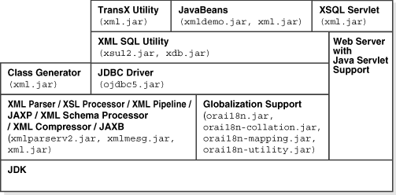

How to get started with XDK for Java is described.

### 11.1 Installing XDK for Java Components

XDK for Java components are included with Oracle Database. This chapter assumes that you installed XDK with Oracle Database and installed the demo programs from the Oracle Database Examples media.

**Caution:**

Using the components of Oracle XML Developer’s Kit (XDK) to build software programs enables some powerful but potentially dangerous features, such as external entity expansion and recursive expansion. Refer to [Security Considerations for Oracle XML Developer's Kit](security-considerations-oracle-xml-developers-kit.md) for information about how to use XDK securely.

For a description of the XDK directory structure, see [About Installing XDK](introduction-to-XDK.md).

Example 11-1 lists the main directories under the Oracle home directory for Java (This is the UNIX directory structure.) The contents of the subdirectories are listed individually, after the example.

The `bin` directory contains these components:

             orajaxb
             orapipe
             oraxml
             oraxsl
             transx

The `lib` directory contains these JAR and ZIP files:

             classgen.jar
             jdev-rt.zip
             oraclexsql.jar
             transx.zip
             xml.jar
             xml2.jar
             xmldemo.jar
             xmlmesg.jar
             xmlparserv2.jar
             xschema.jar
             xsqlserializers.jar
             xsu12.jar

The `jlib` directory contains these JAR files:

             orai18n.jar
             orai18n-collation.jar
             orai18n-mapping.jar
             orai18n-utility.jar

The `jdbc` directory contains this `lib` subdirectory:

             | - lib/
                  ojdbc6.jar

The `rdbms` directory contains this `jlib` subdirectory:

             | - jlib/
                  xdb.jar

And, the `xdk` directory contains this `demo` subdirectory:

             | demo/
                | - java/
                     | - classgen/
                     | - jaxb/
                     | - parser/
                     | - pipeline/
                     | - schema/
                     | - transviewer/
                     | - tranxs/
                     | - xsql/
                     | - xsu/

The `/xdk/demo/java` subdirectories contain sample programs and data files for XDK for Java components. The chapters in [Oracle XML Developer's Kit for Java](XDK-for-Java.md) explain how to use these programs to learn about the most important Java features.

**See Also:**

[Table 1-1](introduction-to-XDK.md) for descriptions of individual XDK for Java components

Example 11-1 Oracle XML Developer's Kit for Java Libraries, Utilities, and Demos

    - $ORACLE_HOME
        | - bin/
        | - lib/
        | - jlib/
        | - jdbc/
        | - rdbms/
        | - xdk/

### 11.2 XDK for Java Component Dependencies

The dependencies of XDK for Java components when using Java Development Kit (JDK) are described.

XDK for Java components are certified and supported with JDK versions 5 and 6. Earlier versions of Java are no longer supported. Figure 11-1 shows the dependencies of XDK for Java components when using JDK 5.

Figure 11-1 Oracle XML Developer's Kit for Java Component Dependencies for JDK 5

[Description of "Figure 11-1 Oracle XML Developer's Kit for Java Component Dependencies for JDK 5"](img_text/adxdk110.md)

XDK for Java components need the libraries in Table 11-1. Some of the libraries are not specific to XDK, but are shared among other Oracle Database components.

Table 11-1 Java Libraries for Oracle XML Developer's Kit for Java Components

| Library                 | Directory                 | Includes . . .                                                                                                                                                                                                                                                                                                                                                                                                                             |
|:------------------------|:--------------------------|:-------------------------------------------------------------------------------------------------------------------------------------------------------------------------------------------------------------------------------------------------------------------------------------------------------------------------------------------------------------------------------------------------------------------------------------------|
| `classgen.jar`          | `$ORACLE_HOME/lib`        | Extensible Markup Language (XML) class generator for Java runtime classes. Note: This library is maintained only for backward compatibility. Use the Java Architecture for XML Binding (JAXB) class generator in `xml.jar` instead.                                                                                                                                                                                                     |
| `jdev-rt.zip`           | `$ORACLE_HOME/lib`        | Java graphical user interface (GUI) libraries for use when working with the demos with the Java Development Environment (JDE).                                                                                                                                                                                                                                                                                                             |
| `ojdbc6.jar`            | `$ORACLE_HOME/jdbc/lib`   | Oracle Java Database Connectivity (JDBC) drivers for Java 6. This Java Archive (JAR) depends on `orai18n.jar` for character set support if you use a multibyte character set other than 8-bit encoding of Unicode (UTF-8), ISO8859-1, or JA16SJIS.                                                                                                                                                                                         |
| `oraclexsql.jar`        | `$ORACLE_HOME/lib`        | Most of the XSQL Servlet classes needed to construct XSQL pages. Note: This JAR is superseded by `xml.jar` and is retained only for backward compatibility.                                                                                                                                                                                                                                                                             |
| `orai18n.jar`           | `$ORACLE_HOME/jlib`       | Globalization support for JDK 1.2 or above. It is a wrapper of all other Globalization JARs and includes character set converters. If you use a multibyte character set other than UTF-8, ISO8859-1, or JA16SJIS, then put this archive in your `CLASSPATH` so that JDBC can convert the character set of the input file to the database character set when loading XML files with XML SQL Utility (XSU), TransX Utility, or XSQL Servlet. |
| `orai18n-collation.jar` | `$ORACLE_HOME/jlib`       | Globalization collation features: the `OraCollator` class and the `lx3*.glb` and `lx4001[0-9].glb` files.                                                                                                                                                                                                                                                                                                                                  |
| `orai18n-mapping.jar`   | `$ORACLE_HOME/jlib`       | Globalization locale and character set name mappings: the `OraResourceBundle` class and `lx4000[0-9].glb` files. This archive is used mainly by products that need only locale name mapping tables.                                                                                                                                                                                                                                        |
| `orai18n-utility.jar`   | `$ORACLE_HOME/jlib`       | Globalization locale objects: the `OraLocaleInfo` class, the `OraNumberFormat` and `OraDateFormat` classes, and the `lx[01]*.glb` files.                                                                                                                                                                                                                                                                                                   |
| `transx.zip`            | `$ORACLE_HOME/lib`        | TransX Utility classes. Note: This archive is superseded by `xml.jar` and is retained only for backward compatibility.                                                                                                                                                                                                                                                                                                                  |
| `xdb.jar`               | `$ORACLE_HOME/rdbms/jlib` | Classes needed by `xml.jar` to access `XMLType`, classes needed to access Oracle XML DB Repository, and `XMLType` Document Object Model (DOM) classes for manipulation of the DOM tree.                                                                                                                                                                                                                                                    |
| `xml.jar`               | `$ORACLE_HOME/lib`        | JAXB and Pipeline Processor classes and classes from these libraries: • `oraclexsql.jar` • `xsqlserializers.jar` • `transx.jar`                                                                                                                                                                                                                                                                                                   |
| `xmldemo.jar`           | `$ORACLE_HOME/lib`        | The visual JavaBeans: `XMLTreeView`, `XMLTransformPanel`, `XMLSourceView`, and `DBViewer`.                                                                                                                                                                                                                                                                                                                                                 |
| `xmlmesg.jar`           | `$ORACLE_HOME/lib`        | Support for using XML parser with a language other than English.                                                                                                                                                                                                                                                                                                                                                                           |
| `xmlparserv2.jar`       | `$ORACLE_HOME/lib`        | Application programming interfaces (APIs) for: • DOM and Simple API for XML (SAX) parsers • XML Schema processor • Extensible Stylesheet Language Transformation (XSLT) processor • XML compression • Java API for XML Processing (JAXP) • Utility functionality such as `XMLSAXSerializer` and asynchronous DOM Builder This library includes `xschema.jar`.                                                         |
| `xschema.jar`           | `$ORACLE_HOME/lib`        | XML Schema classes contained in `xmlparserv2.jar`. Note: This JAR file is retained only for backward compatibility.                                                                                                                                                                                                                                                                                                                     |
| `xsqlserializers.jar`   | `$ORACLE_HOME/lib`        | Classes that XSQL Servlet needs for serialized output such as PDF. Note: This archive is superseded by `xml.jar` and is retained only for backward compatibility.                                                                                                                                                                                                                                                                       |
| `xsu12.jar`             | `$ORACLE_HOME/lib`        | Classes that implement XSU. These classes depend on `xdb.jar` for `XMLType` access.                                                                                                                                                                                                                                                                                                                                                        |

**See Also:**

- [Oracle Database Globalization Support Guide](../nlspg/overview-of-globalization-support.md) to learn about the Globalization Support libraries

- [Oracle Database JDBC Developer’s Guide](../jjdbc/introducing-JDBC.md) to learn about the JDBC libraries

- [Oracle XML DB Developer’s Guide](../adxdb/intro-to-XML-DB.md) to learn about Oracle XML DB

### 11.3 Setting Up the XDK for Java Environment

You can set up the XDK for Java environment using either an environment variable or a command-line option.

To set up the XDK for Java environment, do either of the following:

- During Oracle Database installation of XDK, manually set the `$CLASSPATH` (UNIX) or `%CLASSPATH%` (Windows) environment variables.

- When compiling and running Java programs at the command line, set the `-classpath` option.

#### 11.3.1 Setting Up XDK for Java Environment Variables for UNIX

The UNIX environment variables needed by XDK for Java components are described.

Table 11-2 UNIX Environment Variables for Oracle XML Developer's Kit for Java Components

| Variable           | Description                                                                                                                                                                                           |
|:-------------------|:------------------------------------------------------------------------------------------------------------------------------------------------------------------------------------------------------|
| `$CLASSPATH`       | Includes: `.:${CLASSPATHJ}:${ORACLE_HOME}/lib/xmlparserv2.jar:` `${ORACLE_HOME}/lib/xsu12.jar:${ORACLE_HOME}/lib/xml.jar` Note: A period (.) to represent the current directory is optional. |
| `$CLASSPATHJ`      | For JDK 5, set: `CLASSPATHJ=${ORACLE_HOME}/jdbc/lib/ojdbc6.jar:${ORACLE_HOME}/jlib/orai18n.jar` Certain character sets need `orai18n.jar`.                                                      |
| `$JAVA_HOME`       | Installation directory for the Java JDK, Standard Edition. Modify the path that links to the Java SDK.                                                                                                |
| `$LD_LIBRARY_PATH` | For OCI JDBC connections: `${ORACLE_HOME}/lib:${LD_LIBRARY_PATH}`                                                                                                                                  |
| `$PATH`            | `${JAVA_HOME}/bin`                                                                                                                                                                                    |

After setting up the XDK for Java environment on UNIX, you can use the command-line utilities described in Table 11-3.

Table 11-3 Oracle XML Developer's Kit for Java UNIX Utilities

| Executable/Class | Directory/JAR                | Description                                                                                                                                         |
|:-----------------|:-----------------------------|:----------------------------------------------------------------------------------------------------------------------------------------------------|
| `xsql`           | `$ORACLE_HOME/bin`           | XSQL command-line utility. The script executes the `oracle.xml.xsql.XSQLCommandLine` class. Edit this shell script for your environment before use. |
| `OracleXML`      | `$ORACLE_HOME/lib/xsu12.jar` | XSU command-line utility                                                                                                                            |
| `orajaxb`        | `$ORACLE_HOME/bin`           | JAXB command-line utility                                                                                                                           |
| `orapipe`        | `$ORACLE_HOME/bin`           | Pipeline command-line utility                                                                                                                       |
| `oraxml`         | `$ORACLE_HOME/bin`           | XML parser command-line utility                                                                                                                     |
| `oraxsl`         | `$ORACLE_HOME/bin`           | XSLT processor command-line utility                                                                                                                 |
| `transx`         | `$ORACLE_HOME/bin`           | TransX command-line utility                                                                                                                         |

**Related Topics**

- [Using the XSQL Pages Command-Line Utility](using-XSQL-pages-publishing-framework.md)
- [Using the XSU Command-Line Utility](using-XML-SQL-utility.md)
- [Using the JAXB Class Generator Command-Line Utility](using-JAXB-class-generator.md)
- [Using the XML Pipeline Processor Command-Line Utility](using-XML-pipeline-processor-for-Java.md)
- [Using the Java XML Parser Command-Line Utility (oraxml)](XML-parsing-for-Java.md)
- [Using the XSLT Processor Command-Line Utility](using-XSLT-processor-for-Java.md)
- [Using the TransX Command-Line Utility](using-TransX-utility.md)

#### 11.3.2 Testing the XDK for Java Environment on UNIX

A UNIX shell script is provided to test the XDK Java environment.

If your environment is set up correctly, then the UNIX shell script in Example 11-2 generates version and usage information for the utilities in Table 11-3.

Example 11-2 Testing the Oracle XML Developer's Kit for Java Environment on UNIX

    #!/usr/bin/tcsh
    echo;echo "BEGIN TESTING";echo
    echo;echo "now testing the XSQL utility...";echo
    xsql
    echo; echo "now testing the XSU utility...";echo
    java OracleXML
    echo;echo "now testing the JAXB utility...";echo
    orajaxb -version
    echo;echo "now testing the Pipeline utility...";echo
    orapipe -version
    echo;echo "now testing the XSLT Processor utility...";echo
    oraxsl
    echo;echo "now testing the TransX utility...";echo
    transx
    echo;echo "END TESTING"

#### 11.3.3 Setting Up XDK for Java Environment Variables for Windows

The Microsoft Windows environment variables needed by XDK for Java components are described.

Table 11-4 describes the Windows environment variables that the XDK for Java components need.

Table 11-4 Windows Environment Variables for Oracle XML Developer's Kit for Java Components

| Variable       | Notes                                                                                                                                                                                                                                                                                                |
|:---------------|:-----------------------------------------------------------------------------------------------------------------------------------------------------------------------------------------------------------------------------------------------------------------------------------------------------|
| `%CLASSPATH%`  | Includes: `.;%CLASSPATHJ%;%ORACLE_HOME%\lib\xmlparserv2.jar;` `%ORACLE_HOME%\lib\xsu12.jar;%ORACLE_HOME%\lib\xml.jar;` `%ORACLE_HOME%\lib\xmlmesg.jar;%ORACLE_HOME%\lib\oraclexsql.jar` Note: A single period "." to represent the current directory is not required, but may be useful. |
| `%CLASSPATHJ%` | For JDK 5, set: `CLASSPATHJ=%ORACLE_HOME%\jdbc\lib\ojdbc6.jar:%ORACLE_HOME%\lib\orai18n.jar` The `orai18n.jar` is needed to support certain character sets.                                                                                                                                    |
| `%JAVA_HOME%`  | Installation directory for the Java software developer's kit (SDK), Standard Edition. Modify the path that links to the Java SDK.                                                                                                                                                                    |
| `%PATH%`       | `%JAVA_HOME%\bin`                                                                                                                                                                                                                                                                                    |

After setting up the XDK for Java environment on Windows, you can use the command-line utilities described in Table 11-5.

Table 11-5 Oracle XML Developer's Kit for Java Windows Utilities

| Batch File/Class | Directory/JAR                 | Description                                                                                                                                          |
|:-----------------|:------------------------------|:-----------------------------------------------------------------------------------------------------------------------------------------------------|
| `xsql.bat`       | `%ORACLE_HOME%\bin`           | XSQL command-line utility. The batch file executes the `oracle.xml.xsql.XSQLCommandLine` class. Edit the batch file for your environment before use. |
| `OracleXML`      | `%ORACLE_HOME%\lib\xsu12.jar` | XSU command-line utility                                                                                                                             |
| `orajaxb.bat`    | `%ORACLE_HOME%\bin`           | JAXB command-line utility                                                                                                                            |
| `orapipe.bat`    | `%ORACLE_HOME%\bin`           | Pipeline command-line utility                                                                                                                        |
| `oraxml.bat`     | `%ORACLE_HOME%\bin`           | XML parser command-line utility                                                                                                                      |
| `oraxsl.bat`     | `%ORACLE_HOME%\bin`           | XSLT processor command-line utility                                                                                                                  |
| `transx.bat`     | `%ORACLE_HOME%\bin`           | TransX command-line utility                                                                                                                          |

**Related Topics**

- [Using the XSQL Pages Command-Line Utility](using-XSQL-pages-publishing-framework.md)
- [Using the XSU Command-Line Utility](using-XML-SQL-utility.md)
- [Using the JAXB Class Generator Command-Line Utility](using-JAXB-class-generator.md)
- [Using the XML Pipeline Processor Command-Line Utility](using-XML-pipeline-processor-for-Java.md)
- [Using the Java XML Parser Command-Line Utility (oraxml)](XML-parsing-for-Java.md)
- [Using the XSLT Processor Command-Line Utility](using-XSLT-processor-for-Java.md)
- [Using the TransX Command-Line Utility](using-TransX-utility.md)

#### 11.3.4 Testing the XDK for Java Environment on Windows

An Microsoft Windows script is provided for testing the XDK for Java environment.

If your environment is set up correctly, then you can run the commands in Example 11-3 at the system prompt to generate version and usage information for the utilities in Table 11-5.

Example 11-3 Testing the Oracle XML Developer's Kit for Java Environment on Windows

    xsql.bat
    java OracleXML
    orajaxb.bat -version
    orapipe.bat -version
    oraxsl.bat
    transx.bat

### 11.4 Verifying the XDK (Java) Version

You can use `javac` to check your XDK version.

To see which version of XDK you have installed, use `javac` to compile the Java code shown in Example 11-4.

After compilation, run the program on the operating system command line:

    java XDKVersion

The result is similar to:

    You are using version:
    Oracle XML Developers Kit 11.1.0.6.0 - Production

Example 11-4 XDKVersion.java

    //
    // XDKVersion.java
    //
    import java.net.URL;
    import oracle.xml.parser.v2.XMLParser;
    public class XDKVersion
    {
       static public void main(String[] argv)
       {
          System.out.println("You are using version: ");
          System.out.println(XMLParser.getReleaseVersion());
       }
    }
