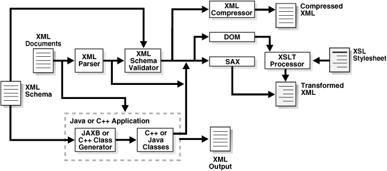
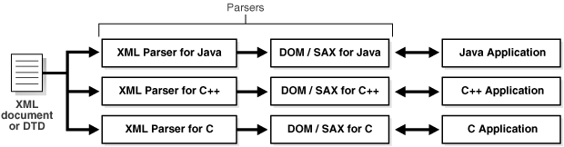
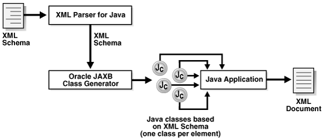
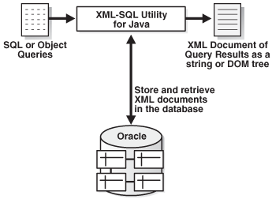
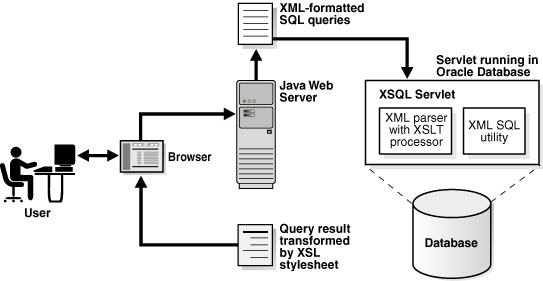
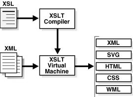
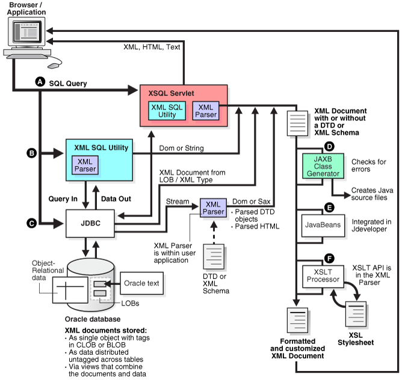
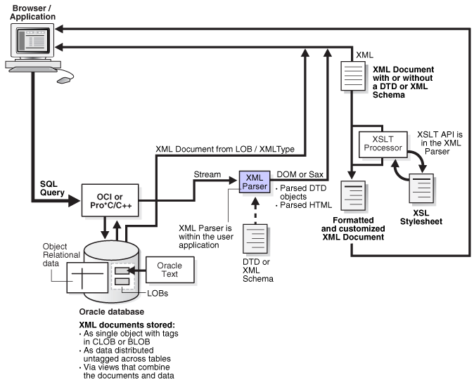
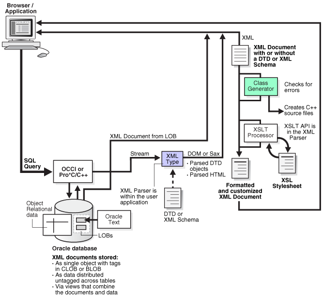
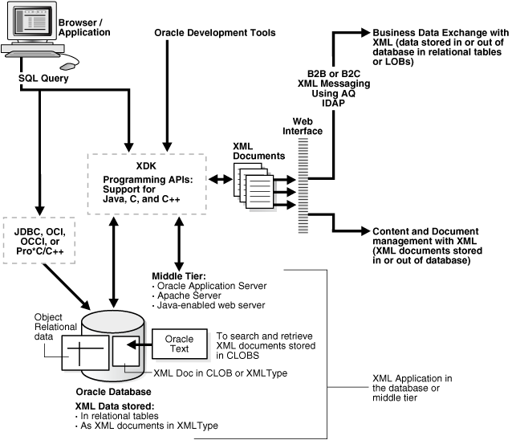

Oracle XML Developer's Kit (XDK) is introduced.

### 1.1 Overview of XDK

Oracle XML Developer’s Kit (XDK) is a versatile set of components that enables you to build and deploy C, C++, and Java software programs that process Extensible Markup Language (XML). You can assemble these components into an XML application that serves your business needs.

**Note:**

If you are using XDK with PL/SQL and migrating from Oracle Database Release 8.1 or 9.2, Oracle strongly recommends that you use database character set AL32UTF8. Otherwise, problems can arise when PL/SQL processes XML data that contains escaped entities.

[Oracle XML Developer's Kit (XDK)](glossary.md) supports [Oracle XML DB](glossary.md), which is a set of technologies used for storing and processing XML in Oracle Database. You can use XDK with Oracle XML DB to build applications that run in Oracle Database. You can also use XDK independently of Oracle XML DB.

Dates and timestamps in generated XML are in the formats specified by XML Schema. See [Oracle XML DB Developer's Guide](../adxdb/generation-of-XML-data-from-relational-data.md).

XDK is fully supported by Oracle and comes with a commercial redistribution license. The standard installation of Oracle Database includes XDK.

Table 1-1 briefly describes the XDK components, tells which programming languages they support, and directs you to the sections of this document that explain how to use them.

Table 1-1 Overview of Oracle XML Developer's Kit Components

| Component                                                    | Description                                                                                                                                                                                                                                               | Languages    | See                                                                                                                                                                                                                                                               |
|:-------------------------------------------------------------|:----------------------------------------------------------------------------------------------------------------------------------------------------------------------------------------------------------------------------------------------------------|:-------------|:------------------------------------------------------------------------------------------------------------------------------------------------------------------------------------------------------------------------------------------------------------------|
| [XML parser](glossary.md)                                    | Creates and parses XML with industry standard Simple API for XML ([SAX](glossary.md)) and Document Object Model ([DOM](glossary.md)) interfaces.                                                                                                          | Java, C, C++ | • [XML Parsing for Java](XML-parsing-for-Java.md) • [Using the XML Parser for C](using-XML-parser-for-C.md) • [Using the XML Parser for C++](using-XML-parser-for-C-plus-plus.md)                                                                           |
| XML Compressor                                               | Enables binary compression and decompression of XML documents. The XML compressor is built into the XML parser for Java.                                                                                                                                  | Java         | [Compressing and Decompressing XML](XML-parsing-for-Java.md)                                                                                                                                                                                                      |
| [Java API for XML Processing (JAXP)](glossary.md)            | Enables Java applications to use SAX, DOM, XML Schema processor, Extensible Stylesheet Language Transformations (XSLT) processors, or alternative processors.                                                                                             | Java         | [Parsing XML with JAXP](XML-parsing-for-Java.md)                                                                                                                                                                                                                  |
| [XSLT](glossary.md) Processor                                | Transforms XML into other text-based formats such as Hypertext Markup Language (HTML).                                                                                                                                                                    | Java, C, C++ | • [Using the XSLT Processor for Java](using-XSLT-processor-for-Java.md) • [Using the XSLT and XVM Processors for C](using-XSLT-and-XVM-processors-for-C.md) • [Using the XSLT Processor for C++](using-XSLT-processor-for-C-plus-plus.md)                   |
| XQuery Processor for Java                                    | Enables Java applications to query, transform, and update XML directly in the Java Virtual Machine (JVM).                                                                                                                                                 | Java         | [Using the XQuery Processor for Java](using-xquery-processor-for-Java.md)                                                                                                                                                                                         |
| XML Schema Processor                                         | Validates schemas, allowing use of simple and complex XML data types.                                                                                                                                                                                     | Java, C, C++ | • [Using the XML Schema Processor for Java](using-XML-schema-processor-for-Java.md) • [Using the XML Schema Processor for C](using-XML-schema-processor-for-C.md) • [Using the XML Schema Processor for C++](using-XML-schema-processor-for-C-plus-plus.md) |
| XML [class generator](glossary.md)                           | Generates Java or C++ classes from document type definitions ([DTD](glossary.md)s) or XML schemas so that you can send XML data from web forms or applications. The Java implementation supports [Java Architecture for XML Binding (JAXB)](glossary.md). | Java, C++    | • [Using the JAXB Class Generator](using-JAXB-class-generator.md) • [Using the XML Class Generator for C++](using-XML-class-generator-for-C-plus-plus.md)                                                                                                      |
| XML Pipeline Processor                                       | Applies XML processes specified in a declarative XML Pipeline document.                                                                                                                                                                                   | Java         | [Using the XML Pipeline Processor for Java](using-XML-pipeline-processor-for-Java.md)                                                                                                                                                                             |
| XML [JavaBeans](glossary.md)                                 | Provides bean encapsulations of XDK components for easy use of Integrated Development Environment (IDE), Java Server Pages (JSP), and applets.                                                                                                            | Java         | [Oracle XML Developer's Kit JavaBeans (Deprecated)](XDK-JavaBeans.md)                                                                                                                                                                                             |
| XML Diffing Library for Java                                 | Enables pure Java programs in the middle tier to exchange XMLDiff output with C programs or programs that use Oracle Database to perform XMLDiff operations.                                                                                              | Java         | [Determining XML Differences Using Java](determining-XML-differences-using-Java.md)                                                                                                                                                                               |
| [XML SQL Utility (XSU)](glossary.md)                         | Generates XML documents, DTDs, and Schemas from structured query language (SQL) queries. Maps any SQL query result to XML or the reverse. XSU Java classes are mirrored by PL/SQL packages.                                                               | Java, PL/SQL | [Using the XML SQL Utility](using-XML-SQL-utility.md)                                                                                                                                                                                                             |
| [TransX Utility](glossary.md)                                | Loads translated seed data and messages into the database using XML.                                                                                                                                                                                      | Java         | [Using the TransX Utility](using-TransX-utility.md)                                                                                                                                                                                                               |
| [XSQL servlet](glossary.md)                                  | Combines XML, SQL, and XSLT in the server to deliver dynamic web content.                                                                                                                                                                                 | Java         | [Using the XSQL Pages Publishing Framework](using-XSQL-pages-publishing-framework.md)                                                                                                                                                                             |
| Oracle [SOAP](glossary.md) Server                            | Provides a lightweight Simple Object Access Protocol (SOAP) messaging protocol for sending and receiving requests and responses across the Internet.                                                                                                      | C            | [Using SOAP with the Oracle XML Developer's Kit for C](using-SOAP-with-XDK.md)                                                                                                                                                                                    |
| [XSLT XVM Processor](using-XSLT-and-XVM-processors-for-C.md) | Provides a high-performance XSLT transformation engine that supports compiled XSL stylesheets.                                                                                                                                                            | C, C++       | [XSLT XVM Processor](using-XSLT-and-XVM-processors-for-C.md)                                                                                                                                                                                                      |

**See Also:**

- XDK Components for fuller descriptions of many components in Table 1-1

- [Oracle XML Developer's Kit Standards](XDK-standards.md) to learn about XDK support for XML-related standards

### 1.2 XDK Components

You can use XDK components in your programs to perform various types of XML processing.

Figure 1-1 shows a hypothetical XML processor that performs these tasks:

- Parse XML

- Validate XML against a DTD or XML schema

- Transform an XML document into another XML document by applying an XSLT stylesheet

- Generate Java and C++ classes from input XML schemas and DTDs

Figure 1-1 Sample XML Processor

[Description of "Figure 1-1 Sample XML Processor"](img_text/adxdk113.md)

#### 1.2.1 XML Parsers

An XML parser reads an XML document and determines the structure and properties of the data. It breaks the data into parts and provides them to other XDK components.

An XML parser can programmatically access the parsed XML data with these APIs:

- SAX

  Use a SAX API to serially access the data element by element. You can register event handlers with a SAX parser and invoke callback methods when certain events are encountered.

- DOM

  Use a DOM API to represent the XML document as an in-memory tree and manipulate or navigate it.

XDK includes XML parsers for Java, C, and C++. Each parser includes support for both DOM and SAX APIs.

The XML parser for Java supports version 1.2 of Java API for XML Processing (JAXP), which is a standard API that enables use of DOM, SAX, XML Schema, and XSLT independently of a processor implementation. Thus, you can change the implementation of XML processors without impacting your programs.

The XML compressor is integrated into the XML parser for Java. It provides element-level XML compression and decompression with DOM and SAX interfaces. The XML compressor compresses XML documents without losing the structural and hierarchical information of the DOM tree. After parsing an XML document, you can serialize it with either DOM or SAX to a binary stream and then reconstruct it later.

You can use the XML compressor to reduce the size of XML message payloads, thereby increasing throughput. When used within applications as the internal XML document access, it significantly reduces memory usage while maintaining fast access.

Figure 1-2 shows the functionality of the XDK parsers for Java, C, and C++.

Figure 1-2 XML Parsers for Java, C, and C++

[Description of "Figure 1-2 XML Parsers for Java, C, and C++"](img_text/adxdk001.md)

**Related Topics**

- [XML Parsing for Java](XML-parsing-for-Java.md)
- [Using the XML Parser for C](using-XML-parser-for-C.md)
- [Using the XML Parser for C++](using-XML-parser-for-C-plus-plus.md)

#### 1.2.2 XSLT Processors

XSLT is a stylesheet language that enables processors to transform one XML document into another. An XSLT document is a stylesheet that contains template rules that govern such a transformation. XDK enables XSLT transformation of XML data inside and outside the database on any operating system.

Each Oracle XML parser includes an integrated XSLT processor for transforming XML data using XSLT stylesheets. Using the XSLT processor, you can transform XML documents to XML, to Extensible Hypertext Markup Language (XHTML), or to almost any other text format.

**Related Topics**

- [Using the XSLT Processor for Java](using-XSLT-processor-for-Java.md)
- [Using the XSLT and XVM Processors for C](using-XSLT-and-XVM-processors-for-C.md)
- [Using the XSLT Processor for C++](using-XSLT-processor-for-C-plus-plus.md)

**See Also:**

Specifications and other information are found on the W3C site at [The Extensible Stylesheet Language Family (XSL)](https://www.oracle.com/pls/topic/lookup?ctx=en/database/oracle/oracle-database/19/adxdk&id=w3_org_xsl)

#### 1.2.3 XML Schema Processors

The XML Schema language, created by the W3C, describes the content and structure of XML documents in XML itself.

An [XML schema](glossary.md) contains rules that define validity for an XML application—this is its principal advantage over a DTD.

An XML schema specifies a set of built-in data types (such as string, float, and date). Users can derive their own data types from the built-in data types. For example, the schema can restrict dates to those after the year 2000 or specify a list of legal values.

XDK includes XML Schema processors for Java, C, and C++.

**Related Topics**

- [Using the XML Schema Processor for Java](using-XML-schema-processor-for-Java.md)
- [Using the XML Schema Processor for C](using-XML-schema-processor-for-C.md)
- [Using the XML Schema Processor for C++](using-XML-schema-processor-for-C-plus-plus.md)

#### 1.2.4 XML Class Generators

An XML class generator takes a parsed XML schema or DTD as input and generates Java or C++ source class files as output. XDK includes both the Java Architecture for XML Binding (JAXB) class generator and the C++ class generator.

JAXB is a Java API and set of tools that maps XML data to Java objects, and the reverse. Because JAXB presents an XML document to a Java program in a Java format, you can write Java programs that process XML data without using a SAX parser or writing callback methods. Each Java object derives from an instance of the schema component in the input XML document. JAXB does not directly support DTDs, but you can convert a DTD to an XML schema that JAXB can use. The XML class generator for C++ directly supports both DTDs and XML Schemas.

As an example of how to use JAXB, you can write a Java program that uses generated Java classes to build XML documents gradually. Suppose that you write an XML schema for use by a human resources department and a Java program that responds to users who change their personal data. The program can use JAXB to construct an XML confirmation document in a piecemeal fashion, which an XSLT processor can transform into XHTML and deliver to a browser.

Figure 1-3 Oracle JAXB Class Generator

[Description of "Figure 1-3 Oracle JAXB Class Generator"](img_text/adxdk003.md)

**Related Topics**

- [Using the JAXB Class Generator](using-JAXB-class-generator.md)
- [Using the XML Class Generator for C++](using-XML-class-generator-for-C-plus-plus.md)

#### 1.2.5 XML Pipeline Processor

The XML Pipeline Definition Language is an XML vocabulary for describing the processing relationships between XML resources. Oracle XML Pipeline processor conforms to the XML Pipeline Definition Language 1.0 standard.

The XML Pipeline processor takes as input an XML pipeline document (which defines the relationship between processes) and executes the pipeline processes according to the derived dependencies. For example, the input document can specify that the program must first validate an input XML document and then, if it is valid, transform it.

The XML pipeline processor helps Java developers by replacing custom Java code with a simple declarative XML syntax for building XML processing applications.

**Related Topics**

- [Using the XML Pipeline Processor for Java](using-XML-pipeline-processor-for-Java.md)

#### 1.2.6 Oracle XML SQL Utility

Oracle XML SQL Utility (XSU) is a set of Java class libraries that you can use to render the results of SQL queries into canonical XML or to load data from an XML document into an existing database schema or view.

You can use XSU for these tasks:

- Automatically and dynamically render the results of arbitrary SQL queries into canonical XML.

  XSU supports queries over richly structured, user-defined object types and object views, including `XMLType`. XSU transforms relational data into XML like this:

  - Columns become top-level elements.

  - Scalar values become elements with text-only content.

  - Object types become elements with attributes appearing as subelements.

  - Collections are mapped to lists of elements.

- Load data from an XML document into an existing database schema or view.

Figure 1-4 shows how XSU processes SQL queries and returns the results as an XML document.

Figure 1-4 XSU Processes SQL Queries and Returns the Result as XML

[Description of "Figure 1-4 XSU Processes SQL Queries and Returns the Result as XML"](img_text/adxdk004.md)

##### 1.2.6.1 XML Document Representations

XSU representations in which you can generate an XML document are described, along with their typical use cases.

| XML Document Representation | When to Use This Representation                                                                                                                         |
|:----------------------------|:--------------------------------------------------------------------------------------------------------------------------------------------------------|
| String                      | When returning the XML document to a requester                                                                                                          |
| In-memory DOM tree          | When operating on the XML programmatically (for example, when transforming it with the XSLT processor by using DOM methods to search or modify the XML) |
| Series of SAX events        | When retrieving XML, especially large documents or result sets                                                                                          |

##### 1.2.6.2 Using XSU with an XML Class Generator

You can use XSU to generate an XML schema that is based on the relational schema of an underlying table or view that you are querying. You can use the generated XML schema as input to the JAXB class generator or the C++ class generator.

You can then write code that uses the generated classes to create the infrastructure behind a web-based form. Based on this infrastructure, the form can capture user data and create an XML document compatible with the database schema. A program can write the XML directly to the corresponding table or object view without further processing.

**Related Topics**

- [Using the XML SQL Utility](using-XML-SQL-utility.md)

#### 1.2.7 TransX Utility Overview

The Oracle TransX utility enables you to populate a database with multilingual XML data. The utility uses a data format that is intuitive for both developers and translators and uses a validation capability that is less error-prone than previous techniques.

The TransX utility is an application of XSU that loads translated seed data and messages into a database schema. For populating a database with data in multiple languages, the TransX utility provides functionality that you would otherwise have to develop with XSU.

**Related Topics**

- [Using the TransX Utility](using-TransX-utility.md)

#### 1.2.8 XSQL Pages Publishing Framework

The XSQL pages publishing framework (XSQL servlet) is a server component that takes an XSQL file (an XML file with a specific structure and grammar) and produces dynamic XML documents from one or more SQL queries of data objects.

Figure 1-5 shows how you can invoke the XSQL servlet.

Figure 1-5 XSQL Pages Publishing Framework

[Description of "Figure 1-5 XSQL Pages Publishing Framework"](img_text/adxdk119.md)

The XSQL servlet uses the Oracle XML parser to process the XSQL file, passing XSLT processing statements to its internal processor while passing parameters and SQL queries between the tags to XSU. Results from those queries are received as XML-formatted text or a Java Database Connectivity (JDBC) `ResultSet` object. If necessary, you can further transform the query results by using the built-in XSLT processor.

One example of an XSQL servlet is a page that contains a query of flight schedules for an airline with a bind variable for the airport name. The user can pass an airport name as a parameter in a web form. The servlet binds the parameter value in its database query and transforms the output XML into HTML for display in a browser.

**Related Topics**

- [Using the XSQL Pages Publishing Framework](using-XSQL-pages-publishing-framework.md)

#### 1.2.9 SOAP Services

Simple Object Access Protocol (SOAP) is a platform-independent messaging protocol that lets programs access services, objects, and servers. Oracle SOAP Services is published and executed through the web. It provides the standard XML message format for all programs.

SOAP Services lets you use XDK to develop messaging, remote procedure calls (RPC), and web service programs using XML standards.

**Related Topics**

- [Using SOAP with the Oracle XML Developer's Kit for C](using-SOAP-with-XDK.md)

#### 1.2.10 XSLT Virtual Machine

The XSLT Virtual Machine (XVM) for C/C++ is the software implementation of a CPU designed to run compiled XSLT code. To run this code, you must compile XSLT stylesheets into byte code that the XVM engine understands.

Figure 1-6 shows how the XVM processes XML and XSL.

Figure 1-6 XSLT Virtual Machine

[Description of "Figure 1-6 XSLT Virtual Machine"](img_text/adxdk117.md)

XDK includes an XSLT compiler that is compliant with the XSLT 1.0 standard. The compilation can occur at runtime or be stored for runtime retrieval. Applications perform transformations faster, and with higher throughput, because the stylesheet does not need parsing and the templates are applied using an index lookup instead of an XML operation.

**Related Topics**

- [XSLT XVM Processor](using-XSLT-and-XVM-processors-for-C.md)

### 1.3 Generating XML Documents Using XDK

XDK lets you map the structure of an XML document to a relational schema. You can use XDK to create XML documents from database tables and insert XML-tagged data into tables. Each XDK programming language supports the development of programs that generate XML documents from relational data.

#### 1.3.1 XML Document Generation with Java

The XDK components for generating XML documents with Java are XSL, XSU, JDBC, JAXB, JavaBeans, and XSLT.

Figure 1-7 shows how to use XDK for Java components to generate XML documents from relational data. For generating an XML document from a SQL query, you have a choice of three components, which are labeled A, B, and C. The components that your program can use to further process the XML document are labeled D, E, and F.

Table 1-2 describes the XDK for Java components.

Table 1-2 XDK for Java Components for Generating XML

| Component    | Label in | Description                                                       |
|:-------------|:---------|:------------------------------------------------------------------|
| XSQL Servlet | A        | Includes XSU and the XML parser                                   |
| XSU          | B        | Includes XML parser                                               |
| JDBC         | C        | Sends output data to the XML parser                               |
| JAXB         | D        | Generates Java class files that correspond to an input XML Schema |
| JavaBeans    | E        | Can compare an XML document with another XML document             |
| XSLT         | F        | Transforms the XML document into XHTML with an XSLT stylesheet    |

Figure 1-7 Sample XML Processor Built with Java Oracle XML Developer's Kit Components

[Description of "Figure 1-7 Sample XML Processor Built with Java Oracle XML Developer's Kit Components"](img_text/adxdk006.md)

#### 1.3.2 XML Document Generation with C

An overview is presented of generating XML documents using XDK for C components.

Figure 1-8 shows how to use XDK for C components to generate XML documents from relational data. For component descriptions, see Table 1-1.

Figure 1-8 Generating XML Documents Using Oracle XML Developer's Kit C Components

[Description of "Figure 1-8 Generating XML Documents Using Oracle XML Developer's Kit C Components"](img_text/adxdk029.md)

To develop a C program that processes an XML document:

1.  Send SQL queries to the database by using either the Oracle Call Interface (OCI) or Pro\*C/C++ Precompiler. Your program must leverage the Oracle XML DB XML view functionality.

2.  Process the resulting XML data with the XML parser or from the CLOB as an XML document.

3.  Either transform the XML document with the XSLT processor, send it to an XML-enabled browser, or send it to a software program for further processing.

#### 1.3.3 XML Document Generation with C++

An overview is presented of generating XML documents using XDK for C++ components.

Figure 1-9 shows how to use XDK for C++ components to generate XML documents from relational data. For component descriptions, see Table 1-1.

Figure 1-9 Generating XML Documents Using Oracle XML Developer's Kit C++ Components

[Description of "Figure 1-9 Generating XML Documents Using Oracle XML Developer's Kit C++ Components"](img_text/adxdk030.md)

To develop a C++ program that processes an XML document:

1.  Send SQL queries to the database by using either the Oracle C++ Call Interface (OCCI) or the Pro\*C/C++ Precompiler.

2.  Process the resulting XML data with the XML parser or from the CLOB as an XML document.

3.  Either transform the XML document with the XSLT processor, send it to an XML-enabled browser, or send it to a software program for further processing.

### 1.4 Development Tools and Frameworks for XDK

Some tools and frameworks that you can use to develop software programs that use XDK components are presented.

Figure 1-10 illustrates this.

Figure 1-10 Oracle XML Developer's Kit Tools and Frameworks

[Description of "Figure 1-10 Oracle XML Developer's Kit Tools and Frameworks"](img_text/adxdk033.md)

For example, you can use Oracle JDeveloper to write a Java client that can query the database, generate XML, and perform additional processing. An employee can then use this program to send a query to Oracle Database. The program can transfer XML documents to XML-based business solutions for data exchange with other users, content and data management, and so forth.

#### 1.4.1 Oracle JDeveloper

Oracle JDeveloper is a Java Platform, Enterprise Edition (Java EE) development environment with end-to-end support for developing, debugging, and deploying e-business applications. It provides a comprehensive set of integrated tools that support the complete development life cycle, from source code control, modeling, and coding through debugging, testing, profiling, and deployment.

Oracle JDeveloper simplifies development by providing deployment tools to create Java EE components such as:

- Applets

- JavaBeans

- Java Server Pages (JSP)

- Servlets

- Enterprise JavaBeans (EJB)

Oracle JDeveloper also provides a public API to extend and customize the development environment and integrate it with external products.

XDK is integrated into Oracle JDeveloper, offering many ways to manage XML. For example, you can use the XSQL Servlet to perform these tasks:

- Query and manipulate database information

- Generate XML documents

- Transform XML with XSLT stylesheets

- Deliver XML on the web

Oracle JDeveloper has an integrated XML schema-driven code editor for working on XML Schema-based documents such as XML schemas and XSLT stylesheets. By specifying the schema for a certain language, the editor can help you create a document in that markup language. The Code Insight feature can list valid alternatives for XML elements or attributes in the document.

Oracle JDeveloper simplifies the task of working simultaneously with Java application code and XML data and documents. It features drag-and-drop XML development modules such as:

- Color-coded syntax highlighting for XML

- Built-in syntax checking for XML and XSL

- Editing support for XML schema documents

- XSQL Pages and Servlet support

- Oracle XML parser for Java

- XSLT processor

- XDK for JavaBeans components

- XSQL Page Wizard

- XSQL Action Handlers

- Schema-driven XML editor

**See Also:**

[Oracle JDeveloper on OTN](https://www.oracle.com/pls/topic/lookup?ctx=en/database/oracle/oracle-database/19/adxdk&id=otn_jdev_overview) for links to Oracle JDeveloper documentation and tutorials

#### 1.4.2 Oracle Data Provider for .NET

Oracle Data Provider for .NET (ODP.NET) is an implementation of a .NET data provider for Oracle Database. It uses Oracle native APIs to provide fast, reliable access to Oracle data and features from any .NET application. It uses and inherits classes and interfaces from the Microsoft .NET Framework Class Library.

You can use ODP.NET and XDK to extract data from relational and object-relational tables and views as XML documents. You can also use XML documents for insert, update, and delete operations on the database server. ODP.NET supports XML natively in the database through Oracle XML DB.

ODP.NET supports XML with features that:

- Store XML data natively in the database server as the Oracle native type `XMLType`.

- Access relational and object-relational data as XML data from database instances into a Microsoft .NET environment and process the XML with the Microsoft .NET framework.

- Save changes to the database server with XML data.

For the ODP.NET application developer, features include:

- Enhancements to the `OracleCommand`, `OracleConnection`, and `OracleDataReader` classes

- XML-specific classes:

  - `OracleXmlType`

  - `OracleXmlStream`

  - `OracleXmlQueryProperties`

  - `OracleXmlSaveProperties`

**See Also:**

[Oracle Data Provider for .NET Developer's Guide for Microsoft Windows](../odpnt/intro.md)

### 1.5 About Installing XDK

The standard installation of Oracle Database includes XDK (all of its components).

**Caution:**

Using the components of Oracle XML Developer’s Kit (XDK) to build software programs enables some powerful but potentially dangerous features, such as external entity expansion and recursive expansion. Refer to [Security Considerations for Oracle XML Developer's Kit](security-considerations-oracle-xml-developers-kit.md) for information about how to use XDK securely.

This section assumes that:

- You installed Oracle Database from either a CD-ROM or an archive that you downloaded from the Oracle Technology Network (OTN).

  The Oracle Database CD-ROM installs XDK by default.

- You installed the XDK demo programs from the Oracle Database Examples media.

Example 1-1 shows how your Oracle Database home directory looks after you have installed Oracle Database and the XDK demo programs.

The directory that contains XDK is called **XDK home**. Set the value of environment variable `$XDK_HOME` (UNIX) or `%XDK_HOME%` (Windows) to the `xdk` directory in your Oracle home directory. For example, you can use `csh` on UNIX to set the XDK home directory with this command:

    setenv XDK_HOME $ORACLE_HOME/xdk

Example 1-1 Oracle XML Developer's Kit Components

    - $ORACLE_HOME: Oracle home directory
       | - bin: includes XDK executables
       | - lib: includes XDK libraries
       | - jlib: includes Globalization Support libraries for the XDK
       | - nls: includes binary files used as part of globalization support
       | - xdk: XDK scripts, message files, documentation, and demos
            readme.html
            | - admin: SQL scripts and XSL Servlet Configuration
                        file (XSQLConfig.xml)
            | - demo: sample programs (installed from Oracle Database Examples media)
                 | - c
                 | - cpp
                 | - java
                 | - jsp
            | - doc: release notes and readme
                 content.html
                 index.html
                 license.html
                 title.html
                  | - cpp
                  | - images
                  | - java
            | - include: header files
            | - mesg: error message files

**Related Topics**

- [Installing XDK for Java Components](getting-started-with-XDK-for-Java.md)
- [Installing XDK for C Components](getting-started-with-XDK-for-C.md)
- [Installing XDK for C++ Components](getting-started-with-XDK-for-C-plus-plus.md)
