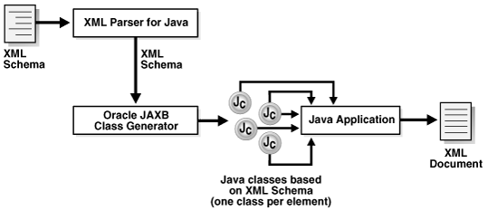

An explanation is given of how to use the Java Architecture for XML Binding (JAXB) class generator.

**Note:**

Use the Java Architecture for XML Binding (JAXB) class generator for new applications to take advantage of the object binding feature for Extensible Markup Language (XML) data. The Oracle9i class generator for Java is deprecated. Oracle Database 10g supports the Oracle9i class generator for backward compatibility.

### 18.1 Introduction to the JAXB Class Generator

Topics introducing the JAXB class generator include prerequisites, standards and specifications, marshalling and unmarshalling, validation, and customization.

#### 18.1.1 Prerequisites for Using the JAXB Class Generator

Prerequisites for using the JAXB class generator are listed.

This chapter assumes that you have some familiarity with these topics:

- [Java Architecture for XML Binding (JAXB)](glossary.md). For a more thorough introduction to JAXB than is possible in this chapter, consult the XML resources listed in [Related Documents](preface.md).

- [XML Schema language](glossary.md). See [Using the XML Schema Processor for Java](using-XML-schema-processor-for-Java.md) for an overview and links to suggested reading.

#### 18.1.2 Standards and Specifications for the JAXB Class Generator

The Oracle JAXB processor implements JSR-31, The Java Architecture for XML Binding (JAXB), Version 1.0, which is a recommendation of the Java Community Process (JCP).

The Oracle XML Developer's Kit (XDK) implementation of the JAXB 1.0 specification does not support these optional features:

- Javadoc generation

- Fail Fast validation

- External customization file

- XML Schema concepts described in section E.2 of the specification

**Related Topics**

- [Oracle XML Developer's Kit Standards](XDK-standards.md)

#### 18.1.3 JAXB Class Generator Features

The JAXB class generator for Java generates the interfaces and the implementation classes corresponding to an XML Schema. Its principal advantage to Java developers is automation of the mapping between XML documents and Java code, which enables programs to use generated code to read, manipulate, and re-create XML data.

The Java classes, which can be extended, give the developer access to the XML data without knowledge of the underlying XML data structure.

The Oracle JAXB class generator provides these advantages for XML application development in Java:

- Speed

  Because the schema-to-code conversion is automated, you can rapidly generate Java code from an input XML schema.

- Ease of use

  You can invoke generated `get` and `set` methods rather than code your own from the start.

- Automated data conversion

  You can automate the conversion of XML document data into Java data types.

- Customization

  JAXB provides a flexible framework that enables you to customize the binding of XML elements and attributes.

#### 18.1.4 Marshalling and Unmarshalling with JAXB

JAXB is an application programming interface (API) and set of tools that maps XML data to Java objects. JAXB simplifies access to an XML document from a Java program by presenting the XML document to the program in a Java format.

You can use the JAXB API and tools to perform these basic tasks:

1.  Generate and compile JAXB classes from an XML schema with the `orajaxb` command-line utility.

    To use the JAXB class generator to generate Java classes you must provide it with an XML schema. Document type definitions (DTDs) are not supported by JAXB. As explained in [Converting DTDs to XML Schemas](using-XML-schema-processor-for-Java.md), however, you can use the `DTD2Schema` program to convert a DTD to an XML schema. Afterwards, you can use the JAXB class generator to generate classes from the schema.

    The JAXB compiler generates Java classes that map to constraints in the source XML schema. The classes implements `get` and `set` methods that you can use to get and specify data for each type of element and attribute in the schema.

2.  Process XML documents by instantiating the generated classes in a Java program.

    Specifically, you can write a program that uses the JAXB binding framework to perform these tasks:

    1.  Unmarshal the XML documents.

        As explained in the JAXB specification, [unmarshalling](glossary.md) is defined as moving data from an XML document to the Java-generated objects.

    2.  Validate the XML documents.

        You can validate before or during the unmarshalling of the contents into the content tree. You can also validate on demand by invoking the validation API on the Java object. See Validation with JAXB.

    3.  Modify Java content objects.

        The content tree of data objects represents the structure and content of the source XML documents. You can use the `set` methods defined for a class to modify the content of elements and attributes.

    4.  Marshal Java content objects back to XML.

        In contrast to unmarshalling, [marshalling](glossary.md) is creating an XML document from Java objects by traversing a content tree of instances of Java classes. You can serialize the data to a Document Object Model (DOM) tree, Simple API for XML (SAX) content handler, transformation result, or output stream.

#### 18.1.5 Validation with JAXB

A Java content tree is considered valid with an XML schema when marshalling the tree generates a valid XML document.

JAXB applications can perform validation in these circumstances:

- Unmarshalling-time validation that notifies the application of errors and warnings during unmarshalling. If unmarshalling includes validation that is error-free, then the input XML document and the Java content tree are valid.

- On-demand validation of a Java content tree initiated by the application.

- Fail-fast validation that gives immediate results while updating the Java content tree with `set` and `get` methods. As specified in Standards and Specifications for the JAXB Class Generator, fail-fast validation is an optional feature in the JAXB 1.0 specification that is not supported in the XDK implementation of the JAXB class generator.

JAXB applications must be able to marshal a valid Java content tree, but they are not required to ensure that the Java content tree is valid before invoking a marshalling API. The marshalling process does not itself validate the content tree. Programs are required to throw a `javax/xml/bind/MarshalException` when marshalling fails due to invalid content.

#### 18.1.6 JAXB Customization

The declared element and type names in an XML schema do not always provide the most useful Java class names. You can override the default JAXB bindings by using custom binding declarations, which are described in the JAXB specification.

These declarations let you customize your generated JAXB classes beyond the XML-specific constraints in an XML schema, to include Java-specific refinements such as class and package name mappings.

You can annotate the schema to perform these customizations:

- Bind XML names to user-defined Java class names

- Name the package, derived classes, and methods

- Choose which elements to bind to which classes

- Decide how to bind each attribute and element declaration to a property in the appropriate content class

- Choose the type of each attribute-value or content specification

Several of the demos programs listed in Table 18-2 show JAXB customizations.

**See Also:**

Customizing a Class Name in a Top-Level Element for a detailed explanation of a customization demo

### 18.2 Using the JAXB Class Generator: Overview

Topics here include the basic process of using the JAXB processor, running the XML schema processor demo programs, and using the JAXB class generator command-line utility.

#### 18.2.1 Using the JAXB Processor: Basic Process

The XDK JAXB API basic process is described.

The XDK JAXB API exposes these packages:

- `javax.xml.bind`, which provides a runtime binding framework for client applications including unmarshalling, marshalling, and validation

- `javax.xml.bind.util`, which provides useful client utility classes

The most important classes and interfaces in the `javax.xml.bind` package are described in Table 18-1. These form the core of most JAXB applications.

Table 18-1 javax.xml.bind Classes and Interfaces

| Class/Interface          | Description                                                                                                                                                                                                                                                         | Methods                                                                                                                                                                                                                                                                                                                                                                                                                                                                                                                                                                                                  |
|:-------------------------|:--------------------------------------------------------------------------------------------------------------------------------------------------------------------------------------------------------------------------------------------------------------------|:---------------------------------------------------------------------------------------------------------------------------------------------------------------------------------------------------------------------------------------------------------------------------------------------------------------------------------------------------------------------------------------------------------------------------------------------------------------------------------------------------------------------------------------------------------------------------------------------------------|
| `JAXBContext` class      | Provides an abstraction for managing the XML/Java binding information necessary to implement the JAXB binding framework operations: unmarshal, marshal, and validate. A client application gets new instances of this class by invoking the `newInstance()` method. | The principal methods are: • `newInstance()` creates a JAXB content class. Supply this method the name of the package containing the generated classes. • `createMarshaller()` creates a marshaller that you can use to convert a content tree to XML. • `createUnmarshaller()` creates an unmarshaller that you can use to convert XML to a content tree. • `createValidator()` creates a `Validator` object that can validate a java content tree against its source schema.                                                                                                               |
| `Marshaller` interface   | Governs the process of serializing Java content trees into XML data.                                                                                                                                                                                                | The principal methods are: • `getEventHandler()` returns the current or default event handler. • `getProperty()` gets the property in the underlying implementation of marshaller. • `marshal()` marshals the content tree into a DOM, SAX2 events, output stream, transformation result, or `Writer`. • `setEventHandler()` creates a `Validator` object that validates a java content tree against its source schema.                                                                                                                                                                      |
| `Unmarshaller` interface | Governs the process of deserializing XML data into newly created Java content trees, optionally validating the XML data as it is unmarshalled.                                                                                                                      | The principal methods are: • `getEventHandler()` returns the current or default event handler. • `getUnmarshallerHandler()` returns an unmarshaller handler object usable as a component in an XML pipeline. • `isValidating()` indicates whether the unmarshaller is set to validate mode. • `setEventHandler()` allows an application to register a `ValidationEventHandler`. • `setValidating()` specifies whether the unmarshaller validates during unmarshal operations. • `marshal()` unmarshals XML data from the specified file, URL, input stream, input source, SAX, or DOM. |
| `Validator` interface    | Controls the validation of content trees during run time. Specifically, this interface controls on-demand validation, which enables clients to receive data about validation errors and warnings detected in the Java content tree.                                 | The principal methods are: • `getEventHandler()` returns the current or default event handler. • `setEventHandler()` allows an application to register a `ValidationEventHandler`. • `validate()` validates Java content trees on-demand at run time. This method can validate any arbitrary subtree of the Java content tree. • `validateRoot()` validates the Java content tree rooted at `rootObj`. You can use this method to validate an entire Java content tree.                                                                                                                      |

Figure 18-1 depicts the process flow of a framework that uses the JAXB class generator.

Figure 18-1 JAXB Class Generator for Java

[Description of "Figure 18-1 JAXB Class Generator for Java"](img_text/adxdk003.md)

The basic stages of the process shown in Figure 18-1 are:

1.  The XML parser parses the XML schema and sends the parsed data to the JAXB class generator.
2.  The class generator creates Java classes and interfaces based on the input XML schema.
    By default, one XML element or type declaration generates one interface and one class. For example, if the schema defines an element named `<anElement>`, then by default the JAXB class generator generates a source file named `AnElement.java` and another named `AnElementImpl.java`. You can use customize binding declarations to override the default binding of XML Schema components to Java representations.
3.  The Java compiler compiles the `.java` source files into class files. All of the generated classes, source files, and application code must be compiled.
4.  Your Java application uses the compiled classes and the binding framework to perform these types of tasks:
    - Create a JAXB context. You use this context to create the marshaller and unmarshaller.

    - Build object trees representing XML data that is valid against the XML schema. You can perform this task by either unmarshalling the data from an XML document that conforms to the schema or instantiating the classes.

    - Access and modify the data.

    - Optionally validate the modifications to the data relative to the constraints expressed in the XML schema.

    - Marshal the data to new XML documents.

**See Also:**

- [Oracle Database XML Java API Reference](../jaxml/index.md) for details of the JAXB API

- Processing XML with the JAXB Class Generator for detailed explanations of JAXB processing

#### 18.2.2 Running the XML Schema Processor Demo Programs

Demo programs for the JAXB class generator for Java are included in `$ORACLE_HOME/xdk/demo/java/jaxb`.

Specifically, XDK includes the JAXB demos listed in Table 18-2.

Table 18-2 JAXB Class Generator Demos

| Program            | Subdirectory within Oracle Home | Demonstrates . . .                                                                                                                                                                                   |
|:-------------------|:--------------------------------|:-----------------------------------------------------------------------------------------------------------------------------------------------------------------------------------------------------|
| `SampleApp1.java`  | `/xdk/demo/java/jaxb/Sample1`   | The binding of top-level element and `complexType` definitions in the `sample1.xsd` schema to Java classes.                                                                                          |
| `SampleApp2.java`  | `/xdk/demo/java/jaxb/Sample2`   | The binding of a top-level element with an inline `simpleType` definition in the `sample2.xsd` schema.                                                                                               |
| `SampleApp3.java`  | `/xdk/demo/java/jaxb/Sample3`   | The binding of a top-level `complexType` element that is derived by extension from another top-level `complexType` definition. See Binding Complex Types for a detailed explanation of this program. |
| `SampleApp4.java`  | `/xdk/demo/java/jaxb/Sample4`   | The binding of a content model within a `complexType` that refers to a top-level named group.                                                                                                        |
| `SampleApp5.java`  | `/xdk/demo/java/jaxb/Sample5`   | The binding of `<choice>` with `maxOccurs` unbounded within a `complexType`.                                                                                                                         |
| `SampleApp6.java`  | `/xdk/demo/java/jaxb/Sample6`   | The binding of atomic data types.                                                                                                                                                                    |
| `SampleApp7.java`  | `/xdk/demo/java/jaxb/Sample7`   | The binding a `complexType` definition in which `mixed="true"`.                                                                                                                                      |
| `SampleApp8.java`  | `/xdk/demo/java/jaxb/Sample8`   | The binding of elements and types declared in two different namespaces.                                                                                                                              |
| `SampleApp9.java`  | `/xdk/demo/java/jaxb/Sample9`   | The customization of a Java package name.                                                                                                                                                            |
| `SampleApp10.java` | `/xdk/demo/java/jaxb/Sample10`  | The customization of class name in a top-level element. See Customizing a Class Name in a Top-Level Element for a detailed explanation of this program.                                              |
| `SampleApp11.java` | `/xdk/demo/java/jaxb/Sample11`  | The customization of class name of a local element occurring in a repeating model group declared inside a `complexType` element.                                                                     |
| `SampleApp12.java` | `/xdk/demo/java/jaxb/Sample12`  | The customization of the attribute name.                                                                                                                                                             |
| `SampleApp13.java` | `/xdk/demo/java/jaxb/Sample13`  | The `javaType` customization specified on a global `simpleType`. The `javaType` customization specifies the parse and print method declared on a user-defined class.                                 |
| `SampleApp14.java` | `/xdk/demo/java/jaxb/Sample14`  | The customization of the typesafe enum class name.                                                                                                                                                   |

You can find documentation that describes how to compile and run the sample programs in the `README` in the same directory. The basic steps are:

1.  Change into the `$ORACLE_HOME/xdk/demo/java/jaxb` directory (UNIX) or `%ORACLE_HOME%\xdk\demo\java\jaxb` directory (Windows).

2.  Make sure that your environment variables are set as described in [Setting Up the XDK for Java Environment](getting-started-with-XDK-for-Java.md).

3.  Run `make` (UNIX) or `Make.bat` (Windows) at the system prompt. The `make` utility performs these sequential actions for each sample subdirectory:

    1.  Runs the `orajaxb` utility to generate Java class files based on an input XML schema. For most of the demos, the output classfiles are written to the `generated` subdirectory. For example, the `make` file performs these commands for the `sample1.xsd` schema in the `Sample1` subdirectory:

            cd ./Sample1; $(JAVA_HOME)/bin/java -classpath "$(MAKE_CLASSPATH)" \
            oracle.xml.jaxb.orajaxb -schema sample1.xsd -targetPkg generated; echo;

    2.  Runs the `javac` utility to compile the Java classes. For example, the `make` utility performs these commands for the Java class files in the `Sample1/generated/` subdirectory:

            cd ./Sample1/generated; $(JAVA_HOME)/bin/javac -classpath \
            "$(MAKE_CLASSPATH)" *.java

    3.  Runs the `javac` utility to compile a sample Java application that uses the classes compiled in the preceding step. For example, the `make` utility compiles the `SampleApp1.java` program:

            cd ./Sample1; $(JAVA_HOME)/bin/javac -classpath "$(MAKE_CLASSPATH)" \
            SampleApp1.java

    4.  Runs the sample Java application and writes the results to a log file. For example, the `make` utility executes the `SampleApp1` class and writes the output to `sample1.out`:

            cd ./Sample1; $(JAVA_HOME)/bin/java -classpath "$(MAKE_CLASSPATH)" \SampleApp1 > sample1.out

#### 18.2.3 Using the JAXB Class Generator Command-Line Utility

XDK includes `orajaxb`, which is a command-line Java interface that generates Java classes from input XML schemas. Shell scripts `$ORACLE_HOME/bin/orajaxb` and `%ORACLE_HOME%\bin\orajaxb.bat` execute class `oracle.xml.jaxb.orajaxb`.

To use `orajaxb` ensure that your `CLASSPATH` is set as described in [Setting Up the XDK for Java Environment](getting-started-with-XDK-for-Java.md).

Table 18-3 lists the `orajaxb` command-line options.

Table 18-3 orajaxb Command-Line Options

| Option                    | Purpose                                                                                                                                                                                                                                                                          |
|:--------------------------|:---------------------------------------------------------------------------------------------------------------------------------------------------------------------------------------------------------------------------------------------------------------------------------|
| \-`help`                  | Prints the help message.                                                                                                                                                                                                                                                         |
| \-`version`               | Prints the release version.                                                                                                                                                                                                                                                      |
| \-`outputdir` `OutputDir` | Specifies the directory in which to generate the Java source files. If the schema has a namespace, then the program generates the java code in the package (corresponding to the namespace) referenced from the outputDir. By default, the current directory is the `outputDir`. |
| \-`schema` `SchemaFile`   | Specifies the input XML schema.                                                                                                                                                                                                                                                  |
| \-`targetPkg` `targetPkg` | Specifies the target package name. This option overrides any binding customization for package name, and also the default package name algorithm defined in the JAXB specification.                                                                                              |
| \-`interface`             | Generates only the interfaces.                                                                                                                                                                                                                                                   |
| \-`verbose`               | Lists the generated classes and interfaces.                                                                                                                                                                                                                                      |
| \-`defaultCus` `fileName` | Generates the default customization file.                                                                                                                                                                                                                                        |
| \-`extension`             | Allows vendor specific extensions and does not strictly follow the compatibility rules specified in Appendix E.2 of the JAXB 1.0 specification. When specified, the program ignores JAXB 1.0 unsupported features such as notations, substitution groups, and any attributes.    |

##### 18.2.3.1 Using the JAXB Class Generator Command-Line Utility: Example

An example shows how to use the JAXB class generator command-line utility.

To test `orjaxb`, change to directory `$ORACLE_HOME/xdk/demo/java/jaxb/Sample1`. If you have run `make` then the directory contains these files:

    SampleApp1.class
    SampleApp1.java
    generated/
    sample1.out
    sample1.xml
    sample1.xsd

File `sample.xsd` is the XML schema associated with XML document `sample1.xml`. Subdirectory `generated/` contains the classes generated from the input schema. You can test `orajaxb` by deleting the contents of `generated/` and regenerating the classes.

    rm generated/*
    orajaxb -schema sample1.xsd -targetPkg generated -verbose

The terminal displays this output:

    generated/CType.java
    generated/AComplexType.java
    generated/AnElement.java
    generated/RElemOfCTypeInSameNs.java
    generated/RType.java
    generated/RElemOfSTypeInSameNs.java

    generated/CTypeImpl.java
    generated/AComplexTypeImpl.java
    generated/AnElementImpl.java
    generated/RElemOfCTypeInSameNsImpl.java
    generated/RTypeImpl.java
    generated/RElemOfSTypeInSameNsImpl.java
    generated/ObjectFactory.java

#### 18.2.4 JAXB Features Not Supported in XDK

Features not supported by the XDK implementation of the JAXB specification are described.

The XDK implementation of the JAXB specification does not support these features:

- Javadoc generation

- XML Schema component "any" and substitution groups

### 18.3 Processing XML with the JAXB Class Generator

Topics include binding complex types and customizing a class name in a top-level element.

#### 18.3.1 Binding Complex Types

`Sample3.java` shows how to bind a complex type definition to a Java content interface. One complex type defined in the XML schema is derived by extension from another complex type.

##### 18.3.1.1 Defining the Schema to Validate sample3.xml

An XML schema, `schema3.xsd`, is defined for validating XML document `schema3.xml`.

Example 18-1 shows the XML data document that provides the input to the sample application. The `sample3.xml` document describes the address of an employee.

The XML schema shown in Example 18-2 defines the structure that you use to validate `sample3.xml`. The schema defines two complex types and one element, which are defined:

- The first complex type, which is named `Address`, is a sequence of elements. Each element in the sequence describes one part of the address: name, door number, and so forth.

- The second complex type, which is named `USAddress`, uses the `<extension base="exp:Address">` element to extend `Address` by adding US-specific elements to the `Address` sequence: state, zip, and so forth. The `exp` prefix specifies the `http://www.oracle.com/sample3/` namespace.

- The element is named `myAddress` and is of type `exp:USAddress`. The `exp` prefix specifies the `http://www.oracle.com/sample3/` namespace. In `sample3.xml`, the `myAddress` top-level element, which is in namespace `http://www.oracle.com/sample3/`, conforms to the schema definition.

Example 18-1 sample3.xml

    <?xml version="1.0"?>
    <myAddress xmlns = "http://www.oracle.com/sample3/"
               xmlns:xsi = "http://www.w3.org/2001/XMLSchema-instance"
               xsi:schemaLocation = "http://www.oracle.com/sample3 sample3.xsd">
        <name>James Bond</name>
        <doorNumber>420</doorNumber>
        <street>Oracle parkway</street>
        <city>Redwood shores</city>
        <state>CA</state>
        <zip>94065</zip>
        <country>United States</country>
    </myAddress>

Example 18-2 sample3.xsd

    <?xml version="1.0"?>

    <!-- Binding a complex type definition to java content interface
     The complex type definition is derived by extension
    -->

    <schema xmlns = "http://www.w3.org/2001/XMLSchema"
            xmlns:exp="http://www.oracle.com/sample3/"
            targetNamespace="http://www.oracle.com/sample3/"
            elementFormDefault="qualified">

       <complexType name="Address">
          <sequence>
             <element name="name" type="string"/>
             <element name="doorNumber" type="short"/>
             <element name="street" type="string"/>
             <element name="city" type="string"/>
          </sequence>
       </complexType>

      <complexType name="USAddress">
        <complexContent>
         <extension base="exp:Address">
           <sequence>
              <element name="state" type="string"/>
              <element name="zip" type="integer"/>
              <element name="country" type="string"/>
           </sequence>
         </extension>
        </complexContent>
      </complexType>

      <element name="myAddress" type="exp:USAddress"/>

    </schema>

##### 18.3.1.2 Generating and Compiling the Java Classes

If you have an XML document and corresponding XML schema, then the next stage of processing is to generate the Java classes from the XML schema.

You can use the JAXB command-line interface described in Using the JAXB Class Generator Command-Line Utility to perform this task.

Assuming that your environment is set up as described in [Setting Up the XDK for Java Environment](getting-started-with-XDK-for-Java.md), you can create the source files in the `generated` package:

    cd $ORACLE_HOME/xdk/demo/java/jaxb/Sample3
    orajaxb -schema sample1.xsd -targetPkg generated

The preceding `orajaxb` command creates these source files in the `./generated/` subdirectory:

    Address.java
    AddressImpl.java
    MyAddress.java
    MyAddressImpl.java
    ObjectFactory.java
    USAddress.java
    USAddressImpl.java

The complex types `Address` and `USAddress` each has two associated source files, as does the element `MyAddress`. The source file named after the element contains the interface; the file with the suffix `Impl` contains the class that implements the interface. For example, `Address.java` contains the interface `Address`, whereas `AddressImpl.java` contains the class that implements `Address`.

The content of the `Address.java` source file is shown in Example 18-3.

The `Address` complex type defined a sequence of elements: `name`, `doorNumber`, `street`, and `city`. Consequently, the `Address` interface includes a `get` and `set` method signature for each of the four elements. For example, the interface includes `getName()` for retrieving data in the `<name>` element and `setName()` for modifying data in this element.

You can compile the Java source files with `javac`:

    cd $ORACLE_HOME/xdk/demo/java/jaxb/Sample3/generated
    javac *.java

Example 18-3 Address.java

    package generated;
    public interface Address
    {
       public void setName(java.lang.String n);
       public java.lang.String getName();
       public void setDoorNumber(short d);
       public short getDoorNumber();
       public void setStreet(java.lang.String s);
       public java.lang.String getStreet();
       public void setCity(java.lang.String c);
       public java.lang.String getCity();
    }

##### 18.3.1.3 Processing the XML Data in sample3.xml

`Sample3.java` unmarshals an XML data document, marshals it, and uses the generated classes to print and modify the address data.

It shows how you can process the `sample3.xml` document by using the Java class files that you generated in Generating and Compiling the Java Classes.

The `Sample3.java` program processes the data as follows:

1.  Create strings for the XML data document file name and the name of the directory that contains the generated classes. This name is the package name. For example:
        String fileName = "sample3.xml";
        String instancePath = "generated";
2.  Instantiate a JAXB context by invoking `JAXBContext.newInstance()`. A client application gets a new instance of this class by initializing it with a context path. The path contains a list of Java package names that contain the interfaces available to the marshaller. Thisthese statement shows this technique:
        JAXBContext jc = JAXBContext.newInstance(instancePath);
3.  Instantiate the unmarshaller. The `Unmarshaller` class governs the process of deserializing XML data into newly created objects, optionally validating the XML data as it is unmarshalled. Thisthese statement shows this technique:
        Unmarshaller u = jc.createUnmarshaller();
4.  Unmarshal the XML document. Invoke the `Unmarshaller.unmarshal()` method to deserialize the `sample3.xml` document and return the content trees as an `Object`. You can create a URL from the XML file name by invoking the `fileToUrl()` helper method. This statement shows the technique:
        Object obj = u.unmarshal(fileToURL(fileName));
5.  Instantiate a marshaller. The `Marshaller` class governs the process of serializing Java content trees back into XML data. Thisthese statement shows this technique:
        Marshaller m = jc.createMarshaller();
6.  Marshal the content tree. Invoke the `Marshaller.marshal()` method to marshal the content tree `Object` returned by the unmarshaller. You can serialize the data to a DOM tree, SAX content handler, transformation result, or output stream. This statement serializes the XML data, including markup, as an output stream:
        m.marshal(obj, System.out);

    By default, the marshaller uses 8-bit encoding of Unicode (UTF-8) encoding when writing XML data to an output stream.
7.  Print the contents of the XML document. The program implements a `process()` method that accepts the content tree and marshaller as parameters.
    The first stage of processing prints the data in the XML document without the XML markup. The method casts the `Object` generated by the marshaller into type `MyAddress`. It proceeds to invoke a series of methods whose method names are constructed by prefixing `get` to the name of an XML element. For example, to get the data in the `<city>` element in Example 18-1, the program invokes `getCity()`. This code fragment shows this technique:

        public static void process(Object obj, Marshaller m) throws Throwable
        {
           generated.MyAddress elem = (generated.MyAddress)obj;
           System.out.println();
           System.out.println(" My address is: ");
           System.out.println("  name:  "  + elem.getName() + "\n"  +
                              "  doorNumber " + elem.getDoorNumber() + "\n" +
                              "  street: " + elem.getStreet() + "\n" +
                              "  city:   " + elem.getCity() + "\n"  +
                              "  state:  " + elem.getState() + "\n" +
                              "  zip:  " + elem.getZip() + "\n" +
                              "  country:  " + elem.getCountry() + "\n" +
                              "\n" );
        ...
8.  Change the XML data and print it. The `process()` method continues by invoking set methods that are analogous to the preceding get methods. The name of each set method is constructed by prefixing `set` to the name of an XML element. For example, `setCountry()` changes the value in the `<country>` element. These statements show this technique:
        short num = 550;
        elem.setDoorNumber(num);
        elem.setCountry("India");
        num = 10100;
        elem.setZip(new java.math.BigInteger("100100"));
        elem.setCity("Noida");
        elem.setState("Delhi");

    After changing the data, the program prints the data by invoking the same get methods as in the previous step.

#### 18.3.2 Customizing a Class Name in a Top-Level Element

The `Sample10.java` program shows one form of JAXB customization. The program shows you can change the name of a class that corresponds to an element in the input XML schema.

##### 18.3.2.1 Defining the Schema to Validate schema10.xml

An XML schema, `schema10.xsd`, is defined for validating XML document `schema10.xml`.

Example 18-4 shows the XML data document that provides the input to the sample application. The `sample10.xml` document describes a business.

Example 18-5 shows the XML schema that defines the structure of `sample10.xml`. The schema defines one complex type and one element as follows:

- The complex type, which is named `businessType`, is a sequence of elements. Each element in the sequence describes a part of the business: title, owner, and id.

- The element, which is named `business`, is of type `biz:businessType`. The `biz` prefix specifies the `http://jaxbcustomized/sample10/` namespace. In `sample10.xml`, the `business` top-level element, which is in namespace `http://jaxbcustomized/sample10/`, conforms to the schema definition.

Example 18-4 sample10.xml

    <?xml version="1.0"?>
    <business xmlns="http://jaxbcustomized/sample10/">
       <title>Software Development</title>
       <owner>Larry Peterson</owner>
       <id>45123</id>
    </business>

Example 18-5 sample10.xsd

    <?xml version="1.0"?>

    <!-- Customization of class name in top level element -->

    <schema xmlns="http://www.w3.org/2001/XMLSchema"
            targetNamespace="http://jaxbcustomized/sample10/"
            xmlns:biz="http://jaxbcustomized/sample10/"
            xmlns:jaxb="http://java.sun.com/xml/ns/jaxb"
            jaxb:version="1.0"
            elementFormDefault="qualified">

       <element name="business" type="biz:businessType">
          <annotation>
             <appinfo>
                <jaxb:class name="myBusiness"/>
             </appinfo>
          </annotation>
       </element>

       <complexType name="businessType">
          <sequence>
             <element name="title" type="string"/>
             <element name="owner" type="string"/>
             <element name="id" type="integer"/>
          </sequence>
       </complexType>

    </schema>

###### 18.3.2.1.1 Customizing the Schema Binding

Binding customizations used in XML schema `sample10.xsd` are described.

The schema shown in Example 18-5 customizes the binding of the `business` element with an inline binding declaration. The general form for inline customizations is:

    <xs:annotation>
       <xs:appinfo>
          .
          .
          binding declarations
          .
          .
       </xs:appinfo>
    </xs:annotation>

Example 18-5 uses the `<class>` binding declaration to bind a schema element to a Java class name. You can use the declaration to customize the name for an interface or the class that implements an interface. The JAXB class generator supports this syntax for `<class>` customizations:

    <class [ name = "className"] >

The `name` attribute specifies the name of the derived Java interface. Example 18-5 contains this customization:

    <jaxb:class name="myBusiness"/>

Thus, the schema binds the `business` element to the interface `myBusiness` rather than to the interface `business`, which is the default.

##### 18.3.2.2 Generating and Compiling the Java Classes

After you have an XML document and corresponding XML schema, the next stage is to generate the Java classes from the XML schema. You can use the JAXB command-line interface to perform this task.

If your environment is set up as described in [Setting Up the XDK for Java Environment](getting-started-with-XDK-for-Java.md), then you can create the source files in the `generated` package:

    cd $ORACLE_HOME/xdk/demo/java/jaxb/Sample10
    orajaxb -schema sample10.xsd

Because the preceding command does not specify a target package, the package name is constructed from the target namespace of the schema, which is `http://jaxbcustomized/sample10/` . Consequently, the utility generates these source files in the `./jaxbcustomized/sample10/` subdirectory:

    BusinessType.java
    BusinessTypeImpl.java
    MyBusiness.java
    MyBusinessImpl.java
    ObjectFactory.java

The complex type `businessType` has two source files, `BusinessType.java` and `BusinessTypeImpl.java`. Because of the JAXB customization, the `business` element is bound to interface `MyBusiness` and implementing class `MyBusinessImpl`.

The content of the `BusinessType.java` source file is shown in Example 18-6.

The `BusinessType` complex type defined a sequence of elements: `title`, `owner`, and `id`. Consequently, the `Address` interface includes a `get` and `set` method signature for each of the elements. For example, the interface includes `getTitle()` for retrieving data in the `<title>` element and `setTitle()` for modifying data in this element.

You can compile the Java source files with `javac`:

    cd $ORACLE_HOME/xdk/demo/java/jaxb/Sample10/jaxbcustomized/sample10
    javac *.java

Example 18-6 BusinessType.java

    package jaxbcustomized.sample10;

    public interface BusinessType
    {
       public void setTitle(java.lang.String t);
       public java.lang.String getTitle();
       public void setOwner(java.lang.String o);
       public java.lang.String getOwner();
       public void setId(java.math.BigInteger i);
       public java.math.BigInteger getId();
    }

##### 18.3.2.3 Processing the XML Data in sample10.xml

`Sample10.java` unmarshals an XML document, prints its content, and marshals the XML to standard output.

`Sample10.java` shows how you can process the data in the `sample10.xml` document by using the class files that you generated in Generating and Compiling the Java Classes.

The `Sample10.java` program processes the XML data as follows:

1.  Create strings for the XML data document file name and the name of the directory that contains the generated classes. This name is the package name. For example:
        String fileName = "sample10.xml";
        String instancePath = "jaxbcustomized.sample10";
2.  Instantiate a JAXB context by invoking the `JAXBContext.newInstance()` method. This statement shows this technique:
        JAXBContext jc = JAXBContext.newInstance(instancePath);
3.  Create the unmarshaller. This statement shows this technique:
        Unmarshaller u = jc.createUnmarshaller();
4.  Unmarshal the XML document. The program unmarshals the document twice: it first returns an `Object` and then uses a cast to return a `MyBusiness` object. This statement shows this technique:
        Object obj = u.unmarshal(fileToURL(fileName));
        jaxbcustomized.sample10.MyBusiness bus =
                 (jaxbcustomized.sample10.MyBusiness) u.unmarshal(fileToURL(fileName));
5.  Print the contents of the XML document. The program invokes the `get` methods on the `MyBusiness` object. This code fragment shows this technique:
        System.out.println("My business details are: ");
        System.out.println("    title: " + bus.getTitle());
        System.out.println("    owner: " + bus.getOwner());
        System.out.println("    id:    " + bus.getId().toString());
        System.out.println();
6.  Create a marshaller. This statement shows this technique:
        Marshaller m = jc.createMarshaller();
7.  Configure the marshaller. You can invoke `setProperty()` to configure various properties the marshaller. The `JAXB_FORMATTED_OUTPUT` constant specifies that the marshaller must format the resulting XML data with line breaks and indentation. This statements show this technique:
        m.setProperty(Marshaller.JAXB_FORMATTED_OUTPUT, new Boolean(true));
8.  Marshal the content tree. This statement serializes the XML data, including markup, as an output stream:
        m.marshal(bus, System.out);

    By default, the marshaller uses UTF-8 encoding when writing XML data to an output stream.
