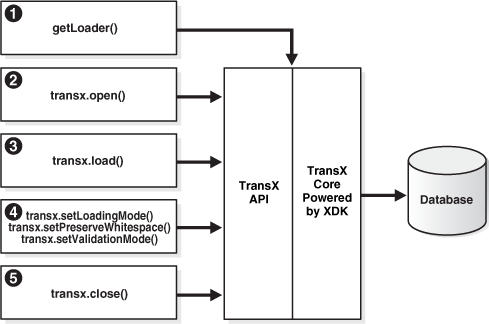

An explanation is given of how to use the TransX utility to transfer XML data to a database.

**Related Topics**

- [Data Loading Format (DLF) Specification](data-loading-format-specification.md)

### 22.1 Introduction to the TransX Utility

The TransX utility is described.

[TransX Utility](glossary.md) lets you transfer XML data to a database. TransX is an application of [XML SQL Utility (XSU)](glossary.md) that loads translated seed data and messages into a database schema.

TransX is particularly useful when handling multilingual Extensible Markup Language (XML). You can use TransX to add data to a database in multiple languages. The utility does this:

- Automatically manages the change variables, start sequences, and additional structured query language (SQL) statements that would otherwise require multiple inserts or sessions. Thus, translation vendors do not have to work with unfamiliar SQL and Procedural Language/Structured Query Language (PL/SQL) scripts.

- Automates character encoding. Consequently, loading errors due to incorrect encoding are impossible if the data file conforms with the XML standard.

- Reduces globalization costs by preparing strings to be translated, translating the strings, and loading them into the database.

- Minimizes translation data format errors and accurately loads the translation contents into predetermined locations in the database. When the data is in a predefined format, the TransX utility validates it.

- Eliminates syntax errors due to varying Globalization Support settings.

- Does not require the `UNISTR` construct for every piece of `NCHAR` data.

**Note:**

TransX runs as the authenticated user. Care must be taken to review data files and to load data files only from a trusted source.

#### 22.1.1 Prerequisites for Using the TransX Utility

Prerequisites for using the TransX utility are described.

This chapter assumes that you are familiar with [XML SQL Utility (XSU)](glossary.md) because TransX is an application of XSU.

**Related Topics**

- [Using the XML SQL Utility](using-XML-SQL-utility.md)

#### 22.1.2 TransX Utility Features

Topics here include simplified multilingual data loading, simplified data format support, and other TransX Utility features.

##### 22.1.2.1 Simplified Multilingual Data Loading

The traditional translation data loading method is to change environment variable `NLS_LANG` when switching load files. This sets the language and territory used by client applications and the database server. It also sets the client character set, which is used for data entered or displayed by a client program.

When inserting multilingual data or data translations into a database, or when encoding, each XML file requires validation.

In the traditional method, each load file is encoded in a character set suitable for its language, which is necessary because translations must be performed in the same file format—typically in a SQL script—as the original. The `NLS_LANG` setting changes as files are loaded to adapt to the character set that corresponds to the language. As well as consuming time, this approach is error-prone because the encoding metadata is separate from the data itself.

With the TransX utility you use an XML document with a predefined format called a data set. The data set contains the encoding information and the data so that you can transfer multilingual data without changing `NLS_LANG` settings. The TransX utility frees development and translation groups by maintaining the correct character set while loading XML data into the database.

**See Also:**

[Oracle Database Globalization Support Guide](../nlspg/setting-up-globalization-support-environment.md) to learn about the `NLS_LANG` environment variable

##### 22.1.2.2 Simplified Data Format Support and Interface

The TransX Utility provides a command-line interface and a programmable application programming interface (API). The utility complies with a data format that is the canonical method for the representation of seed data loaded into the database. The format is easy to understand and simplified for use by translation groups.

The format specification defines how translators can describe the data so that it is loaded in an expected way. You can represent the values in the data set with scalar values or expressions such as constants, sequences, and queries.

##### 22.1.2.3 Additional TransX Utility Features

Other useful TransX Utility features are described.

Table 22-1 TransX Utility Features

| Feature                                   | TransX Utility . . .                                                                                                       |
|:------------------------------------------|:---------------------------------------------------------------------------------------------------------------------------|
| Command-line interface                    | Provides easy-to-use commands.                                                                                             |
| User API                                  | Exposes a Java API.                                                                                                        |
| Validation                                | Validates the data format and reports errors.                                                                              |
| White space handling                      | Does not consider white space characters in the data set as significant unless otherwise specified in various granularity. |
| Unloading                                 | Exports the result into the standard data format based on an input query.                                                  |
| Intimacy with translation exchange format | Enables transformation to and from translation exchange format.                                                            |
| Localized user interface                  | Provides messages in many languages.                                                                                       |

### 22.2 Using the TransX Utility: Overview

Topics here describe how to use the TransX utility.

#### 22.2.1 Using the TransX Utility: Basic Process

The TransX API basic process is described.

TransX is accessible through this API:

- `oracle.xml.transx.loader` class, which contains the `getLoader()` method to get a TransX instance

- `oracle.xml.transx.TransX` interface, which is the TransX API

Figure 22-1 shows the basic process for using the TransX API to transfer XML to a database.

Figure 22-1 Basic Process of a TransX Application

[Description of "Figure 22-1 Basic Process of a TransX Application"](img_text/adxdk118.md)

The basic process of a TransX application is:

1.  Create a TransX loader object. Instantiate the `TransX` class by invoking` getLoader()`:
        TransX  transx = loader.getLoader();
2.  Start a data loading session by supplying database connection information using `TransX.open()`. You create a session by supplying the Java Database Connectivity (JDBC) connect string, database user name, and database password. You can create the connection in one of these ways:
    - Using the JDBC Oracle Call Interface (OCI) driver. The following code fragment shows this technique and connects with the supplied user name and password:

          transx.open( "jdbc:oracle:oci8:@", user, passwd );

    <!-- -->

    - Using the JDBC thin driver. The thin driver is written in pure Java and can be called from any Java program. The following code fragment shows this technique and connects:

          transx.open( "jdbc:oracle:thin:@//myhost:1521/myservicename", user,passwd);

      The thin driver requires the host name (`myhost`), port number (`1521`), and the service name (`myservicename`). The database must have an active Transmission Control Protocol/Internet Protocol (TCP/IP) listener.

    **Note:**

    If you are validating only your data format, you do not have to establish a database connection because the validation is performed by TransX. Thus, you can invoke the `TransX.validate()` method without a preceding `open()` invocation.
3.  Configure the TransX loader. Table 22-2 describes configuration methods.
    Table 22-2 TransX Configuration Methods

    | Method                    | Description                                                                                                                                                                                                                                                                                                                                                                                                  |
    |:--------------------------|:-------------------------------------------------------------------------------------------------------------------------------------------------------------------------------------------------------------------------------------------------------------------------------------------------------------------------------------------------------------------------------------------------------------|
    | `setLoadingMode()`        | Sets the operation mode on duplicates. The mode determines TransX behavior when there are one or more existing rows in the database whose values in the key columns are the same as those in the data set to be loaded. You can specify the constants `EXCEPTION_ON_DUPLICATES`, `SKIP_DUPLICATES`, or `UPDATE_DUPLICATES` in class `oracle.xml.transx.LoadingMode`. By default the loader skips duplicates. |
    | `setNormalizeLangTag()`   | Sets the case of language tag. By default the loader uses the style specified in the `normalize-langtag` attribute on Data Loading Format (DLF).                                                                                                                                                                                                                                                             |
    | `setPreserveWhitespace()` | Specifies how the loader handles white space. The default is `FALSE`, which means that the loader ignores the type of white space characters in the data set and loads them as space characters. The loader treats consecutive white space characters in the data set as one space character.                                                                                                                |
    | `setValidationMode()`     | Sets the validation mode. The default is `TRUE`, which means that the loader performs validation of the data set format against the canonical schema definition on each `load()` invocation. The validation mode is disabled only if the data set has already been validated.                                                                                                                                |

    The following example specifies that the loader must skip duplicate rows and not validate the data set:

        transx.setLoadingMode( LoadingMode.SKIP_DUPLICATES );
        transx.setValidationMode( false );
4.  Load the data sets by invoking `TransX.load()`. The same JDBC connection is used during the iteration of the load operations. For example, load three data sets:
        String  datasrc[] = {"data1.xml", "data2.xml", "data3.xml"};
        ...
        for ( int i = 0 ; i < datasrc.length ; i++ )
        {
          transx.load( datasrc[i] );
        }
5.  Close the loading session by invoking `TransX.close()`. This method invocation closes the database connection:
        transx.close();

    **See Also:**

    - [Oracle Database Java Developer’s Guide](../jjdev/Java-introduction.md) to learn about Oracle JDBC

    - [Oracle Database XML Java API Reference](../jaxml/index.md) to learn about `TransX` classes and methods

#### 22.2.2 Running the TransX Utility Demo Programs

Demo programs for the TransX utility are included in `$ORACLE_HOME/xdk/demo/java/transx`.

Table 22-3 describes the XML files and programs that you can use to test the utility.

Table 22-3 TransX Utility Sample Files

| File           | Description                                                                                                                                                                                                                                                         |
|:---------------|:--------------------------------------------------------------------------------------------------------------------------------------------------------------------------------------------------------------------------------------------------------------------|
| `README`       | A text file that describes how to set up the TransX demos.                                                                                                                                                                                                          |
| `emp-dlf.xml`  | A sample output file. The following command generates a file `emp.xml` that contains all data in the table emp: `transx -s "jdbc:oracle:thin:@//myhost:1521/myservicename" user` ` -pw emp.xml emp` The `emp-dlf.xml` file must be identical to `emp.xml`. |
| `txclean.sql`  | A SQL file that drops the tables and sequences created for the demo.                                                                                                                                                                                                |
| `txdemo1.java` | A sample Java application that creates a JDBC connection and loads three data sets into the database.                                                                                                                                                               |
| `txdemo1.sql`  | A SQL script that creates two tables and a sequence for use by the demo application.                                                                                                                                                                                |
| `txdemo1.xml`  | A sample data set.                                                                                                                                                                                                                                                  |

Documentation for how to compile and run the sample programs is located in the `README`. The basic steps are:

1.  Change into the `$ORACLE_HOME/xdk/demo/java/transx` directory (UNIX) or `%ORACLE_HOME%\xdk\demo\java\transx` directory (Windows).
2.  Make sure that your environment variables are set as described in [Setting Up the XDK for Java Environment](getting-started-with-XDK-for-Java.md). Oracle recommends that you set the `$ORACLE_SID` (UNIX) or `%ORACLE_SID%` (Windows) environment variables to the default database.
    **Note:**

    For security, do not expose passwords in command-line interfaces. If "`-pw`" is specified instead of the password in `TransX`, the user is prompted for the password \[ `Enter password :` \]. When the user types the password, it is not echoed; instead, "`*`"s is printed in the command window.
3.  Set up the sample database objects by executing `txdemo1.sql`. Connect to the database and run the `txdemo1.sql` script:
        @txdemo1
4.  Run the TransX utility from the command line. This example shows how to connect with the Java thin driver, where your host is `myhost`, your port is `1521`, and your service name is `myservicename`. Enter the user name where the token `user` appears. You can execute this command to load data set `txdemo1.xml`:
        transx "jdbc:oracle:thin:@//myhost:1521/myservicename" user -pw txdemo1.xml

    When the operation is successful, nothing is printed out on your terminal.
5.  Query the database to determine whether the load was successful. For example:
        SELECT * FROM i18n_messages;
6.  Drop the demo objects to prepare for another test. Connect to the database and run the `txclean.sql` script:
        @txclean
7.  Compile the Java demo program. For example:
        javac txdemo1.java
8.  Run the Java program, using the same JDBC and database connection data that you used when invoking the command-line interface. For example:
        java txdemo1 "jdbc:oracle:thin:@//myhost:1521/myservicename" user -pw\
                      txdemo1.xml

    Perform the same query test (Step 5) and cleanup operation (Step 6) as before.
9.  Run the TransX Utility to unload data into the predefined XML format. For example:
        transx -s "jdbc:oracle:thin:@//myhost:1521/myservicename" user -pw emp.xml emp

    Compare the data in `emp.xml` with `emp-dlf.xml`.

    **Note:**

    For simplicity in demonstrating this feature, this example does not perform the password management techniques that a deployed system normally uses. In a production environment, follow the Oracle Database password management guidelines, and disable any sample accounts. See [Oracle Database Security Guide](../dbseg/managing-security-for-application-developers.md) for password management guidelines and other security recommendations.

#### 22.2.3 Using the TransX Command-Line Utility

TransX utility is packaged with Oracle Database. By default, the Oracle Universal Installer installs the utility on disk.

As explained in [XDK for Java Component Dependencies](getting-started-with-XDK-for-Java.md), the TransX library is `$ORACLE_HOME/lib/xml.jar` (UNIX) and `%ORACLE_HOME%\lib\xml.jar` (Windows).

You can run the TransX utility from the operating system command line with this syntax:

    java oracle.xml.transx.loader

Oracle XML Developer's Kit (XDK) includes a script version of TransX named `$ORACLE_HOME/bin/transx` (UNIX) and `%ORACLE_HOME%\bin\transx.bat` (Windows). Assuming that your `PATH` variable is set correctly, you can run TransX:

    transx options parameters
    transx.bat options parameters

For example, this command shows valid syntax:

    transx -s "jdbc:oracle:thin:@//myhost:1521/myservicename" user -pw emp.xml emp

##### 22.2.3.1 TransX Utility Command-Line Options

The command-line options for the TransX Utility are described.

Table 22-4 TransX Utility Command-Line Options

| Option | Meaning                                                                 | Description                                                                                                                                                                                                                                                                                      |
|:-------|:------------------------------------------------------------------------|:-------------------------------------------------------------------------------------------------------------------------------------------------------------------------------------------------------------------------------------------------------------------------------------------------|
| `-u `  | Update existing rows.                                                   | Does not skip existing rows but updates them. To exclude a column from the update operation, set the `useforupdate` attribute to `no`.                                                                                                                                                           |
| `-e `  | Raise exception if a given row already exists in the database.          | Raises an exception if a duplicate row is found. By default, TransX skips duplicate rows. Rows are considered duplicate if the values for lookup-key column(s) in the database and the data set are the same.                                                                                    |
| `-x `  | Print database data in the predefined format.                           | Similar to the `-s` option, it causes the utility to perform the opposite operation of loading. Unlike the `-s` option, it prints to `stdout`. Redirecting this output to a file is discouraged because intervention of the operating system may cause data loss due to unexpected transcoding.  |
| `-s`   | Save database data to a file in the predefined format.                  | Performs unloading. TransX Utility queries the database, formats the result into the predefined XML format, and stores it under the specified file name.                                                                                                                                         |
| `-p`   | Print the XML to load.                                                  | Prints out the data set for insert in the canonical format of XSU.                                                                                                                                                                                                                               |
| `-t`   | Print the XML for update.                                               | Prints out the data set for update in the canonical format of XSU.                                                                                                                                                                                                                               |
| `-o`   | Omit validation (as the data set is parsed it is validated by default). | Causes TransX Utility to skip the format validation, which is performed by default.                                                                                                                                                                                                              |
| `-v`   | Validate the data format and exit without loading.                      | Causes TransX Utility to perform validation and exit.                                                                                                                                                                                                                                            |
| `-w`   | Preserve white space.                                                   | Causes TransX Utility to treat white space characters (such as \t, \r, \n, and ' ') as significant. The utility condenses consecutive white space characters in string data elements into one space character by default.                                                                        |
| `-l`   | Set the case of language tag.                                           | Causes TransX Utility to override the style of normalizing the case of language tag specified in the `normalize-langtag` attribute on DLF or the `setNormalizeLangTag()` method on the TransX API. Valid options are `-ls`, `-lu` and `-ll` for standard, uppercase and lowercase, respectively. |

Command-line option exceptions:

- `-u` and `-e` are mutually exclusive.

- `-v` must be the only option followed by data, as shown in the examples.

- `-x` must be the only option followed by connect information and a SQL query, as shown in the examples.

Omitting all arguments produces the display of the usage information shown in Table 22-4.

##### 22.2.3.2 TransX Utility Command-Line Parameters

The command-line parameters for the TransX utility are described.

Table 22-5 TransX Utility Command-Line Parameters

| Parameter         | Description                                                                                              |
|:------------------|:---------------------------------------------------------------------------------------------------------|
| `connect_string ` | The JDBC connect string. See [Oracle Database JDBC Developer’s Guide](../jjdbc/JDBC-getting-started.md), |
| `username `       | Database user name (schema).                                                                             |
| `password `       | Password for the database user, or "`-pw`".                                                              |
| `datasource `     | An XML document specified by file name or URL.                                                           |
| `options`         | Described in Table 22-4.                                                                                 |

**See Also:**

[Oracle Database XML Java API Reference](../jaxml/index.md) for complete details of the `TransX` interface

### 22.3 Loading Data with the TransX Utility

You can use the TransX utility to populate a database with multilingual data. To transfer data in and out of a database schema, you create a data set that maps to this schema. A scenario is described in which you use TransX to organize translated application messages in a database.

#### 22.3.1 Storing Messages in the Database

Data that is specific to a particular region and shares a common language and cultural conventions must be organized with a resource management facility that can retrieve locale-specific information. A database is often used to store such data because of easy maintenance and flexibility.

To build an internationalized system, it is essential to decouple localizable resources from business logic. A typical example of such a resource is translated text information.

Assume that you create the table with the structure and content shown in Example 22-1 and insert data.

The column `language_id` is defined in this table so that applications can retrieve messages based on the preferred language of the end user. It contains abbreviations of language names to identify the language of messages.

Example 22-2 shows sample data for the table.

**See Also:**

[Oracle Database Globalization Support Guide](../nlspg/appendix-A-locale-data.md) for Oracle language abbreviations

Example 22-1 Structure of Table translated_messages

    CREATE TABLE translated_messages
    (
      MESSAGE_ID       NUMBER(4)
         CONSTRAINT tm_mess_id_nn NOT NULL
    , LANGUAGE_ID      VARCHAR2(42)
    , MESSAGE          VARCHAR2(200)
    );

Example 22-2 Query of translated_messages

    MESSAGE_ID  LANGUAGE_ID  MESSAGE
    ----------  -----------  ----------------------------------
    1           us           Welcome to System X
    2           us           Please enter username and password

#### 22.3.2 Creation of a Data Set in a Predefined Format

An example shows an XML document that represents the `translated_messages` table.

[Data Loading Format (DLF) Specification](data-loading-format-specification.md) describes the complete syntax of the DLF language. This language is used to create a DLF document that provides the input to TransX.

Given the data set (the input data) in the canonical format, the TransX Utility loads the data into the designated locations in the database. TransX does not create the database objects: you must create the tables or views before attempting to load data.

An XML document that represents the `translated_messages` table created in Example 22-1 looks something like Example 22-3. The data set reflects the structure of the target table, which in this case is called `translated_messages`.

Example 22-3 example.xml

    <?xml version="1.0"?>
    <table name="translated_messages">
      <!-- Specify the unique identifier -->
      <lookup-key>
        <column name="message_id" />
        <column name="language_id" />
      </lookup-key>
      <!-- Specify the columns into which data will be inserted -->
      <columns>
        <column name="message_id"  type="number"/>
        <column name="language_id" type="string" constant="us" translate="yes"/>
        <column name="message"     type="string" translate="yes"/>
      </columns>
      <!-- Specify the data to be inserted -->
      <dataset>
        <row>
          <col name="message_id">1</col>
          <col name="message" translation-note="dnt'X'">Welcome to System X</col>
        </row>
        <row>
          <col name="message_id">2</col>
          <col name="message">Please enter username and password</col>
        </row>
        <!-- ... -->
      </dataset>
    </table>

##### 22.3.2.1 Format of the Input XML Document

The format of the input XML document is described.

The XML document in Example 22-3 starts with this declaration:

    <?xml version="1.0"?>

Its root element `<table>`, which has an attribute that specifies the name of the table, encloses all the other elements:

    <table name="translated_messages">
    ...
    </table>

As explained in [Elements in DLF](data-loading-format-specification.md), the `<table>` element contains three subsections:

- [Lookup Key Elements](data-loading-format-specification.md)

- [Metadata Elements](data-loading-format-specification.md)

- [Data Elements](data-loading-format-specification.md)

The preceding sections map to elements in Example 22-3:

    <lookup-key>...</lookup-key>
    <columns>...</columns>
    <dataset>...</dataset>

The lookup keys are columns used to evaluate rows if they already exist in the database. Because you want a pair of message and language identifiers to identify a unique string, the document lists the corresponding columns. Thus, the `message_id`, `language_id`, and `message` columns in table `translated_messages` map to the attributes in the `<column>` element:

    <column name="message_id"  type="number"/>
    <column name="language_id" type="string" constant="us" translate="yes"/>
    <column name="message"     type="string" translate="yes"/>

The columns section must mirror the table structure because it specifies which piece of data in the data set section maps to which table column. The column names must be consistent throughout the XML data set and database. You can use the `<column>` attributes in Table 22-6 to describe the data to be loaded. These attributes form a subset of the DLF attributes described in [Attributes in DLF](data-loading-format-specification.md).

Table 22-6 \<column\> Attributes

| Attribute | Description                                                                                                                                                                                                                                         | Example                                                  |
|:----------|:----------------------------------------------------------------------------------------------------------------------------------------------------------------------------------------------------------------------------------------------------|:---------------------------------------------------------|
| type      | Specifies the data type of a column in the data set. This attribute specifies the kind of text contained in the `<col>` element in the data set. Depending on this type, the data loading tool applies different data type conventions to the data. | `<column name="col" type="string" />`                    |
| constant  | Specifies a constant value. A column with a fixed value for each row does not have to repeat that same value.                                                                                                                                       | `<column name="col" type="string" constant="us" />`      |
| language  | The language attribute indicates that the column is the language column, which stores a language tag. It works in the same way as the constant attribute, except for the role to declare the column is the language column.                         | `<column name="language" type="string" language="us" />` |
| sequence  | Specifies a sequence in the database used to fill in the value for this column.                                                                                                                                                                     | `<column name="id" type="number" sequence="id_sq" />`    |
| translate | Indicates whether the text of this column or parameter is to be translated.                                                                                                                                                                         | `<column name="msg" type="string" translate="yes"/>`     |

The `constant` attribute of a `<column>` element specifies a value to be stored into the corresponding column for every row in the `<dataset>` section. Because this example is working in the original language, the `language_id` column is set to the value `us`.

Defining the Language Column

Alternatively, the `language_id` column may use the `language` attribute instead of the `constant` attribute. A DLF document with the `language` attribute can use the `lang` attribute in the xml namespace. A language column can use the "%x" placeholder to get its value from the standard `xml:lang` attribute at the root table element.Thus `translate="yes"` is not required, because the value "%x" does not have to be translated. The result of loading this DLF is the same as Example 10-3.

As explained in [Table 23-10](data-loading-format-specification.md), the valid values for the `type` attribute are `string`, `number`, `date`, and `dateTime`. These values correspond to the data types defined in the XML schema standard, so each piece of data must conform to the respective data type definition. In particular, it is important to use the International Organization for Standardization (ISO) 8601 format for the `date` and `dateTime` data types, as shown in Table 22-7.

Table 22-7 date and dateTime Formats

| Data Type | Format              | Example             |
|:----------|:--------------------|:--------------------|
| date      | CCYY-MM-DD          | 2009-05-20          |
| dateTime  | CCYY-MM-DDThh:mm:ss | 2009-05-20T16:01:37 |

Example 22-5 shows how you can represent a table row with `dateTime` data in a TransX data set.

Example 22-4 example.xml with a Language Attribute

    <?xml version="1.0"?>
    <table xml:lang="us" name="translated_messages">
      <!-- Specify the unique identifier -->
      <lookup-key>
        <column name="message_id" />
        <column name="language_id" />
      </lookup-key>
      <!-- Specify the columns into which data will be inserted -->
      <columns>
        <column name="message_id"  type="number"/>
        <column name="language_id" type="string" language="%x"/>
        <column name="message"     type="string" translate="yes"/>
      </columns>
      <!-- Specify the data to be inserted -->
      <dataset>
        <row>
          <col name="message_id">1</col>
          <col name="message" translation-note="dnt'X'">Welcome to System X</col>
        </row>
        <row>
          <col name="message_id">2</col>
          <col name="message">Please enter username and password</col>
        </row>
        <!-- ... -->
      </dataset>
    </table>

Example 22-5 dateTime Row

    <row>
      <col name="article_id">12345678</col>
      <col name="author_id">10500</col>
      <col name="submission">2002-03-09T16:01:37</col>
      <col name="title">...</col>
      <!-- some columns follows -->
    </row>

##### 22.3.2.2 Specifying Translations in a Data Set

You can use the `translation` attribute to specify whether a column contains translated data.

This is explained in [Attributes in DLF](data-loading-format-specification.md). In Example 22-3, two `<column>` elements use the `translate` attribute differently. The attribute for the `language_id` column specifies that the value of the `constant` attribute must be translated:

    <column name="language_id" type="string" constant="us" translate="yes"/>

In contrast, this `translate` attribute requests translation of the data in the `<dataset>` section with a name that matches this column:

    <column name="message"     type="string" translate="yes"/>

For example, the preceding element specifies that thesethis messages in the `<dataset>` section must be translated:

    <col name="message" translation-note="dnt'X'">Welcome to System X</col>
    <col name="message">Please enter username and password</col>

When translating messages for applications, you might decide to leave specified words or phrases untranslated. The `translation-note` attribute shown in the preceding example achieves this goal.

An Extensible Stylesheet Language Transformation (XSLT) processor can convert the preceding format into another format for exchanging translation data among localization service providers for use with XML-based translation tools. This transformation insulates developers from tasks such as keeping track of revisions, categorizing translatable strings into units, and so on.

Example 22-6 shows what (the beginning of) the document in Example 22-3 looks like after translation.

Example 22-7 shows what the document in Example 22-4 looks like after translation. Unlike the previous example, the column definition is not changed.

If you use a text editor or a traditional text-based translation tool during the translation process, it is important to maintain the encoding of the document. After a document is translated, it may be in a different encoding from the original. As explained in [XML Declaration in DLF](data-loading-format-specification.md), If the translated document is in an encoding other than Unicode, then add the encoding declaration to the XML declaration on the first line. A declaration for non-Unicode encoding looks like these:

    <?xml version="1.0" encoding="ISO-8859-15"?>

To ensure that the translation process does not lose syntactic integrity, process the document as XML. Otherwise, you can check the format by specifying the `-v` option of the command-line interface. If a syntactic error exists, the utility prints the location and description of the error. You must fix errors for the data transfer to succeed.

Example 22-6 example_es.xml

    <?xml version="1.0"?>
    <table xml:lang="es" name="translated_messages">
    <!-- Specify the unique identifier -->
    <lookup-key>
    <column name="message_id" />
    <column name="language_id" />
    </lookup-key>
    <!-- Specify the columns into which data will be inserted -->
    <columns>
    <column name="message_id" type="number"/>
    <column name="language_id" type="string" constant="es"
    translate="yes"/>

Example 22-7 example_es.xml with a Language Attribute

    <?xml version="1.0"?>
    <table xml:lang="es"  name="translated_messages">
      <!-- Specify the unique identifier -->
      <lookup-key>
        <column name="message_id" />
        <column name="language_id" />
      </lookup-key>
      <!-- Specify the columns into which data will be inserted -->
      <columns>
        <column name="message_id"  type="number"/>
        <column name="language_id" type="string" language="%x"/>
    ...

**Related Topics**

- [Data Loading Format (DLF) Specification](data-loading-format-specification.md)

#### 22.3.3 Loading the Data

The use of demo program `txdemo1.java` is described.

You can load the sample documents in Example 22-3 and Example 22-8 into the `translated_messages` table that you created in Example 22-1. Then, you can use the sample program in Example 22-8, which you can find in the TransX demo directory, to load the data.

The `txdemo1.java` program follows these steps:

1.  Create a TransX loader object. For example:

        TransX  transx = loader.getLoader();

2.  Open a data loading session. The first three command-line parameters are the JDBC connect string, database user name, and database password. These parameters are passed to the `TransX.open()` method. The program includes this statement:

        transx.open( args[0], args[1], args[2] );

3.  Configure the TransX loader. The program configures the loader to skip duplicate rows and to validate the input data set. The program includes these statements:

        transx.setLoadingMode( LoadingMode.SKIP_DUPLICATES );
        transx.setValidationMode( false );

4.  Load the data. The first three command-line parameters specify connection information; any additional parameters specify input XML documents. The program invokes the `load()` method for every specified document:

        for ( int i = 3 ; i < args.length ; i++ )
        {
          transx.load( args[i] );
        }

5.  Close the data loading session. The program includes this statement:

        transx.close();

After compiling the program with `javac`, you can run it from the command line. The following example uses the Java thin driver to connect to instance `mydb` on port `1521` of computer `myhost`. It connects to the user schema and loads the XML documents `example.xml` and `example_es.xml`:

    java txdemo1 "jdbc:oracle:thin:@//myhost:1521/mydb" user -pw example.xml
         example_es.xml

In building a multilingual software system, translations usually become available at a later stage of development. They also tend to evolve over time. To add messages to the database later, run the TransX utility again to add new rows in your data set definition. TransX recognizes which rows are new and inserts only the new messages based on the columns specified in the `<lookup-key>` section. If some messages are updated, then run TransX with the `-u` option to update existing rows with the data specified in XML, as shown in this example:

    transx -u "jdbc:oracle:thin:@//myhost:1521/mydb" user -pw example.xml
           example_es.xml

Example 22-8 txdemo1.java

    // Copyright (c) 2001 All rights reserved Oracle Corporation

    import oracle.xml.transx.*;

    public class txdemo1 {

      /**
       * Constructor
       */
      public txdemo1() {
      }

      /**
       * main
       * @param args
       *
       * args[0] : connect string
       * args[1] : username
       * args[2] : password
       * args[3+] : xml file names
       */
      public static void main(String[] args) throws Exception {

        // instantiate a transx class
        TransX  transx = loader.getLoader();

        // start a data loading session
        transx.open( args[0], args[1], args[2] );

        // specify operation modes
        transx.setLoadingMode( LoadingMode.SKIP_DUPLICATES );
        transx.setValidationMode( false );

        // load the dataset(s)
        for ( int i = 3 ; i < args.length ; i++ )
        {
          transx.load( args[i] );
        }

        // cleanup
        transx.close();
      }
    }

#### 22.3.4 Querying the Data

The result of querying table `translated_messages` is shown.

After using the program in Example 22-8 to load the data, you can query table `translated_messages` to see the result, which looks like this:

    MESSAGE_ID  LANGUAGE_ID  MESSAGE
    ----------  -----------  ----------------------------------
    1           us           Welcome to System X
    1           es           Bienvenido al Sistema X
    2           us           Please enter username and password
    2           es           Porfavor entre su nombre de usuario y su contraseña

An application can retrieve a message in a specific language by using the `language_id` and `message_id` columns in a `WHERE` clause. For example, you can execute this query:

    SELECT message
    FROM   translated_messages
    WHERE  message_id = 2
    AND    language_id = 'es';

    MESSAGE
    ----------------------------------
    Porfavor entre su nombre de usuario y su contraseña
