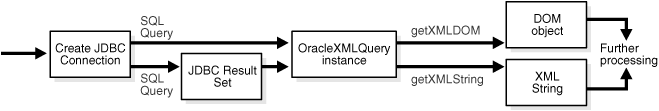
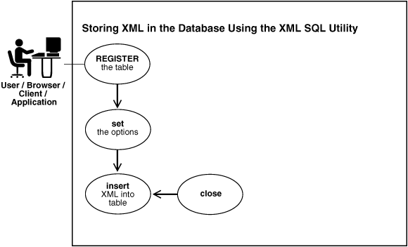
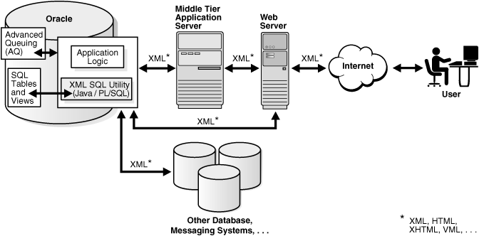
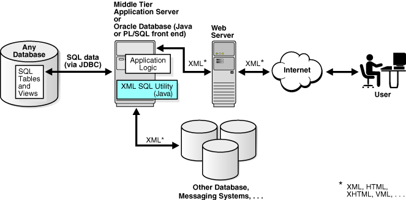
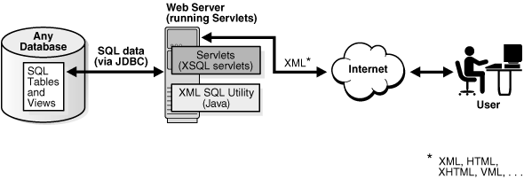

An explanation is given of how to use the Extensible Markup Language (XML) SQL Utility (XSU).

### 21.1 Introduction to the XML SQL Utility (XSU)

XML SQL Utility (XSU) is an Oracle XML Developer's Kit (XDK) component that lets you transfer XML data using Oracle SQL statements.

You can use [XML SQL Utility (XSU)](glossary.md) to perform these tasks:

- Transform data in object-relational database tables or views into XML. XSU can query the database and return the result set as an XML document.

- Extract data from an XML document and use canonical mapping to insert the data into a table or a view or update or delete values of the appropriate columns or attributes.

#### 21.1.1 Prerequisites for Using the XML SQL Utility (XSU)

Prerequisites for using the XML SQL Utility (XSU) are covered.

This section assumes that you are familiar with these technologies:

- Oracle Database structured query language (SQL). XSU transfers XML to and from a database through `SELECT` statements and data manipulation language (DML).

- Procedural Language/Structured Query Language (PL/SQL). XDK supplies a PL/SQL application programming interface (API) for XSU that mirrors the Java API.

- [Java Database Connectivity (JDBC)](glossary.md). Java applications that use XSU to transfer XML to and from a database require a JDBC connection.

#### 21.1.2 XSU Features

The main features provided by XML SQL Utility (XSU) are described.

XSU:

- Dynamically generates document type definitions (DTDs) or XML schemas.

- Generates XML documents in their string or Document Object Model (DOM) representations.

- Performs simple transformations during generation such as modifying default tag names for each `<ROW>` element. You can also register an XSL transformation that XSU applies to the generated XML documents as needed.

- Generates XML as a stream of Simple API for XML (SAX2) callbacks.

- Supports XML attributes during generation, which enables you to specify that a particular column or group of columns maps to an XML attribute instead of an XML element.

- Allows SQL-to-XML-tag escaping. Sometimes column names are not valid XML tag names. To avoid this problem you can either alias all the column names or turn on tag escaping.

- Supports `XMLType` columns in objects or tables.

- Inserts XML into relational database tables or views. When given an XML document, XSU can also update or delete records from a database object.

#### 21.1.3 XSU Restrictions

Some restrictions for using XSU are described.

- XSU can store data only in a single table. You can store XML across tables, however, by using the Oracle Extensible Stylesheet Language Transformation (XSLT) processor to transform a document into multiple documents and inserting them separately. You can also define views over multiple tables and perform insertions into the views. If a view is nonupdatable (because of complex joins), then you can use `INSTEAD` `OF` triggers over the views to perform the inserts.

- You cannot use XSU to load XML data stored in attributes into a database schema, but you can use an XSLT transformation to change the attributes into elements.

- By default XSU is case-sensitive. You can either use the correct case, or specify that case is to be ignored.

- XSU cannot generate a relational database schema from an input DTD.

- Inserting into `XMLType` tables using XSU is not supported. `XMLType` columns are supported.

### 21.2 Using the XML SQL Utility: Overview

Topics here include basic XSU use, installing XSU, running the XSU demo programs, and using the XSU command-line utility.

#### 21.2.1 Using XSU: Basic Process

The basic process of using XSU is described.

XSU is accessible through Java classes `OracleXML``Query` and `OracleXMLSave` in package `oracle.xml.sql.query`. Use class `OracleXMLQuery` to generate XML from relational data and class `OracleXMLSave` to perform DML.

You can write these types of XSU applications:

- Java programs that run inside the database and access the internal XSU Java API

- Java programs that run on the client and access the client-side XSU Java API

- PL/SQL programs that access XSU through PL/SQL packages

##### 21.2.1.1 Generating XML with the XSU Java API: Basic Process

Class `OracleXMLQuery` makes up the XML generation part of the XSU Java API.

Figure 21-1 shows the basic process for generating XML with XSU.

The basic steps in Figure 21-1 are:

Figure 21-1 Generating XML with XSU

[Description of "Figure 21-1 Generating XML with XSU"](img_text/adxdk032.md)

1.  Create a JDBC connection to the database. Normally, you establish a connection with the `DriverManager` class, which manages a set of JDBC drivers. After the JDBC drivers are loaded, invoke `getConnection()`. When it finds the right driver, this method returns a `Connection` object that represents a database session. All SQL statements are executed within the context of this session.
    You have these options:

    - Create the connection with the JDBC Oracle Call Interface (OCI) driver. This code fragment shows this technique:

          // import the Oracle driver class
          import oracle.jdbc.*;
          // load the Oracle JDBC driver
          DriverManager.registerDriver(new oracle.jdbc.OracleDriver());
          // create the connection
          Connection conn =
             DriverManager.getConnection("jdbc:oracle:oci:@","hr","password");

      The preceding example uses the default connection for the JDBC OCI driver.

    <!-- -->

    - Create the connection with the JDBC thin driver. The thin driver is written in pure Java and can be called from any Java program. This code fragment shows this technique:

          Connection conn =
             DriverManager.getConnection("jdbc:oracle:thin:@dlsun489:1521:ORCL",
               "hr","password");

      The thin driver requires the host name (`dlsun489`), port number (1521), and the Oracle system identifier (SID), `ORCL`. The database must have an active Transmission Control Protocol/Internet Protocol (TCP/IP) listener.

    - Use default connection used by the server-side internal JDBC driver. This driver runs within a default session and default transaction context. You are already connected to the database; your SQL operations are part of the default transaction. Thus, you do not have to register the driver. Create the `Connection` object:

          Connection conn = new oracle.jdbc.OracleDriver().defaultConnection ();

    **Note:**

    `OracleXMLDataSetExtJdbc` is used only for Oracle JDBC, whereas `OracleXMLDataSetGenJdbc` is used for non-Oracle JDBC. These classes are in the oracle.xml.sql.dataset package.
2.  Create an XML query object and assign it a SQL query. You create an `OracleXMLQuery` Class instance by passing a SQL query to the constructor, as shown in this example:
        OracleXMLQuery qry = new OracleXMLQuery (conn, "SELECT * from EMPLOYEES");
3.  Configure the XML query object by invoking `OracleXMLQuery` methods. This example specifies that only 20 rows are to be included in the result set:
        xmlQry.setMaxRows(20);
4.  Return a DOM object or string by invoking `OracleXMLQuery` methods. For example, get a DOM object:
        XMLDocument domDoc = (XMLDocument)qry.getXMLDOM();

    Get a string object:

        String xmlString = qry.getXMLString();
5.  Perform additional processing on the string or DOM as needed.
    **See Also:**

    - [Oracle Database Java Developer’s Guide](../jjdev/Java-introduction.md) to learn about Oracle JDBC

    - [Oracle Database XML Java API Reference](../jaxml/index.md) to learn about `OracleXMLQuery` methods

##### 21.2.1.2 Performing DML with the XSU Java API: Basic Process

Use the `OracleXMLSave` class to insert, update, and delete XML in the database.

Figure 21-2 shows the basic process.

Figure 21-2 Storing XML in the Database Using XSU

[Description of "Figure 21-2 Storing XML in the Database Using XSU"](img_text/adxdk013.md)

The basic steps in Figure 21-2 are:

1.  Create a JDBC connection to the database. This step is identical to the first step described in Generating XML with the XSU Java API: Basic Process.

2.  Create an XML save object and assign it a table on which to perform DML. Pass a table or view name to the constructor, as shown in this example:

        OracleXMLSave sav = new OracleXMLSave(conn, "employees");

3.  Specify the primary key columns. For example, this code specifies that `employee_id` is the key column:

        String [] keyColNames = new String[1];
        keyColNames[0] = "EMPLOYEE_ID";
        sav.setKeyColumnList(keyColNames);

4.  Configure the XML save object by invoking `OracleXMLSave` methods. This example specifies an update of the `salary` and `job_id` columns:

        String[] updateColNames = new String[2];
        updateColNames[0] = "SALARY";
        updateColNames[1] = "JOB_ID";
        sav.setUpdateColumnList(updateColNames); // set the columns to update

5.  Invoke the `insertXML()`, `updateXML()`, or `deleteXML()` methods on the `OracleXMLSave` object. This example shows an update:

        // Assume that the user passes in this XML document as the first argument
        sav.updateXML(sav.getURL(argv[0]));

    When performing the DML, XSU performs these tasks:

    1.  Parses the input XML document.

    2.  Matches element names to column names in the target table or view.

    3.  Converts the elements to SQL types and binds them to the appropriate statement.

6.  Close the `OracleXMLSave` object and deallocate all contexts associated with it, as shown in this example:

        sav.close();

    **See Also:**

    - [Oracle Database Java Developer’s Guide](../jjdev/Java-introduction.md) to learn about JDBC

    - [Oracle Database XML Java API Reference](../jaxml/index.md) to learn about `OracleXMLSave`

#### 21.2.2 Installing XSU

XSU is included as part of Oracle Database, along with the other XDK utilities.

[XDK for Java Component Dependencies](getting-started-with-XDK-for-Java.md) describes the XSU components and dependencies.

By default, the Oracle Universal Installer installs XSU on disk and loads it into the database. No user intervention is required. If you did not load XSU in the database when installing Oracle, you can install XSU manually as follows:

1.  Ensure that Oracle XML DB is installed (it is installed by default as part of Oracle Database).
2.  Load the `xsu12.jar` file into the database. This JAR file, which has a dependency on `xdb.jar` for `XMLType` access, is described in [Table 11-1](getting-started-with-XDK-for-Java.md).
3.  Run the `$ORACLE_HOME/rdbms/admin/dbmsxsu.sql` script. This SQL script builds the XSU PL/SQL API.

As explained in Using XSU: Basic Process, you do not have to load XSU into the database to use it. XSU can reside in any tier that supports Java.

##### 21.2.2.1 XSU in the Database

The typical architecture is shown for applications that use the XSU libraries installed in the database.

Figure 21-3 illustrates this typical architecture. XML generated from XSU running in the database can be placed in advanced queues in the database to be queued to other systems or clients. You deliver the XML internally through stored procedures in the database or externally through web servers or application servers.

In Figure 21-3 all lines are bidirectional. Because XSU can generate and save data, resources can deliver XML to XSU running inside the database, which can then insert it in the appropriate database tables.

Figure 21-3 Running XSU in the Database

[Description of "Figure 21-3 Running XSU in the Database"](img_text/adxdk018.md)

##### 21.2.2.2 XSU in an Application Server

You can run XSU in an application server.

Your application architecture may require an application server in the middle tier. The application tier can be a database or an application server that supports Java programs.

You can generate XML in the middle tier from SQL queries or `ResultSets` for various reasons, for example, to integrate different JDBC data sources in the middle tier. In this case, you can install XSU in your middle tier, thereby enabling your Java programs to make use of XSU through its Java API.

Figure 21-4 shows a typical architecture for running XSU in a middle tier. In the middle tier, data from JDBC sources is converted by XSU into XML and then sent to web servers or other systems. Again, the process is bidirectional, which means that the data can be put back into the JDBC sources (database tables or views) with XSU. If a database is used as the application server, then you can use the PL/SQL front end instead of Java.

Figure 21-4 Running XSU in the Middle Tier

[Description of "Figure 21-4 Running XSU in the Middle Tier"](img_text/adxdk019.md)

##### 21.2.2.3 XSU in a Web Server

You can run XSU in a web server because the web server supports Java servlets.

Figure 21-5 shows XSU running in a web server.

Figure 21-5 Running XSU in a Web Server

[Description of "Figure 21-5 Running XSU in a Web Server"](img_text/adxdk020.md)

You can write Java servlets that use XSU. XSQL Servlet is a standard servlet provided by Oracle. It is built on top of XSU and provides a template-like interface to XSU functionality. To perform XML processing in the web server and avoid intricate servlet programming, you can use the XSQL Servlet.

**See Also:**

- [Oracle XML DB Developer’s Guide](../adxdb/generation-of-XML-data-from-relational-data.md), especially the chapter on generating XML, for examples on using XSU with `XMLType`

- [Oracle Database XML Java API Reference](../jaxml/index.md) to learn about the classes `OracleXMLQuery` and `OracleXMLSave`

- [Using the XSQL Pages Publishing Framework](using-XSQL-pages-publishing-framework.md) to learn about XSQL Servlet

#### 21.2.3 Running the XSU Demo Programs

Demo programs for XSU are included in `$ORACLE_HOME/xdk/demo/java/xsu`.

Table 21-1 describes the XML files and programs that you can use to test XSU.

Table 21-1 XSU Sample Files

| File                      | Description                                                                                                                                                                                                                                                                                                                                                      |
|:--------------------------|:-----------------------------------------------------------------------------------------------------------------------------------------------------------------------------------------------------------------------------------------------------------------------------------------------------------------------------------------------------------------|
| `createObjRelSchema.sql`  | A SQL script that sets up an object-relational schema and populates it. See XML Mapping Against an Object-Relational Schema.                                                                                                                                                                                                                                     |
| `createObjRelSchema2.sql` | A SQL script that sets up an object-relational schema and populates it. See Altering the Database Schema or SQL Query.                                                                                                                                                                                                                                           |
| `createRelSchema.sql`     | A SQL script that creates a relational table and then creates a customer view that contains a customer object on top of it. See Altering the Database Schema or SQL Query.                                                                                                                                                                                       |
| `customer.xml`            | An XML document that describes a customer. See Altering the Database Schema or SQL Query.                                                                                                                                                                                                                                                                        |
| `domTest.java`            | A program that generates a DOM tree and then traverses it in document order, printing the nodes one by one. See Generating a DOM Tree with OracleXMLQuery.                                                                                                                                                                                                       |
| `index.txt`               | A README that describes the programs in the demo directory.                                                                                                                                                                                                                                                                                                      |
| `mapColumnToAtt.sql`      | A SQL script that queries the `employees` table, rendering `employee_id` as an XML attribute. See Altering the Database Schema or SQL Query.                                                                                                                                                                                                                     |
| `new_emp.xml`             | An XML document that describes a new employee. See Running the testInsert Program.                                                                                                                                                                                                                                                                               |
| `new_emp2.xml`            | An XML document that describes a new employee. See Running the testInsertSubset Program.                                                                                                                                                                                                                                                                         |
| `noRowsTest.java`         | A program that throws an exception when there are no more rows. See Raising a No Rows Exception.                                                                                                                                                                                                                                                                 |
| `pageTest.java`           | A program that uses the JDBC `ResultSet` to generate XML one page at a time. See Generating Scrollable Result Sets.                                                                                                                                                                                                                                              |
| `paginateResults.java`    | A program that generates an XML page that paginates results. See Paginating Results with OracleXMLQuery: Example.                                                                                                                                                                                                                                                |
| `refCurTest.java`         | A program that generates XML from the results of the SQL query defined in the `testRefCur` function. See Generating XML from Cursor Objects.                                                                                                                                                                                                                     |
| `samp1.java`              | A program that queries the `scott.emp` table, then generates an XML document from the query results.                                                                                                                                                                                                                                                             |
| `samp10.java`             | A program that inserts `sampdoc.xml` into the `xmltest_tab1` table.                                                                                                                                                                                                                                                                                              |
| `samp2.java`              | A program that queries the `scott.emp` table, then generates an XML document from the query results. This program demonstrates how you can customize the generated XML document.                                                                                                                                                                                 |
| `sampdoc.xml`             | A sample XML data document that `samp10.java` inserts into the database.                                                                                                                                                                                                                                                                                         |
| `samps.sql`               | A SQL script that creates the `xmltest_tab1` table used by `samp10.java`.                                                                                                                                                                                                                                                                                        |
| `testDeleteKey.java`      | A program that limits the number of elements used to identify a row, which improves performance by caching the `DELETE` statement and batching transactions. See Deleting by Key with OracleXMLSave.                                                                                                                                                             |
| `testDeleteRow.java`      | A program that accepts an XML document file name as input and deletes the rows corresponding to the elements in the document. See Deleting by Row with OracleXMLSave.                                                                                                                                                                                            |
| `testException.java`      | A sample program shown that throws a runtime exception and then gets the parent exception by invoking `Exception.getParentException()`. See Getting the Parent Exception.                                                                                                                                                                                        |
| `testInsert.java`         | A Java program that inserts XML values into all columns of the `hr.employees` table. See Inserting XML into All Columns with OracleXMLSave.                                                                                                                                                                                                                      |
| `testInsertSubset.java`   | A program shown that inserts XML data into a subset of columns. See Inserting XML into a Subset of Columns with OracleXMLSave.                                                                                                                                                                                                                                   |
| `testRef.sql`             | A PL/SQL script that creates a function that defines a REF cursor and returns it. Every time the `testRefCur` function is called, it opens a cursor object for the `SELECT` query and returns that cursor instance. See Generating XML from Cursor Objects.                                                                                                      |
| `testUpdate.java`         | A sample program that updates the `hr.employees` table by invoking the `OracleXMLSave.setKeyColumnList()` method. See Updating Rows Using OracleXMLSave.                                                                                                                                                                                                         |
| `testUpdateList.java`     | Suppose you want to update only the salary and job title for each employee and ignore the other information. If you know that all the elements to be updated are the same for all `ROW` elements in the XML document, then you can use the `OracleXMLSave.setUpdateColumnNames()` method to specify the columns. See Updating a Column List Using OracleXMLSave. |
| `testXMLSQL.java`         | A sample program that uses XSU to generate XML as a `String` object. This program queries the `hr.employees` table and prints the result set to standard output. See Generating a String with OracleXMLQuery.                                                                                                                                                    |
| `upd_emp.xml`             | An XML document that contains updated salary and other information for a series of employees. See Running the testUpdate Program.                                                                                                                                                                                                                                |
| `upd_emp2.xml`            | An XML document that contains updated salary and other information for a series of employees. See Running the testUpdate Program.                                                                                                                                                                                                                                |
| `updateEmployee.sql`      | An XML document that contains new data for two employees. See Running the testUpdateList Program.                                                                                                                                                                                                                                                                |

The steps for running the demos are:

1.  Change into the `$ORACLE_HOME/xdk/demo/java/xsu` directory (UNIX) or `%ORACLE_HOME%\xdk\demo\java\xsu` directory (Windows).
2.  Ensure that your environment variables are set as described in [Setting Up the XDK for Java Environment](getting-started-with-XDK-for-Java.md). In particular, ensure that the Java classpath includes `xsu12.jar` for XSU and `ojdbc6.jar` (Java 1.6) for JDBC. If you use a multibyte character set other than UTF-8, ISO8859-1, or JA16SJIS, then place `orai18n.jar` in your classpath so that JDBC can convert the character set of the input file to the database character set.
3.  Compile the Java programs as shown in this example:
        javac samp1.java samp2.java samp10.java
4.  Connect to a database as user `hr` and run SQL script `createRelSchema`:
        CONNECT hr
        @$ORACLE_HOME/xdk/demo/java/xsu/createRelSchema

These sections describe the XSU demos in detail.

#### 21.2.4 Using the XSU Command-Line Utility

XDK includes a command-line Java interface for XSU. XSU command-line options are provided through the Java class `OracleXML`.

To use this API ensure that your Java classpath is set as described in [Setting Up the XDK for Java Environment](getting-started-with-XDK-for-Java.md).

To print usage information for XSU to standard output, run this command:

    java OracleXML

To use XSU, invoke it with either the `getXML` or `putXML` parameter:

    java OracleXML getXML options
    java OracleXML putXML options

Table 21-2 describes the `getXML` options.

Table 21-2 getXML Options

| getXML Option                                   | Description                                                                                                                                                                                                                                                                         |
|:------------------------------------------------|:------------------------------------------------------------------------------------------------------------------------------------------------------------------------------------------------------------------------------------------------------------------------------------|
| `-user` "`username`/`password"`                 | Specifies the user name and password to connect to the database. The connect string is also specified. You can specify the user name and password as part of the connect string.                                                                                                    |
| `-conn` `"JDBC_connect_string"`                 | Specifies the JDBC database connect string. By default the connect string is: "`jdbc:oracle:oci:@`".                                                                                                                                                                                |
| `-withDTD`                                      | Instructs the XSU to generate the DTD along with the XML document.                                                                                                                                                                                                                  |
| `-withSchema`                                   | Instructs the XSU to generate the schema along with the XML document.                                                                                                                                                                                                               |
| `-rowsetTag` `tag_name`                         | Specifies the rowset tag, which is tag that encloses all the XML elements corresponding to the records returned by the query. The default rowset tag is `<ROWSET>`. If you specify an empty string ("") for rowset, then XSU omits the rowset element.                              |
| `-rowTag` `tag_name`                            | Specifies the row tag that encloses the data corresponding to a database row. The default row tag is `<ROW>`. If you specify an empty string ("") for the row tag, then XSU omits the row tag.                                                                                      |
| `-rowIdAttr` `row_id_attribute_name`            | Names the attribute of the `ROW` element that keeps track of the cardinality of the `rows`. By default this attribute is `num`. If you specify an empty string as the `rowID` attribute, then XSU omits the attribute.                                                              |
| \-`rowIdColumn` `row_Id_column_name`            | Specifies that the value of a scalar column from the query is to be used as the value of the `rowID` attribute.                                                                                                                                                                     |
| `-collectionIdAttr` `collect_id_attr_name`      | Names the attribute of an XML list element that keeps track of the cardinality of the elements of the list. The generated XML lists correspond to either a cursor query, or collection. If you specify an empty string ("") as the `rowID` attribute, then XSU omits the attribute. |
| `-useTypeForCollElemTag`                        | Specifies the use type name for the column-element tag. By default XSU uses the `column-name_item`.                                                                                                                                                                                 |
| `-useNullAttrId`                                | Specifies the attribute `NULL (TRUE/FALSE)` to indicate the nullness of an element.                                                                                                                                                                                                 |
| `-styleSheet` `stylesheet_URI`                  | Specifies the stylesheet in the XML processing instruction.                                                                                                                                                                                                                         |
| `-stylesheetType` `stylesheet_type`             | Specifies the stylesheet type in the XML processing instruction.                                                                                                                                                                                                                    |
| `-setXSLT ``URI`                                | Specifies the XSLT stylesheet to apply to the XML document.                                                                                                                                                                                                                         |
| `-setXSLTRef` `URI`                             | Sets the XSLT external entity reference.                                                                                                                                                                                                                                            |
| `-useLowerCase | -useUpperCase`                 | Generates lowercase or uppercase tag names. The default is to match the case of the SQL object names from which the tags are generated.                                                                                                                                             |
| `-withEscaping`                                 | Specifies the treatment of characters that are legal in SQL object names but illegal in XML tags. If such a character is encountered, then it is escaped so that it does not throw an exception.                                                                                    |
| `-errorTag` `error tag_name`                    | Specifies the tag to enclose error messages that are formatted as XML.                                                                                                                                                                                                              |
| `-raiseException`                               | Specifies that XSU must throw a Java exception. By default XSU catches any error and produces the XML error.                                                                                                                                                                        |
| `-raiseNoRowsException`                         | Raises an exception if no rows are returned.                                                                                                                                                                                                                                        |
| `-useStrictLegalXMLCharCheck`                   | Performs strict checking on input data.                                                                                                                                                                                                                                             |
| `-maxRows` `maximum_rows`                       | Specifies the maximum number of rows to be retrieved and converted to XML.                                                                                                                                                                                                          |
| `-skipRows ``number_of_rows_to_skip`            | Specifies the number of rows to be skipped.                                                                                                                                                                                                                                         |
| `-encoding` `encoding_name`                     | Specifies the character set encoding of the generated XML.                                                                                                                                                                                                                          |
| `-dateFormat` `date_format`                     | Specifies the date format for the date values in the XML document.                                                                                                                                                                                                                  |
| `-fileName` `SQL_query_fileName` \| `SQL_query` | Specifies the file name that contains the query or the query itself.                                                                                                                                                                                                                |

Table 21-3 describes the `putXML` options.

Table 21-3 putXML Options

| putXML Options                                                      | Description                                                                                                                                                                                                 |
|:--------------------------------------------------------------------|:------------------------------------------------------------------------------------------------------------------------------------------------------------------------------------------------------------|
| `-user "``username`/`password"`                                     | Specifies the user name and password to connect to the database. The connect string is also specified. You can specify the user name and password as part of the connect string.                            |
| `-conn` `"JDBC_connect_string"`                                     | Specifies the JDBC database connect string. By default the connect string is: "`jdbc:oracle:oci:@`".                                                                                                        |
| `-batchSize` `batching_size`                                        | Specifies the batch size that controls the number of rows that are batched together and inserted in a single trip to the database to improve performance.                                                   |
| `-commitBatch` `commit_size`                                        | Specifies the number of inserted records after which a commit is to be executed. If the autocommit is `TRUE` (the default), then setting `commitBatch` has no consequence.                                  |
| `-rowTag` `tag_name`                                                | Specifies the `row` tag, which is tag used to enclose the data corresponding to a database row. The default row tag is `<ROW>`. If you specify an empty string for the row tag, then XSU omits the row tag. |
| `-dateFormat` `date_format`                                         | Specifies the date format for the date values in the XML document.                                                                                                                                          |
| `-withEscaping`                                                     | Turns on reverse mapping if SQL to XML name escaping was used when generating the doc.                                                                                                                      |
| `-ignoreCase`                                                       | Makes the matching of the column names with tag names case insensitive. For example, `EmpNo` matches with `EMPNO` if `ignoreCase` is on.                                                                    |
| `-preserveWhitespace`                                               | Preserves the white space in the inserted XML document.                                                                                                                                                     |
| `-setXSLT`` URI`                                                    | Specifies the XSLT to apply to the XML document before inserting.                                                                                                                                           |
| `-setXSLTRef` `URI`                                                 | Sets the XSLT external entity reference.                                                                                                                                                                    |
| `-fileName` `file_name` \| `-URL ``URL` \| `-xmlDoc` `xml_document` | Specifies the XML document to insert: a local file, a URL, or an XML document as a string on the command line.                                                                                              |
| `table_name`                                                        | Specifies the name of the table to put the values into.                                                                                                                                                     |

##### 21.2.4.1 Generating XML with the XSU Command-Line Utility

To generate XML from the database schema use the `getXML` parameter.

For example, to generate an XML document by querying the `employees` table in the `hr` schema, you can use this syntax:

    java OracleXML getXML -user "hr/password" "SELECT * FROM employees"

The preceding command performs these tasks:

1.  Connects to the current default database
2.  Executes the specified `SELECT` query
3.  Converts the SQL result set to XML
4.  Prints the XML to standard output

The` getXML` parameter supports a wide range of options, which are explained in Table 21-2.

##### 21.2.4.2 Generating XMLType Data with the XSU Command-Line Utility

You can use XSU to generate XML from tables with `XMLType` columns.

Suppose that you run the demo script `setup_xmltype.sql` to create and populate the `parts` table. You can generate XML from this table with XSU:

    java OracleXML getXML -user "hr/password" -rowTag "Part" "SELECT * FROM parts"

The output of the command is shown below:

    <?xml version = '1.0'?>
    <ROWSET>
       <Part num="1">
          <PARTNO>1735</PARTNO>
          <PARTNAME>Gizmo</PARTNAME>
          <PARTDESC>
             <Description>
               <Title>Description of the Gizmo</Title>
               <Author>John Smith</Author>
               <Body>
                 The <b>Gizmo</b> is <i>grand</i>.
               </Body>
             </Description>
          </PARTDESC>
       </Part>
    </ROWSET>

##### 21.2.4.3 Performing DML with the XSU Command-Line Utility

An example shows how to insert an XML document into a database table.

To insert an XML document called `new_employees.xml` into the `hr.employees` table, use this syntax:

    java OracleXML putXML -user "hr/password" -fileName "new_employees.xml" employees

The preceding command performs these tasks:

1.  Connects to the current database as `hr`
2.  Reads the XML document named `new_emp.xml`
3.  Parses the XML document, matching the tags with column names
4.  Inserts the values appropriately into the `employees` table

The` getXML` parameter supports a wide range of options, which are explained in Table 21-2.

### 21.3 Programming with the XSU Java API

Topics here include using OracleXMLQuery and OracleXMLSave to perform various operations, and handling XSU Java exceptions.

#### 21.3.1 Generating a String with OracleXMLQuery

The `testXMLSQL.java` demo program uses XSU to generate XML as a `String` object. The program queries table `hr.employees` and prints the result set to standard output.

The `testXMLSQL.java` program follows these steps:

1.  Register the JDBC driver and create a database connection. This code fragment uses the OCI JDBC driver and connects with the user name `hr`:
        import oracle.jdbc.*;...Connection conn  = getConnection("hr","password");
        ...
        private static Connection getConnection(String username, String password)
            throws SQLException
        {
        // register the JDBC driver
          DriverManager.registerDriver(new oracle.jdbc.OracleDriver());
        // create the connection using the OCI driver
          Connection conn =
            DriverManager.getConnection("jdbc:oracle:oci:@",username,password);
          return conn;
        }
2.  Create an XML query object and initialize it with a SQL query. This code fragment initializes the object with a `SELECT` statement on `hr.employees`:
        OracleXMLQuery qry = new OracleXMLQuery(conn, "SELECT * FROM employees");
3.  Get the query result set as a `String` object. The `getXMLString()` method transforms the object-relational data specified in the constructor into an XML document. This example shows this technique:
        String str = qry.getXMLString();
4.  Close the query object to release any resources, as shown in this code:
        qry.close();

##### 21.3.1.1 Running the testXMLSQL Program

The `testXMLSQL` program is described.

To run the `testXMLSQL.java` program perform these steps:

1.  Compile `testXMLSQL.java` with `javac`.
2.  Execute `java testXMLSQL` on the command line.

You must have the `CLASSPATH` pointing to this directory for the Java executable to find the class. Alternatively, use visual Java tools such as Oracle JDeveloper to compile and run this program. When run, this program prints out the XML file to the screen. This code shows sample output with some rows edited out:

    <?xml version = '1.0'?>
    <ROWSET>
       <ROW num="1">
          <EMPLOYEE_ID>100</EMPLOYEE_ID>
          <FIRST_NAME>Steven</FIRST_NAME>
          <LAST_NAME>King</LAST_NAME>
          <EMAIL>SKING</EMAIL>
          <PHONE_NUMBER>515.123.4567</PHONE_NUMBER>
          <HIRE_DATE>6/17/1987 0:0:0</HIRE_DATE>
          <JOB_ID>AD_PRES</JOB_ID>
          <SALARY>24000</SALARY>
          <DEPARTMENT_ID>90</DEPARTMENT_ID>
       </ROW>
    <!-- ROW num="2" through num="107" ... -->
    </ROWSET>

#### 21.3.2 Generating a DOM Tree with OracleXMLQuery

To generate a DOM tree from the XML generated by XSU, you can directly request a DOM document from XSU. This technique saves the overhead of creating a string representation of the XML document and then parsing it to generate the DOM tree.

XSU invokes the Oracle XML parser to construct the DOM tree from the data values. The `domTest.java` demo program generates a DOM tree and then traverses it in document order, printing the nodes one by one.

The first two steps in the `domTest.java` program are the same as in the `testXMLSQL.java` program described in Generating a String with OracleXMLQuery. The program proceeds as follows:

1.  Get the DOM by invoking `getXMLDOM()` method. The following example shows this technique:
        XMLDocument domDoc = (XMLDocument)qry.getXMLDOM();
2.  Print the DOM tree. The following code prints to standard output:
        domDoc.print(System.out);

    You can also create a `StringWriter` and wrap it in a `PrintWriter`:

        StringWriter s = new StringWriter(10000);
        domDoc.print(new PrintWriter(s));
        System.out.println(" The string version ---> \n"+s.toString());

After compiling the program, run it from the command line:

    java domTest

#### 21.3.3 Paginating Results with OracleXMLQuery

Topics here include limiting the rows in a result set, keeping an object open during a user session, and paginating results using `OracleXMLQuery`.

##### 21.3.3.1 Limiting the Number of Rows in the Result Set

Different ways to limit the number of rows in a result set are described.

In `testXMLSQL.java` and `domTest.java`, XSU generated XML from all rows returned by the query. Suppose that you query a table that contains 1000 rows, but you want only 100 rows at a time. One approach is to execute one query to get the first 100 rows, another to get the next 100 rows, and so on. With this technique you cannot skip the first five rows of the query and then generate the result. To avoid these problems, use these Java methods:

- `OracleXMLSave.setSkipRows()` forces XSU to skip the desired number of rows before starting to generate the result. The command-line equivalent to this method is the `-skipRows` parameter.

- `OracleXMLSave.setMaxRows()` limits the number of rows converted to XML. The command-line equivalent to this method is the `-maxRows` parameter.

Example 21-1 sets `skipRows` to a value of `5` and `maxRows` to a value of `1`, which causes XSU to skip the first 5 rows and then generate XML for the next row when querying the `hr.employees` table.

The following shows sample output (only row 6 of the query result set is returned):

    <?xml version = '1.0'?>
    <ROWSET>
       <ROW num="6">
          <EMPLOYEE_ID>105</EMPLOYEE_ID>
          <FIRST_NAME>David</FIRST_NAME>
          <LAST_NAME>Austin</LAST_NAME>
          <EMAIL>DAUSTIN</EMAIL>
          <PHONE_NUMBER>590.423.4569</PHONE_NUMBER>
          <HIRE_DATE>6/25/1997 0:0:0</HIRE_DATE>
          <JOB_ID>IT_PROG</JOB_ID>
          <SALARY>4800</SALARY>
          <MANAGER_ID>103</MANAGER_ID>
          <DEPARTMENT_ID>60</DEPARTMENT_ID>
       </ROW>
    </ROWSET>

Example 21-1 Specifying skipRows and maxRows on the Command Line

    java OracleXML getXML -user "hr/password" -skipRows 5 -maxRows 1 \
      "SELECT * FROM employees"

##### 21.3.3.2 Keeping an Object Open for the Duration of the User's Session

In some situations, you might want to keep a query object open for the duration of the user session. You can handle such cases with the `maxRows()` method and the `keepObjectOpen()` method.

Consider a web search engine that paginates search results. The first page lists 10 results, the next page lists 10 more, and so on. To perform this task with XSU, request 10 rows at a time and keep the `ResultSet` open so that the next time you ask XSU for more results, it starts generating from where the last generation finished. If `OracleXMLQuery` creates a result set from the SQL query string, then it typically closes the `ResultSet` internally because it assumes no more results are required. Thus, you must invoke `keepObjectOpen()` to keep the cursor active.

A different case requiring an open query object is when the number of rows or number of columns in a row is very large. In this case, you can generate multiple small documents rather than one large document.

**Related Topics**

- Paginating Results with OracleXMLQuery: Example

##### 21.3.3.3 Paginating Results with OracleXMLQuery: Example

The `paginateResults.java` program shows how you can generate an XML page that paginates results. The output XML displays only 20 rows of the `hr` table.

The `paginateResults.java` program shows how you can generate an XML page that paginates results. The output XML displays only 20 rows of the `hr` table.

The first step of the `paginateResults.java` program, which creates the connection, is the same as in `testXMLSQL.java`. The program continues as follows:

1.  Create a SQL statement object and initialize it with a SQL query. The following code fragment sets two options in `java.sql.ResultSet`:
        Statement stmt = conn.createStatement(ResultSet.TYPE_SCROLL_SENSITIVE,
                                              ResultSet.CONCUR_READ_ONLY);
2.  Create the query as a string and execute it by invoking `Statement.executeQuery()`. The return object is of type `ResultSet`. The following example shows this technique:
        String sCmd = "SELECT first_name, last_name FROM hr.employees";
        ResultSet rs = stmt.executeQuery(sCmd);
3.  Create the query object, as shown in this code:
        OracleXMLQuery xmlQry = new OracleXMLQuery(conn, rs);
4.  Configure the query object. The following code specifies that the query object is open for the duration of the session. It also limits the number of rows returned to 20:
        xmlQry.keepObjectOpen(true);
        xmlQry.setRowsetTag("ROWSET");
        xmlQry.setRowTag("ROW");
        xmlQry.setMaxRows(20);
5.  Retrieve the result as a `String` and print:
        String sXML = xmlQry.getXMLString();
        System.out.println(sXML);

After compiling the program, run it from the command line:

    java paginateResults

#### 21.3.4 Generating Scrollable Result Sets

You might want to perform a query and then retrieve a previous page of results from within the result set. To enable scrolling, instantiate the `Oracle.jdbc.ResultSet` class. You can use the `ResultSet` object to move back and forth within the result set and use XSU to generate XML each time.

The `pageTest.java` program shows how to use the JDBC `ResultSet` to generate XML a page at a time. Using `ResultSet` may be necessary in cases that are not handled directly by XSU, for example, when setting the batch size and binding values.

The `pageTest.java` program creates a `pageTest` object and initializes it with a SQL query. The constructor for the `pageTest` object performs these steps:

1.  Create a JDBC connection by invoking the same `getConnection()` method defined in `paginateResults.java`:
        Connection conn;
        ...
        conn  = getConnection("hr","password");
2.  Create a statement:
        Statement stmt;
        ...
        stmt = conn.createStatement();
3.  Execute the query passed to the constructor to get the scrollable result set. The following code shows this technique:
        ResultSet rset = stmt.executeQuery(sqlQuery);
4.  Create a query object by passing references to the connection and result set objects to the constructor. The following code fragment shows this technique:
        OracleXMLQuery qry;
        ...
        qry = new OracleXMLQuery(conn,rset);
5.  Configure the query object. The following code fragment specifies that the query object be kept open, and that it raise an exception when there are no more rows:
        qry.keepObjectOpen(true);
        qry.setRaiseNoRowsException(true);
        qry.setRaiseException(true);
6.  After creating the query object by passing it the string `"SELECT * FROM employees"`, the program loops through the result set. The `getResult()` method receives integer values specifying the start row and end row of the set. It sets the maximum number of rows to retrieve by calculating the difference of these values and then retrieves the result as a string. The following `while` loop retrieves and prints ten rows at a time:
        int i = 0;
        while ((str = test.getResult(i,i+10))!= null)
        {
          System.out.println(str);
          i+= 10;
        }

After compiling the program, run it from the command line:

    java pageTest

#### 21.3.5 Generating XML from Cursor Objects

You can initialize a `CallableStatement` object, execute a PL/SQL function that returns a cursor variable, get the `OracleResultSet` object, and send it to an `OracleXMLQuery` object to obtain the desired XML data.

Class `OracleXMLQuery` provides XML conversion only for query strings or `ResultSet` objects. If your program uses PL/SQL procedures that return `REF` cursors, then how do you perform the conversion? You can use the `ResultSet` conversion mechanism described in Generating Scrollable Result Sets.

`REF` cursors are references to cursor objects in PL/SQL. These cursor objects are SQL statements over which a program can iterate to get a set of values. The cursor objects are converted into `OracleResultSet` objects in the Java world. In your Java program you can initialize a `CallableStatement` object, execute a PL/SQL function that returns a cursor variable, get the `OracleResultSet` object, and then send it to the `OracleXMLQuery` object to get the desired XML.

Consider the `testRef` PL/SQL package defined in the `testRef.sql` script. It creates a function that defines a `REF` cursor and returns it. Every time the `testRefCur` PL/SQL function is called, it opens a cursor object for the `SELECT` query and returns that cursor instance. To convert the object to XML, do this:

1.  Run the `testRef.sql` script to create the `testRef` package in the `hr` schema.
2.  Compile and run the `refCurTest.java` program to generate XML from the results of the SQL query defined in the `testRefCur` function.

To apply the stylesheet, you can use the `applyStylesheet`command, which forces the stylesheet to be applied before generating the output.

#### 21.3.6 Inserting Rows with OracleXMLSave

To insert a document into a table or view, supply the table or view name and the document. XSU parses the document and creates an `INSERT` statement into which it binds the values. By default, XSU inserts values into all columns of the table or view.

An absent element is treated as a `NULL` value. The following example shows how you can store the XML document generated from the `hr.employees` table in the table.

##### 21.3.6.1 Inserting XML into All Columns with OracleXMLSave

The `testInsert.java` demo program inserts XML values into all columns of the `hr.employees` table.

The program follows these steps:

1.  Create a JDBC OCI connection. The program invokes the same `getConnection()` method used by the previous examples in this chapter:
        Connection conn = getConnection("hr","password");
2.  Create an XML save object. You initialize the object by passing it the `Connection` reference and the name of the table on which you want to perform DML. The following example shows this technique:
        OracleXMLSave sav = new OracleXMLSave(conn, "employees");
3.  Insert the data in an input XML document into the `hr.employees` table. The following code fragment creates a URL from the document file name specified on the command line:
        sav.insertXML(sav.getURL(argv[0]));
4.  Close the XML save object:
        sav.close();

###### 21.3.6.1.1 Running the testInsert Program

The `textInsert` program is described.

Assume that you write the `new_emp.xml` document to describe new employee Janet Smith, who has employee ID 7369. You pass the file name `new_emp.xml` as an argument to the `testInsert` program:

    java testInsert "new_emp.xml"

The program inserts a new row in the `employees` table that contains the values for the columns specified. Any absent element inside the row element is treated as `NULL`.

Running the program generates an `INSERT` statement of this form:

    INSERT INTO hr.employees
      (employee_id, first_name, last_name, email, phone_number, hire_date,
       salary, commission_pct, manager_id, department_id)
    VALUES
      (?, ?, ?, ?, ?, ?, ?, ?, ?, ?);

XSU matches the element tags in the input XML document that match the column names and binds their values.

##### 21.3.6.2 Inserting XML into a Subset of Columns with OracleXMLSave

In some situations, you might not want to insert values into all columns. For example, the group of values that you get might not be the complete set, requiring you to use triggers or default values for the remaining columns.

The `testInsertSubset.java` demo program shows how to handle this case. It follows these steps:

1.  Create a JDBC OCI connection. The program invokes the same `getConnection()` method used by the previous examples in this chapter:
        Connection conn = getConnection("hr","password");
2.  Create an XML save object. Initialize the object by passing it the `Connection` reference and the name of the table on which you want to perform DML. The following example shows this technique:
        OracleXMLSave sav = new OracleXMLSave(conn, "employees");
3.  Create an array of strings. Each element of the array must contain the name of a column in which values are inserted. The following code fragment specifies the names of five columns:
        String [] colNames = new String[5];
        colNames[0] = "EMPLOYEE_ID";
        colNames[1] = "LAST_NAME";
        colNames[2] = "EMAIL";
        colNames[3] = "JOB_ID";
        colNames[4] = "HIRE_DATE";
4.  Configure the XML save object to update the specified columns. The following statement passes a reference to the array to the `OracleXMLSave.setUpdateColumnList()` method:
        sav.setUpdateColumnList(colNames);
5.  Insert the data in an input XML document into the `hr.employees` table. The following code fragment creates a URL from the document file name specified on the command line:
        sav.insertXML(sav.getURL(argv[0]));
6.  Close the XML save object:
        sav.close();

###### 21.3.6.2.1 Running the testInsertSubset Program

The `testInsertSubset` program is described.

Assume that you use the `new_emp2.xml` document to store data for new employee Adams, who has employee ID 7400. You pass `new_emp2.xml` as an argument to the `testInsert` program:

    java testInsert new_emp2.xml

The program ignores values for the columns that were not specified in the input file. It performs an `INSERT` for each `ROW` element in the input and batches the `INSERT` statements by default.

The program generates this `INSERT` statement:

    INSERT INTO hr.employees (employee_id, last_name, email, job_id, hire_date)
      VALUES (?, ?, ?, ?, ?);

#### 21.3.7 Updating Rows Using OracleXMLSave

Examples show how to update the fields in a table or view. You supply the table or view name and an XML document. XSU parses the document (if a string is given) and creates one or more `UPDATE` statements into which it binds all of the values.

The following examples use an XML document to update table `hr.employees`.

##### 21.3.7.1 Updating Key Columns Using OracleXMLSave

Demo program `testUpdate.java` invokes method `OracleXMLSave.setKeyColumnList()` to update table `hr.employees`.

`testUpdate.java` follows these steps:

1.  Create a JDBC OCI connection. The program invokes the same `getConnection()` method used by the previous examples in this chapter:
        Connection conn = getConnection("hr","password");
2.  Create an XML save object. You initialize the object by passing it the `Connection` reference and the name of the table on which you want to perform DML. The following example shows this technique:
        OracleXMLSave sav = new OracleXMLSave(conn, "employees");
3.  Create a single-element `String` array to hold the name of the primary key column in the table to be updated. The following code fragment specifies the name of the `employee_id` column:
        String [] keyColNames = new String[1];
        colNames[0] = "EMPLOYEE_ID";
4.  Set the XML save object to the primary key specified in the array. The following statement passes a reference to the `keyColNames` array to the `OracleXMLSave.setKeyColumnList()` method:
        sav.setKeyColumnList(keyColNames);
5.  Update the rows specified in the input XML document. The following statement creates a URL from the file name specified on the command line:
        sav.updateXML(sav.getURL(argv[0]));
6.  Close the XML save object:
        sav.close();

###### 21.3.7.1.1 Running the testUpdate Program

The `testUpdate` program is described.

You can use XSU to update specified fields in a table. Example 21-2 shows `upd_emp.xml`, which contains updated salary and other information for the two employees that you just added, 7369 and 7400.

For updates, supply XSU with the list of key column names in the `WHERE` clause of the `UPDATE` statement. In the `hr.employees` table the `employee_id` column is the key.

Pass the file name `upd_emp.xml` as an argument to the preceding program:

    java testUpdate upd_emp.xml

The program generates two `UPDATE` statements. For the first `ROW` element, the program generates an `UPDATE` statement to update the `SALARY` field:

    UPDATE hr.employees SET salary = 3250 WHERE employee_id = 7400;

For the second `ROW` element the program generates this statement:

    UPDATE hr.employees SET job_id = 'SA_REP' AND MANAGER_ID = 145
      WHERE employee_id = 7369;

Example 21-2 upd_emp.xml

    <?xml version='1.0'?>
    <ROWSET>
     <ROW num="1">
        <EMPLOYEE_ID>7400</EMPLOYEE_ID>
        <SALARY>3250</SALARY>
     </ROW>
     <ROW num="2">
        <EMPLOYEE_ID>7369</EMPLOYEE_ID>
        <JOB_ID>SA_REP</JOB_ID>
        <MANAGER_ID>145</MANAGER_ID>
     </ROW>
    <!-- additional rows ... -->
    </ROWSET>

##### 21.3.7.2 Updating a Column List Using OracleXMLSave

You can update a table using only a subset of the elements in an XML document, by specifying a list of columns. This is fast because XSU uses the same `UPDATE` statement, with bind variables for all of the `ROW` elements. Other tags in the document can be ignored.

**Note:**

When you specify a list of columns to update, if an element corresponding to an update column is absent, XSU treats it as `NULL`.

Suppose you want to update the salary and job title for each employee and ignore the other data. If you know that all the elements to be updated are the same for all `ROW` elements in the XML document, then you can use the `OracleXMLSave.setUpdateColumnNames()` method to specify the columns. The `testUpdateList.java` program shows this technique.

The `testUpdateList.java` program follows these steps:

1.  Create a JDBC OCI connection. The program invokes the same `getConnection()` method used by the previous examples in this chapter:
        Connection conn = getConnection("hr","password");
2.  Create an XML save object. You initialize the object by passing it the `Connection` reference and the name of the table on which you want to perform DML. The following example shows this technique:
        OracleXMLSave sav = new OracleXMLSave(conn, "employees");
3.  Create an array of type `String` to hold the name of the primary key column in the table to be updated. The array contains only one element, which is the name of the primary key column in the table to be updated. The following code fragment specifies the name of the `employee_id` column:
        String [] colNames = new String[1];
        colNames[0] = "EMPLOYEE_ID";
4.  Set the XML save object to the primary key specified in the array. The following statement passes a reference to the `colNames` array to the `OracleXMLSave.setKeyColumnList()` method:
        sav.setKeyColumnList(keyColNames);
5.  Create an array of type `String` to hold the name of the columns to be updated. The following code fragment specifies the name of the `employee_id` column:
        String[] updateColNames = new String[2];
        updateColNames[0] = "SALARY";
        updateColNames[1] = "JOB_ID";
6.  Set the XML save object to the list of columns to be updated. The following statement performs this task:
        sav.setUpdateColumnList(updateColNames);
7.  Update the rows specified in the input XML document. The following code fragment creates a URL from the file name specified on the command line:
        sav.updateXML(sav.getURL(argv[0]));
8.  Close the XML save object:
        sav.close();

###### 21.3.7.2.1 Running the testUpdateList Program

The `testUpdateList` program is described.

Suppose that you use the sample XML document `upd_emp2.xml` to store new data for employees Steven King, who has an employee ID of 100, and William Gietz, who has an employee identifier (ID) of 206. You pass `upd_emp2.xml` as an argument to the `testUpdateList` program:

    java testUpdateList upd_emp2.xml

In this example, the program generates two `UPDATE` statements. For the first `ROW` element, the program generates this statement:

    UPDATE hr.employees SET salary = 8350 AND job_id = 'AC_ACCOUNT'
      WHERE employee_id = 100;

For the second `ROW` element the program generates this statement:

    UPDATE hr.employees SET salary = 25000 AND job_id = 'AD_PRES'
      WHERE employee_id = 206;

#### 21.3.8 Deleting Rows using XSU

When deleting from XML documents, you can specify a list of key columns. XSU uses these columns in the `WHERE` clause of the `DELETE` statement. If you do not supply the key column names, then XSU creates a new `DELETE` statement for each `ROW` element of the XML document.

The list of columns in the `WHERE` clause of the `DELETE` statement matches those in the `ROW` element.

##### 21.3.8.1 Deleting by Row with OracleXMLSave

The `testDeleteRow.java` demo program accepts an XML document file name as input and deletes the rows corresponding to the elements in the document.

The `testDeleteRow.java` program follows these steps:

1.  Create a JDBC OCI connection. The program invokes the same `getConnection()` method used by the previous examples in this chapter:
        Connection conn = getConnection("hr","password");
2.  Create an XML save object. You initialize the object by passing it the `Connection` reference and the name of the table on which you want to perform DML. The following example shows this technique:
        OracleXMLSave sav = new OracleXMLSave(conn, "employees");
3.  Delete the rows specified in the input XML document. The following code fragment creates a URL from the file name specified on the command line:
        sav.deleteXML(sav.getURL(argv[0]));
4.  Close the XML save object:
        sav.close();

###### 21.3.8.1.1 Running the testDelete Program

The `testDelete` program is described.

This section shows how to delete the employees 7400 and 7369 that you added in Inserting Rows with OracleXMLSave.

To make this example work correctly, connect to the database and disable a constraint on the `hr.job_history` table:

    CONNECT hr
    ALTER TABLE job_history
      DISABLE CONSTRAINT JHIST_EMP_FK;
    EXIT

Now pass `upd_emp.xml` to the `testDeleteRow` program:

    java testDeleteRow upd_emp.xml

The program forms the `DELETE` statements based on the tag names present in each `ROW` element in the XML document. It executes these statements:

    DELETE FROM hr.employees WHERE salary = 3250 AND employee_id = 7400;
    DELETE FROM hr.employees WHERE job_id = 'SA_REP' AND MANAGER_ID = 145
      AND employee_id = 7369;

##### 21.3.8.2 Deleting by Key with OracleXMLSave

To use only the key values as predicates on the `DELETE` statement, invoke the `OracleXMLSave.setKeyColumnList()` method. This approach limits the number of elements used to identify a row, which has the benefit of improving performance by caching the `DELETE` statement and batching transactions. The `testDeleteKey.java` program shows this technique.

The `testDeleteKey.java` program follows these steps:

1.  Create a JDBC OCI connection. The program invokes the same `getConnection()` method used by the previous examples in this chapter:
        Connection conn = getConnection("hr","password");
2.  Create an XML save object. You initialize the object by passing it the `Connection` reference and the name of the table on which you want to perform DML. The following example shows this technique:
        OracleXMLSave sav = new OracleXMLSave(conn, "employees");
3.  Create an array of type `String` to hold the name of the primary key column in the table. The array contains only one element. The following code fragment specifies the name of the `employee_id` column:
        String [] colNames = new String[1];
        colNames[0] = "EMPLOYEE_ID";
4.  Set the XML save object to the primary key specified in the array. The following statement passes a reference to the `colNames` array to the `OracleXMLSave.setKeyColumnList()` method:
        sav.setKeyColumnList(keyColNames);
5.  Delete the rows specified in the input XML document. The following code fragment creates a URL from the file name specified on the command line:
        sav.deleteXML(sav.getURL(argv[0]));
6.  Close the XML save object:
        sav.close();

###### 21.3.8.2.1 Running the testDeleteKey Program

The `testDeleteKey` program is described.

This section shows how to delete employees 7400 and 7369 that you added in Updating Key Columns Using OracleXMLSave. If you deleted these employees in the previous example, you can add them back to the `employees` table:

    java testInsert new_emp.xml
    java testInsert new_emp2.xml

Delete employees 7400 and 7369 by passing the same `upd_emp.xml` document to the `testDeleteRow` program:

    java testDeleteKey upd_emp.xml

The program forms this single generated `DELETE` statement:

    DELETE FROM hr.employees WHERE employee_id=?;

The program executes these `DELETE` statements, one for each employee:

    DELETE FROM hr.employees WHERE employee_id = 7400;
    DELETE FROM hr.employees WHERE employee_id = 7369;

#### 21.3.9 Handling XSU Java Exceptions

XSU catches all exceptions that occur during processing and throws `oracle.xml.sql.OracleXMLSQLException`, which is a generic runtime exception. The invoking program need not catch this exception if it can still perform the appropriate action. The exception class provides methods to get error messages and any parent exceptions.

##### 21.3.9.1 Getting the Parent Exception

The `testException.java` demo program throws a runtime exception and then gets the parent exception by invoking `Exception.getParentException()`.

Running the program generates this error message:

    Caught SQL Exception:ORA-00904: "SD": invalid identifier

##### 21.3.9.2 Raising a No Rows Exception

When there are no rows to process, XSU returns a `null` string. You can throw an exception each time there are no more rows, however, so that a program can process this exception using exception handlers.

When a program invokes `OracleXMLQuery.setRaiseNoRowsException()`, XSU raises an `oracle.xml.sql.OracleXMLSQLNoRowsException` whenever there are no rows to generate for the output. This is a runtime exception and need not be caught.

The `noRowsTest.java` demo program instantiates the `pageTest` class defined in `pageTest.java`. The condition to check the termination changed from checking whether the result is `null` to an exception handler.

The `noRowsTest.java` program creates a `pageTest` object and initializes it with a SQL query. The program proceeds as follows:

1.  Configure the query object or raise a no rows exception. The following code fragment shows this technique:
        pageTest test = new pageTest("SELECT * from employees");
        ...
        test.qry.setRaiseNoRowsException(true);
2.  Loop through the result set infinitely, retrieving ten rows at a time. When no rows are available, the program throws an exception. The following code fragment invokes `pageTest.nextPage()`, which scrolls through the result set ten rows at a time:
        try
        {
          while(true)
            System.out.println(test.nextPage());
        }
3.  Catch the no rows exception and print "END OF OUTPUT". The following code shows this technique:
        catch(oracle.xml.sql.OracleXMLSQLNoRowsException e)
        {
          System.out.println(" END OF OUTPUT ");
          try
          {
            test.close();
          }
          catch ( Exception ae )
          {
            ae.printStackTrace(System.out);
          }
        }

After compiling the program, run it from the command line:

    java noRowsTest

### 21.4 Tips and Techniques for Programming with XSU

This section provides tips and techniques for writing programs with XSU.

#### 21.4.1 How XSU Maps Between SQL and XML

The mapping between SQL and XML is described.

The fundamental component of a table is a column, whereas the fundamental components of an XML document are elements and attributes. How do tables map to XML documents? For example, if the `hr.employees` table has a column called `last_name`, how is this structure represented in XML: as an `<EMPLOYEES>` element with a `last_name` attribute or as a `<LAST_NAME>` element within a different root element? This section answers such questions by describing how SQL maps to XML and the reverse.

##### 21.4.1.1 Default SQL-to-XML Mapping

The default mapping of SQL data to XML data is described.

To display data from some column of the `hr.employees` table as an XML document, run XSU at the command line:

    java OracleXML getXML -user "hr/password" -withschema \
      "SELECT employee_id, last_name, hire_date FROM employees"

XSU outputs an XML document based on the input query. The root element of the document is `<DOCUMENT>`. The following shows sample output, with extraneous lines replaced by comments:

    <?xml version = '1.0'?>
    <DOCUMENT xmlns:xsd="http://www.w3.org/2001/XMLSchema">
       <xsd:schema xmlns:xsd="http://www.w3.org/2001/XMLSchema">
       <!-- children of schema element ... -->
       </xsd:schema>
       <ROWSET xmlns:xsi="http://www.w3.org/2001/XMLSchema-instance"
         xsi:noNamespaceSchemaLocation="#/DOCUMENT/xsd:schema[not(@targetNamespace)]">
          <ROW num="1">
             <EMPLOYEE_ID>100</EMPLOYEE_ID>
             <LAST_NAME>King</LAST_NAME>
             <HIRE_DATE>6/17/1987 0:0:0</HIRE_DATE>
          </ROW>
          <!-- additional rows ... -->
       </ROWSET>
    </DOCUMENT>

In the generated XML, the rows returned by the SQL query are children of the `<ROWSET>` element. The XML document has these features:

- The `<ROWSET>` element has zero or more `<ROW>` child elements corresponding to the number of rows returned. If the query generates no rows, then no `<ROW>` elements are included; if the query generates one row, then one `<ROW>` element is included, and so forth.

- Each `<ROW>` element contains data from one table row. Specifically, each `<ROW>` element has one or more child elements whose names and content are identical to the database columns specified in the `SELECT` statement.

###### 21.4.1.1.1 XML Mapping Against an Object-Relational Schema

XSU can generate an XML document from an object-relational schema.

Run the `createObjRelSchema.sql` script in SQL\*Plus to set up and populate an object-relational schema. The schema contains a `dept1` table with two columns that employ user-defined types.

You can query the `dept1` table by invoking XSU from the command line:

    % java OracleXML getXML -user "hr/password" -withschema "SELECT * FROM dept1"

XSU returns the XML document shown in Example 21-3, which is altered so that extraneous lines are replaced by comments.

As in the previous example, the mapping is canonical, that is, `<ROWSET>` contains `<ROW>` child elements, which in turn contain child elements corresponding to the columns in `dept1`. For example, the `<DEPTNAME>` element corresponds to the `dept1.deptname` column. The elements corresponding to scalar type columns contain the data from the columns.

Example 21-3 XSU-Generated Sample Document

    <?xml version='1.0'?>
    <DOCUMENT xmlns:xsd="http://www.w3.org/2001/XMLSchema">
       <schema targetNamespace="http://xmlns.oracle.com/xdb/SYSTEM"
               xmlns="http://www.w3.org/2001/XMLSchema"
               xmlns:SYSTEM="http://xmlns.oracle.com/xdb/SYSTEM">
       <!-- children of schema element ... -->
       </xsd:schema>
       <ROWSET xmlns:xsi="http://www.w3.org/2001/XMLSchema-instance"
     xsi:noNamespaceSchemaLocation="#/DOCUMENT/xsd:schema[not(@targetNamespace)]">
          <ROW num="1">
             <DEPTNO>120</DEPTNO>
             <DEPTNAME>Treasury</DEPTNAME>
             <DEPTADDR>
                <STREET>2004 Charade Rd</STREET>
                <CITY>Seattle</CITY>
                <STATE>WA</STATE>
                <ZIP>98199</ZIP>
             </DEPTADDR>
             <EMPLIST>
                <EMPLIST_ITEM>
                   <EMPLOYEE_ID>1</EMPLOYEE_ID>
                   <LAST_NAME>Mehta</LAST_NAME>
                   <SALARY>6000</SALARY>
                   <EMPLOYEE_ADDRESS>
                      <STREET>500 Main Road</STREET>
                      <CITY>Seattle</CITY>
                      <STATE>WA</STATE>
                      <ZIP>98199</ZIP>
                   </EMPLOYEE_ADDRESS>
                </EMPLIST_ITEM>
             </EMPLIST>
          </ROW>
       </ROWSET>
    </DOCUMENT>

###### 21.4.1.1.2 Default Mapping of Complex Type Columns to XML

The default mapping of complex-type columns to XML data is described.

The situation is more complex with elements corresponding to a complex-type column. In Example 21-3, `<DEPTADDR>` corresponds to the `dept1.deptAddr` column, which is of object type `AddressType`. Consequently, `<DEPTADDR>` contains child elements corresponding to the attributes specified in the type `AddressType`. The `AddressType` attribute `street` corresponds to the child XML element `<STREET>` and so forth. These subelements can contain data or subelements of their own, depending on whether the attribute they correspond to is of a simple or complex type.

###### 21.4.1.1.3 Default Mapping of Collections to XML

The default mapping of database collections to XML data is described.

When dealing with elements corresponding to database collections, the situation is also different. In Example 21-3, the `<EMPLIST>` element corresponds to the `emplist` column of type `EmployeeListType`. Consequently, the `<EMPLIST>` element contains a list of `<EMPLIST_ITEM>` elements, each corresponding to an element of the collection. Note:

- The `<ROW>` elements contain a cardinality attribute `num`.

- If a particular column or attribute value is `NULL`, then for that row, the corresponding XML element is omitted.

- If a top-level scalar column name starts with the at sign (`@`) character, then the column is mapped to an XML attribute instead of an XML element.

##### 21.4.1.2 Default XML-to-SQL Mapping

The default mapping of XML data to SQL data is described.

XML to SQL mapping is the reverse of SQL to XML mapping. Consider these differences when using XSU to map XML to SQL:

- When transforming XML to SQL, XSU ignores XML attributes. Thus, there is really no mapping of XML attributes to SQL.

- When transforming SQL to XML, XSU performs the mapping on a single `ResultSet` created by a SQL query. The query can span multiple database tables or views. When transforming XML into SQL, note:

  - To insert one XML document into multiple tables or views, you must create an object-relational view over the target schema.

  - If the view is not updatable, then you can use `INSTEAD OF INSERT` triggers.

If the XML document does not perfectly map to the target database schema, then you can perform these actions:

- Modify the target. Create an object-relational view over the target schema and make the view the new target.

- Modify the XML document by using XSLT to transform the XML document. You can register the XSLT stylesheet with XSU so that the incoming XML is automatically transformed before it attempts any mapping.

- Modify XSU's XML-to-SQL mapping. You can instruct XSU to perform case-insensitive matching of XML elements to database columns or attributes. For example, you can instruct XSU to do this:

  - Use the name of the element corresponding to a database row instead of `ROW`.

  - Specify the date format to use when parsing dates in the XML document.

##### 21.4.1.3 Customizing Generated XML

In some situations, you might need to generate XML with a specific structure. Because the desired structure might differ from the default structure of the generated XML document, you need to have some flexibility in this process.

###### 21.4.1.3.1 Altering the Database Schema or SQL Query

You can perform source customizations by altering the SQL query or the database schema.

The simplest and most powerful source customizations include:

- In the database schema, create an object-relational view that maps to the desired XML document structure.

- In your query, do this:

  - Use cursor subqueries or cast-multiset constructs to create nesting in the XML document that comes from a flat schema.

  - Alias column and attribute names to get the desired XML element names.

  - Alias top-level scalar type columns with identifiers that begin with the at sign (@) to make them map to an XML attribute instead of an XML element. For example, executing these statement generates an XML document in which the `<ROW>` element has the attribute `empno`:

        SELECT employee_name AS "@empno",... FROM employees;

Consider the `customer.xml` document shown in Example 21-4.

Suppose you must design a set of database tables to store this data. Because the XML is nested more than one level, you can use an object-relational database schema that maps canonically to the preceding XML document. Run the `createObjRelSchema2.sql` script in SQL\*Plus to create such a database schema.

You can load the data in the `customer.xml` document into the `customer_tab` table created by the script. Invoke XSU for Java from the command line:

    java OracleXML putXML -user "hr/password" -fileName customer.xml customer_tab

To load `customer.xml` into a database schema that is not object-relational, you can create objects in views on top of a standard relational schema. For example, you can create a relational table that contains the necessary columns, then create a customer view that contains a customer object on top of it, as shown in the `createRelSchema.sql` script in Example 21-5.

You can load data into `customer_view`:

    java OracleXML putXML -user "hr/password" -fileName customer.xml customer_view

Alternatively, you can flatten your XML with XSLT and then insert it directly into a relational schema. However, this is the least recommended option.

To map a particular column or a group of columns to an XML attribute instead of an XML element, you can create an alias for the column name and prepend the at sign (@) before the name of this alias. For example, you can use the `mapColumnToAtt.sql` script to query the `hr.employees` table, rendering `employee_id` as an XML attribute.

You can run the `mapColumnToAtt.sql` script from the command line:

    java OracleXML getXML -user "hr/password" -fileName "mapColumnToAtt.sql"

**Note:**

All attributes must appear before any nonattribute.

Example 21-4 customer.xml

    <?xml version = "1.0"?>
    <ROWSET>
     <ROW num="1">
      <CUSTOMER>
       <CUSTOMERID>1044</CUSTOMERID>
       <FIRSTNAME>Paul</FIRSTNAME>
       <LASTNAME>Astoria</LASTNAME>
       <HOMEADDRESS>
        <STREET>123 Cherry Lane</STREET>
        <CITY>SF</CITY>
        <STATE>CA</STATE>
        <ZIP>94132</ZIP>
       </HOMEADDRESS>
      </CUSTOMER>
     </ROW>
    </ROWSET>

Example 21-5 createRelSchema.sql

    CREATE TABLE hr.cust_tab
     ( customerid NUMBER(10),
       firstname VARCHAR2(20),
       lastname VARCHAR2(20),
       street VARCHAR2(40),
       city VARCHAR2(20),
       state VARCHAR2(20),
       zip VARCHAR2(20)
     );

    CREATE VIEW customer_view
    AS
    SELECT customer_type(customerid, firstname, lastname,
           address_type(street,city,state,zip)) customer
    FROM cust_tab;

###### 21.4.1.3.2 Modifying XSU

XSU lets you modify the rules that it uses to transform SQL data into XML.

You can make any of these changes when mapping SQL to XML:

- Change or omit the `<ROWSET>` or `<ROW>` tag.

- Change or omit the attribute `num`, which is the cardinality attribute of the `<ROW>` element.

- Specify the case for the generated XML element names.

- Specify that XML elements corresponding to elements of a collection must have a cardinality attribute.

- Specify the format for dates in the XML document.

- Specify that null values in the XML document must be indicated with a nullness attribute rather than by omitting the element.

#### 21.4.2 How XSU Processes SQL Statements

How XSU processes SQL statements is described.

##### 21.4.2.1 How XSU Queries the Database

XSU executes SQL queries and retrieves the `ResultSet` from the database. XSU then acquires and analyzes metadata about the `ResultSet`.

Using the mapping described in Default SQL-to-XML Mapping, XSU processes the SQL result set and converts it into an XML document.

XSU cannot handle certain types of queries, especially those that mix columns of type `LONG` or `LONG RAW` with `CURSOR()` expressions in the `SELECT` clause. `LONG` and `LONG RAW` are two examples of data types that JDBC accesses as streams and whose use is deprecated. If you migrate these columns to `CLOBs`, then the queries succeed.

##### 21.4.2.2 How XSU Inserts Rows

The steps that XSU performs when inserting an XML document into a table or view are described.

When inserting the contents of an XML document into a table or view, XSU does the following:

1.  Retrieves metadata about the target table or view.

2.  Generates a SQL `INSERT` statement based on the metadata. For example, assume that the target table is `dept1` and the XML document is generated from `dept1`. XSU generates this `INSERT` statement:

        INSERT INTO dept1 (deptno, deptname, deptaddr, emplist) VALUES (?,?,?,?)

3.  Parses the XML document, and for each record, it binds the appropriate values to the appropriate columns or attributes. For example, it binds the values for `INSERT` statement:

        deptno   <- 100
        deptname <- SPORTS
        deptaddr <- AddressType('100 Redwood Shores Pkwy','Redwood Shores',
                                'CA','94065')
        emplist  <- EmployeeListType(EmployeeType(7369,'John',100000,
                    AddressType('300 Embarcadero','Palo Alto','CA','94056'),...)

4.  Executes the statement. You can optimize `INSERT` processing to insert in batches and commit in batches.

**Related Topics**

- Default SQL-to-XML Mapping

**See Also:**

Inserting Rows with OracleXMLSave for more detail on batching

##### 21.4.2.3 How XSU Updates Rows

Updates and delete statements differ from inserts in that they can affect more than one row in the database table.

For inserts, each `<ROW>` element of the XML document can affect at most one row in the table if no triggers or constraints are on the table. With updates and deletes, the XML element can match more than one row if the matching columns are not key columns in the table.

For update statements, you must provide a list of key columns that XSU must identify the row to update. For example, assume that you have an XML document that contains this fragment:

    <ROWSET>
      <ROW num="1">
        <DEPTNO>100</DEPTNO>
        <DEPTNAME>SportsDept</DEPTNAME>
      </ROW>
    </ROWSET>

You want to change the `DEPTNAME` value from `Sports` to `SportsDept`. If you supply the `DEPTNO` as the key column, then XSU generates this `UPDATE` statement:

    UPDATE dept1 SET deptname = ? WHERE deptno = ?

XSU binds the values in this way:

    deptno <- 100
    deptname <- SportsDept

For updates, you can also choose to update only a set of columns and not all the elements present in the XML document.

**Related Topics**

- Updating Rows Using OracleXMLSave

##### 21.4.2.4 How XSU Deletes Rows

For row deletions, you can choose to provide a set of key columns, so that XSU can identify the rows to be deleted. If you do not provide a set of key columns then the `DELETE` statement tries to match all the columns in the document.

Assume that you pass this document to XSU:

    <ROWSET>
     <ROW num="1">
      <DEPTNO>100</DEPTNO>
      <DEPTNAME>Sports</DEPTNAME>
      <DEPTADDR>
          <STREET>100 Redwood Shores Pkwy</STREET>
          <CITY>Redwood Shores</CITY>
          <STATE>CA</STATE>
          <ZIP>94065</ZIP>
      </DEPTADDR>
     </ROW>
     <!-- additional rows ... -->
    </ROWSET>

XSU builds a `DELETE` statement for each `ROW` element:

    DELETE FROM dept1 WHERE deptno = ? AND deptname = ? AND deptaddr = ?

The binding is:

    deptno   <- 100
    deptname <- sports
    deptaddr <- addresstype('100 redwood shores pkwy','redwood city','ca',
                '94065')

**Related Topics**

- Deleting Rows using XSU

##### 21.4.2.5 How XSU Commits After DML

By default, XSU performs no explicit commits. If `AUTOCOMMIT` is on, which is the default for a JDBC connection, then after each batch of statement executions XSU executes a `COMMIT`.

You can override this behavior by turning `AUTOCOMMIT` off and then using `setCommitBatch` to specify the number of statement executions before XSU commits. If an error occurs, then XSU rolls back to either the state the target table was in before the call to XSU, or the state after the last commit made during the current call to XSU.
