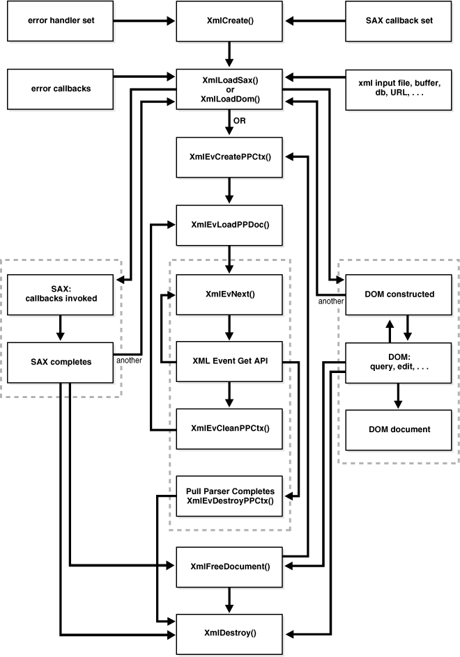

An explanation is given of how to use the Extensible Markup Language (XML) parser for C.

### 5.1 Introduction to the XML Parser for C

Topics here include prerequisites and standards for the XML parser for C.

**See Also:**

[Introduction to XML Parsing for Java](XML-parsing-for-Java.md) for a generic introduction to XML parsing with Document Object Model (DOM) and Simple API for XML (SAX). Much of the information in the introduction is language-independent and applies equally to C.

#### 5.1.1 Prerequisites for Using the XML Parser for C

The Oracle XML parser for C reads an XML document and uses DOM or SAX application programming interfaces (APIs) to provide programmatic access to its content and structure. You can use the parser in validating or nonvalidating mode. A pull parser is also available.

This chapter assumes that you are familiar with these technologies:

- [Document Object Model (DOM)](glossary.md). DOM is an in-memory tree representation of the structure of an XML document.

- [Simple API for XML (SAX)](glossary.md). SAX is a standard for event-based XML parsing.

- Using the XML Pull Parser for C. Pull Parser uses XML events.

- [document type definition (DTD)](glossary.md). An XML DTD defines the legal structure of an XML document.

- [XML Schema](glossary.md). Like a DTD, an XML schema defines the legal structure of an XML document.

- [XML Namespaces](glossary.md). Namespaces are a mechanism for differentiating element and attribute names.

If you require a general introduction to the preceding technologies, consult the XML resources listed in [Related Documents](preface.md).

#### 5.1.2 Standards and Specifications for the XML Parser for C

The standards and specifications for the XDK XML parser are described.

- XML 1.0 is a W3C Recommendation. The Oracle XML Developer's Kit (XDK) for C API provides full support for XML 1.0 (Second Edition).

- The DOM Level 1, Level 2, and Level 3 specifications are World Wide Web Consortium (W3C) Recommendations. The XDK for C API provides full support for DOM Level 1 and 2, but no support for Level 3.

- SAX is available in version 1.0, which is deprecated, and 2.0. SAX is not a W3C specification. The XDK for C API provides full support for both SAX 1.0 and 2.0.

- XML Namespaces is a W3C Recommendation.

**Related Topics**

- [Oracle XML Developer's Kit Standards](XDK-standards.md)

### 5.2 Using the XML Parser API for C

Oracle XML parser for C checks if an XML document is well-formed, and optionally validates it against a DTD. Your application can access the parsed data through the DOM or SAX APIs.

#### 5.2.1 Overview of the Parser API for C

The core of the XML parsing API are the XML, DOM, and SAX APIs.

Table 5-1 describes the interfaces for these APIs. See [Oracle Database XML C API Reference](../caxml/datatypes.md) for the complete API documentation.

Table 5-1 Interfaces for XML, DOM, and SAX APIs

| Package         | Interfaces                                                                                                                                                                                                                                                                                                                                                                                                                                                                                                                                                                                                                                                                                                                                                                                                                                                                                                                                                                                                  | Function Name Convention                                                                                                                         |
|:----------------|:------------------------------------------------------------------------------------------------------------------------------------------------------------------------------------------------------------------------------------------------------------------------------------------------------------------------------------------------------------------------------------------------------------------------------------------------------------------------------------------------------------------------------------------------------------------------------------------------------------------------------------------------------------------------------------------------------------------------------------------------------------------------------------------------------------------------------------------------------------------------------------------------------------------------------------------------------------------------------------------------------------|:-------------------------------------------------------------------------------------------------------------------------------------------------|
| XML             | This package implements a single `XML` interface. The interface defines functions for these tasks: • Creating and destroying contexts. A top-level XML context (`xmlctx`) shares common information between cooperating XML components. • Creating and parsing XML documents and DTDs.                                                                                                                                                                                                                                                                                                                                                                                                                                                                                                                                                                                                                                                                                                                | Function names begin with the string `Xml`. See [Oracle Database XML C API Reference](../caxml/package-XmlDiff-API.md) for API documentation. |
| DOM             | This package provides programmatic access to parsed XML. The package implements these interfaces: • `Attr` defines get and set functions for XML attributes. • `CharacterData` defines functions for manipulating character data. • `Document` defines functions for creating XML nodes, getting information about an XML document, and setting the DTD for a document. • `DocumentType` defines get functions for DTDs. • `Element` defines get and set functions for XML elements. • `Entity` defines get functions for XML entities. • `NamedNodeMap` defines get functions for named nodes. • `Node` defines get and set functions for XML nodes. • `NodeList` defines functions that free a node list and get a node from a list. • `Notation` defines functions that get the system and public ID from a node. • `ProcessingInstruction` defines get and set functions for processing instructions. • `Text` defines a function that splits a text node into two. | Function names begin with the string `XmlDom`. See [Oracle Database XML C API Reference](../caxml/package-DOM-API.md) for API documentation.  |
| SAX             | This package provides programmatic access to parsed XML. The package implements the `SAX` interface, which defines functions that receive notifications for SAX events.                                                                                                                                                                                                                                                                                                                                                                                                                                                                                                                                                                                                                                                                                                                                                                                                                                     | Function names begin with the string `XmlSax`. See [Oracle Database XML C API Reference](../caxml/package-SAX-API.md) for API documentation.  |
| XML Pull Parser | XML events is a representation of an XML document which is similar to SAX events in that the document is represented as a sequence of events like start tag, end tag, comment, and so on. The difference is that SAX events are driven by the parser (producer) and XML events are driven by the application (consumer).                                                                                                                                                                                                                                                                                                                                                                                                                                                                                                                                                                                                                                                                                    | Function names begin with the string `XmlEv`. See [Oracle Database XML C API Reference](../caxml/package-Event-API.md) for API documentation. |

##### 5.2.1.1 XML Parser for C Data Types

The data types used in the XML parser for C are described.

See [Oracle Database XML C API Reference](../caxml/datatypes.md) for the complete list of data types for XDK for C.

Table 5-2 Data Types Used in the XML Parser for C

| Data Type  | Description                         |
|:-----------|:------------------------------------|
| `oratext`  | String pointer                      |
| `xmlctx`   | Master XML context                  |
| `xmlsaxcb` | SAX callback structure (SAX only)   |
| `ub4`      | 32-bit (or larger) unsigned integer |
| `uword`    | Native unsigned integer             |

##### 5.2.1.2 XML Parser for C Defaults

The defaults for the XML parser for C are described.

These are the defaults:

- Character set encoding is 8-bit encoding of Unicode (UTF-8). If all your documents are ASCII, then setting the encoding to US-ASCII increases performance.

- The parser prints messages to `stderr` unless an error handler is provided.

- The parser checks inputs documents for well-formedness but not validity. You can set the property "validate" to validate the input.

  **Note:**

  Oracle recommends that you set the default encoding explicitly if using only single byte character sets (such as US-ASCII or any of the ISO-8859 character sets) for faster performance than is possible with multibyte character sets such as UTF-8.

- The parser conforms with the XML 1.0 specification when processing white space, that is, the parser reports all white space to the application but indicates which white space can be ignored. However, some applications may prefer to set the property "discard-white space," which discards all white space between an end-element tag and this start-element tag.

**See Also:**

- [Oracle Database XML C API Reference](../caxml/package-DOM-API.md) for the DOM, SAX, pull parser, and callback APIs.

#### 5.2.2 XML Parser for C Calling Sequence

The calling sequence for the XML parser for C is illustrated.

Figure 5-1 XML Parser for C Calling Sequence

[Description of "Figure 5-1 XML Parser for C Calling Sequence"](img_text/adxdk096.md)

#### 5.2.3 Using the XML Parser for C: Basic Process

The basic process for using the XML parser for C is described.

Perform these steps in your application:

1.  Initialize the parsing process with the `XmlCreate()` function. The following sample code fragment is from `DOMNamespace.c`:
        xmlctx     *xctx;
        ...
        xctx = XmlCreate(&ecode, (oratext *) "namespace_xctx", NULL);
2.  Parse the input item, which can be an XML document or string buffer.
    If you are parsing with DOM, invoke the `XmlLoadDom()` function. The following sample code fragment is from `DOMNamespace.c`:

        xmldocnode *doc;
        ...
        doc = XmlLoadDom(xctx, &ecode, "file", DOCUMENT,
                         "validate", TRUE, "discard_whitespace", TRUE, NULL);

    If you are parsing with SAX, invoke the `XmlLoadSax()` function. The following sample code fragment is from `SAXNamespace.c`:

        xmlerr      ecode;
        ...
        ecode = XmlLoadSax(xctx, &sax_callback, &sc, "file", DOCUMENT,
                           "validate", TRUE, "discard_whitespace", TRUE, NULL);

    If you are using the pull parser, then include these steps to create the event context and load the document to parse:

        evctx = XmlEvCreatePPCtx(xctx, &xerr, NULL);
        XmlEvLoadPPDoc(xctx, evctx, "File", input_filenames[i], 0, NULL);
3.  If you are using the DOM interface, then include these steps:
    - Use the `XmlLoadDom()` function to invoke `XmlDomGetDocElem()`. This step invokes other DOM functions, which are typically node or print functions that output the DOM document, as required. The following sample code fragment is from `DOMNamespace.c`:

          printElements(xctx, XmlDomGetDocElem(xctx, doc));

    - Invoke the `XmlFreeDocument()` function to clean up any data structures created during the parse process. The following sample code fragment is from `DOMNamespace.c`:

          XmlFreeDocument(xctx, doc);

    If you are using the SAX interface, then include these steps:

    - Process the results of the invocation of `XmlLoadSax()` with a callback function, such as:

          xmlsaxcb saxcb = {
           UserStartDocument,  /* user's own callback functions */
           UserEndDocument,
           /* ... */
          };

          if (XmlLoadSax(xctx, &saxcb, NULL, "file", "some_file.xml", NULL) != 0)
            /* an error occured */

    - Register the callback functions. You can set any of the SAX callback functions to `NULL` if not needed.

    If you are using the pull parser, iterate over the events using:

        cur_event = XmlEvNext(evctx);

    Use the Get APIs to get information about that event.
4.  Use `XmlFreeDocument()` to clean up the memory and structures used during a parse. The program does not free memory allocated for parameters passed to the SAX callbacks or for nodes and data stored with the DOM parse tree until you invoke `XMLFreeDocument()` or `XMLDestroy()`. The following sample code fragment is from `DOMNamespace.c`:
        XmlFreeDocument(xctx, doc);

    Either return to Step 2 or proceed to the next step.

    For the pull parser invoke `XmlEvCleanPPCtx()` to release memory and structures used during the parse. The application can invoke `XmlEvLoadPPDoc()` again to parse another document. Or, it can invoke `XMLEvDestroyPPCtx()` after which the pull parser context cannot be used again.

        XmlEvCleanPPCtx(xctx, evctx);
        ...
        XmlEvDestroyPPCtx(xctx, evctx);
5.  Terminate the parsing process with `XmlDestroy()`. The following sample code fragment is from `DOMNamespace.c`:
        (void) XmlDestroy(xctx);

    If threads fork off somewhere in the sequence of invocations between initialization and termination, the application produces unpredictable behavior and results.

You can use the memory callback functions `XML_ALLOC_F` and `XML_FREE_F` for your own memory allocation. If you do, then specify both functions.

**Related Topics**

- Using the XML Pull Parser for C

#### 5.2.4 Running the XML Parser for C Demo Programs

The `$ORACLE_HOME/xdk/demo/c/` (UNIX) and `%ORACLE_HOME%\xdk\demo\c` (Windows) directories include several XML applications that show how to use the XML parser for C with the DOM and SAX interfaces.

Table 5-3 describes the demos.

The `make` utility compiles the source file `fileName.c` to produce the demo program `fileName` and the output file `fileName.out` . The `fileName.std` is the expected output.

Table 5-3 C Parser Demos

| Directory | Contents                                                                                                                                                          | Demos                                                                                                                                                                                                                                                                                                                                                                                                                                                                                                                                                                                                                                                                                                                                                                                                                                                                                                                                                                                     |
|:----------|:------------------------------------------------------------------------------------------------------------------------------------------------------------------|:------------------------------------------------------------------------------------------------------------------------------------------------------------------------------------------------------------------------------------------------------------------------------------------------------------------------------------------------------------------------------------------------------------------------------------------------------------------------------------------------------------------------------------------------------------------------------------------------------------------------------------------------------------------------------------------------------------------------------------------------------------------------------------------------------------------------------------------------------------------------------------------------------------------------------------------------------------------------------------------|
| `dom`     | `DOMNamespace.c` `DOMSample.c` `FullDom.c` `FullDom.xml` `NSExample.xml` `Traverse.c` `XPointer.c` `class.xml` `cleo.xml` `pantry.xml` | The following demo programs use the DOM API: • The `DOMNamespace` program uses Namespace extensions to the DOM API. It prints out all elements and attributes of `NSExample.xml` along with full namespace information. • The `DOMSample` program uses DOM APIs to display an outline of Cleopatra, that is, the XML elements `ACT` and `SCENE`. The `cleo.xml` document contains the XML version of Shakespeare's The Tragedy of Antony and Cleopatra. • The `FullDom` program shows sample usage of the full DOM interface. It exercises all the invocations. The program accepts `FullDom.xml`, which shows the use of entities, as input. • The `Traverse` program shows the use of DOM iterators, tree walkers, and ranges. The program accepts the `class.xml` document, which describes a college Calculus course, as input. • The `XPointer` program shows the use of the XML Pointer Language by locating the children of the `<pantry>` element in `pantry.xml`. |
| `sax`     | `NSExample.xml` `SAXNamespace.c` `SAXSample.c` `cleo.xml`                                                                                                | The following demo programs use the SAX APIs: • The `SAXNamespace` program uses namespace extensions to the SAX API. It prints out all elements and attributes of `NSExample.xml` along with full namespace information. • The `SAXSample` program uses SAX APIs to show all lines in the play Cleopatra containing a given word. If you do not specify a word, then it uses the word "death." The `cleo.xml` document contains the XML version of Shakespeare's The Tragedy of Antony and Cleopatra.                                                                                                                                                                                                                                                                                                                                                                                                                                                                               |

You can find documentation that describes how to compile and run the sample programs in the `README` in the same directory. The basic steps are:

1.  Change into the `$ORACLE_HOME/xdk/demo/c` directory (UNIX) or `%ORACLE_HOME%\xdk\demo\c` directory (Windows).

2.  Make sure that your environment variables are set as described in [Setting Up XDK for C Environment Variables on UNIX](getting-started-with-XDK-for-C.md) and [Setting Up XDK for C Environment Variables on Windows](getting-started-with-XDK-for-C.md).

3.  Run `make` (UNIX) or `Make.bat` (Windows) at the system prompt. The `make` utility changes into each demo subdirectory and runs `make` to do this:

    1.  Compiles the C source files with the `cc` utility. For example, the `Makefile` in the `$ORACLE_HOME/xdk/demo/c/dom` directory includes these line:

            $(CC) -o DOMSample $(INCLUDE) $@.c $(LIB)

    2.  Runs each demo program and redirects the output to a file. For example, the `Makefile` in the `$ORACLE_HOME/xdk/demo/c/dom` directory includes this line:

            ./DOMSample > DOMSample.out

4.  Compare the `*.std` files to the `*.out` files for each program. The `*.std` file contains the expected output for each program. For example, `DOMSample.std` contains the expected output from running `DOMSample`.

#### 5.2.5 Using the C XML Parser Command-Line Utility

The `xml` utility, which is located in `$ORACLE_HOME/bin` (UNIX) or `%ORACLE_HOME%\bin` (Windows), is a command-line interface that parses XML documents. It checks for both well-formedness and validity.

To use `xml` ensure that your environment is set up as described in [Setting Up XDK for C Environment Variables on UNIX](getting-started-with-XDK-for-C.md) and [Setting Up XDK for C Environment Variables on Windows](getting-started-with-XDK-for-C.md).

Use this syntax on the command line to invoke `xml`. Use `xml.exe` for Windows:

    xml [options] [document URI]
    xml -f [options] [document filespec]

Table 5-4 describes the command-line options.

Table 5-4 C XML Parser Command-Line Options

| Option            | Description                                                                                                                                                                                                          |
|:------------------|:---------------------------------------------------------------------------------------------------------------------------------------------------------------------------------------------------------------------|
| `-B` BaseURI      | Sets the base URI for the XSLT processor. The base URI of `http://pqr/xsl.txt` resolves `pqr.txt` to `http://pqr/pqr.txt`.                                                                                           |
| `-c`              | Checks well-formedness, but performs no validation.                                                                                                                                                                  |
| `-e ``encoding`   | Specifies default input file encoding ("incoding").                                                                                                                                                                  |
| `-E` `encoding`   | Specifies DOM/SAX encoding ("outcoding").                                                                                                                                                                            |
| `-f` `file`       | Interprets the file as filespec, not URI.                                                                                                                                                                            |
| `-G` `xptr_exprs` | Evaluates `XPointer` scheme examples given in a file.                                                                                                                                                                |
| `-h`              | Shows usage help and basic list of command-line options.                                                                                                                                                             |
| `-hh`             | Shows complete list command-line options.                                                                                                                                                                            |
| `-i`` n`          | Specifies the number of times to iterate the `XSLT` processing.                                                                                                                                                      |
| `-l` `language`   | Specifies the language for error reporting.                                                                                                                                                                          |
| `-n`              | Traverses the DOM and reports the number of elements, as shown in this sample output: `ELEMENT       1` ` PCDATA       1` `    DOC       1` `  TOTAL       3 * 60 = 180`                                 |
| `-o ``XSLoutfile` | Specifies the output file of the `XSLT` processor.                                                                                                                                                                   |
| `-p `             | Prints the document/DTD structures after the parse. For example, the root element `<greeting>hello</greeting>` is printed as: `+---ELEMENT greeting ` `    +---PCDATA "hello"`                                 |
| `-P`              | Prints the document from the root element. For example, the root element `<greeting>hello</greeting>` is printed as: `<greeting>hello</greeting>`                                                                 |
| `-PP`             | Prints from the root node (DOC) and includes the XML declaration.                                                                                                                                                    |
| `-PE encoding`    | Specifies the encoding for `-P` or `-PP` output.                                                                                                                                                                     |
| `-PX`             | Includes the XML declaration in the output.                                                                                                                                                                          |
| `-s ``stylesheet` | Specifies the `XSLT` stylesheet.                                                                                                                                                                                     |
| `-v`              | Displays the XDK parser version, and then exits.                                                                                                                                                                     |
| `-V ``var value`  | Tests top-level variables in `CXSLT`.                                                                                                                                                                                |
| `-w`              | Preserves all white space.                                                                                                                                                                                           |
| `-W`              | Stops parsing after a warning.                                                                                                                                                                                       |
| `-x`              | Exercises the SAX interface and prints the document, as shown in this sample output: `StartDocument` `XMLDECL version='1.0' encoding=FALSE` `<greeting>` `    "hello"` `</greeting>` `EndDocument` |

##### 5.2.5.1 Using the XML Parser Command-Line Utility: Example

You can test `xml` documents using the various XML files located in `$ORACLE_HOME/xdk/demo/c`.

Example 5-1 displays the contents of `NSExample.xml`.

You can parse this file, count the number of elements, and display the DOM tree as shown in this example:

    xml -np NSEample.xml > xml.out

Example 5-2shows the output.

Example 5-1 NSExample.xml

    <!DOCTYPE doc [
    <!ELEMENT doc (child*)>
    <!ATTLIST doc xmlns:nsprefix CDATA #IMPLIED>
    <!ATTLIST doc xmlns CDATA #IMPLIED>
    <!ATTLIST doc nsprefix:a1 CDATA #IMPLIED>
    <!ELEMENT child (#PCDATA)>
    ]>
    <doc nsprefix:a1 = "v1" xmlns="http://www.w3c.org"
         xmlns:nsprefix="http://www.oracle.com">
    <child>
    This element inherits the default Namespace of doc.
    </child>
    </doc>

Example 5-2 xml.out

       ELEMENT       2
        PCDATA       1
           DOC       1
           DTD       1
      ELEMDECL       2
      ATTRDECL       3
         TOTAL      10 * 112 = 1120
    +---ELEMENT doc [nsprefix:a1='v1'*, xmlns='http://www.w3c.org'*, xmlns:nsprefix=
    'http://www.oracle.com'*]
        +---ELEMENT child
            +---PCDATA "
    This element inherits the default Namespace of doc.
    "

### 5.3 Using the DOM API for C

Topics here include controlling encoding for XML documents, using NULL-terminated and length-encoded functions, and handling errors.

#### 5.3.1 Controlling the Data Encoding of XML Documents for the C API

XML data occurs in many encodings. You can control the XML encoding in various ways.

- Specify a default encoding to assume for files that are not self-describing

- Specify the presentation encoding for DOM or SAX

- Re-encode when a DOM is serialized

Input XML data is always encoded. Some encodings are entirely self-describing, such as 16-bit encoding of Unicode (UTF-16), which requires a specific Byte Order Mark (BOM) before the start of the actual data. The `XMLDecl` or Multipurpose Internet Mail Extensions (MIME) header of the document can also specify an encoding. If the application cannot determine the specific encoding, then it applies the default input encoding. If you do not provide a default, then the application assumes UTF-8 on ASCII platforms and UTF-EBCDIC on EBCDIC platforms.

The API makes a provision for cases when the encoding data of the input document is corrupt. For example, suppose an ASCII document with an `XMLDecl` of `encoding=ascii` is blindly converted to EBCDIC. The new EBCDIC document contains (in EBCDIC) an `XMLDecl` that incorrectly claims the document is ASCII. The correct behavior for a program that is re-encoding XML data is to regenerate but not convert the `XMLDecl`. The `XMLDecl` is metadata, not data itself. This rule is often ignored, however, which causes corrupt documents. To work around this problem, the API provides an additional flag that enables you to forcibly set the input encoding, thereby overcoming an incorrect `XMLDecl`.

The precedence rules for determining input encoding are:

1.  Forced encoding as specified by the user
    **Note:**

    Forced encoding can cause a fatal error if there is a conflict. For example, the input document is UTF-16 and starts with a UTF-16 BOM, but the user specifies a forced UTF-8 encoding. In this case, the parser objects about the conflict.
2.  Protocol specification (HTTP header, and so on)
3.  `XMLDecl` specification
4.  User's default input encoding
5.  The default, which is UTF-8 on ASCII platforms or UTF-E on EBCDIC platforms

After the application has determined the input encoding, it can parse the document and present the data. You are allowed to choose the presentation encoding; the data is in that encoding regardless of the original input encoding.

When an application writes back a DOM in serialized form, it can choose at that time to re-encode the presentation data. Thus, you can place the serialized document in any encoding.

#### 5.3.2 Using NULL-Terminated and Length-Encoded C API Functions

The native string representation in C is null-terminated. Thus, the primary DOM interface takes and returns null-terminated strings. When stored in table form, however, Oracle XML DB data is not null-terminated but length-encoded. Consequently, XDK provides an additional set of length-encoded APIs for the high-frequency cases to improve performance.

In particular, the DOM functions in Table 5-5 have dual APIs.

Table 5-5 NULL-Terminated and Length-Encoded C API Functions

| NULL-Terminated API    | Length-Encoded API        |
|:-----------------------|:--------------------------|
| `XmlDomGetNodeName()`  | `XmlDomGetNodeNameLen()`  |
| `XmlDomGetNodeLocal()` | `XmlDomGetNodeLocalLen()` |
| `XmlDomGetNodeURI()`   | `XmlDomGetNodeURILen()`   |
| `XmlDomGetNodeValue()` | `XmlDomGetNodeValueLen()` |
| `XmlDomGetAttrName()`  | `XmlDomGetAttrNameLen()`  |
| `XmlDomGetAttrLocal()` | `XmlDomGetAttrLocalLen()` |
| `XmlDomGetAttrURI()`   | `XmlDomGetAttrURILen()`   |
| `XmlDomGetAttrValue()` | `XmlDomGetAttrValueLen()` |

#### 5.3.3 Handling Errors with the C API

The C API functions typically either return a numeric error code (0 for success, nonzero on failure), or pass back an error code through a variable. In all cases, the API stores error codes. Your application can retrieve the most recent error by invoking the `XmlDomGetLastError()` function.

By default, the functions output error messages to `stderr`. However, you can register an error message callback at initialization time. When an error occurs, the application invokes the registered callback and does not print an error.

### 5.4 Using orastream Functions

The orastream function API is an interface that enables you to stream large chunks of data out of a node instead of getting it all in one piece. Nodes of greater than 64 KB are thus accessible.

The orastream API represents a generic input or output stream. This interface is available to XDK users through `xml.h` and is defined by the `orastream` data structure and a set of functions that implement the interface. The creator of the stream passes a list of stream function addresses, along with a stream context to `OraStreamInit`. This function returns an instance of an `orastream` structure.

Several stream properties are specified at the time of initialization. If read or write is provided, the stream operates in byte mode using `OraStreamRead()` and `OraStreamWrite()`. If "read_char" or "write_char" is provided, the stream operates in character mode using `OraStreamReadChar()` and `OraStreamWriteChar()`. In character mode only complete characters are read or written and are never split over buffer boundaries.

A stream context is used to represent the state of the orastream and it persists for the lifetime of a stream.

Just like the input or output streams in Java, a source or a sink for the data is always specified. Output streams store the address of the external stream or object where they must populate the data. Similarly, input streams store the address of the object that is read.

Here are the orastream functions:

    struct orastream;
    typedef struct orastream orastream;
    typedef ub4 oraerr; /* Error code: zero is success, non-zero is failure */

    /* Initialize (Create) & Destroy (Terminate) stream object */

    orastream  *OraStreamInit(void *sctx, void *sid, oraerr *err, ...);
    oraerr     OraStreamTerm(orastream *stream);

    /* Set or Change SID (streamID) for stream (returns old stream ID through osid)*/

    oraerr     OraStreamSid(orastream *stream, void *sid, void **osid);

    /* Is a stream readable or writable? */

    boolean    OraStreamReadable(orastream *stream);
    boolean    OraStreamWritable(orastream *stream);

    /* Open & Close stream */

    oraerr     OraStreamOpen(orastream *stream, ubig_ora *length);
    oraerr     OraStreamClose(orastream *stream);

    /* Read | Write byte stream */

    oraerr     OraStreamRead(orastream *stream, oratext *dest, ubig_ora size,
               oratext **start, ubig_ora *nread, ub1 *eoi);
    oraerr     OraStreamWrite(orastream *stream, oratext *src, ubig_ora size,
               ubig_ora *nwrote);

    /* Read | Write char stream */

    oraerr     OraStreamReadChar(orastream *stream, oratext *dest, ubig_ora size,
               oratext **start, ubig_ora *nread, ub1 *eoi);
    oraerr     OraStreamWriteChar(orastream *stream, oratext *src, ubig_ora size,
               ubig_ora *nwrote);

    /* Return handles for stream */

    orastreamhdl *OraStreamHandle(orastream *stream);

    /* Returns status: if the stream object is currently opened or not */

    boolean OraStreamIsOpen(orastream *stream);

The stream error codes are:

    #define ORASTREAM_ERR_NULL_POINTER      1      /* NULL pointer given */
    #define ORASTREAM_ERR_BAD_STREAM        2      /* invalid stream object */
    #define ORASTREAM_ERR_WRONG_DECTION     3      /* tried wrong-direction I/O */
    #define ORASTREAM_ERR_UNKNOWN_PROPERTY  4      /* unknown creation prop */
    #define ORASTREAM_ERR_NO_DIRECTION      5      /* neither read nor write? */
    #define ORASTREAM_ERR_BI_DIRECTION      6      /* both read any write? */
    #define ORASTREAM_ERR_NOT_OPEN          7      /* stream not open */
    #define ORASTREAM_ERR_WRONG_MODE        8      /* wrote byte/char mode */
    /* --- Open errors --- */
    #define ORASTREAM_ERR_CANT_OPEN         10     /* can't open stream */
    /* --- Close errors --- */
    #define ORASTREAM_ERR_CANT_CLOSE        20     /* can't close stream */

**See Also:**

[Oracle Database XML C API Reference](../caxml/package-Orastream-API.md) for reference information such as parameter definitions in the orastream API

Example 5-3 Using orastream Functions

    int test_read()
    {
       xmlctx *xctx = NULL;
       oratext *barray, *docName = "NSExample.xml";
       orastream* ostream = (orastream *) 0;
       xmlerr ecode = 0;
       ub4 wcount = 0;
       ubig_ora  destsize, nread;
       oraerr oerr = 0;
       ub1 eoi = 0;
       nread = destsize = 1024;
       if (!(xctx = XmlCreateNew(&ecode, (oratext *)"stream_xctx", NULL, wcount,
                                 NULL)))
        {
           printf("Failed to create XML context, error %u\n", (unsigned)ecode);
           return -1;
        }

       barray = XmlAlloc(xctx, sizeof(oratext) * destsize);

       /* open function should be specified in order to read correctly. */
       if (!(ostream = OraStreamInit(NULL,docName, (oraerr *)&ecode,
                                     "open", fileopen,
                                     "read", fileread,
                                     NULL)))
       {
          printf("Failed to initialize OrsStream, error %u\n",(unsigned)ecode);
          return -1;
       }

       /* check readable and writable  */
        if (OraStreamReadable(ostream))
           printf("ostream is readable\n");
        else
           printf("ostream is not readable\n");

         if (OraStreamWritable(ostream))
           printf("ostream is writable\n");
        else
           printf("ostream is not writable\n");

        if (oerr = OraStreamRead(ostream, barray, destsize, &barray, &nread, &eoi))
        {
          printf("Failed to read due to orastream was not open, error %u\n", oerr);
        }

       /* open orastream */
       OraStreamOpen(ostream, NULL);

       /* read document */
       OraStreamRead(ostream, barray, destsize, &barray, &nread, &eoi);

       OraStreamTerm(ostream);

       XmlDestroy(xctx);
       return 0;
    }
    ORASTREAM_OPEN_F(fileopen, sctx, sid, hdl, length)
    {
        FILE *fh = NULL;

        printf("Opening orastream %s...\n", (oratext *)sid);

        if (sid && ((fh= fopen(sid, "r")) != NULL))
        {
            printf("Opening orastream %s...\n", (oratext *)sid);
        }
        else
        {
             printf("Failed to open input file.\n");
             return -1;
         }

        /* store file handle generically, NULL means stdout */
        hdl->ptr_orastreamhdl = fh;

        return XMLERR_OK;
    }

    ORASTREAM_READ_F(fileread, sctx, sid, hdl,
                             dest, size, start, nread, eoi)
    {
        FILE *fh = NULL;
        int i =0;
        printf("Reading orastream %s ...\n", (oratext *)sid);

        // read data from file to dest
        if ((fh = (FILE *) hdl->ptr_orastreamhdl) != NULL)
            *nread = fread(dest, 1, size, fh);
        printf("Read %d bytes from orastream...\n", (int) *nread);

        *eoi = (*nread < size);
        if (start)
            *start = dest;

        printf("printing document ...\n");
        for(i =0; i < *nread; i++)
        printf("%c", (char)dest[i]);
        printf("\nend ...\n");
        return ORAERR_OK;
    }

### 5.5 Using the SAX API for C

To use SAX, initialize an `xmlsaxcb` structure with function pointers and pass it to `XmlLoadSax()`. You can also include a pointer to a user-defined context structure, which you pass to each SAX function.

**See Also:**

[Oracle Database XML C API Reference](../caxml/package-SAX-API.md) for the SAX callback structure

### 5.6 Using the XML Pull Parser for C

The XML Pull Parser is an implementation of the XML Events interface. The XML Pull Parser and the SAX parser are similar, but using the Pull Parser, the application (consumer) drives the events, while in SAX, the parser (producer) drives the events.

Both the XML Pull Parser and SAX represent the document as a sequence of events, with start tags, end tags, and comments. XML Pull Parser gives control to the application by exposing a simple set of APIs and an underlying set of events. Methods such as `XmlEvNext` allow an application to ask for (or pull) the next event, rather than handling the event in a callback, as in SAX. Thus, the application has more procedural control over XML processing. Also, the application can decide to stop further processing, unlike a SAX application, which parses the entire document.

#### 5.6.1 Using Basic XML Pull Parsing Capabilities

The steps required to use the XML Pull Parser are described.

1.  Invoke `XmlCreate` to initialize the XML meta-context.
2.  Initialize the Pull Parser context by invoking the `XmlEvCreatePPCtx` function, which creates and returns the event context.
    The `XmlEvCreatePPCtx` function supports all the properties supported by `XmlLoadDom` and `XmlLoadSax`, plus some additional ones.

    The `XmlEvCreatePPCtx` and `XmlEvCreatePPCtxVA` functions are fully implemented.
3.  Ensure that the event context is passed to all subsequent invocations of the Pull Parser.
4.  Terminate the Pull Parser context by invoking the `XmlEvDestoryPPCtx` function, to clean up memory.
5.  Destroy the XML meta-context by invoking the `XmlDestoryCtx` function.

##### 5.6.1.1 XML Event Context

The XML event context structure is shown.

Example 5-4 XML Event Context

    typedef  struct {
       void *ctx_xmlevctx;                   /* implementation specific context */
       xmlevdisp *disp_xmlevctx;             /* dispatch table */
       ub4 checkword_xmlevctx;               /* checkword for integrity check */
       ub4 flags_xmlevctx;                   /* mode; default: expand_entity */
       struct xmlevctx *input_xmlevctx;      /* input xmlevctx; chains the XML Event
                                                context */
    } xmlevctx;

##### 5.6.1.2 About the XML Event Context

Each XML Pull Parser is allowed to create its own context and implement its own API functions.

- Dispatch Table

  The dispatch table, `disp_xmlevctx`, contains one pointer for each API function, except for the `XmlEvCreatePPCtx`, `XmlEvCreatePPCtxVA`, `XmlEvDestoryPPCtx`, `XmlEvLoadPPDoc`, and `XmlEvCleanPPCtx` functions.

  When the event context is created, the pointer `disp_xmlevctx` is initialized with the address of that static table.

- Implementation-Specific Event Context

  The field `ctx_xmlevctx` must be initialized with the address of the context specific to this invocation of the particular implementation. The implementation-specific event context is of type `*void`, so that it can differ for different applications.

- Input Event Context

  Each Pull Parser can specify an input event context, `xmlevctx`. This field enables the parser to chain multiple event producers. As a result, if a dispatch function is specified as `NULL` in a context, the application uses the next non-null dispatch function in the chain of input event contexts. The base `xmlevctx` must ensure that all dispatch function pointers are non-null.

#### 5.6.2 Parsing Multiple XML Documents

After creating and initializing the XML Event Context, an application can parse multiple documents using repeated invocations of `XmlEvLoadPPDoc` and `XmlEvCleanPPCtx`.

The properties defined by the application during the XML Event Context creation cannot be changed for each invocation of the `XmlLoadPPDoc` function. to change the properties, destroy the event context and then re-create it.

After `XmlEvCleanPPCtx` cleans up the internal structure of the current parser, the event context can be reused to parse another document.

#### 5.6.3 ID Callback

You can provide a callback to convert text-based names to 8-byte identifiers (IDs).

##### Callback Function Signature

    typedef  sb8 (*xmlev_id_cb_funcp)( void *ctx , ub1 type, ub1 *token, ub4 tok_len,
                  sb8 nmspid, boolean isAttribute);

##### Return Value

`sb8`: an 8-byte ID.

##### Arguments

- \*`ctx`: The implementation context.

- `type`: The type, which is indicated by this enumeration:

      typedef enum
      {
        XML_EVENT_ID_URI,
        XML_EVENT_ID_QNAME,
      }xmlevidtype;

- \*`token` and `tok_len`: The actual text to be converted.

- `nmspid`: The namespace ID.

- `isAttribute`: A Boolean value indicating an attribute.

Internally, the `XmlEvGetTagId` and `XmlEvGetAttrID` APIs invoke this callback twice, once to fetch the namespace ID and once to fetch the actual ID of the tag or the attribute `Qname`.

The `XmlEvGetTagUriID` and `XmlEvGetAttrUriID` functions invoke this callback once to get the ID of the corresponding Universal Resource Identifier (URI).

If a callback is not supplied, an error `XML_ERR_EVENT_NOIDCBK` is returned when these APIs are used.

#### 5.6.4 Error Handling for the XML Pull Parser

Error handling for the XML Pull Parser is described.

##### 5.6.4.1 Parser Errors

Errors raised by the parser are described.

The XML Pull Parser returns the message `XML_EVENT_FATAL_ERROR` when it throws an error because the input document is malformed. Function `XmlEvGetError` is provided to get the error number and message.

During the `XmlEvCreatePPCtx` operation, any error handler supplied by the application during `XmlCreate` is overridden. The application must invoke the `XmlErrSetHandler` function after the `XmlEvDestroyPPCtx` operation to restore the original callback.

##### 5.6.4.2 Programming Errors

To handle programmatic errors. XDK provides a callback that the application can supply when creating an event context. This callback is invoked when the application invokes an illegal API.

The callback signature is:

    typedef  void (* xmlev_err_cb_funcp)(xmlctx *xctx, xmlevctx *evctx,
            xmlevtype cur_event);

An example of an illegal API invocation is:

`XmlEvGetName` cannot be called for the `XML_EVENT_CHARACTERS` event.

#### 5.6.5 Sample Pull Parser Application

A sample pull parser application, a document to be parsed, and a list of the events that the application generates from the document are presented.

Example 5-5 shows the sample application code.

Example 5-6 shows the sample document to be parsed.

Example 5-7 shows the sequence of events generated when the attribute events property is `FALSE` and the expand entities properties is `TRUE`.

Example 5-5 Sample Pull Parser Application Example

    # include "xml.h"
    # include "xmlev.h"
    ...
    xmlctx *xctx;
    xmlevctx *evtcx;
    if (!(xctx = XmlCreate(&xerr, (oratext *) "test")))
    {
        printf("Failed to create XML context, error %u\n", (unsigned) xerr);
        return -1;
    }
    ...
    if(!(evctx = XmlEvCreatePPCtx(xctx, &xerr, NULL)))
    {
       printf("Failed to create EVENT context, error %u\n", (unsigned) xerr);
       return -1;
     }
    for(i = 0; i < numDocs; i++)
    {
      if (xerr = XmlEvLoadPPDoc(xctx, evctx, "file", input_filenames[i], 0, NULL)
         {
           printf("Failed to load the document, error %u\n", (unsigned) xerr);
           return -1;
         }
    ...
      for(;;)
      {
        xmlevtype cur_event;
        cur_event = XmlEvNext(evctx);
        switch(cur_event)
             {
                   case XML_EVENT_FATAL_ERROR:
                         XmlEvGetError(evctx, (oratext **)&errmsg);
                              printf("Error %s\n", errmsg);
                   return;
                   case XML_EVENT_START_ELEMENT:
                         printf("<%s>", XmlEvGetName0(evctx));
                   break;
                   case XML_EVENT_END_DOCUMENT:
                         printf("<%s>", XmlEvGetName0(evctx));
                   return;
             }
      }
      XmlEvCleanPPCtx(xctx, evctx);
    }
    XmlEvDestroyPPCtx(xctx, evctx);
    XmlDestroy(xctx);

Example 5-6 Sample Document to Parse

    <!DOCTYPE doc [
    <!ENTITY ent SYSTEM "file:attendees.txt">
    <!ELEMENT doc ANY>
    <!ELEMENT meeting (topic, date, publishAttendees)>
    <!ELEMENT publishAttendees (#PCDATA)>
    <!ELEMENT topic (#PCDATA)>
    <!ELEMENT date (#PCDATA)>
    ]>
    <!-- Begin Document -->
    <doc>
      <!-- Info about the meeting -->
      <meeting>
        <topic>Group meeting</topic>
        <date>April 25, 2005</date>
        <publishAttendees>&ent;</publishAttendees>
      </meeting>
    </doc>
    <!-- End Document -->

Example 5-7 Events Generated by Parsing a Sample Document

    XML_EVENT_START_DOCUMENT
    XML_EVENT_START_DTD
    XML_EVENT_PE_DECLARATION
    XML_EVENT_ELEMENT_DECLARATION
    XML_EVENT_ELEMENT_DECLARATION
    XML_EVENT_ELEMENT_DECLARATION
    XML_EVENT_ELEMENT_DECLARATION
    XML_EVENT_ELEMENT_DECLARATION
    XML_EVENT_END_DTD
    XML_EVENT_COMMENT
    XML_EVENT_START_ELEMENT
    XML_EVENT_SPACE
    XML_EVENT_COMMENT
    XML_EVENT_SPACE
    XML_EVENT_START_ELEMENT
    XML_EVENT_START_ELEMENT
    XML_EVENT_CHARACTERS
    XML_EVENT_END_ELEMENT
    XML_EVENT_START_ELEMENT
    XML_EVENT_CHARACTERS
    XML_EVENT_END_ELEMENT
    XML_EVENT_START_ELEMENT
    XML_EVENT_START_ENTITY
    XML_EVENT_CHARACTERS
    XML_EVENT_END_ENTITY
    XML_EVENT_END_ELEMENT
    XML_EVENT_END_ELEMENT
    XML_EVENT_SPACE
    XML_EVENT_END_ELEMENT
    XML_EVENT_COMMENT
    XML_EVENT_END_DOCUMENT

### 5.7 Using OCI and the XDK for C API

This section describes accessing XDK for C functions from Oracle Call Interface (OCI).

#### 5.7.1 Using XMLType Functions and Descriptions

You can use the C API for XML with `XMLType` columns in the database. An Oracle Call Interface (OCI) program can access XML data stored in a table by initializing the values of OCI handles.

This applies to handles such as these:

- Environment handle

- Service handle

- Error handle

- Optional parameters

The program can pass these input values to the function `OCIXmlDbInitXmlCtx()`, which returns an XML context. After the program invokes the C API, the function `OCIXmlDbFreeXmlCtx()` frees the context.

Table 5-6 XMLType Functions

| Function Name                       | Description                                                                        |
|:------------------------------------|:-----------------------------------------------------------------------------------|
| `XmlCreateDocument()`               | Create empty `XMLType` instance                                                    |
| `XmlLoadDom()` and so on            | Create from a source buffer                                                        |
| `XmlXPathEvalexpr()` and family     | Extract an `XPath` expression                                                      |
| `XmlXslProcess()` and family        | Transform using an Extensible Stylesheet Language Transformation (XSLT) stylesheet |
| `XmlXPathEvalexpr()` and family     | Check if an `XPath` exists                                                         |
| `XmlDomIsSchemaBased()`             | Is document schema-based?                                                          |
| `XmlDomGetSchema()`                 | Get schema information                                                             |
| `XmlDomGetNodeURI()`                | Get document namespace                                                             |
| `XmlSchemaValidate()`               | Validate using schema                                                              |
| Cast `(void *)` to `(xmldocnode *)` | Get DOM from `XMLType`                                                             |
| Cast `(xmldocnode *)` to `(void *)` | Get `XMLType` from DOM                                                             |

#### 5.7.2 Initializing an XML Context for Oracle XML DB

An XML context is a required parameter in each C DOM API function. This opaque context encapsulates information pertaining to data encoding, error message language, and so on. The contents of this XML context are different for XDK applications and for Oracle XML DB applications.

**Note:**

Do not use an XML context for XDK in an Oracle XML DB application, or an XML context for Oracle XML DB in an XDK application.

For Oracle XML DB, the two OCI functions that initialize and free an XML context have these prototypes:

    xmlctx *OCIXmlDbInitXmlCtx (OCIEnv *envhp, OCISvcCtx *svchp, OCIError *errhp,
           ocixmldbparam *params, ub4 num_params);

    void OCIXmlDbFreeXmlCtx (xmlctx *xctx);

**See Also:**

- [Oracle Call Interface Programmer's Guide](../lnoci/oci-xml-databse-functions.md) for reference material on the functions

- [Oracle Call Interface Programmer's Guide](../lnoci/index.md) for a discussion about OCI support for XML

- [Oracle Database XML C API Reference](../caxml/package-DOM-API.md) for reference information on the DOM APIs

#### 5.7.3 Creating XMLType Instances on the Client

You can construct new `XMLType` instances on the client by using the `XmlLoadDom()` invocations.

Follow these basic steps:

1.  You must initialize the `xmlctx`, as showd in the example in Using the DOM API for C.
2.  You can construct the XML data itself from these sources:
    - User buffer

    - Local file

    - URI

    The return value from these is an `(xmldocnode *)`, which you can use in the rest of the common C API.
3.  You can cast the `(xmldocnode *)` to a (`void *)` and directly provide it as the bind value if required.

You can construct empty `XMLType` instances by invoking `XmlCreateDocument()`. This function would be equivalent to an `OCIObjectNew()` for other types. You can operate on the `(xmldocnode *)` returned by the preceding invocation and finally cast it to a `(void *)` if it must be provided as a bind value.

#### 5.7.4 Operating on XML Data in the Database Server

You can operate on XML data in Oracle Database using OCI statements. You can bind and define `XMLType` values using `xmldocnode` and use OCI statements to extract XML data from the database. You can use this data directly in C DOM functions or bind values directly to SQL statements.

#### 5.7.5 Using OCI and the XDK for C API: Examples

Examples show how to use the DOM API to construct and save an XML schema-based document and to modify a database document.

Example 5-8 shows how to construct a schema-based document with the DOM API and save it to the database. You must include the header files `xml.h` and `ocixmldb.h`.

Example 5-9 shows how to get a document from the database and modify it with the DOM API.

Example 5-8 Constructing a Schema-Based Document with the DOM API

    #include <xml.h>
    #include <ocixmldb.h>
    static oratext tlpxml_test_sch[] = "<TOP xmlns='example1.xsd'\n\
    xmlns:xsi='http://www.w3.org/2001/XMLSchema-instance' \n\
    xsi:schemaLocation='example1.xsd example1.xsd'/>";

    void example1()
    {
        OCIEnv *envhp;
        OCIError *errhp;
        OCISvcCtx *svchp;
        OCIStmt *stmthp;
        OCIDuration dur;
        OCIType *xmltdo;

        xmldocnode  *doc;
        ocixmldbparam params[1];
        xmlnode *quux, *foo, *foo_data;
        xmlerr       err;

        /* Initialize envhp, svchp, errhp, dur, stmthp */
        /* ........ */

        /* Get an xml context */
        params[0].name_ocixmldbparam = XCTXINIT_OCIDUR;
        params[0].value_ocixmldbparam = &dur;
        xctx = OCIXmlDbInitXmlCtx(envhp, svchp, errhp, params, 1);

        /* Start processing */
        printf("Supports XML 1.0: %s\n",
           XmlHasFeature(xctx, (oratext *) "xml", (oratext *) "1.0") ? "YES" : "NO");

        /* Parsing a schema-based document */
        if (!(doc = XmlLoadDom(xctx, &err, "buffer", tlpxml_test_sch,
                              "buffer_length", sizeof(tlpxml_test_sch)-1,
                              "validate", TRUE, NULL)))
        {
           printf("Parse failed, code %d\n");
           return;
        }

        /* Create some elements and add them to the document */
        top = XmlDomGetDocElem(xctx, doc);
        quux = (xmlnode *) XmlDomCreateElem(xctx ,doc, (oratext *) "QUUX");
        foo = (xmlnode *) XmlDomCreateElem(xctx, doc, (oratext *) "FOO");
        foo_data = (xmlnode *) XmlDomCreateText(xctx, doc, (oratext *)"foo's data");
        foo_data = XmlDomAppendChild(xctx, (xmlnode *) foo, (xmlnode *) foo_data);
        foo = XmlDomAppendChild(xctx, quux, foo);
        quux = XmlDomAppendChild(xctx, top, quux);

        XmlSaveDom(xctx, &err, top, "stdio", stdout, NULL);
        XmlSaveDom(xctx, &err, doc, "stdio", stdout, NULL);

        /* Insert the document to my_table */
        ins_stmt = "insert into my_table values (:1)";

        status = OCITypeByName(envhp, errhp, svchp, (const text *) "SYS",
                       (ub4) strlen((char *)"SYS"), (const text *) "XMLTYPE",
                       (ub4) strlen((char *)"XMLTYPE"), (CONST text *) 0,
                       (ub4) 0, dur, OCI_TYPEGET_HEADER,
                       (OCIType **) &xmltdo)) ;

        if (status == OCI_SUCCESS)
        {
           exec_bind_xml(svchp, errhp, stmthp, (void *)doc, xmltdo, ins_stmt));
        }

       /* free xml ctx */
       OCIXmlDbFreeXmlCtx(xctx);
    }

    /*--------------------------------------------------------*/
    /* execute a sql statement which binds xml data */
    /*--------------------------------------------------------*/
    sword exec_bind_xml(svchp, errhp, stmthp, xml, xmltdo, sqlstmt)
    OCISvcCtx *svchp;
    OCIError *errhp;
    OCIStmt *stmthp;
    void *xml;
    OCIType *xmltdo;
    OraText *sqlstmt;
    {
       OCIBind *bndhp1 = (OCIBind *) 0;
       OCIBind *bndhp2 = (OCIBind *) 0;
       sword  status = 0;
       OCIInd ind = OCI_IND_NOTNULL;
       OCIInd *indp = &ind;

       if(status = OCIStmtPrepare(stmthp, errhp, (OraText *)sqlstmt,
                        (ub4)strlen((char *)sqlstmt),
                        (ub4) OCI_NTV_SYNTAX, (ub4) OCI_DEFAULT)) {
         return OCI_ERROR;
       }

       if(status = OCIBindByPos(stmthp, &bndhp1, errhp, (ub4) 1, (dvoid *) 0,
                       (sb4) 0, SQLT_NTY, (dvoid *) 0, (ub2 *)0,
                       (ub2 *)0, (ub4) 0, (ub4 *) 0, (ub4) OCI_DEFAULT)) {
         return OCI_ERROR;
       }

       if(status = OCIBindObject(bndhp1, errhp, (CONST OCIType *) xmltdo,
                   (dvoid **) &xml, (ub4 *) 0, (dvoid **) &indp, (ub4 *) 0)) {
         return OCI_ERROR;
       }

       if(status = OCIStmtExecute(svchp, stmthp, errhp, (ub4) 1, (ub4) 0,
                    (CONST OCISnapshot*) 0, (OCISnapshot*) 0, (ub4) OCI_DEFAULT)) {
         return OCI_ERROR;
      }

       return OCI_SUCCESS;
    }

Example 5-9 Modifying a Database Document with the DOM API

    #include <xml.h>
    #include <ocixmldb.h>
    sword example2()
    {
        OCIEnv *envhp;
        OCIError *errhp;
        OCISvcCtx *svchp;
        OCIStmt *stmthp;
        OCIDuration dur;
        OCIType *xmltdo;

        xmldocnode  *doc;
        xmlnodelist *item_list; ub4 ilist_l;
        ocixmldbparam params[1];
        text *sel_xml_stmt = (text *)"SELECT xml_col FROM my_table";
        ub4    xmlsize = 0;
        sword  status = 0;
        OCIDefine *defnp = (OCIDefine *) 0;

        /* Initialize envhp, svchp, errhp, dur, stmthp */
        /* ... */

        /* Get an xml context */
        params[0].name_ocixmldbparam = XCTXINIT_OCIDUR;
        params[0].value_ocixmldbparam = &dur;
        xctx = OCIXmlDbInitXmlCtx(envhp, svchp, errhp, params, 1);

        /* Start processing */
        if(status = OCITypeByName(envhp, errhp, svchp, (const text *) "SYS",
                       (ub4) strlen((char *)"SYS"), (const text *) "XMLTYPE",
                       (ub4) strlen((char *)"XMLTYPE"), (CONST text *) 0,
                       (ub4) 0, dur, OCI_TYPEGET_HEADER,
                       (OCIType **) xmltdo_p)) {
           return OCI_ERROR;
        }

        if(!(*xmltdo_p)) {
           printf("NULL tdo returned\n");
           return OCI_ERROR;
        }

        if(status = OCIStmtPrepare(stmthp, errhp, (OraText *)selstmt,
                        (ub4)strlen((char *)selstmt),
                        (ub4) OCI_NTV_SYNTAX, (ub4) OCI_DEFAULT)) {
          return OCI_ERROR;
        }

        if(status = OCIDefineByPos(stmthp, &defnp, errhp, (ub4) 1, (dvoid *) 0,
                       (sb4) 0, SQLT_NTY, (dvoid *) 0, (ub2 *)0,
                       (ub2 *)0, (ub4) OCI_DEFAULT)) {
           return OCI_ERROR;
        }

        if(status = OCIDefineObject(defnp, errhp, (OCIType *) *xmltdo_p,
                                (dvoid **) &doc,
                                &xmlsize, (dvoid **) 0, (ub4 *) 0)) {
          return OCI_ERROR;
        }

        if(status = OCIStmtExecute(svchp, stmthp, errhp, (ub4) 1, (ub4) 0,
                     (CONST OCISnapshot*) 0, (OCISnapshot*) 0, (ub4) OCI_DEFAULT)) {
          return OCI_ERROR;
        }

        /* We have the doc. Now we can operate on it */
        printf("Getting Item list...\n");

       item_list = XmlDomGetElemsByTag(xctx,(xmlelemnode *) elem,(oratext *)"Item");
        ilist_l   = XmlDomGetNodeListLength(xctx, item_list);
        printf(" Item list length = %d \n", ilist_l);

        for (i = 0; i < ilist_l; i++)
        {
          elem = XmlDomGetNodeListItem(xctx, item_list, i);
          printf("Elem Name:%s\n", XmlDomGetNodeName(xctx, fragelem));
          XmlDomRemoveChild(xctx, fragelem);
        }

        XmlSaveDom(xctx, &err, doc, "stdio", stdout, NULL);

       /* free xml ctx */
       OCIXmlDbFreeXmlCtx(xctx);

       return OCI_SUCCESS;
    }
