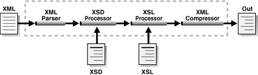
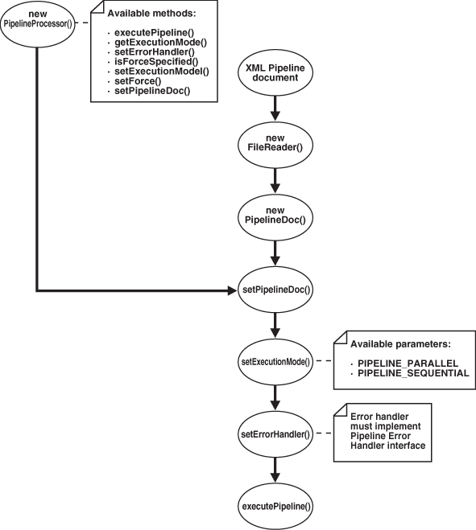

An explanation is given of how to use the Extensible Markup Language (XML) pipeline processor for Java.

### 19.1 Introduction to the XML Pipeline Processor

Topics here include prerequisites, standards and specifications, multistage processing, and customized pipeline processing.

#### 19.1.1 Prerequisites for Using the XML Pipeline Processor for Java

Prerequisites for using the XML Pipeline processor are listed.

This chapter assumes that you are familiar with these topics:

- [XML Pipeline Definition Language](glossary.md). This XML vocabulary enables you to describe the processing relations between XML resources. For a more thorough introduction to the Pipeline Definition Language, consult the XML resources listed in [Related Documents](preface.md).

- [Document Object Model (DOM)](glossary.md). DOM is an in-memory tree representation of the structure of an XML document.

- [Simple API for XML (SAX)](glossary.md). SAX is a standard for event-based XML parsing.

- [XML Schema language](glossary.md). See [Using the XML Schema Processor for Java](using-XML-schema-processor-for-Java.md) for an overview and links to suggested reading.

#### 19.1.2 Standards and Specifications for the XML Pipeline Processor for Java

The Oracle XML Pipeline processor is based on the World Wide Web Consortium (W3C) XML Pipeline Definition Language Version 1.0 Note. The W3C Note defines an XML vocabulary rather than an application programming interface (API).

[Pipeline Definition Language Standard for XDK for Java](XDK-standards.md) describes the differences between the W3C Note and the Oracle XML Developer's Kit (XDK) implementation of the Oracle XML Pipeline processor.

**See Also:**

- [XML Pipeline Definition Language Version 1.0](https://www.oracle.com/pls/topic/lookup?ctx=en/database/oracle/oracle-database/19/adxdk&id=w3_org_xml_pipeline)

- [Table 34-1](XDK-standards.md)

#### 19.1.3 Multistage XML Processing

The Oracle XML Pipeline processor is built on the XML Pipeline Definition Language. The processor can take an input XML pipeline document and execute pipeline processes according to derived dependencies.

A **pipeline document**, which is written in XML, specifies the processes to be executed in a declarative manner. You can associate Java classes with processes by using the `<processdef/>` element in the pipeline document.

Use the Pipeline processor for multistage processing, which occurs when you process XML components sequentially or in parallel. The output of one stage of processing can become the input of another stage of processing. You can write a pipeline document that defines the inputs and outputs of the processes. Figure 19-1 shows a possible pipeline sequence.

Figure 19-1 Pipeline Processing

[Description of "Figure 19-1 Pipeline Processing"](img_text/adxdk116.md)

In addition to the XML Pipeline processor itself, XDK provides an API for processes that you can pipe together in a pipeline document. Table 19-2 summarizes the classes provided in the `oracle.xml.pipeline.processes` package.

The typical stages of processing XML in a pipeline are:

1.  Parse the input XML documents. The `oracle.xml.pipeline.processes` package includes `DOMParserProcess` for DOM parsing and `SAXParserProcess` for SAX parsing.

2.  Validate the input XML documents.

3.  Serialize or transform the input documents. The Pipeline processor does not enable you to connect the SAX parser to the Extensible Stylesheet Language Transformation (XSLT) processor, which requires a DOM.

In multistage processing, SAX is ideal for filtering and searching large XML documents. Use DOM to change or access XML content efficiently and dynamically.

**See Also:**

Processing XML in a Pipeline to learn how to write a pipeline document that provides the input for a pipeline application

#### 19.1.4 Customized Pipeline Processes

Class `oracle.xml.pipeline.controller.Process` is the base class for all pipeline process definitions. The classes in package `oracle.xml.pipeline.processes` extend this base class. To create a customized pipeline process, you must create a class that extends class `Process`.

At the minimum, every custom process must override the do-nothing `initialize()` and `execute()` methods of the `Process` class. If the customized process accepts SAX events as input, then it should override the `SAXContentHandler()` method to return the appropriate `ContentHandler` that handles incoming SAX events. It should also override the `SAXErrorHandler()` method to return the appropriate `ErrorHandler`. Table 19-1 provides further descriptions of the preceding methods.

Table 19-1 Methods in Class oracle.xml.pipeline.controller.Process

| Class                 | Description                                                                                                                                                                                                                                                                                                                                                                                                                                                                                                                                                                                                                                                                                                                                                            |
|:----------------------|:-----------------------------------------------------------------------------------------------------------------------------------------------------------------------------------------------------------------------------------------------------------------------------------------------------------------------------------------------------------------------------------------------------------------------------------------------------------------------------------------------------------------------------------------------------------------------------------------------------------------------------------------------------------------------------------------------------------------------------------------------------------------------|
| `initialize()`        | Initializes the process before execution. Invoke `getInput()` to fetch a specific input object associated with the process element and invoke `supportType()` to indicate the types of input supported. Analogously, invoke `getOutput()` and `supportType()` for output.                                                                                                                                                                                                                                                                                                                                                                                                                                                                                           |
| `execute()`           | Executes the process. Invoke `getInParaValue()`, `getInput()`, or `getInputSource()` to fetch the inputs to the process. If a custom process outputs SAX events, then it should invoke the `getSAXContentHandler()` and `getSAXErrorHandler()` methods in `execute()` to get the SAX handlers of these processes in the pipeline: Invoke `setOutputResult()`, `getOutputStream()`, `getOutputWriter()` or `setOutParam()` to set the outputs or outparams generated by this process. Invoke `getErrorSource()`, `getErrorStream()`, or `getErrorDocument()` to access the pipeline error element associated with this process element. If an exception occurs during `execute()`, invoke `error()` or `info()` to propagate it to the `PipelineErrorHandler`. |
| `SAXContentHandler()` | Returns the SAX `ContentHandler`. If dependencies from other processes are not available, then return `null`. When these dependencies are available, the method is executed till the end.                                                                                                                                                                                                                                                                                                                                                                                                                                                                                                                                                                           |
| `SAXErrorHandler()`   | Returns the SAX `ErrorHandler`. If you do not override this method, then the JAXB processor uses the default error handler implemented by this class to handle SAX errors.                                                                                                                                                                                                                                                                                                                                                                                                                                                                                                                                                                                          |

**See Also:**

[Oracle Database XML Java API Reference](../jaxml/index.md) for information about package `oracle.xml.pipeline.processes`

### 19.2 Using the XML Pipeline Processor for Java: Overview

Topics here include the basic process, running the demo programs, and using the XML pipeline processor command-line utility.

#### 19.2.1 Using the XML Pipeline Processor for Java: Basic Process

The basic process of the XML Pipeline Processor for Java is described.

The XML Pipeline processor for Java is accessible through these packages:

- `oracle.xml.pipeline.controller`, which provides an XML Pipeline controller that executes XML processes in a pipeline based on dependencies.

- `oracle.xml.pipeline.processes`, which provides wrapper classes for XML processes that can be executed by the XML Pipeline controller. The `oracle.xml.pipeline.processes` package contains the classes that you can use to design a pipeline application framework. Each class extends the `oracle.xml.pipeline.controller.Process` class.

  Table 19-2 lists the components in the package. You can connect these components and processes through a combination of the XML Pipeline processor and a pipeline document.

Table 19-2 Classes in oracle.xml.pipeline.processes

| Class                   | Description                                                                                                                                                                         |
|:------------------------|:------------------------------------------------------------------------------------------------------------------------------------------------------------------------------------|
| `CompressReaderProcess` | Receives compressed XML and outputs parsed XML.                                                                                                                                     |
| `CompressWriterProcess` | Receives XML parsed with DOM or SAX and outputs compressed XML.                                                                                                                     |
| `DOMParserProcess`      | Parses incoming XML and outputs a DOM tree.                                                                                                                                         |
| `SAXParserProcess`      | Parses incoming XML and outputs SAX events.                                                                                                                                         |
| `XPathProcess`          | Accepts a DOM as input, uses an XPath pattern to select one or more nodes from an XML `Document` or an XML `DocumentFragment`, and outputs a `Document` or `DocumentFragment`.      |
| `XSDSchemaBuilder`      | Parses an XML schema and outputs a schema object for validation. This process is built into the XML Pipeline processor and builds schema objects used for validating XML documents. |
| `XSDValProcess`         | Validates against a local schema, analyzes the results, and reports errors if necessary.                                                                                            |
| `XSLProcess`            | Accepts DOM as input, applies an XSL stylesheet, and outputs the result of the transformation.                                                                                      |
| `XSLStylesheetProcess`  | Receives an XSL stylesheet as a stream or DOM and creates an `XSLStylesheet` object.                                                                                                |

Figure 19-2 shows how to pass a pipeline document to a Java application that uses the XML Pipeline processor, configure the processor, and execute the pipeline.

Figure 19-2 Using the Pipeline Processor for Java

[Description of "Figure 19-2 Using the Pipeline Processor for Java"](img_text/adxdk120.md)

The basic steps are:

1.  Instantiate a pipeline document, which forms the input to the pipeline execution. Create the object by passing a `FileReader` to the constructor:
        PipelineDoc pipe;
        FileReader f;
        pipe = new PipelineDoc((Reader)f, false);
2.  Instantiate a pipeline processor. `PipelineProcessor` is the top-level class that executes the pipeline. Table 19-3 describes some available methods.
    Table 19-3 PipelineProcessor Methods

    | Method               | Description                                                                                                                                                                                                                          |
    |:---------------------|:-------------------------------------------------------------------------------------------------------------------------------------------------------------------------------------------------------------------------------------|
    | `executePipeline()`  | Executes the pipeline based on the `PipelineDoc` set by invoking `setPipelineDoc()`.                                                                                                                                                 |
    | `getExecutionMode()` | Gets the type of execution mode: `PIPELINE_SEQUENTIAL` or `PIPELINE_PARALLEL`.                                                                                                                                                       |
    | `setErrorHandler()`  | Sets the error handler for the pipeline. This invocation is mandatory to execute the pipeline.                                                                                                                                       |
    | `setExecutionMode()` | Sets the execution mode. `PIPELINE_PARALLEL` is the default and specifies that the processes in the pipeline must execute in parallel. `PIPELINE_SEQUENTIAL` specifies that the processes in the pipeline must execute sequentially. |
    | `setForce()`         | Sets execution behavior. If `TRUE`, then the pipeline executes regardless of whether the target is up-to-date with the pipeline inputs.                                                                                              |
    | `setPipelineDoc()`   | Sets the `PipelineDoc` object for the pipeline.                                                                                                                                                                                      |

    This statement instantiates the pipeline processor:

        proc = new PipelineProcessor();
3.  Set the processor to the pipeline document. For example:
        proc.setPipelineDoc(pipe);
4.  Set the execution mode for the processor and perform any other needed configuration. For example, set the mode by passing a constant to `PipelineProcessor.setExecutionMode()`.
    This statement specifies sequential execution:

        proc.setExecutionMode(PipelineConstants.PIPELINE_SEQUENTIAL);
5.  Instantiate an error handler. The error handler must implement the `PipelineErrorHandler` interface. For example:
        errHandler = new PipelineSampleErrHdlr(logname);
6.  Set the error handler for the processor by invoking `setErrorHandler()`. For example:
        proc.setErrorHandler(errHandler);
7.  Execute the pipeline. For example:
        proc.executePipeline();

    **See Also:**

    [Oracle Database XML Java API Reference](../jaxml/index.md) to learn about the `oracle.xml.pipeline` subpackages

**Related Topics**

- Creating a Pipeline Document

#### 19.2.2 Running the XML Pipeline Processor Demo Programs

Demo programs for the XML Pipeline processor are included in `$ORACLE_HOME/xdk/demo/java/pipeline`.

Table 19-4 describes the XML files and Java source files that you can use to test the utility.

Table 19-4 Pipeline Processor Sample Files

| File                         | Description                                                                                                                                                                                                                                                                                                                                                                                                                                                          |
|:-----------------------------|:---------------------------------------------------------------------------------------------------------------------------------------------------------------------------------------------------------------------------------------------------------------------------------------------------------------------------------------------------------------------------------------------------------------------------------------------------------------------|
| `README`                     | A text file that describes how to set up the Pipeline processor demos.                                                                                                                                                                                                                                                                                                                                                                                               |
| `PipelineSample.java`        | A sample Pipeline processor application. The program takes `pipedoc.xml` as its first argument.                                                                                                                                                                                                                                                                                                                                                                      |
| `PipelineSampleErrHdlr.java` | A sample program to create an error handler used by `PipelineSample`.                                                                                                                                                                                                                                                                                                                                                                                                |
| `book.xml`                   | A sample XML document that describes a series of books. This document is specified as an input by `pipedoc.xml`, `pipedoc2.xml`, and `pipedocerr.xml`.                                                                                                                                                                                                                                                                                                               |
| `book.xsl`                   | An XSLT stylesheet that transforms the list of books in `book.xml` into an HTML table.                                                                                                                                                                                                                                                                                                                                                                               |
| `book_err.xsl`               | An XSLT stylesheet specified as an input by the `pipedocerr.xml` pipeline document. This stylesheet contains an intentional error.                                                                                                                                                                                                                                                                                                                                   |
| `id.xsl`                     | An XSLT stylesheet specified as an input by the `pipedoc3.xml` pipeline document.                                                                                                                                                                                                                                                                                                                                                                                    |
| `items.xsd`                  | An XML schema document specified as an input by the `pipedoc3.xml` pipeline document.                                                                                                                                                                                                                                                                                                                                                                                |
| `pipedoc.xml`                | A pipeline document. This document specifies that process p1 must parse `book.xml` with DOM, process p2 must parse `book.xsl` and create a stylesheet object, and process p3 must apply the stylesheet to the DOM to generate `myresult.html`.                                                                                                                                                                                                                       |
| `pipedoc2.xml`               | A pipeline document. This document specifies that process p1 must parse `book.xml` with SAX, process p2 must generate compressed XML `compxml` from the SAX events, and process p3 must regenerate the XML from the compressed stream as `myresult2.html`.                                                                                                                                                                                                           |
| `pipedoc3.xml`               | A pipeline document. This document specifies that a process p5 must parse `po.xml` with DOM, process p1 must select a single node from the DOM tree with an XPath expression, process p4 must parse `items.xsd` and generate a schema object, process p6 must validate the selected node against the schema, process p3 must parse `id.xsl` and generate a stylesheet object, and validated node to produce `myresult3.html`.                                        |
| `pipedocerr.xml`             | A pipeline document. This document specifies that process p1 must parse `book.xml` with DOM, process p2 must parse `book_err.xsl` and generate a stylesheet object if it encounters no errors and apply an inline stylesheet if it encounters errors, and process p3 must apply the stylesheet to the DOM to generate `myresulterr.html`. Because `book_err.xsl` contains an error, the program must write the text contents of the input XML to `myresulterr.html`. |
| `po.xml`                     | A sample XML document that describes a purchase order. This document is specified as an input by `pipedoc3.xml`.                                                                                                                                                                                                                                                                                                                                                     |

Documentation for how to compile and run the sample programs is located in the `README`. The basic steps are:

1.  Change into the `$ORACLE_HOME/xdk/demo/java/pipeline` directory (UNIX) or `%ORACLE_HOME%\xdk\demo\java\pipeline` directory (Windows).
2.  Ensure that your environment variables are set as described in [Setting Up the XDK for Java Environment](getting-started-with-XDK-for-Java.md).
3.  Run `make` (UNIX) or `Make.bat` (Windows) at the system prompt to generate class files for `PipelineSample.java` and `PipelineSampleErrHdler.java` and run the demo programs. The programs write output files to the `log` subdirectory.
    Alternatively, you can run the demo programs manually by using this syntax:

        java PipelineSample pipedoc pipelog [ seq | para ]

    The `pipedoc` option specifies which pipeline document to use. The `pipelog` option specifies the name of the pipeline log file, which is optional unless you specify `seq` or `para`, in which case a file name is required. If you do not specify a log file, then the program generates `pipeline.log` by default. The `seq` option processes threads sequentially; `para` processes in parallel. If you specify neither `seq` or `para`, then the default is parallel processing.
4.  View the files generated from the pipeline, which are all named with the initial string `myresult`, and the log files.

#### 19.2.3 Using the XML Pipeline Processor Command-Line Utility

The command-line interface for the XML Pipeline processor is named `orapipe`. The Pipeline processor is packaged with Oracle Database. By default, the Oracle Universal Installer installs the utility on disk in `$ORACLE_HOME/bin`.

Before running the utility for the first time, ensure that your environment variables are set as described in [Setting Up the XDK for Java Environment](getting-started-with-XDK-for-Java.md). Run `orapipe` at the operating system command line with this syntax:

    orapipe options pipedoc

The `pipedoc` is the pipeline document, which is required. Table 19-5 describes the available options for the `orapipe` utility.

Table 19-5 orapipe Command-Line Options

| Option                 | Purpose                                                                                                                                                                                                                               |
|:-----------------------|:--------------------------------------------------------------------------------------------------------------------------------------------------------------------------------------------------------------------------------------|
| `-help`                | Prints the help message                                                                                                                                                                                                               |
| `-log` `logfile`       | Writes errors and messages to the specified log file. The default is `pipeline.log`.                                                                                                                                                  |
| `-noinfo`              | Does not log informational items. The default is on.                                                                                                                                                                                  |
| `-nowarning`           | Does not log warnings. The default is on.                                                                                                                                                                                             |
| `-validate`            | Validates the input `pipedoc` with the pipeline schema. Validation is turned off by default. If `outparam` feature is used, then `validate` fails with the current pipeline schema because this is an additional feature.             |
| `-version`             | Prints the release version.                                                                                                                                                                                                           |
| `-sequential`          | Executes the pipeline in sequential mode. The default is parallel.                                                                                                                                                                    |
| `-force`               | Executes pipeline even if target is up-to-date. By default no force is specified.                                                                                                                                                     |
| `-attr` `name` `value` | Sets the value of `$``name` to the specified `value`. For example, if the attribute name is `source` and the value is `book.xml`, then you can pass this value to an element in the pipeline document: `<input ... label="$source">`. |

### 19.3 Processing XML in a Pipeline

Topics here include creating a pipeline document, writing a pipeline processor application, and writing a pipeline error handler.

#### 19.3.1 Creating a Pipeline Document

To use the Oracle XML Pipeline processor, you must create an XML document according to the rules of the Pipeline Definition Language specified in the W3C Note. The W3C specification defines the XML processing components and the inputs and outputs for these processes.

The XML Pipeline processor includes support for these XDK components:

- XML parser

- XML compressor

- XML Schema validator

- XSLT processor

##### 19.3.1.1 Example of a Pipeline Document

The XML Pipeline processor executes a sequence of XML processing according to the rules in the pipeline document and returns a result. The sample pipeline document that is included in the demo directory is presented.

Example 19-1 pipedoc.xml

    <pipeline xmlns="http://www.w3.org/2002/02/xml-pipeline"
              xml:base="http://example.org/">

      <param name="target" select="myresult.html"/>

      <processdef name="domparser.p"
       definition="oracle.xml.pipeline.processes.DOMParserProcess"/>
      <processdef name="xslstylesheet.p"
       definition="oracle.xml.pipeline.processes.XSLStylesheetProcess"/>
      <processdef name="xslprocess.p"
       definition="oracle.xml.pipeline.processes.XSLProcess"/>

       <process id="p2" type="xslstylesheet.p" ignore-errors="false">
         <input name="xsl" label="book.xsl"/>
         <outparam name="stylesheet" label="xslstyle"/>
       </process>

       <process id="p3" type="xslprocess.p" ignore-errors="false">
         <param name="stylesheet" label="xslstyle"/>
         <input name="document" label="xmldoc"/>
         <output name="result" label="myresult.html"/>
       </process>

      <process id="p1" type="domparser.p" ignore-errors="true">
         <input name="xmlsource" label="book.xml "/>
         <output name="dom" label="xmldoc"/>
         <param name="preserveWhitespace" select="true"></param>
         <error name="dom">
           <html xmlns="http://www/w3/org/1999/xhtml">
             <head>
                <title>DOMParser Failure!</title>
             </head>
             <body>
               <h1>Error parsing document</h1>
             </body>
           </html>
         </error>
      </process>

    </pipeline>

###### 19.3.1.1.1 Processes Specified in the Pipeline Document

The processes specified in the pipeline document are described.

In Example 19-1, three processes are called and associated with Java classes in the `oracle.xml.pipeline.processes` package. The pipeline document uses element `processdef` to make these associations:

- `domparser.p` is associated with the `DOMParserProcess` class

- `xslstylesheet.p` is associated with the `XSLStylesheetProcess` class

- `xslprocess.p` is associated with the `XSLProcess` class

###### 19.3.1.1.2 Processing Architecture Specified in the Pipeline Document

The basic design of and the processing architecture of the pipeline are described.

The `PipelineSample` program accepts the `pipedoc.xml` document shown in Example 19-1 as input along with XML documents `book.xml` and `book.xsl`. The basic design of the pipeline is:

1.  Parse the incoming `book.xml` document and generate a DOM tree. This task is performed by `DOMParserProcess`.
2.  Parse `book.xsl` as a stream and generate an `XSLStylesheet` object. This task is performed by `XSLStylesheetProcess`.
3.  Receive the DOM of `book.xml` as input, apply the stylesheet object, and write the result to `myresult.html`. This task is performed by `XSLProcess`.

Note these aspects of the processing architecture used in the pipeline document:

- The target information set, `http://example.org/myresult.html`, is inferred from the default value of the `target` parameter and the `xml:base` setting.

- The process `p2` has an input of `book.xsl` and an output parameter with the label `xslstyle`, so it must run to produce the input for `p3`.

- The `p3` process depends on input parameter `xslstyle` and document `xmldoc`.

- The `p3` process has an output parameter with the label `http://example.org/myresult.html`, so it must run to produce the target.

- The process `p1` depends on input document `book.xml` and outputs `xmldoc`, so it must run to produce the input for `p3`.

In Example 19-1, more than one order of processing can satisfy all of the dependencies. Given the rules, the XML Pipeline processor must process `p3` last but can process `p1` and `p2` in either order or process them in parallel.

#### 19.3.2 Writing a Pipeline Processor Application

The `PipelineSample.java` source file shows a basic pipeline application.

You can use the application with any of the pipeline documents in Table 19-4 to parse and transform an input XML document.

The basic steps of the program are:

1.  Perform the initial setup. The program declares references of type `FileReader` (for the input XML file), `PipelineDoc` (for the input pipeline document), and `PipelineProcessor` (for the processor). The first argument is the pipeline document, which is required. If a second argument is received, then it is stored in the `logname` String. This code fragment shows this technique:
        public static void main(String[] args)
        {
          FileReader f;
          PipelineDoc pipe;
          PipelineProcessor proc;

          if (args.length < 1)
          {
            System.out.println("First argument needed, other arguments are ".
                               "optional:");
            System.out.println("pipedoc.xml <output_log> <'seq'>");
            return;
          }
          if (args.length > 1)
            logname = args[1];
          ...
2.  Create a `FileReader` object by passing the first command-line argument to the constructor as the file name. For example:
        f = new FileReader(args[0]);
3.  Create a `PipelineDoc` object by passing the reference to the `FileReader` object. This example casts the `FileReader` to a `Reader` and specifies no validation:
        pipe = new PipelineDoc((Reader)f, false);
4.  Instantiate an XML Pipeline processor. This statement instantiates the pipeline processor:
        proc = new PipelineProcessor();
5.  Set the processor to the pipeline document. For example:
        proc.setPipelineDoc(pipe);
6.  Set the execution mode for the processor and perform any other configuration. This code fragment uses a condition to determine the execution mode. If three or more arguments are passed to the program, then it sets the mode to sequential or parallel depending on which argument is passed. For example:
        String execMode = null;
        if (args.length > 2)
        {
           execMode = args[2];
           if(execMode.startsWith("seq"))
              proc.setExecutionMode(PipelineConstants.PIPELINE_SEQUENTIAL);
           else if (execMode.startsWith("para"))
              proc.setExecutionMode(PipelineConstants.PIPELINE_PARALLEL);
        }
7.  Instantiate an error handler. The error handler must implement the `PipelineErrorHandler` interface. The program uses the `PipelineSampleErrHdler` shown in `PipelineSampleErrHdlr.java`. This code fragment shows this technique:
        errHandler = new PipelineSampleErrHdlr(logname);
8.  Set the error handler for the processor by invoking `setErrorHandler()`. This statement shows this technique:
        proc.setErrorHandler(errHandler);
9.  Execute the pipeline. This statement shows this technique:
        proc.executePipeline();

    **See Also:**

    [Oracle Database XML Java API Reference](../jaxml/index.md) to learn about the `oracle.xml.pipeline` subpackages

#### 19.3.3 Writing a Pipeline Error Handler

An application invoking the XML Pipeline processor must implement the `PipelineErrorHandler` interface to handle errors received from the processor. Set the error handler in the processor by invoking `setErrorHandler()`. When writing the error handler, you can choose to throw an exception for different types of errors.

The `oracle.xml.pipeline.controller.PipelineErrorHandler` interface declares the methods shown in Table 19-6, all of which return `void`.

Table 19-6 PipelineErrorHandler Methods

| Method                                                  | Description                                           |
|:--------------------------------------------------------|:------------------------------------------------------|
| `error(java.lang.String msg, PipelineException e)`      | Handles `PipelineException` errors.                   |
| `fatalError(java.lang.String msg, PipelineException e)` | Handles fatal `PipelineException` errors.             |
| `warning(java.lang.String msg, PipelineException e)`    | Handles `PipelineException` warnings.                 |
| `info(java.lang.String msg)`                            | Prints optional, additional information about errors. |

The first three methods in Table 19-6 receive a reference to an `oracle.xml.pipeline.controller.PipelineException` object. These methods of the `PipelineException` class are especially useful:

- `getExceptionType()`, which gets the type of exception thrown

- ` getProcessId()`, which gets the process ID where the exception occurred

- `getMessage()`, which returns the message string of this `Throwable` error

The `PipelineSampleErrHdler.java` source file implements a basic error handler for use with the `PipelineSample` program. The basic steps are:

1.  Implement a constructor. The constructor accepts the name of a log file and wraps it in a `FileWriter` object:
        PipelineSampleErrHdlr(String logFile) throws IOException
        {
          log = new PrintWriter(new FileWriter(logFile));
        }
2.  Implement the `error()` method. This implementation prints the process ID, exception type, and error message. It also increments a variable holding the error count. For example:
        public void error (String msg, PipelineException e) throws Exception
        {
          log.println("\nError in: " + e.getProcessId());
          log.println("Type: " + e.getExceptionType());
          log.println("Message: " +  e.getMessage());
          log.println("Error message: " + msg);
          log.flush();
          errCount++;
        }
3.  Implement the `fatalError()` method. This implementation follows the pattern of `error()`. For example:
        public void fatalError (String msg, PipelineException e) throws Exception
        {
          log.println("\nFatalError in: " + e.getProcessId());
          log.println("Type: " + e.getExceptionType());
          log.println("Message: " +  e.getMessage());
          log.println("Error message: " + msg);
          log.flush();
          errCount++;
        }
4.  Implement the `warning()` method. This implementation follows the basic pattern of `error()` except it increments the `warnCount` variable rather than the `errCount` variable. For example:
        public void warning (String msg, PipelineException e) throws Exception
        {
          log.println("\nWarning in: " + e.getProcessId());
          log.println("Message: " +  e.getMessage());
          log.println("Error message: " + msg);
          log.flush();
          warnCount++;
        }
5.  Implement the `info()` method. Unlike the preceding methods, this method does not receive a `PipelineException` reference as input. This implementation prints the `String` received by the method and increments the value of the `warnCount` variable:
        public void info (String msg)
        {
          log.println("\nInfo : " + msg);
          log.flush();
          warnCount++;
        }
6.  Implement a method to close the `PrintWriter`. This code implements the method `closeLog()`, which prints the number of errors and warnings and invokes `PrintWriter.close()`:
        public void closeLog()
        {
          log.println("\nTotal Errors: " + errCount + "\nTotal Warnings: " +
                       warnCount);
          log.flush();
          log.close();
        }

    **See Also:**

    [Oracle Database XML Java API Reference](../jaxml/index.md) to learn about the `PipelineErrorHandler` interface and the `PipelineException` class
