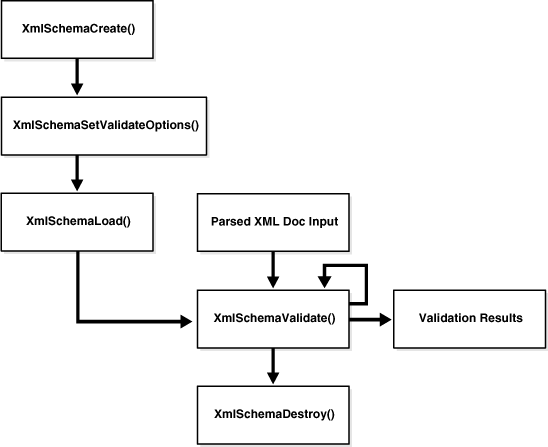

An explanation is given of how to use the Extensible Markup Language (XML) schema processor for C.

**Note:**

Use the unified C application programming interface (API) for Oracle XML Developer's Kit (XDK) and Oracle XML DB applications. Older, nonunified C functions are deprecated and supported only for backward compatibility. They will be removed in a future release.

The unified C API is described in [Overview of the Unified C API](getting-started-with-XDK-for-C.md).

### 7.1 Oracle XML Schema Processor for C

The XML Schema processor for C is a companion component to the Extensible Markup Language (XML) parser for C that allows support for simple and complex data types in XML applications.

The XML Schema processor for C supports the World Wide Web Consortium (W3C) XML Schema Recommendation. This makes writing custom applications that process XML documents straightforward, and means that a standards-compliant XML Schema processor is part of XDK on every operating system where Oracle Database is ported.

The XML Schema processor enables validation of XML and retrieval of metadata. It can be called by itself or through the XML Parser for C.

**See Also:**

[XML Parsing for Java](XML-parsing-for-Java.md), for more information about XML Schema and why you would want to use XML Schema.

#### 7.1.1 Oracle XML Schema for C Features

The features of the Oracle XML Schema processor for C are described.

Features:

- Supports simple and complex types

- Built on XML parser for C

- Supports the W3C XML Schema Recommendation

**See Also:**

- [Oracle Database XML C API Reference](../caxml/package-Schema-API.md) "Schema APIs for C"

- `$ORACLE_HOME/xdk/demo/c/schema/ `- sample code

#### 7.1.2 Standards Conformance for Oracle XML Schema Processor for C

The standards to which the XML Schema Processor for C conforms are listed.

- W3C recommendation for Extensible Markup Language (XML) 1.0

- W3C recommendation for Document Object Model (DOM) Level 1.0

- W3C recommendation for Namespaces in XML

- W3C recommendation for XML Schema

#### 7.1.3 XML Schema Processor for C: Supplied Software

The software supplied for the XML Schema Processor for C is described.

Table 7-1 XML Schema Processor for C: Supplied Files in \$ORACLE_HOME

| Directory and Files | Description                           |
|:--------------------|:--------------------------------------|
| `bin`               | schema processor executable, `schema` |
| `lib`               | XML/XSL/Schema & support libraries    |
| `nls/data`          | Globalization Support data files      |
| `xdk/demo/c/schema` | example usage of the Schema processor |
| `xdk/include`       | header files                          |
| `xdk/mesg`          | error message files                   |
| `xdk/readme.html`   | introductory file                     |

Table 7-2 lists the included libraries in directory `lib`.

Table 7-2 XML Schema Processor for C: Supplied Libraries

| Included Library | Description                                                                                      |
|:-----------------|:-------------------------------------------------------------------------------------------------|
| `libxml19.a`     | XML parser, Extensible Stylesheet Language Transformation (XSLT) processor, XML Schema processor |
| `libcore19.a`    | Common Oracle Runtime Environment (CORE) functions                                               |
| `libnls19.a`     | Globalization Support                                                                            |

### 7.2 Using the C XML Schema Processor Command-Line Utility

You can call XML Schema processor for C as an executable by invoking `bin/schema` in the install area.

The executable takes two arguments:

- XML instance document

- Optionally, a default schema

XML Schema processor for C can also be invoked by writing code using the supplied APIs. The code must be compiled using the headers in the `include` subdirectory and linked against the libraries in the `lib` subdirectory. See `Makefile` in the `xdk/demo/c/schema` subdirectory for details on how to build your program.

Error message files in different languages are provided in the `mesg/` subdirectory.

### 7.3 XML Schema Processor for C Usage Diagram

The calling sequence for the XML Schema processor for C is presented.

Figure 7-1illustrates the calling sequence, which is as follows:

1.  The initialize call is invoked once at the beginning of a session; it returns a schema context which is used throughout the session.

2.  Schema documents to be used in the session are loaded in advance.

3.  The instance document to be validated is first parsed with the XML parser.

4.  The top of the XML element subtree for the instance is then passed to the schema validate function.

5.  If no explicit schema is defined in the instance document, any loaded schemas are used.

6.  More documents can then be validated using the same schema context.

7.  When the session is over, the Schema tear-down function is called, which releases all memory allocated for the loaded schemas.

Figure 7-1 XML Schema Processor for C Usage Diagram

[Description of "Figure 7-1 XML Schema Processor for C Usage Diagram"](img_text/adxdk092.md)

### 7.4 How to Run XML Schema for C Sample Programs

Directory `xdk/demo/c/schema` contains sample XML Schema applications that show how to use Oracle XML Schema processor with its API. These sample files are described here.

Table 7-3 XML Schema for C Samples Provided

| Sample File         | Description                                                                                                 |
|:--------------------|:------------------------------------------------------------------------------------------------------------|
| `Makefile`          | Makefile to build the sample programs and run them, verifying correct output.                               |
| `xsdtest.c`         | Program which invokes the XML Schema for C API                                                              |
| `car.{xsd,xml,std}` | Sample schema, instance document, and expected output respectively, after running `xsdtest` on them.        |
| `aq.{xsd,xml,std}`  | Second sample schema, instance document, and expected output respectively, after running `xsdtest` on them. |
| `pub.{xsd,xml,std}` | Third sample schema, instance document, and expected output respectively, after running `xsdtest` on them.  |

To build the sample programs, run `make`.

To build the programs and run them, comparing the actual output to expected output:

    make sure

### 7.5 What Is the Streaming Validator?

The streaming validator uses XML Events, which is a representation of an XML document that is similar to Simple API for XML (SAX) Events. XML events has a start tag, end tag, and comment. The producer drives the SAX events and the consumer drives the XML events.

The streaming validator shares software with the older schema validator and derives most functionality from it. Memory overhead is less than for the DOM representation used in the older validator. Only one pass is made over the document. The streaming validator was introduced in Oracle Database 11g Release 1 (11.1).

There are two modes of streaming validation:

- Transparent mode—events are returned to the application.

- Opaque mode—events are not returned to the application but an error indicating success or failure of the document validation process is returned.

Before document validation, the regular validation context must be created, and the relevant schema must be loaded using this context. Then XML event context for pull parser (or for another event producer) must be created. This event context is then given to the streaming validator, so that it can request events from the producer.

Passing in a schema DOM to the `XmlSchemaLoad` API is also supported.

#### 7.5.1 Using Transparent Mode

Basic use of transparent mode is described.

An application starts by invoking `XmlEvCreateSVCtx(`). This invocation creates and returns an event context of type `xmlctx`, which must be passed on all subsequent invoking the streaming validator. The event context created must be terminated by invoking `XmlEvDestroyCtx()`.

After creation of the event context, the application repeatedly advances validation to the next event by invoking `XmlEvNext()`, which returns the type of the next event. Additional API interfaces allow the application to retrieve information relevant to the last event.

##### 7.5.1.1 Error Handling in Transparent Mode

There is no notion of a valid event. Validity is the property of a document and not of the individual items and events of the document.

The errors are:

- `XML_EVENT_FATAL_ERROR`—When the producer of XML events reports this error, the streaming validator returns this event back to the application and stops the validation process.

- `XML_EVENT_ERROR`—The streaming validator returns this event to the application when a validation error occurs. The application can then invoke `XmlEvGetError()` to get more information about the error.

If the application does not receive any `XML_EVENT_ERROR` or `XML_EVENT_FATAL_ERROR` events, the document is valid. Therefore, the application must handle these events and not ignore them.

These errors are not cached and the associated information is not available for later retrieval.

##### 7.5.1.2 Streaming Validator Example

A streaming validator example in transparent mode is presented.

Example 7-1 Streaming Validator in Transparent Mode

    # include "xmlev.h"
    ...
    xmlevctx *ppevtcx, *svevctx;
    xmlctx *xctx
    xsdctx *sctx;

    if (!(xctx = XmlCreate(&xerr, (oratext *) "test")))
        printf("Failed to create XML context, error %u\n",
                            (unsigned) xerr);
    ...
    if (!(sctx = XmlSchemaCreate(xctx, &xerr, NULL)))
        printf("Failed to create schema context, error %u\n",
                            (unsigned) xerr);

    ...
    If (xerr = XmlSchemaLoad(sctx, "my_schema.xsd", NULL))
        printf("Failed to load schema, error %u\n",
                            (unsigned) xerr);

    if(!(ppevctx = XmlEvCreatePPCtx(xctx, &xerr, NULL)))
       printf("Failed to create EVENT context, error %u\n",
                            (unsigned) xerr);

    if(xerr = XmlEvLoadPPDoc(xctx, ppevctx, "file", "test.xml", 0, NULL))
       printf("Failed to load Document, error %u\n",
                            (unsigned) xerr);

    ...
    If(!(svevctx = XmlEvCreateSVCtx(xctx, sctx, ppevctx, &xerr)))
       printf("Failed to create SVcontext, error %u\n",
                            (unsigned) xerr);
    ...
    for(;;)
    {
       xmlevtype cur_event;
       cur_event = XmlEvNext(svevctx);
       switch(cur_event)
        {
            case XML_EVENT_FATAL_ERROR:
               printf("FATAL ERROR");
               /* error processing goes here */
               return;
            case XML_EVENT_ERROR:
               XmlEvGetError(svevctx, oratext *msg);
               printf("Validation Failed, Error %s\n", msg);
               break;
            case XML_EVENT_START_ELEMENT:
               printf("<%s>", XmlEvGetName(svevctx));
               break;
    ...
            case XML_EVENT_END_DOCUMENT:
               printf("END DOCUMENT");
               return;
        }
    }
    ...
    XmlEvDestroySVCtx(svevctx);
    XmlSchemaDestroy(sctx);
    XmlEvDestroyCtx(ppevctx);
    XmlDestroyCtx(xctx);

#### 7.5.2 Using Opaque Mode

In opaque mode, the streaming validator reads the instance document to be validated as a sequence of events from the producer, but it does not pass the events to the application (consumer). It returns `XMLERR_OK` on success and an error number on failure.

After the schema has been loaded and the XML events context has been initialized, an application can validate the document in this mode by invoking `XmlEvSchemaValidate()`. The signature of this function takes a pointer to the events context. The declaration is:

    xmlerr XmlEvSchemaValidate(xmlctx *xctx, xsdctx *sctx, xmlevctx *evctx,
           oratext **errmsg);
    /* Returns (xmlerr), the error code */

##### 7.5.2.1 Error Handling in Opaque Mode

When the streaming validator encounters an error, `XmlEvSchemaValidate()` returns an error number. This could be because of a parse error or a validation error. The application can then use the existing `XmlEvGetError` APIs to get the error message.

The error message is parameterized and typically has all of the errors leading up to the point where the streaming validator terminated.

##### 7.5.2.2 Example of Opaque Mode Application

An example of opaque mode application is presented.

Example 7-2 Example of Streaming Validator in Opaque Mode

    # include "xmlev.h"
    ...
    xmlevctx *ppevtcx;
    xmlctx   *xctx;
    xsdctx   *sctx;
    oratext  **errmsg;
    xmlerr   xerr;

    if (!(xctx = XmlCreate(&xerr, (oratext *) "test"))
          printf("Failed to create XML context, error %u\n", (unsigned) xerr);
    ...
    if (!(sctx = XmlSchemaCreate(xctx, &xerr, NULL)))
          printf("Failed to create schema context, error %u\n", (unsigned) xerr);

    ...
    if (xerr = XmlSchemaLoad(sctx, "my_schema.xsd", NULL))
        printf("Failed to load schema, error %u\n", (unsigned) xerr);

    if(!(ppevctx = XmlEvCreatePPCtx(xctx, &xerr, NULL)))
         printf("Failed to create EVENT context, error %u\n", (unsigned) xerr);

    if(xerr = XmlEvLoadPPDoc(xctx, ppevctx, "file", "test.xml", 0, NULL))
       printf("Failed to load Document, error %u\n", (unsigned) xerr);

    if((xerr = XmlEvSchemaValidate(xctx, sctx, ppevctx, errmsg)))
    {
      printf("Validation Failed, Error: %s\n", errmsg);
    }
    ...
    XmlSchemaDestroy(sctx);
    XmlEvDestroyCtx(ppevctx);
    XmlDestroyCtx(xctx);

#### 7.5.3 Using Function XmlSchemaLoad() With an Existing DOM

Function `XmlSchemaLoad()` accepts two fixed arguments and a set of variable properties. The first argument is the schema context; the second is the URL location of the schema document.

Starting with Oracle Database 11g Release 1 (11.1), you can use property `schema_dom_callback` to provide access to the schema DOM given a URL. The property is a callback function provided by the application. If supplied, the schema load function uses this callback to access the DOM for the main schema and to access any included, imported, or redefined schemas.

The callback signature is as follows:

    typedef  xmldocnode* (*xmlsch_dom_callback) (xmlctx *xctx, oratext *uri,
             xmlerr *xerr);

The callback accepts a URI (the schema load function passes in the URI of the document desired) and returns the document node. Example 7-3 illustrates this.

Example 7-3 XmlSchemaLoad() Example

    # include "xmlev.h"
    ...
    xmlctx *xctx;
    xsdctx *sctx;
    xmldocnode *doc;

    if (!(xctx = XmlCreate(&xerr, (oratext *) "test"))
        printf("Failed to create XML context, error %u\n", (unsigned) xerr);
    ...
    if (!(sctx = XmlSchemaCreate(xctx, &xerr, NULL)))
        printf("Failed to create schema context, error %u\n", (unsigned) xerr);
    ...
    If (xerr = XmlSchemaLoad(sctx, schema_uri, "schema_dom_callback", func1,  NULL))
        printf("Failed to load schema, error %u\n", (unsigned) xerr);
    ...
    XmlSchemaDestroy(sctx);
    XmlDestroyCtx(xctx);

#### 7.5.4 Validation Options

You can supply options to the validation process using `XmlSchemaSetValidateOptions()`.

For example:

    XmlSchemaSetValidateOptions(scctx, "ignore_id_constraint", (boolean)TRUE, NULL);

The options are:

- `ignore_id_constraint` (existing before Oracle Database 11g Release 1 (11.1))

- `ignore_sch_location` (existing before Oracle Database 11g Release 1 (11.1))

- `ignore_par_val_rest` (existing before Oracle Database 11g Release 1 (11.1))

- `ignore_pattern_check`: When this property is `TRUE`, the streaming validator ignores pattern-facet checks. The default is `FALSE`.

- `no_events_for_defaults`: When this property is `TRUE`, the streaming validator does not return events for default values added to the instance document. This option can be used only in the transparent case.

Example 7-4 Example of Streaming Validator Using New Options

    # include "xmlev.h"
    ...
    xmlevctx *ppevtcx;
    xmlctx   *xctx;
    xsdctx   *sctx;
    xmlerr   xerr;
    oratext  **errmsg;

    if (!(xctx = XmlCreate(&xerr, (oratext *) "test"))
        printf("Failed to create XML context, error %u\n", (unsigned) xerr);
    ...
    if (!(sctx = XmlSchemaCreate(xctx, &xerr, NULL)))
        printf("Failed to create schema context, error %u\n", (unsigned) xerr);
    ...
    If (xerr = XmlSchemaLoad(sctx, "my_schema.xsd", NULL))
        printf("Failed to load schema, error %u\n", (unsigned) xerr);
    if(!(ppevctx = XmlEvCreatePPCtx(xctx, &xerr, "file", "test.xml", NULL)))
       printf("Failed to create EVENT context, error %u\n", (unsigned) xerr);

    if(xerr = XmlEvLoadPPDoc(xctx, ppevctx, "file", "test.xml", 0, NULL))
       printf("Failed to load Document, error %u\n", (unsigned) xerr);

    XmlSchemaSetValidateOptions(sctx, "ignore_id_constraint", TRUE,
                                      "ignore_pattern_facet", TRUE, NULL);
    if((xerr = XmlEvSchemaValidate(xctx,sctx, ppevctx, errmsg)))
    {
      printf("Validation Failed, Error: %s\n", errmsg);
    }
    ...
    XmlSchemaDestroy(sctx);
    XmlEvDestroyCtx(ppevctx);
    XmlDestroyCtx(xctx);
