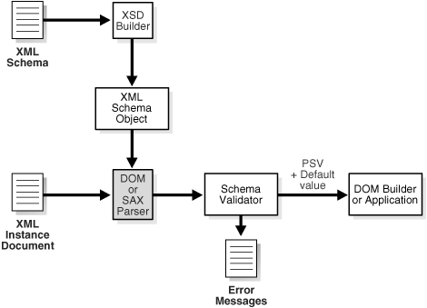

Topics here cover how to use the Extensible Markup Language (XML) schema processor for Java.

### 17.1 Introduction to XML Validation

Topics cover the different techniques for XML validation.

#### 17.1.1 Prerequisites for Using the XML Schema Processor for Java

Prerequisites for using the XML schema processor are covered.

This section assumes that you have working knowledge of these technologies:

- [document type definition (DTD)](glossary.md). An XML document type definition (DTD) defines the legal structure of an XML document.

- [XML Schema language](glossary.md). XML Schema defines the legal structure of an XML document.

To learn more about these technologies, consult the XML resources in [Related Documents](preface.md).

#### 17.1.2 Standards and Specifications for the XML Schema Processor for Java

XML Schema is a World Wide Web Consortium (W3C) standard.

The Oracle XML Schema processor supports the W3C XML Schema specifications:

- [XML Schema Part 0: Primer](https://www.oracle.com/pls/topic/lookup?ctx=en/database/oracle/oracle-database/19/adxdk&id=w3_org_tr_xschema0_primer)

- [XML Schema Part 1: Structures](https://www.oracle.com/pls/topic/lookup?ctx=en/database/oracle/oracle-database/19/adxdk&id=w3_org_tr_xschema1_struct)

- [XML Schema Part 2: Datatypes](https://www.oracle.com/pls/topic/lookup?ctx=en/database/oracle/oracle-database/19/adxdk&id=w3_org_tr_xschema2_types)

**Related Topics**

- [Oracle XML Developer's Kit Standards](XDK-standards.md)

#### 17.1.3 XML Validation with DTDs

Document type definition (DTDs) were originally developed for SGML. XML DTDs are a subset of those available in SGML and provide a mechanism for declaring constraints on XML markup. XML DTDs enable the specification of:

- Which elements can be in your XML documents.

- The content model of an XML element, that is, whether the element contains only data or has a set of subelements that defines its structure. DTDs can define whether a subelement is optional or mandatory and whether it can occur only once or multiple times.

- Attributes of XML elements. DTDs can also specify whether attributes are optional or mandatory.

- Entities that are legal in your XML documents.

An XML DTD is not itself written in XML, but is a context-independent grammar for defining the structure of an XML document. You can declare a DTD in an XML document itself or in a separate file from the XML document.

Validation is the process by which you verify an XML document against its associated DTD, ensuring that the structure, use of elements, and use of attributes are consistent with the definitions in the DTD. Thus, applications that handle XML documents can assume that the data matches the definition.

Using XDK, you can write an application that includes a validating XML parser; that is, a program that parses and validates XML documents against a DTD. Depending on its implementation, a validating parser may:

- Either stop processing when it encounters an error, or continue.

- Either report warnings and errors as they occur or in summary form at the end of processing.

- Enable or disable validation mode

  Most processors can enable or disable validation mode, but they must still process entity definitions and other constructs of DTDs.

##### 17.1.3.1 DTD Samples in XDK

An example DTD is shown, together with an example XML document that conforms to that DTD.

Example 17-1 shows the contents of a DTD named `family.dtd`, which is located in `$ORACLE_HOME/xdk/demo/java/parser/common/`. The `<ELEMENT>` tags specify the legal nomenclature and structure of elements in the document, whereas the `<ATTLIST>` tags specify the legal attributes of elements.

Example 17-2 shows the contents of an XML document named `family.xml`, which is also located in `$ORACLE_HOME/xdk/demo/java/parser/common/`. The `<!DOCTYPE>` element in `family.xml` specifies that this XML document conforms to the external DTD named `family.dtd`.

Example 17-1 family.dtd

    <?xml version="1.0" encoding="UTF-8"?>
    <!ELEMENT family (member*)>
    <!ATTLIST family lastname CDATA #REQUIRED>
    <!ELEMENT member (#PCDATA)>
    <!ATTLIST member memberid ID #REQUIRED>
    <!ATTLIST member dad IDREF #IMPLIED>
    <!ATTLIST member mom IDREF #IMPLIED>

Example 17-2 family.xml

    <?xml version="1.0" standalone="no"?>
    <!DOCTYPE family SYSTEM "family.dtd">
    <family lastname="Smith">
    <member memberid="m1">Sarah</member>
    <member memberid="m2">Bob</member>
    <member memberid="m3" mom="m1" dad="m2">Joanne</member>
    <member memberid="m4" mom="m1" dad="m2">Jim</member>
    </family>

#### 17.1.4 XML Validation with XML Schemas

Concepts involving validation using XML schemas are introduced.

The [XML Schema language](glossary.md), also known as [XML Schema Definition](glossary.md), was created by the W3C to use XML syntax to describe the content and the structure of XML documents. An [XML schema](glossary.md) is an XML document written in the XML Schema language. An XML schema document contains rules describing the structure of an input XML document, called an [instance document](glossary.md). An instance document is valid if and only if it conforms to the rules of the XML schema.

The XML Schema language defines such things as:

- Which elements and attributes are legal in the instance document

- Which elements can be children of other elements

- The order and number of child elements

- Data types for elements and attributes

- Default and fixed values for elements and attributes

A validating XML parser tries to determine whether an instance document conforms to the rules of its associated XML schema. Using XDK you can write a validating parser that performs this schema validation. Depending on its implementation, a validating parser may:

- Either stop processing when it encounters an error, or continue.

- Either report warnings and errors as they occur or in summary form at the end of processing.

The processor must consider entity definitions and other constructs that are defined in a DTD that is included by the instance document. The XML Schema language does not define what must occurs when an instance document includes both an XML schema and a DTD. Thus, the behavior of the application in such cases depends on the implementation.

##### 17.1.4.1 XML Schema Samples in XDK

A sample XML document is shown which contains a purchase report that describes parts that have been ordered in different regions. This document is located at `$ORACLE_HOME/xdk/demo/java/schema/report.xml`. An XML schema document, `report.xsd`, which you can use to validate `report.xml`, is also shown.

Among other things, the XML schema defines the names of the elements that are legal in the instance document and the type of data that the elements can contain.

Example 17-3 report.xml

    <purchaseReport
      xmlns="http://www.example.com/Report"
      xmlns:xsi = "http://www.w3.org/2001/XMLSchema-instance"
      xsi:schemaLocation="http://www.example.com/Report  report.xsd"
      period="P3M" periodEnding="1999-12-31">
     <regions>
      <zip code="95819">
       <part number="872-AA" quantity="1"/>
       <part number="926-AA" quantity="1"/>
       <part number="833-AA" quantity="1"/>
       <part number="455-BX" quantity="1"/>
      </zip>
      <zip code="63143">
       <part number="455-BX" quantity="4"/>
      </zip>
     </regions>
     <parts>
      <part number="872-AA">Lawnmower</part>
      <part number="926-AA">Baby Monitor</part>
      <part number="833-AA">Lapis Necklace</part>
      <part number="455-BX">Sturdy Shelves</part>
     </parts>
    </purchaseReport>

Example 17-4 report.xsd

    <schema targetNamespace="http://www.example.com/Report"
            xmlns="http://www.w3.org/2001/XMLSchema"
            xmlns:r="http://www.example.com/Report"
            elementFormDefault="qualified">
     <annotation>
      <documentation xml:lang="en">
       Report schema for Example.com
       Copyright 2000 Example.com. All rights reserved.
      </documentation>
     </annotation>
     <element name="purchaseReport">
      <complexType>
       <sequence>
        <element name="regions" type="r:RegionsType">
         <keyref name="dummy2" refer="r:pNumKey">
          <selector xpath="r:zip/r:part"/>
          <field xpath="@number"/>
         </keyref>
        </element>
        <element name="parts" type="r:PartsType"/>
       </sequence>
       <attribute name="period"       type="duration"/>
       <attribute name="periodEnding" type="date"/>
      </complexType>
      <unique name="dummy1">
       <selector xpath="r:regions/r:zip"/>
       <field xpath="@code"/>
      </unique>
      <key name="pNumKey">
       <selector xpath="r:parts/r:part"/>
       <field xpath="@number"/>
      </key>
     </element>
     <complexType name="RegionsType">
      <sequence>
       <element name="zip" maxOccurs="unbounded">
        <complexType>
         <sequence>
          <element name="part" maxOccurs="unbounded">
           <complexType>
            <complexContent>
             <restriction base="anyType">
              <attribute name="number"   type="r:SKU"/>
              <attribute name="quantity" type="positiveInteger"/>
             </restriction>
            </complexContent>
           </complexType>
          </element>
         </sequence>
         <attribute name="code" type="positiveInteger"/>
        </complexType>
       </element>
      </sequence>
     </complexType>
     <simpleType name="SKU">
      <restriction base="string">
       <pattern value="\d{3}-[A-Z]{2}"/>
      </restriction>
     </simpleType>
     <complexType name="PartsType">
      <sequence>
       <element name="part" maxOccurs="unbounded">
        <complexType>
         <simpleContent>
          <extension base="string">
           <attribute name="number" type="r:SKU"/>
          </extension>
         </simpleContent>
        </complexType>
       </element>
      </sequence>
     </complexType>
    </schema>

#### 17.1.5 Differences Between XML Schemas and DTDs

The XML Schema language includes most of the capabilities of the DTD specification. An XML schema serves a similar purpose to a DTD, but is more flexible in specifying document constraints.

Table 17-1 compares some features between the two validation mechanisms.

Table 17-1 Feature Comparison Between XML Schema and DTD

| Feature                            | XML Schema | DTD |
|:-----------------------------------|:-----------|:----|
| Element nesting                    | X          | X   |
| Element occurrence constraints     | X          | X   |
| Permitted attributes               | X          | X   |
| Attribute types and default values | X          | X   |
| Written in XML                     | X          |     |
| Namespace support                  | X          |     |
| Built-In data types                | X          |     |
| User-Defined data types            | X          |     |
| Include/Import                     | X          |     |
| Refinement (inheritance)           | X          |     |

These reasons are probably the most persuasive for choosing XML schema validation over DTD validation:

- The XML Schema language enables you to define rules for the content of elements and attributes. You achieve control over content by using data types. With XML Schema data types you can more easily perform actions such as:

  - Declare which elements are to contain which types of data, for example, positive integers in one element and years in another

  - Process data obtained from a database

  - Define restrictions on data, for example, a number between 10 and 20

  - Define data formats, for example, dates in the form MM-DD-YYYY

  - Convert data between different data types, for example, strings to dates

- Unlike DTD grammar, documents written in the XML Schema language are themselves written in XML. Thus, you can perform these actions:

  - Use your XML parser to parse your XML schema

  - Process your XML schema with the XML Document Object Model (DOM)

  - Transform your XML document with Extensible Stylesheet Language Transformation (XSLT)

  - Reuse your XML schemas in other XML schemas

  - Extend your XML schema by adding elements and attributes

  - Reference multiple XML schemas from the same document

### 17.2 Using the XML Schema Processor: Overview

The Oracle XML Schema processor is a SAX-based XML schema validator that you can use to validate instance documents against an XML schema. The processor supports both language example (LAX) and strict validation.

You can use the processor in these ways:

- Enable it in the XML parser

- Use it with a DOM tree to validate whole or part of an XML document

- Use it as a component in a processing pipeline (like a content handler)

You can configure the schema processor in different ways depending on your requirements. For example, you can:

- Use a fixed XML schema or automatically build a schema based on the `schemaLocation` attributes in an instance document.

- Set `XMLError` and `entityResolver` to gain better control over the validation process.

- Determine how much of an instance document is to be validated. You can use any of the validation modes specified in [Table 12-1](XML-parsing-for-Java.md). You can also designate a type of element as the root of validation.

#### 17.2.1 Using the XML Schema Processor for Java: Basic Process

XDK packages that are important for applications that process XML schemas are described.

These are the important packages for applications that process XML schemas:

- `oracle.xml.parser.v2`, which provides APIs for XML parsing

- `oracle.xml.parser.schema`, which provides APIs for XML Schema processing

The most important classes in the `oracle.xml.parser.schema` package are described in Table 17-2. These form the core of most XML schema applications.

Table 17-2 oracle.xml.parser.schema Classes

| Class/Interface       | Description                                                                                                                                                                                                                                         | Methods                                                                                                                                                                                                                                                                                                                                     |
|:----------------------|:----------------------------------------------------------------------------------------------------------------------------------------------------------------------------------------------------------------------------------------------------|:--------------------------------------------------------------------------------------------------------------------------------------------------------------------------------------------------------------------------------------------------------------------------------------------------------------------------------------------|
| `XMLSchema` class     | Represents XML Schema component model. An `XMLSchema` object is a set of `XMLSchemaNodes` that belong to different target namespaces. The `XSDValidator` class uses `XMLSchema` for schema validation or metadata.                                  | The principal methods are: • `get` methods such as `getElement()` and `getSchemaTargetNS()` get information about the XML schema • `printSchema()` prints information about the XML schema                                                                                                                                            |
| `XMLSchemaNode` class | Represents schema components in a target namespace, including type definitions, element and attribute delcarations, and group and attribute group definitions.                                                                                      | The principal methods are `get` methods such as `getElementSet()` and `getAttributeDeclarations()` get components of the XML schema.                                                                                                                                                                                                        |
| `XSDBuilder` class    | Builds an `XMLSchema` object from an XML schema document. The `XMLSchema` object is a set of objects (Infoset items) corresponding to top-level schema declarations and definitions. The schema document is XML parsed and converted to a DOM tree. | The principal methods are: • `build()` creates an `XMLSchema` object. • `getObject()` returns the `XMLSchema` object. • `setEntityResolver()` sets an `EntityResolver` for resolving imports and includes.                                                                                                                         |
| `XSDValidator` class  | Validates an instance XML document against an XML schema. When registered, an `XSDValidator` object is inserted as a pipeline node between `XMLParser` and `XMLDocument` events handlers.                                                           | The principal methods are: • `get` methods such as `getCurrentMode()` and `getElementDeclaration()` • `set` methods such as `setXMLProperty()` and `setDocumentLocator()` • `startDocument()` receives notification of the beginning of the document. • `startElement()` receives notification of the beginning of the element. |

Figure 17-1 depicts the basic process of validating an instance document with the XML Schema processor for Java.

Figure 17-1 XML Schema Processor for Java

[Description of "Figure 17-1 XML Schema Processor for Java"](img_text/adxdk105.md)

The XML Schema processor performs these major tasks:

1.  A builder (`XSDBuilder` object) assembles the XML schema from an input XML schema document. Although instance documents and schemas need not exist specifically as files on the operating system, they are commonly referred to as files. They may exist as streams of bytes, fields in a database record, or collections of XML Infoset "Information Items."

    This task involves parsing the schema document into an object. The builder creates the schema object explicitly or implicitly:

    - In explicit mode, you pass in an XML schema when you invoke the processor. Validating Against Externally Referenced XML Schemas explains how to build the schema object in explicit mode.

    - In implicit mode, you do not pass in an XML schema when you invoke the processor because the schema is internally referenced by the instance document. Validating Against Internally Referenced XML Schemas explains how to create the schema object in implicit mode.

2.  The XML schema validator uses the schema object to validate the instance document. This task has these steps:

    1.  A Simple API for XML (SAX) parser parses the instance document into SAX events, which it passes to the validator.

    2.  The validator receives SAX events as input and validates them against the schema object, sending an error message if it finds invalid XML components.

        [Validation in the XML Parser](XML-parsing-for-Java.md) describes the validation modes that you can use when validating the instance document. If you do not explicitly set a schema for validation with the `XSDBuilder` class, then the instance document must have the correct `xsi:schemaLocation` attribute pointing to the schema file. Otherwise, the program does not perform the validation. If the processor encounters errors, it generates error messages.

    3.  The validator sends input SAX events, default values, or post-schema validation information to a DOM builder or application.

**See Also:**

- [Oracle Database XML Java API Reference](../jaxml/index.md) to learn about the `XSDBuilder`, `DOMParser`, and `SAXParser` classes

- Using the XML Schema Processor for Java to learn about the XDK SAX and DOM parsers

#### 17.2.2 Running the XML Schema Processor Demo Programs

Demo programs for the XML Schema processor for Java are included in `$ORACLE_HOME/xdk/demo/java/schema`.

Table 17-3 describes the XML files and programs that you can use to test the XML Schema processor.

Table 17-3 XML Schema Sample Files

| File                | Description                                                                                                                                                                                                     |
|:--------------------|:----------------------------------------------------------------------------------------------------------------------------------------------------------------------------------------------------------------|
| `cat.xsd`           | A sample XML schema used by the `XSDSetSchema.java` program to validate `catalogue.xml`. The `cat.xsd` schema specifies the structure of a catalogue of books.                                                  |
| `catalogue.xml`     | A sample instance document that the `XSDSetSchema.java` program uses to validate against the `cat.xsd` schema.                                                                                                  |
| `catalogue_e.xml`   | A sample instance document used by the `XSDSample.java` program. When the program tries to validate this document against the `cat.xsd` schema, it generates schema errors.                                     |
| `DTD2Schema.java`   | This sample program converts a DTD (first argument) into an XML Schema and uses it to validate an XML file (second argument).                                                                                   |
| `embeded_xsql.xsd`  | The XML schema used by `XSDLax.java.` The schema defines the structure of an XSQL page.                                                                                                                         |
| `embeded_xsql.xml`  | The instance document used by `XSDLax.java`.                                                                                                                                                                    |
| `juicer1.xml`       | A sample XML document for use with `xsdproperty.java`. The XML schema that defines this document is `juicer1.xsd`.                                                                                              |
| `juicer1.xsd`       | A sample XML schema for use with `xsdproperty.java`. This XML schema defines `juicer1.xml`.                                                                                                                     |
| `juicer2.xml`       | A sample XML document for use with `xsdproperty.java`. The XML schema that defines this document is `juicer2.xsd`.                                                                                              |
| `juicer2.xsd`       | A sample XML document for use with `xsdproperty.java`. This XML schema defines `juicer2.xml`.                                                                                                                   |
| `report.xml`        | The sample XML file that `XSDSetSchema.java` uses to validate against the XML schema `report.xsd`.                                                                                                              |
| `report.xsd`        | A sample XML schema used by the `XSDSetSchema.java` program to validate the contents of `report.xml`. The `report.xsd` schema specifies the structure of a purchase order.                                      |
| `report_e.xml`      | When the program validates this sample XML file using `XSDSample.java`, it generates XML Schema errors.                                                                                                         |
| `xsddom.java`       | This program shows how to validate an instance document by get a DOM representation of the document and using an `XSDValidator` object to validate it.                                                          |
| `xsdent.java`       | This program validates an XML document by redirecting the referenced schema in the `SchemaLocation` attribute to a local version.                                                                               |
| `xsdent.xml`        | This XML document describes a book. The file is used as an input to `xsdent.java`.                                                                                                                              |
| `xsdent.xsd`        | This XML schema document defines the rules for `xsdent.xml`. The schema document contains a `schemaLocation` attribute set to `xsdent-1.xsd`.                                                                   |
| `xsdent-1.xsd`      | The XML schema document referenced by the `schemaLocation` attribute in `xsdent.xsd`.                                                                                                                           |
| `xsdproperty.java`  | This demo shows how to configure the XML Schema processor to validate an XML document based on a complex type or element declaration.                                                                           |
| `xsdsax.java`       | This demo shows how to validate an XML document received as a SAX stream.                                                                                                                                       |
| `XSDLax.java`       | This demo is the same as `XSDSetSchema.java` but sets the `SCHEMA_LAX_VALIDATION` flag for LAX validation.                                                                                                      |
| `XSDSample.java`    | This program is a sample driver that you can use to process XML instance documents.                                                                                                                             |
| `XSDSetSchema.java` | This program is a sample driver to process XML instance documents by overriding the `schemaLocation`. The program uses the XML Schema specification from `cat.xsd` to validate the contents of `catalogue.xml`. |

Documentation for how to compile and run the sample programs is located in the `README` in the same directory. The basic steps are:

1.  Change into the `$ORACLE_HOME/xdk/demo/java/schema` directory (UNIX) or `%ORACLE_HOME%\xdk\demo\java\schema` directory (Windows).
2.  Run `make` (UNIX) or `Make.bat` (Windows) at the command line.
3.  Add `xmlparserv2.jar`, `xschema.jar`, and the current directory to the `CLASSPATH`. These JAR files are located in `$ORACLE_HOME/lib` (UNIX) and `%ORACLE_HOME%\lib` (Windows). For example, you can set the `CLASSPATH` with the `tcsh` shell on UNIX:
        setenv CLASSPATH
         "$CLASSPATH":$ORACLE_HOME/lib/xmlparserv2.jar:$ORACLE_HOME/lib/schema.jar:.

    **Note:**

    The XML Schema processor requires JDK version 1.2 or later, and it is usable on any operating system with Java 1.2 support.
4.  Run the sample programs with the XML files that are included in the directory:
    - These examples use `report.xsd` to validate the contents of `report.xml`:

          java XSDSample report.xml
          java XSDSetSchema report.xsd report.xml

    - This example validates an instance document in Lax mode:

          java XSDLax embeded_xsql.xsd embeded_xsql.xml

    - These examples use `cat.xsd` to validate the contents of `catalogue.xml`:

          java XSDSample catalogue.xml
          java XSDSetSchema cat.xsd catalogue.xml

    - These examples generates error messages:

          java XSDSample catalogue_e.xml
          java XSDSample report_e.xml

    - This example uses the `schemaLocation` attribute in `xsdent.xsd` to redirect the XML schema to `xsdent-1.xsd` for validation:

          java xsdent xsdent.xml xsdent.xsd

    - This example generates a SAX stream from `report.xml` and validates it against the XML schema defined in `report.xsd`:

          java xsdsax report.xsd report.xml

    - This example creates a DOM representation of `report.xml` and validates it against the XML schema defined in `report.xsd`:

          java xsddom report.xsd report.xml

    - These examples configure validation starting with an element declaration or complex type definition:

          java xsdproperty juicer1.xml juicer1.xsd http://www.juicers.org \
          juicersType false > juicersType.out

          java xsdproperty juicer2.xml juicer2.xsd http://www.juicers.org \
          Juicers true > juicers_e.out

    - This example converts a DTD (`dtd2schema.dtd`) into an XML schema and uses it to validate an instance document (`dtd2schema.xml`):

          java DTD2Schema dtd2schema.dtd dtd2schema.xml

#### 17.2.3 Using the XML Schema Processor Command-Line Utility

You can use the XML parser command-line utility (`oraxml`) to validate instance documents against XML schemas and DTDs.

**See Also:**

[Using the Java XML Parser Command-Line Utility (oraxml)](XML-parsing-for-Java.md) for information about how to run `oraxml` .

##### 17.2.3.1 Using oraxml to Validate Against a Schema

An example shows how you can validate document `report.xml` against the XML schema `report.xsd` by invoking `oraxml` on the command line.

Example 17-5 Using oraxml to Validate Against a Schema

Invoke this command in directory `$ORACLE_HOME/xdk/demo/java/schema`:

    oraxml -schema -enc report.xml

The expected output is:

    The encoding of the input file: UTF-8
    The input XML file is parsed without errors using Schema validation mode.

##### 17.2.3.2 Using oraxml to Validate Against a DTD

An example shows how you can validate document `family.xml` against the DTD `family.dtd` by invoking `oraxml` on the command line.

Example 17-6 Using oraxml to Validate Against a DTD

Invoke this command in directory `$ORACLE_HOME/xdk/demo/java/parser/common`:

    oraxml -dtd -enc family.xml

The expected output is:

    The encoding of the input file: UTF-8
     The input XML file is parsed without errors using DTD validation mode.

### 17.3 Validating XML with XML Schemas

Topics cover various ways to validate XML documents using XML schemas.

#### 17.3.1 Validating Against Internally Referenced XML Schemas

`$ORACLE_HOME/xdk/demo/java/schema/XSDSample.java` shows how to validate against an implicit XML Schema. The validation mode is implicit because the XML schema is referenced in the instance document itself.

Follow the steps in this section to write programs that use the `setValidationMode()` method of the `oracle.xml.parser.v2.``DOMParser` class:

1.  Create a DOM parser to use for the validation of an instance document. this code fragment from `XSDSample.java` shows how to create the `DOMParser` object:
        public class XSDSample
        {
           public static void main(String[] args) throws Exception
           {
              if (args.length != 1)
              {
                 System.out.println("Usage: java XSDSample <filename>");
                 return;
              }
              process (args[0]);
           }

           public static void process (String xmlURI) throws Exception
           {
              DOMParser dp  = new DOMParser();
              URL       url = createURL(xmlURI);
              ...
           }
        ...
        }

    `createURL()` is a helper method that constructs a URL from a file name passed to the program as an argument.
2.  Set the validation mode for the validating DOM parser with the `DOMParser.setValidationMode()` method. For example, `XSDSample.java` shows how to specify XML schema validation:
        dp.setValidationMode(XMLParser.SCHEMA_VALIDATION);
        dp.setPreserveWhitespace(true);
3.  Set the output error stream with the `DOMParser.setErrorStream()` method. For example, `XSDSample.java` sets the error stream for the DOM parser object:
        dp.setErrorStream (System.out);
4.  Validate the instance document with the `DOMParser.parse()` method. You do not have to create an XML schema object explicitly because the schema is internally referenced by the instance document. For example, `XSDSample.java` validates the instance document:
        try
        {
          System.out.println("Parsing "+xmlURI);
          dp.parse(url);
          System.out.println("The input file <"+xmlURI+"> parsed without errors");
        }
        catch (XMLParseException pe)
        {
          System.out.println("Parser Exception: " + pe.getMessage());
        }
        catch (Exception e)
        {
          System.out.println("NonParserException: " + e.getMessage());
        }

#### 17.3.2 Validating Against Externally Referenced XML Schemas

`$ORACLE_HOME/xdk/demo/java/schema/XSDSetSchema.java` shows how to validate an XML schema explicitly. The validation mode is explicit because you use the `XSDBuilder` class to specify the schema to use for validation: the schema is not specified in the instance document as in implicit validation.

Follow the basic steps in this section to write Java programs that use the `build()` method of the `oracle.xml.parser.schema.XSDBuilder` class:

1.  Build an XML schema object from the XML schema document with the `XSDBuilder.build()` method. This code fragment from `XSDSetSchema.java` shows how to create the object:
        public class XSDSetSchema
        {
           public static void main(String[] args) throws Exception
           {
              if (args.length != 2)
              {
                 System.out.println("Usage: java XSDSample <schema_file> <xml_file>");
                 return;
              }

              XSDBuilder builder = new XSDBuilder();
              URL    url =  createURL(args[0]);

              // Build XML Schema Object
              XMLSchema schemadoc = (XMLSchema)builder.build(url);
              process(args[1], schemadoc);
           }
        . . .

    The `createURL()` method is a helper method that constructs a URL from the schema document file name specified on the command line.
2.  Create a DOM parser to use for validation of the instance document. This code from `XSDSetSchema.java` shows how to pass the instance document file name and XML schema object to the `process()` method:
        public static void process(String xmlURI, XMLSchema schemadoc)throws Exception{
           DOMParser dp  = new DOMParser();
           URL       url = createURL (xmlURI);
           . . .
3.  Specify the schema object to use for validation with the `DOMParser.setXMLSchema()` method. This step is not necessary in implicit validation mode because the instance document already references the schema. For example, `XSDSetSchema.java` specifies the schema:
        dp.setXMLSchema(schemadoc);
4.  Set the validation mode for the DOM parser object with the `DOMParser.setValidationMode()` method. For example, `XSDSample.java` shows how to specify XML schema validation:
        dp.setValidationMode(XMLParser.SCHEMA_VALIDATION);
        dp.setPreserveWhitespace(true);
5.  Set the output error stream for the parser with the `DOMParser.setErrorStream()` method. For example, `XSDSetSchema.java` sets it:
        dp.setErrorStream (System.out);
6.  Validate the instance document against the XML schema with the `DOMParser.parse()` method. For example, `XSDSetSchema.java` includes this code:
        try
        {
           System.out.println("Parsing "+xmlURI);
           dp.parse (url);
           System.out.println("The input file <"+xmlURI+"> parsed without errors");
        }
        catch (XMLParseException pe)
        {
           System.out.println("Parser Exception: " + pe.getMessage());
        }
        catch (Exception e)
        {
           System.out.println ("NonParserException: " + e.getMessage());
        }

#### 17.3.3 Validating a Subsection of an XML Document

In LAX mode, you can validate parts of an XML document without validating all of it. LAX parsing validates elements in a document that are declared in an associated XML schema. The processor does not consider the instance document invalid if it contains no elements declared in the schema.

By using LAX mode, you can define the schema only for the part of the XML to be validated. The `$ORACLE_HOME/xdk/demo/java/schema/XSDLax.java` program shows how to use LAX validation. The program follows the basic steps described in Validating Against Externally Referenced XML Schemas:

1.  Build an XML schema object from the user-specified XML schema document.
2.  Create a DOM parser to use for validation of the instance document.
3.  Specify the XML schema to use for validation.
4.  Set the validation mode for the DOM parser object.
5.  Set the output error stream for the parser.
6.  Validate the instance document against the XML schema by invoking `DOMParser.parse()`.

To enable LAX validation, the program sets the validation mode in the parser to `SCHEMA_LAX_VALIDATION` rather than to `SCHEMA_VALIDATION`. This code fragment from `XSDLax.java` shows this technique:

    dp.setXMLSchema(schemadoc);
    dp.setValidationMode(XMLParser.SCHEMA_LAX_VALIDATION);
    dp.setPreserveWhitespace (true);
    . . .

You can test LAX validation by running the sample program:

    java XSDLax embeded_xsql.xsd embeded_xsql.xml

#### 17.3.4 Validating XML from a SAX Stream

`$ORACLE_HOME/xdk/demo/java/schema/xsdsax.java` shows how to validate an XML document received as a SAX stream. You instantiate an `XSDValidator` and register it with the SAX parser as the content handler.

Follow the steps in this section to write programs that validate XML from a SAX stream:

1.  Build an XML schema object from the user-specified XML schema document by invoking the `XSDBuilder.build()` method. This code fragment shows how to create the object:
        XSDBuilder builder = new XSDBuilder();
        URL    url =  XMLUtil.createURL(args[0]);

        // Build XML Schema Object
        XMLSchema schemadoc = (XMLSchema)builder.build(url);
        process(args[1], schemadoc);
        . . .

    `createURL()` is a helper method that constructs a URL from the file name specified on the command line.
2.  Create a SAX parser (`SAXParser` object) to use for validation of the instance document. This code fragment from `saxxsd.java` passes the handles to the XML document and schema document to the `process()` method:
        process(args[1], schemadoc);...public static void process(String xmlURI, XMLSchema schemadoc)
        throws Exception
        {
            SAXParser dp  = new SAXParser();
        ...
3.  Configure the SAX parser. This code fragment sets the validation mode for the SAX parser object with the `XSDBuilder.setValidationMode()` method:
        dp.setPreserveWhitespace (true);
        dp.setValidationMode(XMLParser.NONVALIDATING);
4.  Create and configure a validator (`XSDValidator` object). This code fragment shows this technique:
        XMLError err;... err = new XMLError();
        ...
        XSDValidator validator = new XSDValidator();
        ...
        validator.setError(err);
5.  Specify the XML schema to use for validation by invoking the `XSDBuilder.setXMLProperty()` method. The first argument is the name of the property, which is `fixedSchema`, and the second is the reference to the XML schema object. This code fragment shows this technique:
        validator.setXMLProperty(XSDNode.FIXED_SCHEMA, schemadoc);
        ...
6.  Register the validator as the SAX content handler for the parser. This code fragment shows this technique:
        dp.setContentHandler(validator);
        ...
7.  Validate the instance document against the XML schema by invoking the `SAXParser.parse()` method. This code fragment shows this technique:
        dp.parse (url);

#### 17.3.5 Validating XML from a DOM

`$ORACLE_HOME/xdk/demo/java/schema/xsddom.java` shows how to validate an instance document by get a DOM representation of the document and using an `XSDValidator` object to validate it.

The `xsddom.java` program follows these steps:

1.  Build an XML schema object from the user-specified XML schema document by invoking the `XSDBuilder.build()` method. This code fragment shows how to create the object:
        XSDBuilder builder = new XSDBuilder();
        URL    url =  XMLUtil.createURL(args[0]);

        XMLSchema schemadoc = (XMLSchema)builder.build(url);
        process(args[1], schemadoc);

    `createURL()` is a helper method that constructs a URL from the file name specified on the command line.
2.  Create a DOM parser (`DOMParser` object) to use for validation of the instance document. This code fragment from `domxsd.java` passes the handles to the XML document and schema document to the `process()` method:
        process(args[1], schemadoc);...public static void process(String xmlURI, XMLSchema schemadoc)
        throws Exception
        {
            DOMParser dp  = new DOMParser();
            . . .
3.  Configure the DOM parser. This code fragment sets the validation mode for the parser object with the `DOMParser.setValidationMode()` method:
        dp.setPreserveWhitespace (true);
        dp.setValidationMode(XMLParser.NONVALIDATING);
        dp.setErrorStream (System.out);
4.  Parse the instance document. This code fragment shows this technique:
        dp.parse (url);
5.  Get the DOM representation of the input document. This code fragment shows this technique:
        XMLDocument doc = dp.getDocument();
6.  Create and configure a validator (`XSDValidator` object). This code fragment shows this technique:
        XMLError err;... err = new XMLError();
        ...
        XSDValidator validator = new XSDValidator();
        ...
        validator.setError(err);
7.  Specify the schema object to use for validation by invoking the `XSDBuilder.setXMLProperty()` method. The first argument is the name of the property, which in this example is `fixedSchema`, and the second is the reference to the schema object. This code fragment shows this technique:
        validator.setXMLProperty(XSDNode.FIXED_SCHEMA, schemadoc);
        . . .
8.  Get the root element (`XMLElement`) of the DOM tree and validate. This code fragment shows this technique:
        XMLElement root = (XMLElement)doc.getDocumentElement();
        XMLElement copy = (XMLElement)root.validateContent(validator, true);
        copy.print(System.out);

#### 17.3.6 Validating XML from Designed Types and Elements

`$ORACLE_HOME/xdk/demo/java/schema/xsdproperty.java` shows how to configure the XML Schema processor to validate an XML document based on a complex type or element declaration.

The `xsdproperty.java` program follows these steps:

1.  Create `String` objects for the instance document name, XML schema name, root node namespace, root node local name, and specification of element or complex type ("true" means the root node is an element declaration). This code fragment shows this technique:

        String xmlfile = args[0];
        String xsdfile =  args[1];
        ...
        String ns = args[2]; //namespace for the root node
        String nm = args[3]; //root node's local name
        String el = args[4]; //true if root node is element declaration,
                             // otherwise, the root node is a complex type

2.  Create an XSD builder and use it to create the schema object. This code fragment shows this technique:

        XSDBuilder builder = new XSDBuilder();
        URL    url =  XMLUtil.createURL(xsdfile);
        XMLSchema  schema;
        ...
        schema = (XMLSchema) builder.build(url);

3.  Get the node. Invoke different methods depending on whether the node is an element declaration or a complex type:

    - If the node is an element declaration, pass the local name and namespace to the `getElement()` method of the schema object.

    - If the node is an element declaration, pass the namespace, local name, and root complex type to the `getType()` method of the schema object.

    `xsdproperty.java` uses this control structure:

        QxName qname = new QxName(ns, nm);
        ...
        XSDNode nd;
        ...
        if (el.equals("true"))
        {
          nd = schema.getElement(ns, nm);
          /* process ... */
        }
        else
        {
          nd = schema.getType(ns, nm, XSDNode.TYPE);
          /* process ... */
        }

4.  After getting the node, create a new parser and set the schema to the parser to enable schema validation. This code fragment shows this technique:

        DOMParser dp  = new DOMParser();
        URL       url = XMLUtil.createURL (xmlURI);

5.  Set properties on the parser and then parse the URL. Invoke the `schemaValidatorProperty()` method:

    1.  Set the root element or type property on the parser to a fully qualified name.

        For a top-level element declaration, set the property name to `XSDNode.ROOT_ELEMENT` and the value to a `QName`, as showd by the `process1()` method.

        For a top-level type definition, set the property name to `XSDNode.ROOT_TYPE` and the value to a `QName`, as showd by the `process2()` method.

    2.  Set the root node property on the parser to an element or complex type node.

        For an element node, set the property name to `XSDNode.ROOT_NODE` and the value to an `XSDElement` node, as showd by the `process3()` method.

        For a type node, set the property name to `XSDNode.ROOT_NODE` and the value to an `XSDComplexType` node, as showd by the `process3()` method.

    This code fragment shows the sequence of method invocation:

        if (el.equals("true"))
        {
           nd = schema.getElement(ns, nm);
           process1(xmlfile, schema, qname);
           process3(xmlfile, schema, nd);
        }
        else
        {
           nd = schema.getType(ns, nm, XSDNode.TYPE);
           process2(xmlfile, schema, qname);
           process3(xmlfile, schema, nd);
        }

    The processing methods are implemented:

          static void process1(String xmlURI, XMLSchema schema, QxName qname)
              throws Exception
          {
            /* create parser... */
            dp.setXMLSchema(schema);
            dp.setSchemaValidatorProperty(XSDNode.ROOT_ELEMENT, qname);
            dp.setPreserveWhitespace (true);
            dp.setErrorStream (System.out);
            dp.parse (url);
            ...
          }

          static void process2(String xmlURI, XMLSchema schema, QxName qname)
              throws Exception
          {
              /* create parser... */
            dp.setXMLSchema(schema);
            dp.setSchemaValidatorProperty(XSDNode.ROOT_TYPE, qname);
            dp.setPreserveWhitespace (true);
            dp.setErrorStream (System.out);
            dp.parse (url);
            ...
          }

          static void process3(String xmlURI, XMLSchema schema, XSDNode node)
              throws Exception
          {
              /* create parser... */

            dp.setXMLSchema(schema);
            dp.setSchemaValidatorProperty(XSDNode.ROOT_NODE, node);
            dp.setPreserveWhitespace (true);
            dp.setErrorStream (System.out);
            dp.parse (url);
            ...
          }

### 17.4 Tips and Techniques for Programming with XML Schemas

Topics include overriding schema location and converting a DTD to an XML schema.

#### 17.4.1 Overriding the Schema Location with an Entity Resolver

When `XSDBuilder` builds a schema, it might need to include or import other schemas that are specified as URLs in a `schemaLocation` attribute. In some situations, you might want to override the schema locations specified in `<import>` and supply the builder with the required schema documents.

The `xsdent.java` demo described in Table 17-3 shows a case where a schema specified as `schemaLocation` needs to be imported. The document element in `xsdent.xml` file contains this attribute:

    xsi:schemaLocation =  "http://www.example.com/BookCatalogue
                           xsdent.xsd">

The `xsdent.xsd` document contains these elements:

    <schema xmlns="http://www.w3.org/2001/XMLSchema"
                   targetNamespace="http://www.example.com/BookCatalogue"
                   xmlns:catd = "http://www.example.com/Digest"
                   xmlns:cat  = "http://www.example.com/BookCatalogue"
                   elementFormDefault="qualified">
    <import namespace = "http://www.example.com/Digest"
            schemaLocation = "xsdent-1.xsd" />

As an example of wanting to override schema locations specified in `<import>` and supplying the builder with the required schema documents, suppose that you have downloaded the schemas documents from external web sites and stored them in a database. In such a situation, you can set an entity resolver in the `XSDBuilder`. `XSDBuilder` passes the schema location to the resolver, which returns an `InputStream`, `Reader`, or `URL` as an `InputSource`. The builder can read the schema documents from the `InputSource`.

The `xsdent.java` program shows how you can override the schema location with an entity resolver. You must implement the `EntityResolver` interface, instantiate the entity resolver, and set it in the XML schema builder. In the demo code, `sampleEntityResolver1` returns `InputSource` as an `InputStream` whereas `sampleEntityResolver2` returns `InputSource` as a `URL`.

Follow these basic steps:

1.  Create a new XML schema builder:
        XSDBuilder builder = new XSDBuilder();

2.  Set the builder to your entity resolver. An entity resolver is a class that implements the `EntityResolver` interface. The purpose of the resolver is to enable the XML reader to intercept any external entities before including them. This code fragment creates an entity resolver and sets it in the builder:
        builder.setEntityResolver(new sampleEntityResolver1());

    The `sampleEntityResolver1` class implements the `resolveEntity()` method. You can use this method to redirect external system identifiers to local URIs. The source code is:

        class sampleEntityResolver1 implements EntityResolver
        {
           public InputSource resolveEntity (String targetNS,  String systemId)
           throws SAXException, IOException
           {
              // perform any validation check if needed based on targetNS & systemId
              InputSource mySource = null;
              URL u = XMLUtil.createURL(systemId);
              // Create input source with InputStream as input
              mySource = new InputSource(u.openStream());
              mySource.setSystemId(systemId);
              return mySource;
           }
        }

    The `sampleEntityResolver1` class initializes the `InputSource` with a stream.
3.  Build the XML schema object. This code shows this technique:
        schemadoc = builder.build(url);
4.  Validate the instance document against the XML schema. The program executes this statement:
        process(xmlfile, schemadoc);

    The `process()` method creates a DOM parser, configures it, and invokes the `parse()` method. The method is implemented:

        public static void process(String xmlURI, Object schemadoc)
            throws Exception
        {
          DOMParser dp  = new DOMParser();
          URL       url = XMLUtil.createURL (xmlURI);

          dp.setXMLSchema(schemadoc);
          dp.setValidationMode(XMLParser.SCHEMA_VALIDATION);
          dp.setPreserveWhitespace (true);
          dp.setErrorStream (System.out);
          try {
             dp.parse (url);
             ...
        }

#### 17.4.2 Converting DTDs to XML Schemas

Because of the power and flexibility of the XML Schema language, you may want to convert your existing DTDs to XML schema documents. You can use XDK to perform this transformation.

The `$ORACLE_HOME/xdk/demo/java/schema/DTD2Schema.java` program shows how to convert a DTD. You can test the program:

    java DTD2Schema dtd2schema.dtd dtd2schema.xml

Follow these basic steps to convert a DTD to an XML schema document:

1.  Parse the DTD with the `DOMParser.parseDTD()` method. This code fragment from `DTD2Schema.java` shows how to create the DTD object:
        XSDBuilder builder = new XSDBuilder();
        URL dtdURL = createURL(args[0]);
        DTD dtd = getDTD(dtdURL, "abc");

    The `getDTD()` method is implemented:

        private static DTD getDTD(URL dtdURL, String rootName)
           throws Exception
        {
           DOMParser parser = new DOMParser();
           DTD dtd;
           parser.setValidationMode(true);
           parser.setErrorStream(System.out);
           parser.showWarnings(true);
           parser.parseDTD(dtdURL, rootName);
           dtd = (DTD)parser.getDoctype();
           return dtd;
        }
2.  Convert the DTD to an XML schema DOM tree with the `DTD.convertDTD2Sdhema()` method. This code fragment from `DTD2Schema.java` shows this technique:
        XMLDocument dtddoc = dtd.convertDTD2Schema();
3.  Write the XML schema DOM tree to an output stream with the `XMLDocument.print()` method. This code fragment from `DTD2Schema.java` shows this technique:
        FileOutputStream fos = new FileOutputStream("dtd2schema.xsd.out");
        dtddoc.print(fos);
4.  Create an XML schema object from the schema DOM tree with the `XSDBuilder.build()` method. This code fragment from `DTD2Schema.java` shows this technique:
        XMLSchema schemadoc = (XMLSchema)builder.build(dtddoc, null);
5.  Validate an instance document against the XML schema with the `DOMParser.parse()` method. This code fragment from `DTD2Schema.java` shows this technique:
        validate(args[1], schemadoc);

    The `validate()` method is implemented:

        DOMParser dp  = new DOMParser();
        URL       url = createURL (xmlURI);
        dp.setXMLSchema(schemadoc);
        dp.setValidationMode(XMLParser.SCHEMA_VALIDATION);
        dp.setPreserveWhitespace (true);
        dp.setErrorStream (System.out);
        try
        {
           System.out.println("Parsing "+xmlURI);
           dp.parse (url);
           System.out.println("The input file <"+xmlURI+"> parsed without errors");
        }
        ...
