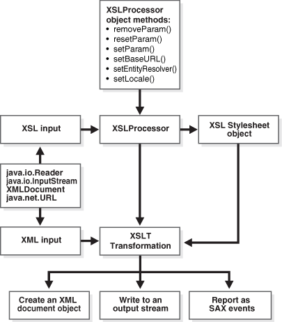

An explanation is given of how to use the Extensible Stylesheet Language Transformation (XSLT) processor for Java.

### 14.1 Introduction to the XSLT Processor

Topics include prerequisites, standards and specifications, and an overview of XML transformation with XSLT.

#### 14.1.1 Prerequisites for Using the XSLT Processor for Java

XSLT is a language, based on Extensible Markup Language (XML), that you can use to transform one XML document into another text document. For example, you can use XSLT to accept an XML data document as input, perform arithmetic calculations on element values in the document, and generate an Extensible HyperText Markup Language (XHTML) document that shows the calculation results.In XSLT, XPath is used to navigate and process elements in the source node tree. XPath models an XML document as a tree made up of nodes; the types of nodes in the XPath node tree correspond to the types of nodes in a DOM tree.

This chapter assumes that you are familiar with these World Wide Web Consortium (W3C) standards:

- Extensible Stylesheet Language (XSL) and [Extensible Stylesheet Language Transformations (XSLT)](glossary.md). For a general introduction to XSLT, see the XML resources listed in [Related Documents](preface.md).

#### 14.1.2 Standards and Specifications for the XSLT Processor for Java

The Oracle XML Developer's Kit (XDK) XSLT processor supports the XSLT2.0 recommendation.

XPath, which is the navigational language used by XSLT and other XML languages, is available in two versions: XPath 2.0 and the XPath 1.0 Recommendation.

**Related Topics**

- [Oracle XML Developer's Kit Standards](XDK-standards.md)

**See Also:**

- [XSL Transformations (XSLT) Version 2.0](https://www.oracle.com/pls/topic/lookup?ctx=en/database/oracle/oracle-database/19/adxdk&id=w3_org_tr_xslt20)

- [XML Path Language (XPath) 2.0](https://www.oracle.com/pls/topic/lookup?ctx=en/database/oracle/oracle-database/19/adxdk&id=w3_org_tr_xpath_2_0)

- [XML Path Language (XPath)](https://www.oracle.com/pls/topic/lookup?ctx=en/database/oracle/oracle-database/19/adxdk&id=w3_org_tr_xpath)

#### 14.1.3 XML Transformation with XSLT 1.0 and 2.0

Oracle XML Developer's Kit (XDK) provides several useful features not included in XSLT 1.0. To use XSLT 2.0, set the `version` attribute in your stylesheet.

    <? xml-stylesheet version="2.0" ... ?>

Useful XSLT 2.0 features include these:

- User-defined functions

  You can use the `<xsl:function>` declaration to define functions. This element must have one `name` attribute to define the function name. The value of the `name` attribute is a `QName`. The content of the `<xsl:function>` element is zero or more `xsl:param` elements that specify the formal arguments of the function, followed by a sequence constructor that defines the value returned by the function.

  `QName` can have a null namespace, but user-defined functions must have a non-null namespace. That is, if `abc` is defined as a namespace, then `add` is not a legal user-defined function, but `abc:add` is.

- Grouping

  You can use the `<xsl:for-each-group>` element, `current-group()` function, and `current-grouping-key()` function to group items.

- Multiple result documents

  You can use the `<xsl:result-document>` element to create a result tree. The content of the `<xsl:result-document>` element is a sequence constructor for the children of the document node of the tree.

  For example, this element enables you to accept an XML document as input and break it into separate documents. You can take an XML document that describes a list of books and generate an XHTML document for each book. You can then validate each output document.

- Temporary trees

  Instead of representing the intermediate XSL transformation results and XSL variables as strings, as in XSLT 1.0, you can store them as a set of document nodes. The document nodes, which you can construct with the `<xsl:variable>`, `<xsl:param>`, and `<xsl:with-param>` elements, are called temporary trees.

- Character mapping

  In XSLT 1.0, you had to use the `disable-output-escaping` attribute of the `<xsl:text>` and `<xsl:value-of>` elements to specify character escaping. In XSLT 2.0, you can declare mapping characters with an `<xsl:character-map>` element as a top-level `stylesheet` element. You can use this element to generate files with reserved or invalid XML characters in the XSLT outputs, such as `<`, `>`, and `&`.

**See Also:**

[XSL Transformations (XSLT) Version 2.0](https://www.oracle.com/pls/topic/lookup?ctx=en/database/oracle/oracle-database/19/adxdk&id=w3_org_tr_xslt20) for explanation and examples of XSLT 2.0 features

### 14.2 Using the XSLT Processor for Java: Overview

The XDK XSLT processor transforms an XML document into another text-based document, with a format such as XML, HTML, XHTML, or plain text. You can invoke the processor programmatically by using an application programming interface (API) or run it from the command line.

The XSLT processor can perform these tasks:

- Reads one or more XSLT stylesheets. The processor can apply multiple stylesheets to a single XML input document and generate different results.

- Reads one or more input XML documents. The processor can use a single stylesheet to transform multiple XML input documents.

- Builds output documents by applying the rules in the stylesheet to the input XML documents. The output is a Document Object Model (DOM) tree, output stream, or series of Simple API for XML (SAX) events.

Whereas XSLT is a function-based language that generally requires a DOM of the input document and stylesheet to perform the transformation, the XDK Java implementation of the XSLT processor can use SAX to create a stylesheet object to perform transformations with higher efficiency and fewer resources. You can reuse this stylesheet object to transform multiple documents without reparsing the stylesheet.

#### 14.2.1 Using the XSLT Processor for Java: Basic Process

The basic design of the XSLT processor for Java is presented.

Figure 14-1 illustrates this process.

**See Also:**

[Oracle Database XML Java API Reference](../jaxml/index.md) to learn about the `XMLParser` and `XSDBuilder` classes

Figure 14-1 Using the XSLT Processor for Java

[Description of "Figure 14-1 Using the XSLT Processor for Java"](img_text/adxdk111.md)

#### 14.2.2 Running the XSLT Processor Demo Programs

Demo programs for the XSLT processor for Java are included in `$ORACLE_HOME/xdk/demo/java/parser/xslt`.

Table 14-1 describes the XML files and programs that you can use to test the XSLT processor.

Table 14-1 XSLT Processor Sample Files

| File              | Description                                                                                                                                                                                                                                                                                                                                                                                                                                                                                                                                                                           |
|:------------------|:--------------------------------------------------------------------------------------------------------------------------------------------------------------------------------------------------------------------------------------------------------------------------------------------------------------------------------------------------------------------------------------------------------------------------------------------------------------------------------------------------------------------------------------------------------------------------------------|
| `match.xml`       | A sample XML document that you can use to test ID selection and pattern matching. Its associated stylesheet is `match.xsl`.                                                                                                                                                                                                                                                                                                                                                                                                                                                           |
| `match.xsl`       | A sample stylesheet for use with `match.xml`. You can use it to test simple identity transformations.                                                                                                                                                                                                                                                                                                                                                                                                                                                                                 |
| `math.xml`        | A sample XML data document that you can use to perform simple arithmetic. Its associated stylesheet is `math.xsl`.                                                                                                                                                                                                                                                                                                                                                                                                                                                                    |
| `math.xsl`        | A sample stylesheet for use with `math.xml`. The stylesheet outputs an HTML page with the results of arithmetic operations performed on element values in `math.xml`.                                                                                                                                                                                                                                                                                                                                                                                                                 |
| `number.xml`      | A sample XML data document that you can use to test for source tree numbering. The document describes the structure of a book.                                                                                                                                                                                                                                                                                                                                                                                                                                                        |
| `number.xsl`      | A sample stylesheet for us with `number.xml`. The stylesheet outputs an HTML page that calculates section numbers for the sections in the book described by `number.xml`.                                                                                                                                                                                                                                                                                                                                                                                                             |
| `position.xml`    | A sample XML data document that you can use to test for `position()=X` in complex patterns. Its associated stylesheet is `position.xsl`.                                                                                                                                                                                                                                                                                                                                                                                                                                              |
| `position.xsl`    | A sample stylesheet for use with `position.xml`. The stylesheet outputs an HTML page with the results of complex pattern matching.                                                                                                                                                                                                                                                                                                                                                                                                                                                    |
| `reverse.xml`     | A sample XML data document that you can use with `reverse.xsl` to traverse backward through a tree.                                                                                                                                                                                                                                                                                                                                                                                                                                                                                   |
| `reverse.xsl`     | A sample stylesheet for us with `reverse.xml`. The stylesheet output the item numbers in `reverse.xml` in reverse order.                                                                                                                                                                                                                                                                                                                                                                                                                                                              |
| `string.xml`      | A sample XML data document that you can use to test perform various string test and manipulations. Its associated stylesheet is `string.xsl`.                                                                                                                                                                                                                                                                                                                                                                                                                                         |
| `string.xsl`      | A sample stylesheet for us with `string.xml`. The stylesheet outputs an XML document that displays the results of the string manipulations.                                                                                                                                                                                                                                                                                                                                                                                                                                           |
| `style.txt`       | A stylesheet that provides the framework for an HTML page. The stylesheet is included by `number.xsl`.                                                                                                                                                                                                                                                                                                                                                                                                                                                                                |
| `variable.xml`    | A sample XML data document that you can use to test the use of XSL variables. The document describes the structure of a book. Its associated stylesheet is `variable.xsl`.                                                                                                                                                                                                                                                                                                                                                                                                            |
| `variable.xsl`    | A stylesheet for use with `variable.xml`. The stylesheet makes extensive use of XSL variables.                                                                                                                                                                                                                                                                                                                                                                                                                                                                                        |
| `XSLSample.java`  | A sample application that offers a simple example of how to use the XSL processing capabilities of the Oracle XSLT processor. The program transforms an input XML document by using an input stylesheet. This program builds the result of XSL transformations as a `DocumentFragment` and does not show `xsl:output` features. Run this program with any XSLT stylesheet in the directory as a first argument and its associated `*.xml` XML document as a second argument. For example, run the program with `variable.xsl` and `variable.xml` or `string.xsl` and `string.xml`. |
| `XSLSample2.java` | A sample application that offers a simple example of how to use the XSL processing capabilities of the Oracle XSLT processor. The program transforms an input XML document by using an input stylesheet. This program outputs the result to a stream and supports `xsl:output` features. Like `XSLSample.java`, you can run it against any pair of XML data documents and stylesheets in the directory.                                                                                                                                                                               |

Documentation for how to compile and run the sample programs is located in the `README`. The basic steps are:

1.  Change into the `$ORACLE_HOME/xdk/demo/java/parser/xslt` directory (UNIX) or `%ORACLE_HOME%\xdk\demo\java\parser\xslt` directory (Windows).
2.  Make sure that your environment variables are set as described in [Setting Up the XDK for Java Environment](getting-started-with-XDK-for-Java.md)
3.  Run `make` (UNIX) or `Make.bat` (Windows) at the command line. The make file compiles the source code and then runs the `XSLSample` and `XSLSample2` programs for each `*.xml` file and its associated `*.xsl` stylesheet. The program writes its output for each transformation to `*.out`.
4.  You can view the `*.out` files to see the output for the XML transformations. You can also run the programs on the command line as follows, where `name` is replaced by `match`, `math`, and so forth:
        java XSLSample name.xsl name.xml
        java XSLSample2 name.xsl name.xml

    For example, run the `match.xml` demos:

        java XSLSample match.xsl match.xml
        java XSLSample2 match.xsl match.xml

#### 14.2.3 Using the XSLT Processor Command-Line Utility

XDK includes `oraxsl`, which is a command-line Java interface that can apply a stylesheet to multiple XML documents. The `$ORACLE_HOME/bin/oraxsl` and `%ORACLE_HOME%\bin\oraxsl.bat` shell scripts execute the `oracle.xml.jaxb.oraxsl` class.

To use `oraxsl` ensure that your `CLASSPATH` is set as described in [Setting Up the XDK for Java Environment](getting-started-with-XDK-for-Java.md).

Use this syntax on the command line to invoke `oraxsl`:

    oraxsl options source stylesheet result

The `oraxsl` utility expects a stylesheet, an XML file to transform, and an optional result file. If you do not specify a result file, then the utility sends the transformed document to standard output. If multiple XML documents must be transformed by a stylesheet, then use the `-l` or `-d` options with the `-s` and `-r` options. These and other options are described in Table 14-2.

Table 14-2 Command-Line Options for oraxsl

| Option                  | Description                                                                                                                                                                                                                                                                                                                                                                                                                                               |
|:------------------------|:----------------------------------------------------------------------------------------------------------------------------------------------------------------------------------------------------------------------------------------------------------------------------------------------------------------------------------------------------------------------------------------------------------------------------------------------------------|
| `-w`                    | Shows warnings. By default, warnings are turned off.                                                                                                                                                                                                                                                                                                                                                                                                      |
| `-e ``error_log`        | Specifies file into which the program writes errors and warnings.                                                                                                                                                                                                                                                                                                                                                                                         |
| `-l` `xml_file_list`    | Lists files to be processed.                                                                                                                                                                                                                                                                                                                                                                                                                              |
| `-d` `directory`        | Specifies the directory that contains the files to transform. The default behavior is to process all files in the directory. If only a subset of the files in that directory, for example, one file, must be processed, then change this behavior by setting `-l` and specifying the files that must be processed. You can also change the behavior by using the `-x` or `-i` option to select files based on their extension.                            |
| `-x` `source_extension` | Specifies extensions for the files to be excluded. Use this option with `-d`. The program does not select any files with the specified extension.                                                                                                                                                                                                                                                                                                         |
| `-i` `source_extension` | Specifies extensions for the files to be included. Use this option with `-d`. The program selects only files with the specified extension.                                                                                                                                                                                                                                                                                                                |
| `-s` `stylesheet`       | Specifies the stylesheet. If you set `-d` or `-l`, then set `-s` to indicate the stylesheet to be used. You must specify the complete path.                                                                                                                                                                                                                                                                                                               |
| `-r` `result_extension` | Specifies the extension to use for results. If you set `-d` or `-l`, then set `-r` to specify the extension to be used for the results of the transformation. So, if you specify the extension `out`, the program transformed an input document `doc` to `doc.out`. By default, the program places the results in the current directory. You can change this behavior by using the `-o` option, which enables you to specify a directory for the results. |
| `-o` `result_directory` | Specifies the directory in which to place results. You must set this option with the `-r` option.                                                                                                                                                                                                                                                                                                                                                         |
| `-p` `param_list`       | Lists parameters.                                                                                                                                                                                                                                                                                                                                                                                                                                         |
| `-t` `num_of_threads`   | Specifies the number of threads to use for processing. Using multiple threads can provide performance improvements when processing multiple documents.                                                                                                                                                                                                                                                                                                    |
| `-v`                    | Generates verbose output. The program prints some debugging information and can help in tracing any problems that are encountered during processing.                                                                                                                                                                                                                                                                                                      |
| `-debug`                | Generates debugging output. By default, debug mode is disabled. A graphical user interface (GUI) version of the XSLT debugger is available in Oracle JDeveloper.                                                                                                                                                                                                                                                                                          |

##### 14.2.3.1 Using the XSLT Processor Command-Line Utility: Example

You can test `oraxsl` on the various XML files and stylesheets in `$ORACLE_HOME/xdk/demo/java/parser/xslt`.

Example 14-1 displays the contents of `math.xml`.

The XSLT stylesheet named `math.xsl` is shown in Example 14-2.

You can run the `oraxsl` utility on these files to produce HTML output as shown in this example:

    oraxsl math.xml math.xsl math.htm

The output file `math.htm` is shown in Example 14-3.

Example 14-1 math.xml

    <?xml version="1.0"?>
    <doc>
      <n1>5</n1>
      <n2>2</n2>
      -5
      <mod>2</mod>
    </doc>

Example 14-2 math.xsl

    <?xml version="1.0"?><xsl:stylesheet version="1.0" xmlns:xsl="http://www.w3.org/1999/XSL/Transform">
      <xsl:template match="doc">
        <HTML>
          <H1>Test for mod.</H1>
          

          
Should say "1": <xsl:value-of select="5 mod 2"/>

          
Should say "1": <xsl:value-of select="n1 mod n2"/>

          
Should say "-1": <xsl:value-of select="div mod mod"/>

          
<xsl:value-of select="div or ((mod)) | or"/>

        </HTML>
      </xsl:template>
    </xsl:stylesheet

Example 14-3 math.htm

    <HTML>
       <H1>Test for mod.</H1>
       

       
Should say "1": 1

       
Should say "1": 1

       
Should say "-1": -1

       
true

    </HTML>

### 14.3 Transforming XML

Topics here include performing basic XSL transformation and getting DOM results from a transformation.

#### 14.3.1 Performing Basic XSL Transformation

The fundamental classes used by the XSLT processor are `DOMParser` and `XSLProcessor`. The `XSL2Sample.java` demo program provides a good illustration of how to use these classes to transform an XML document with an XSLT stylesheet.

Classes `DOMParser` and `XSLProcessor` are described in Using the XSLT Processor for Java: Overview.

Use these basic steps to write Java programs that use the XSLT processor:

1.  Create a DOM parser object that you can use to parse the XML data documents and XSLT stylesheets. This code fragment from `XSL2Sample.java` shows how to instantiate a parser:
        XMLDocument xml, xsldoc, out;URL xslURL;URL xmlURL;
        // ...
        parser = new DOMParser();parser.setPreserveWhitespace(true);

    By default, the parser does not preserve white space unless a DTD is used. It is important to preserve white space because it enables XSLT white space rules to determine how white space is handled.
2.  Parse the XSLT stylesheet with the `DOMParser.parse()` method. this code fragment from `XSL2Sample.java` shows how to perform the parse:
        xslURL = DemoUtil.createURL(args[0]);
        parser.parse(xslURL);
        xsldoc = parser.getDocument();
3.  Parse the XML data document with the `DOMParser.parse()` method. this code fragment from `XSL2Sample.java` shows how to perform the parse:
        xmlURL = DemoUtil.createURL(args[1]);
        parser.parse(xmlURL);
        xml = parser.getDocument();
4.  Create a new XSLT stylesheet object. You can pass objects of these classes to the `XSLProcessor.newXSLStylesheet()` method:
    - `java.io.Reader`

    - `java.io.InputStream`

    - `XMLDocument`

    - `java.net.URL`

    For example, `XSL2Sample.java` shows how to create a stylesheet object from an `XMLDocument` object:

        XSLProcessor processor = new XSLProcessor();
        processor.setBaseURL(xslURL);
        XSLStylesheet xsl = processor.newXSLStylesheet(xsldoc);
5.  Set the XSLT processor to display any warnings. For example, `XSL2Sample.java` invokes the `showWarnings()` and `setErrorStream()` methods:
        processor.showWarnings(true);
        processor.setErrorStream(System.err);
6.  Use the `XSLProcessor.processXSL()` method to apply the stylesheet to the input XML data document. Table 14-3 lists some other available `XSLProcessor` methods.
    Table 14-3 XSLProcessor Methods

    | Method                | Description                                                            |
    |:----------------------|:-----------------------------------------------------------------------|
    | `removeParam()`       | Removes parameters.                                                    |
    | `resetParams()`       | Resets all parameters.                                                 |
    | `setParam()`          | Sets parameters for the transformation.                                |
    | `setBaseUrl()`        | Sets a base URL for any relative references in the stylesheet.         |
    | `setEntityResolver()` | Sets an entity resolver for any relative references in the stylesheet. |
    | `setLocale()`         | Sets a locale for error reporting.                                     |

    This code fragment from `XSL2Sample.java` shows how to apply the stylesheet to the XML document:

        processor.processXSL(xsl, xml, System.out);
7.  Process the transformed output. You can transform the results by creating an XML document object, writing to an output stream, or reporting SAX events.
    This code fragment from `XSL2Sample.java` shows how to print the results:

        processor.processXSL(xsl, xml, System.out);

    **See Also:**

    - [XSL Transformations (XSLT)](https://www.oracle.com/pls/topic/lookup?ctx=en/database/oracle/oracle-database/19/adxdk&id=w3_org_tr_xslt)

    - [The Extensible Stylesheet Language Family (XSL)](https://www.oracle.com/pls/topic/lookup?ctx=en/database/oracle/oracle-database/19/adxdk&id=w3_org_xsl)

**Related Topics**

- [XML Parsing for Java](XML-parsing-for-Java.md)

#### 14.3.2 Getting DOM Results from an XSL Transformation

Sample programs show how to obtain the results from an XSL transformation.

The `XSLSample.java` demo program shows how to generate an `oracle.xml.parser.v2.XMLDocumentFragment` object as the result of an XSL transformation. An `XMLDocumentFragment` is a lightweight `Document` object that extracts a portion of an XML document tree. The `XMLDocumentFragment` class implements the `org.w3c.dom.DocumentFragment` interface.

The `XSL2Sample.java` demo program shows how to generate a `DocumentFragment` object. The basic steps for transforming XML are the same as those described in Performing Basic XSL Transformation. The only difference is in the arguments passed to the `XSLProcessor.processXSL()` method. This code fragment from `XSL2Sample.java` shows how to create the DOM fragment and then print it to standard output:

    XMLDocumentFragment result = processor.processXSL(xsl, xml);
    result.print(System.out);

Table 14-4 lists some `XMLDocumentFragment` methods you can use to manipulate the object.

Table 14-4 XMLDocumentFragment Methods

| Method                 | Description                                                                                            |
|:-----------------------|:-------------------------------------------------------------------------------------------------------|
| `getAttributes()`      | Gets a `NamedNodeMap` containing the attributes of this node (if it is an `Element`) or null otherwise |
| `getLocalName()`       | Gets the local name for this element                                                                   |
| `getNamespaceURI()`    | Gets the namespace URI of this element                                                                 |
| `getNextSibling()`     | Gets the node immediately following the current node                                                   |
| `getNodeName()`        | Gets the name of the node                                                                              |
| `getNodeType()`        | Gets a code that represents the type of the underlying object                                          |
| `getParentNode()`      | Gets the parent of the current node                                                                    |
| `getPreviousSibling()` | Gets the node immediately preceding the current node                                                   |
| `reportSAXEvents()`    | Reports SAX events from a DOM tree                                                                     |

### 14.4 Programming with Oracle XSLT Extensions

Topics here include an overview, specifying namespaces for extension functions, using Java methods, using constructor extension functions, and using return value extension functions.

#### 14.4.1 Overview of Oracle XSLT Extensions

The XSLT 1.0 standard defines two kinds of extensions: extension elements and extension functions. XDK provides extension functions for XSLT processing that enable users of the XSLT processor to invoke any Java method from XSL expressions. When using Oracle XSLT extensions, follow these guidelines:

- When you define an XSLT extension in a given programming language, you can use only the XSLT stylesheet with XSLT processors that can invoke this extension. Thus, only the Java version of the processor can invoke extension functions that are defined in Java.

- Use XSLT extensions only if the built-in XSL functions cannot solve a given problem.

- As explained in this section, the namespace of the extension class must start with the proper URL.

These Oracle extension functions are especially useful:

- `<ora:output>`, you can use `<ora:output>` as a top-level element or in an XSL template. If used as a top-level element, it is similar to the `<xsl:output>` extension function, except that it has an additional `name` attribute. When used as a template, it has the additional attributes `use` and `href`. This function is useful for creating multiple outputs from one XSL transformation.

- `<ora:node-set>`, which converts a result tree fragment into a node-set. This function is useful when you want to refer the existing text or intermediate text results in XSL for further transformation.

#### 14.4.2 Specifying Namespaces for XSLT Extension Functions

The Oracle Java extension functions belong to the namespace that corresponds to this Universal Resource Identifier (URI): `http://www.oracle.com/XSL/Transform/java/`. An extension function that belongs to this namespace refers to methods in the Java `classname`, so that you can construct URIs in this format: `http://www.oracle.com/XSL/Transform/java/``classname`.

For example, you can use this namespace to invoke `java.lang.String` methods from XSL expressions: `http://www.oracle.com/XSL/Transform/java/java.lang.String`.

**Note:**

When assigning the `xsl` prefix to a namespace, the correct URI is `xmlns:xsl="http://www.w3.org/1999/XSL/Transform"`. Any other URI fails to give correct output.

#### 14.4.3 Using Static and Nonstatic Java Methods in XSLT

If a Java method is a nonstatic method of a class then the first parameter is used as the instance on which the method is invoked, and the rest of the parameters are passed to the method. If the extension function is a static method, however, then all the parameters of the extension function are passed as parameters to the static function.

Example 14-4 shows how to use the `java.lang.Math.ceil()` method in an XSLT stylesheet.

For example, you can create Example 14-4 as stylesheet `ceil.xsl` and then apply it to any well-formed XML document. For example, run the `oraxsl` utility:

    oraxsl ceil.xsl ceil.xsl ceil.out

The output document `ceil.out` has this content:

    <?xml version = '1.0' encoding = 'UTF-8'?>
    13

**Note:**

The XSL class loader recognizes only statically added JARs and paths in the `CLASSPATH` and those specified by `wrapper.classpath`. Files added dynamically are not visible to XSLT processor.

Example 14-4 Using a Static Function in an XSLT Stylesheet

    <xsl:stylesheet version="1.0"
      xmlns:xsl="http://www.w3.org/1999/XSL/Transform"
      xmlns:math="http://www.oracle.com/XSL/Transform/java/java.lang.Math">
      <xsl:template match="/">
        <xsl:value-of select="math:ceil('12.34')"/>
      </xsl:template>
    </xsl:stylesheet>

#### 14.4.4 Using Constructor Extension Functions

The extension function `new` creates a new instance of a class and acts as the constructor.

Example 14-5 creates a new `String` object with the value `Hello World`, stores it in the XSL variable `str1`, and then outputs it in uppercase.

For example, you can create this stylesheet as `hello.xsl` and apply it to any well-formed XML document. For example, run the `oraxsl` utility:

    oraxsl hello.xsl hello.xsl hello.out

The output document `hello.out` has this content:

    <?xml version = '1.0' encoding = 'UTF-8'?>
    HELLO WORLD

Example 14-5 Using a Constructor in an XSLT Stylesheet

    <xsl:stylesheet version="1.0"
      xmlns:xsl="http://www.w3.org/1999/XSL/Transform"
      xmlns:jstring="http://www.oracle.com/XSL/Transform/java/java.lang.String">
      <xsl:template match="/">
        <!-- creates a new java.lang.String and stores it in the variable str1 -->
        <xsl:variable name="str1" select="jstring:new('HeLlO wOrLd')"/>
        <xsl:value-of select="jstring:toUpperCase($str1)"/>
      </xsl:template>
    </xsl:stylesheet>

#### 14.4.5 Using Return Value Extension Functions

The result of an extension function can be of any type, including the five types defined in XSL and the additional simple XML Schema data types defined in XSLT 2.0:

- `NodeSet`

- `Boolean`

- `String`

- `Number`

- `ResultTree`

You can store these data types in variables or pass them to other extension functions. If the result is one of the five types defined in XSL, it can be returned as the result of an XSL expression.

The XSLT Processor supports overloading based on the number of parameters and type. The processor performs implicit type conversion between the five XSL types as defined in XSL. It performs type conversion implicitly among these data types, and also from `NodeSet` to these data types:

- `String`

- `Number`

- `Boolean`

- `ResultTree`

Overloading based on two types that can be implicitly converted to each other is not permitted. This overloading causes an error in XSL because `String` and `Number` can be implicitly converted to each other:

- `overloadme(int i){} `

- `overloadme(String s){} `

Mapping between XSL data types and Java data types is done as follows:

    String     ->     java.lang.String
    Number     ->     int, float, double
    Boolean    ->     boolean
    NodeSet    ->     NodeList
    ResultTree ->     XMLDocumentFragment

The stylesheet in Example 14-6 parses the `variable.xml` document, which is located in the directory `$ORACLE_HOME/xdk/demo/java/parser/xslt`, and retrieves the value of the `<title>` child of the `<chapter>` element.

You can create Example 14-6 as `gettitle.xsl` and then run `oraxsl`:

    oraxsl gettitle.xsl gettitle.xsl variable.out

The output document `variable.out` has this content:

    <?xml version = '1.0' encoding = 'UTF-8'?>
    The value of the title element is: Section Tests

Example 14-6 gettitle.xsl

    <xsl:stylesheet version="1.0"
      xmlns:xsl="http://www.w3.org/1999/XSL/Transform"
      xmlns:parser = "http://www.oracle.com/XSL/Transform/java/oracle.xml.parser.v2.DOMParser"
      xmlns:document =
        "http://www.oracle.com/XSL/Transform/java/oracle.xml.parser.v2.XMLDocument">

      <xsl:template match ="/">
        <!-- Create a new instance of the parser and store it in myparser variable -->
        <xsl:variable name="myparser" select="parser:new()"/>

        <!-- Call an instance method of DOMParser. The first parameter is the object.
         The PI is equivalent to $myparser.parse('file:/my_path/variable.xml'). Note
         that you should replace my_path with the absolute path on your system. -->
        <xsl:value-of select="parser:parse($myparser, 'file:/my_path/variable.xml')"/>

        <!-- Get the document node of the XML Dom tree -->
        <xsl:variable name="mydocument" select="parser:getDocument($myparser)"/>

        <!-- Invoke getelementsbytagname on mydocument -->
        <xsl:for-each select="document:getElementsByTagName($mydocument,'chapter')">
          The value of the title element is: <xsl:value-of select="docinfo/title" />
        </xsl:for-each>
      </xsl:template>
    </xsl:stylesheet>

### 14.5 Tips and Techniques for Transforming XML

Topics here include using XSLT to merge XML documents and creating an HTML input form based on the columns of a database table.

#### 14.5.1 Merging XML Documents with XSLT

Examples show how to merge XML documents using XSLT.

[Merging Documents with appendChild()](XML-parsing-for-Java.md) discusses the DOM technique for merging documents. If the merging operation is simple, then you can also use an XSLT-based approach. For example, you might want to merge the XML documents shown in Example 14-7 and Example 14-8.

Example 14-9 displays a sample stylesheet that merges the two XML documents based on matching the `<key/>` element values.

Create the XML files in Example 14-7, Example 14-8, and Example 14-9 and run this at the command line:

    oraxsl msg_w_num.xml msgmerge.xsl msgmerge.xml

Example 14-10 shows the output document, which merges the data contained in `msg_w_num.xml` and `msg_w_text.xml`.

This technique is not as efficient for larger files as an equivalent database join of two tables, but it is useful if you have only XML files.

Example 14-7 msg_w_num.xml

    <messages>
      <msg>
        <key>AAA</key>
        <num>01001</num>
      </msg>
      <msg>
        <key>BBB</key>
        <num>01011</num>
      </msg>
    </messages>

Example 14-8 msg_w_text.xml

    <messages>
      <msg>
        <key>AAA</key>
        <text>This is a Message</text>
      </msg>
      <msg>
        <key>BBB</key>
        <text>This is another Message</text>
      </msg>
    </messages>

Example 14-9 msgmerge.xsl

    <xsl:stylesheet version="1.0" xmlns:xsl="http://www.w3.org/1999/XSL/Transform">
      <xsl:output indent="yes"/>
      <!-- store msg_w_text.xml in doc2 variable -->
      <xsl:variable name="doc2" select="document('msg_w_text.xml')"/>

      <!-- match each node in input xml document, that is, msg_w_num.xml -->
      <xsl:template match="@*|node()">
         <!-- copy the current node to the result tree -->
         <xsl:copy>
            <xsl:apply-templates select="@*|node()"/>
         </xsl:copy>
      </xsl:template>

      <!-- match each <msg> element in msg_w_num.xml -->
      <xsl:template match="msg">
         <xsl:copy>
            <xsl:apply-templates select="@*|node()"/>
            <!-- insert two spaces so indentation is correct in output document -->
            <xsl:text>  </xsl:text>
            <!-- copy <text> node from msg_w_text.xml into result tree -->
            <text><xsl:value-of
                   select="$doc2/messages/msg[key=current()/key]/text"/>
            </text>
         </xsl:copy>
      </xsl:template>
    </xsl:stylesheet>

Example 14-10 msgmerge.xml

    <?xml version = '1.0' encoding = 'UTF-8'?>
    <messages>
      <msg>
        <key>AAA</key>
        <num>01001</num>
        <text>This is a Message</text>
       </msg>
      <msg>
        <key>BBB</key>
        <num>01011</num>
        <text>This is another Message</text>
       </msg>
    </messages>

#### 14.5.2 Creating an HTML Input Form Based on the Columns in a Table

To generate an HTML form for inputting data that uses column names from a database table, you can use the XML SQL Utility (XSU) to get an XML document based on the `user_tab_columns` table and then use XSLT to transform the XML into an HTML form.

1.  Use XSU to generate an XML document based on the columns in the table. For example, using the table `hr.employees`, you can run XSU from the command line:
        java OracleXML getXML -user "hr/password"\
         "SELECT column_name FROM user_tab_columns WHERE table_name = 'EMPLOYEES'"
2.  Save the XSU output as an XML file called `emp_columns.xml`. The XML looks like this, with one `<ROW>` element corresponding to each column in the table (some `<ROW>` elements have been removed to conserve space):
        <?xml version = '1.0'?><ROWSET>
           <ROW num="1">
              <COLUMN_NAME>EMPLOYEE_ID</COLUMN_NAME>
           </ROW>
           <ROW num="2">
              <COLUMN_NAME>FIRST_NAME</COLUMN_NAME>
           </ROW>
           <!-- rows 3 through 10 -->
           <ROW num="11">
              <COLUMN_NAME>DEPARTMENT_ID</COLUMN_NAME>
           </ROW>
        </ROWSET>
3.  Create an XSLT stylesheet to transform the XML into HTML. For example, create the `columns.xsl` stylesheet:
        <xsl:stylesheet version="1.0" xmlns:xsl="http://www.w3.org/1999/XSL/Transform">
          <xsl:output method="html"/>
          <xsl:template match="/">
            <HTML>
              <xsl:apply-templates select="@*|node()"/>
            </HTML>
          </xsl:template>
          <xsl:template match="ROW">
            <xsl:value-of select="COLUMN_NAME"/>
            <xsl:text>&nbsp;</xsl:text>
            <INPUT NAME="{COLUMN_NAME}"/>
             
          </xsl:template>
        </xsl:stylesheet>
4.  Run the `oraxsl` utility to generate the HTML form. For example:
        oraxsl emp_columns.xml columns.xsl emp_form.htm
5.  Review the output HTML form, which has contents similar to these:
        <HTML>
           EMPLOYEE_ID&nbsp;<INPUT NAME="EMPLOYEE_ID"> 
           FIRST_NAME&nbsp;<INPUT NAME="FIRST_NAME"> 
           LAST_NAME&nbsp;<INPUT NAME="LAST_NAME"> 
           EMAIL&nbsp;<INPUT NAME="EMAIL"> 
           PHONE_NUMBER&nbsp;<INPUT NAME="PHONE_NUMBER"> 
           HIRE_DATE&nbsp;<INPUT NAME="HIRE_DATE"> 
           JOB_ID&nbsp;<INPUT NAME="JOB_ID"> 
           SALARY&nbsp;<INPUT NAME="SALARY"> 
           COMMISSION_PCT&nbsp;<INPUT NAME="COMMISSION_PCT"> 
           MANAGER_ID&nbsp;<INPUT NAME="MANAGER_ID"> 
           DEPARTMENT_ID&nbsp;<INPUT NAME="DEPARTMENT_ID"> 
        </HTML>
