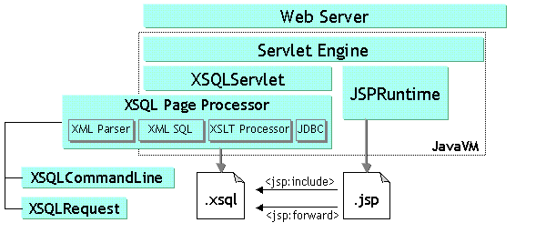
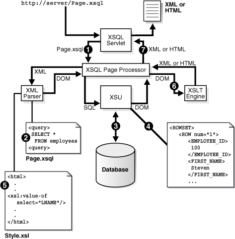
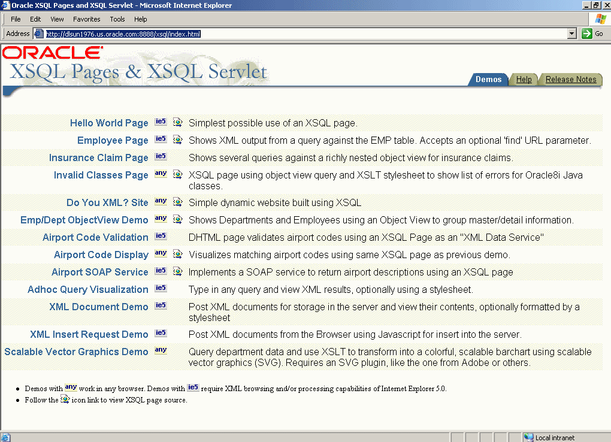
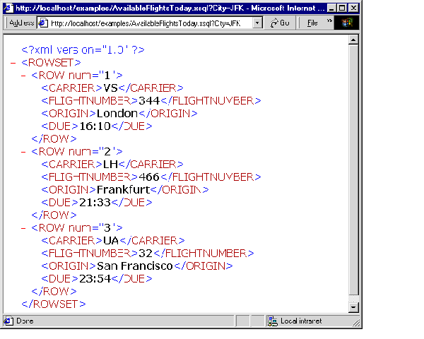
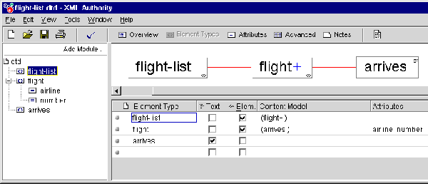
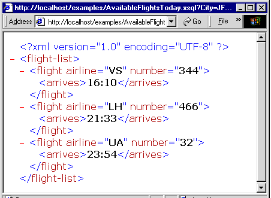
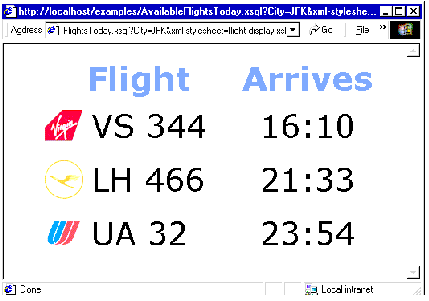

An explanation is given of how to use the basic features of the XSQL pages publishing framework.

**Related Topics**

- [Using the XSQL Pages Publishing Framework: Advanced Topics](using-XSQL-pages-publishing-framework-advanced.md)

### 24.1 Introduction to the XSQL Pages Publishing Framework

The Oracle XSQL pages publishing framework is an extensible platform for publishing Extensible Markup Language (XML) in multiple formats.

The Java-based [XSQL servlet](glossary.md), which is the center of the framework, provides a declarative interface for dynamically publishing dynamic web content based on relational data.

The XSQL framework combines the power of structured query language (SQL), XML, and Extensible Stylesheet Language Transformation (XSLT). You can use it to create declarative templates called [XSQL pages](glossary.md) to perform these actions:

- Assemble dynamic XML datagrams based on parameterized SQL queries

- Transform datagrams with XSLT to generate a result in an XML, HTML, or text-based format

An XSQL page, so called because its default extension is `.xsql`, is an XML file that contains instructions for the XSQL servlet. The Example 24-1 shows a simple XSQL page. It uses the [\<xsql:query\>](XSQL-pages-reference.md) action element to query the `hr.employees` table.

You can present a browser client with the data returned from the query in Example 24-1. Assembling and transforming information for publishing requires no programming. You can perform most tasks in a declarative way. If a built-in feature does not fit your needs, however, you can use Java to integrate custom data sources or perform customized server-side processing.

In the XSQL pages framework, the assembly of information to be published is separate from presentation. This architectural feature enables you to do this:

- Present the same data in multiple ways, including tailoring the presentation appropriately to the type of client device making the request —browser, cellular phone, personal digital assistant (PDA), and so on.

- Reuse data by aggregating existing pages into new ones

- Revise and enhance the presentation independently of the content

Example 24-1 Sample XSQL Page

    <?xml version="1.0">
    <?xml-stylesheet type="text/xsl" href="emplist.xsl"?>
    <xsql:query connection="hr" xmlns:xsql="urn:oracle-xsql">
     SELECT * FROM employees
    </xsql:query>

#### 24.1.1 Prerequisites for Using the XSQL Pages Publishing Framework

Prerequisites for using the XSQL pages publishing framework are described.

This chapter assumes that you are familiar with these technologies:

- Oracle Database SQL. The XSQL framework accesses data in a database.

- Procedural Language/Structured Query Language (PL/SQL). Oracle XML Developer's Kit (XDK) supplies a PL/SQL application programming interface (API) for XML SQL Utility (XSU) that mirrors the Java API.

- [Java Database Connectivity (JDBC)](glossary.md). The XSQL pages framework depends on a JDBC driver for database connections.

- [Extensible Stylesheet Language Transformations (XSLT)](glossary.md). You can use XSLT to transform the data into a format appropriate for delivery to the user.

- [XML SQL Utility (XSU)](glossary.md). The XSQL pages framework uses XSU to query the database.

### 24.2 Using the XSQL Pages Publishing Framework: Overview

Topics here include basic use, setting up, running the demo programs, and using the command-line utility.

#### 24.2.1 Using the XSQL Pages Framework: Basic Process

The XSQL page processor engine interprets, caches, and processes the contents of XSQL pages. Basic use of the XSQL pages framework is described.

Figure 24-1 shows the basic architecture of the XSQL pages publishing framework. The XSQL page processor provides access from this entry points:

- From the command line or in batch mode with the XSQL command-line utility. The `oracle.xml.xsql.XSQLCommandLine` class is the command-line interface.

- Over the web by using the XSQL servlet installed in a web server. The `oracle.xml.xsql.XSQLServlet` class is the servlet interface.

- As part of JSP applications by using `<jsp:include>` to include a template or `<jsp:forward>` to forward a template.

- Programmatically by using the `oracle.xml.xsql.XSQLRequest` Java class.

Figure 24-1 XSQL Pages Framework Architecture

[Description of "Figure 24-1 XSQL Pages Framework Architecture"](img_text/xsql5.md)

You can run the same XSQL pages from any of the access points shown in Figure 24-1. Regardless of which way you use the XSQL page processor, it performs these actions to generate a result:

1.  Receives a request to process an XSQL page. The request can come from the command-line utility or programmatically from an `XSQLRequest` object.

2.  Assembles an XML datagram by using the result of one or more SQL queries. The query is specified in the [\<xsql:query\>](XSQL-pages-reference.md) element of the XSQL page.

3.  Returns this XML datagram to the requester.

4.  Optionally transforms the datagram into any XML, HTML, or text-based format.

Figure 24-2 shows a typical web-based scenario in which a web server receives an HTTP request for `Page.xsql`, which contains a reference to the XSLT stylesheet `Style.xsl`. The XSQL page contains a database query.

Figure 24-2 Web Access to XSQL Pages

[Description of "Figure 24-2 Web Access to XSQL Pages"](img_text/adxdk122.md)

The XSQL page processor shown in Figure 24-2 performs these steps:

1.  Receives a request from the XSQL Servlet to process `Page.xsql`.

2.  Parses `Page.xsql` with the Oracle XML Parser and caches it.

3.  Connects to the database based on the value of the connection attribute on the document element.

4.  Generates the XML datagram by replacing each XSQL action element, for example, [\<xsql:query\>](XSQL-pages-reference.md), with the XML results returned by its built-in action handler.

5.  Parses the `Style.xsl` stylesheet and caches it.

6.  Transforms the datagram by passing it and the `Style.xsl` stylesheet to the Oracle XSLT processor.

7.  Returns the resulting XML or HTML document to the requester.

During the transformation step in this process, you can use stylesheets that conform with the W3C XSLT 1.0 or 2.0 standard to transform the assembled datagram into document formats such as:

- HTML for browser display

- Wireless Markup Language (WML) for wireless devices

- Scalable Vector Graphics (SVG) for data-driven charts, graphs, and diagrams

- XML Stylesheet Formatting Objects (XSL-FO), for rendering into Adobe PDF

- Text documents such as e-mails, SQL scripts, Java programs, and so on

- Arbitrary XML-based document formats

#### 24.2.2 Setting Up the XSQL Pages Framework

You can develop and use XSQL pages in various scenarios.

##### 24.2.2.1 Creating and Testing XSQL Pages with Oracle JDeveloper

The following Oracle JDeveloper tasks are covered here: creating an XSQL page, adding XSQL action elements to an XSQL page, checking the syntax of an XSQL page, testing an XSQL page, and adding an XSQL runtime library to your project library list so that environment variable `CLASSPATH` is properly set.

The IDE supports these features:

- Color-coded syntax highlighting

- XML syntax checking

- In-context drop-down lists that help you pick valid XSQL tag names and auto-complete tag and attribute names

- XSQL page deployment and testing

- Debugging tools

- Wizards for creating XSQL actions

To create an XSQL page in an Oracle JDeveloper project:

1.  Create or open a project.

2.  Select File and then New.

3.  In the New Gallery dialog box, select the General category and then XML.

4.  In the Item window, select XSQL Page and click OK. Oracle JDeveloper loads a tab for the new XSQL page into the central window.

To add XSQL action elements such as [\<xsql:query\>](XSQL-pages-reference.md) to your XSQL page, place the cursor where you want the new element to go and click an item in the Component Palette. A wizard opens that takes you through the steps of selecting which XSQL action you want to use and which attributes you must provide.

To check the syntax of an XSQL page, place the cursor in the page and right-click Check XML Syntax. If there are any XML syntax errors, Oracle JDeveloper displays them.

To test an XSQL page, select the page in the navigator and right-click Run. Oracle JDeveloper automatically starts a local web server, properly configured to run XSQL pages, and tests your page by starting your default browser with the appropriate URL to request the page. After you have run the XSQL page, you can continue to make modifications to it in the IDE. And, you can modify any XSLT stylesheets with which it might be associated. After saving the files in the IDE, you can immediately refresh the browser to observe the effect of the changes.

You must add the XSQL runtime library to your project library list so that the `CLASSPATH` is properly set. The IDE adds this entry automatically when you go through the New Gallery dialog to create a new XSQL page, but you can also add it manually to the project as follows:

1.  Right-click the project in the Applications Navigator.
2.  Select Project Properties.
3.  Select Profiles and then Libraries from the navigation tree.
4.  Move XSQL Runtime from the Available Libraries pane to Selected Libraries.

##### 24.2.2.2 Setting the CLASSPATH for XSQL Pages

Outside of the Oracle JDeveloper environment, you must ensure that the XSQL page processor engine is properly configured.

Ensure that the appropriate Java Archive (JAR) files are in the `CLASSPATH` of the Java Virtual Machine (JVM) that processes the XSQL Pages. The complete set of XDK JAR files is described in [Table 11-1](getting-started-with-XDK-for-Java.md). The JAR files for the XSQL framework include:

- `xml.jar`, the XSQL page processor

- `xmlparserv2.jar`, the Oracle XML parser

- `xsu12.jar`, the Oracle XML SQL utility (XSU)

- `ojdbc6.jar`, the Oracle JDBC driver

**Note:**

The XSQL servlet can connect to any database that has Java Database Connectivity (JDBC) support. Indicate the appropriate JDBC driver class and connection URL in the XSQL configuration file connection definition. Object-relational functionality works only when using Oracle Database with the Oracle JDBC driver.

If you have configured your `CLASSPATH` as instructed in [Setting Up the XDK for Java Environment](getting-started-with-XDK-for-Java.md), you need to add the directory only where the XSQL pages configuration file resides. In the database installation of XDK, the directory for `XSQLConfig.xml` is `$ORACLE_HOME/xdk/admin`.

On Windows your `%CLASSPATH%` variable contains these entries:

    %ORACLE_HOME%\lib\ojdbc6.jar;%ORACLE_HOME%\lib\xmlparserv2.jar;
    %ORACLE_HOME%\lib\xsu12.jar;C:\xsql\lib\xml.jar;%ORACLE_HOME%\xdk\admin

On UNIX the `$CLASSPATH` variable contains these entries:

    $ORACLE_HOME/lib/ojdbc6.jar:$ORACLE_HOME/lib/xmlparserv2.jar:
    $ORACLE_HOME/lib/xsu12.jar:$ORACLE_HOME/lib/xml.jar:$ORACLE_HOME\xdk\admin

**Note:**

If you are deploying your XSQL pages in a Java Platform, Enterprise Edition (Java EE) web application archive (WAR) file, then you can include the XSQL JAR files in the `./WEB-INF/lib` directory of the WAR file.

##### 24.2.2.3 Configuring the XSQL Servlet Container

You can install the XSQL servlet in a variety of different web servers. See the file `$ORACLE_HOME/xdk/readme.html` for servlet installation instructions.

##### 24.2.2.4 Setting Up the Connection Definitions

XSQL pages specify database connections by using a short name for a connection that is defined in the XSQL configuration file, which by default is named `$ORACLE_HOME/xdk/admin/XSQLConfig.xml`.

**Note:**

If you are deploying your XSQL pages in a Java EE WAR file, then you can place the `XSQLConfig.xml` file in the `./WEB-INF/classes` directory of your WAR file.

The sample XSQL page shown in Example 24-1 contains this connection information:

    <xsql:query connection="hr" xmlns:xsql="urn:oracle-xsql">

Connection names are defined in the `<connectiondefs>` section of the XSQL configuration file. Example 24-2 shows the relevant section of the sample configuration file included with the database, with the `hr` connection in bold.

For each database connection, you can specify these elements:

- `<username>`, the database user name

- `<password>`, the database password

- `<dburl>`, the JDBC connection string

- `<driver>`, the fully qualified class name of the JDBC driver to use

- `<autocommit>`, which optionally forces `AUTOCOMMIT` to `TRUE` or `FALSE`

Specify an `<autocommit>` child element to control the setting of the JDBC autocommit for any connection. If no `<autocommit>` child element is set for a `<connection>`, then the autocommit setting is not set by the XSQL connection manager. In this case, the setting is the default autocommit setting for the JDBC driver.

You can place an arbitrary number of `<connection>` elements in the XSQL configuration file to define your database connections. An individual XSQL page refers to the connection it wants to use by putting a `connection="``xxx``"` attribute on the top-level element in the page (also called the "document element").

**Note:**

The `XSQLConfig.xml` file contains sensitive database user name and password information that must be kept secure on the database server. See Security Considerations for XSQL Pages for instructions.

Example 24-2 Connection Definitions Section of XSQLConfig.xml

    <connectiondefs>
      ...
      <connection name="hr">
        <username>hr</username>
        <password>hr_password</password>
        <dburl>jdbc:oracle:thin:@localhost:1521:ORCL</dburl>
        <driver>oracle.jdbc.driver.OracleDriver</driver>
        <autocommit>false</autocommit>
      </connection>
      ...
    </connectiondefs>

#### 24.2.3 Running the XSQL Pages Demo Programs

Demo programs for the XSQL servlet are included in `$ORACLE_HOME/xdk/demo/java/xsql`.

Table 24-1 lists the demo subdirectories and explains the included demos. The Demo Name column refers to the title of the demo listed on the XSQL Pages & XSQL Servlet home page. Running the XSQL Demos explains how to access the home page.

Table 24-1 XSQL Servlet Demos

| Directory     | Demo Name                     | Description                                                                                                                                                                                                                                                                                                                                                                                                                                                                                                                                                                                                                                                                                                                                                                                                                                                                                                                                                                                                                                                                                                                                          |
|:--------------|:------------------------------|:-----------------------------------------------------------------------------------------------------------------------------------------------------------------------------------------------------------------------------------------------------------------------------------------------------------------------------------------------------------------------------------------------------------------------------------------------------------------------------------------------------------------------------------------------------------------------------------------------------------------------------------------------------------------------------------------------------------------------------------------------------------------------------------------------------------------------------------------------------------------------------------------------------------------------------------------------------------------------------------------------------------------------------------------------------------------------------------------------------------------------------------------------------|
| `home/`       | XSQL Pages & XSQL Servlet     | Contains the pages that display the tabbed home page of the XSQL demos and the online XSQL help that you can access from that page. As explained in Running the XSQL Demos. you can invoke the XSQL home page from the `index.html` page.                                                                                                                                                                                                                                                                                                                                                                                                                                                                                                                                                                                                                                                                                                                                                                                                                                                                                                            |
| `helloworld/` | Hello World Page              | Shows the simplest possible XSQL page.                                                                                                                                                                                                                                                                                                                                                                                                                                                                                                                                                                                                                                                                                                                                                                                                                                                                                                                                                                                                                                                                                                               |
| `emp/`        | Employee Page                 | XSQL page showing XML data from the `hr.employees` table, using XSQL page parameters to control what employees are returned and which columns to use for the database sort. Uses an associated XSLT stylesheet to format the results as an HTML Form containing the `emp.xsql` page as the form action so the user can refine the search criteria.                                                                                                                                                                                                                                                                                                                                                                                                                                                                                                                                                                                                                                                                                                                                                                                                |
| `insclaim/`   | Insurance Claim Page          | Demonstrates several sample queries over the richly structured Insurance Claim object view. The `insclaim.sql` scripts sets up the `INSURANCE_CLAIM_VIEW` object view and populates it with sample data.                                                                                                                                                                                                                                                                                                                                                                                                                                                                                                                                                                                                                                                                                                                                                                                                                                                                                                                                             |
| `classerr/`   | Invalid Classes Page          | Uses `invalidclasses.xsl` to format a "live" list of current Java class compilation errors in your schema. The accompanying SQL script sets up the `XSQLJavaClassesView` object view used by the demo. The master/detail information from the object view is formatted into HTML by the `invalidclasses.xsl` stylesheet in the server.                                                                                                                                                                                                                                                                                                                                                                                                                                                                                                                                                                                                                                                                                                                                                                                                               |
| `doyouxml/`   | Do You XML? Site              | Shows how a simple, data-driven web site can be built with an XSQL page that uses SQL, XSQL substitution variables in the queries, and XSLT for formatting the site. Demonstrates using substitution parameters in both the body of SQL query statements within [\<xsql:query\>](XSQL-pages-reference.md) tags, and also within the attributes to `<xsql:query>` tags to control behavior such as how many records to display and to skip (for "paging" through query results in a stateless way).                                                                                                                                                                                                                                                                                                                                                                                                                                                                                                                                                                                                                                                |
| `empdept/`    | Emp/Dept Object Demo          | Demonstrates how to use an object view to group master/detail information from two existing flat tables such as `scott.emp` and `scott.dept`. The `empdeptobjs.sql` script creates the object view and also the `INSTEAD OF INSERT` triggers that enable the master/detail view to be used as an insert target of `xsql:insert-request`. The `empdept.xsl` stylesheet shows a form of an XSLT stylesheet that looks just like an HTML page without the extra `xsl:stylesheet` or `xsl:transform` at the top. Using a Literal Result Element as a stylesheet is part of the XSLT 1.0 specification. The stylesheet also shows how to generate an HTML page that includes `<link rel="stylesheet">` to enable the generated HTML to fully leverage cascading stylesheets (CSS) for centralized HTML style information, found in the `coolcolors.css` file.                                                                                                                                                                                                                                                                                          |
| `airport/`    | Airport Code Validation       | Returns a datagram of information about airports based on their three-letter codes and uses `<xsql:no-rows-query>` as alternative queries when initial queries return no rows. After attempting to match the airport code passed in, the XSQL page tries a fuzzy match based on the airport description. The `airport.htm` page shows how to use the XML results of the `airport.xsql` page from a web page with JavaScript to exploit built-in Document Object Model (DOM) functionality in Internet Explorer. When you enter the three-letter airport code on the web page, a JavaScript fetches an XML datagram from XSQL servlet. The datagram corresponds to the code that you entered. If the return indicates no match, then the program collects a "picklist" of possible matches based on information returned in the XML datagram from XSQL servlet                                                                                                                                                                                                                                                                                  |
| `airport/`    | Airport Code Display          | Demonstrates use of the same XSQL page as the Airport Code Validation example but supplies an XSLT stylesheet name in the request. This behavior causes the airport information to be formatted as an HTML form instead of being returned as raw XML.                                                                                                                                                                                                                                                                                                                                                                                                                                                                                                                                                                                                                                                                                                                                                                                                                                                                                                |
| `airport/`    | Airport Soap Service          | Demonstrates returning airport information as a Simple Object Access Protocol (SOAP) Service.                                                                                                                                                                                                                                                                                                                                                                                                                                                                                                                                                                                                                                                                                                                                                                                                                                                                                                                                                                                                                                                        |
| `adhocsql/`   | Adhoc Query Visualization     | Demonstrates how to pass a SQL query and an XSLT stylesheet as parameters to the server.                                                                                                                                                                                                                                                                                                                                                                                                                                                                                                                                                                                                                                                                                                                                                                                                                                                                                                                                                                                                                                                             |
| `document/`   | XML Document Demo             | Demonstrates inserting XML documents into relational tables. The `docdemo.sql` script creates a user-defined type called XMLDOCFRAG containing an attribute of type character large object (CLOB). Try inserting the text of the document in `./xsql/demo/xml99.xml` and providing the name `xml99.xsl` as the stylesheet, and `./xsql/demo/JDevRelNotes.xml` with the stylesheet `relnotes.xsl`. The `docstyle.xsql` page shows an example of the [\<xsql:include-xsql\>](XSQL-pages-reference.md) action element to include the output of the `doc.xsql` page into its own page before transforming the final output using a client-supplied stylesheet name. The demo uses the client-side XML features of Internet Explorer 5.0 to check the document for well-formedness before allowing it to be posted to the server.                                                                                                                                                                                                                                                                                                                |
| `insertxml/`  | XML Insert Request Demo       | Demonstrates posting XML from a client to an XSQL page that handles inserting the posted XML data into a database table using the [\<xsql:insert-request\>](XSQL-pages-reference.md) action element. The demo accepts XML documents in the `moreover.com` XML-based news format. In this case, the program doing the posting of the XML is a client-side web page using Internet Explorer 5.0 and the `XMLHttpRequest` object from JavaScript. If you look at the source for the `insertnewsstory.xsql` page, you'll see it's specifying a table name and an XSLT Transform name. The `moreover-to-newsstory.xsl` stylesheet transforms the incoming XML information into the canonical format that the `OracleXMLSave` utility knows how to insert. Try copying and pasting the example `` element several times within the `<moreovernews>` element to insert several new articles in one shot. The `newsstory.sql` script shows how INSTEAD OF triggers can be used on the database views into which you ask XSQL Pages to insert to the data to customize how incoming data is handled, default primary key values, and so on. |
| `svg/`        | Scalable Vector Graphics Demo | The `deptlist.xsql` page displays a simple list of departments with hyperlinks to the `SalChart.xsql` page. The `SalChart.xsql` page queries employees for a given department passed in as a parameter and uses the associated `SalChart.xsql` stylesheet to format the result into a Scalable Vector Graphics drawing, a bar chart comparing salaries of the employees in that department.                                                                                                                                                                                                                                                                                                                                                                                                                                                                                                                                                                                                                                                                                                                                                          |
| `fop/`        | PDF Demo                      | The `emptable.xsql` page displays a simple list of employees. The `emptable.xsl `stylesheet transforms the datapage into the XSL-FO Formatting Objects which, combined with the built-in FOP serializer, render the results in Adobe PDF format.                                                                                                                                                                                                                                                                                                                                                                                                                                                                                                                                                                                                                                                                                                                                                                                                                                                                                                     |
| `cursor/`     | Cursor Demo                   | Contains an example of using a nested `CURSOR` expression, which is one of three ways to use the default [\<xsql:query\>](XSQL-pages-reference.md) element to produce nested elements.                                                                                                                                                                                                                                                                                                                                                                                                                                                                                                                                                                                                                                                                                                                                                                                                                                                                                                                                                               |
| `actions/`    |                               | Contains the source code for two example custom actions.                                                                                                                                                                                                                                                                                                                                                                                                                                                                                                                                                                                                                                                                                                                                                                                                                                                                                                                                                                                                                                                                                             |

##### 24.2.3.1 Setting Up the XSQL Demos

How to set up the XSQL demos is described.

1.  Change into the `$ORACLE_HOME/xdk/demo/java/xsql` directory (UNIX) or `%ORACLE_HOME%\xdk\demo\java\xsql` directory (Windows).
2.  Start SQL\*Plus and connect to your database as `ctxsys`—the schema owner for the Oracle Text packages—and issue this statement:
        GRANT EXECUTE ON ctx_ddl TO scott;
3.  Connect to your database as a user with `DBA` privileges and issue this statement:
        GRANT QUERY REWRITE TO scott;

    The preceding query enables `scott` to create a function-based index that one of the demos requires to perform case-insensitive queries on descriptions of airports.
4.  Connect to your database as `scott`. You are prompted for the password.
5.  Run the SQL script `install.sql` in the current directory. This script runs all SQL scripts for all the demos:
        @install.sql
6.  Change to the `./doyouxml` subdirectory, and run this command to import sample data for the "Do You XML?" demo (you are prompted for the password):
        imp scott file=doyouxml.dmp
7.  To run the Scalable Vector Graphics (SVG) demonstration, install an SVG plug-in such as Adobe SVG plug-in into your browser.

##### 24.2.3.2 Running the XSQL Demos

The XSQL demos are designed to be accessed through a web browser.

If you have set up the XSQL servlet in a web server as described in Configuring the XSQL Servlet Container, then you can access the demos through this URL, substituting appropriate values for `yourserver` and `port`:

    http://yourserver:port/xsql/index.html

Figure 24-3 shows a section of the XSQL home page in Internet Explorer. (You must use browser version 5 or later.)

Figure 24-3 XSQL Home Page

[Description of "Figure 24-3 XSQL Home Page"](img_text/xsql_home.md)

The demos are designed to be self-explanatory. Click the demo titles—Hello World Page, Employee Page, and so forth—and follow the online instructions.

#### 24.2.4 Using the XSQL Pages Command-Line Utility

XDK includes a command-line Java interface that runs the XSQL page processor. You can process any XSQL page with the XSQL command-line utility.

Often the content of a dynamic page is based on data that does not frequently change. To optimize performance of your web publishing, you can use operating system facilities to schedule offline processing of your XSQL pages. This technique enables the processed results to be served statically by your web server.

The `$ORACLE_HOME/xdk/bin/xsql` and `%ORACLE_HOME%\xdk\bin\xsql.bat` shell scripts run the `oracle.xml.xsql.XSQLCommandLine` class. Before invoking the class ensure that your environment is configured as described in Setting Up the XSQL Pages Framework. Depending on how you invoke the utility, the syntax is either of these:

    java oracle.xml.xsql.XSQLCommandLine xsqlpage [outfile] [param1=value1 ...]
    xsql xsqlpage [outfile] [param1=value1 ...]

If you specify an `outfile`, then the result of processing `xsqlpage` is written to it; otherwise the result goes to standard out. You can pass any number of parameters to the XSQL page processor, which are available for reference by the XSQL page processed as part of the request. However, these parameter names are recognized by the command-line utility and have a predefined behavior:

- `xml-stylesheet=stylesheetURL`

  Provides the relative or absolute URL for a stylesheet to use for the request. You can also set it to the string `none` to suppress XSLT stylesheet processing for debugging.

- `posted-xml=XMLDocumentURL`

  Provides the relative or absolute URL of an XML resource to treat as if it were posted as part of the request.

- `useragent=UserAgentString`

  Simulates a particular HTTP User-Agent string from the command line so that an appropriate stylesheet for that User-Agent type is selected as part of command-line processing of the page.

### 24.3 Generating and Transforming XML with XSQL Servlet

The basic tasks that you can perform with your server-side XSQL page templates are described.

#### 24.3.1 Composing XSQL Pages

You can serve database information in XML format over the web with XSQL pages.

For example, suppose your aim is to serve a real-time XML datagram from Oracle of all available flights landing today at JFK airport. Example 24-3 shows a sample XSQL page in a file named `AvailableFlightsToday.xsql`.

The XSQL page is an XML file that contains any mix of static XML content and XSQL action elements. The file can have any extension, but `.xsql` is the default extension for XSQL pages. You can modify your servlet engine configuration settings to associate other extensions by using the same technique described in Configuring the XSQL Servlet Container. The servlet extension mapping is configured inside the `./WEB-INF/web.xml` file in a Java EE WAR file.

The XSQL page in Example 24-3 begins with this declaration:

    <?xml version="1.0"?>

The first, outermost element in an XSQL page is the **document element**. `AvailableFlightsToday.xsql` contains a single XSQL action element [\<xsql:query\>](XSQL-pages-reference.md), but no static XML elements. In this case the `<xsql:query>` element is the document element. Example 24-3 represents the simplest useful XSQL page: one that contains a single query. The results of the query replace the `<xsql:query>` section in the XSQL page.

**Note:**

[XSQL Pages Reference](XSQL-pages-reference.md) describes the complete set of built-in action elements.

The `<xsql:query>` action element includes an `xmlns` attribute that declares the `xsql` namespace prefix as a synonym for the `urn:oracle-xsql` value, which is the Oracle XSQL namespace identifier:

    <xsql:query connection="demo" bind-params="City" xmlns:xsql="urn:oracle-xsql">

The element also contains a `connection` attribute whose value is the name of a predefined connection in the XSQL configuration file:

    <xsql:query connection="demo" bind-params="City" xmlns:xsql="urn:oracle-xsql">

The details concerning the user name, password, database, and JDBC driver to be used for the `demo` connection are centralized in the configuration file.

To include more than one query on the page, you can invent an XML element to wrap the other elements. Example 24-4 shows this technique.

In Example 24-4, the `connection` attribute and the `xsql` namespace declaration always go on the document element, whereas the `bind-params` is specific to the `<xsql:query>` action.

Example 24-3 Sample XSQL Page in AvailableFlightsToday.xsql

    <?xml version="1.0"?>
    <xsql:query connection="demo" bind-params="City" xmlns:xsql="urn:oracle-xsql">
      SELECT    Carrier, FlightNumber, Origin, TO_CHAR(ExpectedTime,'HH24:MI') AS Due
      FROM      FlightSchedule
      WHERE     TRUNC(ExpectedTime) = TRUNC(SYSDATE)
      AND       Arrived = 'N'
      AND       Destination = ?   /* The "?" represents a bind variable bound */
      ORDER BY  ExpectedTime      /* to the value of the City parameter.      */
    </xsql:query>

Example 24-4 Wrapping the \<xsql:query\> Element

    <?xml version="1.0"?>
    <page connection="demo" xmlns:xsql="urn:oracle-xsql">
      <xsql:query bind-params="City">
        SELECT   Carrier, FlightNumber, Origin, TO_CHAR(ExpectedTime,'HH24:MI') AS Due
        FROM     FlightSchedule
        WHERE    TRUNC(ExpectedTime) = TRUNC(SYSDATE)
        AND      Arrived = 'N'
        AND      Destination = ?   /* The ? is a bind variable bound       */
        ORDER BY ExpectedTime      /* to the value of the City parameter.  */
      </xsql:query>
      <!-- Other xsql:query actions can go here inside <page> and </page> -->
    </page>

##### 24.3.1.1 Using Bind Parameters

The use of bind parameters is described.

The `<xsql:query>` element shown in Example 24-3 contains a `bind-params` attribute that associates the values of parameters in the request to bind variables in the SQL statement included in the `<xsql:query>` tag. The bind parameters in the SQL statement are represented by question marks.

You can use SQL bind variables to parameterize the results of any of the actions in [Table 33-1](XSQL-pages-reference.md) that allow SQL statements. Bind variables enable your XSQL page template to produce results based on the values of parameters passed in the request.

To use a bind variable, include a question mark anywhere in a statement where bind variables are allowed by SQL. Whenever a SQL statement is executed in the page, the XSQL engine binds the parameter values to the variable by specifying the `bind-params` attribute on the action element.

Example 24-5 shows an XSQL page that binds the bind variables to the value of the `custid` parameter in the page request.

The XML data for a customer with ID of 101 can then be requested by passing the customer id parameter in the request:

    http://yourserver.com/fin/CustomerPortfolio.xsql?custid=1001

The value of the `bind-params` attribute is a space-delimited list of parameter names. The left-to-right order indicates the positional bind variable to which its value is bound in the statement. Thus, if your SQL statement contains five question marks, then the `bind-params` attribute needs a space-delimited list of five parameter names. If the same parameter value must be bound to several different occurrences of a bind variable, then repeat the name of the parameters in the value of the `bind-params` attribute at the appropriate position. Failure to include the same number of parameter names in the `bind-params` attribute as in the query causes an error when the page is executed.

You can use variables in any action that expects a SQL statement or PL/SQL block. The page shown in Example 24-6 shows this technique. The XSQL page contains three action elements:

- [\<xsql:dml\>](XSQL-pages-reference.md) binds `useridCookie` to an argument in the `log_user_hit` procedure.

- [\<xsql:query\>](XSQL-pages-reference.md) binds parameter `custid` to a variable in a `WHERE` clause.

- [\<xsql:include-owa\>](XSQL-pages-reference.md) binds parameters `custid` and `userCookie` to two arguments in the `historical_data` procedure.

Example 24-5 Bind Variables in CustomerPortfolio.xsql

    <portfolio connnection="prod" xmlns:xsql="urn:oracle-xsql">
      <xsql:query bind-params="custid">
        SELECT s.ticker as "Symbol", s.last_traded_price as "Price"
        FROM latest_stocks s, customer_portfolio p
        WHERE p.customer_id = ?
        AND s.ticker = p.ticker
      </xsql:query>
    </portfolio>

Example 24-6 Bind Variables with Action Elements in CustomerPortfolio.xsql

    <portfolio connnection="prod" xmlns:xsql="urn:oracle-xsql">
      <xsql:dml commit="yes" bind-params="useridCookie">
         BEGIN log_user_hit(?); END;
      </xsql:dml>
      <current-prices>
        <xsql:query bind-params="custid">
          SELECT s.ticker as "Symbol", s.last_traded_price as "Price"
          FROM latest_stocks s, customer_portfolio p
          WHERE p.customer_id = ?
          AND s.ticker = p.ticker
        </xsql:query>
      </current-prices>
      <analysis>
        <xsql:include-owa bind-params="custid userCookie">
          BEGIN portfolio_analysis.historical_data(?,5 /* years */, ?); END;
        </xsql:include-owa>
      </analysis>
    </portfolio>

##### 24.3.1.2 Using Lexical Substitution Parameters

For any XSQL action element, you can substitute a lexical substitution parameter for the value of any attribute or the text of any contained SQL statement. Thus, you can parameterize how actions behave and substitute parts of the SQL statements that they perform.

Lexical substitution parameters are referenced with this syntax: `{@ParameterName}`. Example 24-7 shows how you can use two lexical substitution parameters. One parameter in the [\<xsql:query\>](XSQL-pages-reference.md) element sets the maximum number of rows to be passed in, whereas the other controls the list of columns to be ordered.

Example 24-7 also contains two bind parameters: `dev` and `prod`. For example, you might want to get the open bugs for developer `yxsmith` against product `817`. And, you want to retrieve only 10 rows and order them by bug number. You can fetch the XML for the bug list by specifying parameter values:

    http://server.com/bug/DevOpenBugs.xsql?dev=yxsmith&prod=817&max=10&orderby=bugno

You can also use the XSQL command-line utility to make the request:

    xsql DevOpenBugs.xsql dev=yxsmith prod=817 max=10 orderby=bugno

Lexical parameters also enable you to specify parameters for the XSQL pages connection and the stylesheet used to process the page. Example 24-8 shows this technique. You can switch between stylesheets `test.xsql` and `prod.xsl` by specifying the name/value pairs `sheet=test` and `sheet=prod`.

Example 24-7 Lexical Substitution Parameters for Rows and Columns in DevOpenBugs.xsql

    <!-- DevOpenBugs.xsql -->
    <open-bugs connection="demo" xmlns:xsql="urn:oracle-xsql">
      <xsql:query max-rows="{@max}" bind-params="dev prod">
        SELECT bugno, abstract, status
        FROM   bug_table
        WHERE  programmer_assigned = UPPER(?)
        AND    product_id          = ?
        AND    status < 80
        ORDER BY {@orderby}
      </xsql:query>
    </open-bugs>

Example 24-8 Lexical Substitution Parameters for Connections and Stylesheets in DevOpenBugs.xsql

    <?xml version="1.0"?>
    <?xml-stylesheet type="text/xsl" href="{@sheet}.xsl"?>
    <!-- DevOpenBugs.xsql -->
    <open-bugs connection="{@conn}" xmlns:xsql="urn:oracle-xsql">
      <xsql:query max-rows="{@max}" bind-params="dev prod">
        SELECT bugno, abstract, status
          FROM bug_table
         WHERE programmer_assigned = UPPER(?)
           AND product_id          = ?
           AND status < 80
        ORDER BY {@orderby}
      </xsql:query>
    </open-bugs>

##### 24.3.1.3 Providing Default Values for Bind and Substitution Parameters

You may want to provide a default value for a bind variable or a substitution parameter directly in a page. In this way, the page is parameterized without requiring the requester to explicitly pass in all values in each request.

To include a default value for a parameter, add an XML attribute of the same name as the parameter to the action element or to any ancestor element. If a value for a given parameter is not included in the request, then the XSQL page processor searches for an attribute by the same name on the current action element. If it does not find one, it keeps looking for such an attribute on each ancestor element of the current action element until it gets to the document element of the page.

The page in Example 24-9 defaults the value of the `max` parameter to `10` for both `<xsql:query>` actions in the page.

This page in Example 24-10 defaults the first query to a `max` of `5`, the second query to a `max` of `7`, and the third query to a `max` of `10`.

All defaults are overridden if a value of `max` is supplied in the request, as shown in this example:

    http://yourserver.com/example.xsql?max=3

Bind variables respect the same defaulting rules. Example 24-11 shows how you can set the `val` parameter to `10` by default.

If the page in Example 24-11 is requested without any parameters, it returns this XML datagram:

    <example>
      <rowset>
        <row>
          <somevalue>10</somevalue>
        </row>
      </row>
    </example>

Alternatively, assume that the page is requested with this URL:

    http://yourserver.com/example.xsql?val=3

The preceding URL returns this datagram:

    <example>
      <rowset>
        <row>
          <somevalue>3</somevalue>
        </row>
      </row>
    </example>

You can remove the default value for the `val` parameter from the page by removing the `val` attribute. Example 24-12 shows this technique.

A URL request for the page that does not supply a name/value pair returns this datagram:

    <example>
      <rowset/>
    </example>

A bind variable that is bound to a parameter with neither a default value nor a value supplied in the request is bound to NULL, which causes the `WHERE` clause in Example 24-12 to return no rows.

Example 24-9 Setting a Default Value

    <example max="10" connection="demo" xmlns:xsql="urn:oracle-xsql">
      <xsql:query max-rows="{@max}">SELECT * FROM TABLE1</xsql:query>
      <xsql:query max-rows="{@max}">SELECT * FROM TABLE2</xsql:query>
    </example>

Example 24-10 Setting Multiple Default Values

    <example max="10" connection="demo" xmlns:xsql="urn:oracle-xsql">
      <xsql:query max="5" max-rows="{@max}">SELECT * FROM TABLE1</xsql:query>
      <xsql:query max="7" max-rows="{@max}">SELECT * FROM TABLE2</xsql:query>
      <xsql:query max-rows="{@max}">SELECT * FROM TABLE3</xsql:query>
    </example>

Example 24-11 Defaults for Bind Variables

    <example val="10" connection="demo" xmlns:xsql="urn:oracle-xsql">
      <xsql:query tag-case="lower" bind-params="val val val">
        SELECT ? AS somevalue
        FROM DUAL
        WHERE ? = ?
      </xsql:query>
    </example>

Example 24-12 Bind Variables with No Defaults

    <example connection="demo" xmlns:xsql="urn:oracle-xsql">
      <xsql:query tag-case="lower" bind-params="val val val">
        SELECT ? AS somevalue
        FROM DUAL
        WHERE ? = ?
      </xsql:query>
    </example>

##### 24.3.1.4 How the XSQL Page Processor Handles Different Types of Parameters

XSQL pages can make use of parameters supplied in the request and also of page-private parameters. The names and values of page-private parameters are determined by actions in the page.

If an action encounters a reference to a parameter named `param` in either a `bind-params` attribute or in a lexical parameter reference, then the value of the `param` parameter is resolved in this order:

1.  The value of the page-private parameter named `param`, if set

2.  The value of the request parameter named `param`, if supplied

3.  The default value provided by an attribute named `param` on the current action element or one of its ancestor elements

4.  The value NULL for bind variables and the empty string for lexical parameters

For XSQL pages that are processed by the XSQL servlet over HTTP, you can also set and reference the HTTP-Session-level variables and HTTP Cookies parameters.

For XSQL pages processed through the XSQL servlet, the value of a parameter `param` is resolved in this order:

1.  The value of the page-private parameter `param`, if set

2.  The value of the cookie named `param`, if set

3.  The value of the session variable named `param`, if set

4.  The value of the request parameter named `param`, if supplied

5.  The default value provided by an attribute named `param` on the current action element or one of its ancestor elements

6.  The value NULL for bind variables and the empty string for lexical parameters

The resolution order means that users cannot supply parameter values in a request to override parameters of the same name set in the HTTP session. Also, users cannot set them as cookies that persist across browser sessions.

#### 24.3.2 Producing Datagrams from SQL Queries

How to produce datagrams using SQL queries is described.

With XSQL servlet properly installed on your web server, you can access XSQL pages by following these basic steps:

1.  Copy an XSQL file to a directory under the virtual hierarchy of your web server. Example 24-3 shows the sample page `AvailableFlightsToday.xsql`.
    You can also deploy XSQL pages in a standard Java EE WAR file, which occurs when you use Oracle JDeveloper to develop and deploy your pages to Oracle WebLogic Server.
2.  Load the page in your browser. For example, if the root URL is `yourcompany.com`, then you can access the `AvailableFlightsToday.xsql` page through a web browser by requesting this URL:
        http://yourcompany.com/AvailableFlightsToday.xsql?City=JFK

The XSQL page processor automatically materializes the results of the query in your XSQL page as XML and returns them to the requester. Typically, another server program requests this XML-based datagram for processing, but if you use a browser such as Internet Explorer then you can directly view the XML result, as shown in Figure 24-4.

Figure 24-4 XML Result from XSQL Page (AvailableFlightsToday.xsql) Query

[Description of "Figure 24-4 XML Result from XSQL Page (AvailableFlightsToday.xsql) Query"](img_text/xsql1.md)

#### 24.3.3 Transforming XML Datagrams into an Alternative XML Format

If the canonical `<ROWSET>` and `<ROW>` XML output format is not the XML format you need, you can associate an XSLT stylesheet with your XSQL page. The stylesheet can transform the XML datagram in the server before returning the data.

The canonical output is presented in Figure 24-4.

When exchanging data with another program, you typically agree on a document type definition (DTD) that describes the XML format for the exchange. Assume that you are given the `flight-list.dtd` definition and are told to produce your list of arriving flights in a format compliant with the DTD. You can use a visual tool such as XML Authority to browse the structure of the flight-list DTD, as shown in Figure 24-5.

Figure 24-5 Exploring flight-list.dtd with XML Authority

[Description of "Figure 24-5 Exploring flight-list.dtd with XML Authority"](img_text/xsql2.md)

Figure 24-5 shows that the standard XML formats for flight lists are:

- `<flight-list>` element, which contains one or more `<flight>` elements

- `<flight>` elements, which have attributes `airline` and `number`, and each of which contains an `<arrives>` element

- `<arrives>` elements, which contains text

Example 24-13 shows the XSLT stylesheet `flight-list.xsl`. By associating the stylesheet with the XSQL page, you can change the default `<ROWSET>` and `<ROW>` format into the industry-standard `<flight-list>` and `<flight>`.

The XSLT stylesheet is a template that includes the literal elements to produce in the resulting document, such as `<flight-list>`, `<flight>`, and `<arrives>`, interspersed with XSLT actions that enable you to do this:

- Loop over matching elements in the source document with `<xsl:for-each>`

- Plug in the values of source document elements where necessary with `<xsl:value-of>`

- Plug in the values of source document elements into attribute values with the `{some_parameter}` notation

The following items have been added to the top-level `<flight-list>` element in the Example 24-13 stylesheet:

- `xmlns:xsl="http://www.w3.org/1999/XSL/Transform"`

  This attribute defines the XML namespace named `xsl` and identifies the URL string that uniquely identifies the XSLT specification. Although it looks just like a URL, think of the string `http://www.w3.org/1999/XSL/Transform `as the "global primary key" for the set of elements defined in the XSLT specification. When the namespace is defined, you can use the `<xsl:XXX>` action elements in the stylesheet to loop and plug values in where necessary.

- `xsl:version="1.0"`

  This attribute identifies the document as an XSLT 1.0 stylesheet. A version attribute is required on all XSLT stylesheets for them to be valid and recognized by an XSLT processor.

You can associate the `flight-list.xsl` stylesheet with the `AvailableFlightsToday.xsql` in Example 24-3 by adding an `<?xml-stylesheet?>` instruction to the top of the page. Example 24-14 shows this technique.

Associating an XSLT stylesheet with the XSQL page causes the requesting program or browser to view the XML in the format as specified by `flight-list.dtd` you were given. Figure 24-6 shows a sample browser display.

Figure 24-6 XSQL Page Results in XML Format

[Description of "Figure 24-6 XSQL Page Results in XML Format"](img_text/xsql3.md)

Example 24-13 Industry Standard Formats in flight-list.xsl

    <!-- XSLT Stylesheet to transform ROWSET/ROW results into flight-list format
     -->
    <flight-list xmlns:xsl="http://www.w3.org/1999/XSL/Transform"
                   xsl:version="1.0">
      <xsl:for-each select="ROWSET/ROW">
          <flight airline="{CARRIER}" number="{FLIGHTNUMBER}">
            <arrives><xsl:value-of select="DUE"/></arrives>
          </flight>
      </xsl:for-each>
    </flight-list>

Example 24-14 Stylesheet Association in flight-list.xsl

    <?xml version="1.0"?>
    <?xml-stylesheet type="text/xsl" href="flight-list.xsl"?>
    <xsql:query connection="demo" bind-params="City" xmlns:xsql="urn:oracle-xsql">
        SELECT Carrier, FlightNumber, Origin, TO_CHAR(ExpectedTime,'HH24:MI') AS Due
          FROM FlightSchedule
         WHERE TRUNC(ExpectedTime) = TRUNC(SYSDATE) AND Arrived = 'N'
           AND Destination = ?   /* The ? is a bind variable being bound */
          ORDER BY ExpectedTime  /* to the value of the City parameter   */
    </xsql:query>

#### 24.3.4 Transforming XML Datagrams into HTML for Display

To return XML data in HTML instead of an alternative XML format, use an appropriate XSLT stylesheet. For example, rather than producing elements such as `<flight-list>` and `<flight>`, you can write a stylesheet that produces HTML elements such as `<table>`, `<tr>`, and `<td>`.

The result of the dynamically queried data then looks like the HTML page shown in Figure 24-7. Instead of returning raw XML data, the XSQL page leverages server-side XSLT transformation to format the information as HTML for delivery to the browser.

Figure 24-7 Using an XSLT Stylesheet to Render HTML

[Description of "Figure 24-7 Using an XSLT Stylesheet to Render HTML"](img_text/xsql4.md)

Similar to the syntax of the `flight-list.xsl` stylesheet, the `flight-display.xsl` stylesheet shown in Example 24-15 looks like a template HTML page. It contains `<xsl:for-each>`, `<xsl:value-of>`, and attribute value templates such as `{DUE}` to plug in the dynamic values from the underlying `<ROWSET>` and `<ROW>` structured XML query results.

**Note:**

The stylesheet produces well-formed HTML. Each opening tag is properly closed (for example, `<td>`…`</td>`); empty tags use the XML empty element syntax ` ` instead of just ` `.

You can achieve useful results quickly by combining the power of:

- Parameterized SQL statements to select information from Oracle Database

- Industry-standard XML as a portable, interim data exchange format

- XSLT to transform XML-based datagrams into any XML- or HTML-based format

Example 24-15 Query Results in flight-display.xsl

    <!-- XSLT Stylesheet to transform ROWSET/ROW results into HTML -->
    <html xmlns:xsl="http://www.w3.org/1999/XSL/Transform" xsl:version="1.0">
      <head><link rel="stylesheet" type="text/css" href="flights.css" /></head>
      <body>
        
<table border="0">
          <tr><th>Flight</th><th>Arrives</th></tr>
          <xsl:for-each select="ROWSET/ROW">
            <tr>
              <td>
                <table border="0" cellspacing="0" cellpadding="4">
                  <tr>
                    <td></td>
                    <td width="180">
                      <xsl:value-of select="CARRIER"/>
                      <xsl:text> </xsl:text>
                      <xsl:value-of select="FLIGHTNUMBER"/>
                    </td>
                  </tr>
                </table>
              </td>
              <td align="center"><xsl:value-of select="DUE"/></td>
            </tr>
          </xsl:for-each>
        </table>

      </body>
    </html>

### 24.4 Using XSQL in Java Programs

Class `oracle.xml.xsql.XSQLRequest` lets you use the XSQL page processor in your Java programs.

To use the XSQL Java API, follow these basic steps:

1.  Construct an instance of `XSQLRequest`, passing the XSQL page to be processed into the constructor as one of these components:

    - `String` containing a URL to the page

    - `URL` object for the page

    - In-memory `XMLDocument`

2.  Invoke one of these methods on the object to process the page:

    - `process()` to write the result to a `PrintWriter` or `OutputStream`

    - `processToXML()` to return the result as an XML Document

To use the built-in XSQL connection manager, which implements JDBC connection pooling based on XSQL configuration file definitions, the XSQL page is all you must pass to the constructor. Optionally, you can pass in a custom implementation for the `XSQLConnectionManagerFactory` interface as well.

The ability to pass the XSQL page as an in-memory `XMLDocument` object means that you can dynamically generate any valid XSQL page for processing. You can then pass the page to the XSQL engine for evaluation.

When processing a page, you may want to perform these additional tasks as part of the request:

- Pass a set of parameters to the request.

  You accomplish this aim by passing any object that implements the `Dictionary` interface to the `process()` or `processToXML()` methods. Passing a `HashTable` containing the parameters is one popular approach.

- Set an XML document to be processed by the page as if it were the "posted XML" message body.

  You can do this by using the `XSQLResquest.setPostedDocument()` method.

Example 24-16 shows how you can process a page by using `XSQLRequest`.

**See Also:**

[Using the XSQL Pages Publishing Framework: Advanced Topics](using-XSQL-pages-publishing-framework-advanced.md) to learn more about the XSQL Java API

Example 24-16 XSQLRequestSample Class

    import oracle.xml.xsql.XSQLRequest;
    import java.util.Hashtable;
    import java.io.PrintWriter;
    import java.net.URL;
    public class XSQLRequestSample {
      public static void main( String[] args) throws Exception {
         // Construct the URL of the XSQL Page
       URL pageUrl = new URL("file:///C:/foo/bar.xsql");
       // Construct a new XSQL Page request
       XSQLRequest req = new XSQLRequest(pageUrl);
       // Set up a Hashtable of named parameters to pass to the request
       Hashtable params = new Hashtable(3);
       params.put("param1","value1");
       params.put("param2","value2");
       /* If needed, treat an existing, in-memory XMLDocument as if
       ** it were posted to the XSQL Page as part of the request
       req.setPostedDocument(myXMLDocument);
       **
       */
       // Process the page, passing the parameters and writing the output
       // to standard out.
       req.process(params,new PrintWriter(System.out),
                          new PrintWriter(System.err));
      }
    }

**Related Topics**

- [Using the XSQL Pages Publishing Framework: Advanced Topics](using-XSQL-pages-publishing-framework-advanced.md)

### 24.5 XSQL Pages Tips and Techniques

Topics here provide information about using XSQL pages.

#### 24.5.1 XSQL Pages Limitations

Limitations are specified for XSQL pages.

HTTP parameters with multibyte names, such as a parameter whose name is in Kanji, are properly handled when they are inserted into your XSQL page with element [\<xsql:include-request-params\>](XSQL-pages-reference.md). An attempt to refer to a parameter with a multibyte name inside the query statement of an [\<xsql:query\>](XSQL-pages-reference.md) tag returns an empty string for the parameter value.

As a workaround, use a nonmultibyte parameter name. The parameter can still have a multibyte value that can be handled correctly.

#### 24.5.2 Hints for Using the XSQL Servlet

Topics here provide hints for using the XSQL Servlet.

##### 24.5.2.1 Specifying a DTD While Transforming XSQL Output to a WML Document

You can specify a DTD while transforming XSQL output to a Wireless Markup Language (WML) document for a wireless application. The technique is to use a built-in facility of the XSLT stylesheet called `<xsl:output>`. An example illustrates this.

    <xsl:stylesheet xmlns:xsl="http://www.w3.org/1999/XSL/Transform">
      <xsl:output type="xml" doctype-system="your.dtd"/>
      <xsl:template match="/">
      </xsl:template>
        ...
    </xsl:stylesheet>

The preceding stylesheet produces an XML result that includes this code, where `"your.dtd"` can be any valid absolute or relative URL:

`<!DOCTYPE xxxx SYSTEM ``"your.dtd"``>`

##### 24.5.2.2 Testing Conditions in XSQL Pages

You can include if-then logic in your XSQL pages.

Example 24-17 shows a technique for executing a query based on a test of a parameter value.

**See Also:**

[XSQL Pages Reference](XSQL-pages-reference.md) to learn about the [\<xsql:if-param\>](XSQL-pages-reference.md) action

Example 24-17 Conditional Statements in XSQL Pages

    <xsql:if-param name="security" equals="admin">
      <xsql:query>
          SELECT ....
      </xsql:query>
    </xsq:when>
    <xsql:if-param name="security" equals="user">
      <xsql:query>
          SELECT ....
      </xsql:query>
    </xsql:if-param>

##### 24.5.2.3 Passing a Query Result to the WHERE Clause of Another Query

If you have two queries in an XSQL page then you can use the value of a select list item of the first query in the second query by using page parameters.

Example 24-18 Passing Values Among SQL Queries

    <page xmlns:xsql="urn:oracle-xsql" connection="demo">
      <!-- Value of page param "xxx" will be first column of first row -->
      <xsql:set-page-param name="xxx">
        SELECT one FROM table1 WHERE ...
      </xsl:set-param-param>
      <xsql:query bind-params="xxx">
        SELECT col3,col4 FROM table2
        WHERE col3 = ?
      </xsql:query>
    </page>

##### 24.5.2.4 Handling Multivalued HTML Form Parameters

In some situations, you might need to process multivalued HTML `<form>` parameters that are needed for `<input name="choices" type="checkbox">`. Use the parameter array notation on your parameter name (for example, `choices[]`) to refer to the array of values from the selected check boxes.

Assume that you have a multivalued parameter named `guy`. You can use the array parameter notation in an XSQL page as shown in Example 24-19.

Assume that you request this page is requested with this URL, which contains multiple parameters of the same name to produce a multivalued attribute:

    http://yourserver.com/page.xsql?guy=Curly&guy=Larry&guy=Moe

The page returned looks like this:

    <page>
      <guy-list>Curly,Larry,Moe</guy-list>
      <quoted-guys>'Curly','Larry','Moe'</quoted-guys>
      <guy>
        <value>Curly</value>
        <value>Larry</value>
        <value>Moe</value>
      </guy>
    </page>

You can also use the value of a multivalued page parameter in a SQL statement `WHERE` clause by using the code shown in Example 24-20.

Example 24-19 Handling Multivalued Parameters

    <page xmlns:xsql="urn:oracle-xsql">
      <xsql:set-page-param name="guy-list" value="{@guy[]}"
                           treat-list-as-array="yes"/>
      <xsql:set-page-param name="quoted-guys" value="{@guy[]}"
                           treat-list-as-array="yes" quote-array-values="yes"/>
      <xsql:include-param name="guy-list"/>
      <xsql:include-param name="quoted-guys"/>
      <xsql:include-param name="guy[]"/>
    </page>

Example 24-20 Using Multivalued Page Parameters in a SQL Statement

    <page connection="demo" xmlns:xsql="urn:oracle-xsql">
      <xsql:set-page-param name="quoted-guys" value="{@guy[]}"
                           treat-list-as-array="yes"
                           quote-array-values="yes"/>
      <xsql:query>
        SELECT *
        FROM   sometable
        WHERE  name IN ({@quoted-guys})
      </xsql:query>
    </page>

##### 24.5.2.5 Invoking PL/SQL Wrapper Procedures to Generate XML Datagrams

The use of PL/SQL wrapper procedures to generate XML datagrams is described.

You cannot set parameter values by binding them in the position of `OUT` variables with [\<xsql:dml\>](XSQL-pages-reference.md). Only `IN` parameters are supported for binding. You can create a wrapper procedure, however, that constructs XML elements with the HTTP package. Your XSQL page can then invoke the wrapper procedure with [\<xsql:include-owa\>](XSQL-pages-reference.md).

Example 24-21 shows a PL/SQL procedure that accepts two `IN` parameters, multiplies them and puts the value in one `OUT` parameter, then adds them and puts the result in a second `OUT` parameter.

You can write the PL/SQL procedure in Example 24-22 to wrap the procedure in Example 24-21. The `addmultwrapper` procedure accepts the `IN` arguments that the `addmult` procedure preceding expects, and then encodes the `OUT` values as an XML datagram that you print to the Open Web Analytics (OWA) page buffer.

The XSQL page shown in Example 24-23 constructs an XML document by including a call to the PL/SQL wrapper procedure.

You can invoke `addmult.xsql` by entering a URL in a browser:

    http://yourserver.com/addmult.xsql?arg1=30&arg2=45

The XML datagram returned by the servlet reflects the `OUT` values:

    <page>
      <addmult><sum>75</sum><product>1350</product></addmult>
    </page>

Example 24-21 addmult PL/SQL Procedure

    CREATE OR REPLACE PROCEDURE addmult(arg1        NUMBER, arg2        NUMBER,
                                        sumval  OUT NUMBER, prodval OUT NUMBER)
    IS
    BEGIN
      sumval := arg1 + arg2;
      prodval := arg1 * arg2;
    END;

Example 24-22 addmultwrapper PL/SQL Procedure

    CREATE OR REPLACE PROCEDURE addmultwrapper(arg1 NUMBER, arg2 NUMBER)
    IS
      sumval  NUMBER;
      prodval NUMBER;
      xml     VARCHAR2(2000);
    BEGIN
      -- Call the procedure with OUT values
      addmult(arg1,arg2,sumval,prodval);
      -- Then produce XML that encodes the OUT values
      xml := '<addmult>'||
             '<sum>'||sumval||'</sum>'||
             '<product>'||prodval||'</product>'||
             '</addmult>';
      -- Print the XML result to the OWA page buffer for return
      HTP.P(xml);
    END;

Example 24-23 addmult.xsql

    <page connection="demo" xmlns:xsql="urn:oracle-xsql">
      <xsql:include-owa bind-params="arg1 arg2">
        BEGIN addmultwrapper(?,?); END;
      </xsql:include-owa>
    </page>

##### 24.5.2.6 Accessing Contents of Posted XML

The XSQL page processor can access the contents of posted XML. Any XML document can be posted and handled by the feature that XSQL supports.

For example, an XSQL page can access the contents of an inbound SOAP message by using the `xpath=`"`XpathExpression`" attribute in the [\<xsql:set-page-param\>](XSQL-pages-reference.md) action. Alternatively, custom action handlers can gain direct access to the SOAP message body by invoking `getPageRequest().getPostedDocument()`. To create the SOAP response body to return to the client, use an XSLT stylesheet or a custom serializer implementation to write the XML response in an appropriate SOAP-encoded format.

**See Also:**

The Airport SOAP demo for an example of using an XSQL page to implement a SOAP-based web service

##### 24.5.2.7 Changing Database Connections Dynamically

You can choose database connections dynamically when invoking an XSQL page. For example, you might want to switch between a test database and a production database. You can achieve this goal by including an XSQL parameter in the `connection` attribute of the XSQL page.

Define an attribute of the same name to serve as the default value for the connection name.

Assume that in your XSQL configuration file you define connections for database `testdb` and `proddb`. You then write an XSQL page with this [\<xsql:query\>](XSQL-pages-reference.md) element:

    <xsql:query conn="testdb" connection="{@conn}" xmlns:xsql="urn:oracle-xsql">
      ...
    </xsql:query>

If you request this page without any parameters, then the value of the `conn` parameter is `testdb`, so the page uses the connection named `testdb` defined in the XSQL configuration file. If you request the page with `conn=proddb`, then the page uses the connection named `proddb` instead.

##### 24.5.2.8 Retrieving the Name of the Current XSQL Page

An XSQL page can access its own name in a generic way at run time to construct links to the current page.

You can use a helper method like the one shown in Example 24-24 to retrieve the name of the page inside a custom action handler.

Example 24-24 Getting the Name of the Current XSQL Page

    private String curPageName(XSQLPageRequest req) {
      String thisPage = req.getSourceDocumentURI();;
      int pos = thisPage.lastIndexOf('/');
      if (pos >=0) thisPage = thisPage.substring(pos+1);
      pos = thisPage.indexOf('?');
      if (pos >=0) thisPage = thisPage.substring(0,pos-1);
      return thisPage;
    }

#### 24.5.3 Resolving Common XSQL Connection Errors

Topics here include receiving unable-to-connect and no-posted-document errors.

##### 24.5.3.1 Receiving "Unable to Connect" Errors

Reasons are given for receiving errors saying that you cannot connect.

Suppose you are unable to connect to a database and you see errors similar to these when running the `helloworld.xsql` sample program:

    Oracle XSQL Servlet Page Processor
    XSQL-007: Cannot acquire a database connection to process page.
    Connection refused(DESCRIPTION=(TMP=)(VSNNUM=135286784)(ERR=12505)
    (ERROR_STACK=(ERROR=(CODE=12505)(EMFI=4))))

The preceding errors indicate that the XSQL servlet is attempting the JDBC connection based on the `<connectiondef>` information for the connection named `demo`, assuming you did not modify the `helloworld.xsql` demo page.

By default the `XSQLConfig.xml` file comes with the entry for the `demo` connection that looks like this (use the correct password):

    <connection name="demo">
      <username>scott</username>
      <password>password</password>
      <dburl>jdbc:oracle:thin:@localhost:1521:ORCL</dburl>
      <driver>oracle.jdbc.driver.OracleDriver</driver>
    </connection>

The error is probably due to one of these reasons:

- Your database is not on the `localhost` machine.

- Your database `SID` is not `ORCL.`

- Your TNS Listener Port is not `1521`.

##### 24.5.3.2 Receiving "No Posted Document to Process" When Using HTTP POST

If you try to post XML information to an XSQL page for processing using HTTP `GET` instead of HTTP `POST`, then there is no posted document, and you get the “No posted document to process” error.

XML information posted to an XSQL page for processing must be sent by HTTP `POST`. This transfer can be effected by an HTML form or an XML document sent by HTTP `POST`.

#### 24.5.4 Security Considerations for XSQL Pages

Best practices are covered for managing security in the XSQL servlet.

##### 24.5.4.1 Installing Your XSQL Configuration File in a Safe Directory

The `XSQLConfig.xml` configuration file contains sensitive database user name and password information. This file must not reside in any directory that maps to a virtual path of your web server, nor in any of its subdirectories.

The only required permissions for the configuration file are read permission granted to the UNIX account that owns the servlet engine. Failure to follow this recommendation could mean that a user of your site could browse the contents of your configuration file, thereby getting the passwords to database accounts.

##### 24.5.4.2 Disabling Default Client Stylesheet Overrides

By default, the XSQL page processor lets you supply a stylesheet in a page request by passing a value for parameter `xml-stylesheet`. If you want the stylesheet referenced by the server-side XSQL page to be the only legal stylesheet, then include attribute `allow-client-style="no"` on the document element of your page.

You can also globally change the default setting in the `XSQLConfig.xml` file to disallow client stylesheet overrides. If you take either approach, then the only pages that allow client stylesheet overrides are those that include the `allow-client-style="yes"` attribute on their document element.

##### 24.5.4.3 Protecting Against the Misuse of Substitution Parameters

Some precautions are described that help you avoid misuse of substitution variables.

Any product that supports the use of lexical substitution variables in a SQL query can cause a developer problems. Any time you deploy an XSQL page that allows part of all of a SQL statement to be substituted by a lexical parameter, you must ensure that you have taken appropriate precautions against misuse.

For example, one of the demonstrations that comes with XSQL Pages is the Adhoc Query Demo. It shows how you can supply the entire SQL statement of an [\<xsql:query\>](XSQL-pages-reference.md) action handler as a parameter. This technique is a powerful and beneficial tool when in the right hands, but if you deploy a similar page to your production system, then the user can execute any query that the database security privileges for the connection associated with the page allows. For example, the Adhoc Query Demo is set up to use a connection that maps to the `scott` account, so a user can query any data that `scott` would be allowed to query from SQL\*Plus.

You can use these techniques to ensure that your pages are not abused:

- Ensure the database user account associated with the page has only the privileges for reading the tables and views you want your users to see.

- Use true bind variables instead of lexical bind variables when substituting single values in a `SELECT` statement. If you must parameterize syntactic parts of your SQL statement, then lexical parameters are the only way to proceed. Otherwise, use true bind variables so that any attempt to pass an invalid value generates an error instead of producing an unexpected result.
