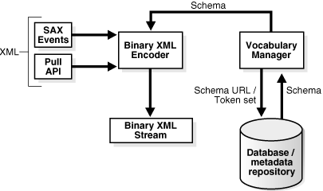
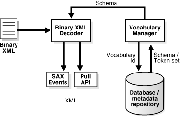

Topics here explain how to use Binary XML with Java.

### 13.1 Introduction to Binary XML for Java

Binary XML makes it possible to encode and decode between XML text and compressed binary XML. Application programming interfaces (APIs) are provided on top of Binary XML for direct consumption by the XML applications. Compression and decompression of fragments of an XML document facilitate incremental processing.

This chapter assumes that you are familiar with the XML Parser for Java.

**Related Topics**

- [XML Parsing for Java](XML-parsing-for-Java.md)

#### 13.1.1 Binary XML Storage Format – Java

Binary XML is a compact XML-Schema-aware encoding of XML data, but it can be used with XML data that is not based on an XML schema. You can also use binary XML for XML data which is outside the database (in a client-side application, for instance). Binary XML allows for encoding and decoding of XML documents, from text to binary and binary to text. Binary XML is post-parse persistent XML with native database data types.

`XMLType` tables and columns can be created using the binary XML storage option. The XML data in binary format can be accessed and manipulated by all the existing structured query language (SQL) operators and functions and Procedural Language/Structured Query Language (PL/SQL) APIs that operate on `XMLType`.

Binary XML provides more efficient database storage, updating, indexing, query performance, and fragment extraction than unstructured storage. It can store data and metadata together, or separately.

**See Also:**

[Oracle XML DB Developer’s Guide](../adxdb/intro-to-XML-DB.md) for a discussion of all the storage models in Oracle XML DB.

#### 13.1.2 Binary XML Processors

A binary XML processor is an abstract term for a component that processes and transforms binary XML into text and XML text into binary XML. It can also provide a cache for storing schemas. A binary XML processor can originate or receive network protocol requests.

The base class for a binary XML processor is `BinXMLProcessor`.

### 13.2 Models for Using Binary XML

There are several models for using binary XML in applications. These subsections describe the terminology and the models for using binary XML.

#### 13.2.1 Usage Terminology for Binary XML

Terms related to binary XML usage are described.

- doc-id: Each encoded XML document is identified by a unique doc-id. It is either a 16-byte Global User identifier (GUID) or an opaque sequence of bytes like a URL.

- token table: When a text XML document does not have a schema associated with it, then a token (or symbol) table is used to minimize space for repeated items.

- vocabulary id: Can be a schema-id or a namespace Universal Resource Identifier (URI) for a token table.

- schema-id: A unique opaque binary identifier for a schema scoped to the binary XML processor. The schema-id is unique for a binary XML processor and is identifiable only within the scope of that binary XML processor. The schema-id remains constant even when the schema is evolved. A schema-id represents the entire set of schema documents, including imported and included schemas.

- schema version: Every annotated schema has a version number associated with it. The version number is specified as part of the system level annotations. It is incremented by the binary XML processor when a schema is evolved (that is, a new version of the same schema is registered with the binary XML processor).

- partial validity: Binary XML stream encoding using schema implies at least partial validity with the schema. Partial validity implies no validation for unique keys, keyrefs, identifiers (IDs), or DTD attributes such as IDREF.

#### 13.2.2 Standalone Model

This is the simplest usage scenario for binary XML. There is a single binary XML processor.

The only repository available is the local in-memory vocabulary cache that is not persistent and is available only for the life of the binary XML processor. All schemas must be registered in advance with the binary XML Processor before the encoding, or they can be registered automatically when the XML Processor sees the `xsi:SchemaLocation` tag. For decoding, the schema is already available in the vocabulary cache.

#### 13.2.3 Client/Server Model

In a client-server scenario, the binary XML processor is connected to a database using Java Database Connectivity (JDBC). It is assumed that the XML schema is registered with the database before encoding.

Here is an example of how to achieve that:

    BEGIN
       DBMS_XMLSCHEMA.registerSchema(
       SCHEMAURL =>
       'http://xmlns.oracle.com/xdb/documentation/purchaseOrder.xsd',
       SCHEMADOC =>
       bfilename('XMLDIR','purchaseOrder.xsd'),
       CSID => nls_charset_id('AL32UTF8'),
       GENTYPES => FALSE,
       OPTIONS => REGISTER_BINARYXML );
    END;
    /

Unless a separate connection is specified for data (using `associateDataConnection()`) it is assumed that all data and metadata is stored and retrieved using a single connection for encoding and decoding.

#### 13.2.4 Web Services Model With Repository

In this scenario there are multiple clients, each running a binary XML processor. One encodes and another decodes. There is a common repository (that is not necessarily a database) connected to all the clients for metadata storage. It can be a file system or some other repository.

The first binary XML processor ensures that the schema is registered with the repository before performing the encoding, or the schema might be automatically registered using the `xsi:schemaLocation` tag at the time of encoding. The second binary XML processor is used for decoding, is not aware of the location of the schema, and fetches the schema from the repository.

If the first binary XML processor registers a schema and the second binary XML processor registers the same schema in the repository, the binary XML processor does not compile the schema, but simply returns the `vocabulary-id` of the existing compiled schema in the local vocabulary cache.

The `BinXMLProcessor` is not thread-safe, so multiple threads or clients accessing the repository must implement their own thread safety scheme.

#### 13.2.5 Web Services Model Without Repository

In this scenario, there are multiple clients, each running a binary XML processor. Encoding and decoding can happen on different clients. There is no common metadata repository.

The encoder must ensure that the binary data passed to the next client is independent of schema: that is, has inline token definitions. This can be achieved by setting `schemaAware` = `false` and `inlineTokenDefs` = `true`, using the `setProperty()` method, during encoding. While decoding, there is no schema required.

### 13.3 Components of Binary XML for Java

The components of binary XML for Java are described.

These are the components:

- Binary XML encoding—The binary XML encoder converts XML 1.0 infoset to binary XML.

- Binary XML decoding—The binary XML decoder converts binary XML to XML infoset.

- Binary XML vocabulary management, which includes schema management and token management.

#### 13.3.1 Binary XML Encoding

The encoder is created from a `BinXMLStream`. It takes XML text as input, and it outputs the encoded binary XML to the `BinXMLStream`. It reads the XML text using streaming SAX. The encoding of the XML text is based on the results of parsing the XML text.

Set the `schemaAware` flag on the encoder that specifies whether the encoding is schema-aware or schema-less.

For schema-aware encoding, the encoder determines whether the schema with the specified schema URL has been registered with the vocabulary manager. For a repository-based or a database-based processor, the encoder queries the repository or the database for the compiled schema based on the schema URL. If the schema is available in the database, it is fetched from the repository or database in the binary XML format and registered with the local vocabulary manager. The vocabulary is schema.

Also set a flag to indicate that the encoding produces a binary XML stream that is independent of a schema. In this case, the resulting binary XML stream contains all token definitions inline and is not dependent on schema or external token sets.

If the encoding is schema-aware, the encoder uses the data type information from the schema object for more efficient encoding of the SAX stream. There is a default encoding data type associated with each schema built-in data type. Binary XML stream encoding using a schema implies at least partial validity with the schema (For partial validity there is no validation for unique key, or keyref, or ID, or DTD attributes such as IDREF). If the data is known to be completely valid with a schema, the encoded binary XML stream stores this information.

**See Also:**

[Oracle XML DB Developer’s Guide](../adxdb/XML-Schema-and-query-basic.md) for tables of the binary encoding data types and their mappings from XML schema data types

If there is no schema associated with the text XML, then integer token ids are generated for repeated items in the text XML. Creating a token table of token ids and token definitions is an important compression technique. The token definitions are stored as token tables in the vocabulary cache. If the property for inline token definitions is set, then the token definitions are present inline.

Another property on the encoder is specifying PSVI (Post-Schema-Validated Infoset) information as part of the binary stream. If this is set to true then PSVI information can be accessed using XDK extension APIs for PSVI on DOM. If `psvi = true` then the input XML is fully validated with the schema. If `psvi` is `false` then PSVI information is not included in the output binary stream. The default is `false`.

**Related Topics**

- Token Management

#### 13.3.2 Binary XML Decoding

The binary XML decoder converts binary XML to XML infoset. The decoder is created from the `BinXMLStream`; it reads binary XML from this stream and outputs SAX events or provide a pull style `InfosetReader` API for reading the decoded XML.

If an XML schema is associated with the `BinXMLStream`, the binary XML decoder retrieves the associated schema object from the vocabulary cache, using the vocabulary id before decoding. If the schema is not available in the vocabulary cache and the connection information to the server is available, then the schema is fetched from the server.

If no schema is associated with `BinXMLStream`, then the token definitions can be either inline in the `BinXMLStream` or stored in a token set. If tokens of a corresponding namespace are not stored in the local vocabulary cache, then the token set is fetched from the repository.

### 13.4 Binary XML Vocabulary Management

The binary XML processors are of different types depending on where the metadata (schema or token sets) are located—either local binary XML processor or repository binary XML processor.

#### 13.4.1 Schema Management

For metadata persistence, Oracle recommends that you use the DB Binary XML processor. In this case, schemas and token sets are registered with the database. The vocabulary manager fetches the schema or token sets from the database and cache it in the local vocabulary cache for encoding and decoding.

If you must use a persistent metadata repository that is not a database, you can plug in your own metadata repository. You must implement the interface for communicating with this repository, `BinXMLMetadataProvider`.

**Related Topics**

- Binary XML

##### 13.4.1.1 Schema Registration for Binary XML Vocabulary Management

Register XML schemas locally with the local binary XML processor. It contains a vocabulary manager that maintains all XML schemas submitted by a user for the duration of its existence. The vocabulary manager associated with a local binary XML processor does not provide for XML schema persistence.

If you register the same XML schema again (same schema location and same target namespace) then it is not parsed, and the existing vocabulary identifier is returned.

If a new XML schema with the same target namespace and a different schema location is registered, then the existing XML schema definition is augmented with the new schema definitions. In case of conflict, an error is raised.

##### 13.4.1.2 Schema Identification

Each schema is identified by a vocabulary id. The vocabulary id is in the scope of the processor and is unique within the processor. Any document that validates with a schema is required to validate with a latest version of the schema.

##### 13.4.1.3 Schema Annotations

Binary XML Schema annotations can appear only within element `<xsd:appInfo>` in an XML schema. The vocabulary manager interprets user-level and system-level annotations during XML schema registration. All other schema annotations, such as database-related annotations, are ignored.

##### 13.4.1.4 User-Level Annotations

User-level annotations are specified by a user before registration.

`encodingType`—This annotation can be used within a `xsd:element`, `xsd:attribute` or `xsd:simpleType` elements. It indicates the data type to be used for encoding the node value of the element or attribute. For strings, there is support only for 8-bit encoding of Unicode (UTF-8) encoding in this release.

##### 13.4.1.5 System-Level Annotations

The vocabulary manager adds system-level annotations at the time of registration. You cannot overwrite them.

#### 13.4.2 Token Management

Token sets can be fetched from the database or metadata repository, cached in the local vocabulary manager, and used for decoding. While encoding, token sets can be pushed to the repository for persistence.

Token definitions can also be included as part of the binary XML stream by setting a flag on the encoder.

### 13.5 Using the Java Binary XML Package

Use of the binary XML package is described.

A `BinXMLStream` class represents the binary XML stream. The different storage locations defined for the binary XML stream are:

- `InputStream`—stream for reading.

- `OutputStream`—stream for writing.

- `URL`—stream for reading.

- `File`—stream for read and write.

- `BLOB`—stream for reading and writing.

- Byte array—stream for reading and writing.

- In memory—stream for reading and writing.

The `BinXMLStream` object specifies the type of storage during creation.

A `BinXMLStream` object can be created from a `BinXMLProcessor` factory. This factory can be initialized with a JDBC connection (for remote metadata access), connection pool, URL or a `PageManagerPool` (for lazy in-memory storage). `BinXMLEncoder` and `BinXMLDecoder` can be created from the `BinXMLStream` for encoding or decoding.

Here is an example of creating a processor without a repository, registering a schema, encoding XML SAX events into schema-aware binary format, and storing in a file:

    BinXMLProcessor  proc = BinXMLProcessorFactory.createProcessor();
    proc.registerSchema(schemaURL);
    BinXMLStream outbin = proc.createBinaryStream(outFile);
    BinXMLEncoder enc = outbin.getEncoder();
    enc.setSchemaAware(true);
    ContentHandler hdlr = enc.getContentHandler();

In addition to getting the `ContentHandler`, you can also get the other handlers, such as:

    LexicalHandler lexhdlr = enc.getLexicalHandler();
    DTDHandler dtdhdlr = encenc.getDTDHandler();
    DeclHandler declhdlr = enc.getDeclHandler();
    ErrorHandler errhdlr = enc.getErrorHandler();

Use `hdlr` in the application that generates the SAX events.

2\. Here is an example of creating a processor with a database repository, decoding a schema-aware binary stream and reading the decoded XML using pull API. The schema is fetched from the database repository for decoding.

    DBBinXMLMetadataProvider dbrep =
         BinXMLMetadataProviderFactory.createDBMetadataProvider();
    BinXMLProcessor proc = BinXMLProcessorFactory.createProcessor(dbrep);
    BinXMLStream inpbin = proc.createBinaryStream(blob);
    BinXMLDecoder dec = inpbin.getDecoder();
    InfosetReader xmlreader = dec.getReader();

Use `xmlreader` to read XML in a pull-style from the decoder.

#### 13.5.1 Binary XML Encoder

The encoder takes XML input, which is parsed and read using SAX events, and outputs binary XML.

##### 13.5.1.1 Schema-Less Option

You can specify the schema-aware or the schema-less option before encoding. The default is schema-less encoding.

If the schema-aware option is set, then the encoding is done based on schema(s) specified in the instance document. The annotated schemas used for encoding are also required at the time of decoding. If the schema-less option is specified, then the encoding is independent of schemas, but the tokens are inline by default. To override the default, set `Inline-token = false.`

##### 13.5.1.2 Inline-Token Option

You can set an option to create a binary XML stream with inline token definitions before encoding. If inlining is turned off then you must ensure that the encoder or decoder processors use the same metadata repository. By default, token definition is inline.

Flag `Inline-token` is ignored if the schema-aware option is turned on.

Figure 13-1 Binary XML Encoding

[Description of "Figure 13-1 Binary XML Encoding"](img_text/adxdk124.md)

#### 13.5.2 Binary XML Decoder

The binary XML decoder takes a binary XML stream as input and generates SAX Events as output, or it provides a pull interface to read the decoded XML. For an XML schema-aware binary XML stream, the binary XML decoder interacts with the vocabulary manager to extract the schema information.

If the vocabulary manager does not contain the required schema, and the processor is of type binary XML with a valid JDBC connection, then the remote schema is fetched from the database or the metadata repository based on the vocabulary id in the binary XML stream to be decoded. Similarly, the set of token definitions can be fetched from the database or the metadata repository.

Figure 13-2 Binary XML Decoder

[Description of "Figure 13-2 Binary XML Decoder"](img_text/adxdk123.md)

#### 13.5.3 Schema Registration Overview

You register an XML schema with the Binary XML Processor. The schema is a text file that can contain user-level annotations. As part of the registration process, the processor adds system-level annotations. The resulting annotated schema is then processed by the Schema Builder to build an XML schema object.

This XML schema object is stored in the vocabulary cache. The vocabulary cache assigns a unique vocabulary id for each XML schema object, which is returned as output. The annotated DOM representation of the XML schema is sent to the binary XML encoder.

#### 13.5.4 Resolving xsi:schemaLocation

How `xsi:schemaLocation` is resolved is described.

During encoding, if `schemaAware` is true and the property `ImplcitSchemaRegistration` is `true`, then the first `xsi:schemaLocation` tag present in the root element of an XML instance document automatically registers that schema in the local vocabulary manager. No other `schemaLocation` tags are explicitly registered. If the processor is database-oriented then the schema is also registered in the database; similarly for any metadata repository based processor.

If the encoding is set to `schemaAware` is `false` or `ImplcitSchemaRegistration` is `false`, then all `xsi:schemaLocation` tags are ignored by the encoder.

#### 13.5.5 Binary XML

A binary XML processor can communicate with the database for various types of binary XML operations involving storage and retrieval of binary XML schemas, token sets, and binary XML streams.

A `DBBinXMLMetadataProvider` object is either instantiated with a dedicated JDBC connection or a connection pool to access vocabulary information such as schema and token set. The processor is also associated with one or more data connections to access XML data.

Database communication is involved in these ways:

1.  Extracting compiled binary XML schema using the vocabulary ID or the schema URL

    To retrieve a compiled binary XML schema for encoding, the database is queried based on the schema URL. For decoding the binary XML schema, fetch it from the database based on the vocabulary ID.

2.  Storing noncompiled binary XML schema using the schema URL and retrieving the vocabulary id.

    When the `xsi:schemaLocation` tag is encountered during encoding, the schema is registered in the database for persistent storage in the database. The vocabulary id associated with the schema, and the binary version of the compiled schema is retrieved from the database; the compiled schema object is built and stored in the local cache using the vocabulary id returned from the database.

3.  Retrieving a binary token set using namespace URL.

    If a binary stream to be decoded is associated with token tables for decoding, these are fetched from the database using the metadata connection.

4.  Storing binary token set using namespace URL

    If the XML text has been encoded without a schema, then it produces a token set of token definitions. These token tables can be stored persistently in the database. The metadata connection is used for transferring the token set to the database.

5.  Binary XML stream with remote storage option

    It is your responsibility to create a table containing an `XMLType` column with binary XML for storing the result of encoding and retrieving the binary XML for decoding. Communication with the database can be achieved with Oracle Net Services and JDBC. Fetch the `XMLType` object from the output result set of the JDBC query. The `BinXMLStream` for reading the binary data or for writing out binary data can be created from the `XMLType` object. The `XMLType` class must be extended to support reading and writing of binary XML data.

#### 13.5.6 Persistent Storage of Metadata

You can provide persistent back-end storage for metadata.

A local vocabulary manager and cache stores metadata information in memory for the life of the `BinXMLProcessor`. You can plug in your own back-end storage for metadata by implementing interface `BinXMLMetadataProvider` and plugging it into the `BinXMLProcessor`. Currently only one metadata provider for each processor is supported.

You must code a `FileBinXMLMetadataProvider` that implements interface `BinXMLMetadataProvider`. The encoder and decoder uses these APIs to access metadata from the persisted back-end storage. Set up the configuration information for the persistent storage: for example, root directory for a file system in `FileBinXMLMetadataProvider` class. Instantiate `FileBinXMLMetadataProvider` and plug it into the `BinXMLProcessor`.
