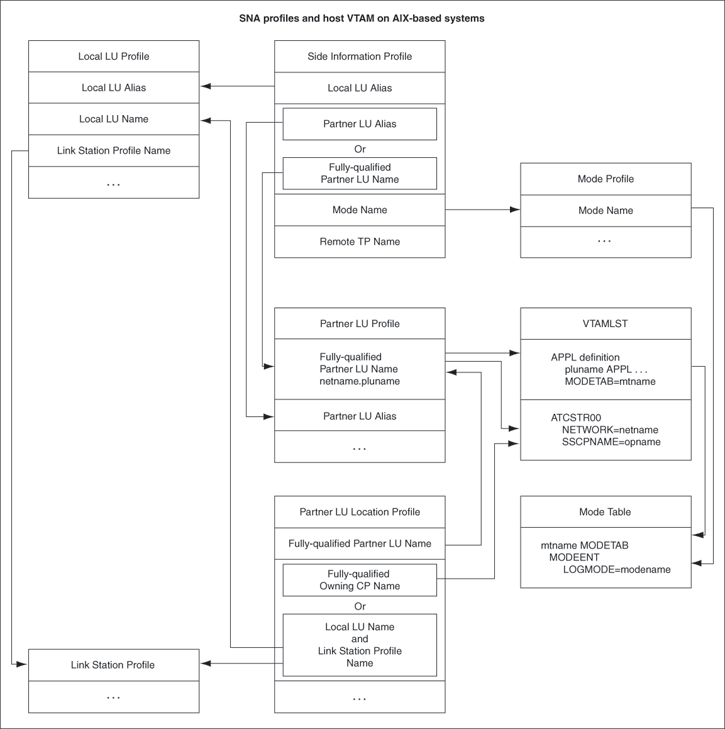

The Oracle Database Gateway for APPC uses the SNA Advanced Program to Program Communication (APPC/LU6.2) protocol to communicate with online transaction processing (OLTP). All AIX-based system support for APPC is provided by IBM SNA server product.

This product requires a stored set of definitions, called profiles, to support connections between the gateway and the applications using OLTP. Each profile consists of a profile name, a profile type, and a set of fields describing the profile. The fields in a profile type are generally a mixture of operating parameter values and names of other SNA profiles relevant to the profile.

Refer to the following topics if your gateway uses the SNA communication protocol. The topics describe how to create and activate SNA server profiles.

**Note:**

When you finish following the instructions in this chapter to configure your communication protocol, refer to [Configuring Your Oracle Network](appc-gateway-config-oracle-network.md) to continue your network configuration.

- Processing Inbound Connections

- Independent Versus Dependent LUs

- Creating SNA Profiles for the Gateway

- Profile Types

- SNA Server Profiles

- Activating Profiles

- Resume Configuration of the Gateway

### Processing Inbound Connections

Many OLTPs provide options for manipulating the security conduct of an inbound (client) APPC session request. Refer to the appropriate OLTP documentation for detailed information about this topic.

**Note:**

For CICS, one security option is not supported by the gateway. `ATTACHSEC=PERSISTENT`, specified on the CICS `CONNECTION` definition, requires capability that is not yet available in the gateway.

However, `ATTACHSEC=LOCAL`, `ATTACHSEC=IDENTIFY`, `ATTACHSEC=VERIFY`, and `ATTACHSEC=MIXIDPE` are fully supported by the gateway.

### Independent Versus Dependent LUs

Oracle recommends independent LUs for Oracle Database Gateway for APPC because they support multiple parallel sessions or conversations. This means that multiple Oracle client applications can be active simultaneously with the same OLTP through the independent LU.

Dependent LUs support only a single active session. The CP (SNA server for AIX, in this case) queues additional conversation requests from the gateway server behind an already active conversation. In other words, conversations are single threaded for dependent LUs.

If a dependent LU is correctly defined, then you do not need to alter the Oracle Database Gateway for APPC configuration, the host transaction, or how the OLTP is started.

The operational impact of dependent LUs is that the first client application can initiate a conversation through the Oracle Database Gateway with the OLTP. While that transaction is active (which could be seconds to minutes to hours depending on how the client application and transaction are designed), any other client application initiating a conversation with the same OLTP instance appears to hang as it waits behind the previous conversation.

If a production application really uses only a single conversation or transaction at a time, then there should be no impact.

However, additional concurrent conversations or transactions might be required for testing or for other application development. Each requires that additional dependent LUs be defined on the remote host, plus additional SNA server profiles, which define the additional dependent LUs on the IBM pSeries workstation. The TIP that initiates the conversation must specify the different Partner LU through a different side information profile or by overriding the LU name.

**See Also:**

Refer to `PGAU DEFINE TRANSACTION SIDEPROFILE` and `LUNAME` parameters in Chapter 2, "Procedural Gateway Administration Utility," in the [Oracle Database Gateway for APPC User's Guide](../appug/pga-utility-oracle-database-gateway-appc.md) and the SNA server-side information profile discussed in the section, Side Information Profile

### Creating SNA Profiles for the Gateway

You can create and modify the SNA server profile definitions using menus in the AIX System Management Interface Tool (smit).

Maintenance of SNA server profiles is normally done by a user with `root` access. The following information is intended for the user who creates profiles for the gateway. You should have some knowledge of SNA before reading this section.

By using smit, you should be able to accept most of the defaults. The default values assigned to many of the fields in a new set of profiles are acceptable for the gateway.

The `$ORACLE_HOME/dg4appc/sna` subdirectory contains a sample set of profiles for the gateway in the `pgasna.export` file.

Before building the SNA server profiles, examine the appropriate sample export file to determine the profiles needed, their contents, and their interrelationships. The export file format is text-oriented, and each field of each profile is clearly labeled. You can print a copy of the export file to use while working with the profiles in a smit session.

### Profile Types

Several types of SNA server profiles are relevant to gateway APPC/LU6.2 operation. Each profile can be created and edited using a corresponding smit menu that can be reached from the Communications Applications and Services primary menu choice.

The profiles are presented in hierarchical order. The profile types that are lowest in the hierarchy are discussed first. This matches the logical sequence in which to create the profiles. You can use the smit list menu to specify the profile names.

### SNA Server Profiles

Refer to the appropriate vendor documentation for a complete discussion of SNA profiles. This section is an overview of SNA server profiles in relation to the Oracle Database Gateway for APPC. It includes the following topics:

- SNA Node Profile

- Link Station Profile

- Mode Profile

- Local LU Profile

- Partner LU Profile

- Partner LU Location Profile

- Side Information Profile

#### SNA Node Profile

The SNA node profile defines miscellaneous SNA system defaults. Set the "Maximum number of sessions" and "Maximum number of conversations" fields to values large enough to handle the maximum number of concurrent gateway conversations anticipated, plus any non-gateway sessions and conversations that are in use on your system by other applications.

Set the "Recovery Resource Manager (RRM) enabled?" field to `no`, unless you already have other applications running on your AIX system that require this field to be set to `yes`. For example, CICS pSeries and Encina need this field set to `yes`.

#### Link Station Profile

The Link Station Profile and the related DLC profile describe and control the connection of the IBM pSeries to the network. Details on profile contents are not discussed here because Oracle Database Gateway for APPC does not impose special requirements on these profiles. The sample profile distributed in `pgasna.export` includes a profile created for a Token-Ring network connection. The Link Station Profile name is specified later in the Partner LU Location Profile, if one is necessary.

#### Mode Profile

The Mode Profile specifies parameters that determine:

- APPC/LU6.2 parallel session limits

- send and receive pacing values

- SNA RU size

- the mode name that is sent to OLTP at session initiation

The mode name that you specify must be defined to the OLTP communications software. Choose the mode name in addition to the other mode parameters after consulting the user who is responsible for configuring the OLTP communications software.

The parameters that are related to parallel session limits determine the maximum number of concurrent conversations allowed between a gateway instance and the OLTP. This equates to the maximum number of concurrently active remote transaction program invocations through the gateway instance.

The mode name, for example, `ORAPLU62`, is specified later in the Side Information Profile.

**Note:**

Do not confuse the Mode Profile with the mode name.

#### Local LU Profile

The Local LU (Logical Unit) Profile describes the SNA LU through which the gateway communicates.

An LU name must be assigned to the gateway. The LU name assigned to the gateway might be required elsewhere in the SNA network. Contact the SNA network administrator to determine the correct LU name to specify in the profile.

To create a Local LU Profile, perform the following steps:

1.  Set the "Local LU name" to the LU name assigned to the gateway.

2.  An alias should be assigned to the LU using the "Local LU alias" field. This alias is used later in the side information profile.

3.  Set the "Local LU is dependent" field to `no`.

The Local LU Profile name is specified later in the side information profile.

#### Partner LU Profile

The Partner LU Profile describes the SNA LU of the OLTP system with which the gateway communicates. The name of the OLTP LU and the name of your SNA network must be specified in this profile. Contact your SNA network administrator to determine the correct LU and network names.

To create a Partner LU Profile, perform the following steps:

1.  Set the "Fully qualified partner LU name" field to the network name, followed by a period, followed by the OLTP LU name. For example, `network.oltplu`.

2.  You can assign an alias to the partner LU name by setting the "Partner LU alias" to the value of your choice. This enables you to reference the partner LU without knowing the fully qualified partner LU name and minimizes the change if the partner LU name is changed.

3.  Set the "Parallel sessions supported?" field to `yes` unless your OLTP does not support parallel sessions.

4.  If you plan to use SNA session or conversation security, then set the "Session security supported?" and "Conversation security supported?" fields as required. These settings require the Session Security and Conversation Security Profiles.

**See Also:**

The vendor documentation for more information

#### Partner LU Location Profile

The Partner LU Location Profile is used when the remote host where the Partner LU is located is not an APPN-capable node. Many mainframe systems do not have APPN capability. For example, z/OS systems running VTAM versions before version 4 do not support APPN. Also, if your hardware connection is through a front-end processor running NCP versions before version 5, then APPN is not supported. In these cases, the Partner LU Location Profile can be used to specify the name of the System Services Control Point (SSCP) or Control Point (CP), which owns the network connection to the partner LU.

Set the "Fully qualified partner LU name" field to the network name, followed by a period, followed by the OLTP LU name For example, `network.oltplu`.

Set the "Partner LU location method" and associated fields as required by your network configuration. If you use the `owning cp` option, then the "Fully qualified owning Control Point (CP) name" field should be set to the `SSCP` or `CP` name, which owns the network connection to the partner LU. For VTAM, the SSCP name is the value of the VTAM `NETID` start parameter, usually found in `VTAMLST` member `ATCSTR00`.

#### Side Information Profile

The side information profile is a required profile, which is used to identify target OLTP systems to be accessed through Oracle Database Gateway for APPC.

The side information profile identifies the following:

- the local LU alias

- the partner LU alias or fully-qualified name

- the remote transaction program name (optional)

- the mode name

Set the profile information as follows for each side information profile field:

- Set the Local LU or Control Point alias to the alias assigned to the local LU in the Local LU Profile.

- Set the Mode name to the actual mode name as specified in the Mode Profile.

- Set the Remote transaction program name (RTPN) using the actual remote TP name or a dummy name to be overridden at execution time.

- Set the "RTPN in hexadecimal?" field to `yes`, if the remote TP name is hexadecimal.

- If there is a field for "Partner LU alias", then add the alias assigned to the partner LU in the Partner LU Profile.

- If there is a field for "Fully qualified partner LU name", then add the fully qualified partner LU name of the partner LU.

Figure 7-1 shows the relationship between SNA server profiles and the VTAM definitions on the host.

Figure 7-1 Relationship Between SNA Profiles and Host VTAM Definitions

[Description of "Figure 7-1 Relationship Between SNA Profiles and Host VTAM Definitions"](img_text/g6_1vtam.md)

### Activating Profiles

After you have built all the necessary SNA server profiles for communicating with the remote host, you must verify the profiles. Use the "Verify Configuration Profiles" option under the "Advanced Configuration" option of the smit SNA server menu. Then use smit to start the link station profile.

**See Also:**

the vendor documentation for more information about using smit to start link stations

### Resume Configuration of the Gateway

When you finish configuring the SNA communication package for your AIX-based system, proceed to [Configuring the OLTP](appc-gateway-config-oltp.md) to continue configuring the network.
