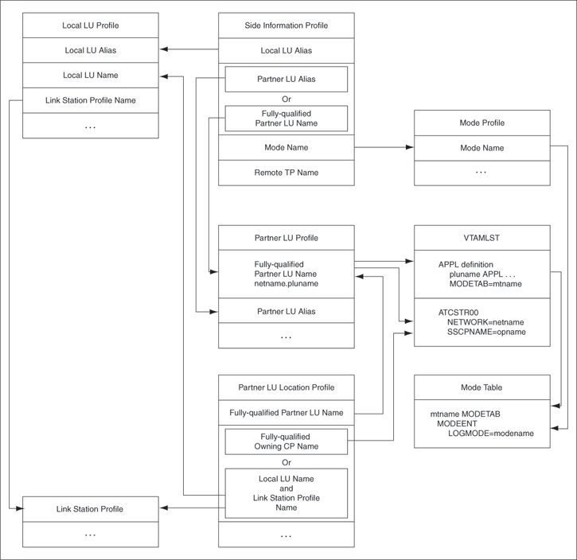

The Oracle Database Gateway for APPC uses the SNA Advanced Program to Program Communication (APPC/LU6.2) protocol to communicate with an OLTP. Linux for Intel Pentium-based 32-bit system support for APPC is provided by IBM Communications Server for Linux.

The following topics describe how to configure your SNA Server on a Linux for Intel Pentium-based 32-bit system to run the Oracle Database Gateway for APPC, using IBM Communications Server for Linux.

- Using SNA Security Validation

- Processing Inbound Connections

- Independent Versus Dependent LUs

- Creating IBM Communications Server Definitions for the Gateway

- Testing the Connection

- Resume Configuration of the Gateway

**Note:**

The term SNA Server is used in this guide to generally refer to the IBM Communications Server.

### Using SNA Security Validation

When the gateway receives an RPC request to start a remote transaction program, the gateway attempts to start an APPC conversation with online transaction processing (OLTP). Before the conversation can begin, a session must start between the Linux Logical Unit (LU) and the OLTP LU.

SNA and its various access method implementations (including SNA Server and VTAM) provide security validation at session initiation time, enabling each LU to authenticate its partner. This validation is carried out entirely by network software before the gateway and OLTP application programs begin their conversation and process conversation-level security data. If session-level security is used, then correct password information must be established in the gateway SNA Server definitions and in similar parameter structures in the OLTP to be accessed. Refer to the appropriate communications software product documentation for detailed information about this subject.

### Processing Inbound Connections

Many OLTPs provide options for manipulating the security conduct of an inbound (client) APPC session request. Refer to the appropriate OLTP documentation for detailed information about this topic.

**Note:**

For CICS, one security option is not supported by the gateway: `ATTACHSEC=PERSISTENT`, specified in the CICS `CONNECTION` definition, requires capability that is not yet available in the gateway.

However, the `ATTACHSEC=LOCAL`, `ATTACHSEC=IDENTIFY`, `ATTACHSEC=VERIFY`, and `ATTACHSEC=MIXIDPE` security options are fully supported by the gateway.

### Independent Versus Dependent LUs

Oracle recommends that you use independent LUs for the Oracle Database Gateway for APPC because they support multiple parallel sessions or conversations. This means that multiple Oracle client applications can be active simultaneously using the same OLTP through the independent LU.

Dependent LUs support only a single active session. The CP (Control Point for the node) queues additional conversation requests from the gateway server behind an already active conversation.In other words, conversations are single threaded for dependent LUs. If a gateway LU is correctly defined, then you do not need to alter the configuration for the Oracle Database Gateway for APPC and the gateway server.

The operational impact of dependent LUs is that the first client application can initiate a conversation through the Oracle Database Gateway with the gateway server. While that transaction is active (which could be seconds to minutes to hours, depending on how the client application and transaction are designed), any other client application initiating a session with the same gateway server appears to hang as it waits behind the previous session.

If a production application uses only a single conversation at any one time, then there should be no impact.

However, additional concurrent conversations might be required for testing or for other application development. Each conversation requires that you define additional dependent LUs on the remote host, plus additional IBM Communication Server configuration entries, which define the additional dependent LUs on the gateway system. Additional Side Information Profiles should be defined to use the new dependent LUs. New gateway instances should be created and configured to use these new Side Information Profiles.

**See Also:**

Refer to `PGAU DEFINE TRANSACTION SIDEPROFILE` and `LUNAME` parameters in Chapter 2, "Procedural Gateway Administration Utility," in [Oracle Database Gateway for APPC User's Guide](../appug/pga-utility-oracle-database-gateway-appc.md)

### Definition Types

Several types of IBM Communications Server definitions are relevant to gateway APPC/LU6.2 operation. Each definition can be created and edited using a corresponding SNA Node Configuration menu.The definitions relevant to the gateway are presented in Creating IBM Communications Server Definitions for the Gateway in hierarchical order. This section provides an overview of IBM Communications Server definitions in relation to the Oracle Database Gateway for APPC. Those definition types that are lowest in the hierarchy are discussed first. This matches the logical sequence in which to create the definitions.Refer to the IBM Communications Server online documentation for a complete discussion of IBM Communications Server definitions.

### Creating IBM Communications Server Definitions for the Gateway

IBM Communications Server definitions are created using the SNA Node Configuration tool, while the operation of the server is done using the SNA Node Operations tool, both of which are provided with IBM Communications Server. Maintenance of SNA definitions is normally done by a user with Administrator privileges.

The following sections describe the process of creating SNA definitions for IBM Communications Server using the SNA Node Configuration tool. All of the tasks described in this section are performed within SNA Node Configuration.

The section includes the following topics:

- Creating the Configuration

- Creating the Node

- Creating Devices

- Choosing the Device Type

- Configuring a LAN Device

- Creating Peer Connections

- Defining the Link Station

- Defining the Adjacent Node

- Creating Local LUs

- Defining Local LUs

- Creating Partner LUs

- Defining Partner LUsCreating the CPI-C Side Information Profile

- Creating the CPI-C Side Information Profile

#### Creating the Configuration

The SNA Node Configuration screen prompts you to specify if you are creating a new configuration or loading an existing configuration. These tasks are based on the assumption that a new configuration is being created.

SNA Node Configuration next prompts you for a configuration scenario.

#### Creating the Node

Each SNA Server must have a Control Point defined. This is typically called the Node definition. To define the node:

1.  Click Node.

2.  Click Create.

    In the Define the Node dialog box:

    1.  Select the Basic tab.

    2.  Enter information in the Control Point, Local Node ID, and Node Type boxes.

    You can select Advanced tab options depending on your SNA network configuration.

3.  Click OK.

#### Creating Devices

To configure communication devices:

1.  Click Devices.
2.  Click Create.

#### Choosing the Device Type

Select the type of device to use for communication. The LAN type is typical for either Ethernet or Token Ring attached network devices.

#### Configuring a LAN Device

To configure a LAN device:

1.  Select the Basic tab.
2.  Choose the Adapter to use and the Local SAP. The other tabs provide options for network tuning parameters.
3.  Click OK.

#### Creating Peer Connections

To create peer connections:

1.  Click Peer Connections.
2.  Click Create.

#### Defining the Link Station

To define the link station:

1.  In the Basic tab, enter a Link Station name for this connection.
2.  Choose the device for the connection.
3.  Enter the Destination address and Remote SAP.

#### Defining the Adjacent Node

To define the adjacent node:

1.  Select the Adjacent Node tab.
2.  Enter the Adjacent CP name of the remote system and select its CP type.
    You might have to choose a different transmission group (TG) than the default. Consult your SNA network administrator for details.Other tabs provide options on tuning and reactivation.
3.  Click OK.

#### Creating Local LUs

To create local LUs for the node:

1.  Click Local LU 6.2 LUs.
2.  Click Create.

#### Defining Local LUs

To define local LUs:

1.  In the Basic tab, enter the name of the Local LU, and, optionally, an alias. The name must match the Local LU definition of the remote host for this Node. You can examine the other tab for synchronization support and for LU session limits.
2.  Click OK.

#### Creating Partner LUs

To create partner LUs:

1.  Click Partner LU 6.2 LUs.
2.  Click Create.

#### Defining Partner LUs

To define partner LUs:

1.  In the Basic tab, enter the name of the Remote or Partner LU, and, optionally, an alias.
2.  Choose the Fully Qualified CP from the Existing list. You can examine the other tab for logical record limits and security support.
3.  Click OK.

#### Creating the CPI-C Side Information Profile

To define the CPI-C profile that will be used to create the gateway:

1.  Click the CPI-C Side Information Definitions.
2.  Click Create.

### Testing the Connection

Before proceeding with the gateway configuration tasks, ensure that your connection is working.

Figure 6-1 shows the relationship between SNA Server definitions and the VTAM definitions on the host.

Figure 6-1 SNA server definitions and VTAM

[Description of "Figure 6-1 SNA server definitions and VTAM"](img_text/g6_1sna.md)

### Resume Configuration of the Gateway

When you have finished configuring the SNA communication package for your Linux for Intel Pentium-based 32-bit System, proceed to [Configuring the OLTP](appc-gateway-config-oltp.md) to continue configuring the network.
