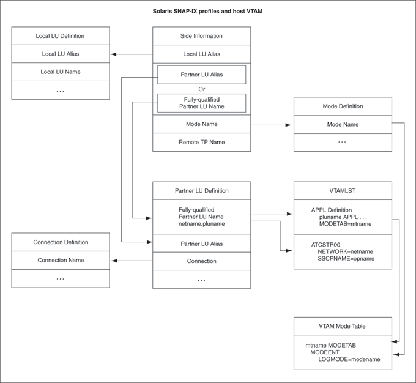

Oracle Database Gateway for APPC uses the SNA Advanced Program to Program Communication (APPC/LU6.2) protocol to communicate with an OLTP. APPC support on Solaris Operating System (SPARC 64-bit) is provided by the SNAP-IX product.

The following topics describe how to configure SNAP-IX on a Solaris system to run Oracle Database Gateway for APPC.

**Note:**

When you finish following the instructions in this chapter, refer to [Configuring Your Oracle Network](appc-gateway-config-oracle-network.md) to continue network configuration.

- Processing Inbound Connections

- Configuring SNAP-IX Version 6

- Resuming Gateway Configuration

### Processing Inbound Connections

Many OLTPs provide options for manipulating the security conduct of an inbound (client) APPC session request. Refer to the appropriate documentation for your OLTP for detailed information about this issue.

Note that for CICS, the gateway provides the following support:

- `ATTACHSEC=LOCAL`, `ATTACHSEC=IDENTIFY`, `ATTACHSEC=VERIFY`, and `ATTACHSEC=MIXIDPE` are fully supported by the gateway.

- `ATTACHSEC=PERSISTENT`, specified in the CICS `CONNECTION` definition, requires capability that is not yet available in the gateway.

### Configuring SNAP-IX Version 6

The following topics describe how to configure SNAP-IX version 6.

- Before You Begin

- SNAP-IX Configuration Tool

- Creating SNAP-IX Profiles for the Gateway

- Independent Versus Dependent LUs

- Creating SNA Definitions for the Gateway

- Sample SNAP-IX Definitions

- Configuring SNAP-IX

- Starting xsnaadmin

- Testing the Connection

#### Before You Begin

You must specify parameters that are unique to your system to configure SNAP-IX version 6 properly. Before you begin, request these parameters from your network administrator.

#### SNAP-IX Configuration Tool

All SNAP-IX product configuration is done using the `xsnaadmin` program. This tool is an X-Windows application that provides a graphical interface to view and modify the current SNAP-IX configuration and the current running state of the host SNA node.

#### Creating SNAP-IX Profiles for the Gateway

Oracle Database Gateway for APPC requires a stored set of definitions, called Side Information Profiles, to support connections between the gateway and gateway servers. Each profile consists of a profile name and a profile type, which is a set of fields describing the profile. The fields in a given profile type are generally a mix of operating parameter values and names of other SNA profiles relevant to the profile. Each functional part of APPC, such as the Mode, Remote Transaction Program name, and Logical Unit (LU), is described by a distinct profile type.

#### Independent Versus Dependent LUs

The gateway configuration can accommodate either independent or dependent LUs. If you choose to use dependent LUs, or are restricted to using dependent LUs, the gateway functions properly. If a dependent LU is correctly defined, then you do not need to make changes to the configuration of the gateway, nor should any changes be needed to the gateway server. However, Oracle recommends that you use independent LUs for the gateway because they support multiple parallel sessions or conversations. This means that multiple Oracle client applications can be active simultaneously with the same gateway server through the independent LU.

In contrast to independent LUs, dependent LUs support only a single active session. The CP (Control Point for the Node) queues each additional conversation request from the gateway behind an already active conversation. In other words, conversations are single-threaded for dependent LUs.

The operational impact of dependent LUs is that the first client application can initiate a conversation through the gateway with the gateway server, but while that session is active (which could be for seconds, minutes, or hours, depending on how the client application and transaction are designed), any other client application initiating a session with the same gateway server appears to hang as it waits behind the previous session.

If a production application really uses only a single conversation at any one time, then there should not be a problem. However, at some point, you might require additional concurrent conversations for testing or for other application development. Having more than one conversation requires that additional dependent LUs be defined on the remote host. Additional configuration entries must be added to SNAP-IX. Additional Side Information Profiles should be defined to use the new dependent LUs. Gateway instances should be created and configured to use these new Side Information Profiles.

#### Creating SNA Definitions for the Gateway

SNAP-IX definitions are stored in the following files, which are located in the `/etc/opt/sna` directory:

- `SNA node definitions: sna_node.cfg`

- SNA domain definitions: `sna_domn.cfg`

These files are created and maintained with the `xsnaadmin` tool. Maintenance of SNA definitions is usually done by a user with administrative authority. The following information is intended for a user creating SNA definitions for the gateway. You must have some knowledge of SNA before reading this section.

#### Sample SNAP-IX Definitions

The `$ORACLE_HOME/dg4appc/sna` subdirectory contains a set of sample SNAP-IX definition files for the gateway, which are created with the `xsnaadmin`. These sample files are `sna_domn.cfg` and `sna_node.cfg`. SNA definitions are very specific to the host and SNA network. As such, the sample definitions provided will not work without being tailored for the local host and SNA network.

#### Configuring SNAP-IX

This section describes the process of creating SNA definitions for SNAP-IX, using `xsnaadmin`. All configuration is done using the various dropdown menus and panels in `xsnaadmin`. The following configuration descriptions follow the samples provided. Please tailor the various SNA values for your local host and SNA network.

#### Starting xsnaadmin

Use the following commands to invoke `xsnaadmin`. The `DISPLAY` environment variable must be set correctly. If you are running `xsnaadmin` from the local console, then `DISPLAY` should already be set. If you are running `xsnaadmin` from a remote X display, then set `DISPLAY` to the host name or IP address of that display.

    $ DISPLAY=<your_display>:0
    $ export DISPLAY
    $ xsnaadmin &

On startup of `xsnaadmin`, the main screen opens and displays the current configuration of the local SNA node.

##### Configuring the SNA node

To configure the SNA node, you need to do the following:

1.  From the Services menu, select Configure Node Parameters.
2.  In the Node Parameters dialog box, enter the APPN support type, Control Point Name, Control Point Alias, and Node ID as needed. The Control Point Name is composed of the SNA Network Name and the CP name of the local host.
3.  Click OK.

##### Adding a Port

To add a new port, from the Services menu, select Connectivity and New Port.

1.  In the Add to Nodename dialog box, select the Port type and click OK.
2.  In the SAP dialog box, enter a Port name and network card number. The Port name is used to logically name the physical network card that you are using and is used to bind a Service Access Port to the card for SNA protocols. Usually, you can accept the values provided in the dialog box. If a different network card is needed, however, enter the card number as reported by the `dmesg` command.
3.  Click OK.

##### Create a Link Station

When the Port has been defined, you must create a Link Station. The Link Station represents the SNA node of the remote host of the gateway server. But before you create the Link Station, you must create a Remote Node definition as described in the following procedure:

1.  From the Services menu, select APPC and Add Remote Node.

2.  In the dialog box, enter the SNA CPNAME of the remote node and click OK.

Now you can create a Link Station as follows:

1.  From the Services menu, select Connectivity and New Link Station. In the dialog box, select the Port previously defined and click OK.
2.  In the Link Station dialog box, enter a name for the Link Station, choose the SNA Port name, the type of link activation, and the LU Traffic type. For maximum flexibility, select the Any option.
3.  For Independent LU traffic, specify the Remote Node name. Click Remote Node and select the node you previously created, and then click OK. Choose the type of the Remote node, typically a Network node.
4.   For Dependent LU traffic, specify the role of the Remote node, typically 'host', the Local Node ID, and optionally, Remote Node ID.
5.  Specify the Contact Information. Contact information contains the MAC address of the remote host as well as the SAP number.
6.  Click Advanced for additional parameters of the Link Station. The Token Ring Parameters dialog box shows additional parameters of the Link Station. These parameters affect initial XID contact and retransmission times and limits. You usually do not need to change the default values.
7.  Click OK.

##### Creating Local LUs

When the Remote Node definitions have been made, create the Local LU names for the local host as follows:

1.  From the Services menu, select APPC and New Local LU. In the local LU dialog box, enter the name of the local LU and an alias. This name must correspond to the VTAM definitions on the remote gateway server host for the UNIX host.
2.  Click OK.

##### Creating Partner LUs

Now define a Partner LU that represents the LU that the gateway server is using to communicate.

1.  From the Services menu, select APPC and New Partner LUs and Partner LU on Remote Node.
2.  In the Partner LU dialog box, enter the Partner LU name and characteristics. The Partner LU name contains the SNA Network Name as well as the LU name of the remote LU. Enable parallel session support. The location is the name as the Remote Node name. You can click Location for a list.
3.  Click OK.

##### Creating Mode and CPI-C Profiles

When the local and remote LU definitions have been created, create the necessary Mode and CPI-C definitions.

1.  From the Services menu, select APPC and Modes. In the Modes dialog box, click New to add a new mode.
2.  In the Mode dialog box, enter the Mode Name and other session parameters. The recommended name for a gateway mode is `CICSPGA`. Contact your Remote Host system administrator for appropriate mode parameters.
3.  Click OK.
4.  Now that the Mode has been defined, create the CPI-C Side Information Profile, which the gateway uses as a connection name. From the menu, select APPC and CPI-C.
5.  In the CPI-C destination names dialog box, click New to add a new Profile.
6.  In the CPI-C destination dialog box, enter the Profile name, Local LU name, Partner TP, Partner LU and mode, and Security option. The partner TP name is the name of the host transaction program or a dummy value to be overridden in the TIP.
7.  For the Local LU, you may specify a specific LU or choose the default LU. For the Partner LU, enter either the full LU name or the alias created previously.
8.  Enter `ORAPLU62` for the mode name. Choose the type of security for these sessions to use. This affects how session authorization is done.
9.  Click OK.

#### Testing the Connection

Before proceeding with gateway configuration tasks, ensure that your connection is working. Perform this by starting the SNAP-IX Node and then starting the individual link stations.

Figure 8-1 shows the relationship between SNAP-IX definitions and the VTAM definitions on the remote host.

Figure 8-1 Relationship Between SNAP-IX Definitions and Host VTAM Definitions

[Description of "Figure 8-1 Relationship Between SNAP-IX Definitions and Host VTAM Definitions"](img_text/g8_1vtam.md)

### Resuming Gateway Configuration

When you have finished configuring the SNA communication package for Solaris, proceed to [Configuring the OLTP](appc-gateway-config-oltp.md) to continue configuring the network.
