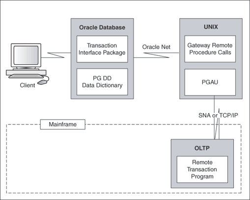
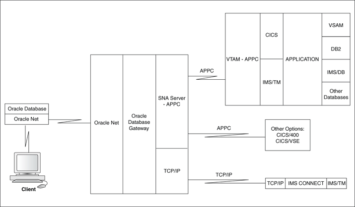

The Oracle Database Gateway for APPC (the gateway) enables users to initiate transaction program execution on remote online transaction processors (OLTPs). The Oracle Database Gateway for APPC can establish a connection with OLTP using the SNA communication protocol. The gateway can also use TCP/IP for IMS Connect to establish communication with the OLTP through TCP/IP. The gateway provides Oracle applications with seamless access to IBM mainframe data and services through remote Procedural Call (RPC) processing. The gateway can access any application capable of using the CPI-C API either directly or through a TP monitor such as CICS.

The following topics discuss the architecture, uses, and features of the gateway:

- Overview of the Gateway

- Features of the Gateway

- Terms

- Architecture of the Gateway

- Implementation of the Gateway

- Communication With the Gateway

- RPC Functions

- Transaction Types for Gateway Using SNA

- Transaction Types for Gateway Using TCP/IP

### Overview of the Gateway

The Oracle Database Gateway for APPC extends the RPC facilities available with the Oracle database. The gateway enables any client application to use PL/SQL to request execution of a remote transaction program (RTP) residing on a host. The gateway provides RPC processing to systems using the SNA APPC (Advanced Program-to-Program Communication) protocol and to systems using TCP/IP for IMS Connect protocol. This architecture allows efficient access to data and transactions available on the IBM mainframe and IMS, respectively.

The gateway requires no Oracle software on the remote host system. As a result, the gateway uses existing transactions with little or no programming effort on the remote host.

**Note:**

For gateways using SNA only the use of a generic and standard protocol, APPC, enables the gateway to access a multitude of systems. The gateway can communicate with virtually any APPC-enabled system, including IBM Corporation CICS on any platform, IBM Corporation IMS and APPC/MVS. These transaction monitors provide access to a broad range of systems, allowing the gateway to access many datastores, including VSAM, DB2 (static SQL), IMS, and others.

The gateway can access any application capable of using the CPI-C API either directly or through a TP monitor such as CICS.

### Features of the Gateway

The Oracle Database Gateway for APPC provides the following benefits:

- TCP/IP support for IMS Connect

  This release of the gateway includes TCP/IP support for IMS Connect, providing users a choice between the SNA or TCP/IP communication protocol. IMS Connect is an IBM product which enables TCP/IP clients to trigger execution of IMS transactions. The gateway can use a TCP/IP communication protocol to access IMS Connect, which triggers execution of IMS transactions. If you choose to use TCP/IP, then there is no SNA involvement with this configuration.

  Related to this new feature of the gateway is the `pg4tcpmap` tool. This release of the gateway includes a tool whose purpose is to map the information from your Side Profile Name to TCP/IP and IMS Connect. For more information about the gateway mapping tool, refer to Chapter 6, of the [Oracle Database Gateway for APPC User's Guide ](../appug/pg4tcpmap-commands-tcpip.md), and to [Gateway Configuration Using TCP/IP Communication Protocol](config-appc-gateway-using-tcp-ip.md) in this guide.

- Fast interface

  The gateway is optimized for minimum network traffic when you execute programs remotely. The interface to the gateway is an optimized PL/SQL stored procedure specification called the transaction interface package (TIP). This specification is precompiled in the Oracle database. Because there are no additional software layers on the remote host system, overhead occurs only when your program executes.

- Platform independence

  Client applications need not be operating system-specific. For example, your application can call a program on a CICS Transaction Server for z/OS. If you move the program to a CICS region on pSeries, then you need not change the application.

- Application transparency

  Users calling applications that execute a remote transaction program are unaware that a request is sent to a host.

- Flexible interface

  You can use the gateway as an interface with an existing procedural logic or to integrate new procedural logic into an Oracle database environment.

- Oracle database integration

  Integration of Oracle database with the gateway enables you to benefit from existing and future Oracle features. For example, the gateway can be called from an Oracle stored procedure or database trigger.

- Transactional support

  The gateway and the Oracle database allow remote transaction updates and Oracle database updates to be performed in a coordinated fashion.

- Wide selection of tools

  The gateway supports any tool or application that supports PL/SQL.

- PL/SQL code generator

  The Oracle Database Gateway for APPC provides a powerful development environment, including:

  - A data dictionary to store information relevant to the remote transaction

  - A tool to generate the PL/SQL Transaction Interface Package, or TIP

  - A report utility to view the information stored in the gateway dictionary

  - A complete set of tracing and debugging facilities

  - A wide set of samples to demonstrate the use of the product against datastores such as DB2, IMS, and CICS.

- Site autonomy and security

  The gateway provides site autonomy, allowing you to perform tasks such as authenticate users. It also provides role-based security compatible with any security package running on your mainframe computer.

- Automatic conversion

  Through TIP, the following conversions are performed:

  - ASCII to and from EBCDIC

  - Remote transaction program data types to and from PL/SQL data types

  - National language support for many languages

### Terms

The following terms and definitions are used throughout this guide. Refer to [Gateway Terminology](appc-gateway-terminology.md) for the complete list of terms and definitions pertaining to the gateway, its components, and functions.

#### Oracle Database

This is any Oracle database instance that communicates with the gateway for purposes of performing remote procedural calls to execute RTP. The Oracle database can be on the same system as the gateway or on a different system. If it is on a different system, then Oracle Net is required on both systems. Refer to Figure 1-2 for a view of the gateway architecture.

#### Online Transaction Processor (OLTP)

OLTP is an online transaction processor available from other vendors, including CICS Transaction Server for z/OS, IMS/TM, and z/OS.

#### Procedural Gateway Administration Utility (PGAU)

PGAU is the tool that is used to define and generate PL/SQL Transaction Interface Packages (TIPs). Refer to Chapter 2, Procedural Gateway Administration Utility in the [Oracle Database Gateway for APPC User's Guide](../appug/pga-utility-oracle-database-gateway-appc.md) for more information about PGAU.

#### Data Dictionary (PG DD)

This gateway component is a repository of remote host transaction (RHT) definitions and data definitions. PGAU accesses definitions in the PG DD when generating TIPs. The PG DD has data type dependencies because it supports the PGAU and is not intended to be directly accessed by the customer. Refer to Appendix A, Procedural Gateway for APPC Data Dictionary in the [Oracle Database Gateway for APPC User's Guide](../appug/oracle-database-gateway-appc-data-dictionary.md) for a list of PG DD tables.

#### RPC

RPC is a programming call that executes program logic on one system in response to a request from another system. Refer to [Gateway Terminology](appc-gateway-terminology.md)for more information, and refer to Appendix B, Gateway RPC Interface in the [Oracle Database Gateway for APPC User's Guide](../appug/oracle-database-gateway-appc-rpc-interface.md) as well.

#### RTP

A remote transaction program is a customer-written transaction, running under the control of an OLTP, which the user invokes remotely using a PL/SQL procedure. To execute a remote transaction program through the gateway, you must use RPC to execute a PL/SQL program to call the gateway functions.

#### TIP (Transaction Interface Package)

A TIP is an Oracle PL/SQL package that exists between your application and the remote transaction program. TIP is a set of PL/SQL stored procedures that invoke the remote transaction program through the gateway. TIPs perform the conversion and reformatting of remote host data using PL/SQL and `UTL_RAW`/`UTL_PG` functions.

Figure 1-1 illustrates the Relationship of the gateway and the Oracle database. The terminology discussed in the preceding sections has been used in the architecture of the gateway.

Figure 1-1 Relationship of Gateway and the Oracle Database

[Description of "Figure 1-1 Relationship of Gateway and the Oracle Database"](img_text/g1_1trms.md)

### Architecture of the Gateway

The architecture of Oracle Database Gateway for APPC consists of several components:

- Oracle database

- The gateway

  Oracle Database Gateway for APPC must be installed on a server that can run the required version of the operating system.

- An OLTP (online transaction processor)

  The OLTP must be accessible from the gateway using SNA or TCP/IP communication protocol. Multiple Oracle databases can access the same gateway. A single system gateway installation can be configured to access more than one OLTP.

**Note:**

For a gateway using TCP/IP support for IMS Connect the only OLTP that is supported through TCP/IP is IMS through IMS Connect

The OLTP must be accessible to the system using the TCP/IP protocol. Multiple Oracle databases can access the same gateway. A single system gateway installation can be configured to access more than one OLTP. Multiple IMS can be accessed from an IMS Connect. If you have a number of IMS Connect systems available, any of these may be connected to one or more IMS systems.

Figure 1-2 illustrates the architecture of Oracle Database Gateway for APPC using either SNA or TCP/IP, as described in the preceding section.

Figure 1-2 Gateway Architecture

[Description of "Figure 1-2 Gateway Architecture"](img_text/g1_2arch.md)

### Implementation of the Gateway

The basic structure of the gateway is the same whether your communications protocol is SNA or TCP/IP support for IMS Connect. The gateway has some of the same components as an Oracle database instance on UNIX. It has the following components:

- A home directory, similar to the one associated with an Oracle instance `ORACLE_HOME` environment variable

- A system identifier, identified as `sid` or `ORACLE_SID`

- An initialization parameter file, similar to the Oracle database `init``sid`.`ora` file.

The gateway does not have:

- Control, redo log, or database files

- The full set of subdirectories and ancillary files associated with an installed Oracle database

Because the gateway has no background processes and does not need a management utility such as Oracle Enterprise Manager, you do not need to start the gateway. Each Oracle database user session that accesses a particular gateway creates an independent process on UNIX which in turn runs the gateway server and executes either the SNA or TCP/IP functions to communicate with an OLTP.

### Communication With the Gateway

All communication between the user or client program and the gateway is handled through a transaction interface package (TIP), which executes on an Oracle database. The TIP is a standard PL/SQL package that provides the following functions:

- Declares the PL/SQL variables that can be exchanged with a remote transaction program

- Calls the gateway packages that handle the communications for starting the conversation, exchanging data and terminating the conversation

- Handles all data type conversions between PL/SQL data types and the target program data types

The Procedural Gateway Administration Utility (PGAU), provided with the gateway automatically generates the TIP specification.

The gateway is identified to the Oracle database using a database link. The database link is the same construct used to identify other Oracle databases. The functions in the gateway are referenced in PL/SQL as:

    function_name@dblink_name

### RPC Functions

The Oracle Database Gateway for APPC provides a set of functions that are invoked by the client through RPC. These functions direct the gateway to initiate, transfer data, and terminate remote transaction programs running under an OLTP on another system.

Table 1-1 lists the remote procedural call functions and the correlating commands that are invoked in the gateway and remote host.

Table 1-1 RPC Functions and Commands in the Gateway and Remote Host

| Applications    | Oracle TIP                           | Gateway   | Remote Host       |
|:----------------|:-------------------------------------|:----------|:------------------|
| `call tip_init` | `tip_init` `call pgainit@gateway` | `PGAINIT` | Initiate program  |
| `call tip_main` | `tip_main` `call pgaxfer@gateway` | `PGAXFER` | Exchange data     |
| `call tip_term` | `tip_term` `call pgaterm@gateway` | `PGATERM` | Terminate program |

#### Description of RPC Functions

The following sections describe how the RPC functions perform on gateways using SNA or TCP/IP communication protocols.

- Remote Transaction Initiation

- Data Exchange

- Remote Transaction Termination

##### Remote Transaction Initiation

The TIP initiates a connection to the remote host system, using one of the gateway functions, `PGAINIT`.

When the communication protocol is SNA: `PGAINIT` provides, as input, the required SNA parameters to start a conversation with the target transaction program. These parameters are sent across the SNA network, which returns a conversation identifier to `PGAINIT`. Any future calls to the target program use the conversation identifier as an `INPUT` parameter.

When the communication protocol is TCP/IP: `PGAINIT` provides, as input, the required TCP/IP parameters. Use the `pg4tcpmap` tool to map the parameters. These parameters are sent across the TCP/IP network to start the conversation with the target transaction program. The TCP/IP network returns a socket file descriptor to `PGAINIT`. Any future calls to the target program made by `PGAXFER` and `PGATERM` use the socket file descriptor as an input parameter.

Refer to [Gateway Initialization Parameters for TCP/IP Communication Protocol](appc-gateway-initialization-parameters-tcp-ip.md) , and Chapter 6 in the [Oracle Database Gateway for APPC User's Guide](../appug/pg4tcpmap-commands-tcpip.md), for more information about the function and use of the `pg4tcpmap` tool.

##### Data Exchange

After the conversation is established, a database gateway function called `PGAXFER` can exchange data in the form of input and output variables. `PGAXFER `sends and receives buffers to and from the target transaction program. The gateway sees a buffer as only a `RAW` stream of bytes. The TIP that is residing in the Oracle database is responsible for converting the application PL/SQL data types to `RAW` before sending the buffer to the gateway. It is also responsible for converting `RAW `to the PL/SQL data types before returning the results to the application.

##### Remote Transaction Termination

When communication with the remote program is complete, the gateway function `PGATERM` terminates the conversation between the gateway and the remote host.

When the communication protocol is SNA, `PGATERM` uses the conversation identifier as an `INPUT` parameter to request conversation termination.

When the communication protocol is TCP/IP, `PGATERM `uses the socket file descriptor for TCP/IP as an `INPUT` parameter to request conversation termination.

### Transaction Types for Gateway Using SNA

The Oracle Database Gateway for APPC supports three types of transactions that read data from and write data to remote host systems:

- One-shot

  In a one-shot transaction, the application initializes the connection, exchanges data and terminates the connection, all in a single call.

- Persistent

  In a persistent transaction, multiple calls to exchange data with the remote transaction can be made before terminating the conversation.

- Multiconversational

  In a multiconversation transaction, the database gateway server can be used to exchange multiple records in one call to the remote transaction program.

Refer to Remote Host Transaction Types in Chapter 4, Client Application Development of the [Oracle Database Gateway for APPC User's Guide](../appug/developing-appc-client-app-sna-only.md) for more information on transaction types.

The following list demonstrates the power of the Oracle Database Gateway for APPC:

- You can initiate a CICS transaction on the mainframe to retrieve data from a VSAM file for a PC application.

- You can modify and monitor the operation of a remote process control system.

- You can initiate an IMS/TM transaction that executes static SQL in DB2.

- You can initiate a CICS transaction that returns a large number of records in a single call.

### Transaction Types for Gateway Using TCP/IP

The Oracle Database Gateway for APPC using TCP/IP for IMS Connect supports three types of transaction socket connections:

- Transaction socket

  The socket connection lasts across a single transaction.

- Persistent socket

  The socket connection lasts across multiple transactions.

- Nonpersistent socket

  The socket connection lasts across a single exchange consisting of one input and one output.

  **Note:**

  Do not use the nonpersistent socket type if you plan on implementing conversational transactions because multiple connects and disconnects will occur.

  Refer to pg4tcpmap Tool Commands in Chapter 6 of the [Oracle Database Gateway for APPC User's Guide](../appug/pg4tcpmap-commands-tcpip.md) and to [Gateway Configuration Using TCP/IP Communication Protocol](config-appc-gateway-using-tcp-ip.md) in this guide for more information about how to enter these parameters.

  You can initiate an IMS/TM transaction that executes static SQL in DB2; this illustrates the power of the Oracle Database Gateway for APPC feature supporting TCP/IP for IMS Connect.
