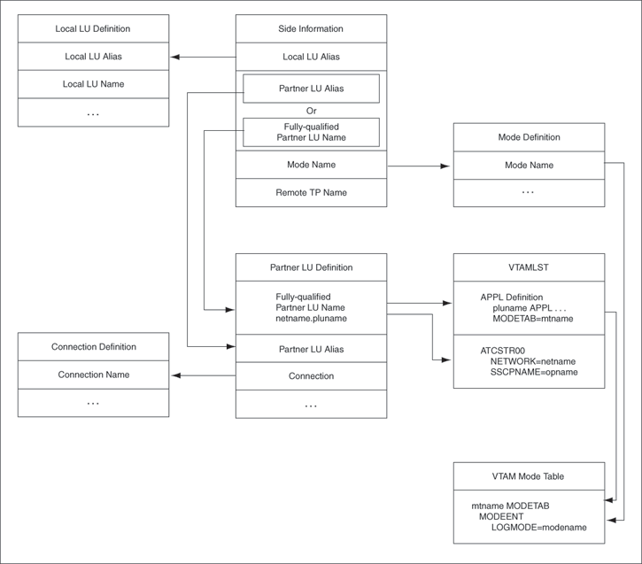

The Oracle Database Gateway for APPC uses the SNA Advanced Program to Program Communication (APPC/LU6.2) protocol to communicate with an OLTP.

APPC support on Microsoft Windows can be provided by using either of the following tools:

- Microsoft Host Integration Server 2000(HIS), or

- IBM Communications Server v6.1.1 (or higher).

Read the following topics to learn how to configure the SNA Server on a Windows system to run the Oracle Database Gateway for APPC, using either a Microsoft Host Integration Server or IBM Communications Server.

- Using SNA Security Validation

- Processing Inbound Connections

- Configuring Your Microsoft Host Integration Server

- Creating SNA Server Definitions on Microsoft Host Integration Server

- Configuring an IBM Communications Server

- Creating IBM Communications Server Definitions for the Gateway

- Testing the Connection

- Resume Configuration of the Gateway

### Using SNA Security Validation

When a Remote Procedure Call (RPC) request to start a remote transaction program (RTP) is received by the gateway, the gateway attempts to start an APPC conversation with the OLTP. Before the conversation can begin, a session must start between the Windows Logical Unit (LU) and the OLTP LU.

SNA and its various access method implementations (including HIS and IBM Communication Server and VTAM) provide security validation at session initiation time, allowing each LU to authenticate its partner. This validation is carried out entirely by network software before the gateway and OLTP application programs begin their conversation and process conversation-level security data. If session-level security is used, then correct password information must be established in the Windows SNA Server definitions and in similar parameter structures in the OLTP to be accessed. Refer to suitable communications software product documentation for detailed information about this subject.

### Processing Inbound Connections

Many OLTPs provide options for manipulating the security conduct of an inbound (client) APPC session request. Refer to suitable OLTP documentation for detailed information about this topic.

Note that for CICS, one security option is not supported by the gateway:

- `ATTACHSEC=PERSISTENT`, specified on the CICS `CONNECTION `definition, requires capability that is not yet available in the gateway.

However, `ATTACHSEC=LOCAL`, `ATTACHSEC=IDENTIFY`, `ATTACHSEC=VERIFY`, and `ATTACHSEC=MIXIDPE` are fully supported by the gateway.

### Configuring Your Microsoft Host Integration Server

The following sections discuss general information about the SNA Server and how to configure a Microsoft Host Integration Server.

**Note:**

If you are using the IBM Communication Server to configure your Windows system for the gateway, then proceed to Configuring an IBM Communications Server.

**Note:**

Although the Microsoft Host Integration Server has replaced the Microsoft SNA Server Manager, configuration of the communication package remains the same.

This means that the following steps shown for configuring the Microsoft SNA Server Manager also apply to the Microsoft Host Integration Server. The graphic windows you will actually see during configuration will be labelled as "Microsoft Host Integration Server " windows, rather than "SNA Server Manager".

#### Independent Versus Dependent LUs

Oracle recommends independent LUs for the Oracle Database Gateway for APPC because they support multiple parallel sessions or conversations. This means that multiple Oracle client applications can be active simultaneously with the same OLTP through the independent LU.

Dependent LUs support only a single active session. The CP (Control Point for the Node, which is SNA Server for Windows in this case) queues additional conversation requests from the gateway server behind an already active conversation. In other words, conversations are single-threaded for dependent LUs.

If a dependent LU is correctly defined, then no alterations to the Oracle Database Gateway for APPC configuration are needed, nor should any changes be needed to the host transaction or how the OLTP is started.

The operational impact of dependent LUs is that the first client application can initiate a conversation through the database gateway with the OLTP. While that transaction is active (which could be seconds to minutes to hours, depending on how the client application and transaction are designed), any other client application initiating a conversation with the same OLTP instance appears to hang as it waits behind the previous conversation.

If a production application really uses only a single conversation or transaction at any one time, then there should be no impact.

However, additional concurrent conversations or transactions might be required for testing or for other application development. Each requires that additional dependent LUs be defined on the remote host, plus additional SNA Server configuration entries, which define the additional dependent LUs on the Windows system. The TIP that initiates the conversation must specify the different Partner LU through a different Side Information Profile or by overriding the LU name. Refer to PGAU [`DEFINE TRANSACTION`](../appug/pga-utility-oracle-database-gateway-appc.md) , [`SIDEPROFILE`](../appug/pga-utility-oracle-database-gateway-appc.md), and [`LUNAME`](../appug/pga-utility-oracle-database-gateway-appc.md) parameters in Chapter 2, "Procedural Gateway Administration Utility," in the [Oracle Database Gateway for APPC User's Guide](../appug/pga-utility-oracle-database-gateway-appc.md).

#### Location of Sample SNA Server Definitions

The `%ORACLE_HOME%\dg4appc\sna` subdirectory contains a sample set of gateway SNA Server definitions created with the `SNACFG` command. The `snacfg.ctl` file contains sample definitions for SNA Server.

Before building the SNA Server definitions, examine the snacfg.ctl file to determine the definitions needed, their contents, and their inter-relationships. The file format is text-oriented, and each field of each definition is clearly labelled. You can print a copy of the file to use while working with your definitions in a Microsoft Host Integration Server (formerly SNA Server Manager) session.

#### HIS Definition Types

Several types of SNA Server definitions are relevant to gateway APPC/LU6.2 operation. Each definition can be created and edited using a corresponding Microsoft Host Integration Server (formerly SNA Server Manager) menu.

The definitions relevant to the gateway are presented here in hierarchical order. Those definition types that are lowest in the hierarchy are discussed first. This matches the logical sequence in which to create the definitions.

Refer to the Windows HIS online documentation for a complete discussion of HIS definitions. This section provides an overview of HIS definitions in relation to the Oracle Database Gateway for APPC.

#### Methods of Creating SNA Server Definitions for the Gateway

HIS definitions can be created and modified in two ways:

- You can create the definitions using menus in the Microsoft Host Integration Server (formerly SNA Server Manager).

  Using the Microsoft Host Integration Server is the recommended method for creating the definitions. You should be able to accept most of the defaults. The default values assigned to many of the fields in a new set of definitions are acceptable to the gateway.

  Step through the tasks for creating SNA Server definitions in Creating SNA Server Definitions on Microsoft Host Integration Server Creating SNA Server Definitions on Microsoft Host Integration Server .

- Alternatively, you can install the definitions directly on your system using the `SNACFG` command.

  For information on using the `SNACFG` command, refer to your vendor documentation.

  If you use the `SNACFG` command method, then you must use Microsoft Host Integration Server (formerly SNA Server Manager) to review and modify the installed definitions. Because of configuration and naming differences, it is unlikely that they will work without modification.

Maintenance of SNA definitions is normally done by a user with Administrator authority. The following information is intended for the person creating SNA definitions for the gateway. You should have some knowledge of SNA before reading the following sections.

### Creating SNA Server Definitions on Microsoft Host Integration Server

This section describes the process of creating your SNA definitions in the Microsoft Host Integration Server (formerly called the SNA Server Manager). All of the tasks described in this section are performed from within the Microsoft Host Integration Server.

#### Server Selection

Select the appropriate folder to ensure that definitions created are for that server. When HIS Manager is started, a dialog box appears.

Select the Servers folder under your local system and select the local SNA Server. From a list of services for that server, select the SNA Service.

#### Link Service Definition

You must install and configure a link service for SNA Server to use the network adapter installed in your workstation, as follows:

1.  From the Insert menu, select Link Service.
2.  From the Insert Link Service dialog box, select the Link Service you want to use from the selection list and click Add. For example, select DLC 802.2 Link Service and click Add.

Now, the Link Service Properties dialog box is displayed. Note that the contents of this dialog box vary depending on which link service was selected. In this example, the DLC 802.2 Link Service Properties dialog box is used.

Select the suitable network adapter from the Adapter drop-down menu and click OK. In the Insert Link Service dialog box, click Finish. The system now updates your network bindings.

#### Connection Definition

To create a connection definition, perform the following steps:

1.  You must create a connection definition to define the devices which HIS uses to perform SNA communication. From the Insert menu, select Connection. The Connection Properties dialog box appears.

2.  Select the General tab. Enter a connection name. This is the name used by HIS to name the connection. This example names the connection `TOKEN1`. From the Link Service drop-down menu, select a link service for the connection. All other settings can be left set to their default values.

3.  Select the Address tab in the Connection Properties box. Enter the Remote Network Address and the Remote SAP Address.

4.  Select the System Identification tab. Under Local Node Name, enter the Network Name, Control Point Name, and Local Node ID.

5.  Under Remote Node Name, enter the Network Name, Control Point Name, and optionally, the Remote Node ID. The XID Type should be set to Format 3.

6.  Next, select the DLC tab in the Connection Properties box. In this example, the 802.2 DLC (Token Ring) is being used. For the 802.2 DLC, all of the defaults are usually acceptable. If you need to change any values, then do so now.

7.  Now, all the connection properties are set. Click OK to continue.

#### Local LU Definition

You must create a local logical unit (LU) definition. The local LU definition describes the SNA LU through which the gateway communicates with OLTP systems. Perform the following steps to create a local LU definition:

1.  From the Insert menu, select Local APPC LU. The Local LU Properties dialog box appears.

2.  Select the General tab. Enter the LU Alias, Network Name, and LU Name. Ensure that the APPC SyncPoint Support box is not checked.

3.  Select Advanced tab of the Local APPC LU Properties box. Check the Member of Default Outgoing Local APPC LU Pool check box. Set the LU 6.2 Type to Independent to allow parallel sessions.

4.  Now, the Local LU properties are all set. Click OK to continue.

#### Mode Definition

This definition describes an SNA mode entry to be used when establishing sessions between LUs. The mode defined here must match a mode defined on the target system. Perform the following steps to create a mode definition:

1.  From the Insert menu, select APPC Mode Definition. The APPC Mode Properties dialog box appears.

2.  Select the General tab. Enter the Mode Name. The mode name that you specify must be defined to the OLTP communications software. Choose the mode name in addition to other mode parameters after consulting the person responsible for configuring the OLTP communications software.

3.  Next, select the Limits tab. Enter the Parallel Session Limit, Minimum Contention Winner Limit, Partner Min Contention Winner Limit, and Automatic Activation Limit values.

4.  The Parallel Session limit determines the maximum number of concurrent conversations allowed between the gateway instance and the OLTP. This equates to the maximum number of concurrently active RTP calls through the gateway instance.

5.  Now, select the Characteristics tab. Enter the Pacing Send Count, Pacing Receive Count, Max Send RU Size, and Max Receive RU Size. For optimal performance, check the High Priority Mode check box.

    The pacing and RU size parameters are performance-related and should be tuned to suit your application. For most installations, the values set in the example are sufficient.

6.  After you finish entering the values called for in this box, all the APPC mode properties will be set. Click OK at the bottom of the box to continue.

#### Remote LU Definition

This definition describes the SNA LU of the OLTP system with which the gateway communicates. You must create a remote LU definition for the remote OLTP system. Determine the link with which to associate the LU (in the example, it is `TOKEN1`). Perform the following steps to create a remote LU definition:

1.  From the Insert menu, select APPC Remote LU. The Remote APPC LU Properties dialog box appears.

2.  Select the General tab. Use the Connection drop-down menu to select the connection used to access this LU. Enter the LU Alias, Network Name, LU Name, and Uninterpreted LU Name.

    You should contact the person responsible for your SNA network to determine the correct LU and network names. Note that you can use the LU Alias to define a name known only to SNA Server, and that name can remain the same even if the remote LU name changes. This helps to reduce the amount of maintenance required when network changes occur.

3.  Now, select the Options tab. Check the Supports Parallel Sessions check box. Use the Implicit Incoming Mode drop-down menu to select the mode. Set any security options you need.

4.  Once you have filled in the suitable values in the Remote APPC LU Properties box, the APPC LU properties will be set. Click OK to continue.

#### CPI-C Symbolic Destination Name

When the Local and Remote Partner definitions and Mode definitions have been created, you can create CPI-C Symbolic Destination Names, also called side information. The side information is used to identify target OLTP systems to be accessed through the gateway.

1.  From the Insert menu, select APPC CPIC Symbolic Name. The CPIC Name Properties dialog box appears.

2.  Select the General tab. Enter a Name for the side information. From the Mode Name drop-down list, select the suitable mode.

3.  Now, select the Partner Information tab. Select Application TP and enter the TP name. If you plan to define one CPI-C Symbolic Destination Name for accessing multiple transaction programs at an OLTP, then you can enter a dummy TP Name at this time. The TP Name is overridden by the gateway at run time.

    Enter the Partner LU Name Alias.

4.  Click OK to save the side information.

Configuration of the Microsoft Host Integration Server is now complete. Proceed to "Testing the Connection".

### Configuring an IBM Communications Server

If you are using IBM Communications Server as your SNA Server, then read the following sections to learn how to configure it to communicate with the Oracle Database Gateway for APPC.

#### Independent And Dependent LUs

Oracle recommends independent LUs for the Oracle Database Gateway for APPC because they support multiple parallel sessions or conversations. This means that multiple Oracle client applications can be active simultaneously with the same OLTP through the independent LU.

Dependent LUs support only a single active session. The CP (Control Point for the node, which is IBM Communications Server, in this case) queues additional conversation requests from the gateway server behind an already active conversation. In other words, conversations are single-threaded for dependent LUs.

If a gateway LU is correctly defined, then no alterations to the Oracle Database Gateway for APPC configuration are needed, nor should any changes be needed to the gateway server.

The operational impact of dependent LUs is that the first client application can initiate a conversation through the database gateway with the gateway server. While that transaction is active (which could be seconds to minutes to hours, depending on how the client application and transaction are designed), any other client application initiating a session with the same gateway server appears to hang as it waits behind the previous session.

If a production application really uses only a single conversation at any one time, then there should be no impact.

However, additional concurrent conversations might be required for testing or for other application development. Each requires that additional dependent LUs be defined on the remote host, plus additional IBM Communication Server configuration entries, which define the additional dependent LUs on the host Windows system.

Additional side information profiles should be defined to use the new dependent LUs. New gateway instances should be created and configured to use these new side information profiles.

Refer to PGAU DEFINE TRANSACTION, SIDEPROFILE, and LUNAME parameters in Chapter 2, "Procedural Gateway Administration Utility," in the [Oracle Database Gateway for APPC User's Guide](../appug/pga-utility-oracle-database-gateway-appc.md).

#### Definition Types

Several types of IBM Communications Server definitions are relevant to gateway APPC/LU6.2 operation. Each definition can be created and edited using a corresponding SNA Node Configuration menu.

The definitions relevant to the gateway are presented here in hierarchical order. Those definition types that are lowest in the hierarchy are discussed first. This matches the logical sequence in which to create the definitions.

Refer to the IBM Communications Server online documentation for a complete discussion of IBM Communications Server definitions. This section provides an overview of IBM Communications Server definitions in relation to the Oracle Database Gateway for APPC.

### Creating IBM Communications Server Definitions for the Gateway

IBM Communications Server definitions are created using the SNA Node Configuration tool, while the actual operation of the server is done using the SNA Node Operations tool, both of which are provided with IBM Communications Server.

Maintenance of SNA definitions is normally done by a user with Administrator privileges.

The following sections describe the process of creating your SNA definitions for IBM Communications Server using the SNA Node Configuration tool. All the tasks described in this section are performed within SNA Node Configuration.

#### Creating the Configuration

SNA Node Configuration will first ask you if you are creating a new configuration or loading an existing configuration. These tasks are based on the assumption that a new configuration is being created.

SNA Node Configuration will next prompt you for a configuration scenario.

#### Creating the Node

Each SNA Server must have a control point defined. This is typically called the Node definition. To define the node:

1.  Click Node.
2.  Click Create.
3.  In the Define the Node dialog box, select the Basic tab. Enter the Control Point, Local Node ID, and Node Type information.
    You can select Advanced tab options, depending on your SNA network configuration.
4.  Click OK.

#### Creating Devices

Configure Communication Devices next. Follow these instructions:

1.  Click Devices.
2.  Click Create.

#### Choosing the Device Type

Select the type of device to use for communication. The LAN type is typical for either Ethernet or Token Ring attached network devices.

#### Configuring a LAN Device

Configure a LAN device next. Follow these instructions:

1.  Select the Basic tab. Select the adapter to use and the Local SAP.
    The other tabs provide options on network tuning parameters.
2.  Click OK.

#### Creating Peer Connections

Configure Peer Connections next. Follow these instructions:

1.  Click Peer Connections.
2.  Click Create.

#### Defining the Link Station

Define the Link Station next. Follow these instructions:

1.  In the Basic tab, enter a Link Station name for this connection.
2.  Choose the device for the connection.
3.  Enter the Destination address and Remote SAP.

#### Defining the Adjacent Node

Define the Adjacent Node next. Follow these instructions:

1.  Select the Adjacent Node tab.
2.  Enter the Adjacent CP name of the remote system and pick its CP type. You may have to choose a different transmission group (TG) than the default. Consult your SNA network administrator for details.
    Other tabs provide options on tuning and reactivation.
3.  Click OK.

#### Creating Local LUs

Create Local LUs for this node next. Follow these instructions:

1.  Click Local LU 6.2 LUs.
2.  Click Create.

#### Defining Local LUs

Define Local LUs next. Follow these instructions:

1.  In the Basic tab, enter the name of the Local LU, and, optionally, an alias. The name must match the Local LU definition of the remote host for this node.
    You can examine the other tab for synchronization support and for LU session limits.
2.  Click OK.

#### Creating Partner LUs

Create remote Partner LUs next. Follow these instructions:

1.  Click Partner LU 6.2 LUs.
2.  Click Create.

#### Defining Partner LUs

Define Partner LUs next. Follow these instructions:

1.  In the Basic tab, enter the name of the Remote or Partner LU, and, optionally, an alias.
2.  Select the Fully Qualified CP from the Existing list.
    You can examine the other tab for logical record limits and security support.
3.  Click OK.

#### Creating the CPI-C Side Information Profile

Next, define the CPI-C profile that will be used to create the gateway. Follow these instructions:

1.  Click the CPI-C Side Information Definitions.
2.  Click Create.

### Testing the Connection

Before proceeding with the gateway configuration tasks, ensure that your connection is working. You can do this by using the Microsoft Host Integration Server (SNA Server Manager).

Figure 6-1 shows the relationship between SNA Server definitions and the VTAM definitions on the host.

Figure 6-1 Relationship Between SNA Server Definitions and Host VTAM

[Description of "Figure 6-1 Relationship Between SNA Server Definitions and Host VTAM"](img_text/g6_17vtam.md)

### Resume Configuration of the Gateway

When you have finished configuring the SNA Server for your Windows system, proceed to [Configuring the OLTP](appc-gateway-configure-oltp.md) to continue configuring the network.
