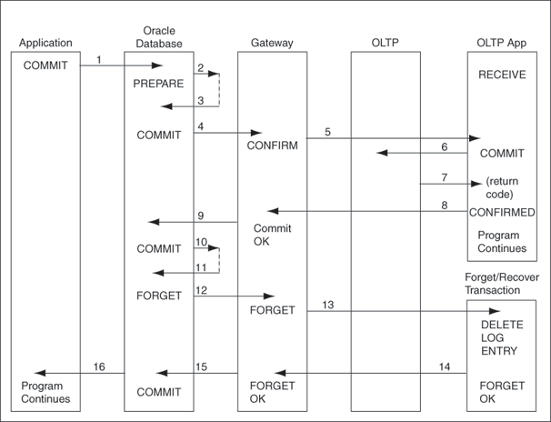

Commit-confirm allows the updating of local Oracle resources to occur in the same Oracle transaction as the updating of non-Oracle resources accessed through the Oracle Database Gateway for APPC.

Read the following topics to familiarize yourself with the elements and functions of commit-confirm.

You will find instructions for configuring gateway components for commit-confirm on an SNA environment in the installation guides. Refer to Chapter 5, "Configuring Your Network" and Chapter 6, "Gateway Configuration Using the SNA Communications Protocol" of the installation and configuration guides for specific information.

Topics:

- Overview of Commit-Confirm

- Supported OLTPs

- Components Required to Support Commit-Confirm

- Application Design Requirements

- Commit-Confirm Architecture

- Commit-Confirm Flow

### Overview of Commit-Confirm

**Note:**

If you are planning to implement commit-confirm, then you should already have configured the components. Depending on your platform, refer to Chapter 12 of the [Oracle Database Gateway for APPC Installation and Configuration Guide for IBM AIX on POWER Systems (64-Bit), Linux x86-64, Oracle Solaris on SPARC (64-Bit), and HP-UX Itanium](../appci/configuring-appc-gateway-sna.md) or Chapter 9 of the [Oracle Database Gateway for APPC Installation and Configuration Guide for Microsoft Windows](../appcw/configure-appc-gateway-using-sna.md) for instructions on its configuration.

Commit-confirm is a special implementation of two-phase commit that allows a database or gateway that does not support full two-phase commit to participate in distributed update transactions with other databases or gateways that do support full two-phase commit. In this implementation, the commit-confirm site is always the first to be committed, after all other sites have been prepared. This allows all sites to be kept in sync, because if the commit-confirm site fails to commit successfully, all other sites can be rolled back.

Within an Oracle distributed transaction, all work associated with that transaction is assigned a common identifier, known as the Oracle Global Transaction ID. This identifier is guaranteed to be unique, so that it can be used to exclusively identify a particular distributed transaction. The key requirement for commit-confirm support is the ability for the commit-confirm site (in this case, the Oracle Database Gateway for APPC) to be able to log the Oracle Global Transaction ID as part of its unit of work, so that if a failure occurs, the gateway's recovery processing can determine the status of a particular Oracle Global Transaction ID by the presence or absence of a log entry for that transaction. A new Oracle Global Transaction ID is generated after every commit or rollback operation.

The Oracle Database Gateway for APPC implements commit-confirm using LU6.2 `SYNCLEVEL 1`. This is similar to the implementation of single-site update, with the added advantage that resources on both the Oracle site and the OLTP being accessed by the gateway can be updated and kept in sync. The main difference is that the commit-confirm implementation requires some additional programming in the OLTP transaction to perform the transaction logging necessary for recovery support.

### Supported OLTPs

Since commit-confirm uses LU6.2 `SYNCLEVEL 1`, it can be supported by any OLTP that supports APPC, including CICS Transaction Server for z/OS and IMS/TM. The Oracle Database Gateway for APPC provides sample commit-confirm applications for both CICS Transaction Server for z/OS and IMS/TM.

With CICS Transaction Server for z/OS, the standard command-level EXEC CICS interface can be used for all APPC communications. In addition, the CPI-C interface can be used if it is preferred. A sample DB2 update transaction written in COBOL using the EXEC CICS interface is provided with the gateway. Any language supported by CICS Transaction Server for z/OS can be used for writing commit-confirm transactions.

With IMS/TM, the CPI-C interface must be used, making the IMS transaction an "explicit APPC transaction," as referred to in the IBM IMSCICS Transaction Server for z/OS manuals. This is necessary because it is the only way that the LU6.2 `SYNCLEVEL 1` control flows are accessible to the IMS transaction. When using "implied APPC" where "GU" from the IOPCB and "ISRT" to the IOPCB are used for receiving and sending data, there is no way for the IMS transaction to access the LU6.2 `SYNCLEVEL 1` control flow, making it impossible to use this method for commit-confirm. A sample DLI database update transaction written in COBOL using the CPI-C APPC interface is provided with the gateway. Any language supported by IMS and CPI-C can be used for writing commit-confirm transactions.

### Components Required to Support Commit-Confirm

The following components are required to support commit-confirm:

- Oracle Database Gateway for APPC Server

  The gateway server supports commit-confirm when `PGA_CAPABILITY=COMMIT_CONFIRM` is specified in the gateway initialization file. When the gateway server is running with commit-confirm enabled, it will connect to a local Oracle database where it maintains a commit-confirm transaction log, similar to the Oracle two-phase commit log stored in the `DBA_2PC_PENDING` table. The gateway's transaction log is stored in the `PGA_CC_PENDING` table. A row is stored in this table for each in-flight transaction and remains there until the transaction has completed. The life span of rows in `PGA_CC_PENDING` is normally quite short, lasting only from the time the commit is received by the gateway until the time the Oracle database completes all commit processing and tells the gateway to forget the transaction.

  The commit-confirm gateway SID should be reserved for use only to invoke update transactions that implement commit-confirm. There is some extra overhead involved in the setup for logging when `PGA_CAPABILITY` is set to `COMMIT_CONFIRM`. Read-only transactions should be invoked through a separate gateway SID with `PGA_CAPABILITY` set to `READ_ONLY` so that they will not incur the extra overhead.

- Logging Server

  An Oracle database must be available for use by the gateway server for storing the `PGA_CC_PENDING` table. For maximum performance and reliability, Oracle recommends that this Oracle database reside on the same system as the gateway server.

- OLTP Commit-Confirm Transaction Log

  A commit-confirm transaction log database must be defined to the OLTP system being accessed. This database must be recoverable and must be accessible by the OLTP as part of the same unit of work as the OLTP application's databases, so that updates to the transaction log database will be kept in sync with updates to the application's databases in a single unit of work.

  The commit-confirm transaction log database need contain only the Oracle Global Transaction ID and a date/time stamp. The Oracle Global Transaction ID is 169 bytes long and must be the key field. The date/time stamp is used for purging old entries that can be left in the log after certain failure scenarios.

  For simplicity, all commit-confirm applications under a particular OLTP should share the same commit-confirm transaction log.

- OLTP Transaction Logging Code

  Code must be added to each OLTP transaction invoked by a commit-confirm gateway to perform the transaction logging required by the gateway's commit-confirm implementation. This code must receive the Oracle Global Transaction ID from the gateway and write that information into the OLTP commit-confirm transaction log database. For maximum flexibility and ease of use, this code can be written as a subroutine callable from any commit-confirm transaction on your OLTP system.

  This code must be executed at the beginning of each commit-confirm transaction prior to the first APPC receive and then immediately after each `COMMIT` or `ROLLBACK` in the transaction. This ensures that the logging is done at the beginning of each unit of work.

- OLTP Forget/Recovery Transaction

  A separate APPC transaction must be created on the OLTP system that can be started by the gateway to forget a transaction once it has been successfully committed and to query a transaction's state during recovery processing. This transaction deletes the entry for a particular Oracle Global Transaction ID from the OLTP commit-confirm transaction log database during forget processing and queries the entry for a particular Oracle Global Transaction ID from the OLTP commit-confirm transaction log database during recovery processing.

  **Note:**

  Make sure that the gateway initialization parameters and the OLTP parameters are properly configured, as described in Chapter 11 of the [Oracle Database Gateway for APPC Installation and Configuration Guide for IBM AIX on POWER Systems (64-Bit), Linux x86-64, Oracle Solaris on SPARC (64-Bit), and HP-UX Itanium](../appci/appc-gateway-config-oltp.md) or Chapter 8 of the [Oracle Database Gateway for APPC Installation and Configuration Guide for Microsoft Windows](../appcw/appc-gateway-configure-oltp.md) depending on your platform.

### Application Design Requirements

When designing commit-confirm applications for use with the Oracle Database Gateway for APPC, there are some requirements you must meet to provide the ability for the gateway to determine the state of a transaction in the event of a failure. If these requirements are not met, attempting to use an application with a commit-confirm gateway will produce unpredictable results.

The first thing that must be done by an OLTP transaction invoked by a commit-confirm gateway is to receive the Oracle Global Transaction ID from the gateway and log it into the OLTP commit-confirm transaction log database. This must be done before the normal data flow between the OLTP transaction and the Oracle application begins. The gateway always sends the Oracle Global Transaction ID as the very first data item.

If the OLTP transaction is a one-shot transaction, this is the only change needed. If the transaction is a persistent transaction that performs more than one unit of work (issues more than one commit or rollback), then a new Oracle Global Transaction ID must be received and logged after every `COMMIT` or `ROLLBACK`.

The Oracle Global Transaction ID is sent by the gateway in a variable-length record with a maximum length of 202 bytes. The first 32 bytes contain a special binary string used to verify that the data came from the gateway and not from some other application. The next 1 byte is a reserved field. The Oracle Global Transaction ID is next, with a maximum length of 169 bytes. You must log the reserved field and the Oracle Global Transaction ID, as well as a date/time stamp and any other information you wish to log. Note that the Oracle Global Transaction ID must be the key field for the log database so that the forget/recovery transaction can use the Oracle Global Transaction ID to directly access a log entry.

**Note:**

If your OLTP is IMS/TM, you must add a PCB for the commit-confirm transaction log database to the PSB for each transaction that you will use with a commit-confirm gateway. This PCB must be the first PCB in the PSB.

### Commit-Confirm Architecture

The architecture of the commit-confirm implementation in the Oracle Database Gateway for APPC consists of three main components:

- Oracle database

- Oracle Database Gateway for APPC server (gateway server)

- Logging server (an Oracle database holding the tables `PGA_CC_PENDING` and `PGA_CC_LOG`)

This section describes the role each component plays in the operation of commit-confirm and how these components interact.

#### Components

The Oracle database is the controlling component in the commit-confirm architecture. It tells the gateway server when to commit a transaction and when to rollback a transaction. It does the same with all other servers participating in a distributed transaction. When a failure has occurred, it is the Oracle database acting as the integrating server which drives the recovery process in each participating server, including the gateway server.

The gateway server performs the task of converting instructions from the Oracle database into LU6.2 operations and then logs the transaction into the logging server. The gateway server stores the log information in a table called `PGA_CC_PENDING` on the logging server. If a failure occurs during transaction processing, the gateway server determines which error should be returned to the Oracle database.

The logging server is an Oracle database available to the gateway server for storing and accessing its commit-confirm log information. The logging server need not be the same Oracle database which acts as the integrating server. Because the logging server is an integral component of gateway commit-confirm operations, the best place for it to reside is on the same system as the gateway server. This allows the communication between the gateway server and the logging server to use interprocess communications, providing a high-speed, low overhead, local connection between the components.

#### Interactions

There is a specific set of interactions that occur between the components. They are:

- Oracle Database \<--\> Gateway Server

  The Oracle database drives all actions by the gateway server. At the request of the Oracle application, the integrating server can instruct the gateway server to begin a new Oracle transaction, start a commit sequence, start a rollback sequence, or start a forget sequence. It can also call gateway remote procedural call (RPC) functions (`PGAINIT`, `PGAXFER`, `PGATERM`) on behalf of the Oracle application.

- Gateway Server \<--\> Logging Server

  The gateway server calls the logging server to insert and delete rows from its `PGA_CC_PENDING` table. This is actually done by calling a PL/SQL stored procedure, `PGA_CC_LOG`, in the logging server to reduce the number of open cursors required by the gateway server for performing its logging. Only a single cursor is needed by the gateway server for logging.

### Commit-Confirm Flow

The flow of control for a successful commit between an Oracle application and an OLTP transaction is described in the following section and illustrated inFigure 5-1 . The figure assumes that both Oracle and OLTP resources have been updated. The following steps in Commit-Confirm Logic Flow\_ Step by Step outline the commit-confirm logic flow.

#### Commit-Confirm Logic Flow, Step by Step

1.  The application issues a `COMMIT` to the Oracle database.
2.  The Oracle database sends `PREPARE` to each participant in the distributed transaction other than the gateway.
3.  Each participant prepares its database updates and responds `PREPARE OK` to the Oracle database.
4.  The Oracle database sends `COMMIT` to the gateway. The gateway receives the `COMMIT` from the Oracle database and inserts a new pending transaction row into the `PGA_CC_PENDING` table.
5.  The gateway sends an APPC `CONFIRM` to the OLTP application. The OLTP application receives the `CONFIRM` request in the form of a status from the last APPC `RECEIVE`.
6.  The OLTP application issues a `COMMIT` using an appropriate OLTP function. The OLTP commits all database updates made by the application since the last `COMMIT`, including the commit-confirm transaction log update.
7.  Once the database updates have been committed, the OLTP returns control to the application with a return code indicating the status of the `COMMIT`.
8.  The OLTP application sends an APPC `CONFIRMED` to the gateway.
9.  The gateway receives the `CONFIRMED` and returns `COMMIT OK` to the Oracle database.
10. The Oracle database sends `COMMIT` to each participant in the distributed transaction other than the gateway.
11. Each participant commits its database updates and responds `COMMIT OK` to the Oracle database.
12. The Oracle database sends a `FORGET` to the gateway.
13. The gateway receives the `FORGET` and starts a new APPC conversation with the `FORGET/RECOVERY` transaction at the OLTP, sends it a `FORGET` request and an APPC `CONFIRM`. The `FORGET/RECOVERY` transaction receives the `FORGET` request and deletes the entry from the commit-confirm transaction log for the current Oracle transaction, and commits the delete.
14. The `FORGET/RECOVERY` transaction sends an APPC `CONFIRMED` to the gateway to indicate that the `FORGET` was processed, and then terminates. The gateway receives the `CONFIRMED` and deletes the pending transaction row from the `PGA_CC_PENDING` table.
15. The gateway returns `FORGET OK` to the Oracle database.
16. The Oracle database returns control to the Oracle application.

Figure 5-1 illustrates the Commit-Confirm logic flow described in the previous section.

Figure 5-1 Commit-Confirm Flow with Synclevel 1

[Description of "Figure 5-1 Commit-Confirm Flow with Synclevel 1"](img_text/comm5_1.md)

#### Gateway Server Commit-Confirm Transaction Log

The commit-confirm transaction log consists of a single table, `PGA_CC_PENDING`. This table contains a row for each in-flight Oracle transaction that includes the commit-confirm gateway. The table is maintained by the gateway server and is similar in function to the Oracle database's `DBA_2PC_PENDING` table. Note that a row is not inserted into this table until a `COMMIT` is received by the gateway and the row is deleted when a `FORGET` is received by the gateway. There is no involvement by the gateway during the `PREPARE` phase.

The `PGA_CC_PENDING` table contains the following columns:

- `GLOBAL_TRAN_ID`

  This is the Oracle Global Transaction ID for the transaction. It is identical to the corresponding column in the `DBA_2PC_PENDING` table.

- `SIDE_NAME`

  This is the Side Information Profile name that was used by the gateway to allocate the APPC conversation with the target LU. It corresponds to the `SIDENAME` parameter passed to the `PGAINIT` gateway function.

- `LU_NAME`

  This is the fully-qualified partner LU name of the target LU. This value is either the LU name from the Side Information Profile or the `LUNAME` parameter passed to the `PGAINIT` gateway function. This name fully identifies the OLTP system on which the transaction was executed.

- `MODE_NAME`

  This is the Mode name that was used by the gateway to allocate the APPC conversation with the target LU. The value is either the Mode name from the Side Information Profile or the `MODENAME` parameter passed to the `PGAINIT` gateway function.

- `TP_NAME`

  This is the transaction program name executed at the target LU. The value is either the TP name from the Side Information Profile or the `TPNAME` parameter passed to the `PGAINIT` gateway function. This name fully identifies the OLTP transaction program that was executed.
