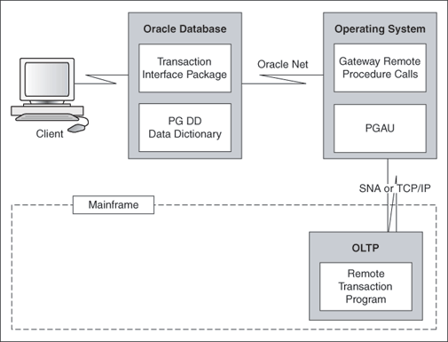
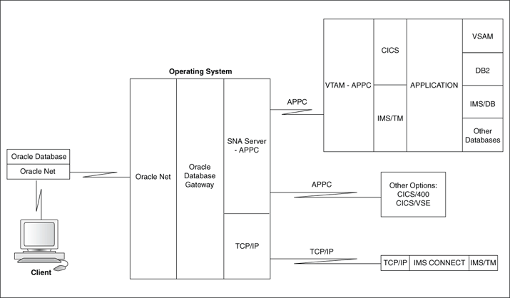
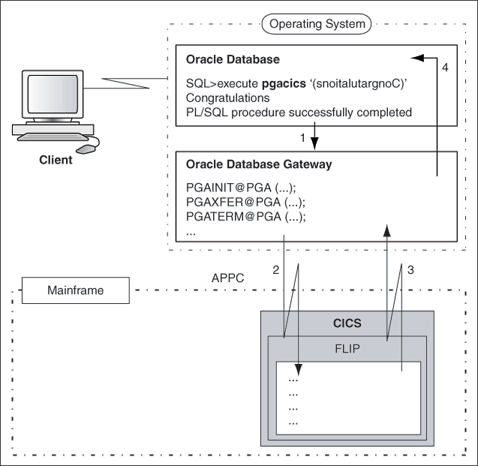
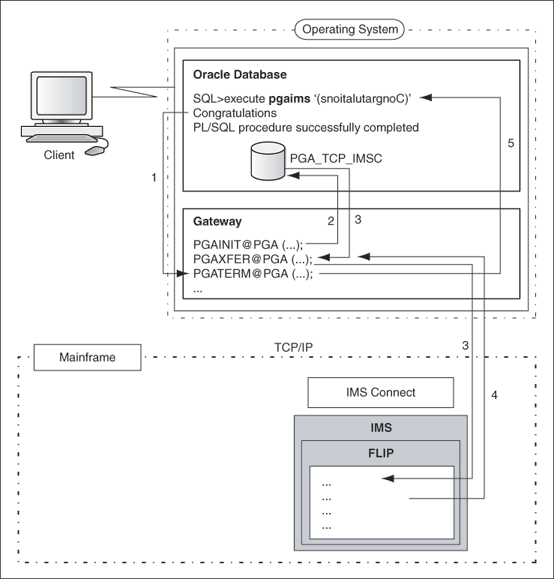

The Oracle Database Gateway for APPC enables users to initiate transaction program execution on remote online transaction processors (OLTPs). The Oracle Database Gateway for APPC can establish connection with OLTP using the SNA communication protocol. The gateway can also use TCP/IP for IMS Connect to establish communication with IMS/TM through TCP/IP. The gateway provides Oracle applications with seamless access to IBM mainframe data and services through Remote Procedural Call (RPC) processing.

Refer to the [Oracle Database Installation Guide](../install-and-upgrade.md) and to the certification matrix on the My Oracle Support Web site for the most up-to-date list of certified hardware platforms and operating system versions. The My Oracle Support Web site can be found at:

[`https://support.oracle.com`](https://support.oracle.com)

The following sections describe the architecture, uses, and features of the Oracle Database Gateway for APPC.

- Overview of the Gateway

- Features of the Gateway

- Terms

- Examples and Sample Files for the Gateway

- Architecture of the Gateway

- Communication with the Gateway

- RPC Functions

- Overview of a Gateway Using SNA

- Overview of a Gateway Using TCP/IP

### Overview of the Gateway

The Oracle Database Gateway for APPC extends the RPC facilities available with the Oracle database. The gateway enables any client application to use PL/SQL to request execution of a remote transaction program (RTP) residing on a host. The gateway provides RPC processing to systems using the SNA Advanced Program-to-Program Communication (APPC) protocol and to IMS/TM systems using TCP/IP support for IMS Connect. This architecture allows efficient access to data and transactions available on the IBM mainframe and IMS, respectively.

The gateway requires no Oracle software on the remote host system. Because of this, the gateway uses existing transactions with little or no programming effort on the remote host.

#### For gateways using SNA only:

The use of a generic and standard protocol, APPC, allows the gateway to access numerous systems. The gateway can communicate with virtually any APPC-enabled system, including IBM Corporation's CICS on any platform and IBM Corporation's IMS and APPC/MVS. These transaction monitors provide access to a broad range of systems, allowing the gateway to access many datastores, including VSAM, DB2 (static SQL), IMS, and others.

The gateway can access any application capable of using the CPI-C API, either directly or through a TP monitor such as CICS.

### Features of the Gateway

The Oracle Database Gateway for APPC provides the following benefits:

- Fast interface

  The gateway is optimized so that remote execution of a program is achieved with minimum network traffic. The interface to the gateway is an optimized PL/SQL stored procedure specification (called the TIP or transaction interface package) precompiled in the Oracle database. Because there are no additional software layers on the remote host, overhead occurs only when your program executes.

- Location transparency

  Client applications need not be operating system-specific. For example, your application can call a program in a CICS Transaction Server for z/OS. If you move the program to a CICS region on AIX, then you need not change the application.

- Application transparency

  Users calling applications that execute a remote transaction program are unaware that a request is sent to a host.

- Flexible interface

  You can use the gateway to interface with existing procedural logic or to integrate new procedural logic into an Oracle database environment.

- Oracle database integration

  The integration of the Oracle database with the gateway enables the gateway to benefit from existing and future Oracle database features. For example, the gateway can be called from an Oracle stored procedure or database trigger.

- Transactional support

  The gateway and the Oracle database allow remote transfer updates and Oracle database updates to be performed in a coordinated fashion.

- Wide selection of tools

  The gateway supports any tool or application that supports PL/SQL.

- PL/SQL code generator

  The Oracle Database Gateway for APPC provides a powerful development environment, including:

  - a data dictionary to store information relevant to the remote transaction

  - a tool to generate the PL/SQL Transaction Interface Package, or TIP

  - a report utility to view the information stored in the gateway dictionary

  - a complete set of tracing and debugging facilities

  - a wide set of samples to demonstrate the use of the product against datastores such as DB2, IMS, and CICS.

- Site autonomy and security

  The gateway provides site autonomy, allowing you to do such things as authenticate users. It also provides role-based security compatible with any security package running on your mainframe computer.

- Automatic conversion

  Through the TIP, the following conversions are performed:

  - ASCII to and from EBCDIC

  - remote transaction program datatypes to and from PL/SQL datatypes

  - national language support for many languages

- Globalization Support

- TCP/IP support for IMS Connect

  This release of the gateway includes TCP/IP support for IMS Connect, giving users a choice of whether to use an SNA or TCP/IP communication protocol. IMS Connect is an IBM product which allows TCP/IP clients to trigger execution of IMS transactions. The gateway can use a TCP/IP communication protocol to access IMS Connect, which triggers execution of IMS transactions. There is no SNA involvement with this configuration.

  Related to this feature of the gateway is:

  - The gateway mapping tool. This release of the gateway includes a tool (`pg4tcpmap`) whose purpose is to map the information from your SNA Side Profile Name to the TCP/IP host name and Port Number.

    **Note:**

    When your communications protocol is TCP/IP, only IMS is supported as the OLTP.

### Terms

The following terms and definitions are used throughout this guide:

#### Gateway Initialization File

This file is known as `init``sid``.ora` and it contains parameters that govern the operation of the gateway. If you are using the SNA protocol, refer to Appendix A, "Gateway Initialization Parameters for SNA Protocol" in the [Oracle Database Gateway for APPC Installation and Configuration Guide for IBM AIX on POWER Systems (64-Bit), Linux x86-64, Oracle Solaris on SPARC (64-Bit), and HP-UX Itanium](../appci/appc-gateway-initialization-parameters-sna.md) or [Oracle Database Gateway for APPC Installation and Configuration Guide for Microsoft Windows](../appcw/appc-gateway-initialization-parameters-sna.md) for more information. If your protocol is TCP/IP, refer to Appendix B, "Gateway Initialization Parameters for TCP/IP Communication Protocol" in the [Oracle Database Gateway for APPC Installation and Configuration Guide for IBM AIX on POWER Systems (64-Bit), Linux x86-64, Oracle Solaris on SPARC (64-Bit), and HP-UX Itanium](../appci/appc-gateway-initialization-parameters-tcp-ip.md) or [Oracle Database Gateway for APPC Installation and Configuration Guide for Microsoft Windows](../appcw/appc-gateway-initialization-parameters-tcp-ip.md).

#### Gateway Remote Procedure

The Oracle Database Gateway for APPC provides prebuilt remote procedures. In general, the following three remote procedures are used:

- `PGAINIT`, which initializes transactions

- `PGAXFER`, which transfers data

- `PGATERM`, which terminates transactions

Refer to [Gateway RPC Interface](oracle-database-gateway-appc-rpc-interface.md) in this guide and to "Remote Procedural Call Functions" in Chapter 1 of the [Oracle Database Gateway for APPC Installation and Configuration Guide for IBM AIX on POWER Systems (64-Bit), Linux x86-64, Oracle Solaris on SPARC (64-Bit), and HP-UX Itanium](../appci/appc-gateway-introduction.md) or [Oracle Database Gateway for APPC Installation and Configuration Guide for Microsoft Windows](../appcw/appc-gateway-introduction.md) for more information about gateway remote procedures.

#### dg4pwd

`dg4pwd` is a utility which encrypts passwords that are normally stored in the gateway initialization file. Passwords are stored in an encrypted form in the password file, making the information more secure. Refer to "Passwords in the Gateway Initialization File" in the security requirements chapter of the[ Oracle Database Gateway for APPC Installation and Configuration Guide for IBM AIX on POWER Systems (64-Bit), Linux x86-64, Oracle Solaris on SPARC (64-Bit), and HP-UX Itanium](../appci/appc-gateway-security-requirements.md) and [Oracle Database Gateway for APPC Installation and Configuration Guide for Microsoft Windows](../appcw/appc-gateway-security-requirements.md) for detailed information about how the `dg4pwd` utility works.

#### pg4tcpmap Tool

This tool is applicable only when the gateway is using TCP/IP support for IMS Connect. Its function is to map SNA parameters (such as Side Profile Name) to TCP/IP parameters (such as OLTP host name, IMS Connect port number and IMS destination ID).

#### PGA (Procedural Gateway Administration)

PGA is a general reference within this guide to all or most components comprising the Oracle Database Gateway for APPC. This term is used when references to a specific product or component are too narrow.

#### PGDL (Procedural Gateway Definition Language)

PGDL is the collection of statements used to define transactions and data to the PGAU.

#### PL/SQL Stored Procedure Specification (PL/SQL package)

This is a precompiled PL/SQL procedure that is stored in Oracle database.

#### UTL_RAW PL/SQL Package (the UTL_RAW Functions)

This component of the gateway represents a series of data conversion functions for PL/SQL RAW variables and remote host data. The types of conversions performed depend on the language of the remote host data. Refer to [Datatype Conversions](data-type-conversion-oracle-database-gateway-appc.md) in this guide for more information.

#### UTL_PG PL/SQL Package (the UTL_PG Functions)

This component of the gateway represents a series of COBOL numeric data conversion functions. Refer to "[NUMBER_TO_RAW and RAW_TO_NUMBER Argument Values](oracle-database-gateway-appc-utl_pg-interface.md)" in [The UTL_PG Interface](oracle-database-gateway-appc-utl_pg-interface.md) of this guide for supported numeric datatype conversions.

#### Oracle Database

This is any Oracle database instance that communicates with the gateway for purposes of performing RPCs to execute RTP. The Oracle database can be on the same system as the gateway or on a different system. If it is on a different system, then Oracle Net is required on both systems. Refer to Figure 1-2 for a view of the gateway architecture.

#### OLTP (Online Transaction Processor)

OLTP is any of a number of online transaction processors available from other vendors, including CICS Transaction Server for z/OS and IMS/TM.

**Note:**

When your communications protocol is TCP/IP, only IMS is supported as the OLTP.

#### PGAU (Procedural Gateway Administration Utility)

PGAU is the tool that is used to define and generate PL/SQL transaction interface packages (TIPs). Refer to [Procedural Gateway Administration Utility](pga-utility-oracle-database-gateway-appc.md) in this guide for more information about PGAU.

#### PG DD (Procedural Gateway Data Dictionary)

This component of the gateway is a repository of remote host transaction definitions and data definitions. PGAU accesses definitions in the PG DD when generating TIPs. The PG DD has datatype dependencies because it supports the PGAU and is not intended to be directly accessed by the customer. Refer to [Database Gateway for APPC Data Dictionary](oracle-database-gateway-appc-data-dictionary.md) in this guide for a list of PG DD tables.

#### RPC (Remote Procedural Call)

RPC is a programming call that executes program logic on one system in response to a request from another system. Refer to "Gateway Remote Procedure" in Appendix C of the [Oracle Database Gateway for APPC Installation and Configuration Guide for IBM AIX on POWER Systems (64-Bit), Linux x86-64, Oracle Solaris on SPARC (64-Bit), and HP-UX Itanium](../appci/appc-gateway-terminology.md)or [Oracle Database Gateway for APPC Installation and Configuration Guide for Microsoft Windows](../appcw/appc-gateway-terminology.md) , and to [Gateway RPC Interface](oracle-database-gateway-appc-rpc-interface.md) in this guide for more information.

#### RTP (Remote Transaction Program)

A remote transaction program is a customer-written transaction, running under the control of an OLTP, which the user invokes remotely using a PL/SQL procedure. To execute a remote transaction program through the gateway, you must use RPC to execute a PL/SQL program to call the gateway functions.

#### TIP (Transaction Interface Package)

A TIP is an Oracle PL/SQL package that exists between your application and the remote transaction program. The transaction interface package, or TIP, is a set of PL/SQL stored procedures that invoke the RTP through the gateway. TIPs perform the conversion and reformatting of remote host data using PL/SQL and `UTL_RAW/UTL_PG` functions.

Figure 1-1 illustrates where the terminology discussed in the preceding sections applies to the gateway's architecture.

Figure 1-1 Relationship of Gateway and Oracle Database

[Description of "Figure 1-1 Relationship of Gateway and Oracle Database "](img_text/trms1_1.md)

### Examples and Sample Files for the Gateway

The following sample files and examples are referred to for illustration purposes throughout this guide. There are different example and sample files for a gateway using the SNA protocol than for a gateway using TCP/IP for IMS Connect.

#### Examples and Sample Files for Gateway Using SNA

For gateways using the SNA communication protocol, this guide uses a CICS-DB2 inquiry as an example. Transaction Interface Packages (TIPs) `pgadb2i.pkb` and `pgadb2i.pkh` send an employee number, `empno`, to a DB2 application and receive an employee record, `emprec`.

The CICS-DB2 inquiry sample and its associated PGAU commands are also available in the `%ORACLE_HOME%\dg4appc\demo\CICS `directory on Windows platform and `$ORACLE_HOME/dg4appc/demo/CICS` directory on UNIX platforms. The sample CICS-DB2 inquiry used as an example in this chapter is in files `pgadb2i.pkh` and `pgadb2i.pkb`. Refer to the `README.doc` file in the same directory for information about installing and using the samples. It can be found in the `%ORACLE_HOME%\dg4appc\demo\CICS` directory for Windows and `$ORACLE_HOME/dg4appc/demo/CICS` directory for UNIX.

#### Examples and Sample Files for Gateway Using TCP/IP

If your gateway is using the TCP/IP communication protocol, this guide uses an IMS inquiry as an example. Transaction Interface Packages (TIPs) `pgtflip.pkh` and `pgtflip.pkb` send input to IMS, through IMS Connect, and receive the flipped input as the output.

The IMS inquiry sample (FLIP) and its associated PGAU commands are located in the `%ORACLE_HOME%\dg4appc\demo\IMS` directory for Windows and `$ORACLE_HOME/dg4appc/demo/IMS` directory for UNIX. The sample IMS inquiry used as an example for a gateway using TCP/IP is located in files `pgtflip.pkh` and `pgtflip.pkb`.

Refer to the `README.doc` file for more information about installing and using other IMS samples. It can be found in the `%ORACLE_HOME%\dg4appc\demo\IMS` directory for Windows and` $ORACLE_HOME/dg4appc/demo/IMS `directory for UNIX.

### Architecture of the Gateway

The architecture of Oracle Database Gateway for APPC consists of several components:

1.  Oracle database

    Refer to the configuration section corresponding to your communications protocol in the installation guides for a description of the various methods for establishing the gateway-Oracle database relationship.

    The Oracle database can also be used for non-gateway applications.

2.  The gateway

    Oracle Database Gateway for APPC must be installed on a server that can run the required version of the operating system.

3.  An OLTP

    The OLTP must be accessible from the gateway using your SNA or TCP/IP communication protocol. Multiple Oracle databases can access the same gateway. A single system gateway installation can be configured to access more than one OLTP.

    - For gateways using TCP/IP: The only OLTP that is supported through TCP/IP is IMS through IMS Connect.The OLTP must be accessible to the system using the TCP/IP protocol. Multiple Oracle databases can access the same gateway. A single system gateway installation can be configured to access more than one OLTP. Multiple IMS systems can be accessed from an IMS Connect. If you have a number of IMS Connect systems available, any of these may be connected to one or more IMS systems.

Figure 1-2 illustrates the architecture of the Oracle Database Gateway for APPC using SNA or TCP/IP, as described in the previous section.

Figure 1-2 Gateway Architecture Featuring SNA or TCP/IP Protocol

[Description of "Figure 1-2 Gateway Architecture Featuring SNA or TCP/IP Protocol"](img_text/arch1_2.md)

### Communication with the Gateway

All the communication between the user or client program and the gateway is handled through a TIP which executes on an Oracle database. The TIP is a standard PL/SQL package that provides the following functions:

- declares the PL/SQL variables that can be exchanged with a remote transaction program;

- calls the gateway packages that handle the communications for starting the conversation, exchanging data, and terminating the conversation;

- handles all datatype conversions between PL/SQL datatypes and the target program datatypes.

The PGAU, provided with the gateway, automatically generates the TIP specification.

The gateway is identified to the Oracle database using a database link. The database link is the same construct used to identify other Oracle databases. The functions in the gateway are referenced in PL/SQL as:

    function_name@dblink_name

### RPC Functions

The Oracle Database Gateway for APPC provides a set of functions that are called by the client through RPC. These functions direct the gateway to initiate, transfer data with, and terminate RTP running under an OLTP on another system.

Table 1-1 lists the RPC functions and the correlating commands that are invoked in the gateway and remote host.

Table 1-1 RPC Functions and Commands in the Gateway and Remote Host

| Applications    | Oracle TIP                           | Gateway   | Remote Host       |
|:----------------|:-------------------------------------|:----------|:------------------|
| `call tip_init` | `tip_init` `call pgainit@gateway` | `PGAINIT` | Initiate program  |
| `call tip_main` | `tip_main` `call pgaxfer@gateway` | `PGAXFER` | Exchange data     |
| `call tip_term` | `tip_term` `call pgaterm@gateway` | `PGATERM` | Terminate program |

#### TIP Function

The following sections describe how a TIP works by first establishing a connection to the remote host, then exchanging data from the target transaction program and finally, terminating a conversation.

- Remote Transaction Initiation

- Data Exchange

- Remote Transaction Termination

##### Remote Transaction Initiation

The TIP initiates a connection to the remote host using one of the gateway functions, `PGAINIT`.

When the communication protocol is SNA: `PGAINIT` provides, as input, the required SNA parameters to start a conversation with the target transaction program. These parameters are sent across the SNA network, which returns a conversation identifier to `PGAINIT`. Future calls to the target program use the conversation identifier as an input parameter.

When the communication protocol is TCP/IP: `PGAINIT` provides, as input, the required TCP/IP parameters.These parameters are sent across the TCP/IP network to start the conversation with the target transaction program. The TCP/IP network returns a socket file descriptor to `PGAINIT`. Future calls, such as `PGAXFER` and `PGATERM`, use this same socket file descriptor as an input parameter.

##### Data Exchange

After the conversation is established, a database gateway function called `PGAXFER` can exchange data in the form of input and output variables. `PGAXFER` sends and receives buffers to and from the target transaction program. The gateway sees a buffer as only a RAW stream of bytes. The TIP that resides in the Oracle database is responsible for converting PL/SQL datatypes of the application to RAW before sending the buffer to the gateway. It is also responsible for converting RAW to PL/SQL datatypes before returning the results to the application.

##### Remote Transaction Termination

When communication with the remote program is complete, the gateway function `PGATERM` terminates the conversation between the gateway and the remote host.

When the communication protocol is SNA: `PGATERM` uses the conversation identifier as an input parameter to request conversation termination.

When the communication protocol is TCP/IP: `PGATERM` uses the socket file descriptor for TCP/IP as an input parameter to request conversation termination.

**Note:**

At this point, if your communication protocol is SNA, then proceed to the following section, Overview of a Gateway Using SNA.

If your gateway communication protocol is TCP/IP, then proceed to Overview of a Gateway Using TCP/IP.

### Overview of a Gateway Using SNA

If you are using the SNA communication protocol, read the following sections to develop an understanding of how the gateway communicates with the Oracle database and with the mainframe, as well as transaction types unique to your gateway and writing TIPs.

#### Transaction Types for a Gateway Using SNA

The Oracle Database Gateway for APPC supports three types of transactions that read data from and write data to remote host systems:

- one-shot

  In a one-shot transaction, the application starts the connection, exchanges data, and terminates the connection, all in a single call.

- persistent

  In a persistent transaction, multiple calls to exchange data with the remote transaction can be executed before terminating the conversation.

- multi-conversational

  In a multi-conversational transaction, the database gateway server can be used to exchange multiple records in one call to the remote transaction program.

Refer to "[Remote Host Transaction Types](developing-appc-client-app-sna-only.md)" in [Client Application Development (SNA Only)](developing-appc-client-app-sna-only.md) of this guide for more information about transaction types.

The following list demonstrates examples of the power of the Oracle Database Gateway for APPC:

- You can initiate a CICS transaction on the mainframe to retrieve data from a VSAM file for a PC application.

- You can modify and monitor the operation of a remote process control computer.

- You can initiate an IMS/TM transaction that executes static SQL in DB2.

- You can initiate a CICS transaction that returns a large number of records in a single call.

#### Simple Gateway Communication with the Oracle Database (SNA)

This section describes simple communication between the mainframe and the Oracle database on a gateway using the SNA communication protocol. The Oracle Database Gateway for APPC lets you write your own procedures to begin transferring information between the Oracle database and a variety of programs on an IBM mainframe, including IBM CICS, IMS, and APPC/MVS.

For an illustration of the communications function of the Oracle Database Gateway for APPC, refer to `%ORACLE_HOME%\dg4appc\demo\CICS\pgacics.sql` on Microsoft Windows or `$ORACLE_HOME/dg4appc/demo/CICS/pgacics.sql` on UNIX based platforms. This is a sample communication between the Oracle database and CICS Transaction Server for z/OS. Executing this simple PL/SQL procedure `pgacics.sql`, causes the Oracle database to invoke the database gateway, which uses SNA to converse with the `FLIP` transaction in CICS. These steps are described in detail in Steps to Communicate Between Gateway and Mainframe Using SNA . Note that you will already have compiled and linked the stored procedure when you configured the gateway.

##### Steps to Communicate Between Gateway and Mainframe Using SNA

The following steps describe the Windows-to-mainframe communications process illustrated in Figure 1-3 when your communication protocol is SNA to communicate between the gateway and the mainframe:

1.  From SQL\*Plus, execute `pgacics`. This invokes the PL/SQL stored procedure in the Oracle database.
    For Microsoft Windows:

        C:\> sqlplus <userid>/<password>@<database_specification_string>
        SQL> execute pgacics('==< .SCIC htiw gnitacinummoc si yawetag ruoy ,snoitalutargnoC >==');

    For UNIX Based platforms:

        $ sqlplus <userid>/<password>@<database_specification_string>
        SQL> execute pgacics('==< .SCIC htiw gnitacinummoc si yawetag ruoy ,snoitalutargnoC >==');
2.  The `pgacics` PL/SQL stored procedure will start up the gateway. The gateway will start up communication with CICS Transaction Server for z/OS through SNA and will call `FLIP`.
3.  `FLIP` processes the input, generates the output and sends the output back to the database gateway.
4.  Finally, the database gateway will send the output back to the PL/SQL stored procedure in the Oracle database. The result is displayed in SQL\*Plus:
        ==> Congratulations, your gateway is communicating with CICS. <==
        PL/SQL procedure successfully completed.

    Figure 1-3 illustrates the communications process described in steps 1 through 4.

Figure 1-3 Communication Between the Oracle Database and the Mainframe, Using SNA

[Description of "Figure 1-3 Communication Between the Oracle Database and the Mainframe, Using SNA"](img_text/svrcm1_3.md)

#### Writing TIPs to Generate PL/SQL Programs Using SNA

Most transactions using SNA communication protocol are much larger and more complex than the sample `pgacics.sql` file referred to in Figure 1-3. Additionally, communication with a normal-sized RTP would require you to create an extremely long PL/SQL file. PGAU function generates the PL/SQL procedure for you.

The following is a brief description of the four steps necessary for you to generate a TIP. Refer to [Creating a TIP](creating-tip-oracle-database-gateway-appc.md) for detailed information about this procedure, and refer to [Procedural Gateway Administration Utility](pga-utility-oracle-database-gateway-appc.md) for more information about PGAU.

All parameter names in this section are taken from a file called `pgadb2i.ctl` in the `%ORACLE_HOME%\pga4appc\demo\CICS` directory on Microsoft Windows or in the `$ORACLE_HOME/pga4appc/demo/CICS` directory on UNIX Based systems.

##### Steps to Writing a TIP on a Gateway Using SNA

Follow these steps to write a TIP.

Step 1    Create a control file:
The user writes the control files. The control file has four main types of PGAU commands:

1.  `DEFINE DATA`. This is used to define input and output fields, using COBOL data definitions.

    - Sample define data:

          define data empno plsdname(empno) usage(pass) language(ibmvscobolii)
                            infile("empno.cob");

2.  `DEFINE CALL`. This is used to define PL/SQL functions calls to be generated as part of the package.

    - Sample define call:

          define call db2imain pkgcall(pgadb2i_main)
                               parms((empno in),(emprec out));

3.  `DEFINE TRANSACTION`. This is used to group the preceding functions and specify other parameters on which the TIP depends.

    - Sample define transaction:

          define transaction db2i call(db2imain,db2idiag)
                                  sideprofile(CICSPGA)
                                  tpname(DB2I)
                                  logmode(oraplu62)
                                  synclevel(0)
                                  nls_language("american_america.we8ebcdic37c");

4.  `GENERATE`. This is used to generate the TIP specification files from the previously stored data, call, and transaction definitions.

    - Sample generate transaction:

          generate db2i pkgname(pgadb2i) pganode(pga) outfile("pgadb2i");

Step 2   Execute the control file within PGAU
Running the control file within PGAU will create PG DD entries for the data, call, and transaction definitions, and will generate the specification files (For example, `pgadb2i.pkh` and `pgadb2i.pkb`):

For Microsoft Windows:

    C:\> pgau
    PGAU> CONNECT<userid>/<password>@<database>_specification_string>
    PGAU> @pgadb2i.ctl

For UNIX based systems:

    $ pgau
    PGAU> CONNECT<userid>/<password>@<database>_specification_string>
    PGAU> @pgadb2i.ctl

Step 3   Execute the specification files
Running the specification files will create the PL/SQL stored procedures. Note that the header specification file (for example, `pgadb2i.pkh`) must be run first:

For Microsoft Windows:

    C:\> sqlplus<userid>/<password>@<database_specification_string>
    SQL> @pgadb2i.pkh;
    SQL> @pgadb2i.pkb;

For UNIX based systems:

    $ sqlplus<userid>/<password>@<database_specification_string>
    SQL> @pgadb2i.pkh;
    SQL> @pgadb2i.pkb;

Step 4   Create a driver procedure to run the TIP
The TIP is now ready for use. For convenience, it will usually be called using a driver procedure (for example, `db2idriv`). This driver will then call the individual stored procedures in the correct order. Create the driver procedure and run it:

For Microsoft Windows:

    C:\> sqlplus <userid>/<password>@<database_specification string>
    SQL> @pgadb2id.sql
    SQL> execute db2idriv('000320');

For UNIX based systems:

    $ sqlplus <userid>/<password>@<database_specification string>
    SQL> @pgadb2id.sql
    SQL> execute db2idriv('000320');

### Overview of a Gateway Using TCP/IP

If you are using the TCP/IP communication protocol, read the following sections to develop an understanding of how the gateway communicates with the Oracle database and with the mainframe, as well as transaction types unique to your gateway and writing TIPs.

#### Transaction Types for a Gateway Using TCP/IP

The Oracle Database Gateway for APPC using TCP/IP support for IMS Connect supports three types of transaction socket connections:

- Transaction socket.

  The socket connection lasts across a single transaction.

- Persistent socket.

  The socket connection lasts across multiple transactions.

- Nonpersistent socket.

  The socket connection lasts across a single exchange consisting of one input and one output.

  **Note:**

  Do not use the nonpersistent socket type if you plan to implement conversational transactions because multiple connections and disconnections will occur.

  Refer to the section about `pg4tcpmap` commands in [PG4TCPMAP Commands (TCP/IP Only)](pg4tcpmap-commands-tcpip.md) of this guide for more information about the function and use of these parameters.

  You can initiate an IMS/TM transaction that executes static SQL in DB2. This illustrates the power of the Oracle Database Gateway for APPC's feature supporting TCP/IP for IMS Connect.

#### Simple Gateway Communication with the Oracle Database (TCP/IP)

This section describes simple communication between IMS and the Oracle database whenTCP/IP for IMS Connect is being used as the communication protocol between the gateway and the remote host (IMS). The Oracle Database Gateway for APPC lets you write your own procedures to begin transferring information between the Oracle database and I/O PCB programs on IMS.

For an illustration of the communications function of the gateway using TCP/IP for IMS Connect, refer to the `%ORACLE_HOME%\dg4appc\demo\IMS\pgaims.sql` file on Microsoft Windows or` $ORACLE_HOME/dg4appc/demo/IMS/pgaims.sql `on UNIX based systems.

Executing the simple PL/SQL procedure `pgaims.sql` causes the Oracle database to call the gateway, which uses TCP/IP to converse with the sample transaction `FLIP` in IMS. The communication steps that take place when you execute the PL/SQL procedure are described in detail in Steps to Communication Between the Gateway and IMS\_ Using TCP/IP. Note that you will already have compiled and linked the stored procedure when you configured the gateway.

##### Preparing the Gateway to Communicate Using TCP/IP

If your gateway is using TCP/IP support for IMS Connect, then you must use the `pg4tcpmap` tool to create the required mapping between `PGAINIT` parameters and the target system network address information. The `pg4tcpmap` tool maps the Side Profile Name specified in a `DEFINE TRANSACTION` to TCP/IP and IMS Connect attributes, such as port number, IP address (host name) and IMS subsystem ID. The TCP/IP parameters are used to start a conversation with the target transaction program.

The `pg4tcpmap` tool must be run in order to populate the `PGA_TCP_IMSC` table before executing any TIPs which rely on TPC/IP support for IMS Connect.

- Refer to [PG4TCPMAP Commands (TCP/IP Only)](pg4tcpmap-commands-tcpip.md) in this guide for complete instructions for setting up and executing `pg4tcpmap` commands to populate the `PGA_TCP_IMSC` table. [PG4TCPMAP Commands (TCP/IP Only)](pg4tcpmap-commands-tcpip.md) also explains the content of the `PGA_TCP_IMSC` table and an example of how to use the table.

- A trace file from a sample `pg4tcpmap` execution is located in [Troubleshooting](troubleshooting-oracle-database-gateway-appc.md) in this guide.

- A screen output file is located in Appendix B, "Gateway Initialization Parameters for TCP/IP Communication Protocol" in the [Oracle Database Gateway for APPC Installation and Configuration Guide for IBM AIX on POWER Systems (64-Bit), Linux x86-64, Oracle Solaris on SPARC (64-Bit), and HP-UX Itanium](../appci/appc-gateway-initialization-parameters-tcp-ip.md) or [Oracle Database Gateway for APPC Installation and Configuration Guide for Microsoft Windows](../appcw/appc-gateway-initialization-parameters-tcp-ip.md).

##### Steps to Communication Between the Gateway and IMS, Using TCP/IP

The following steps describe the communications process, as illustrated in Figure 1-4 when your communication protocol is TCP/IP:

1.  From SQL\*Plus, execute `pgaims.sql`. This invokes the PL/SQL stored procedure in the Oracle database.
    For Microsoft Windows:

        C:\> sqlplus <userid>/<password>@<database_specification_string>
        SQL> execute pgaims 'snoitalutargnoC';

    For UNIX based systems:

        $ sqlplus <userid>/<password>@<database_specification_string>
        SQL> execute pgaims 'snoitalutargnoC';

    The `pgaims.sql` stored procedure will start up the gateway.
2.  The gateway which has the APPC information will call the mapping table (`PGA_TCP_IMSC`). The mapping table will map the information so that it will have the host name (TCP/IP address) and the port number.
    **Note:**

    Rather than insert, delete, or update the `PGA_TCP_IMSC` mapping table manually, you should use the `pg4tcpmap` tool to do so. You may use the `SELECT` statement to query the rows.
3.  When the gateway has the port number and host name, it will initiate communication with IMS Connect through TCP/IP, and it will call `FLIP` through IMS.
4.  `FLIP` processes the input, generates the output, and sends the output back to the gateway.
5.  Finally, the gateway will send the output back to the PL/SQL stored procedure in the Oracle database. The result is displayed in SQL\*Plus:
        Congratulations
        PL/SQL procedure successfully completed.

Figure 1-4 illustrates the communications process described in the previous Steps 1 through 5.

Figure 1-4 Communication Between Oracle Database and Mainframe, Using TCP/IP

[Description of "Figure 1-4 Communication Between Oracle Database and Mainframe, Using TCP/IP"](img_text/svtcp1_4.md)

#### Writing TIPs to Generate PL/SQL Programs Using TCP/IP

Most transactions are much larger and more complex than the sample `pgaims.sql` file referred to in Figure 1-4. Additionally, communication with a normal-sized RTP (remote transaction program) would require you to create an extremely long PL/SQL file. Oracle Database Gateway for APPC's TIP function generates the PL/SQL procedure for you.

The following is a brief description of the four steps necessary for you to generate a TIP. Refer to [Creating a TIP](creating-tip-oracle-database-gateway-appc.md) for detailed information about this procedure, and refer to [Procedural Gateway Administration Utility](pga-utility-oracle-database-gateway-appc.md) for more information about PGAU.

All parameter names in this section are taken from a file called `pgtflip.ctl` in the `%ORACLE_HOME%\pga4appc\demo\IMS` directory on Microsoft Windows or `$ORACLE_HOME/pga4appc/demo/IMS` directory on UNIX based systems.

##### Steps to Writing a TIP on a Gateway Using TCP/IP

Follow these steps to write a TIP.

Step 1    Create a control file:
The user writes the control files. The control file has four main types of PGAU commands:

1.  `DEFINE DATA`. This is used to define input and output fields, using COBOL data definitions.

    - Sample define data:

          define data flipin plsdname(flipin) usage(pass) language(ibmvscobolii)
          (
            01 msgin pic x(20).
          )

          define data flipout plsdname(flipout) usage(pass) language(ibmvscobolii)
          (
            01 msgout pic x(20).
          )

2.  `DEFINE CALL`. This is used to define PL/SQL functions calls to be generated as part of the package.

    - Sample define call:

          define call flipmain pkgcall(pgtflip_main)
                               parms((flipin in),(flipout out));

3.  `DEFINE TRANSACTION`. This is used to group the preceding functions and specify other parameters on which the TIP depends.

    - Sample define transaction:

          define transaction imsflip call(flipmain)
                                  sideprofile(pgatcp)
                                  tpname(flip)
                                  nls_language("american_america.us7ascii");

      **Note:**

      On a gateway using TCP/IP, the side profile name value is actually the TCP/IP unique name that was defined when the user specified the value, host name, port number and many other IMS Connect values during configuration of the network.

4.  `GENERATE`. This is used to generate the TIP specification files from the previously stored data, call, and transaction definitions.

    - Sample generate transaction:

          generate imsflip pkgname(pgtflip) pganode(pga10ia) outfile("pgtflip") diagnose(pkgex(dc,dr));

Step 2   Execute the control file within PGAU
Running the control file within PGAU will create PG DD entries for the data, call, and transaction definitions and will generate the specification files (for example, `pgtflip.pkh` and `pgtflip.pkb`):

For Microsoft Windows:

    C:\> cd %ORACLE_HOME%\dg4appc\demo\IMS
    C:\> pgau
    PGAU> CONNECT userid/password@database_specification_string
    PGAU> @pgtflip.ctl

For UNIX based systems:

    $ pgau
    PGAU> CONNECT userid/password@database_specification_string
    PGAU> @pgtflip.ctl

Step 3   Execute the specification files
Running the specification files will create the PL/SQL stored procedures. Note that the header specification file (for example, `pgtflip.pkh`) must be run first:

For Microsoft Windows:

    C:\> sqlplus userid/password@database_specification_string
    SQL> @pgtflip.pkh;
    SQL> @pgtflip.pkb;

For UNIX based systems:

    $ sqlplus userid/password@database_specification_string
    SQL> @pgtflip.pkh;
    SQL> @pgtflip.pkb;

Step 4   Create a driver procedure to run the TIP
The TIP is now ready for use. For convenience, it will usually be called using a driver procedure (for example, `pgtflipd`). This driver will then call the individual stored procedures in the correct order. Create the driver procedure and run it:

For Microsoft Windows:

    C:\> sqlplus <userid>/<password>@<database_specification string>
    SQL> @pgtflip.sql
    SQL> execute pgtflipd('hello');

For UNIX based system:

    $ sqlplus <userid>/<password>@<database_specification string>
    SQL> @pgtflip.sql
    SQL> execute pgtflipd('hello');
