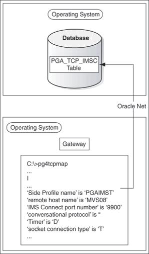

The following sections describe the commands and instructions necessary to operate the `pg4tcpmap` tool. This tool allows relevant parameters to map to a gateway using TCP/IP support for IMS Connect. The tool will be used to populate the `PGA_TCP_IMSC` table.

Topics:

- Preparation for Populating the PGA_TCP_IMSC Table

- Overview

- Populating the PGA_TCP_IMSC Table

- Before You Run the pg4tcpmap Tool

- pg4tcpmap Tool Commands

### Preparation for Populating the PGA_TCP_IMSC Table

If your gateway is using TCP/IP support for IMS Connect, then you must use the `pg4tcpmap` tool to prompt `PGAINIT` to provide the required TCP/IP parameters as input.

The `pg4tcpmap` tool must be run before executing any PL/SQL gateway statements in order to populate the `PGA_TCP_IMSC` table, which utilizes the corresponding TIPs.

Note that you do not need to rerun the `pg4tcpmap` tool for additional IMS transactions if they share the same IMS Connect attributes.

The `PGA_TCP_IMSC` table was created when you executed the `%ORACLE_HOME%\dg4appc\admin\pgaimsc.sql` script on Microsoft Windows or `$ORACLE_HOME/dg4appc/admin/pgaimsc.sql` script on UNIX based systems during your gateway configuration. If you need further information about creating the `PGA_TCP_IMSC` table, then depending on your platform, refer to Chapter 13 of the [Oracle Database Gateway for APPC Installation and Configuration Guide for IBM AIX on POWER Systems (64-Bit), Linux x86-64, Oracle Solaris on SPARC (64-Bit), and HP-UX Itanium ](../appci/config-appc-gateway-using-tcp-ip.md)or Chapter 10 of [Oracle Database Gateway for APPC Installation and Configuration Guide for Microsoft Windows](../appcw/configure-appc-gateway-using-tcp-ip.md) .

### Overview

In a `PGAINIT` procedure call, the user must specify a Side Profile Name and TP Name. The values of these parameters will be inserted into a table named `PGA_TCP_IMSC`.

#### Configure userid and password before running gateway mapping tool

Before executing the `pg4tcpmap` tool, you must configure a valid userid and password and `TNSNAMES` alias for the Oracle database where the `PGA_TCP_IMSC` table resides. You must specify the userid, password, and database in the `PGA_TCP_USER`, `PGA_TCP_PASS`, and `PGA_TCP_DB` parameters, respectively, located in the gateway initialization file `%ORACLE_HOME%\dg4appc\admin\init``sid``.ora` for Microsoft Windows and `$ORACLE_HOME/dg4appc/admin/initsid.ora` for UNIX based systems.

### Populating the PGA_TCP_IMSC Table

Table 6-1 describes the parameter information contained in the column names, types and contents column found in the `PGA_TCP_IMSC` table.

Table 6-1 PGA_TCP_IMSC Table Columns

| Column Name       | Type                     | Content                                                                                                                                                                                                                                                                                                                                                                                                                                                                                                                                                                                                                                                                                                                                                                                                                                                                                                                                                                                                                                                                                                                                                                                                                          |
|:------------------|:-------------------------|:---------------------------------------------------------------------------------------------------------------------------------------------------------------------------------------------------------------------------------------------------------------------------------------------------------------------------------------------------------------------------------------------------------------------------------------------------------------------------------------------------------------------------------------------------------------------------------------------------------------------------------------------------------------------------------------------------------------------------------------------------------------------------------------------------------------------------------------------------------------------------------------------------------------------------------------------------------------------------------------------------------------------------------------------------------------------------------------------------------------------------------------------------------------------------------------------------------------------------------|
| `SideProfileName` | `varchar2(8)`            | This parameter has no SNA implication. It is simply a name that is defined in the `.ctl` file for the PGAU utility. It represents a group of IMS transactions with similar IMS Connect attributes, such as time delay, socket type and IMS subsystem ID. Unique index.                                                                                                                                                                                                                                                                                                                                                                                                                                                                                                                                                                                                                                                                                                                                                                                                                                                                                                                                                        |
| `HostName`        | `varchar2(169) NOT NULL` | The OLTP TCP/IP address or the hostname.                                                                                                                                                                                                                                                                                                                                                                                                                                                                                                                                                                                                                                                                                                                                                                                                                                                                                                                                                                                                                                                                                                                                                                                         |
| `PortNumber`      | `varchar2(17) NOT NULL`  | The OLTP port number.                                                                                                                                                                                                                                                                                                                                                                                                                                                                                                                                                                                                                                                                                                                                                                                                                                                                                                                                                                                                                                                                                                                                                                                                            |
| `ANDRS`           | `char(1) NOT NULL`       | `ANDRS` specifies whether the client is sending: `A = ACK`: Positive Acknowledgement; `N = NAK`: Negative Acknowledgement; `D = DEALLOCATE`: Deallocate Connection; `R = RESUME`: Resume `TPIPE`; `S = SENDONLY`: Send only Acknowledgment or Deallocate. blank: no request for Acknowledgement or Deallocate. The default is "`blank`".                                                                                                                                                                                                                                                                                                                                                                                                                                                                                                                                                                                                                                                                                                                                                                                                                                                                    |
| `TIMER`           | `char(1) NOT NULL`       | Time delay for the receive to the datastore after an `ACK` or `RESUME TPIPE`: `D` = default value `X'00' .25` second; `S` = short wait `X'01'` through `X'19'`: `01` to `.25` second `N` = No Wait occurs `I` = Receive waits indefinitely. The default is "`D`".                                                                                                                                                                                                                                                                                                                                                                                                                                                                                                                                                                                                                                                                                                                                                                                                                                                                                                                                                 |
| `SOCK`            | `char(1) NOT NULL`       | Socket Connection Type `T` = Transaction Socket: `P` = Persistent Socket `N` = Non-persistent Socket The default is "`T`".                                                                                                                                                                                                                                                                                                                                                                                                                                                                                                                                                                                                                                                                                                                                                                                                                                                                                                                                                                                                                                                                                           |
| `CLIENTID`        | `char(8) NOT NULL`       | Specifies the name of the client ID that is used by IMS Connect. The default is '`null`'.                                                                                                                                                                                                                                                                                                                                                                                                                                                                                                                                                                                                                                                                                                                                                                                                                                                                                                                                                                                                                                                                                                                                        |
| `COMMITMODE`      | `char(1) NOT NULL`       | It specifies the commit mode: `0` = the commit mode is 0; `1` = the commit mode is 1 The default is "`1`".                                                                                                                                                                                                                                                                                                                                                                                                                                                                                                                                                                                                                                                                                                                                                                                                                                                                                                                                                                                                                                                                                                              |
| `IMSDESTID`       | `char(8) NOT NULL`       | Specifies the datastore names (IMS subsystem ID) 8 bytes. This parameter must be specified.                                                                                                                                                                                                                                                                                                                                                                                                                                                                                                                                                                                                                                                                                                                                                                                                                                                                                                                                                                                                                                                                                                                                   |
| `LTERM`           | `char(8) NOT NULL`       | Specifies the IMS `LTERM` override. The default is "`blank`".                                                                                                                                                                                                                                                                                                                                                                                                                                                                                                                                                                                                                                                                                                                                                                                                                                                                                                                                                                                                                                                                                                                                                                    |
| `RACFGRPNAM`      | `char(8) NOT NULL`       | Specifies the RACF group name. The default is "`blank`". You need to specify the RACF group name if you have set `PGA_SECURITY_TYPE` to `PROGRAM`. Refer to "PGA_SECURITY_TYPE" in Table B-1 "PGA Parameters on Gateway Using TCP/IP for IMS Connect" in the [Oracle Database Gateway for APPC Installation and Configuration Guide for IBM AIX on POWER Systems (64-Bit), Linux x86-64, Oracle Solaris on SPARC (64-Bit), and HP-UX Itanium](../appci/appc-gateway-initialization-parameters-tcp-ip.md) or [Oracle Database Gateway for APPC Installation and Configuration Guide for Microsoft Windows](../appcw/appc-gateway-initialization-parameters-tcp-ip.md).. Refer to "TCP/IP Security Option SECURITY=PROGRAM" in Chapter 14 of the [Oracle Database Gateway for APPC Installation and Configuration Guide for IBM AIX on POWER Systems (64-Bit), Linux x86-64, Oracle Solaris on SPARC (64-Bit), and HP-UX Itanium](../appci/appc-gateway-security-requirements.md) or Chapter 11 of the [Oracle Database Gateway for APPC Installation and Configuration Guide for Microsoft Windows](../appcw/appc-gateway-security-requirements.md) to learn more about how to set the RACF userid and RACF password. |
| `IRM_ID`          | `char(8) NOT NULL`       | Specifes the IMS Connect user exit IRM ID. If you do not specify this parameter it will default to `IRMREQ`, corresponding to the IBM `HWSIMSO0` sample user exit.                                                                                                                                                                                                                                                                                                                                                                                                                                                                                                                                                                                                                                                                                                                                                                                                                                                                                                                                                                                                                                                               |
| `LLLL`            | `char(1) NOT NULL`       | Specifies whether the IMS Connect user exit return data includes the `LLLL` (total length) prefix field or not. Supported values are: `Y` - the exit return data includes the `LLLL` prefix field `N` - the exit return data does not include the `LLLL` prefix field The default value is `N`.                                                                                                                                                                                                                                                                                                                                                                                                                                                                                                                                                                                                                                                                                                                                                                                                                                                                                                                         |

### Before You Run the pg4tcpmap Tool

Follow these steps to prepare for running the `pg4tcpmap` tool before you run the gateway.

1.  Set the `ORACLE_HOME` and `ORACLE_SID` for the Oracle database.
2.  Make certain that the user, `PGAADMIN`, has been created in the Oracle database and you can talk to the database. Issue:
    `%ORACLE_HOME%\dg4appc\admin\pgacr8au.sql` on Microsoft Windows

    or,

    `$ORACLE_HOME/dg4appc/admin/pgacr8au.sql` on UNIX based systems
3.  The `init``sid``.ora` file must contain appropriate parameters. Set the following parameters:
    - `PGA_TCP_USER`

    - `PGA_TCP_PASS`

    - `PGA_TCP_DB`

    - If you intend to enable the tracing, you will also need to set the following parameters:

      - `TRACE_LEVEL=255`

      - `LOG_DESTINATION=<valid directory>`

      Refer to [Troubleshooting](troubleshooting-oracle-database-gateway-appc.md) for information about tracing.
4.  Make certain that the `PGA_TCP_IMSC` table has been created. Issue:
    `%ORACLE_HOME%\dg4appc\admin\pgaimsc.sql` on Microsoft Windows

    or,

    `$ORACLE_HOME/dg4appc/admin/pgaimsc.sql` on UNIX based systems

Figure 6-1 illustrates the relationship between the gateway, the database and the pg4tcpmap tool in mapping the Side Profile Name to TCP/IP and IMS Connect attributes in the `PGA_TCP_IMSC` table.

Figure 6-1 Mapping SNA Parameters to TCP/IP Using the pg4tcpmap Tool

[Description of "Figure 6-1 Mapping SNA Parameters to TCP/IP Using the pg4tcpmap Tool"](img_text/map6_1.md)

A copy of the screen output file for the `pg4tcpmap` tool is located in Appendix B, "Gateway Initialization Parameters for TCP/IP Communication Protocol" in the [Oracle Database Gateway for APPC Installation and Configuration Guide for IBM AIX on POWER Systems (64-Bit), Linux x86-64, Oracle Solaris on SPARC (64-Bit), and HP-UX Itanium](../appci/appc-gateway-initialization-parameters-tcp-ip.md) or [Oracle Database Gateway for APPC Installation and Configuration Guide for Microsoft Windows](../appcw/appc-gateway-initialization-parameters-tcp-ip.md).

An example of a trace file from a sample `pg4tcpmap` execution can be found in [Troubleshooting](troubleshooting-oracle-database-gateway-appc.md).

### pg4tcpmap Tool Commands

There are two commands for the `pg4tcpmap` tool:

- one command inserts a row into the `PGA_TCP_IMSC` table;

- the other command deletes a row from the table, and the user must specify the predicate as "Side Profile Name".

#### Inserting a Row into the PGA_TCP_IMSC Table

For Microsoft Windows, issue the following command from the gateway Oracle home `%ORACLE_HOME%\bin` directory:

    C:\> pg4tcpmap

For UNIX based systems, issue the following command from the gateway Oracle home `$ORACLE_HOME/bin` directory:

    $ pg4tcpmap

The gateway release number, copyright information, along with the following text appears:

    This tool takes the IMS Connect TCP/IP information, such as host name and port number, and maps them to your TIPs.

    You may use this tool to insert or delete IMS Connect TCP/IP information.
    If you want to insert a row, Type "I"
    If you want to delete a row, type "D"

Enter `<i>`, and after that, you need only enter the required parameters.

#### Deleting Rows from the PGA_TCP_IMSC Table

For Microsoft Windows, issue the following command from the gateway Oracle home `%ORACLE_HOME%\bin` directory:

    C:\> pg4tcpmap

For UNIX based systems, issue the following command from the gateway Oracle home `$ORACLE_HOME/bin` directory:

    $ pg4tcpmap

The gateway release number, copyright information, along with the following text appears:

    This tool takes the IMS Connect TCP/IP information, such as host name and port number, and maps them to your TIPs.

    You may use this tool to insert or delete IMS Connect TCP/IP information.
    If you want to insert a row, Type "I"
    If you want to delete a row, type "D"

Enter `<d>`, and the pg4tcpmap tool will ask you what Side Profile Name you want to delete.

If the row does not exist, you will receive an ORA-1403 error message.

**Note:**

Do not use SQL\*Plus to update the `PGA_TCP_IMSC` table. If you have problems or incorrect data in the table, use `%ORACLE_HOME%\dg4appc\admin\pgaimsc.sql` on Microsoft Windows or `$ORACLE_HOME/dg4appc/admin/pgaimsc.sql` on UNIX based systems to re-create the table and its index.

#### Querying the PGA_TCP_IMSC Table

Use the regular SQL\*Plus select statement to query the table.

Example for Microsoft Windows:

    C:\> sqlplus userid/password@databasename
    SQL> column hostname format A22
    SQL> column portnumber format A6
    SQL> select sideprofilename, hostname,portnumber,imsdestid,commitmode from
         pga_tcp_imsc;

    SIDEPROF           HOSTNAME                PORTNU    IMSDESTI    C
    ---------------    ----------------------  ------    --------    -
    IMSPGA             MVS08.US.EXAMPLE.COM     9900      IMSE        1

Example for UNIX based systems:

    $ sqlplus userid/password@databasename
    SQL> column hostname format A22
    SQL> column portnumber format A6
    SQL> select sideprofilename, hostname,portnumber,imsdestid,commitmode from
         pga_tcp_imsc;

    SIDEPROF           HOSTNAME                PORTNU    IMSDESTI    C
    ---------------    ----------------------  ------    --------    -
    IMSPGA             MVS08.US.EXAMPLE.COM     9900      IMSE        1
