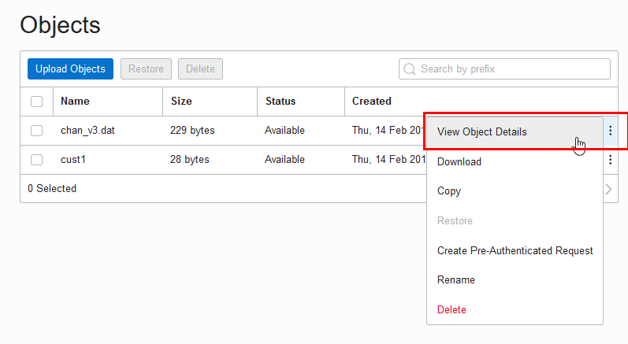

## 37 DBMS_CLOUD

The `DBMS_CLOUD` package provides comprehensive support for working with data in Object Storage.

This chapter contains the following topics:

- DBMS_CLOUD Overview

- Installing the DBMS_CLOUD Package

- DBMS_CLOUD Security Model

- DBMS_CLOUD Exceptions

- Summary of DBMS_CLOUD Subprograms

- DBMS_CLOUD Package File URI Formats

- DBMS_CLOUD Package Format Options

- DBMS_CLOUD Avro and Parquet Support

### 37.1 DBMS_CLOUD Overview

Using `DBMS_CLOUD` to work with data in Object Storage you can do the following:

- Manage your credentials for accessing Object Store.

- Copy data as-is: External data is loaded into the database in a single one-step operation, without the need to create any objects in the database. The load operation is monitored and tracked inside the database.

- Manage the information about your load operations.

- Validate the content of external data prior to consumption. Prior to consumption of external data you verify its content and identify rows that do not conform to the expected external data format.

- Create an external table. Create the necessary object in the database for flexible and continuous consumption.

- Work with objects in object stores and directories.

### 37.2 Installing the DBMS_CLOUD Package

The `DBMS_CLOUD` package provides a comprehensive support for working with data in Object Storage starting with Oracle Database 19c and later releases. However, this package is not pre-installed with Oracle Database. You need to manually install the `DBMS_CLOUD` package and also configure users or roles to use this package.

For information on installing the `DBMS_CLOUD` package and configuring users/roles, see the MOS-NOTE with Doc ID [2748362.1](https://support.oracle.com/rs?type=doc&id=2748362.1).

### 37.3 DBMS_CLOUD Security Model

Security on this package can be controlled by granting `EXECUTE` on this package to selected users or roles.

### 37.4 DBMS_CLOUD Exceptions

The following table describes exceptions for `DBMS_CLOUD`.

| Exception                     | Code  | Description                                                                                                             |
|:------------------------------|:------|:------------------------------------------------------------------------------------------------------------------------|
| `reject_limit`                | 20003 | The reject limit of an external table was reached.                                                                      |
| `credential_not_exist`        | 20004 | A credential object does not exist.                                                                                     |
| `table_not_exist`             | 20005 | A table does not exist.                                                                                                 |
| `unsupported_obj_store`       | 20006 | An unsupported object store URI was provided.                                                                           |
| `iden_too_long`               | 20008 | An identifier is too long.                                                                                              |
| `invalid_format`              | 20009 | A format argument is not valid.                                                                                         |
| `missing_credential`          | 20010 | Mandatory credential object information was not specified.                                                              |
| `invalid_object_uri`          | 20011 | An invalid object URI was provided.                                                                                     |
| `invalid_partitioning_clause` | 20012 | An partitioning clause is missing or was not provided.                                                                  |
| `unsupported_feature`         | 20013 | An unsupported feature was used that is not existent in the current database version.                                   |
| `part_not_exist`              | 20014 | A partition or subpartition does not exist, or a table is not a partitioned external table or hybrid partitioned table. |
| `invalid_table_name`          | 20016 | An invalid table name was used.                                                                                         |
| `invalid_schema_name`         | 20017 | An invalid schema name was used.                                                                                        |
| `invalid_dir_name`            | 20018 | An invalid directory name was used.                                                                                     |
| `invalid_file_name`           | 20019 | An invalid file name was used.                                                                                          |
| `invalid_cred_attribute`      | 20020 | Invalid credential attributes were specified.                                                                           |
| `table_exist`                 | 20021 | A table already exists.                                                                                                 |
| `credential_exist`            | 20022 | A credential object already exists.                                                                                     |
| `invalid_req_method`          | 20023 | A request method is either too long or invalid.                                                                         |
| `invalid_req_header`          | 20024 | An invalid request header was specified.                                                                                |
| `file_not_exist`              | 20025 | A file does not exist.                                                                                                  |
| `invalid_response`            | 20026 | An HTTP response was not valid.                                                                                         |
| `invalid_operation`           | 20027 | An invalid task class or ID was specified.                                                                              |
| `invalid_user_name`           | 20028 | An invalid username was specified.                                                                                      |

### 37.5 Summary of DBMS_CLOUD Subprograms

This section covers the `DBMS_CLOUD` subprograms provided with Oracle Database.

| Subprogram                                                | Description                                                                                                                                                                                                                                                                                         |
|:----------------------------------------------------------|:----------------------------------------------------------------------------------------------------------------------------------------------------------------------------------------------------------------------------------------------------------------------------------------------------|
| COPY_DATA Procedure                                       | This procedure loads data into existing Oracle Database tables from files in the Cloud.                                                                                                                                                                                                             |
| COPY_DATA Procedure for Avro or Parquet Files             | This procedure with the `format` parameter `type` set to the value `avro` or `parquet` loads data into existing Oracle Database tables from Avro or Parquet files in the Cloud. Similar to text files, the data is copied from the source Avro or Parquet file into the preexisting internal table. |
| CREATE_CREDENTIAL Procedure                               | This procedure stores cloud service credentials in Oracle Database.                                                                                                                                                                                                                                 |
| CREATE_EXTERNAL_TABLE Procedure                           | This procedure creates an external table on files in the Cloud. This allows you to run queries on external data from Oracle Database.                                                                                                                                                               |
| CREATE_EXTERNAL_TABLE Procedure for Avro or Parquet Files | This procedure with the `format` parameter `type` set to the value `avro` or `parquet` creates an external table with either Avro or Parquet format files in the Cloud. This allows you to run queries on external data from Oracle Database.                                                       |
| CREATE_EXTERNAL_PART_TABLE Procedure                      | This procedure creates an external partitioned table on files in the Cloud. This allows you to run queries on external data from Oracle Database.                                                                                                                                                   |
| CREATE_HYBRID_PART_TABLE Procedure                        | This procedure creates a hybrid partitioned table. This allows you to run queries on hybrid partitioned data from Oracle Database.                                                                                                                                                                  |
| DELETE_ALL_OPERATIONS Procedure                           | This procedure clears either all data load operations logged in the `user_load_operations` table in your schema or clears all the data load operations of the specified type, as indicated with the `type` parameter.                                                                               |
| DELETE_FILE Procedure                                     | This procedure removes the specified file from the specified directory on Oracle Database                                                                                                                                                                                                           |
| DELETE_OBJECT Procedure                                   | This procedure deletes the specified object on object store.                                                                                                                                                                                                                                        |
| DROP_CREDENTIAL Procedure                                 | This procedure removes an existing credential from Oracle Database.                                                                                                                                                                                                                                 |
| GET_OBJECT Procedure and Function                         | This procedure is overloaded. The procedure form reads an object from Cloud Object Storage and copies it to Oracle Database. The function form reads an object from Cloud Object Storage and returns a `BLOB` to Oracle Database.                                                                   |
| LIST_FILES Function                                       | This function lists the files in the specified directory. The results include the file names and additional metadata about the files such as file size in bytes, creation timestamp, and the last modification timestamp.                                                                           |
| LIST_OBJECTS Function                                     | This function lists objects in the specified location on object store. The results include the object names and additional metadata about the objects such as size, checksum, creation timestamp, and the last modification timestamp.                                                              |
| PUT_OBJECT Procedure                                      | This procedure is overloaded. In one form the procedure copies a file from Oracle Database to the Cloud Object Storage. In another form the procedure copies a `BLOB` from Oracle Database to the Cloud Object Storage.                                                                             |
| UPDATE_CREDENTIAL Procedure                               | This procedure updates cloud service credential attributes in Oracle Database.                                                                                                                                                                                                                      |
| VALIDATE_EXTERNAL_TABLE Procedure                         | This procedure validates the source files for an external table, generates log information, and stores the rows that do not match the format options specified for the external table in a badfile table on Oracle Database.                                                                        |
| VALIDATE_EXTERNAL_PART_TABLE Procedure                    | This procedure validates the source files for an external partitioned table, generates log information, and stores the rows that do not match the format options specified for the external table in a badfile table on Oracle Database.                                                            |
| VALIDATE_HYBRID_PART_TABLE Procedure                      | This procedure validates the source files for a hybrid partitioned table, generates log information, and stores the rows that do not match the format options specified for the hybrid table in a badfile table on Oracle Database.                                                                 |

#### 37.5.1 COPY_DATA Procedure

This procedure loads data into existing Oracle Database tables from files in the Cloud. The overloaded form enables you to use the `operation_id` parameter.

##### Syntax

    DBMS_CLOUD.COPY_DATA (
        table_name        IN VARCHAR2,
        credential_name   IN VARCHAR2,
        file_uri_list     IN CLOB,
        schema_name       IN VARCHAR2,
        field_list        IN CLOB,
        format            IN CLOB);

    DBMS_CLOUD.COPY_DATA (
        table_name        IN VARCHAR2,
        credential_name   IN VARCHAR2 DEFAULT NULL,
        file_uri_list     IN CLOB DEFAULT NULL,
        schema_name       IN VARCHAR2 DEFAULT NULL,
        field_list        IN CLOB DEFAULT NULL,
        format            IN CLOB DEFAULT NULL
        operation_id      OUT NOCOPY NUMBER);

##### Parameters

| Parameter         | Description                                                                                                                                                                                                                                                                                                                                                                                                                                                                     |
|:------------------|:--------------------------------------------------------------------------------------------------------------------------------------------------------------------------------------------------------------------------------------------------------------------------------------------------------------------------------------------------------------------------------------------------------------------------------------------------------------------------------|
| `table_name`      | The name of the target table on the database. The target table needs to be created before you run `COPY_DATA`.                                                                                                                                                                                                                                                                                                                                                                  |
| `credential_name` | The name of the credential to access the Cloud Object Storage.                                                                                                                                                                                                                                                                                                                                                                                                                  |
| `file_uri_list`   | Comma-delimited list of source file URIs. You can use wildcards in the file names in your URIs. The character "\*" can be used as the wildcard for multiple characters, the character "?" can be used as the wildcard for a single character. The format of the URIs depend on the Cloud Object Storage service you are using, for details see DBMS_CLOUD Package File URI Formats.                                                                                          |
| `schema_name`     | The name of the schema where the target table resides. The default value is NULL meaning the target table is in the same schema as the user running the procedure.                                                                                                                                                                                                                                                                                                              |
| `field_list`      | Identifies the fields in the source files and their data types. The default value is NULL meaning the fields and their data types are determined by the target table definition. This argument's syntax is the same as the `field_list` clause in regular Oracle external tables. For more information about `field_list` see [Oracle® Database Utilities](../sutil/oracle_loader-access-driver.md). For an example using `field_list`, see CREATE_EXTERNAL_TABLE Procedure. |
| `format`          | The options describing the format of the source files. For the list of the options and how to specify the values see DBMS_CLOUD Package Format Options. For Avro or Parquet file format options, see DBMS_CLOUD Package Format Options for Avro or Parquet.                                                                                                                                                                                                                  |
| `operation_id`    | Use this parameter to track the progress and final status of the load operation as the corresponding ID in the `USER_LOAD_OPERATIONS` view.                                                                                                                                                                                                                                                                                                                                     |

#### 37.5.2 COPY_DATA Procedure for Avro or Parquet Files

This procedure with the `format` parameter `type` set to the value `avro` or `parquet` loads data into existing Oracle Database tables from Avro or Parquet files in the Cloud. Similar to text files, the data is copied from the source Avro or Parquet file into the preexisting internal table.

##### Syntax

    DBMS_CLOUD.COPY_DATA (
        table_name        IN VARCHAR2,
        credential_name   IN VARCHAR2,
        file_uri_list     IN CLOB,
        schema_name       IN VARCHAR2 DEFAULT,
        field_list        IN CLOB DEFAULT,
        format            IN CLOB DEFAULT);

##### Parameters

| Parameter         | Description                                                                                                                                                                                                                                                                                                                                                                                  |
|:------------------|:---------------------------------------------------------------------------------------------------------------------------------------------------------------------------------------------------------------------------------------------------------------------------------------------------------------------------------------------------------------------------------------------|
| `table_name`      | The name of the target table on the database. The target table needs to be created before you run `COPY_DATA`.                                                                                                                                                                                                                                                                               |
| `credential_name` | The name of the credential to access the Cloud Object Storage.                                                                                                                                                                                                                                                                                                                               |
| `file_uri_list`   | Comma-delimited list of source file URIs. You can use wildcards in the file names in your URIs. The character "\*" can be used as the wildcard for multiple characters, the character "?" can be used as the wildcard for a single character. The format of the URIs depend on the Cloud Object Storage service you are using, for details see DBMS_CLOUD Package File URI Formats.       |
| `schema_name`     | The name of the schema where the target table resides. The default value is NULL meaning the target table is in the same schema as the user running the procedure.                                                                                                                                                                                                                           |
| `field_list`      | Ignored for Avro or Parquet files. The fields in the source match the external table columns by name. Source data types are converted to the external table column data type. For Parquet files, see DBMS_CLOUD Package Parquet to Oracle Data Type Mapping for details on mapping. For Avro files, see DBMS_CLOUD Package Avro to Oracle Data Type Mapping for details on mapping. |
| `format`          | The options describing the format of the source files. For Avro or Parquet files, only two options are supported: see DBMS_CLOUD Package Format Options for Avro or Parquet.                                                                                                                                                                                                                 |

##### Usage Notes

- As with other data files, Avro and Parquet data loads generate logs that are viewable in the tables `dba_load_operations` and `user_load_operations`. Each load operation adds a record to `dba`\[user\]`_load_operations` that indicates the table containing the logs.

  The log table provides summary information about the load.

- For Avro or Parquet, when the `format` parameter `type` is set to the value `avro` or `parquet`, the `BADFILE_TABLE` table is always empty.

  - For Parquet files, `PRIMARY KEY` constraint errors throw an `ORA` error.

  - If data for a column encounters a conversion error, for example, the target column is not large enough to hold the converted value, the value for the column is set to `NULL`. This does not produce a rejected record.

#### 37.5.3 CREATE_CREDENTIAL Procedure

This procedure stores cloud service credentials in Oracle Database.

Use stored cloud service credentials to access the cloud service for data loading, for querying external data residing in the cloud, or for other cases when you use `DBMS_CLOUD` procedures with a `credential_name` parameter. This procedure is overloaded. Use the Oracle Cloud Infrastructure-related parameters, including: `user_ocid`, `tenancy_ocid`, `private_key`, and `fingerprint` only when you are using Oracle Cloud Infrastructure Signing Keys authentication.

##### Syntax

    DBMS_CLOUD.CREATE_CREDENTIAL (
        credential_name   IN VARCHAR2,
        username          IN VARCHAR2,
        password          IN VARCHAR2 DEFAULT NULL);

    DBMS_CLOUD.CREATE_CREDENTIAL (
        credential_name IN VARCHAR2,
        user_ocid       IN VARCHAR2,
        tenancy_ocid    IN VARCHAR2,
        private_key     IN VARCHAR2,
        fingerprint     IN VARCHAR2);

##### Parameters

| Parameter         | Description                                                                                                                                                                                                                                                                                                                                                                                                                                            |
|:------------------|:-------------------------------------------------------------------------------------------------------------------------------------------------------------------------------------------------------------------------------------------------------------------------------------------------------------------------------------------------------------------------------------------------------------------------------------------------------|
| `credential_name` | The name of the credential to be stored.                                                                                                                                                                                                                                                                                                                                                                                                               |
| `username`        | The `username` and `password` arguments together specify your cloud service credentials. See below for what to specify for the `username` and `password` for different cloud services.                                                                                                                                                                                                                                                                 |
| `password`        | The `username` and `password` arguments together specify your cloud service credentials.                                                                                                                                                                                                                                                                                                                                                               |
| `user_ocid`       | Specifies the user's OCID. See [Where to Get the Tenancy's OCID and User's OCID](https://docs.cloud.oracle.com/iaas/Content/API/Concepts/apisigningkey.htm#Other) for details on obtaining the User's OCID.                                                                                                                                                                                                                                            |
| `tenancy_ocid`    | Specifies the tenancy's OCID. See [Where to Get the Tenancy's OCID and User's OCID](https://docs.cloud.oracle.com/iaas/Content/API/Concepts/apisigningkey.htm#Other) for details on obtaining the Tenancy's OCID.                                                                                                                                                                                                                                      |
| `private_key`     | Specifies the generated private key. Private keys generated with a passphrase are not supported. You need to generate the private key without a passphrase. See [How to Generate an API Signing Key](https://docs.cloud.oracle.com/iaas/Content/API/Concepts/apisigningkey.htm#How) for details on generating a key pair in PEM format.                                                                                                                |
| `fingerprint`     | Specifies a fingerprint. After a generated public key is uploaded to the user's account the fingerprint is displayed in the console. Use the displayed fingerprint for this argument. See [How to Get the Key's Fingerprint](https://docs.cloud.oracle.com/iaas/Content/API/Concepts/apisigningkey.htm#How3) and [How to Generate an API Signing Key](https://docs.cloud.oracle.com/iaas/Content/API/Concepts/apisigningkey.htm#How) for more details. |

##### Usage Notes

- This operation stores the credentials in the database in an encrypted format.

- You can see the credentials in your schema by querying the `user_credentials` table.

- The `ADMIN` user can see all the credentials by querying the `dba_credentials` table.

- You only need to create credentials once unless your cloud service credentials change. Once you store the credentials you can then use the same credential name for `DBMS_CLOUD` procedures that require a `credential_name` parameter.

- This procedure is overloaded. If you provide one of the key based authentication attributes, `user_ocid`, `tenancy_ocid`, `private_key`, or `fingerprint`, the call is assumed to be an Oracle Cloud Infrastructure Signing Key based credential.

- On Oracle Cloud Infrastructure, private keys generated with a passphrase are not supported. You need to generate the private key without a passphrase. See [How to Generate an API Signing Key](https://docs.cloud.oracle.com/iaas/Content/API/Concepts/apisigningkey.htm#How) for more information.

##### Oracle Cloud Infrastructure Credentials (Auth Tokens)

For Oracle Cloud Infrastructure the `username` is your Oracle Cloud Infrastructure user name. The `password` is your Oracle Cloud Infrastructure auth token. See [Working with Auth Tokens](https://docs.cloud.oracle.com/iaas/Content/Identity/Tasks/managingcredentials.htm#two).

##### Oracle Cloud Infrastructure Object Storage Classic Credentials

If your source files reside in Oracle Cloud Infrastructure Object Storage Classic, the `username` is your Oracle Cloud Infrastructure Classic user name and the `password` is your Oracle Cloud Infrastructure Classic password.

##### Amazon Web Services (AWS) Credentials

If your source files reside in Amazon S3 or you are calling an AWS API, the `username` is your AWS access key ID and the `password` is your AWS secret access key. See [AWS Identity and Access Management](http://docs.aws.amazon.com/IAM/latest/UserGuide/id_credentials_access-keys.html#Using_CreateAccessKey).

##### Microsoft Azure Credentials

If your source files reside in Azure Blob Storage or you are calling an Azure API, the `username` is your Azure storage account name and the `password` is an Azure storage account access key. See [About Azure storage accounts](https://docs.microsoft.com/en-us/azure/storage/common/storage-create-storage-account?toc=%2fazure%2fstorage%2fblobs%2ftoc.json).

#### 37.5.4 CREATE_EXTERNAL_TABLE Procedure

This procedure creates an external table on files in the Cloud. This allows you to run queries on external data from Oracle Database.

##### Syntax

    DBMS_CLOUD.CREATE_EXTERNAL_TABLE (
        table_name       IN VARCHAR2,
        credential_name  IN VARCHAR2,
        file_uri_list    IN CLOB,
        column_list      IN CLOB,
        field_list       IN CLOB DEFAULT,
        format           IN CLOB DEFAULT);

##### Parameters

| Parameter         | Description                                                                                                                                                                                                                                                                                                                                                                                        |
|:------------------|:---------------------------------------------------------------------------------------------------------------------------------------------------------------------------------------------------------------------------------------------------------------------------------------------------------------------------------------------------------------------------------------------------|
| `table_name`      | The name of the external table.                                                                                                                                                                                                                                                                                                                                                                    |
| `credential_name` | The name of the credential to access the Cloud Object Storage.                                                                                                                                                                                                                                                                                                                                     |
| `file_uri_list`   | Comma-delimited list of source file URIs. You can use wildcards in the file names in your URIs. The character "\*" can be used as the wildcard for multiple characters, the character "?" can be used as the wildcard for a single character. The format of the URIs depend on the Cloud Object Storage service you are using, for details see DBMS_CLOUD Package File URI Formats.             |
| `column_list`     | Comma-delimited list of column names and data types for the external table.                                                                                                                                                                                                                                                                                                                        |
| `field_list`      | Identifies the fields in the source files and their data types. The default value is NULL meaning the fields and their data types are determined by the column_list parameter. This argument's syntax is the same as the `field_list` clause in regular Oracle external tables. For more information about `field_list` see [Oracle® Database Utilities](../sutil/oracle_loader-access-driver.md). |
| `format`          | The options describing the format of the source files. For the list of the options and how to specify the values see DBMS_CLOUD Package Format Options. For Avro or Parquet format files, see CREATE_EXTERNAL_TABLE Procedure for Avro or Parquet Files.                                                                                                                                        |

##### Usage Notes

- The procedure `DBMS_CLOUD.CREATE_EXTERNAL_TABLE` supports external partitioned files in the supported cloud object storage services, including:

  - Oracle Cloud Infrastructure Object Storage

  - Azure Blob Storage

  - Amazon S3

  The credential is a table level property; therefore, the external files must be on the same object store.

  See DBMS_CLOUD Package File URI Formats for more information.

##### Example

    BEGIN
       DBMS_CLOUD.CREATE_EXTERNAL_TABLE(
          table_name =>'WEATHER_REPORT_DOUBLE_DATE',
          credential_name =>'OBJ_STORE_CRED',
          file_uri_list =>'&base_URL/Charlotte_NC_Weather_History_Double_Dates.csv',
          format => json_object('type' value 'csv', 'skipheaders' value '1'),
          field_list => 'REPORT_DATE DATE''mm/dd/yy'',
                         REPORT_DATE_COPY DATE ''yyyy-mm-dd'',
                         ACTUAL_MEAN_TEMP,
                         ACTUAL_MIN_TEMP,
                         ACTUAL_MAX_TEMP,
                         AVERAGE_MIN_TEMP,
                         AVERAGE_MAX_TEMP,
                         AVERAGE_PRECIPITATION',
          column_list => 'REPORT_DATE DATE,
                         REPORT_DATE_COPY DATE,
                         ACTUAL_MEAN_TEMP NUMBER,
                         ACTUAL_MIN_TEMP NUMBER,
                         ACTUAL_MAX_TEMP NUMBER,
                         AVERAGE_MIN_TEMP NUMBER,
                         AVERAGE_MAX_TEMP NUMBER,
                         AVERAGE_PRECIPITATION NUMBER');
       END;
    /

    SELECT * FROM WEATHER_REPORT_DOUBLE_DATE where
       actual_mean_temp > 69 and actual_mean_temp < 74

#### 37.5.5 CREATE_EXTERNAL_TABLE Procedure for Avro or Parquet Files

This procedure with the `format` parameter `type` set to the value `avro` or `parquet` creates an external table with either Avro or Parquet format files in the Cloud. This allows you to run queries on external data from Oracle Database.

##### Syntax

    DBMS_CLOUD.CREATE_EXTERNAL_TABLE (
        table_name       IN VARCHAR2,
        credential_name  IN VARCHAR2,
        file_uri_list    IN CLOB,
        column_list      IN CLOB,
        field_list       IN CLOB DEFAULT,
        format           IN CLOB DEFAULT);

##### Parameters

| Parameter         | Description                                                                                                                                                                                                                                                                                                                                                                                                                                                                                                                                                                                                  |
|:------------------|:-------------------------------------------------------------------------------------------------------------------------------------------------------------------------------------------------------------------------------------------------------------------------------------------------------------------------------------------------------------------------------------------------------------------------------------------------------------------------------------------------------------------------------------------------------------------------------------------------------------|
| `table_name`      | The name of the external table.                                                                                                                                                                                                                                                                                                                                                                                                                                                                                                                                                                              |
| `credential_name` | The name of the credential to access the Cloud Object Storage.                                                                                                                                                                                                                                                                                                                                                                                                                                                                                                                                               |
| `file_uri_list`   | Comma-delimited list of source file URIs. You can use wildcards in the file names in your URIs. The character "\*" can be used as the wildcard for multiple characters, the character "?" can be used as the wildcard for a single character. The format of the URIs depend on the Cloud Object Storage service you are using, for details see DBMS_CLOUD Package File URI Formats.                                                                                                                                                                                                                       |
| `column_list`     | (Optional) This field, when specified, overrides the `format->schema` parameter which specifies that the schema, columns, and data types, are derived automatically. See the format parameter for details. When the `column_list` is specified for Avro or Parquet source, the column names must match those columns found in the file. Oracle data types must map appropriately to the Avro or Parquet data types. For Parquet files, see DBMS_CLOUD Package Parquet to Oracle Data Type Mapping for details. For Avro files, see DBMS_CLOUD Package Avro to Oracle Data Type Mapping for details. |
| `field_list`      | Ignored for Avro or Parquet files. The fields in the source match the external table columns by name. Source data types are converted to the external table column data type. For Parquet files, see DBMS_CLOUD Package Parquet to Oracle Data Type Mapping for details. For Avro files, see DBMS_CLOUD Package Avro to Oracle Data Type Mapping for details.                                                                                                                                                                                                                                       |
| `format`          | For Avro or Parquet, there are only two supported parameters. See DBMS_CLOUD Package Format Options for Avro or Parquet for details.                                                                                                                                                                                                                                                                                                                                                                                                                                                                         |

##### Examples Avro

    format => '{"type":"avro", "schema": "all"}'

    format => json_object('type' value 'avro', 'schema' value 'first')

##### Examples Parquet

    format => '{"type":"parquet", "schema": "all"}'

    format => json_object('type' value 'parquet', 'schema' value 'first')

##### Avro or Parquet Column Name Mapping to Oracle Column Names

See DBMS_CLOUD Package Avro and Parquet to Oracle Column Name Mapping for information on column name mapping and column name conversion usage in Oracle SQL.

#### 37.5.6 CREATE_EXTERNAL_PART_TABLE Procedure

This procedure creates an external partitioned table on files in the Cloud. This allows you to run queries on external data from Oracle Database.

##### Syntax

    DBMS_CLOUD.CREATE_EXTERNAL_PART_TABLE (
        table_name           IN VARCHAR2,
        credential_name      IN VARCHAR2,
        partitioning_clause  IN CLOB,
        column_list          IN CLOB,
        field_list           IN CLOB DEFAULT,
        format               IN CLOB DEFAULT);

##### Parameters

| Parameter             | Description                                                                                                                                                                                                                                                                                                                                                                                        |
|:----------------------|:---------------------------------------------------------------------------------------------------------------------------------------------------------------------------------------------------------------------------------------------------------------------------------------------------------------------------------------------------------------------------------------------------|
| `table_name`          | The name of the external table.                                                                                                                                                                                                                                                                                                                                                                    |
| `credential_name`     | The name of the credential to access the Cloud Object Storage.                                                                                                                                                                                                                                                                                                                                     |
| `partitioning_clause` | Specifies the complete partitioning clause, including the location information for individual partitions.                                                                                                                                                                                                                                                                                          |
| `column_list`         | Comma-delimited list of column names and data types for the external table.                                                                                                                                                                                                                                                                                                                        |
| `field_list`          | Identifies the fields in the source files and their data types. The default value is NULL meaning the fields and their data types are determined by the column_list parameter. This argument's syntax is the same as the `field_list` clause in regular Oracle external tables. For more information about `field_list` see [Oracle® Database Utilities](../sutil/oracle_loader-access-driver.md). |
| `format`              | The options describing the format of the source files. For the list of the options and how to specify the values see DBMS_CLOUD Package Format Options.                                                                                                                                                                                                                                            |

##### Usage Notes

- With Avro or Parquet data format using `DBMS_CLOUD.CREATE_EXTERNAL_PART_TABLE`, the `schema` format option is not available and the `column_list` parameter must be specified. The `schema` format option is available with `DBMS_CLOUD.CREATE_EXTERNAL_TABLE`.

- The procedure `DBMS_CLOUD.CREATE_EXTERNAL_PART_TABLE` supports external partitioned files in the supported cloud object storage services, including:
  - Oracle Cloud Infrastructure Object Storage

  - Azure Blob Storage

  - Amazon S3

  See DBMS_CLOUD Package File URI Formats for more information.

##### Example

    BEGIN
       DBMS_CLOUD.CREATE_EXTERNAL_PART_TABLE(
          table_name =>'PET1',
          credential_name =>'OBJ_STORE_CRED',
          format => json_object('delimiter' value ',', 'recorddelimiter' value 'newline', 'characterset' value 'us7ascii'),
          column_list => 'col1 number, col2 number, col3 number',
          partitioning_clause => 'partition by range (col1)
                                    (partition p1 values less than (1000) location
                                        ( ''&base_URL//file_11.txt'')
                                     ,
                                     partition p2 values less than (2000) location
                                        ( ''&base_URL/file_21.txt'')
                                     ,
                                     partition p3 values less than (3000) location
                                        ( ''&base_URL/file_31.txt'')
                                     )'
         );
       END;
    /

#### 37.5.7 CREATE_HYBRID_PART_TABLE Procedure

This procedure creates a hybrid partitioned table. This allows you to run queries on hybrid partitioned data from Oracle Database.

##### Syntax

    DBMS_CLOUD.CREATE_HYBRID_PART_TABLE (
        table_name           IN VARCHAR2,
        credential_name      IN VARCHAR2,
        partitioning_clause  IN CLOB,
        column_list          IN CLOB,
        field_list           IN CLOB DEFAULT,
        format               IN CLOB DEFAULT);

##### Parameters

| Parameter             | Description                                                                                                                                                                                                                                                                                                                                                                                        |
|:----------------------|:---------------------------------------------------------------------------------------------------------------------------------------------------------------------------------------------------------------------------------------------------------------------------------------------------------------------------------------------------------------------------------------------------|
| `table_name`          | The name of the external table.                                                                                                                                                                                                                                                                                                                                                                    |
| `credential_name`     | The name of the credential to access the Cloud Object Storage.                                                                                                                                                                                                                                                                                                                                     |
| `partitioning_clause` | Specifies the complete partitioning clause, including the location information for individual partitions.                                                                                                                                                                                                                                                                                          |
| `column_list`         | Comma-delimited list of column names and data types for the external table.                                                                                                                                                                                                                                                                                                                        |
| `field_list`          | Identifies the fields in the source files and their data types. The default value is NULL meaning the fields and their data types are determined by the column_list parameter. This argument's syntax is the same as the `field_list` clause in regular Oracle external tables. For more information about `field_list` see [Oracle® Database Utilities](../sutil/oracle_loader-access-driver.md). |
| `format`              | The options describing the format of the source files. For the list of the options and how to specify the values see DBMS_CLOUD Package Format Options.                                                                                                                                                                                                                                            |

##### Usage Note

- The procedure `DBMS_CLOUD.CREATE_HYBRID_PART_TABLE` supports external partitioned files in the supported cloud object storage services, including:

  - Oracle Cloud Infrastructure Object Storage

  - Azure Blob Storage

  - Amazon S3

  The credential is a table level property; therefore, the external files must be on the same object store.

  See DBMS_CLOUD Package File URI Formats for more information.

##### Example

    BEGIN
       DBMS_CLOUD.CREATE_HYBRID_PART_TABLE(
          table_name =>'HPT1',
          credential_name =>'OBJ_STORE_CRED',
          format => json_object('delimiter' value ',', 'recorddelimiter' value 'newline', 'characterset' value 'us7ascii'),
          column_list => 'col1 number, col2 number, col3 number',
          partitioning_clause => 'partition by range (col1)
                                    (partition p1 values less than (1000) external location
                                        ( ''&base_URL/file_11.txt'')
                                     ,
                                     partition p2 values less than (2000) external location
                                        ( ''&base_URL/file_21.txt'')
                                     ,
                                     partition p3 values less than (3000)
                                     )'
         );
       END;
    /

#### 37.5.8 DELETE_ALL_OPERATIONS Procedure

This procedure clears either all data load operations logged in the `user_load_operations` table in your schema or clears all the data load operations of the specified type, as indicated with the `type` parameter.

##### Syntax

    DBMS_CLOUD.DELETE_ALL_OPERATIONS (
        type      IN VARCHAR DEFAULT NULL);

##### Parameters

| Parameter | Description                                                                                                                                                                      |
|:----------|:---------------------------------------------------------------------------------------------------------------------------------------------------------------------------------|
| `type`    | Specifies the type of operation to delete. Type values can be found in the `TYPE` column in the `user_load_operations` table. If no `type` is specified all rows are deleted. |

##### Usage Note

- `DBMS_CLOUD.DELETE_ALL_OPERATIONS` does not delete currently running operations (operations in a "Running" status).

#### 37.5.9 DELETE_FILE Procedure

This procedure removes the specified file from the specified directory on Oracle Database.

##### Syntax

     DBMS_CLOUD.DELETE_FILE (
           directory_name     IN VARCHAR2,
           file_name          IN VARCHAR2);

##### Parameters

| Parameter        | Description                                                |
|:-----------------|:-----------------------------------------------------------|
| `directory_name` | The name of the directory on the Oracle Database instance. |
| `file_name`      | The name of the file to be removed.                        |

**Note:**

To run `DBMS_CLOUD.DELETE_FILE` you need to grant write privileges on the directory that contains the file to the user. For example, run the following command as ADMIN to grant write privileges to `db_user`:

    GRANT WRITE ON DIRECTORY data_pump_dir TO db_user;

##### Example

    BEGIN
       DBMS_CLOUD.DELETE_FILE(
          directory_name =>  'DATA_PUMP_DIR',
          file_name => 'exp1.dmp' );
       END;
    /

#### 37.5.10 DELETE_OBJECT Procedure

This procedure deletes the specified object on object store.

##### Syntax

    DBMS_CLOUD.DELETE_OBJECT (
           credential_name      IN VARCHAR2,
           object_uri           IN VARCHAR2);

##### Parameters

| Parameter         | Description                                                                                                                                                                        |
|:------------------|:-----------------------------------------------------------------------------------------------------------------------------------------------------------------------------------|
| `credential_name` | The name of the credential to access the Cloud Object Storage.                                                                                                                     |
| `object_uri`      | Object or file URI for the object to delete. The format of the URI depends on the Cloud Object Storage service you are using, for details see DBMS_CLOUD Package File URI Formats. |

##### Example

    BEGIN
       DBMS_CLOUD.DELETE_OBJECT(
           credential_name => 'DEF_CRED_NAME',
           object_uri => 'https://objectstorage.us-ashburn-1.oraclecloud.com/n/namespace-string/b/bucketname/o/exp1.dmp');
       END;
    /

#### 37.5.11 DROP_CREDENTIAL Procedure

This procedure removes an existing credential from Oracle Database.

##### Syntax

    DBMS_CLOUD.DROP_CREDENTIAL (
       credential_name     IN VARCHAR2);

##### Parameters

| Parameter         | Description                               |
|:------------------|:------------------------------------------|
| `credential_name` | The name of the credential to be removed. |

#### 37.5.12 GET_OBJECT Procedure and Function

This procedure is overloaded. The procedure form reads an object from Cloud Object Storage and copies it to Oracle Database. The function form reads an object from Cloud Object Storage and returns a `BLOB` to Oracle Database.

##### Syntax

    DBMS_CLOUD.GET_OBJECT (
           credential_name      IN VARCHAR2,
           object_uri           IN VARCHAR2,
           directory_name       IN VARCHAR2,
           file_name            IN VARCHAR2 DEFAULT  NULL,
           startoffset          IN NUMBER DEFAULT  0,
           endoffset            IN NUMBER DEFAULT  0,
           compression          IN VARCHAR2 DEFAULT  NULL);

    DBMS_CLOUD.GET_OBJECT(
           credential_name      IN VARCHAR2 DEFAULT NULL,
           object_uri           IN VARCHAR2,
           startoffset          IN NUMBER DEFAULT  0,
           endoffset            IN NUMBER DEFAULT  0,
           compression          IN VARCHAR2 DEFAULT  NULL)
    RETURN BLOB;

##### Parameters

| Parameter         | Description                                                                                                                                                                                                                                                 |
|:------------------|:------------------------------------------------------------------------------------------------------------------------------------------------------------------------------------------------------------------------------------------------------------|
| `credential_name` | The name of the credential to access the Cloud Object Storage.                                                                                                                                                                                              |
| `object_uri`      | Object or file URI. The format of the URI depends on the Cloud Object Storage service you are using, for details see DBMS_CLOUD Package File URI Formats.                                                                                                   |
| `directory_name`  | The name of the directory on the database. Foot 1                                                                                                                                                                                             |
| `file_name`       | Specifies the name of the file to create. If file name is not specified, the file name is taken from after the last slash in the `object_uri` parameter. For special cases, for example when the file name contains slashes, use the `file_name` parameter. |
| `startoffset`     | The offset, in bytes, from where the procedure starts reading.                                                                                                                                                                                              |
| `endoffset`       | The offset, in bytes, until where the procedure stops reading.                                                                                                                                                                                              |
| `compression`     | Specifies the compression used to store the object. When `compression` is set to `‘AUTO’` the file is uncompressed (the value `‘AUTO’` implies the object specified with `object_uri` is compressed with Gzip).                                             |

Footnote 1

**Note:**

To run `DBMS_CLOUD.GET_OBJECT`, you need to grant `WRITE` privileges on the directory to the user. For example, run the following command as ADMIN to grant write privileges to `db_user`:

    GRANT WRITE ON DIRECTORY data_pump_dir TO db_user;

##### Return Values

The function form reads from Object Store and `DBMS_CLOUD.GET_OBJECT` returns a `BLOB`.

##### Examples

    BEGIN
       DBMS_CLOUD.GET_OBJECT(
         credential_name => 'OBJ_STORE_CRED',
         object_uri => 'https://objectstorage.us-phoenix-1.oraclecloud.com/n/namespace-string/b/bucketname/o/file.txt',
         directory_name => 'DATA_PUMP_DIR');
    END;
    /

To read character data from a file in Object Store:

    SELECT to_clob(
         DBMS_CLOUD.GET_OBJECT(
           credential_name => 'OBJ_STORE_CRED',
           object_uri => 'https://objectstorage.us-phoenix-1.oraclecloud.com/n/namespace-string/b/bucketname/o/file.txt'))
    FROM DUAL;

To add an image stored on Object Store in a `BLOB` in the database:

    DECLARE
       l_blob BLOB := NULL;
    BEGIN
       l_blob := DBMS_CLOUD.GET_OBJECT(
         credential_name => 'OBJ_STORE_CRED',
         object_uri => 'https://objectstorage.us-phoenix-1.oraclecloud.com/n/namespace-string/b/bucketname/o/MyImage.gif' );
    END;
    /

In this example, `namespace-string` is the Oracle Cloud Infrastructure object storage namespace and `bucketname` is the bucket name. See [Understanding Object Storage Namespaces](https://docs.cloud.oracle.com/iaas/Content/Object/Tasks/understandingnamespaces.htm) for more information.

#### 37.5.13 LIST_FILES Function

This function lists the files in the specified directory. The results include the file names and additional metadata about the files such as file size in bytes, creation timestamp, and the last modification timestamp.

##### Syntax

    DBMS_CLOUD.LIST_FILES (
        directory_name      IN VARCHAR2)
           RETURN TABLE;

##### Parameters

| Parameter        | Description                                |
|:-----------------|:-------------------------------------------|
| `directory_name` | The name of the directory on the database. |

##### Usage Notes

- `DBMS_CLOUD.LIST_FILES` is only supported for directory objects mapping to Oracle File System (OFS) or Database File System (DBFS) file systems.

- To run `DBMS_CLOUD.LIST_FILES`, you need to grant read privileges on the directory to the user. For example, run the following command as ADMIN to grant read privileges to `db_user`:

      GRANT READ ON DIRECTORY data_pump_dir TO db_user;

- This is a pipelined table function with return type as `DBMS_CLOUD_TYPES.list_object_ret_t`.

- `DBMS_CLOUD.LIST_FILES` does not obtain the checksum value and returns `NULL` for this field.

##### Example

This is a pipelined function that returns a row for each file. For example, use the following query to use this function:

    SELECT * FROM DBMS_CLOUD.LIST_FILES('DATA_PUMP_DIR');

    OBJECT_NAME       BYTES   CHECKSUM      CREATED              LAST_MODIFIED
    ------------ ---------- ----------    ---------------------  ---------------------
    cwallet.sso        2965               2018-12-12T18:10:47Z   2019-11-23T06:36:54Z

#### 37.5.14 LIST_OBJECTS Function

This function lists objects in the specified location on object store. The results include the object names and additional metadata about the objects such as size, checksum, creation timestamp, and the last modification timestamp.

##### Syntax

    DBMS_CLOUD.LIST_OBJECTS (
           credential_name      IN VARCHAR2,
           location_uri         IN VARCHAR2)
       RETURN TABLE;

##### Parameters

| Parameter         | Description                                                                                                                                               |
|:------------------|:----------------------------------------------------------------------------------------------------------------------------------------------------------|
| `credential_name` | The name of the credential to access the Cloud Object Storage.                                                                                            |
| `location_uri`    | Object or file URI. The format of the URI depends on the Cloud Object Storage service you are using, for details see DBMS_CLOUD Package File URI Formats. |

##### Usage Notes

- Depending on the capabilities of the object store, `DBMS_CLOUD.LIST_OBJECTS` does not return values for certain attributes and the return value for the field is `NULL` in this case.

  All supported Object Stores return values for the `OBJECT_NAME`, `BYTES`, and `CHECKSUM` fields.

  The following table shows support for the fields `CREATED` and `LAST_MODIFIED` by Object Store:

  | Object Store                        | `CREATED`         | `LAST_MODIFIED`   |
  |:------------------------------------|:------------------|:------------------|
  | Oracle Cloud Infrastructure Native  | Returns timestamp | Returns `NULL`    |
  | Oracle Cloud Infrastructure Swift   | Returns `NULL`    | Returns timestamp |
  | Oracle Cloud Infrastructure Classic | Returns `NULL`    | Returns timestamp |
  | Amazon S3                           | Returns `NULL`    | Returns timestamp |
  | Azure                               | Returns timestamp | Returns timestamp |

- The checksum value is the MD5 checksum. This is a 32-character hexadecimal number that is computed on the object contents. It is expected to have a different checksum value if `OCI$RESOURCE_PRINCIPAL` credential is used.

- This is a pipelined table function with return type as `DBMS_CLOUD_TYPES.list_object_ret_t`.

##### Example

This is a pipelined function that returns a row for each object. For example, use the following query to use this function:

    SELECT * FROM DBMS_CLOUD.LIST_OBJECTS('OBJ_STORE_CRED',
        'https://objectstorage.us-phoenix-1.oraclecloud.com/n/namespace-string/b/bucketname/o/');

    OBJECT_NAME   BYTES              CHECKSUM                       CREATED         LAST_MODIFIED
    ------------ ---------- -------------------------------- --------------------- --------------------
    cwallet.sso   2965      2339a2731ba24a837b26d344d643dc07 2019-11-23T06:36:54Z

In this example, `namespace-string` is the Oracle Cloud Infrastructure object storage namespace and `bucketname` is the bucket name. See [Understanding Object Storage Namespaces](https://docs.cloud.oracle.com/iaas/Content/Object/Tasks/understandingnamespaces.htm) for more information.

#### 37.5.15 PUT_OBJECT Procedure

This procedure is overloaded. In one form the procedure copies a file from Oracle Database to the Cloud Object Storage. In another form the procedure copies a `BLOB` from Oracle Database to the Cloud Object Storage.

##### Syntax

    DBMS_CLOUD.PUT_OBJECT (
           credential_name      IN VARCHAR2,
           object_uri           IN VARCHAR2,
           directory_name       IN VARCHAR2,
           file_name            IN VARCHAR2);

    DBMS_CLOUD.PUT_OBJECT (
           credential_name      IN VARCHAR2,
           object_uri           IN VARCHAR2,
           contents             IN BLOB,
           file_name            IN VARCHAR2);

##### Parameters

| Parameter         | Description                                                                                                                                               |
|:------------------|:----------------------------------------------------------------------------------------------------------------------------------------------------------|
| `credential_name` | The name of the credential to access the Cloud Object Storage.                                                                                            |
| `object_uri`      | Object or file URI. The format of the URI depends on the Cloud Object Storage service you are using, for details see DBMS_CLOUD Package File URI Formats. |
| `directory_name`  | The name of the directory on the Oracle Database. Foot 2                                                                                    |
| `file_name`       | The name of the file in the specified directory.                                                                                                          |

Footnote 2

**Note:**

To run `DBMS_CLOUD.PUT_OBJECT`, you need to grant read privileges on the directory to the user. For example, run the following command as ADMIN to grant read privileges to `db_user`:

    GRANT READ ON DIRECTORY data_pump_dir TO db_user;

##### Example

To handle `BLOB` data after in-database processing and then store the data directly into a file in the object store:

    DECLARE
          my_blob_data BLOB;
    BEGIN
     /* Some processing producing BLOB data and populating my_blob_data */
    DBMS_CLOUD.PUT_OBJECT(
         credential_name => 'OBJ_STORE_CRED',
         object_uri => 'https://objectstorage.us-phoenix-1.oraclecloud.com/n/namespace-string/b/bucketname/o/my_new_file',
         contents => my_blob_data));
    END;
    /

##### Usage Notes

Depending on your Cloud Object Storage, the size of the object you transfer is limited as follows:

| Cloud Object Storage Service               | Object Transfer Size Limit |
|:-------------------------------------------|:---------------------------|
| Oracle Cloud Infrastructure Object Storage | 50 GB                      |
| Amazon S3                                  | 5 GB                       |
| Azure Blob Storage                         | 256 MB                     |

Oracle Cloud Infrastructure object store does not allow writing files into a public bucket without supplying credentials (Oracle Cloud Infrastructure allows users to download objects from public buckets). Thus, you must supply a credential name with valid credentials to store an object in an Oracle Cloud Infrastructure public bucket using `PUT_OBJECT`.

See DBMS_CLOUD Package File URI Formats for more information.

#### 37.5.16 UPDATE_CREDENTIAL Procedure

This procedure updates cloud service credential attributes in Oracle Database.

Use stored credentials for data loading, for querying external data residing in the Cloud, or wherever you use `DBMS_CLOUD` procedures with a `credential_name` parameter. This procedure lets you update an attribute with a new value for a specified `credential_name`.

##### Syntax

    DBMS_CLOUD.UPDATE_CREDENTIAL (
        credential_name   IN VARCHAR2,
        attribute         IN VARCHAR2,
        value             IN VARCHAR2);

##### Parameters

| Parameter         | Description                                            |
|:------------------|:-------------------------------------------------------|
| `credential_name` | The name of the credential to be stored.               |
| `attribute`       | Name of attribute to update: `USERNAME` or `PASSWORD`. |
| `value`           | New value for the selected attribute.                  |

##### Usage Notes

- The user name is case sensitive. It cannot contain double quotes or spaces.

- You only need to create credentials once unless your cloud service credentials change. Once you store the credentials you can then use the same credential name for `DBMS_CLOUD` procedures that require a `credential_name` parameter.

##### Example

    BEGIN
      DBMS_CLOUD.UPDATE_CREDENTIAL(
         credential_name => 'OBJ_STORE_CRED',
         attribute => 'PASSWORD',
         value => 'password');
    END;
    /

#### 37.5.17 VALIDATE_EXTERNAL_TABLE Procedure

This procedure validates the source files for an external table, generates log information, and stores the rows that do not match the format options specified for the external table in a badfile table on Oracle Database. The overloaded form enables you to use the `operation_id` parameter.

##### Syntax

    DBMS_CLOUD.VALIDATE_EXTERNAL_TABLE (
        table_name      IN VARCHAR2,
        schema_name     IN VARCHAR2 DEFAULT,
        rowcount        IN NUMBER DEFAULT,
        stop_on_error   IN BOOLEAN DEFAULT);

    DBMS_CLOUD.VALIDATE_EXTERNAL_TABLE(
        table_name      IN VARCHAR2,
        operation_id    OUT NOCOPY NUMBER,
        schema_name     IN VARCHAR2 DEFAULT NULL,
        rowcount        IN NUMBER DEFAULT 0,
        stop_on_error   IN BOOLEAN DEFAULT TRUE);

##### Parameters

| Parameter       | Description                                                                                                                                                                                                                                                                                                                                                                                                                                                                                                                                                                                                                                                                                                                         |
|:----------------|:------------------------------------------------------------------------------------------------------------------------------------------------------------------------------------------------------------------------------------------------------------------------------------------------------------------------------------------------------------------------------------------------------------------------------------------------------------------------------------------------------------------------------------------------------------------------------------------------------------------------------------------------------------------------------------------------------------------------------------|
| `table_name`    | The name of the external table.                                                                                                                                                                                                                                                                                                                                                                                                                                                                                                                                                                                                                                                                                                     |
| `operation_id`  | Use this parameter to track the progress and final status of the load operation as the corresponding ID in the `USER_LOAD_OPERATIONS` view.                                                                                                                                                                                                                                                                                                                                                                                                                                                                                                                                                                                         |
| `schema_name`   | The name of the schema where the external table resides. The default value is NULL meaning the external table is in the same schema as the user running the procedure.                                                                                                                                                                                                                                                                                                                                                                                                                                                                                                                                                              |
| `rowcount`      | Number of rows to be scanned. The default value is NULL meaning all the rows in the source files are scanned.                                                                                                                                                                                                                                                                                                                                                                                                                                                                                                                                                                                                                       |
| `stop_on_error` | Determines if the validate should stop when a row is rejected. The default value is `TRUE` meaning the validate stops at the first rejected row. Setting the value to `FALSE` specifies that the validate does not stop at the first rejected row and validates all rows up to the value specified for the `rowcount` parameter. If the external table refers to Avro or Parquet files then the validate stops at the first rejected row. When the external table specifies the `format` parameter `type` set to the value `avro` or `parquet`, the parameter `stop_on_error` effectively always has the value `TRUE`. Thus, the table badfile will always be empty for an external table referring to Avro or Parquet files. |

##### Usage Notes

- `DBMS_CLOUD.VALIDATE_EXTERNAL_TABLE` works with both partitioned external tables and hybrid partitioned tables. This potentially reads data from all external partitions until `rowcount` is reached or `stop_on_error` applies. You do not have control over which partition, or parts of a partition, is read in which order.

#### 37.5.18 VALIDATE_EXTERNAL_PART_TABLE Procedure

This procedure validates the source files for an external partitioned table, generates log information, and stores the rows that do not match the format options specified for the external table in a badfile table on Oracle Database. The overloaded form enables you to use the `operation_id` parameter.

##### Syntax

    DBMS_CLOUD.VALIDATE_EXTERNAL_PART_TABLE (
           table_name                 IN VARCHAR2,
           partition_name             IN CLOB DEFAULT,
           schema_name                IN VARCHAR2 DEFAULT,
           rowcount                   IN NUMBER DEFAULT,
           partition_key_validation   IN BOOLEAN DEFAULT,
           stop_on_error              IN BOOLEAN DEFAULT);

    DBMS_CLOUD.VALIDATE_EXTERNAL_PART_TABLE (
           table_name                 IN VARCHAR2,
           operation_id               OUT NUMBER,
           partition_name             IN CLOB DEFAULT,
           schema_name                IN VARCHAR2 DEFAULT,
           rowcount                   IN NUMBER DEFAULT,
           partition_key_validation   IN BOOLEAN DEFAULT,
           stop_on_error              IN BOOLEAN DEFAULT);

##### Parameters

| Parameter                  | Description                                                                                                                                                                                                                                                                                                                                                                                                                                                                                                                                                                                                                                                                                                                         |
|:---------------------------|:------------------------------------------------------------------------------------------------------------------------------------------------------------------------------------------------------------------------------------------------------------------------------------------------------------------------------------------------------------------------------------------------------------------------------------------------------------------------------------------------------------------------------------------------------------------------------------------------------------------------------------------------------------------------------------------------------------------------------------|
| `table_name`               | The name of the external table.                                                                                                                                                                                                                                                                                                                                                                                                                                                                                                                                                                                                                                                                                                     |
| `operation_id`             | Use this parameter to track the progress and final status of the load operation as the corresponding ID in the `USER_LOAD_OPERATIONS` view.                                                                                                                                                                                                                                                                                                                                                                                                                                                                                                                                                                                         |
| `partition_name`           | If defined, then only a specific partition is validated. If not specified then read all partitions sequentially until `rowcount` is reached.                                                                                                                                                                                                                                                                                                                                                                                                                                                                                                                                                                                        |
| `schema_name`              | The name of the schema where the external table resides. The default value is NULL meaning the external table is in the same schema as the user running the procedure.                                                                                                                                                                                                                                                                                                                                                                                                                                                                                                                                                              |
| `rowcount`                 | Number of rows to be scanned. The default value is NULL meaning all the rows in the source files are scanned.                                                                                                                                                                                                                                                                                                                                                                                                                                                                                                                                                                                                                       |
| `partition_key_validation` | For internal use only. Do not use this parameter.                                                                                                                                                                                                                                                                                                                                                                                                                                                                                                                                                                                                                                                                                   |
| `stop_on_error`            | Determines if the validate should stop when a row is rejected. The default value is `TRUE` meaning the validate stops at the first rejected row. Setting the value to `FALSE` specifies that the validate does not stop at the first rejected row and validates all rows up to the value specified for the `rowcount` parameter. If the external table refers to Avro or Parquet files then the validate stops at the first rejected row. When the external table specifies the `format` parameter `type` set to the value `avro` or `parquet`, the parameter `stop_on_error` effectively always has the value `TRUE`. Thus, the table badfile will always be empty for an external table referring to Avro or Parquet files. |

#### 37.5.19 VALIDATE_HYBRID_PART_TABLE Procedure

This procedure validates the source files for a hybrid partitioned table, generates log information, and stores the rows that do not match the format options specified for the hybrid table in a badfile table on Oracle Database. The overloaded form enables you to use the `operation_id` parameter.

##### Syntax

    DBMS_CLOUD.VALIDATE_HYBRID_PART_TABLE (
           table_name                 IN VARCHAR2,
           partition_name             IN CLOB DEFAULT,
           schema_name                IN VARCHAR2 DEFAULT,
           rowcount                   IN NUMBER DEFAULT,
           partition_key_validation   IN BOOLEAN DEFAULT,
           stop_on_error              IN BOOLEAN DEFAULT);

    DBMS_CLOUD.VALIDATE_HYBRID_PART_TABLE (
           table_name                 IN VARCHAR2,
           operation_id               OUT NUMBER,
           partition_name             IN CLOB DEFAULT,
           schema_name                IN VARCHAR2 DEFAULT,
           rowcount                   IN NUMBER DEFAULT,
           partition_key_validation   IN BOOLEAN DEFAULT,
           stop_on_error              IN BOOLEAN DEFAULT);

##### Parameters

| Parameter                  | Description                                                                                                                                                                                                                                                                                                                                                                                                                                                                                                                                                                                                                                                                                                                         |
|:---------------------------|:------------------------------------------------------------------------------------------------------------------------------------------------------------------------------------------------------------------------------------------------------------------------------------------------------------------------------------------------------------------------------------------------------------------------------------------------------------------------------------------------------------------------------------------------------------------------------------------------------------------------------------------------------------------------------------------------------------------------------------|
| `table_name`               | The name of the external table.                                                                                                                                                                                                                                                                                                                                                                                                                                                                                                                                                                                                                                                                                                     |
| `operation_id`             | Use this parameter to track the progress and final status of the load operation as the corresponding ID in the `USER_LOAD_OPERATIONS` view.                                                                                                                                                                                                                                                                                                                                                                                                                                                                                                                                                                                         |
| `partition_name`           | If defined, then only a specific partition is validated. If not specified then read from all external partitions sequentially until `rowcount` is reached.                                                                                                                                                                                                                                                                                                                                                                                                                                                                                                                                                                          |
| `schema_name`              | The name of the schema where the external table resides. The default value is NULL meaning the external table is in the same schema as the user running the procedure.                                                                                                                                                                                                                                                                                                                                                                                                                                                                                                                                                              |
| `rowcount`                 | Number of rows to be scanned. The default value is NULL meaning all the rows in the source files are scanned.                                                                                                                                                                                                                                                                                                                                                                                                                                                                                                                                                                                                                       |
| `partition_key_validation` | For internal use only. Do not use this parameter.                                                                                                                                                                                                                                                                                                                                                                                                                                                                                                                                                                                                                                                                                   |
| `stop_on_error`            | Determines if the validate should stop when a row is rejected. The default value is `TRUE` meaning the validate stops at the first rejected row. Setting the value to `FALSE` specifies that the validate does not stop at the first rejected row and validates all rows up to the value specified for the `rowcount` parameter. If the external table refers to Avro or Parquet files then the validate stops at the first rejected row. When the external table specifies the `format` parameter `type` set to the value `avro` or `parquet`, the parameter `stop_on_error` effectively always has the value `TRUE`. Thus, the table badfile will always be empty for an external table referring to Avro or Parquet files. |

### 37.6 DBMS_CLOUD Package File URI Formats

Describes the format of the source file URIs in operations with `DBMS_CLOUD`. The format depends on the object storage service you are using.

`DBMS_CLOUD` guarantees secure communication and any URI that you specify must use HTTPS, with `https://` as the prefix for the URI.

#### Topics

- Oracle Cloud Infrastructure Object Storage Native URI Format

- Oracle Cloud Infrastructure Object Storage Swift URI Format

- Oracle Cloud Infrastructure Object Storage URI Format Using Pre-Authenticated Request URL

- URI Format Using Public URL

- Oracle Cloud Infrastructure Object Storage Classic URI Format

- Amazon S3 URI Format

- Azure Blob Storage URI Format

#### 37.6.1 Oracle Cloud Infrastructure Object Storage Native URI Format

If your source files reside on the Oracle Cloud Infrastructure Object Storage you can use Oracle Cloud Infrastructure native URIs, with the format:

    https://objectstorage.region.oraclecloud.com/n/namespace-string/b/bucket/o/filename

For example, the Native URI for the file `channels.txt` in the `bucketname` bucket in the `Phoenix` data center is:

    https://objectstorage.us-phoenix-1.oraclecloud.com/n/namespace-string/b/bucketname/o/channels.txt

In this example, `namespace-string` is the Oracle Cloud Infrastructure object storage namespace and `bucketname` is the bucket name. See [Understanding Object Storage Namespaces](https://docs.cloud.oracle.com/iaas/Content/Object/Tasks/understandingnamespaces.htm) for more information.

You can find the URI from the Oracle Cloud Infrastructure Object Storage "Object Details" in the right hand side ellipsis menu in the Object Store:

1.  From the Oracle Cloud Infrastructure left navigation list click Object Storage → Object Storage.
2.  From the Name column, select a bucket.
3.  In the Objects area, click View Object Details.
    
    [Description of the illustration ad_oci_view_object_details.png](img_text/ad_oci_view_object_details.md)
4.  On the Object Details page, the URL Path (URI) field shows the URI to access the object.

**Note:**

The source files need to be stored in an Object Storage tier bucket. Oracle Database does not support buckets in the Archive Storage tier. See [Overview of Object Storage](https://docs.cloud.oracle.com/iaas/Content/Object/Concepts/objectstorageoverview.htm) for more information.

#### 37.6.2 Oracle Cloud Infrastructure Object Storage Swift URI Format

If your source files reside on the Oracle Cloud Infrastructure Object Storage you can use Oracle Cloud Infrastructure Swift URIs with the format:

    https://swiftobjectstorage.region.oraclecloud.com/v1/namespace-string/bucket/filename

For example, the Swift URI for the file `channels.txt` in the `bucketname` bucket in the `Phoenix` data center is:

    https://swiftobjectstorage.us-phoenix-1.oraclecloud.com/v1/namespace-string/bucketname/channels.txt

In this example, `namespace-string` is the Oracle Cloud Infrastructure object storage namespace and `bucketname` is the bucket name. See [Understanding Object Storage Namespaces](https://docs.cloud.oracle.com/iaas/Content/Object/Tasks/understandingnamespaces.htm) for more information.

**Note:**

The source files need to be stored in an Object Storage tier bucket. Oracle Database does not support buckets in the Archive Storage tier. See [Overview of Object Storage](https://docs.cloud.oracle.com/iaas/Content/Object/Concepts/objectstorageoverview.htm) for more information.

#### 37.6.3 Oracle Cloud Infrastructure Object Storage URI Format Using Pre-Authenticated Request URL

If your source files reside on the Oracle Cloud Infrastructure Object Storage you can use Oracle Cloud Infrastructure pre-authenticated URIs. When you create a pre-authenticated request, a unique URL is generated. You can then provide the unique URL to users in your organization, partners, or third parties to access the Object Storage resource target identified in the pre-authenticated request.

**Note:**

Carefully assess the business requirement for and the security ramifications of pre‑authenticated access. When you create the pre-authenticated request URL, note the Expiration and the Access Type to make sure they are appropriate for your use.

A pre-authenticated request URL gives anyone who has the URL access to the targets identified in the request for as long as the request is active. In addition to considering the operational needs of pre-authenticated access, it is equally important to manage its distribution.

The format for pre-authenticated request URLs is:

    https://objectstorage.region.oraclecloud.com/p/encrypted_string/n/namespace-string/b/bucket/o/filename

For example, a sample pre-authenticated URI for the file `channels.txt` in the bucketname bucket in the `Phoenix` data center is:

    https://objectstorage.us-phoenix-1.oraclecloud.com/p/2xN-uDtWJNsiD910UCYGue/n/namespace-string/b/bucketname/o/channels.txt

In this example, `namespace-string` is the Oracle Cloud Infrastructure object storage namespace and `bucketname` is the bucket name. See [Understanding Object Storage Namespaces](https://docs.cloud.oracle.com/iaas/Content/Object/Tasks/understandingnamespaces.htm) for more information.

You can use a pre-authenticated URL in any `DBMS_CLOUD` procedure that takes a URL to access files in Oracle Cloud Infrastructure object store, without the need to create a credential. You need to either specify the `credential_name` parameter as `NULL` or not supply a `credential_name` parameter.

For example:

    BEGIN
      DBMS_CLOUD.COPY_DATA(
         table_name =>'CHANNELS',
         file_uri_list =>'https://objectstorage.us-phoenix-1.oraclecloud.com/p/unique-pre-authenticated-string/n/namespace-string/b/bucketname/o/channels.txt',
         format => json_object('delimiter' value ',') );
    END;
    /

**Note:**

A list of mixed URLs is valid. If the URL list contains both pre-authenticated URLs and URLs that require authentication, `DBMS_CLOUD` uses the specified `credential_name` to access the URLs that require authentication and for the pre-authenticated URLs the specified `credential_name` is ignored.

See [Using Pre-Authenticated Requests](https://docs.cloud.oracle.com/iaas/Content/Object/Tasks/usingpreauthenticatedrequests.htm) for more information.

#### 37.6.4 URI Format Using Public URL

If your source files reside on an Object Store that provides public URLs, you can use public URLs with `DBMS_CLOUD` procedures. Public means the Object Storage service supports anonymous, unauthenticated access to the Object Store files. See your Cloud Object Storage service for details on how to make an object public in a supported Object Store.

**Note:**

Carefully assess the business requirement for and the security ramifications of using public URLs. When you use public URLs, due to the file content not being authenticated, make sure this is appropriate for your use.

You can use a public URL in any `DBMS_CLOUD` procedure that takes a URL to access files in your object store, without the need to create a credential. You need to either specify the `credential_name` parameter as `NULL` or not supply a `credential_name` parameter.

For example the following uses `DBMS_CLOUD.COPY_DATA` without a `credential_name`:

    BEGIN
      DBMS_CLOUD.COPY_DATA(
         table_name =>'CHANNELS',
         file_uri_list =>'https://objectstorage.us-ashburn-1.oraclecloud.com/n/namespace-string/b/bucketname/o/chan_v3.dat',
         format => json_object('delimiter' value ',') );
    END;
    /

In this example, `namespace-string` is the Oracle Cloud Infrastructure object storage namespace and `bucketname` is the bucket name. See [Understanding Object Storage Namespaces](https://docs.cloud.oracle.com/iaas/Content/Object/Tasks/understandingnamespaces.htm) for more information.

**Note:**

A list of mixed URLs is valid. If the URL list contains both public URLs and URLs that require authentication, `DBMS_CLOUD` uses the specified `credential_name` to access the URLs that require authentication and for the public URLs the specified `credential_name` is ignored.

See [Public Buckets](https://docs.cloud.oracle.com/iaas/Content/Object/Tasks/managingbuckets.htm#publicbuckets) for information on using Oracle Cloud Infrastructure public buckets.

#### 37.6.5 Oracle Cloud Infrastructure Object Storage Classic URI Format

If your source files reside in Oracle Cloud Infrastructure Object Storage Classic, see the REST page for a description of the URI format for accessing your files: [About REST URLs for Oracle Cloud Infrastructure Object Storage Classic Resources](https://docs.oracle.com/en/cloud/iaas/storage-cloud/cssto/accessing-object-storage-classic.html#GUID-221133EF-F408-4DCF-9BF7-7A1F12C3E8A6).

#### 37.6.6 Amazon S3 URI Format

If your source files reside in Amazon S3, see the following for a description of the URI format for accessing your files: [Accessing a Bucket](http://docs.aws.amazon.com/AmazonS3/latest/dev/UsingBucket.html#access-bucket-intro).

For example the following refers to the file `channels.txt` in the `adb` bucket in the `us-west-2` region.

    https://s3-us-west-2.amazonaws.com/adb/channels.txt

**Note:**

`DBMS_CLOUD` only supports native S3 storage, and no S3-compliant APIs or storage devices.

#### 37.6.7 Azure Blob Storage URI Format

If your source files reside in Azure Blob Storage, see the following for a description of the URI format for accessing your files: [Resource URI Syntax](https://docs.oracle.com/pls/topic/lookup?ctx=en/cloud/paas/autonomous-data-warehouse-cloud&id=microsoft-azure-resource-uri).

For example the following refers to the file `channels.txt` in the `adb` container in the storage account `db_user`:

    https://db_user.blob.core.windows.net/adb/channels.txt

**Note:**

You can use Shared Access Signatures (SAS) URL in any `DBMS_CLOUD` procedure that takes a URL to access files in Azure Blob Storage, without the need to create a credential. To use a Shared Access Signature (SAS) URL, either specify the `credential_name` parameter as `NULL`, or do not supply a `credential_name` parameter.

See [Grant Limited Access to Azure Storage Resources Using Shared Access Signatures (SAS)](https://docs.oracle.com/pls/topic/lookup?ctx=en/database/oracle/oracle-database/19/arpls&id=microsoft-azure-sas) for more information.

### 37.7 DBMS_CLOUD Package Format Options

The format argument in `DBMS_CLOUD` specifies the format of source files.

The two ways to specify the format argument are:

    format => '{"format_option" : “format_value” }'

And:

    format => json_object('format_option' value 'format_value'))

Examples:

    format => json_object('type' VALUE 'CSV')

To specify multiple format options, separate the values with a "`,`".

For example:

    format => json_object('ignoremissingcolumns' value 'true', 'removequotes' value 'true',
                               'dateformat' value 'YYYY-MM-DD-HH24-MI-SS', 'blankasnull' value 'true')

**Note:**

For Avro or Parquet format options, see DBMS_CLOUD Package Format Options for Avro or Parquet.

| Format Option          | Description                                                                                                                                                                                                                                                                                                                                                                                                                                                                                                                                                                                                                                                                                                                                                                                                                                                                                                                                                                                                                                                                          | Syntax                                                                                                                                                                                                                                                   |
|:-----------------------|:-------------------------------------------------------------------------------------------------------------------------------------------------------------------------------------------------------------------------------------------------------------------------------------------------------------------------------------------------------------------------------------------------------------------------------------------------------------------------------------------------------------------------------------------------------------------------------------------------------------------------------------------------------------------------------------------------------------------------------------------------------------------------------------------------------------------------------------------------------------------------------------------------------------------------------------------------------------------------------------------------------------------------------------------------------------------------------------|:---------------------------------------------------------------------------------------------------------------------------------------------------------------------------------------------------------------------------------------------------------|
| `blankasnull`          | When set to `true`, loads fields consisting of spaces as null.                                                                                                                                                                                                                                                                                                                                                                                                                                                                                                                                                                                                                                                                                                                                                                                                                                                                                                                                                                                                                       | `blankasnull` `: true` Default value: `False`                                                                                                                                                                                                         |
| `characterset`         | Specifies the characterset of source files                                                                                                                                                                                                                                                                                                                                                                                                                                                                                                                                                                                                                                                                                                                                                                                                                                                                                                                                                                                                                                           | `characterset`: string Default value: Database characterset                                                                                                                                                                                           |
| `compression`          | Specifies the compression type of the source file. ZIP archiving format is not supported. Specifying the value `auto` checks for the compression types: `gzip, zlib, bzip2`.                                                                                                                                                                                                                                                                                                                                                                                                                                                                                                                                                                                                                                                                                                                                                                                                                                                                                                   | `compression`: `auto|gzip|zlib|bzip2` Default value: Null value meaning no compression.                                                                                                                                                               |
| `conversionerrors`     | If a row is rejected because of data type conversion errors, the related columns are stored as null or the row is rejected.                                                                                                                                                                                                                                                                                                                                                                                                                                                                                                                                                                                                                                                                                                                                                                                                                                                                                                                                                          | `conversionerrors` : `reject_record | store_null` Default value: `reject_record`                                                                                                                                                                      |
| `dateformat`           | Specifies the date format in the source file. The format option `AUTO` searches for the following formats: `J ` `MM-DD-YYYYBC ` `MM-DD-YYYY ` `YYYYMMDD HHMISS ` `YYMMDD HHMISS ` `YYYY.DDD ` `YYYY-MM-DD`                                                                                                                                                                                                                                                                                                                                                                                                                                                                                                                                                                                                                                                                                                                                                                                                                                                      | `dateformat` : string Default value: Database date format                                                                                                                                                                                             |
| `delimiter`            | Specifies the field delimiter. To use a special character as the delimiter, specify the HEX value of the ASCII code of the character. For example, the following specifies the TAB character as the delimiter: `format => json_object('delimiter' value 'X''9''')`                                                                                                                                                                                                                                                                                                                                                                                                                                                                                                                                                                                                                                                                                                                                                                                                             | `delimiter` : character Default value `|` (pipe character)                                                                                                                                                                                            |
| `escape`               | The character "\\ is used as the escape character when specified.                                                                                                                                                                                                                                                                                                                                                                                                                                                                                                                                                                                                                                                                                                                                                                                                                                                                                                                                                                                                                    | `escape` `: true` Default value: `False`                                                                                                                                                                                                              |
| `ignoreblanklines`     | Blank lines are ignored when set to true.                                                                                                                                                                                                                                                                                                                                                                                                                                                                                                                                                                                                                                                                                                                                                                                                                                                                                                                                                                                                                                            | `ignoreblanklines` `: true` Default value: `False`                                                                                                                                                                                                    |
| `ignoremissingcolumns` | If there are more columns in the `field_list` than there are in the source files, the extra columns are stored as null.                                                                                                                                                                                                                                                                                                                                                                                                                                                                                                                                                                                                                                                                                                                                                                                                                                                                                                                                                              | `ignoremissingcolumns ``: true` Default value `False`                                                                                                                                                                                                 |
| `language`             | Specifies a language name (for example, FRENCH), from which locale-sensitive information can be derived.                                                                                                                                                                                                                                                                                                                                                                                                                                                                                                                                                                                                                                                                                                                                                                                                                                                                                                                                                                             | `language`: string Default value: Null See [Locale Data](../nlspg/appendix-A-locale-data.md) in Oracle Database Globalization Support Guide for a listing of Oracle-supported languages.                                                           |
| `numericcharacters`    | Specifies the characters to use as the group separator and decimal character. decimal_character: The decimal separates the integer portion of a number from the decimal portion. group_separator: The group separator separates integer groups (that is, thousands, millions, billions, and so on).                                                                                                                                                                                                                                                                                                                                                                                                                                                                                                                                                                                                                                                                                                                                                                            | `numericcharacters: '``decimal_character`` ``group_separator``'` Default value: `".,"` See [NLS_NUMERIC_CHARACTERS](../nlspg/setting-up-globalization-support-environment.md) in Oracle Database Globalization Support Guide for more information. |
| `numberformat`         | Specifies the number format model. Number format models cause the number to be rounded to the specified number of significant digits. A number format model is composed of one or more number format elements. This is used in combination with `numericcharacters`.                                                                                                                                                                                                                                                                                                                                                                                                                                                                                                                                                                                                                                                                                                                                                                                                              | `numberformat: ``number_format_model` Default value: is derived from the setting of the `NLS_TERRITORY` parameter See [Number Format Models](../sqlrf/Format-Models.md) in SQL Language Reference for more information.                            |
| `quote`                | Specifies the quote character for the fields, the quote characters are removed during loading when specified.                                                                                                                                                                                                                                                                                                                                                                                                                                                                                                                                                                                                                                                                                                                                                                                                                                                                                                                                                                        | `quote`: character Default value: Null meaning no quote                                                                                                                                                                                               |
| `recorddelimiter`      | Specifies the record delimiter. By default, `DBMS_CLOUD` tries to automatically find the correct newline character as the delimiter. It first searches the file for the Windows newline character "`\r\n`". If it finds the Windows newline character, this is used as the record delimiter for the file. If a Windows newline character is not found, it searches for the UNIX/Linux newline character "`\n`" and if it finds one it uses it as the record delimiter for the file. Specify this argument explicitly if you want to override the default behavior, for example: `format => json_object('recorddelimiter' VALUE '''\r\n''')` To indicate that there is no record delimiter you can specify a `recorddelimiter` that does not occur in the input file. For example, to indicate that there is no delimiter, specify the control character 0x01 (SOH) as a value for the `recorddelimiter` and set the `recorddelimiter` value to `"0x''01''"` (this character does not occur in JSON text). For example: `format => '{"recorddelimiter" : "0x''01''"}'` | `recorddelimiter`: character Default value: newline                                                                                                                                                                                                   |
| `rejectlimit`          | The operation will error out after specified number of rows are rejected.                                                                                                                                                                                                                                                                                                                                                                                                                                                                                                                                                                                                                                                                                                                                                                                                                                                                                                                                                                                                            | `rejectlimit`: number Default value: `0`                                                                                                                                                                                                              |
| `removequotes`         | Removes any quotes that are around any field in the source file.                                                                                                                                                                                                                                                                                                                                                                                                                                                                                                                                                                                                                                                                                                                                                                                                                                                                                                                                                                                                                     | `removequotes`: `true` Default value: `False`                                                                                                                                                                                                         |
| `skipheaders`          | Specifies how many rows should be skipped from the start of the file.                                                                                                                                                                                                                                                                                                                                                                                                                                                                                                                                                                                                                                                                                                                                                                                                                                                                                                                                                                                                                | `skipheaders`: number Default value: 0 if not specified, 1 if specified without a value                                                                                                                                                               |
| `territory`            | Specifies a territory name to further determine input data characteristics.                                                                                                                                                                                                                                                                                                                                                                                                                                                                                                                                                                                                                                                                                                                                                                                                                                                                                                                                                                                                          | `territory`: string Default value: Null See [Locale Data](../nlspg/appendix-A-locale-data.md) in Oracle Database Globalization Support Guide for a listing of Oracle-supported territories.                                                        |
| `timestampformat`      | Specifies the timestamp format in the source file. The format option `AUTO` searches for the following formats: `YYYY-MM-DD HH:MI:SS.FF ` `YYYY-MM-DD HH:MI:SS.FF3 ` `MM/DD/YYYY HH:MI:SS.FF3`                                                                                                                                                                                                                                                                                                                                                                                                                                                                                                                                                                                                                                                                                                                                                                                                                                                                              | `timestampformat` : string Default value: Database timestamp format The string can contain wildcard characters such as "\$".                                                                                                                       |
| `timestampltzformat`   | Specifies the timestamp with local timezone format in the source file. The format option `AUTO` searches for the following formats: `DD Mon YYYY HH:MI:SS.FF TZR ` `MM/DD/YYYY HH:MI:SS.FF TZR ` `YYYY-MM-DD HH:MI:SS+/-TZR ` `YYYY-MM-DD HH:MI:SS.FF3 ` `DD.MM.YYYY HH:MI:SS TZR`                                                                                                                                                                                                                                                                                                                                                                                                                                                                                                                                                                                                                                                                                                                                                                                    | `timestampltzformat` : string Default value: Database timestamp with local timezone format                                                                                                                                                            |
| `timestamptzformat`    | Specifies the timestamp with timezone format in the source file. The format option `AUTO` searches for the following formats: `DD Mon YYYY HH:MI:SS.FF TZR ` `MM/DD/YYYY HH:MI:SS.FF TZR ` `YYYY-MM-DD HH:MI:SS+/-TZR ` `YYYY-MM-DD HH:MI:SS.FF3 ` `DD.MM.YYYY HH:MI:SS TZR`                                                                                                                                                                                                                                                                                                                                                                                                                                                                                                                                                                                                                                                                                                                                                                                          | `timestamptzformat`: string Default value: Database timestamp with timezone format                                                                                                                                                                    |
| `trimspaces`           | Specifies how the leading and trailing spaces of the fields are trimmed. See the description of [trim_spec](../sutil/oracle_loader-access-driver.md).                                                                                                                                                                                                                                                                                                                                                                                                                                                                                                                                                                                                                                                                                                                                                                                                                                                                                                                             | `trimspaces`: `rtrim| ltrim| notrim| lrtrim| ldrtrim` Default value: `notrim`                                                                                                                                                                         |
| `truncatecol`          | If the data in the file is too long for a field, then this option will truncate the value of the field rather than reject the row.                                                                                                                                                                                                                                                                                                                                                                                                                                                                                                                                                                                                                                                                                                                                                                                                                                                                                                                                                   | `truncatecol`:` true` Default value: `False`                                                                                                                                                                                                          |
| `type`                 | Specifies the source file type. See the description of `CSV` in [field_definitions Clause](../sutil/oracle_loader-access-driver.md) See DBMS_CLOUD Package Format Options for Avro or Parquet for `type` values `avro` or `parquet`.                                                                                                                                                                                                                                                                                                                                                                                                                                                                                                                                                                                                                                                                                                                                                                                                                                           | `type`: `csv|csv` `with embedded`\|`csv` `without embedded` `csv` is the same as `csv` `without embedded`. Default value: Null                                                                                                                     |

### 37.8 DBMS_CLOUD Avro and Parquet Support

This section covers the `DBMS_CLOUD` Avro and Parquet support provided with Oracle Database.

#### Topics

- DBMS_CLOUD Package Format Options for Avro or Parquet

- DBMS_CLOUD Package Avro to Oracle Data Type Mapping

- DBMS_CLOUD Package Parquet to Oracle Data Type Mapping

- DBMS_CLOUD Package Avro and Parquet Complex Types

- DBMS_CLOUD Package Avro and Parquet to Oracle Column Name Mapping

#### 37.8.1 DBMS_CLOUD Package Format Options for Avro or Parquet

The format argument in `DBMS_CLOUD` specifies the format of source files.

The two ways to specify the format argument are:

    format => '{"format_option" : “format_value” }'

And:

    format => json_object('format_option' value 'format_value'))

Examples:

    format => json_object('type' VALUE 'CSV')

To specify multiple format options, separate the values with a "`,`".

For example:

    format => json_object('ignoremissingcolumns' value 'true', 'removequotes' value 'true', 'dateformat' value 'YYYY-MM-DD-HH24-MI-SS', 'blankasnull' value 'true')

| Format Option | Description                                                                                                                                                                                                                                                                                                                                                                                                                                                                                                                                                                                                                                                                                                                                                                                                                                                                                                                                                                                                                                                                                                                                                                                            | Syntax                   |
|:--------------|:-------------------------------------------------------------------------------------------------------------------------------------------------------------------------------------------------------------------------------------------------------------------------------------------------------------------------------------------------------------------------------------------------------------------------------------------------------------------------------------------------------------------------------------------------------------------------------------------------------------------------------------------------------------------------------------------------------------------------------------------------------------------------------------------------------------------------------------------------------------------------------------------------------------------------------------------------------------------------------------------------------------------------------------------------------------------------------------------------------------------------------------------------------------------------------------------------------|:-------------------------|
| `type`        | Specifies the file type.                                                                                                                                                                                                                                                                                                                                                                                                                                                                                                                                                                                                                                                                                                                                                                                                                                                                                                                                                                                                                                                                                                                                                                               | `type : avro | parquet`  |
| `schema`      | When schema is set to `first` or `all`, the external table columns and data types are automatically derived from the Avro or Parquet file metadata. The column names will match those found in Avro or Parquet. The data types are converted from Avro or Parquet data types to Oracle data types. All columns are added to the table. The value `first` specifies to use the metadata from the first Avro or Parquet file in the `file_uri_list` to auto generate the columns and their data types. Use `first` if all of the files have the same schema. The value `all` specifies to use the metadata from all Avro or Parquet files in the `file_uri_list` to auto generate the columns and their data types. Use `all` (slower) if the files may have different schemas. Default: If `column_list` is specified, then the `schema` value, if specified is ignored. If `column_list` is not specified then the `schema` default value is `first`. Note: For Avro or Parquet format files the `schema` format option is not available and the `column_list` parameter must be specified for partitioned external tables using the `DBMS_CLOUD.CREATE_EXTERNAL_PART_TABLE` procedure. | `schema` : `first | all` |

#### 37.8.2 DBMS_CLOUD Package Avro to Oracle Data Type Mapping

Describes the mapping of Avro data types to Oracle data types.

**Note:**

Complex types, such as maps, arrays, and structs are supported starting with Oracle Database 19c. See DBMS_CLOUD Package Avro and Parquet Complex Types for information on using Avro complex types.

| Avro Type        | Oracle Type                                                                            |
|:-----------------|:---------------------------------------------------------------------------------------|
| INT              | NUMBER(10)                                                                             |
| LONG             | NUMBER(19)                                                                             |
| BOOL             | NUMBER(1)                                                                              |
| UTF8 BYTE_ARRAY  | RAW(2000)                                                                              |
| FLT              | BINARY_FLOAT                                                                           |
| DBL              | BINARY_DOUBLE                                                                          |
| DECIMAL(p)       | NUMBER(p)                                                                              |
| DECIMAL(p,s)     | NUMBER(p,s)                                                                            |
| DATE             | DATE                                                                                   |
| STRING           | VARCHAR2                                                                               |
| TIME_MILLIS      | VARCHAR2(20 BYTE)                                                                      |
| TIME_MICROS      | VARCHAR2(20 BYTE)                                                                      |
| TIMESTAMP_MILLIS | TIMESTAMP(3)                                                                           |
| TIMESTAMP_MICROS | TIMESTAMP(6)                                                                           |
| ENUM             | VARCHAR2(n) Where: "n" is the actual maximum length of the AVRO ENUM's possible values |
| DURATION         | RAW(2000)                                                                              |
| FIXED            | RAW(2000)                                                                              |
| NULL             | VARCHAR2(1) BYTE                                                                       |

See DBMS_CLOUD Package Avro and Parquet Complex Types for information on using Avro complex types.

#### 37.8.3 DBMS_CLOUD Package Parquet to Oracle Data Type Mapping

Describes the mapping of Parquet data types to Oracle data types.

**Note:**

Complex types, such as maps, arrays, and structs are supported starting with Oracle Database 19c. See DBMS_CLOUD Package Avro and Parquet Complex Types for information on using Parquet complex types.

| Parquet Type         | Oracle Type         |
|:---------------------|:--------------------|
| UINT_64              | NUMBER(20)          |
| INT_64               | NUMBER(19)          |
| UINT_32              | NUMBER(10)          |
| INT_32               | NUMBER(10)          |
| UINT_16              | NUMBER(5)           |
| INT_16               | NUMBER(5)           |
| UINT_8               | NUMBER(3)           |
| INT_8                | NUMBER(3)           |
| BOOL                 | NUMBER(1)           |
| UTF8 BYTE_ARRAY      | VARCHAR2(4000 BYTE) |
| FLT                  | BINARY_FLOAT        |
| DBL                  | BINARY_DOUBLE       |
| DECIMAL(p)           | NUMBER(p)           |
| DECIMAL(p,s)         | NUMBER(p,s)         |
| DATE                 | DATE                |
| STRING               | VARCHAR2(4000)      |
| TIME_MILLIS          | VARCHAR2(20 BYTE)   |
| TIME_MILLIS_UTC      | VARCHAR2(20 BYTE)   |
| TIME_MICROS          | VARCHAR2(20 BYTE)   |
| TIME_MICROS_UTC      | VARCHAR2(20 BYTE)   |
| TIMESTAMP_MILLIS     | TIMESTAMP(3)        |
| TIMESTAMP_MILLIS_UTC | TIMESTAMP(3)        |
| TIMESTAMP_MICROS     | TIMESTAMP(6)        |
| TIMESTAMP_MICROS_UTC | TIMESTAMP(6)        |
| TIMESTAMP_NANOS      | TIMESTAMP(9)        |

See DBMS_CLOUD Package Avro and Parquet Complex Types for information on using Parquet complex types.

#### 37.8.4 DBMS_CLOUD Package Avro and Parquet Complex Types

Describes the mapping of Avro and Parquet complex data types to Oracle data types.

Oracle Database supports complex data types, including the following complex types:

- struct

- list

- map

- union

- array

When you specify a source file type of Avro or Parquet and the source file includes complex columns, Oracle Database queries return JSON for the complex columns. This simplifies processing of query results; you can use Oracle's powerful JSON parsing features consistently across the file types and data types. The following table shows the format for the complex types in Oracle Database:

**Note:**

The complex fields map to `VARCHAR2` columns and `VARCHAR2` size limits apply.

| Type                                 | Parquet       | Avro   | Oracle                   |
|:-------------------------------------|:--------------|:-------|:-------------------------|
| List: sequence of values             | List          | Array  | `VARCHAR2` (JSON format) |
| Map: list of objects with single key | Map           | Map    | `VARCHAR2` (JSON format) |
| Union: values of different type      | Not Available | Union  | `VARCHAR2` (JSON format) |
| Object: zero or more key-value pairs | Struct        | Record | `VARCHAR2` (JSON format) |

#### 37.8.5 DBMS_CLOUD Package Avro and Parquet to Oracle Column Name Mapping

Describes rules for how Avro and Parquet column names are converted to Oracle column names.

The following are supported for Avro and Parquet column names, but may require use of double quotes for Oracle SQL references in external tables. Thus, for ease of use and to avoid having to use double quotes when referencing column names, if possible do not use the following in Avro and Parquet column names:

- Embedded blanks

- Leading numbers

- Leading underscores

- Oracle SQL reserved words

The following table shows various types of Avro and Parquet column names, and rules for using the column names in Oracle column names in external tables.

| Avro or Parquet Name                                                                                                                | CREATE TABLE Name    | Oracle CATALOG    | Valid SQL                                                                    | Notes                                                                                                                                                                                                                                                                                                                                             |
|:------------------------------------------------------------------------------------------------------------------------------------|:---------------------|:------------------|:-----------------------------------------------------------------------------|:--------------------------------------------------------------------------------------------------------------------------------------------------------------------------------------------------------------------------------------------------------------------------------------------------------------------------------------------------|
| part, Part, or PART                                                                                                                 | part, Part, PART     | PART              | `select part` `select Part` `select paRt` `select PART`             | Oracle implicitly uppercases unquoted column names                                                                                                                                                                                                                                                                                                |
| Ord No                                                                                                                              | "Ord No"             | Ord No            | `select "Ord No"`                                                            | Double quotes are required when there are embedded blanks, which also preserves the character case                                                                                                                                                                                                                                                |
| \_\_index_key\_\_                                                                                                                   | "\_\_index_key\_\_"  | \_\_index_key\_\_ | `select "__index_key__"`                                                     | Double quotes are required when there is a leading underscore, which also preserves the character case                                                                                                                                                                                                                                            |
| 6Way                                                                                                                                | "6Way"               | 6Way              | `select "6Way"`                                                              | Double quotes are required when there is a leading numeric digit, which also preserves the character case                                                                                                                                                                                                                                         |
| create, Create, or CREATE, and so on. (any case variation) partition, Partition, PARTITION, and so on (for an Oracle Reserved word) | "CREATE" "PARTITION" | CREATE PARTITION  | `select "CREATE"` `select "PARTITION"`                                    | Double quotes are required around Oracle SQL Reserved words. These are forced to uppercase, but must always be double-quoted when used anywhere in SQL                                                                                                                                                                                            |
| rowid, Rowid, ROWid, and so on (for ROWID see notes)                                                                                | rowid                |                   | `select "rowid"` `select "Rowid"` `select "ROWid"` `select "rowid"` | For ROWID, any mixed or lower-case variation of ROWID preserves the case and must always be double-quoted and use the original case variations. Due to the inherent conflict with Oracle ROWID for the table, if you specify upper-case ROWID, it is automatically stored as lower-case "rowid" and must always be double-quoted when referenced. |

**Notes:**

- In general a column name in an external table can be referenced without double quotes.

- Unless there is an embedded blank, a leading underscore ("\_") or leading numeric digit ("0" through "9") in the column name, the original case of the column name is preserved, and it must always be referenced with double quotes and using the original case (upper, lower or mixed-case) of the Avro or Parquet column name.

- After using `DBMS_CLOUD.CREATE_EXTERNAL_TABLE` to create an external table with the format specified as `avro` or `parquet`, use the `DESCRIBE` command in SQL\*Plus to view the table's column names.

- When Oracle SQL Reserved Words are used in Avro or Parquet column names, they must always be double-quoted when referenced anywhere in SQL. See [Oracle SQL Reserved Words](../sqlrf/Oracle-SQL-Reserved-Words.md) for more information.
