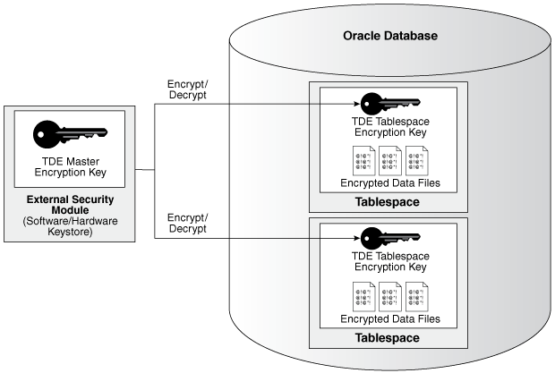
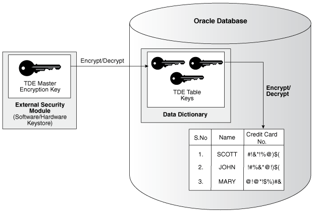
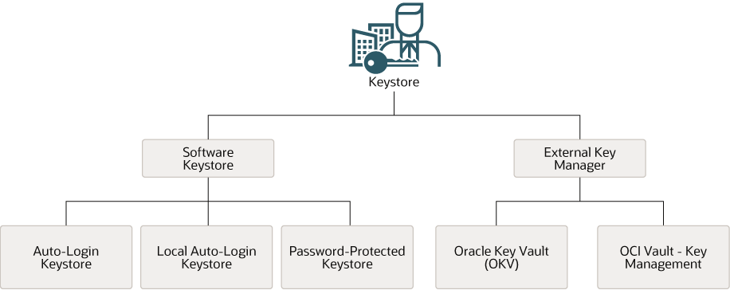

## 3 Introduction to Transparent Data Encryption

Transparent data encryption enables you to encrypt database data files or selected columns of data. This helps you protect sensitive data contained in your database, such as credit card numbers or Social Security numbers.

- What Is Transparent Data Encryption?
  Transparent Data Encryption (TDE) enables you to encrypt sensitive data that you store in tables and tablespaces. It also enables you to encrypt database backups.
- Benefits of Using Transparent Data Encryption
  Transparent Data Encryption (TDE) ensures that sensitive data is encrypted, helps address compliance requirements, and provides functionality that streamlines encryption operations.
- Who Can Configure Transparent Data Encryption?
  You must be granted the `ADMINISTER KEY MANAGEMENT` system privilege to configure Transparent Data Encryption (TDE).
- Types and Components of Transparent Data Encryption
  Transparent Data Encryption can be applied to individual columns or entire tablespaces.
- How the Multitenant Option Affects Transparent Data Encryption
  In a multitenant environment, you can configure keystores for either the entire container database (CDB) or for individual pluggable databases (PDBs).

**Parent topic:** [Using Transparent Data Encryption](asopart1.md)

### 3.1 What Is Transparent Data Encryption?

Transparent Data Encryption (TDE) enables you to encrypt sensitive data that you store in tables and tablespaces. It also enables you to encrypt database backups.

After the data is encrypted, this data is transparently decrypted for authorized users or applications when they access this data. TDE helps protect data stored on media (also called data at rest) in the event that the storage media or data file is stolen.

Oracle Database uses authentication, authorization, and auditing mechanisms to secure data in the database, but not in the operating system data files where data is stored. To protect these data files, Oracle Database provides Transparent Data Encryption (TDE). TDE encrypts sensitive data stored in data files. To prevent unauthorized decryption, TDE stores the encryption keys in a security module that is external to the database. This security module can be referred to as follows:

- TDE wallets are wallets used for TDE. They cannot contain other security artifacts such as certificates. In previous releases, they were called software keystores or just wallets.
- External keystores refer to Oracle Key Vault or Oracle Cloud Infrastructure (OCI) Key Management Service (KMS).
- Keystores is a generic term for both TDE wallets and external keystores.

You can configure Oracle Key Vault as part of the TDE implementation. This enables you to centrally manage keystores in your enterprise. For example, you can upload a TDE wallet to Oracle Key Vault, migrate the database to use Oracle Key Vault as the default keystore, and then share the contents of this keystore with other primary and standby Oracle Real Application Clusters (Oracle RAC) nodes of that database to streamline daily database administrative operations with encrypted databases.

**Related Topics**

- [Oracle Key Vault Administrator's Guide](https://docs.oracle.com/pls/topic/lookup?ctx=en/database/oracle/oracle-database/19/asoag&id=OKVAG-GUID-0D169EB8-C355-459A-9ABD-325CA5B46DD0)

**Parent topic:** Introduction to Transparent Data Encryption

### 3.2 Benefits of Using Transparent Data Encryption

Transparent Data Encryption (TDE) ensures that sensitive data is encrypted, helps address compliance requirements, and provides functionality that streamlines encryption operations.

Benefits are as follows:

- As a security administrator, you can be sure that sensitive data is encrypted and therefore safe in the event that the storage media or data file is stolen.

- Using TDE helps you address security-related regulatory compliance issues.

- You do not need to create auxiliary tables, triggers, or views to decrypt data for the authorized user or application. Data from tables is transparently decrypted for the database user and application. An application that processes sensitive data can use TDE to provide strong data encryption with little or no change to the application.

- Data is transparently decrypted for database users and applications that access this data. Database users and applications do not need to be aware that the data they are accessing is stored in encrypted form.

- You can encrypt data with zero downtime on production systems by using online table redefinition or you can encrypt it offline during maintenance periods.

- You do not need to modify your applications to handle the encrypted data. The database manages the data encryption and decryption.

- Oracle Database automates TDE master encryption key and keystore management operations. The user or application does not need to manage TDE master encryption keys.

**Parent topic:** Introduction to Transparent Data Encryption

### 3.3 Who Can Configure Transparent Data Encryption?

You must be granted the `ADMINISTER KEY MANAGEMENT` system privilege to configure Transparent Data Encryption (TDE).

If you must open the keystore at the mount stage, then you must be granted the `SYSKM` administrative privilege, which includes the `ADMINISTER KEY MANAGEMENT` system privilege and other necessary privileges.

When you grant the `SYSKM` administrative privilege to a user, ensure that you create a password file for it so that the user can connect to the database as `SYSKM` using a password. This enables the user to perform actions such as querying the `V$DATABASE` view.

To use TDE, you do not need the `SYSKM` or `ADMINISTER KEY MANAGEMENT` privileges. You must have the following additional privileges to encrypt table columns and tablespaces:

- `CREATE TABLE`

- `ALTER TABLE`

- `CREATE TABLESPACE`

- `ALTER TABLESPACE` (for online and offline tablespace encryption)

- `ALTER DATABASE` (for fast offline tablespace encryption)

**Parent topic:** Introduction to Transparent Data Encryption

### 3.4 Types and Components of Transparent Data Encryption

Transparent Data Encryption can be applied to individual columns or entire tablespaces.

- About Transparent Data Encryption Types and Components
  You can encrypt sensitive data at the column level or the tablespace level.
- How Transparent Data Encryption Tablespace Encryption Works
  Transparent Data Encryption (TDE) tablespace encryption enables you to encrypt an entire tablespace.
- How Transparent Data Encryption Column Encryption Works
  Transparent Data Encryption (TDE) column encryption protects confidential data, such as credit card and Social Security numbers, that is stored in table columns.
- How the Keystore for the Storage of TDE Master Encryption Keys Works
  To control the encryption, you use a keystore and a TDE master encryption key.
- Supported Encryption and Integrity Algorithms
  The supported Advanced Encryption Standard cipher keys, including tablespace and database encryption keys, can be either 128, 192, or 256 bits long. Tablespace and database encryption use the 128–bit length cipher key.

**Parent topic:** Introduction to Transparent Data Encryption

#### 3.4.1 About Transparent Data Encryption Types and Components

You can encrypt sensitive data at the column level or the tablespace level.

At the column level, you can encrypt sensitive data in application table columns. TDE tablespace encryption enables you to encrypt all of the data that is stored in a tablespace.

Both TDE column encryption and TDE tablespace encryption use a two-tiered key-based architecture. Unauthorized users, such as intruders who are attempting security attacks, cannot read the data from storage and back up media unless they have the TDE master encryption key to decrypt it.

**Parent topic:** Types and Components of Transparent Data Encryption

#### 3.4.2 How Transparent Data Encryption Tablespace Encryption Works

Transparent Data Encryption (TDE) tablespace encryption enables you to encrypt an entire tablespace.

All of the objects that are created in the encrypted tablespace are automatically encrypted. TDE tablespace encryption is useful if your tables contain sensitive data in multiple columns, or if you want to protect the entire table and not just individual columns. You do not need to perform a granular analysis of each table column to determine the columns that need encryption.

In addition, TDE tablespace encryption takes advantage of bulk encryption and caching to provide enhanced performance. The actual performance impact on applications can vary.

TDE tablespace encryption encrypts all of the data stored in an encrypted tablespace including its redo data. TDE tablespace encryption does not encrypt data that is stored outside of the tablespace. For example, `BFILE` data is not encrypted because it is stored outside the database. If you create a table with a `BFILE` column in an encrypted tablespace, then this particular column will not be encrypted.

All of the data in an encrypted tablespace is stored in encrypted format on the disk. Data is transparently decrypted for an authorized user having the necessary privileges to view or modify the data. A database user or application does not need to know if the data in a particular table is encrypted on the disk. In the event that the data files on a disk or backup media is stolen, the data remains protected.

TDE tablespace encryption uses the two-tiered, key-based architecture to transparently encrypt (and decrypt) tablespaces. The TDE master encryption key is stored in a security module (Oracle wallet, Oracle Key Vault, or Oracle Cloud Infrastructure (OCI) Key Management Service (KMS)). This TDE master encryption key is used to encrypt the TDE [tablespace encryption key](glossary.md), which in turn is used to encrypt and decrypt data in the tablespace.

Figure 3-1 shows an overview of the TDE tablespace encryption process.

Figure 3-1 TDE Tablespace Encryption

[Description of "Figure 3-1 TDE Tablespace Encryption"](img_text/asoag039.md)

**Note:**

The encrypted data is protected during operations such as `JOIN` and `SORT`. This means that the data is safe when it is moved to temporary tablespaces. Data in undo and redo logs is also protected.

TDE tablespace encryption also allows index range scans on data in encrypted tablespaces. It does not interfere with Exadata Hybrid Columnar Compression (EHCC), Oracle Advanced Compression, or Oracle Recovery Manager (Oracle RMAN) compression. This is not possible with TDE column encryption.

**Parent topic:** Types and Components of Transparent Data Encryption

#### 3.4.3 How Transparent Data Encryption Column Encryption Works

Transparent Data Encryption (TDE) column encryption protects confidential data, such as credit card and Social Security numbers, that is stored in table columns.

TDE column encryption uses the two-tiered key-based architecture to transparently encrypt and decrypt sensitive table columns. The TDE master encryption key is stored in an external keystore, which can be an Oracle wallet or in Oracle Key Vault. The Oracle wallet is a PKCS#12 container for certificates and encryption keys. It is encrypted with an AES256 key that is derived from the TDE wallet password. This TDE master encryption key encrypts and decrypts the TDE table key, which in turn encrypts and decrypts data in the table column.

Figure 3-2 shows an overview of the TDE column encryption process.

Figure 3-2 TDE Column Encryption Overview

[Description of "Figure 3-2 TDE Column Encryption Overview"](img_text/asoag040.md)

As shown in Figure 3-2, the TDE master encryption key is stored in an external security module that is outside of the database and accessible only to a user who was granted the appropriate privileges. For this external security module, Oracle Database uses an Oracle TDE wallet (TDE wallet, in previous releases) or Oracle Key Vault. Storing the TDE master encryption key in this way prevents its unauthorized use.

Using an external security module separates ordinary program functions from encryption operations, making it possible to assign separate, distinct duties to database administrators and security administrators. Security is enhanced because the keystore password can be unknown to the database administrator, requiring the security administrator to provide the password.

When a table contains encrypted columns, TDE uses a single TDE table key regardless of the number of encrypted columns. Each TDE table key is individually encrypted with the TDE master encryption key.

**Parent topic:** Types and Components of Transparent Data Encryption

#### 3.4.4 How the Keystore for the Storage of TDE Master Encryption Keys Works

To control the encryption, you use a keystore and a TDE master encryption key.

- About the Keystore Storage of TDE Master Encryption Keys
  Oracle Database provides a key management framework for Transparent Data Encryption (TDE) that stores and manages keys and credentials.
- Benefits of the Keystore Storage Framework
  The key management framework provides several benefits for Transparent Data Encryption.
- Types of Keystores
  Oracle Database supports TDE wallets, Oracle Key Vault, and Oracle Cloud Infrastructure (OCI) key management systems (KMS).

**Parent topic:** Types and Components of Transparent Data Encryption

##### 3.4.4.1 About the Keystore Storage of TDE Master Encryption Keys

Oracle Database provides a key management framework for Transparent Data Encryption (TDE) that stores and manages keys and credentials.

The key management framework includes the keystore to securely store the TDE master encryption keys and the management framework to securely and efficiently manage keystore and key operations for various database components.

The Oracle keystore stores a history of retired TDE master encryption keys, which enables you to rotate the TDE master encryption key, and still be able to decrypt data (for example, for incoming Oracle Recovery Manager (Oracle RMAN) backups) that was encrypted under an earlier TDE master encryption key.

**Parent topic:** How the Keystore for the Storage of TDE Master Encryption Keys Works

##### 3.4.4.2 Benefits of the Keystore Storage Framework

The key management framework provides several benefits for Transparent Data Encryption.

- Enables separation of duty between the database administrator and the security administrator who manages the keys. You can grant the `ADMINISTER KEY MANAGEMENT` or `SYSKM` privilege to users who are responsible for managing the keystore and key operations.

- Facilitates compliance, because it helps you to track encryption keys and implement requirements such as keystore password rotation and TDE master encryption key re-key operations. Both wallet password rotations and TDE master key re-key operation do not require database or application downtime.

- Facilitates and helps enforce keystore backup requirements. A backup is a copy of the password-protected TDE wallet that is created for all of the critical keystore operations.

  The mandatory `WITH BACKUP` clause of the `ADMINISTER KEY MANAGEMENT` statement creates a backup of the password-protected wallet before the changes are applied to the original password-protected wallet.

- Enables the keystore to be stored on an Oracle Automatic Storage Management (Oracle ASM) file system. This is particularly useful for Oracle Real Application Clusters (Oracle RAC) environments where database instances share a unified file system view. In Oracle RAC, you must store the Oracle wallet in a shared location (Oracle ASM or Oracle Advanced Cluster File System (ACFS)), to which all Oracle RAC instances that belong to one database, have access to. Individual TDE wallets for each Oracle RAC instances are not supported.

- Enables reverse migration from an external keystore to a file system-based TDE wallet. This option is useful if you must migrate back to a TDE wallet.

**Parent topic:** How the Keystore for the Storage of TDE Master Encryption Keys Works

##### 3.4.4.3 Types of Keystores

Oracle Database supports TDE wallets, Oracle Key Vault, and Oracle Cloud Infrastructure (OCI) key management systems (KMS).

Figure 3-3 illustrates the types of keystores that Oracle Database supports.

Figure 3-3 Oracle Database Supported Keystores

[Description of "Figure 3-3 Oracle Database Supported Keystores"](img_text/keystores-types.md)

These keystores are as follows:

- Auto-login TDE wallets: Auto-login TDE wallets are protected by a system-generated password, and do not need to be explicitly opened by a security administrator. Auto-login TDE wallets are automatically opened when accessed at database startup. Auto-login TDE wallets can be used across different systems. If your environment does not require the extra security provided by a keystore that must be explicitly opened for use, then you can use an auto-login TDE wallet. Auto-login TDE wallets are ideal for unattended scenarios (for example, Oracle Data Guard standby databases).

- Local auto-login TDE wallets: Local auto-login TDE wallets are auto-login TDE wallets that are local to the computer on which they are created. Local auto-login keystores cannot be opened on any computer other than the one on which they are created. This type of keystore is typically used for scenarios where additional security is required (that is, to limit the use of the auto-login for that computer) while supporting an unattended operation. You cannot use local auto-open wallets in Oracle RAC-enabled databases, because only shared wallets (in ACFS or ASM) are supported.

- Password-protected TDE wallets: Password-protected TDE wallets are protected by using a password that you create. You must open this type of keystore before the keys can be retrieved or used and use a password to open this type of keystore.

TDE wallets can be stored in Oracle Automatic Storage Management (Oracle ASM), Oracle Automatic Storage Management Cluster File System (Oracle ACFS), or regular file systems.

Under External Keystore Manager are the following categories:

- Oracle Key Vault (OKV): Oracle Key Vault is a software appliance that provides continuous key availability and scalable key management through clustering with up to 16 Oracle Key Vault nodes, potentially deployed across geographically distributed data centers. It is purpose-built for Oracle Database and its many deployment models (Oracle RAC, Oracle Data Guard, Exadata, multitenant environments). In addition, Oracle Key Vault provides online key management for Oracle GoldenGate encrypted trail files and encrypted ACFS. It is also certified for ExaDB-C@C and Autonomous Database (dedicated) (ADB-C@C). Oracle Key Vault is distributed as a full-stack software appliance for installation on dedicated hardware. It is also available in the OCI Marketplace and can be deployed in your OCI tenancy quickly and easily. See the video [Deploying Oracle Key Vault in OCI](https://www.oracle.com/security/database-security/key-vault/?ytid=ULKHmTyqu6s).

- OCI Vault - Key Management: The Oracle Cloud Infrastructure (OCI) Key Management Service (KMS) is a cloud-based service that provides centralized management and control of encryption keys for data stored in OCI. It enables integration of encryption with other OCI services such as storage, database, and Fusion Applications for protecting data stored in these services.

**Related Topics**

- [Oracle Key Vault Administrator's Guide](https://docs.oracle.com/pls/topic/lookup?ctx=en/database/oracle/oracle-database/19/asoag&id=OKVAG-GUID-2B541778-EF4E-4D3A-B251-377FBF4490C7)

**Parent topic:** How the Keystore for the Storage of TDE Master Encryption Keys Works

#### 3.4.5 Supported Encryption and Integrity Algorithms

The supported Advanced Encryption Standard cipher keys, including tablespace and database encryption keys, can be either 128, 192, or 256 bits long. Tablespace and database encryption use the 128–bit length cipher key.

for TDE column encryption, [salt](glossary.md) is added by default to plaintext before encryption unless specified otherwise. You cannot add salt to indexed columns that you want to encrypt. For indexed columns, choose the `NO SALT` parameter for the SQL `ENCRYPT` clause.

For TDE tablespace encryption and database encryption, the default is to use the Advanced Encryption Standard with a 128-bit length cipher key (AES128). By default, Transparent Data Encryption (TDE) column encryption uses the Advanced Encryption Standard (AES) with a 192-bit length cipher key (AES192).

You can change encryption algorithms and encryption keys on existing encrypted columns by setting a different algorithm with the SQL `ENCRYPT` clause.

Table 3-1 lists the supported encryption algorithms.

Table 3-1 Supported Encryption Algorithms for Transparent Data Encryption

| Algorithm                          | Key Size                                                                                                   | Parameter Name                            |
|:-----------------------------------|:-----------------------------------------------------------------------------------------------------------|:------------------------------------------|
| Advanced Encryption Standard (AES) | • 128 bits (default for tablespace encryption) • 192 bits (default for column encryption) • 256 bits | • `AES128` • `AES192` • `AES256`    |
| ARIA                               | • 128 bits • 192 bits • 256 bits                                                                     | • `ARIA128` • `ARIA192` • `ARIA256` |
| GOST                               | 256 bits                                                                                                   | `GOST256`                                 |
| SEED                               | 128 bits                                                                                                   | `SEED128`                                 |
| Triple Encryption Standard (DES)   | 168 bits                                                                                                   | `3DES168`                                 |

For integrity protection of TDE column encryption, the `SHA-1` hashing algorithm is used. If you have storage restrictions, then use the `NOMAC` option.

**Related Topics**

- [Setting the Tablespace Encryption Default Algorithm](configuring-transparent-data-encryption.md)

**Parent topic:** Types and Components of Transparent Data Encryption

### 3.5 How the Multitenant Option Affects Transparent Data Encryption

In a multitenant environment, you can configure keystores for either the entire container database (CDB) or for individual pluggable databases (PDBs).

Oracle Database supports the following multitenant modes for the management of keystores:

- United mode enables you to configure one keystore for the CDB root and any associated united mode PDBs. United mode operates much the same as how TDE was managed in an multitenant environment in previous releases.

- Isolated mode enables you to create and manage both keystores and TDE master encryption keys in an individual PDB. Different isolated mode PDBs can have different keystore types.

Oracle Database supports isolated PDBs with TDE wallets (wallets) and Oracle Key Vault. The cloud tooling in Oracle Cloud Infrastructure (OCI) and the OCI Key Management Service (KMS), do not support isolated PDBs. This includes Oracle Exadata Cloud@Customer (ExaDB-C@C), Autonomous Database Cloud@Customer (ADB-C@C), and Oracle Exadata Database Service (ExaDB-D and ExaDB-D@Azure).

Depending on your site’s needs, you can use a mixture of both united mode and isolated mode. For example, if you want most of the PDBs to use one type of a keystore, then you can configure the keystore type in the CDB root (united mode). For the PDBs in this CDB that must use a different type of keystore, then you can configure the PDB itself to use the keystore it needs (isolated mode). The isolated mode setting for the PDB will override the united mode setting for the CDB.

Before you can configure keystores for use in united or isolated mode, you must perform a one-time configuration by using initialization parameters. To configure keystores for united mode and isolated mode, you use the `ADMINISTER KEY MANAGEMENT` statement.

**Related Topics**

- [Managing Keystores and TDE Master Encryption Keys in United Mode](managing-keystores-encryption-keys-in-united-mode.md)
- [Managing Keystores and TDE Master Encryption Keys in Isolated Mode](managing-keystores-encryption-keys-in-isolated-mode.md)
- [Using sqlnet.ora to Configure Transparent Data Encryption Keystores](using-sqlnet-ora-to-configure-tde-keystores.md)

**Parent topic:** Introduction to Transparent Data Encryption
