## 15 Managing Oracle Data Redaction Policies in Oracle Enterprise Manager

Oracle Enterprise Manager Cloud Control (Cloud Control) can manage Oracle Data Redaction policies and formats.

- About Using Oracle Data Redaction in Oracle Enterprise Manager
  Oracle Enterprise Manager Cloud Control provides an unified user interface for creating and managing Oracle Data Redaction policies.
- Oracle Data Redaction Workflow
  First, you should create sensitive column types and formats if necessary, and then create the Oracle Data Redaction policy afterward.
- Management of Sensitive Column Types in Enterprise Manager
  A sensitive column type categorizes table column sensitive information into a sensitive information type, such as credit card numbers.
- Managing Oracle Data Redaction Formats Using Enterprise Manager
  Oracle Data Redaction provides redaction formats to be used directly within a redaction policy to redact data.
- Managing Oracle Data Redaction Policies Using Enterprise Manager
  You can create, edit, view, and delete Oracle Data Redaction policies in Enterprise Manager Cloud Control.
- Managing Named Data Redaction Policy Expressions Using Enterprise Manager
  You can manage Oracle Data Redaction policy expressions in Enterprise Manager Cloud Control.

**Parent topic:** [Using Oracle Data Redaction](asopart2.md)

### 15.1 About Using Oracle Data Redaction in Oracle Enterprise Manager

Oracle Enterprise Manager Cloud Control provides an unified user interface for creating and managing Oracle Data Redaction policies.

You can do the following:

- Create and manage custom Oracle Data Redaction formats, which were previously known as Data Redaction shortcuts. (This functionality is not available from the command line.)

- Create and manage sensitive column types directly from the Oracle Data Redaction pages. While you create a Data Redaction policy, Cloud Control uses sensitive column types to obtain the Oracle Data Redaction formats that are relevant to the column that you are redacting.

**Note:**

Ensure that you have the latest plug-in for Oracle Enterprise Manager. If you have the Oracle Database plug-in release 13.1.1.0.0, then you can create named Data Redaction policy expressions in Oracle Enterprise Manager.

**Parent topic:** Managing Oracle Data Redaction Policies in Oracle Enterprise Manager

### 15.2 Oracle Data Redaction Workflow

First, you should create sensitive column types and formats if necessary, and then create the Oracle Data Redaction policy afterward.

The following figure illustrates this process:

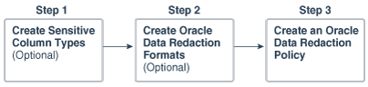
[Description of the illustration asoag_3v_041a.eps](img_text/asoag_3v_041a.md)

1.  (Optional) If you want to map the database columns (that contain the data that you want to redact) to new sensitive column types, then create the required sensitive column types as described in Management of Sensitive Column Types in Enterprise Manager.

2.  (Optional) If you want to redact the data (present in a particular database column) using a custom redaction format, then create the required redaction format as described in Creating a Custom Oracle Data Redaction Format Using Enterprise Manager.

3.  Create an Oracle Data Redaction policy for the required database, as described in Creating an Oracle Data Redaction Policy Using Enterprise Manager.

**Note:**

When you create an Oracle Data Redaction policy, it is enabled by default. For information on how to disable an enabled redaction policy, see Enabling or Disabling an Oracle Data Redaction Policy in Enterprise Manager.

**Parent topic:** Managing Oracle Data Redaction Policies in Oracle Enterprise Manager

### 15.3 Management of Sensitive Column Types in Enterprise Manager

A sensitive column type categorizes table column sensitive information into a sensitive information type, such as credit card numbers.

Sensitive column types use a combination of the column name, column comments, and the data pattern defined using a regular expression to tag a column to a particular sensitive information type.

While you create Oracle Data Redaction policies, redaction formats are filtered on the basis of the chosen sensitive column type, thus saving time and effort. For example, if the database table column that you want to redact contains U.S. Social Security numbers, and you select the `SOCIAL_SECURITY_NUMBER` sensitive column type for the column while adding it to the Oracle Data Redaction policy, the default redaction formats that you can use to redact the column data are filtered, and only the relevant redaction formats are displayed.

Figure 15-1 illustrates the filtering of Oracle Data Redaction formats based on sensitive column types.

Figure 15-1 Oracle Data Redaction Formats Filtered on the Basis of Sensitive Column Types

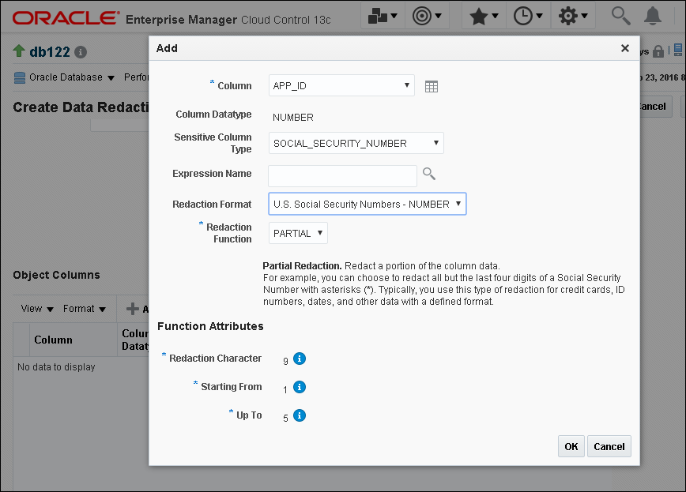
[Description of "Figure 15-1 Oracle Data Redaction Formats Filtered on the Basis of Sensitive Column Types"](img_text/em_red_sensitive_col_types.md)

**Note:**

This functionality is available only if you have the Enterprise Manager for Oracle Database plug-in 12.1.0.7 or later deployed in your system.

As part of the Application Data Modeling feature, Oracle provides a number of default sensitive column types that a database column can be mapped to.

Figure 15-2 displays some of the default sensitive column types. To access this page, click Manage Sensitive Column Types on the Data Redaction Formats page.

Figure 15-2 Default Sensitive Column Types

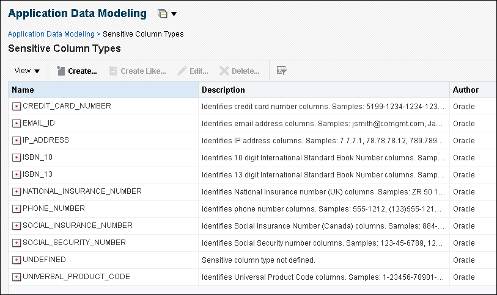
[Description of "Figure 15-2 Default Sensitive Column Types"](img_text/em_red_sens_col_types.md)

If none of the default sensitive column types are suitable for the database column that contains the data that you want to redact, you can create a new sensitive column type, or create a sensitive column type that is based on an existing sensitive column type.

**Parent topic:** Managing Oracle Data Redaction Policies in Oracle Enterprise Manager

### 15.4 Managing Oracle Data Redaction Formats Using Enterprise Manager

Oracle Data Redaction provides redaction formats to be used directly within a redaction policy to redact data.

- About Managing Oracle Data Redaction Formats Using Enterprise Manager
  The Oracle Data Redaction formats are used for commonly redacted data, such as ID numbers, credit cards, or phone numbers.
- Creating a Custom Oracle Data Redaction Format Using Enterprise Manager
  You can create and save custom Oracle Data Redaction formats using Enterprise Manager Cloud Control.
- Editing a Custom Oracle Data Redaction Format Using Enterprise Manager
  You can edit custom Oracle Data Redaction formats using Enterprise Manager Cloud Control, but not in SQL\*Plus.
- Viewing Oracle Data Redaction Formats Using Enterprise Manager
  Enterprise Manager Cloud Control displays the details of the Oracle-supplied and custom Oracle Data Redaction formats.
- Deleting a Custom Oracle Data Redaction Format Using Enterprise Manager
  You can delete custom Oracle Data Redaction formats using Enterprise Manager Cloud Control.

**Parent topic:** Managing Oracle Data Redaction Policies in Oracle Enterprise Manager

#### 15.4.1 About Managing Oracle Data Redaction Formats Using Enterprise Manager

The Oracle Data Redaction formats are used for commonly redacted data, such as ID numbers, credit cards, or phone numbers.

You can use several default Oracle Data Redaction formats (previously known as Oracle Data Redaction templates). As an example of the Oracle Data Redaction formats, a set of Social Security number formats enable you to quickly designate ways to redact Social Security numbers, such as redacting the first five numbers of the Social Security number.

Figure 15-3 displays the default Oracle Data Redaction formats.

Figure 15-3 Default Oracle Data Redaction Formats

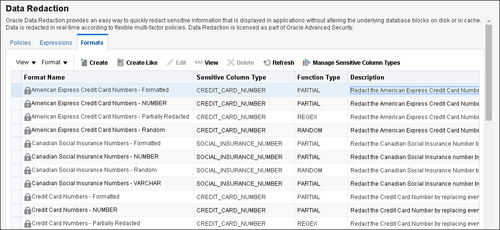
[Description of "Figure 15-3 Default Oracle Data Redaction Formats"](img_text/em_red_formats.md)

Each default Oracle Data Redaction format consists of a specific redaction function that determines the redacted output when the redaction format is used in an Oracle Data Redaction policy. For example, the `Credit Card Numbers - NUMBER` default redaction format replaces the first twelve digits of the column data with the digit 0, when it is used in an Oracle Data Redaction policy. That is, if the column data is `5555555555554444`, the redacted output will be `0000000000004444`.

If you have deployed the Enterprise Manager for Oracle Database plug-in 12.1.0.7 or higher on your system, then you can also create and save custom redaction formats, which you can then use in your redaction policies.

**Parent topic:** Managing Oracle Data Redaction Formats Using Enterprise Manager

#### 15.4.2 Creating a Custom Oracle Data Redaction Format Using Enterprise Manager

You can create and save custom Oracle Data Redaction formats using Enterprise Manager Cloud Control.

1.  Log into Oracle Enterprise Manager Cloud Control as either user `SYSTEM` or `SYSMAN`.
    The URL is as follows:
    `https://``host``:``port``/em`
2.  From the Targets menu, select Databases.
3.  Select Search List, then click the name of a database target.
4.  On the home page of the database target, from the Security menu, select Data Redaction.
5.  Log in to the database, if you are prompted to do so.
    Ensure that you log in to the database as a user that has the `EXECUTE` privilege on the `DBMS_REDACT` PL/SQL package.
6.  Select the Formats tab.
7.  Do one of the following:
    - To create a new redaction format, click Create.
    - To create a redaction format that is based on a default format, select the format and then click Create Like.

    If you select Create, then the following dialog box appears:
    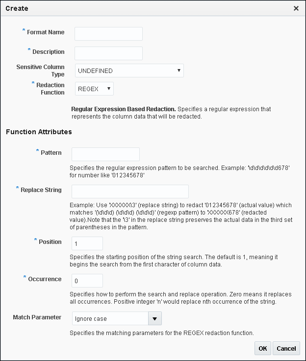
    [Description of the illustration em_red_format_create.png](img_text/em_red_format_create.md)
8.  Provide a name and a description for the redaction format that you want to create.
    If you want to map the redaction format to a particular sensitive column type (such that the created redaction format can be used to redact the data of a column that is associated with the sensitive column type), then select a value for Sensitive Column Type.

    Select the function that the format should use to redact the column data. For Redaction Function, select as follows:

    - FULL if the format should redact the entire column data.

    - PARTIAL if the format should redact only a part of the column data. Ensure that you provide the function attributes, as well as the data type that you want to use the redaction format for.

    - REGEX if the format should redact data based on a regular expression. Ensure that you provide the function attributes.

    - RANDOM if the format should redact data in a random manner, using randomly generated values

    - NONE if the format will be used to only test the definition of a redaction policy, and not redact any column data
9.  Click OK to create and save the custom redaction format.
    This format now can be used to create a redaction policy.

**Related Topics**

- [Oracle Data Redaction Features and Capabilities](oracle-data-redaction-features-and-capabilities.md)
- Creating an Oracle Data Redaction Policy Using Enterprise Manager

**Parent topic:** Managing Oracle Data Redaction Formats Using Enterprise Manager

#### 15.4.3 Editing a Custom Oracle Data Redaction Format Using Enterprise Manager

You can edit custom Oracle Data Redaction formats using Enterprise Manager Cloud Control, but not in SQL\*Plus.

1.  Log into Oracle Enterprise Manager Cloud Control as either user `SYSTEM` or `SYSMAN`.
    The URL is as follows:
    `https://``host``:``port``/em`
2.  From the Targets menu, select Databases.
3.  Select Search List, then click the name of a database target.
4.  On the home page of the database target, from the Security menu, select Data Redaction.
5.  Log in to the database, if you are prompted to do so.
    Ensure that you log in to the database as a user that has the `EXECUTE` privilege on the `DBMS_REDACT` PL/SQL package.
6.  Select the Formats tab.
7.  Select the custom redaction format that you want to edit, then click Edit.
    A dialog box similar to the following appears:
    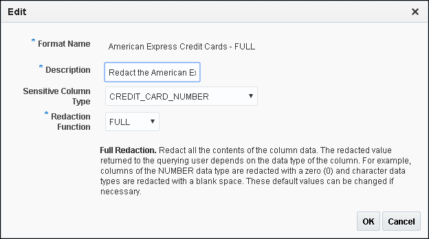
    [Description of the illustration em_red_format_edit.png](img_text/em_red_format_edit.md)
8.  (Optional) Choose to edit the format description, sensitive column type, redaction function, and the redaction function attributes.
9.  Click OK to save the edited format.

**Parent topic:** Managing Oracle Data Redaction Formats Using Enterprise Manager

#### 15.4.4 Viewing Oracle Data Redaction Formats Using Enterprise Manager

Enterprise Manager Cloud Control displays the details of the Oracle-supplied and custom Oracle Data Redaction formats.

1.  Log into Oracle Enterprise Manager Cloud Control as either user `SYSTEM` or `SYSMAN`.
    The URL is as follows:
    `https://``host``:``port``/em`
2.  From the Targets menu, select Databases.
3.  Select Search List, then click the name of a database target.
4.  On the home page of the database target, from the Security menu, select Data Redaction.
5.  Log in to the database, if you are prompted to do so.
    Ensure that you log in to the database as a user that has the `EXECUTE` privilege on the `DBMS_REDACT` PL/SQL package.
6.  Select the Formats tab.
    The Data Redaction Formats page appears, similar to the following page.
    
    [Description of the illustration em_red_formats.png](img_text/em_red_formats.md)
7.  Select the required redaction format, then click View.

**Parent topic:** Managing Oracle Data Redaction Formats Using Enterprise Manager

#### 15.4.5 Deleting a Custom Oracle Data Redaction Format Using Enterprise Manager

You can delete custom Oracle Data Redaction formats using Enterprise Manager Cloud Control.

You can only delete custom Oracle Data Redaction formats, and not the redaction formats that are provided by Oracle.

1.  Log into Oracle Enterprise Manager Cloud Control as either user `SYSTEM` or `SYSMAN`.
    The URL is as follows:
    `https://``host``:``port``/em`
2.  From the Targets menu, select Databases.
3.  Select Search List, then click the name of a database target.
4.  On the home page of the database target, from the Security menu, select Data Redaction.
5.  Log in to the database, if you are prompted to do so.
    Ensure that you log in to the database as a user that has the `EXECUTE` privilege on the `DBMS_REDACT` PL/SQL package.
6.  Select the Formats tab.
7.  Select the custom redaction format that you want to delete, and then click Delete.
8.  In the Confirmation dialog box, click Yes or No.

**Parent topic:** Managing Oracle Data Redaction Formats Using Enterprise Manager

### 15.5 Managing Oracle Data Redaction Policies Using Enterprise Manager

You can create, edit, view, and delete Oracle Data Redaction policies in Enterprise Manager Cloud Control.

- About Managing Oracle Data Redaction Policies Using Enterprise Manager
  Use the Data Redaction page in Cloud Control to manage Oracle Data Redaction policies.
- Creating an Oracle Data Redaction Policy Using Enterprise Manager
  You can create an Oracle Data Redaction policy using Enterprise Manager Cloud Control.
- Editing an Oracle Data Redaction Policy Using Enterprise Manager
  You can edit an Oracle Data Redaction policy using Enterprise Manager Cloud Control.
- Viewing Oracle Data Redaction Policy Details Using Enterprise Manager
  You can find Oracle Data Redaction policy details such as whether the policy is enabled by using Enterprise Manager Cloud Control.
- Enabling or Disabling an Oracle Data Redaction Policy in Enterprise Manager
  An Oracle Data Redaction policy is executed at run time only if it is enabled. When you create an Oracle Data Redaction policy, it is enabled by default.
- Deleting an Oracle Data Redaction Policy Using Enterprise Manager
  You can delete an Oracle Data Redaction policy using Enterprise Manager Cloud Control.

**Parent topic:** Managing Oracle Data Redaction Policies in Oracle Enterprise Manager

#### 15.5.1 About Managing Oracle Data Redaction Policies Using Enterprise Manager

Use the Data Redaction page in Cloud Control to manage Oracle Data Redaction policies.

To redact the data present in a particular database table or view column, you must create an Oracle Data Redaction policy. Data is redacted using a redaction format that is specified by the Oracle Data Redaction policy. To redact data, you can use any of the Oracle-supplied redaction formats, or create and use a custom redaction format. If the table or view column that contains the data that you want to redact is mapped to a sensitive column type, Oracle uses the mapping to recommend suitable redaction formats for the data. Thus, Oracle Data Redaction policies encapsulate database schemas, database table and view columns, sensitive column types, and Oracle Data Redaction formats.

Figure 15-4 shows the Data Redaction page, which enables you to create and manage Oracle Data Redaction policies in Cloud Control.

Figure 15-4 Oracle Data Redaction Policies Page

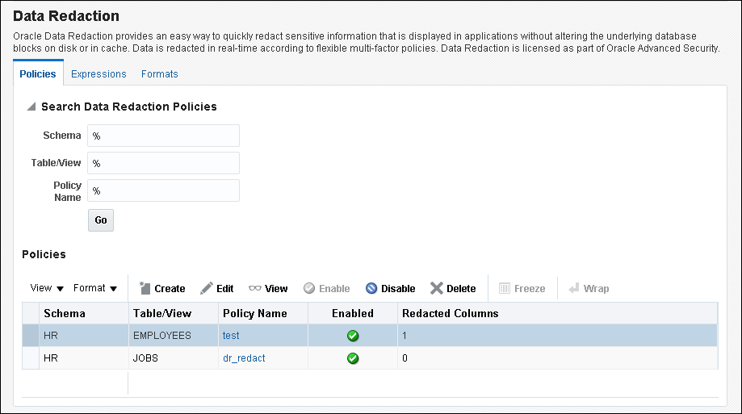
[Description of "Figure 15-4 Oracle Data Redaction Policies Page"](img_text/em_red_pols.md)

**Parent topic:** Managing Oracle Data Redaction Policies Using Enterprise Manager

#### 15.5.2 Creating an Oracle Data Redaction Policy Using Enterprise Manager

You can create an Oracle Data Redaction policy using Enterprise Manager Cloud Control.

1.  Log into Oracle Enterprise Manager Cloud Control as either user `SYSTEM` or `SYSMAN`.
    The URL is as follows:
    `https://``host``:``port``/em`
2.  From the Targets menu, select Databases.
3.  Select Search List, then click the name of a database target for which you want to create an Oracle Data Redaction policy.
4.  On the home page of the database target, from the Security menu, select Data Redaction.
5.  Log in to the database, if you are prompted to do so.
    Ensure that you log in to the database as a user that has the `EXECUTE` privilege on the `DBMS_REDACT` PL/SQL package.
6.  In the Policies section of the Policies tab, select Create.
    If this is the first time that you are creating a Data Redaction policy, then the Data Redaction: Set up for enabling column sensitive type discovery dialog box appears. This feature enables the use of column sensitive type discovery for Data Redaction policies.

    To accomplish this, Enterprise Manager creates the `GET_COL_DATA_SENSITIVE_TYPES` procedure in the `DBSNMP` schema. To perform a sensitive type discovery for a selected column while creating an Oracle Data Redaction policy, a user must have the `EXECUTE` privilege on the `DBSNMP.GET_COL_DATA_SENSITIVE_TYPES` procedure. If the database is protected by Oracle Database Vault, then ensure that any users who must create Data Redaction policies are participants to realms that protect the `DBSNMP` schema.
7.  If the Data Redaction: Set up for enabling column sensitive type discovery dialog box appears and if the current login user does not have the correct requirements, select a credential of a user who has the `EXECUTE` privilege on `DBSNMP.GET_COL_DATA_SENSITIVE_TYPES`. Then click `OK`.
8.  On the Create Data Redaction Policy page, enter the following information:
    - Schema: Enter (or search for) the name of the schema that contains the data you want to redact.

    - Table/View: Enter (or search for) the table or field that contains the column you want to redact.

    - Policy Name: Enter a for the policy, such as emp_wages_pol.

    - Default Expression: Enter the default expression. The default setting is 1=1, which means that the policy always will be enforced. If you are not familiar with the components of a policy expression, then click the pencil icon beside the Policy Expression field to use Policy Expression Builder. Select Policy is in effect when, select the required conditions, then click Add. Click Edit if you want to edit the policy expression manually. After building the required policy expression, click OK. The Policy Expression Builder appears as follows:

      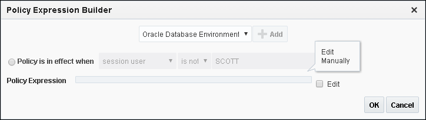
      [Description of the illustration em_red_pol_exp_bldr.png](img_text/em_red_pol_exp_bldr.md)
9.  In the Object Columns section, click Add to add a table or view column to the redaction policy.
    A dialog box similar to the following appears:

    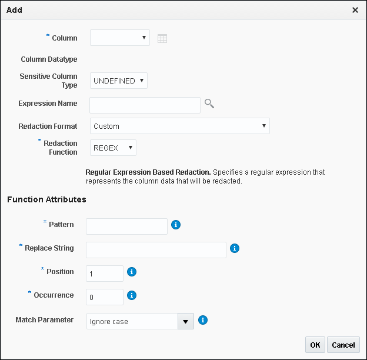
    [Description of the illustration em_red_pol_attr.png](img_text/em_red_pol_attr.md)
    The redaction policy is applied only on the table or view columns that are added to it.
10. From the Column menu, select the table or view column to which you want to apply the redaction policy.
    To the right of the Column menu is an icon that you can click to view the contents of the selected column.
    If the column contains sensitive data and has been mapped to a sensitive column type, then from the Sensitive Column Type menu, select the sensitive column type that it has been mapped to. If the search pattern in the Sensitive Column Type menu matches, then the sensitive column type is selected by default. For example, for a column listing credit card numbers, if there is a match, then the menu will list Undefined and CREDIT_CARD_TYPE. If there is no sensitive column type created, then the default Sensitive Column Type menu listing is only Undefined.
11. From the Redaction Format menu, select the redaction format that you want to use.
    The drop-down list is populated with the Oracle Database-supplied redaction formats, as well as the custom redaction formats that you have created and saved.
    If you do not want to use a pre-defined redaction format (that is, an Oracle-Database supplied redaction format, or a custom redaction format that you have created), and instead want to specify the redaction details while creating the redaction policy, select CUSTOM for Redaction Format.

    The Add dialog box adjusts to accommodate the type of redaction format and function that you select. For example, if you select the CUSTOM redaction format and the REGEX redaction function, then the Function Attributes region appears in the dialog box.
12. From the Redaction Function menu, select the function that you want to use to redact the column data.
    Select FULL if you want to redact the entire column data, PARTIAL if you want to redact only a part of the column data, REGEX if you want to redact the column data based on a regular expression, RANDOM if you want to redact the column data in a random manner, using randomly generated values, or NONE if you only want to test the definition of the redaction policy, and not redact any column data. Note that all the redaction functions may not be applicable for a particular redaction format. The drop-down list displays only the redaction functions that are applicable for the selected redaction format.
    If you selected CUSTOM for Redaction Format in the previous step, and PARTIAL or REGEX for Redaction Function, ensure that you specify the function attributes.
13. Click OK.
14. Repeat these steps starting with Step 8 for all the columns that you want to add to the redaction policy.
15. On the Create Data Redaction Policy page, click OK to create the data redaction policy.
    When you create an Oracle Data Redaction policy, it is enabled by default.

**Related Topics**

- Creating a Custom Oracle Data Redaction Format Using Enterprise Manager
- [Oracle Data Redaction Features and Capabilities](oracle-data-redaction-features-and-capabilities.md)
- Enabling or Disabling an Oracle Data Redaction Policy in Enterprise Manager

**Parent topic:** Managing Oracle Data Redaction Policies Using Enterprise Manager

#### 15.5.3 Editing an Oracle Data Redaction Policy Using Enterprise Manager

You can edit an Oracle Data Redaction policy using Enterprise Manager Cloud Control.

1.  Log into Oracle Enterprise Manager Cloud Control as either user `SYSTEM` or `SYSMAN`.
    The URL is as follows:
    `https://``host``:``port``/em`
2.  From the Targets menu, select Databases.
3.  Select Search List, then search for and click the name of the database target for which the Oracle Data Redaction policy that you want to edit was created.
4.  On the home page of the database target, from the Security menu, select Data Redaction.
5.  Log in to the database, if you are prompted to do so.
    Ensure that you log in to the database as a user that has the `EXECUTE` privilege on the `DBMS_REDACT` PL/SQL package.
6.  In the Policies section of the Policies tab, select the redaction policy that you want to edit, then click Edit..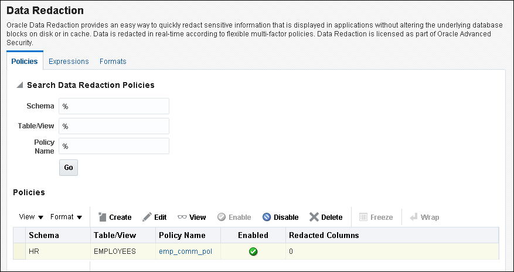
    [Description of the illustration em_red_pol_edit.png](img_text/em_red_pol_edit.md)
7.  On the Edit Data Redaction Policy page, choose to edit the policy expression, add new columns to the redaction policy, modify the redaction details of a column that is a part of the policy, or delete a column from the redaction policy.
    You can do the following:

    - To add a new column to the redaction policy, in the Object Columns section, click Add, select the table or view column that you want to add, then specify the redaction details.

    - To modify the redaction details of a column that is a part of the policy, select the column, click Modify, then edit the redaction details.

    - To delete a column from the redaction policy, select the column, then click Delete.
8.  On the Edit Data Redaction Policy page, after editing the required fields, click OK to save and enable the edited redaction policy.

**Parent topic:** Managing Oracle Data Redaction Policies Using Enterprise Manager

#### 15.5.4 Viewing Oracle Data Redaction Policy Details Using Enterprise Manager

You can find Oracle Data Redaction policy details such as whether the policy is enabled by using Enterprise Manager Cloud Control.

You can disable an enabled redaction policy, or enable a disabled redaction policy using Enterprise Manager Cloud Control.

1.  Log into Oracle Enterprise Manager Cloud Control as either user `SYSTEM` or `SYSMAN`.
    The URL is as follows:
    `https://``host``:``port``/em`
2.  From the Targets menu, select Databases.
3.  Select Search List, then search for and click the name of the database target for which the Oracle Data Redaction policy that you want to view was created.
4.  On the home page of the database target, from the Security menu, select Data Redaction.
5.  Log in to the database, if you are prompted to do so.
    Ensure that you log in to the database as a user that has the `EXECUTE` privilege on the `DBMS_REDACT` PL/SQL package.
6.  In the Policies section of the Policies tab, do one of the following:
    - Select the name of the policy in the table.
    - Select the required redaction policy, then click View.
7.  To exit, click OK.

**Parent topic:** Managing Oracle Data Redaction Policies Using Enterprise Manager

#### 15.5.5 Enabling or Disabling an Oracle Data Redaction Policy in Enterprise Manager

An Oracle Data Redaction policy is executed at run time only if it is enabled. When you create an Oracle Data Redaction policy, it is enabled by default.

You can disable an enabled redaction policy, or enable a disabled redaction policy using Enterprise Manager Cloud Control.

1.  Log into Oracle Enterprise Manager Cloud Control as either user `SYSTEM` or `SYSMAN`.
    The URL is as follows:
    `https://``host``:``port``/em`
2.  From the Targets menu, select Databases.
3.  Select Search List, then search for and click the name of the database target for which the Oracle Data Redaction policy that you want to enable or disable was created.
4.  On the home page of the database target, from the Security menu, select Data Redaction.
5.  Log in to the database, if you are prompted to do so.
    Ensure that you log in to the database as a user that has the `EXECUTE` privilege on the `DBMS_REDACT` PL/SQL package.
6.  In the Policies section of the Policies tab, select the redaction policy that you want to enable or disable, and then click Enable or Disable.
    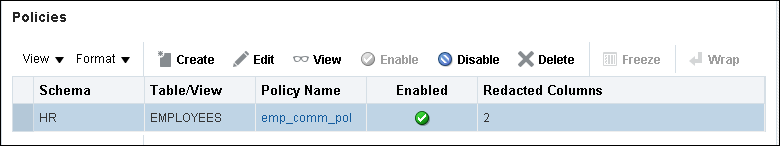
    [Description of the illustration em_red_pol_disable.png](img_text/em_red_pol_disable.md)
7.  In the Confirmation dialog box, click Yes or No.

**Parent topic:** Managing Oracle Data Redaction Policies Using Enterprise Manager

#### 15.5.6 Deleting an Oracle Data Redaction Policy Using Enterprise Manager

You can delete an Oracle Data Redaction policy using Enterprise Manager Cloud Control.

1.  Log into Oracle Enterprise Manager Cloud Control as either user `SYSTEM` or `SYSMAN`.
    The URL is as follows:
    `https://``host``:``port``/em`
2.  From the Targets menu, select Databases.
3.  Select Search List, then search for and click the name of the database target for which the Oracle Data Redaction policy that you want to delete was created.
4.  On the home page of the database target, from the Security menu, select Data Redaction.
5.  Log in to the database, if you are prompted to do so.
    Ensure that you log in to the database as a user that has the `EXECUTE` privilege on the `DBMS_REDACT` PL/SQL package.
6.  In the Policies section of the Policies tab, select the redaction policy that you want to delete, and then click Delete.
7.  In the Confirmation dialog box, click Yes or No.

**Parent topic:** Managing Oracle Data Redaction Policies Using Enterprise Manager

### 15.6 Managing Named Data Redaction Policy Expressions Using Enterprise Manager

You can manage Oracle Data Redaction policy expressions in Enterprise Manager Cloud Control.

- About Named Data Redaction Policy Expressions in Enterprise Manager
  You can create and apply named Oracle Data Redaction policy expression to multiple columns in tables and views in Oracle Enterprise Manager Cloud Control.
- Creating a Named Data Redaction Policy Expression in Enterprise Manager
  You can create and apply a named Oracle Data Redaction policy expression using Enterprise Manager Cloud Control.
- Editing a Named Data Redaction Policy Expression in Enterprise Manager
  You can edit a named Oracle Data Redaction policy expression using Enterprise Manager Cloud Control.
- Viewing Named Data Redaction Policy Expressions in Enterprise Manager
  You can view named Oracle Data Redaction policy expressions using Enterprise Manager Cloud Control.
- Deleting a Named Data Redaction Policy Expression in Enterprise Manager
  You can delete named Oracle Data Redaction policy expressions using Enterprise Manager Cloud Control.

**Parent topic:** Managing Oracle Data Redaction Policies in Oracle Enterprise Manager

#### 15.6.1 About Named Data Redaction Policy Expressions in Enterprise Manager

You can create and apply named Oracle Data Redaction policy expression to multiple columns in tables and views in Oracle Enterprise Manager Cloud Control.

When you modify the policy expression, the change is reflected in all redacted columns in the database instance that use the policy expression. Cloud Control enables you to create, edit, view, apply to columns, and delete policy expressions. Before you can create and use named Data Redaction policy expressions, ensure that the `COMPATIBLE` initialization parameter is set to `12.2.0.0` or later.

**Related Topics**

- [Creating and Managing Multiple Named Policy Expressions](configuring-oracle-data-redaction-policies.md)

**Parent topic:** Managing Named Data Redaction Policy Expressions Using Enterprise Manager

#### 15.6.2 Creating a Named Data Redaction Policy Expression in Enterprise Manager

You can create and apply a named Oracle Data Redaction policy expression using Enterprise Manager Cloud Control.

1.  Log into Oracle Enterprise Manager Cloud Control as either user `SYSTEM` or `SYSMAN`.
    The URL is as follows:
    `https://``host``:``port``/em`
2.  From the Targets menu, select Databases.
3.  Select Search List, then click the name of a database target for which you want to create an Oracle Data Redaction policy.
4.  On the home page of the database target, from the Security menu, select Data Redaction.
5.  Log in to the database, if you are prompted to do so.
    Ensure that you log in to the database as a user that has the `EXECUTE` privilege on the `DBMS_REDACT` PL/SQL package.
6.  On the Oracle Data Redaction page, select the Expressions tab.
7.  Click Create.
    The Create dialog box appears.

    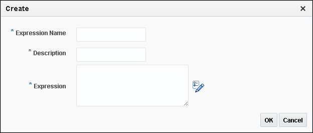
    [Description of the illustration em_red_pol_exp_create.png](img_text/em_red_pol_exp_create.md)
8.  In the Create dialog box, enter the following information:
    - Expression Name: Enter a name for the policy expression. Existing policy expressions are listed on the Data Redaction page.
    - Description: Enter a brief description of the policy.
    - Expression: Enter the expression. For more complex expressions, such as applying or exempting the policy from specific users, click the Policy Expression Builder icon at the right of the Expression field. Click OK in the Policy Expression Builder to create the expression.
9.  Click OK in the Create dialog box.
    After you create the policy expression, it is listed in the Data Redaction page and ready to be associated with a Data Redaction policy.
10. In the Data Redaction page, select the Policies tab.
11. Under Policies, select the row for the policy that redacts the column to which you want to apply the policy expression, and then click Edit.
12. Under Object Columns, select the column that you want and then click the Modify button.
13. In the Modify dialog box, select the expression from the Expression Name list.
14. Click OK, and then click OK again in the Edit Data Redaction Policy dialog box.

**Parent topic:** Managing Named Data Redaction Policy Expressions Using Enterprise Manager

#### 15.6.3 Editing a Named Data Redaction Policy Expression in Enterprise Manager

You can edit a named Oracle Data Redaction policy expression using Enterprise Manager Cloud Control.

1.  Log into Oracle Enterprise Manager Cloud Control as either user `SYSTEM` or `SYSMAN`.
    The URL is as follows:
    `https://``host``:``port``/em`
2.  From the Targets menu, select Databases.
3.  Select Search List, then click the name of a database target for which you want to create an Oracle Data Redaction policy.
4.  On the home page of the database target, from the Security menu, select Data Redaction.
5.  Log in to the database, if you are prompted to do so.
    Ensure that you log in to the database as a user that has the `EXECUTE` privilege on the `DBMS_REDACT` PL/SQL package.
6.  On the Oracle Data Redaction page, select the Expressions tab.
7.  Select the policy expression that you want to edit and then click Edit.
    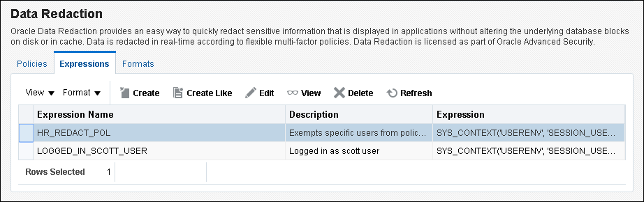
    [Description of the illustration em_red_pol_expr_edit.png](img_text/em_red_pol_expr_edit.md)
8.  In the Edit dialog box, modify the Description and Expression fields as necessary. For more complex expressions, click the Policy Expression Builder icon, and then click OK after you have recreated the expression.
9.  Click OK in the Edit dialog box.

**Parent topic:** Managing Named Data Redaction Policy Expressions Using Enterprise Manager

#### 15.6.4 Viewing Named Data Redaction Policy Expressions in Enterprise Manager

You can view named Oracle Data Redaction policy expressions using Enterprise Manager Cloud Control.

1.  Log into Oracle Enterprise Manager Cloud Control as either user `SYSTEM` or `SYSMAN`.
    The URL is as follows:
    `https://``host``:``port``/em`
2.  From the Targets menu, select Databases.
3.  Select Search List, then click the name of a database target for which you want to create an Oracle Data Redaction policy.
4.  On the home page of the database target, from the Security menu, select Data Redaction.
5.  Log in to the database, if you are prompted to do so.
    Ensure that you log in to the database as a user that has the `EXECUTE` privilege on the `DBMS_REDACT` PL/SQL package.
6.  On the Oracle Data Redaction page, select the Expressions tab.
7.  Select the policy expression that you want to view and then click View.
    The View dialog box appears, showing the definition of the policy expression.
8.  Click OK to exit the View dialog box.

**Parent topic:** Managing Named Data Redaction Policy Expressions Using Enterprise Manager

#### 15.6.5 Deleting a Named Data Redaction Policy Expression in Enterprise Manager

You can delete named Oracle Data Redaction policy expressions using Enterprise Manager Cloud Control.

The deletion process first dissociates the policy expression from all columns to which it is applied.

1.  Log into Oracle Enterprise Manager Cloud Control as either user `SYSTEM` or `SYSMAN`.
    The URL is as follows:
    `https://``host``:``port``/em`
2.  From the Targets menu, select Databases.
3.  Select Search List, then click the name of a database target for which you want to create an Oracle Data Redaction policy.
4.  On the home page of the database target, from the Security menu, select Data Redaction.
5.  Log in to the database, if you are prompted to do so.
    Ensure that you log in to the database as a user that has the `EXECUTE` privilege on the `DBMS_REDACT` PL/SQL package.
6.  On the Oracle Data Redaction page, select the Expressions tab.
7.  Select the policy expression that you want to delete, and then click Delete.
    The Delete Expressions confirmation dialog box appears.
8.  Click OK.

**Parent topic:** Managing Named Data Redaction Policy Expressions Using Enterprise Manager
