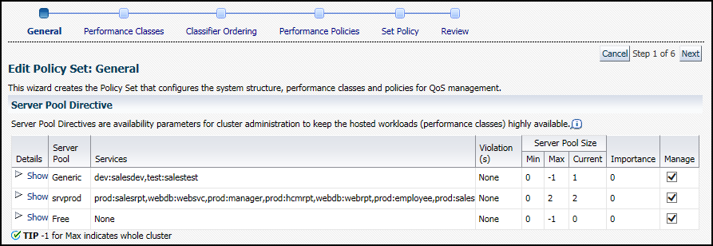
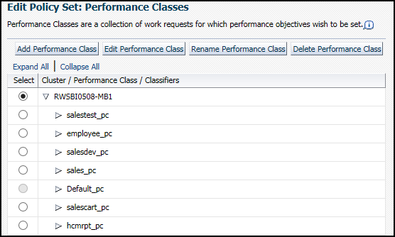
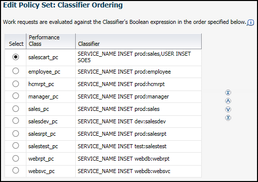
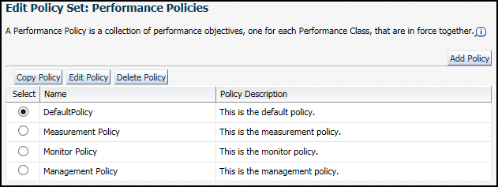
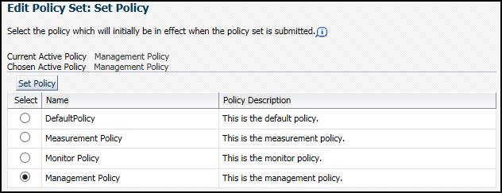

Whether you are configuring the Oracle Database QoS Management system for the first time, or want to create a new Policy Set, you use the Create Policy Set wizard to create your Policy Set.

You use the Edit Policy Set wizard to modify your existing Policy Set.

**Note:**

If you decide to create a new Policy Set, then all existing Performance Policies and user-added Performance Classes must be re-created. The changes you make to the stored Policy Set are not saved until you click Submit Policy Set in the last page of the Policy Set wizard.

- Editing a Policy Set
  You can modify the policy sets for your system.
- Adding Server Pools to a Policy Set
  Server pools are created by the cluster or database administrator, using either Oracle Enterprise Manager Cloud Control or Server Control (SRVCTL).
- Modifying Server Pool Settings
  To modify the server pool settings, you configure a server pool directive override for a Policy Set.
- Adding Database Services to a Policy Set
  By creating additional services, you can monitor your workload performance at a finer level, by limiting use of the new services to specific applications or users.
- Updating a Policy Set to Include a New Database
  If a new database is added to your cluster, you can configure Oracle Database QoS Management to manage or monitor the workload on this database.

**Parent topic:** [Administering the Oracle Database QoS Management System](administering-oracle-database-qos-management-system.md)

### 9.4.1 Editing a Policy Set

You can modify the policy sets for your system.

To modify an existing Policy Set, perform the following steps:

1.  From the cluster target menu, select Administration, then Quality of Service Management, then Edit Policy Set.
    The Policy Set Editor wizard is started.
2.  On the first page of the Policy Set Editor wizard you can view the current server pool settings.
    
    [Description of the illustration edit_policy-general.png](img_text/edit_policy-general.md)
    This page lets you specify which server pools are managed by Oracle Database QoS Management. If the Manage box for a server pool is unchecked, then none of the servers, databases or workloads that use that server pool are displayed or managed by Oracle Database QoS Management. The Details column displays any configuration violation details and the corrective action to take to enable the server pool to be managed.

    When finished, click Next.

    The Policy Set Editor: Performance Classes page appears.
3.  The second page enables you to create, edit, rename, or delete Performance Classes for the system. You can create a new Performance Class, or use the Edit Performance Class button to modify the classifiers for an existing Performance Class.
    
    [Description of the illustration edit_policy-perfomance_classes.png](img_text/edit_policy-perfomance_classes.md)
    You can use the Expand All link to show the classifiers for each Performance Class, or expand an individual Performance Class entry to show the classifiers for only that Performance Class.

    Select the Performance Class you want to edit, and then click the appropriate action button (Edit Performance Class, Rename Performance Class, or Delete Performance Class). If you want to create a Performance Class for this Policy Set, then click Add Performance Class.

    When you have finished, click Next.
4.  After creating or modifying the Performance Classes, the next step is to set the order in which the classifiers are evaluated.
    
    [Description of the illustration edit_policy-classifier_ordering.png](img_text/edit_policy-classifier_ordering.md)
    This step is very important, because the classifiers determine which Performance Class a work request is placed into. Select a Performance Class and use the arrow keys to the right of the classifiers to move the entries up and down in the list.

    As a work request enters the system, the work request is evaluated against the classifiers. The first expression that evaluates to `TRUE` determines which Performance Class the work request belongs to. You should put the more fine-grained classifiers at the top, and the more generic classifiers at the bottom of the list.
5.  After you have set the order for your Performance Classes, the next step is to edit the Performance Policies and set the Performance Objectives.
    
    [Description of the illustration edit_policy-performance_policies.png](img_text/edit_policy-performance_policies.md)
    On this page you can:

    - Create a new Performance Policy

    - Edit, copy, or delete an existing Performance Policy

    - Specify which resource allocation methods can be automatically implemented by QoS Management.

    **Note:**

    The DefaultPolicy Performance Policy cannot be modified, but the policy can be copied and used as the basis for a new Performance Policy.
6.  After you have configured the Performance Policies, you must choose which one to put into effect immediately after the Policy Set is submitted.
    
    [Description of the illustration edit_policy-set_policy.png](img_text/edit_policy-set_policy.md)
    Select the preferred Performance Policy, then click Set Policy. When finished, click Next.
7.  Before you submit a Policy Set to the Oracle Database QoS Management system, you are asked to review the Policy Set configuration.
    - If the changes are what you intended, then click Submit Policy Set.
    - If you must modify any of the displayed settings, then click the Back or Cancel button.

    After clicking Submit Policy Set, you are returned to the Dashboard.

**Related Topics**

- [Creating a Performance Class](managing-performance-classes.md)
- [Managing Performance Policies](managing-performance-policies.md)

**Parent topic:** Administering the Policy Set

### 9.4.2 Adding Server Pools to a Policy Set

Server pools are created by the cluster or database administrator, using either Oracle Enterprise Manager Cloud Control or Server Control (SRVCTL).

- Refer to [Oracle Clusterware Administration and Deployment Guide](../cwadd/policy-based-cluster-and-capacity-management.md) for instructions on how to create a server pool.
- After the cluster administrator has created a server pool, you can add the server pool to the Oracle Database QoS Management system.

**Related Topics**

- [Creating a Performance Policy and Specifying Performance Objectives](managing-performance-policies.md)

**See Also:**

- [Oracle Clusterware Administration and Deployment Guide](../cwadd/policy-based-cluster-and-capacity-management.md) for more information about modifying the size of a server pool

- [Oracle Real Application Clusters Administration and Deployment Guide](../racad/adding-and-deleting-oracle-rac-from-nodes-on-linux-and-unix-systems.md) for more information about configuring a recently allocated server to be a part of an existing Oracle RAC database.

**Parent topic:** Administering the Policy Set

### 9.4.3 Modifying Server Pool Settings

To modify the server pool settings, you configure a server pool directive override for a Policy Set.

When you configure server pool directive overrides, the new parameters you specify for the server pool are used instead of the parameters specified at the time of server pool creation.

**Note:**

You can change the minimum and maximum settings for the listed server pools, but you cannot create additional server pools using this interface. Any changes made here, after they are submitted, alter the current server pool properties set in the Manage Server Pools section of Oracle Enterprise Manager Cloud Control when the associated Performance Policy is active.

- You can modify the server pool parameters manually using the Manage Server Pool pages of Oracle Enterprise Manager Cloud Control or SRVCTL.
  You should not use this method of altering the server pool configuration when you have Oracle Database QoS Management enabled. If you use both server pool directive overrides and manually change the server pool configuration, then the server pool directive overrides specified for the current Policy Set will override the manual settings and can result in confusion.

**Related Topics**

- [Setting Server Pool Directive Overrides](managing-performance-policies.md)

**Parent topic:** Administering the Policy Set

### 9.4.4 Adding Database Services to a Policy Set

By creating additional services, you can monitor your workload performance at a finer level, by limiting use of the new services to specific applications or users.

To add database services to a Policy Set, you must create or modify Performance Classes for each new database service.

1.  The database administrator uses SRVCTL or Oracle Enterprise Manager Cloud Control to create database services that are managed by Oracle Clusterware. You can use the Availability menu on the database target page of Enterprise Manager Cloud Control to create services for an Oracle RAC database.
2.  The QoS Administrator adds one or more Performance Classes to the Policy Set or modifies the existing Performance Classes to include the new database services

**Note:**

Database services appear in Oracle Database QoS Management as `db_name``:``service_name`, so the service names must be unique within a database.

**Parent topic:** Administering the Policy Set

### 9.4.5 Updating a Policy Set to Include a New Database

If a new database is added to your cluster, you can configure Oracle Database QoS Management to manage or monitor the workload on this database.

1.  The database administrator first requests servers to host the cluster database from the cluster or system administrator.
2.  The cluster or database administrator creates the new server pools with the specified minimum number of nodes.
    The cluster or database administrator could also decide to grant access to existing server pools instead of creating new ones.
3.  The database administrator creates a new database on the allocated server pools.
    The database administrator must ensure that the new database is configured correctly for management by Oracle Database QoS Management.
4.  The database administrator uses SRVCTL or Oracle Enterprise Manager Cloud Control to create database services that are managed by Oracle Clusterware for the new database.
5.  The database administrator enables the database for Oracle Database QoS Management from the Database target page of Cloud Control.
6.  Using the Edit Policy Set link in Cloud Control, the QoS Administrator adds the new server pools to the Policy Set, adds one or more Performance Classes to the Policy Set, or modifies the existing Performance Classes to include the new database services.
7.  After you successfully submit the new Policy Set, the new database is monitored and managed by Oracle Database QoS Management.
8.  You can update the Policy Set from the command-line using the option `qosctl qosadmin -updatepolicyset`. This is useful when adding a new database and/or a service in silent mode, or by running scripts.

**Related Topics**

- [Supported Database Configurations](supported-configurations-qos-management.md)
- Editing a Policy Set
- [QOSCTL Utility Reference](creating-administrative-users-qos-management.md)

**Parent topic:** Administering the Policy Set
