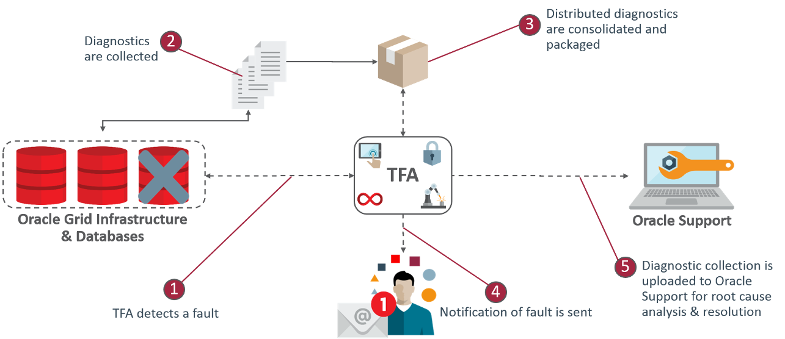
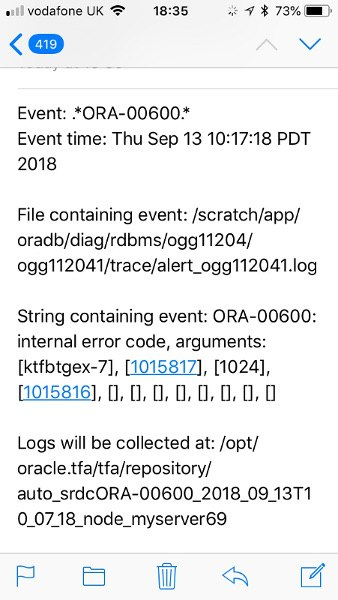

Oracle Trace File Analyzer monitors your logs for significant problems, such as internal errors like `ORA-00600`, or node evictions.

- Collecting Diagnostics Automatically
  This section explains automatic diagnostic collection concepts.
- Configuring Email Notification Details
  Configure Oracle Trace File Analyzer to send an email to the registered email address after an automatic collection completes.
- Collecting Problems Detected by Oracle Cluster Health Advisor
  Configure Oracle Cluster Health Advisor to automatically collect diagnostics for ABNORMAL events, and send email notifications.

**Parent topic:** [Collecting Diagnostic Data and Triaging, Diagnosing, and Resolving Issues](diagnose-troubleshoot-issues-errors.md)

### 14.1 Collecting Diagnostics Automatically

This section explains automatic diagnostic collection concepts.

If Oracle Trace File Analyzer detects any problems, then it carries out the following actions:

- Runs necessary diagnostics and collects all relevant log data at the time of a problem

- Trims log files around the time of the problem so that Oracle Trace File Analyzer collects only what is necessary for diagnosis

- Collects and packages all trimmed diagnostics from all nodes in the cluster, consolidating everything on a single node

- Stores diagnostic collections in the Oracle Trace File Analyzer repository

- Sends you email notification of the problem and details of diagnostic collection that is ready for upload to Oracle Support

Figure 14-1 Automatic Diagnostic Collections

[Description of "Figure 14-1 Automatic Diagnostic Collections"](img_text/tfa-automatic-collections-18c.md)

Oracle Trace File Analyzer uses a flood control mechanism. Repeated errors do not flood the system with automatic collections.

Identifying an event triggers the start point for a collection and five minutes later Oracle Trace File Analyzer starts collecting diagnostic data. Starting five minutes later is to capture any other relevant events together. If events are still occurring after five minutes, then diagnostic collection continues to wait. Oracle Trace File Analyzer waits for 30 seconds with no events occurring, up to a further five minutes.

If events are still occurring after 10 minutes, then a diagnostic collection happens. A new collection point starts.

After the collection is complete, Oracle Trace File Analyzer sends email notification that includes the location of the collection, to the relevant recipients.

If your environment can make a connection to oracle.com, you can then use Oracle Trace File Analyzer to upload the collection to a Service Request.

    $ tfactl set autodiagcollect=ON|OFF

Automatic collections are `ON` by default.

Table 14-1 Log Entries that Trigger Automatic collection

| String Pattern                                                                                                                                                 | Log Monitored                                                                                                             |
|:---------------------------------------------------------------------------------------------------------------------------------------------------------------|:--------------------------------------------------------------------------------------------------------------------------|
| `ORA-297(01|02|03|08|09|10|40)` `ORA-00600` `ORA-07445` `ORA-04(69|([7-8][0-9]|9([0-3]|[5-8])))` `ORA-32701` `ORA-00494` System State dumped | Alert Log - Oracle Database Alert Log - Oracle ASM Alert Log - Oracle ASM Proxy Alert Log - Oracle ASM IO Server |
| `CRS-016(07|10|11|12)`                                                                                                                                         | Alert Log - CRS                                                                                                           |

Additionally, when Oracle Cluster Health Advisor detects a problem event, Oracle Trace File Analyzer automatically triggers the relevant diagnostic collection.

**Related Topics**

- [Uploading Collections to Oracle Support](ondemand-diagnostic-collection.md)

**Parent topic:** Automatic Diagnostic Collections

### 14.2 Configuring Email Notification Details

Configure Oracle Trace File Analyzer to send an email to the registered email address after an automatic collection completes.

To send emails, configure the system on which Oracle Trace Analyzer is running. You must configure notification with a user email address to enable it to work.

#### To configure email notification details:

1.  To set the notification email to use for a specific `ORACLE_HOME`, include the operating system owner in the command:
        tfactl set notificationAddress=os_user:email

    For example:
        tfactl set notificationAddress=oracle:some.body@example.com
2.  To set the notification email to use for any `ORACLE_HOME`:
        tfactl set notificationAddress=email

    For example:
        tfactl set notificationAddress=another.body@example.com
3.  Configure the SMTP server using `tfactl set smtp`.
    Set the SMTP parameters when prompted.

    Table 14-2 tfactl diagnosetfa Command Parameters

    | Parameter       | Description                                             |
    |:----------------|:--------------------------------------------------------|
    | `smtp.host`     | Specify the SMTP server host name.                      |
    | `smtp.port`     | Specify the SMTP server port.                           |
    | `smtp.user`     | Specify the SMTP user.                                  |
    | `smtp.password` | Specify password for the SMTP user.                     |
    | `smtp.auth`     | Set the Authentication flag to true or false.           |
    | `smtp.ssl`      | Set the SSL flag to true or false.                      |
    | `smtp.from`     | Specify the from mail ID.                               |
    | `smtp.to`       | Specify the comma-delimited list of recipient mail IDs. |
    | `smtp.cc`       | Specify the comma-delimited list of CC mail IDs.        |
    | `smtp.bcc`      | Specify the comma-delimited list of BCC mail IDs.       |
    | `smtp.debug`    | Set the Debug flag to true or false.                    |

    **Note:**

    You can view current SMTP configuration details using `tfactl print smtp`.
4.  Verify SMTP configuration by sending a test email using `tfactl sendmail ``email_address`.
    When Oracle Trace File Analyzer detects a significant error has occurred it will send an email notification as follows:

    Figure 14-2 Email Notification

    
    [Description of "Figure 14-2 Email Notification"](img_text/ora600-notification.md)
5.  Do the following after receiving the notification email:
    1.  To find the root cause, inspect the referenced collection details.
    2.  If you can fix the issue, then resolve the underlying cause of the problem.
    3.  If you do not know the root cause of the problem, then log an SR with Oracle Support, and upload the collection details.

Example 14-1 tfactl set smtp

    # /u01/app/11.2.0.4/grid/bin/tfactl set smtp

    .---------------------------.
    | SMTP Server Configuration |
    +---------------+-----------+
    | Parameter | Value |
    +---------------+-----------+
    | smtp.auth | false |
    | smtp.from | tfa |
    | smtp.user | - |
    | smtp.cc | - |
    | smtp.port | 25 |
    | smtp.bcc | - |
    | smtp.password | ******* |
    | smtp.host | localhost |
    | smtp.to | - |
    | smtp.debug | true |
    | smtp.ssl | true |
    '---------------+-----------'

    Enter the SMTP property you want to update : smtp.host

    Enter value for smtp.host : myhost.domain.com

    SMTP Property smtp.host updated with myhost.domain.com

    Do you want to continue ? [Y]|N : N

    #

**Parent topic:** Automatic Diagnostic Collections

### 14.3 Collecting Problems Detected by Oracle Cluster Health Advisor

Configure Oracle Cluster Health Advisor to automatically collect diagnostics for ABNORMAL events, and send email notifications.

1.  To configure Oracle Cluster Health Advisor auto collection for ABNORMAL events:
        tfactl set chaautocollect=ON
2.  To enable Oracle Cluster Health Advisor notification through Oracle Trace File Analyzer:
        tfactl set chanotification=on
3.  To configure an email address for Oracle Cluster Health Advisor notifications to be sent to:
        tfactl set notificationAddress=chatfa:john.doe@acompany.com

**Parent topic:** Automatic Diagnostic Collections
