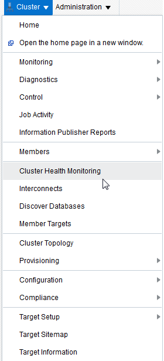
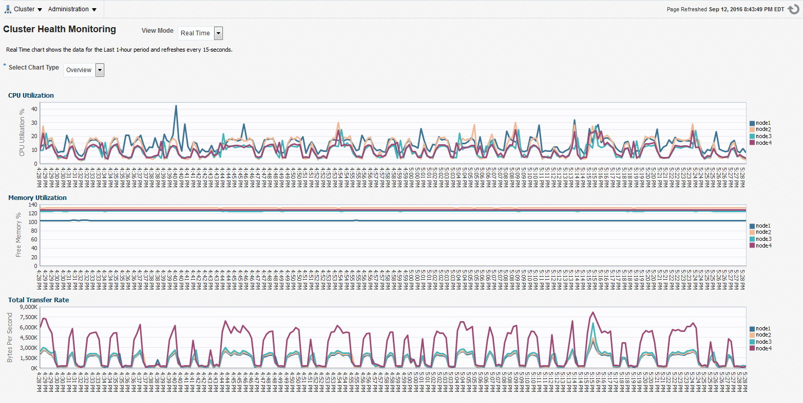
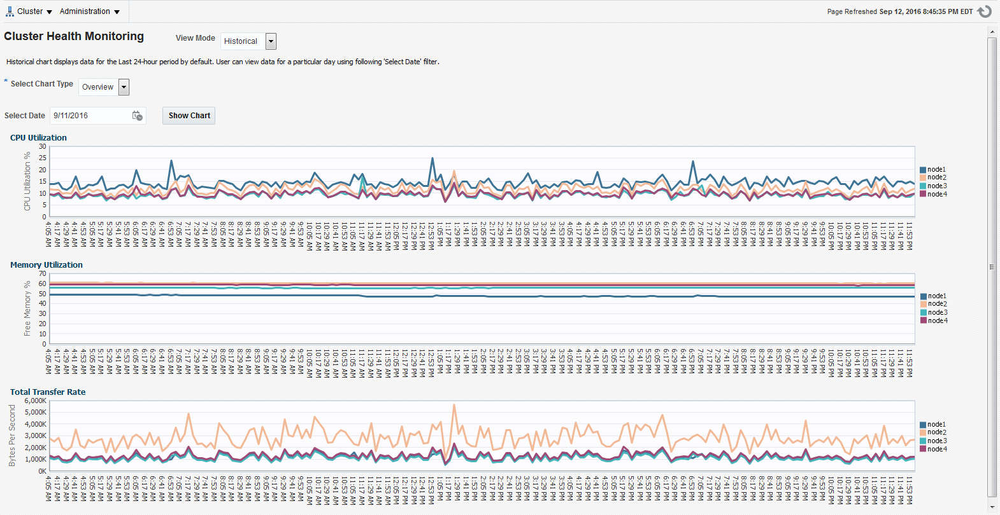

Histograms presented in real-time and historical modes enable you to understand precisely what was happening at the time of degradation or failure.

The metric data from Cluster Health Monitor is available in graphical display within Enterprise Manager Cloud Control. Complete cluster views of this data are accessible from the cluster target page. Selecting the Cluster Health Monitoring  menu item from the Cluster  menu presents a log-in screen prompting for the Cluster Health Monitor credentials. There is a fixed EMUSER and the password is user-specified. Once the credentials are saved, you then can view Cluster Health Monitor data for the last day in overview format for the entire cluster. Metric categories are CPU, Memory, and Network.

Each category is able to be separately display in greater detail showing more metrics. For example, selecting CPU results in cluster graphs detailing CPU System Usage, CPU User Usage, and CPU Queue Length. From any cluster view, you can select individual node views to more closely examine performance of a single server. As in the case of CPU, the performance of each core is displayed. Move your cursor along the graph to see a tool-tip displaying the numerical values and time stamp of that point.

Besides examining the performance of the current day, you can also review historical data. The amount of historical data is governed by the retention time configured in the Cluster Health Monitor repository in the Gird Infrastructure Management Repository and defaults to 72 hours. This view is selectable at any time by using the View Mode  drop-down menu and selecting Historical. A previous date can then be entered or selected from a pop-up calendar that has dates where data is available bolded. Selecting Show Chart  then displays the associated metrics graphs.

### To view Cluster Health Monitor data:

1.  Log in to Enterprise Manager Cloud Control.
2.  Select the Cluster Target you want to view.
3.  From the Cluster  drop-down list, select the Cluster Health Monitoring  option.
    Figure 4-1 EMCC - Cluster Health Monitoring

    
    [Description of "Figure 4-1 EMCC - Cluster Health Monitoring"](img_text/emcc-chm.md)
4.  Enter Cluster Health Monitor login credentials.
5.  From the View Mode  drop-down list, select the Real Time  option to view the current data.
    By default, EMCC displays the Overview  of resource utilization. You can filter by CPU, Memory, and Network  by selecting an appropriate option from the Select Chart Type  drop-down list.

    While viewing CPU and Network metric graphs, click a node name on the legend to view more details.

    Figure 4-2 Cluster Health Monitoring - Real Time Data

    
    [Description of "Figure 4-2 Cluster Health Monitoring - Real Time Data"](img_text/emcc_chm_realtime_overview_1.md)
6.  From the View Mode  drop-down list, select the Historical  option to view data for the last 24 hours.
    1.  To filter historical data by date, select a day on the Select Date  calendar control and then click Show Chart.

    By default, EMCC displays the Overview  of resource utilization. You can filter by CPU, Memory, and Network  by selecting an appropriate option from the Select Chart Type  drop-down list.

    While viewing CPU and Network metric graphs, click a node name on the legend to view more details.

    Figure 4-3 Cluster Health Monitoring - Historical Data

    
    [Description of "Figure 4-3 Cluster Health Monitoring - Historical Data"](img_text/emcc_chm_historical_overview1.md)

**Parent topic:** [Collecting Operating System Resources Metrics](purpose-cluster-health-monitor.md)
