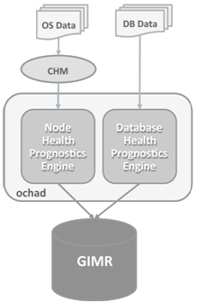

Oracle Cluster Health Advisor runs as a highly available cluster resource, `ochad`, on each node in the cluster.

Each Oracle Cluster Health Advisor daemon (`ochad`) monitors the operating system on the cluster node and optionally, each Oracle Real Application Clusters (Oracle RAC) database instance on the node.

Figure 3-1 Oracle Cluster Health Advisor Architecture

[Description of "Figure 3-1 Oracle Cluster Health Advisor Architecture"](img_text/cluster-health-advisor-architecture.md)

The `ochad` daemon receives operating system metric data from the Cluster Health Monitor and gets Oracle RAC database instance metrics from a memory-mapped file. The daemon does not require a connection to each database instance. This data, along with the selected model, is used in the Health Prognostics Engine of Oracle Cluster Health Advisor for both the node and each monitored database instance in order to analyze their health multiple times a minute.

**Parent topic:** [Proactively Detecting and Diagnosing Performance Issues for Oracle RAC](purpose-cluster-health-advisor.md)
