Oracle Health Check Collections Manager for Oracle Application Express 4.2 provides you an enterprise-wide view of your health check collection data.

- Selectively Capturing Users During Login
  Configure Oracle Health Check Collections Manager to capture user details and assign the users Oracle Health Check Collections Manager roles.
- Bulk Mapping Systems to Business Units
  Oracle Health Check Collections Manager provides an XML bulk upload option so that you can quickly map many systems to business units.
- Adjusting or Disabling Old Collections Purging
  Modify or disable the purge schedule for Oracle Health Check Collections Manager collection data.
- Uploading Collections Automatically
  Configure Oracle ORAchk and Oracle EXAchk to upload check results automatically to the Oracle Health Check Collections Manager database.
- Viewing and Reattempting Failed Uploads
  Configure Oracle ORAchk and Oracle EXAchk to display and reattempt to upload the failed uploads.
- Authoring User-Defined Checks
  Define, test, and maintain your own checks that are specific to your environment.
- Finding Which Checks Require Privileged Users
  Use the Privileged User filter in the Health Check Catalogs to find health checks that must be run by privileged users, such as `root`.
- Creating or Editing Incidents Tickets
  Create or edit incident tickets for individual checks or for an entire collection.
- Viewing Clusterwide Linux Operating System Health Check (VMPScan)
  On Linux systems, view a summary of the VMPScan report in the Clusterwide Linux Operating System Health Check (VMPScan) section of the Health Check report.

**Related Topics**

- [Oracle ORAchk and EXAchk User’s Guide](https://docs.oracle.com/pls/topic/lookup?ctx=en/database/oracle/oracle-database/19/atnms&id=OEXUG-GUID-BC64F401-438E-4CE5-914C-577BD3A12EB1)

**Parent topic:** [Analyzing Risks and Complying with Best Practices](purpose-oracle-orachk-and-oracle-exachk.md)

### 2.8.1 Selectively Capturing Users During Login

Configure Oracle Health Check Collections Manager to capture user details and assign the users Oracle Health Check Collections Manager roles.

Automatically capturing users during login automates user management. You need not create users manually.

By default, Oracle Health Check Collections Manager:

- Captures details of users that are logging in with LDAP authentication

- Assigns them Oracle Health Check Collections Manager roles, for example, DBA role.

**Note:**

The Oracle Health Check Collections Manager roles are specific to Oracle Health Check Collections Manager and do not equate to system privileges. For example, the DBA role is not granted SYSDBA system privilege.

However, you can disable automatic capture and re-enable anytime later. If you disable, then you must manually create users and assign them roles.

#### To enable or disable capturing user details automatically:

1.  Click Administration, and then select Manage Users, User Roles and assign System to users.
    Figure 2-8 Manage Users, User Roles and assign System to users

    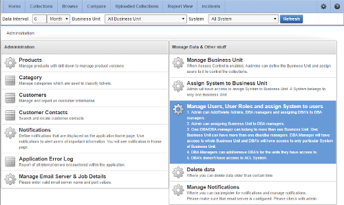
    [Description of "Figure 2-8 Manage Users, User Roles and assign System to users"](img_text/manage-users-user-roles-and-assign-system-users.md)
2.  To disable automatic capture of users details, click Don’t Capture User Details (When Login).
    Figure 2-9 Don’t Capture User Details (When Login)

    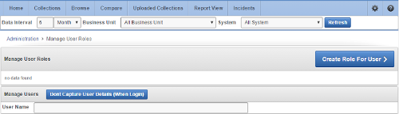
    [Description of "Figure 2-9 Don’t Capture User Details (When Login)"](img_text/dont-capture-user-details-when-login.md)
3.  To re-enable automatic capture of user details, click Capture User Details (When Login).
    Figure 2-10 Capture User Details (When Login)

    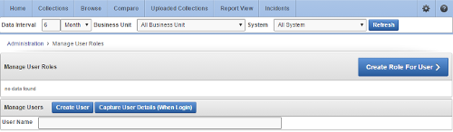
    [Description of "Figure 2-10 Capture User Details (When Login)"](img_text/capture-user-details-when-login.md)

**Parent topic:** Collecting and Consuming Health Check Data

### 2.8.2 Bulk Mapping Systems to Business Units

Oracle Health Check Collections Manager provides an XML bulk upload option so that you can quickly map many systems to business units.

#### To bulk map systems to the business units:

1.  Click Administration, then select Assign System to Business Unit.
    Figure 2-11 Assign System to Business Unit

    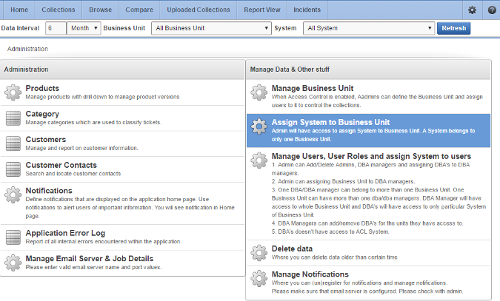
    [Description of "Figure 2-11 Assign System to Business Unit"](img_text/assign-system-business-unit.md)
2.  Click Bulk Mapping.
    Figure 2-12 Bulk Mapping

    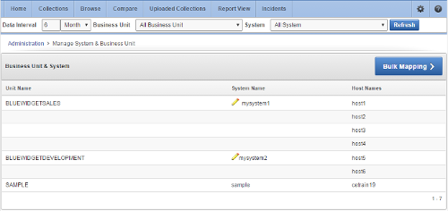
    [Description of "Figure 2-12 Bulk Mapping"](img_text/bulk-mapping.md)
3.  Upload a mapping XML.
    1.  Click Generate XML File (Current Mapping).
    2.  Download the resulting XML file that contains your current system to business unit mappings.
        Figure 2-13 Upload a mapping XML

        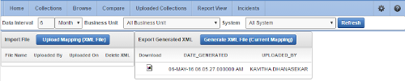
        [Description of "Figure 2-13 Upload a mapping XML"](img_text/upload-mapping-xml.md)
    3.  Amend the XML to show mappings that you want.
    4.  Upload new Mapping XML through Upload Mapping (XML File).

**Parent topic:** Collecting and Consuming Health Check Data

### 2.8.3 Adjusting or Disabling Old Collections Purging

Modify or disable the purge schedule for Oracle Health Check Collections Manager collection data.

By default, Oracle Health Check Collections Manager purges collections older than three months.

#### To adjust or disable the collection purging frequency:

1.  Click Administration, and then select Manage Email Server & Job Details.
    Figure 2-14 Manage Email Server and Job Details

    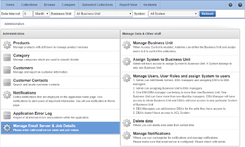
    [Description of "Figure 2-14 Manage Email Server and Job Details"](img_text/manage-email-server-and-job-details.md)
2.  Select an appropriate option:
    - Change the frequency of purges by setting different values in Purge Frequency . Then click Click To Purge Every.

    - To disable purging, click Click To Disable Purging.

    - To re-enable purging, click Click To Enable Purging.

Figure 2-15 Configure Purging

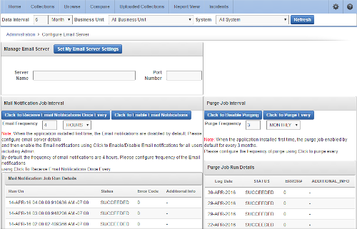
[Description of "Figure 2-15 Configure Purging"](img_text/configure-email-server.md)

**Parent topic:** Collecting and Consuming Health Check Data

### 2.8.4 Uploading Collections Automatically

Configure Oracle ORAchk and Oracle EXAchk to upload check results automatically to the Oracle Health Check Collections Manager database.

Specify the connection string and the password to connect to the database. Oracle Health Check Collections Manager stores the connection details in an encrypted wallet.

#### To configure Oracle ORAchk and Oracle EXAchk to upload check results automatically:

1.  Specify the connection details using the `–setdbupload` option. For default options, use `–setdbupload all`.
        orachk -setdbupload all

        exachk -setdbupload all

    Oracle Health Check Collections Manager prompts you to enter the values for the connection string and password. Oracle Health Check Collections Manager stores these values in an encrypted wallet file.
2.  Verify the values set in the wallet, using the `–getdbupload` option.
        orachk –getdbupload

        exachk –getdbupload

    Oracle ORAchk and Oracle EXAchk automatically use the default values set in the `RAT_UPLOAD_USER` and `RAT_ZIP_UPLOAD_TABLE` environment variables.
3.  Verify, using the `–checkdbupload`  option if Oracle ORAchk and Oracle EXAchk successfully connect to the database.
        orachk –checkdbupload

        exachk –checkdbupload
4.  Set database uploads for Oracle ORAchk and Oracle EXAchk check results.
        orachk -setdbupload all

        exachk -setdbupload all

    **Note:**

    Use fully qualified address for the connect string as mentioned in the previous example. Do not use an alias from the `tnsnames.ora` file.

    Using fully qualified address eliminates the need to rely on `tnsnames.ora` file name resolution on all the servers where you run the tool.
5.  Review Oracle ORAchk and Oracle EXAchk database check result uploads.
        orachk -getdbupload

        exachk -getdbupload

Example 2-1 Checking Oracle ORAchk and Oracle EXAchk Check Result Uploads

    $ ./orachk -checkdbupload

    Configuration is good to upload result to database.

At the end of health check collection, Oracle ORAchk and Oracle EXAchk check if the required connection details are set (in the wallet or the environment variables). If the connection details are set properly, then Oracle ORAchk and Oracle EXAchk upload the collection results.

To configure many Oracle ORAchk and Oracle EXAchk instances:

1.  Create the wallet once with the `-setdbupload all` option, then enter the values when prompted.

2.  Copy the resulting wallet directory to each Oracle ORAchk and Oracle EXAchk instance directories.

You can also set the environment variable `RAT_WALLET_LOC` to point to the location of the wallet directory.

Other configurable upload values are:

- `RAT_UPLOAD_USER`: Controls which user to connect as (default is `ORACHKCM`).

- `RAT_UPLOAD_TABLE`: Controls the table name to store non-zipped collection results in (not used by default).

- `RAT_PATCH_UPLOAD_TABLE`: Controls the table name to store non-zipped patch results in (not used by default).

- `RAT_UPLOAD_ORACLE_HOME`: Controls `ORACLE_HOME` used while establishing connection and uploading.

  By default, the `ORACLE_HOME` environment variable is set to the Oracle Grid Infrastructure Grid home that Oracle ORAchk and Oracle EXAchk discover.

`RCA13_DOCS`: Not configurable to use Oracle Health Check Collections Manager because `RCA13_DOCS` is the table Oracle Health Check Collections Manager looks for.

`RAT_UPLOAD_TABLE` and `RAT_PATCH_UPLOAD_TABLE`: Not used by default because the zipped collection details are stored in `RCA13_DOCS`.

Configure `RAT_UPLOAD_TABLE` and `RAT_PATCH_UPLOAD_TABLE` environments variables if you are using your own custom application to view the collection results.

You can also set these values in the wallet.

For example:

    $ ./orachk -setdbupload all

    $ ./exachk -setdbupload all

This prompts you for and set the `RAT_UPLOAD_CONNECT_STRING` and `RAT_UPLOAD_PASSWORD`, then use

    $ ./orachk -setdbupload RAT_PATCH_UPLOAD_TABLE,RAT_PATCH_UPLOAD_TABLE

    $ ./exachk -setdbupload RAT_PATCH_UPLOAD_TABLE,RAT_PATCH_UPLOAD_TABLE

**Note:**

Alternatively, set all values set in the wallet using the environment variables. If you set the values using the environment variable `RAT_UPLOAD_CONNECT_STRING`, then enclose the values in double quotes.

For example:

    export RAT_UPLOAD_CONNECT_STRING="(DESCRIPTION=(ADDRESS=(PROTOCOL=TCP)(HOST=myserver44.example.com)(PORT=1521))(CONNECT_DATA=(SERVER=DEDICATED)(SERVICE_NAME=orachkcm.example.com)))"

**Parent topic:** Collecting and Consuming Health Check Data

### 2.8.5 Viewing and Reattempting Failed Uploads

Configure Oracle ORAchk and Oracle EXAchk to display and reattempt to upload the failed uploads.

The tools store the values in the `collection_dir``/outfiles/check_env.out` file to record if the previous database upload was successful or not.

The following example shows that database upload has been set up, but the last upload was unsuccessful:

    DATABASE_UPLOAD_SETUP=1
    DATABASE_UPLOAD_STATUS=0

#### To view and reattempt failed uploads:

1.  To view failed collections, use the `-checkfaileduploads` option.
        ./orachk -checkfaileduploads

        ./exachk -checkfaileduploads

    For example:
        $ ./orachk -checkfaileduploads

        List of failed upload collections
        /home/oracle/orachk_myserver_042016_232011.zip
        /home/oracle/orachk_myserver_042016_231732.zip
        /home/oracle/orachk_myserver_042016_230811.zip
        /home/oracle/orachk_myserver_042016_222227.zip
        /home/oracle/orachk_myserver_042016_222043.zip
2.  To reattempt collection upload, use the `-uploadfailed` option
    Specify either all to upload all collections or a comma-delimited list of collections:
        ./orachk -uploadfailed all|list of failed collections

        ./exachk -uploadfailed all|list of failed collections

    For example:
        ./orachk -uploadfailed "/home/oracle/orachk_myserver_042016_232011.zip, /home/oracle/orachk_myserver_042016_231732.zip"

    **Note:**

    You cannot upload collections uploaded earlier because of the SQL unique constraint.

**Parent topic:** Collecting and Consuming Health Check Data

### 2.8.6 Authoring User-Defined Checks

Define, test, and maintain your own checks that are specific to your environment.

Oracle supports the framework for creating and running user-defined checks, but not the logic of the checks. It is your responsibility to test, verify, author, maintain, and support user-defined checks. At runtime, Oracle ORAchk and Oracle EXAchk script run the user-defined checks and display the results in the User Defined Checks section of the HTML report.

The user-defined checks are stored in the Oracle Health Check Collections Manager schema and output to an XML file, which is co-located with the ORAchk script. When run on your system, ORAchk 12.1.0.2.5 and later tries to find the XML file. If found, then Oracle ORAchk runs the checks contained therein and includes the results in the standard HTML report.

#### To author user-defined checks:

1.  Click the User Defined Checks tab, then select Add New Check.
    Figure 2-16 User-Defined Checks Tab

    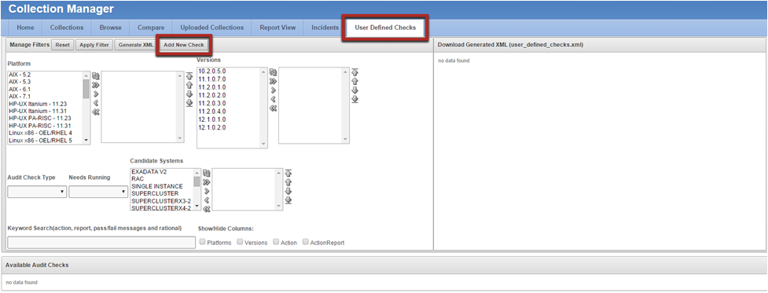
    [Description of "Figure 2-16 User-Defined Checks Tab"](img_text/user-defined-checks-tab.md)
2.  Select OS Check or SQL Check as Audit Check Type.
    Operating system checks use a system command to determine the check status. SQL checks run an SQL statement to determine the check status.

    Figure 2-17 User-Defined Checks Tab - Audit Check Type

    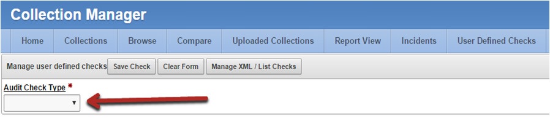
    [Description of "Figure 2-17 User-Defined Checks Tab - Audit Check Type"](img_text/user-defined-checks-tab-audit-check-type.md)
    Once you have selected an Audit Check Type, Oracle Health Check Collections Manager updates the applicable fields.

    Any time during authoring, click the title of a field to see help documentation specific to that field.

    Operating system and SQL commands are supported. Running user-defined checks as `root` is **NOT** supported.

    Figure 2-18 User-Defined Checks Tab - Audit Check Type - OS Check

    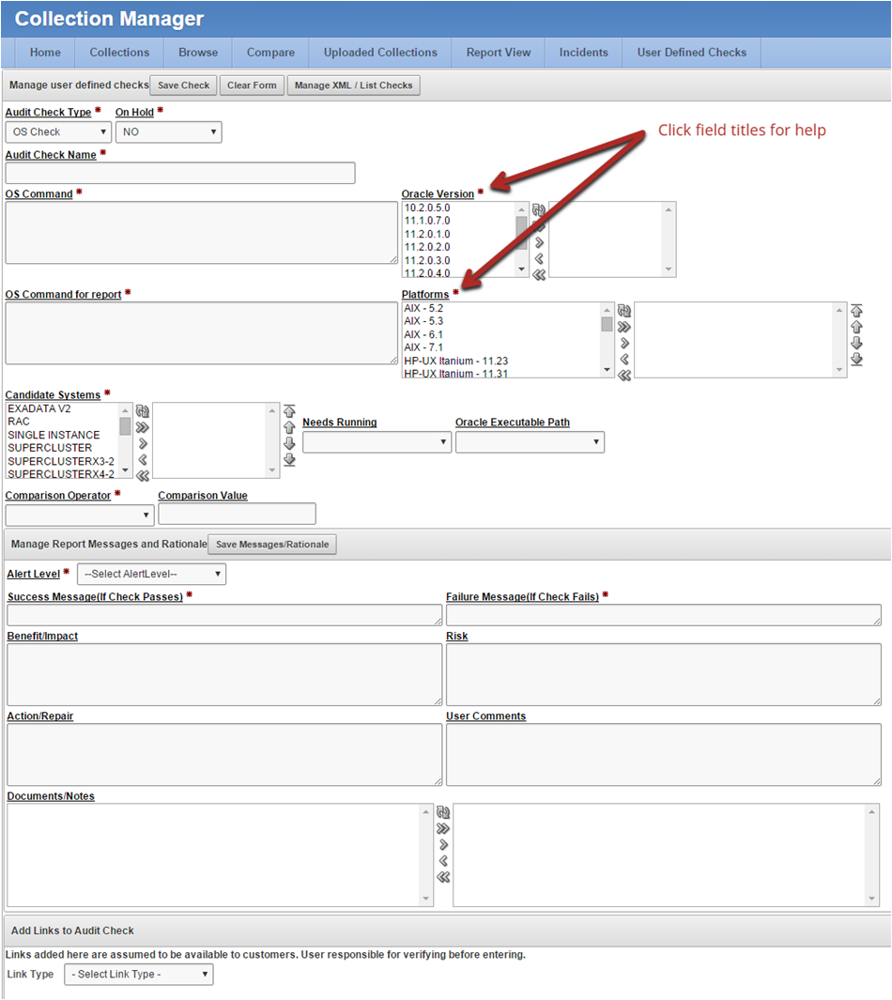
    [Description of "Figure 2-18 User-Defined Checks Tab - Audit Check Type - OS Check"](img_text/user-defined-checks-tab-audit-check-type-os-check.md)
    Once a check is created, the check is listed in the Available Audit Checks section.

    Filter the checks using the filters on this page.

    Figure 2-19 User-Defined Checks Tab - Available Audit Checks

    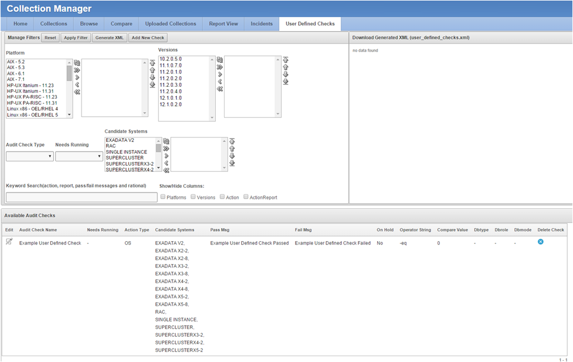
    [Description of "Figure 2-19 User-Defined Checks Tab - Available Audit Checks"](img_text/user-defined-checks-tab-available-audit-checks.md)
3.  Click the Generate XML.
    On the right, find a link to download the generated `user_defined_checks.xml` file.

    The generated XML file includes all the checks that have been authored and have not been placed on hold. Placing checks on hold is equivalent to a logical delete. If there is a problem with a check or the logic is not perfect, then place the check on hold. The check that is placed on hold is not included in the XML file. If the check is production ready, then remove the hold to include the check the next time the XML file is generated.
4.  Download and save the `user_defined_checks.xml` file into the same directory as the Oracle ORAchk and Oracle EXAchk tools.
    Oracle ORAchk and Oracle EXAchk run the user-defined checks the next time they run.

    Figure 2-20 User-Defined Checks Tab - Download User-Defined Checks

    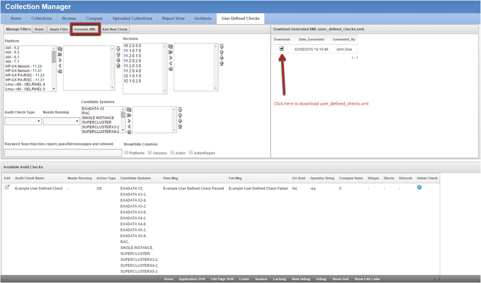
    [Description of "Figure 2-20 User-Defined Checks Tab - Download User-Defined Checks"](img_text/user-defined-checks-tab-download-user-defined-checks.md)
5.  Alternatively, to run only the user-defined checks use the profile `user_defined_checks`.
    When this option is used, then the user-defined checks are the only checks run and theUser Defined Checks section is the only one with results displayed in the report.
        ./orachk –profile user_defined_checks

        ./exachk –profile user_defined_checks
6.  To omit the user-defined checks at runtime, use the –excludeprofile option.
        ./orachk –excludeprofile user_defined_checks

        ./exachk –excludeprofile user_defined_checks

**Parent topic:** Collecting and Consuming Health Check Data

### 2.8.7 Finding Which Checks Require Privileged Users

Use the Privileged User filter in the Health Check Catalogs to find health checks that must be run by privileged users, such as `root`.

Enable Javascript before you view the Health Check Catalogs.

#### To filter health checks by privileged users:

1.  Go to My Oracle Support note 1268927.2.
2.  Click the Health Check Catalog tab.
3.  Click Open ORAchk Health Check Catalog to open or download the `ORAchk_Health_Check_Catalog.html` file.
4.  Click the Privileged User drop-down list and then clear or select the check boxes appropriately.
    Figure 2-21 Oracle ORAchk - Privileged User

    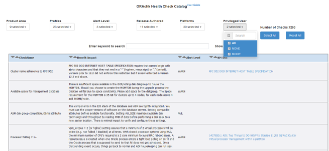
    [Description of "Figure 2-21 Oracle ORAchk - Privileged User"](img_text/oracle-orachk-health-check-catalog.md)

**Related Topics**

- <https://support.oracle.com/rs?type=doc&id=1268927.2>

**Parent topic:** Collecting and Consuming Health Check Data

### 2.8.8 Creating or Editing Incidents Tickets

Create or edit incident tickets for individual checks or for an entire collection.

Oracle Health Check Collections Manager represents the statuses of each ticket with different colored icons. To act upon the tickets, click the icons.

- Creating Incident Tickets
- Editing Incident Tickets

**Parent topic:** Collecting and Consuming Health Check Data

#### 2.8.8.1 Creating Incident Tickets

##### To create incident tickets:

1.  Click the Delta (Δ) symbol colored RED.
2.  Add your ticket details.
3.  Click Next.
4.  Select the Product and Product Version.
5.  Click Next.
6.  Select the Urgency of the ticket.
7.  Select the Severity of the ticket.
8.  Select the Status of the ticket.
9.  Select the Category of the ticket.
10. Enter a summary and description of the incident.
11. Click Create Ticket.

**Parent topic:** Creating or Editing Incidents Tickets

#### 2.8.8.2 Editing Incident Tickets

##### To edit incident tickets:

1.  Click the Incident tab.
2.  Click Open Tickets.
3.  Click the ticket.
4.  Click Edit Ticket.
5.  Alter required details, click Apply Changes.

**Note:**

Click the delta symbol colored GREEN in the Collections or Browse tabs to edit incident tickets.

**Parent topic:** Creating or Editing Incidents Tickets

### 2.8.9 Viewing Clusterwide Linux Operating System Health Check (VMPScan)

On Linux systems, view a summary of the VMPScan report in the Clusterwide Linux Operating System Health Check (VMPScan) section of the Health Check report.

The full VMPScan report is also available within the `collection``/reports` and `collection``/outfiles/vmpscan` directory.

Figure 2-22 Clusterwide Linux Operating System Health Check (VMPScan)

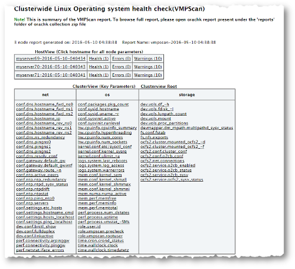
[Description of "Figure 2-22 Clusterwide Linux Operating System Health Check (VMPScan)"](img_text/clusterwide-linux-operating-system-health-check-vmpscan.md)

**Note:**

The VMPScan report is included only when Oracle ORAchk is run on Linux systems.

**Parent topic:** Collecting and Consuming Health Check Data
