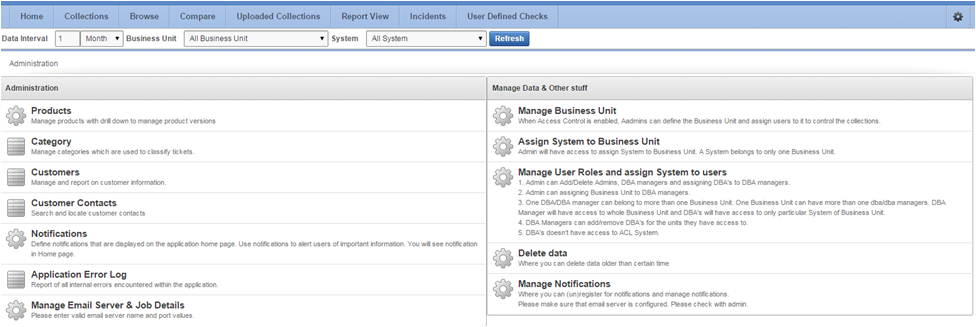
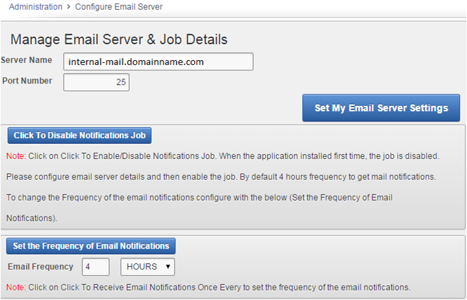
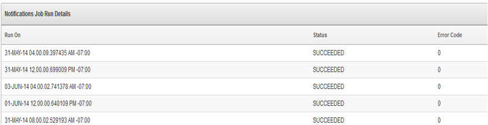
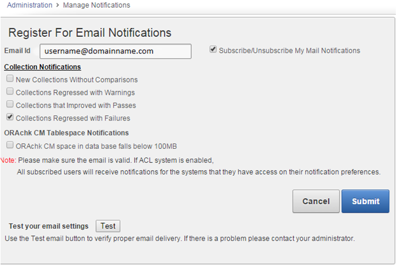
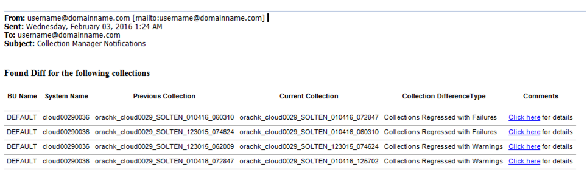
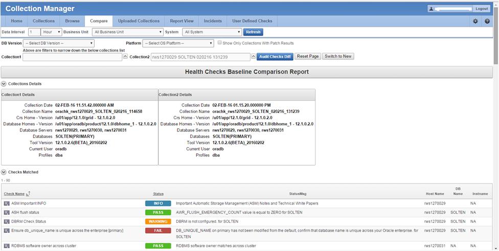

Oracle Health Check Collections Manager provides an email notification system that users can subscribe to.

The setup involves:

- Configuring the email server, port, and the frequency of email notifications.

- Registering the email address

**Note:**

Only the users who are assigned Admin role can manage Email Notification Server and Job details.

### To configure the email notification system:

1.  Log in to Oracle Health Check Collections Manager, and then click Administration at the upper-right corner.
    Figure 2-1 Oracle Health Check Collections Manager - Administration

    
    [Description of "Figure 2-1 Oracle Health Check Collections Manager - Administration"](img_text/collection-manager-administration_1.md)
2.  Under Administration, click Manage Email Server & Job Details.
    Figure 2-2 Oracle Health Check Collections Manager - Configure Email Server

    
    [Description of "Figure 2-2 Oracle Health Check Collections Manager - Configure Email Server"](img_text/collection-manager-configure-email-server.md)
    1.  Specify a valid Email Server Name, Port Number, and then click Set My Email Server Settings.
    2.  Set Email Notification Frequency as per your needs.
        See the Notification Job Run Details on the same page.
        Figure 2-3 Oracle Health Check Collections Manager - Notification Job Run status details

        
        [Description of "Figure 2-3 Oracle Health Check Collections Manager - Notification Job Run status details"](img_text/collection-manager-notification-job-run-status-details.md)
3.  Go back to the Administration page, and click Manage Notifications.
    Figure 2-4 Oracle Health Check Collections Manager - Manage Notifications

    
    [Description of "Figure 2-4 Oracle Health Check Collections Manager - Manage Notifications"](img_text/collection-manager-manage-notifications.md)
    1.  If you are configuring for the first time, then enter your email address.
        Subsequent access to Manage Notifications page shows your email address automatically.
    2.  By default, Subscribe/Unsubscribe My Mail Notifications is checked. Leave as is.
    3.  Under Collection Notifications, choose the type of collections for which you want to receive notifications.
    4.  Select to receive notification when the available space in ORAchk CM Tablespace falls below 100 MB.
    5.  Validate the notification delivery by clicking Test under Test your email settings.
        If the configuration is correct, then you must receive an email. If you do not receive an email, then check with your administrator.

        Following is the sample notification:
            From: username@example.com
            Sent: Thursday, January 28, 2016 12:21 PM
            To: username@example.com
            Subject: Test Mail From Collection Manager

            Testing Collection Manager Email Notification System
    6.  Click Submit.

**Note:**

Manage Notifications section under the Administration menu is available for all users irrespective of the role.

If the ACL system is enabled, then the registered users receive notifications for the systems that they have access to. If the ACL system is not configured, then all the registered users receive all notifications.

Depending on the selections, you made under Collection Notifications section, you receive an email with `Subject: Collection Manager Notifications` containing application URL with results.

Figure 2-5 Oracle Health Check Collections Manager - Sample Email Notification

[Description of "Figure 2-5 Oracle Health Check Collections Manager - Sample Email Notification"](img_text/collection-manager-sample-email-notification.md)

Under Comments column, click the Click here  links for details. Click the respective URLs, authenticate, and then view respective comparison report.

Figure 2-6 Oracle Health Check Collections Manager - Sample Diff Report

[Description of "Figure 2-6 Oracle Health Check Collections Manager - Sample Diff Report"](img_text/collection-manager-sample-diff-report.md)

**Parent topic:** [Configuring Oracle ORAchk and Oracle EXAchk](config-orachk-and-exachk.md)
