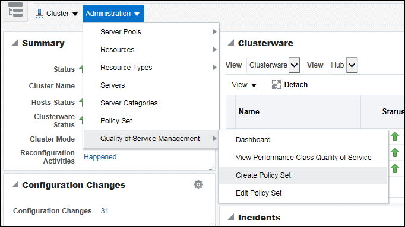
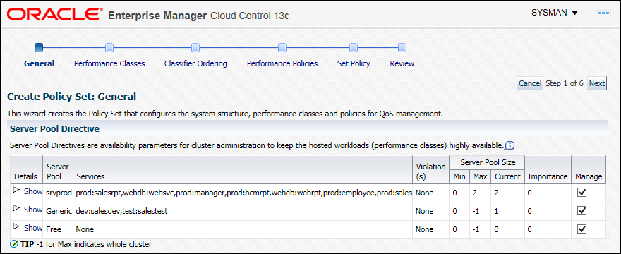
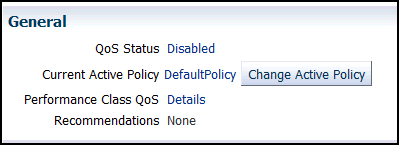

Before you can use Oracle Database Quality of Service (QoS) Management, you must configure the databases.

- Configuring the Databases
  When configuring the Oracle RAC databases to work with Oracle Database QoS Management, the server pool configuration tasks are not required for administrator-managed databases.
- Installing and Configuring Oracle Grid Infrastructure for a Cluster
  The installation and configuration of Oracle Grid Infrastructure for a cluster is not covered in this book.
- Creating and Configuring Server Pools
  By default, a server pool called the Free pool is created during Oracle Grid Infrastructure installation.
- Creating and Configuring an Oracle RAC Database
  The steps for creating and configuring an Oracle RAC database are not covered in this book.
- Creating Oracle Database QoS Management Administrator Accounts
  Before logging in to the Oracle Database QoS Management Dashboard (the Dashboard), you must create an Oracle Database QoS Management administrative user. The operating system user associated with this account must be a cluster administrator user to initially set this up.
- Enabling Oracle Database QoS Management
  If you have multiple databases running on the same cluster, you can specify which databases are managed by Oracle QoS Management.
- About Multi-CPU Binding on Solaris and Quality of Service Management
  Using Multi-CPU Binding (MCB) and Oracle Database Quality of Service (QoS) Management together requires close communication between the system administrator and the database administrator (DBA).

**Parent topic:** [Installing and Enabling Oracle Database QoS Management](installing-and-enabling-oracle-database-qos-management.md)

### 8.1.1 Configuring the Databases

When configuring the Oracle RAC databases to work with Oracle Database QoS Management, the server pool configuration tasks are not required for administrator-managed databases.

1.  For policy-managed databases, the database administrator (DBA) requests access to a server pool to be used for the database. The cluster administrator creates a server pool for the DBA and grants access to this server pool to the DBA. If the cluster administrator user is the same as the DBA user, then the server pool can be created at the time DBCA is run by selecting the Policy-managed option within DBCA. The server pool can also be created after installation by using Server Control (SRVCTL).
    The minimum size of this server pool is the number of database instances. If the maximum size of the server pool is greater than the minimum size, then new instances can be added to the database to handle peak workloads or to accommodate growth.

    For administrator-managed databases, the databases are automatically configured to run in the Generic server pool.
2.  For policy-managed databases, the DBA creates an Oracle RAC database in the allocated server pool by selecting the Policy-managed option within DBCA.
3.  The DBA creates database services that are managed by Oracle Clusterware. The application users connect to the database using these services.
4.  The DBA enables the database for Oracle Database QoS Management using Enterprise Manager Cloud Control.

The initial configuration tasks for the Oracle Database QoS Management administrator are covered in more detail in the following sections.

For Oracle Solaris platforms, there is an additional consideration.

**Related Topics**

- About Multi-CPU Binding on Solaris and Quality of Service Management
- [Managing Performance Classes](managing-performance-classes.md)

**Parent topic:** Configuring Oracle Database QoS Management to Manage Oracle Database Workloads

### 8.1.2 Installing and Configuring Oracle Grid Infrastructure for a Cluster

The installation and configuration of Oracle Grid Infrastructure for a cluster is not covered in this book.

**Related Topics**

- [Oracle Grid Infrastructure Installation and Upgrade Guide](../install-and-upgrade.md)

**Parent topic:** Configuring Oracle Database QoS Management to Manage Oracle Database Workloads

### 8.1.3 Creating and Configuring Server Pools

By default, a server pool called the Free pool is created during Oracle Grid Infrastructure installation.

To create server pools for your Oracle RAC database, you can use SRVCTL or Oracle Enterprise Manager.

When you use DBCA to create an Oracle RAC database, Oracle recommends that you select policy-managed for the database, and choose the server pools which the database instances should run in. If you choose the create an administrator-managed Oracle RAC database, then the database runs exclusively in the Generic server pool, which is created during the installation of Oracle Grid Infrastructure.

If you use a cluster administrator that is separate from the database administrator, then only the cluster administrator user can create server pools. The cluster administrator then grants privileges on the server pools to the operating system user that owns the Oracle RAC installation.

**Note:**

When creating a server pool for use with Oracle Database QoS Management, do not configure the `SERVER_NAMES` attribute (the `-servers` option of `srvctl add svrpool` or `srvctl modify svrpool` commands) for the server pool. Full resource management is not supported in such a configuration because Oracle Database QoS Management cannot change server pool sizes. This is the same limitation that exists for resource management of administrator-managed databases.

**See Also:**

- [Oracle Clusterware Administration and Deployment Guide](../cwadd/policy-based-cluster-and-capacity-management.md) for information about server pools

- [Oracle Real Application Clusters Administration and Deployment Guide](../racad/server-control-utility-reference.md) for information about using SRVCTL to create a server pool

- [Oracle Real Application Clusters Installation Guide for Linux and UNIX](../rilin/selecting-dbca-options-to-create-oracle-rac-or-oracle-rac-one-node-databases-with-dbca.md) for information about using DBCA to create an Oracle RAC database

- [Oracle Clusterware Administration and Deployment Guide](../cwadd/oracle-clusterware-administration.md) for more information about the cluster administrator user.

**Parent topic:** Configuring Oracle Database QoS Management to Manage Oracle Database Workloads

### 8.1.4 Creating and Configuring an Oracle RAC Database

The steps for creating and configuring an Oracle RAC database are not covered in this book.

When creating a database, Oracle recommends that you choose to create a policy-managed Oracle RAC database and specify the server pools in which it should run. If you create an administrator-managed Oracle RAC database, then it runs exclusively in the Generic server pool.

After you have created the databases, perform the following steps to configure the databases for use with Oracle Database QoS Management:

- Modifying Database Initialization Parameters
  The `CPU_COUNT` parameter for each database instance that runs in a server pool must be set to the same value if the database is managed by Oracle Database QoS Management.
- Creating Database Services
  Applications and users connect to the database using services.

**Related Topics**

- [Oracle Real Application Clusters Installation Guide for Linux and UNIX](../rilin/selecting-dbca-options-to-create-oracle-rac-or-oracle-rac-one-node-databases-with-dbca.md)

**Parent topic:** Configuring Oracle Database QoS Management to Manage Oracle Database Workloads

#### 8.1.4.1 Modifying Database Initialization Parameters

The `CPU_COUNT` parameter for each database instance that runs in a server pool must be set to the same value if the database is managed by Oracle Database QoS Management.

On each server, the sum of the values for `CPU_COUNT` for all database instances running on that server must be less than or equal to the physical CPU count. For example, if you have a server with eight CPUs, and there are two database instances running on this server, then, for the databases to be managed by Oracle Database QoS Management, the `CPU_COUNT` parameter for each database instance must be set so that the values of the `CPU_COUNT` parameters for all instances on the server add up to eight or less. For example, you could have `CPU_COUNT=3` on one instance and `CPU_COUNT=4` on the other instance, or `CPU_COUNT=6` on one instance and `CPU_COUNT=2` on the other instance.

**Note:**

By default, the CPU count of each database that is started on a server is set to the number of physical CPUs installed for that server.

If you are running more than one database in a server pool, then using the default settings for `CPU_COUNT` will cause Oracle Database QoS Management to report a violation. To avoid this error, manually configure the `CPU_COUNT` value in the SPFILE using either Oracle Enterprise Manager or SQL\*Plus.

- Use SQL\*Plus to modify the `CPU_COUNT` database initialization parameter for all instances of your Oracle RAC database:
      ALTER SYSTEM SET cpu_count=n SCOPE=BOTH SID='*';

  In the previous command, n is the number of CPUs that should be used by the database instances.

  `CPU_COUNT` is a dynamic parameter that is not set by default. It should be set to the maximum number of CPUs that the database instance should utilize at any time. The sum of the values of `CPU_COUNT` for all instances on a server should not exceed the number of physical CPUs for that server. As a best practice, Oracle recommends using a minimum value of 2 for `CPU_COUNT`.

**Parent topic:** Creating and Configuring an Oracle RAC Database

#### 8.1.4.2 Creating Database Services

Applications and users connect to the database using services.

Details about creating database services are not included in this guide.

**Related Topics**

- [Oracle Real Application Clusters Administration and Deployment Guide](../racad/workload-management-with-dynamic-database-services.md)

**Parent topic:** Creating and Configuring an Oracle RAC Database

### 8.1.5 Creating Oracle Database QoS Management Administrator Accounts

Before logging in to the Oracle Database QoS Management Dashboard (the Dashboard), you must create an Oracle Database QoS Management administrative user. The operating system user associated with this account must be a cluster administrator user to initially set this up.

The administrative user for the Oracle Database QoS Management server is referred to as the QoS Admin user. This user has access to all the features of the Oracle Database QoS Management server, including checking and changing the account password for the QoS Admin user. You can have multiple QoS Admin users.

1.  As the cluster administrator user, log in to the node that is hosting the Oracle Database QoS Management server. This can be determined by using the following command from the Oracle Grid Infrastructure home:
        srvctl status qosmserver
2.  Stop the Oracle Database QoS Management server resource.
        srvctl stop qosmserver
3.  Log on as a CRS Administrator user and enter the following command:
        qosctl qosadmin -setpasswd qosadmin

    After you enter this command, you are prompted to enter the password of the default QoS Admin user one or more times.

    If you want to use a different user name, then you would enter the following command:

        qosctl qosadmin -adduser username

    In this example:

    - `qosadmin` is the name of the default QoS Admin user.

    - `username` is the name of the QoS Admin user you are creating. You are prompted to enter a password for this user
4.  Restart the Oracle Database QoS Management server resource.
        srvctl start qosmserver

**Related Topics**

- [QOSCTL Utility Reference](creating-administrative-users-qos-management.md)
- [Creating Administrative Users for Oracle Database QoS Management](creating-administrative-users-qos-management.md)

**Parent topic:** Configuring Oracle Database QoS Management to Manage Oracle Database Workloads

### 8.1.6 Enabling Oracle Database QoS Management

If you have multiple databases running on the same cluster, you can specify which databases are managed by Oracle QoS Management.

You enable Oracle Database QoS Management in a hierarchical manner:

- Measuring, monitoring, or managing the cluster

- Measuring, monitoring, or managing individual databases that run on the cluster

To manage a database, all the databases that use the same user-defined server pool must be enabled for Oracle Database QoS Management if:

- One or more Performance Classes in that user-defined server pool are not marked "Measure-Only" in the active policy

- There are Performance Classes that include a service hosted by that database

If you do not enable all the databases in the same user-defined server pool for Oracle Database QoS Management and any of the above conditions exist, then a violation is signaled when you try to access the Dashboard for the database. If all of the Performance Classes in the user-defined server pool are in measure–only or monitor mode and none of the Performance Classes specify a hosted service, then there is no violation reported when accessing the Dashboard for the database.

**Note:**

If you enable Oracle QoS Management to monitor or manage a container database (CDB), then all contained pluggable databases (PDBs) are monitored or managed as well. You cannot configure Oracle QoS Management to monitor or manage individual PDBs.

To enable Oracle QoS Management for your system, perform the following steps:

- Enable Oracle QoS Management at the Database Level
- Create an Initial Policy Set
- Enable Oracle QoS Management at the Cluster Level

**Parent topic:** Configuring Oracle Database QoS Management to Manage Oracle Database Workloads

#### 8.1.6.1 Enable Oracle QoS Management at the Database Level

1.  Log in to Oracle Enterprise Manager Cloud Control as the database administrator.
2.  From the Database targets page, select the database you want to modify.
3.  Select Availability, then Enable / Disable Quality of Service Management.
4.  Enter the Cluster and Database credentials, then click Login.
    **Note:**

    To complete this step, you must specify the login information for both a SYSDBA and a cluster administrator account.

    The Enable/Disable QoS Management screen is displayed.
5.  You are prompted to enter a password for the APPQOSSYS user. Choose a password and enter it in the Password and Confirm Password fields, then click OK.
    When you provide a password, the following actions take place:

    - The APPQOSSYS account, which enables the Oracle Database QoS Management server to connect to the database, is unlocked and the new password is set.

    - The credentials are written to an Oracle Wallet stored in the Oracle Cluster Registry to enable Oracle Database QoS Management to log in to the database.
6.  `APPQOS_PLAN` is set as the active Oracle Database Resource Manager plan for all actively managed databases, so that Oracle Database QoS Management can adjust CPU access for Performance Classes. The APPQOS_PLAN is not required for databases where all their Performance Classes are checked Measure-Only.

**Parent topic:** Enabling Oracle Database QoS Management

#### 8.1.6.2 Create an Initial Policy Set

1.  On the Oracle Enterprise Manager Cloud Control All Targets page, select the cluster on which your cluster database that has Oracle Database QoS Management enabled runs.
2.  Select Administration, then Quality of Service Management, then Create Policy Set.
    
    [Description of the illustration create_policy_set_menu.png](img_text/create_policy_set_menu.md)
3.  Log in to the Oracle Database QoS Management Server using the QoS Management administrator password (default user name is `qosadmin`).
4.  On the first page of the Create Policy Set wizard, check the Manage box next to the server pools that represent your database. For example, `online` and `backoffice`. Click Next.
    
    [Description of the illustration apqos_create_polset.png](img_text/apqos_create_polset.md)
5.  To get started with Oracle Database QoS Management, accept the defaults for your initial configuration and click Next on each page of the wizard to use the Default Policy Settings. On the fifth step, click Set Policy to set the DefaultPolicy as the Chosen Active Policy, then click Next.
    On the last step of the Create Policy Set Wizard, click Submit Policy Set.

**Parent topic:** Enabling Oracle Database QoS Management

#### 8.1.6.3 Enable Oracle QoS Management at the Cluster Level

1.  Using Oracle Enterprise Manager Cloud Control, on the All Targets page, select the cluster on which your cluster database that has Oracle Database QoS Management enabled runs.
2.  Select Administration, then Quality of Service Management, then Dashboard.
3.  Log in as the Oracle Database QoS Management user (for example, `qosadmin`).
4.  On the Dashboard page, the General section shows the current status of Oracle Database QoS Management. On a new system, the status is Disabled. Click the link Disabled next to the status to enable Oracle Database QoS Management for this cluster.
    
    [Description of the illustration qos_cluster_status_new_12c.gif](img_text/qos_cluster_status_new_12c.md)

**Parent topic:** Enabling Oracle Database QoS Management

### 8.1.7 About Multi-CPU Binding on Solaris and Quality of Service Management

Using Multi-CPU Binding (MCB) and Oracle Database Quality of Service (QoS) Management together requires close communication between the system administrator and the database administrator (DBA).

Multi-CPU binding (MCB) is an Oracle Solaris projects resource management functionality that is used to bind a project to a specific set of CPUs, but not bind the CPUs exclusively. MCB allows other processes also to use these CPUs and allows overlapping of partitions. MCB is supported on Oracle Solaris 11.3. Control groups (CGroups) on Linux systems is another system administrator methods of managing server resources by allocating CPU and server resources to specific applications.

MCB has no impact on the use of Oracle Database Quality of Service (QoS) Management when used in measure and monitor mode. When you use Oracle Database Quality of Service (QoS) Management in management mode for a group of servers, there are four resource controls that Oracle QoS Management currently supports:

1.  Consumer Group Mappings: CPU shares between competing workloads within a Non-CDB or PDB.

2.  Container Database (CDB) Resource Plans: CPU Shares between competing PDBs within a CDB

3.  Instance Caging: CPUs/Threads between co-hosted database instances

4.  Server Pool Cardinality: number of servers in a server pool offering the database

MCB becomes a problem with regards to instance caging because it is possible for Oracle Database Quality of Service (QoS) Management to recommend a change in `CPU_COUNT` that would not be honored by the operating system. If the recommended action is implemented in this situation, there would probably still be some improvement to the target workload because the donor database would lose a CPU. This would cause Resource Manager to not schedule as many parallel sessions which would help out when hard partitioning is not used. However, the projected performance improvement would be overstated.

**Parent topic:** Configuring Oracle Database QoS Management to Manage Oracle Database Workloads
