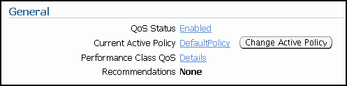

You enable Oracle Database QoS Management in a hierarchical-method.

Levels 2 and 3 depend on the previous levels being configured.

1.  On the cluster: Required for all operations

2.  On the server pool: Required for any operation upon the node in that server pool

3.  On the database: Required for any operation

If you have multiple databases within the same Oracle RAC cluster, they might not all be managed by Oracle Database QoS Management. If you enable Oracle Database QoS Management for a multitenant database, then Oracle Database QoS Management is enabled for all pluggable databases (PDBs) of that container database (CDB).

- Checking the Enabled Status for a Database
- Checking the Enabled Status for the Cluster
  Using Oracle Enterprise Manager Cloud Control, you can determine whether Oracle Database QoS Management is enabled for your cluster.

**Parent topic:** [Administering the Oracle Database QoS Management System](administering-oracle-database-qos-management-system.md)

### 9.1.1 Checking the Enabled Status for a Database

To determine if your database is managed by Oracle Database QoS Management, perform the following steps:

1.  Log in to Cloud Control and select the database target to check.
2.  From the target's menu, select Cluster Database, then Target Information.
3.  In the Target Information window, at the bottom, the value for QoS Status should be Enabled if Oracle Database QoS Management is enabled for this database.

**Parent topic:** Determining If Oracle Database QoS Management is Enabled

### 9.1.2 Checking the Enabled Status for the Cluster

Using Oracle Enterprise Manager Cloud Control, you can determine whether Oracle Database QoS Management is enabled for your cluster.

To determine if a cluster is managed by Oracle Database QoS Management, perform the following steps:

1.  Log in to Cloud Control and select the cluster target to check.
2.  From the target's menu, select Administration, then Quality of Service Management, and then Dashboard.
3.  If prompted, log in as the QoSAdmin user.
4.  On the Dashboard, in the General section, check the value for QoS Status. If the status value is Enabled, then the cluster is being managed by Oracle Database QoS Management.
    
    [Description of the illustration qos_cluster_status_en.gif](img_text/qos_cluster_status_en.md)

**Parent topic:** Determining If Oracle Database QoS Management is Enabled
