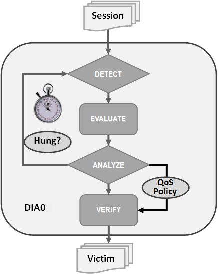

Hang Manager autonomously runs as a `DIA0` task within the database.

Figure 12-1 Hang Manager Architecture

[Description of "Figure 12-1 Hang Manager Architecture"](img_text/hm-architecture.md)

Hang Manager works in the following three phases:

- Detect: In this phase, Hang Manager collects the data on all the nodes and detects the sessions that are waiting for the resources held by another session.

- Analyze: In this phase, Hang Manager analyzes the sessions detected in the Detect phase to determine if the sessions are part of a potential hang. If the sessions are suspected as hung, Hang Manager then waits for a certain threshold time period to ensure that the sessions are hung.

- Verify: In this phase, after the threshold time period is up, Hang Manager verifies that the sessions are hung and selects a victim session. The victim session is the session that is causing the hang.

After the victim session is selected, Hang Manager applies hang resolution methods on the victim session. If the chain of sessions or the hang resolves automatically, then Hang Manager does not apply hang resolution methods. However, if the hang does not resolve by itself, then Hang Manager resolves the hang by terminating the victim session. If terminating the session fails, then Hang Manager terminates the process of the session. This entire process is autonomous and does not block resources for a long period and does not affect the performance.

Hang Manager also considers Oracle Database QoS Management policies, performance classes, and ranks that you use to maintain performance objectives.

For example, if a high rank session is included in the chain of hung sessions, then Hang Manager expedites the termination of the victim session. Termination of the victim session prevents the high rank session from waiting too long and helps to maintain performance objective of the high rank session.

**Parent topic:** [Resolving Database and Database Instance Hangs](purpose-hang-manager.md)
