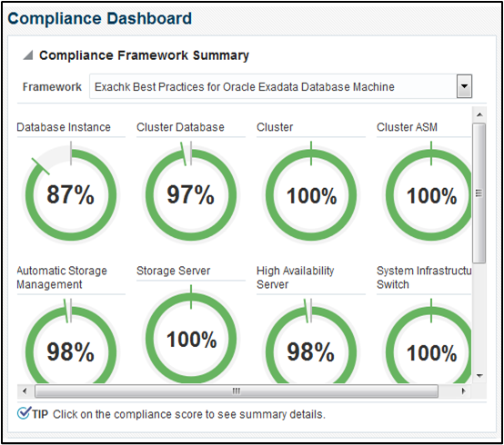
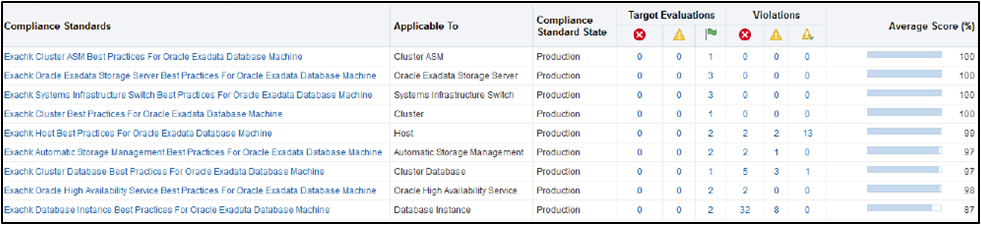
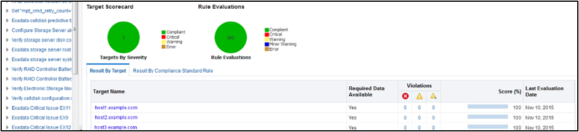
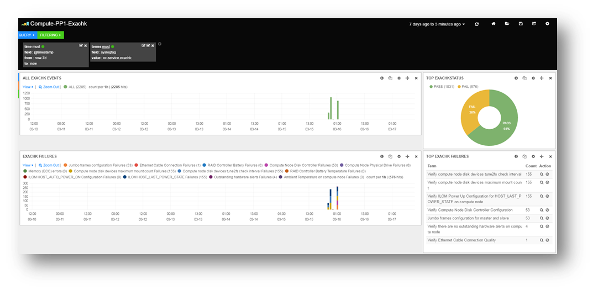

Integrate health check results from Oracle ORAchk and Oracle EXAchk into Enterprise Manager and other third-party tools.

- Integrating Health Check Results with Oracle Enterprise Manager
  Integrate health check results from Oracle ORAchk and Oracle EXAchk into Oracle Enterprise Manager.
- Integrating Health Check Results with Third-Party Tool
  Integrate health check results from Oracle ORAchk and Oracle EXAchk into various third-party log monitoring and analytics tools, such as Elasticsearch and Kibana.
- Integrating Health Check Results with Custom Application
  Oracle ORAchk and Oracle EXAchk upload collection results from multiple instances into a single database for easier consumption of check results across your enterprise.

**Parent topic:** [Analyzing Risks and Complying with Best Practices](purpose-oracle-orachk-and-oracle-exachk.md)

### 2.10.1 Integrating Health Check Results with Oracle Enterprise Manager

Integrate health check results from Oracle ORAchk and Oracle EXAchk into Oracle Enterprise Manager.

Oracle Enterprise Manager Cloud Control releases 13.1 and 13.2 support integration with Oracle ORAchk and Oracle EXAchk through the Oracle Enterprise Manager ORAchk Healthchecks Plug-in. The Oracle Engineered System Healthchecks plug-in supported integration with EXAchk for Oracle Enterprise Manager Cloud Control 12c release 12.1.0.5 and earlier releases.

With Oracle Enterprise Manager Cloud Control 13.1, Oracle ORAchk and Oracle EXAchk check results are integrated into the compliance framework. Integrating check results into the compliance framework enables you to display Compliance Framework Dashboards and browse checks by compliance standards.

- Integrate check results into Oracle Enterprise Manager compliance framework.

- View health check results in native Oracle Enterprise Manager compliance dashboards.

  Figure 2-23 Compliance Dashboard

  
  [Description of "Figure 2-23 Compliance Dashboard"](img_text/compliance-dashborad.md)

- Related checks are grouped into compliance standards where you can view targets checked, violations, and average score.

  Figure 2-24 Compliance Standards

  
  [Description of "Figure 2-24 Compliance Standards"](img_text/compliance-standards.md)

- From within a compliance standard, drill-down to see individual check results and break the results by targets.

  Figure 2-25 Compliance Standards Drill-Down

  
  [Description of "Figure 2-25 Compliance Standards Drill-Down"](img_text/compliance-standards-drill.md)

**Note:**

Although Oracle ORAchk and Oracle EXAchk do not require additional licenses, you require applicable Oracle Enterprise Manager licenses.

**Related Topics**

- [Oracle Enterprise Manager ORAchk Healthchecks Plug-in User's Guide](https://docs.oracle.com/pls/topic/lookup?ctx=en/database/oracle/oracle-database/19/atnms&id=PICHK125)
- [Oracle Enterprise Manager Licensing Information User Manual](https://docs.oracle.com/pls/topic/lookup?ctx=en/database/oracle/oracle-database/19/atnms&id=OEMLI108)

**Parent topic:** Integrating Health Check Results with Other Tools

### 2.10.2 Integrating Health Check Results with Third-Party Tool

Integrate health check results from Oracle ORAchk and Oracle EXAchk into various third-party log monitoring and analytics tools, such as Elasticsearch and Kibana.

Figure 2-26 Third-Party Tool Integration

[Description of "Figure 2-26 Third-Party Tool Integration"](img_text/third-party-tool-integration.md)

Oracle ORAchk and Oracle EXAchk create JSON output results in the output upload directory, for example:

    Report_Output_Dir/upload/mymachine_orachk_results.json
    Report_Output_Dir/upload/mymachine_orachk_exceptions.json

    Report_Output_Dir/upload/mymachine_exachk_results.json
    Report_Output_Dir/upload/mymachine_exachk_exceptions.json

1.  Run the `–syslog` option to write JSON results to the `syslog` daemon.

    For example:
        ./orachk –syslog

        ./exachk –syslog

2.  Verify the `syslog` configuration by running the following commands:

    Oracle ORAchk and Oracle EXAchk use the message levels: `CRIT`, `ERR`, `WARN`, and `INFO`.

        $  logger -p user.crit crit_message
        $  logger -p user.err err_message
        $  logger -p user.warn warn_message
        $  logger -p user.info info_message

3.  Verify in your configured message location, for example, `/var/adm/messages` that each test message is written.

**Related Topics**

- [Elasticsearch: RESTful, Distributed Search & Analytics \| Elastic](https://docs.oracle.com/pls/topic/lookup?ctx=en/database/oracle/oracle-database/19/atnms&id=elasticsearch_download)
- [Kibana: Explore, Visualize, Discover Data \| Elastic](https://docs.oracle.com/pls/topic/lookup?ctx=en/database/oracle/oracle-database/19/atnms&id=kibana_download)
- [Logging Alerts to the syslogd Daemon](https://docs.oracle.com/cd/E19424-01/820-4809/log_syslog/index.html)

**Parent topic:** Integrating Health Check Results with Other Tools

### 2.10.3 Integrating Health Check Results with Custom Application

Oracle ORAchk and Oracle EXAchk upload collection results from multiple instances into a single database for easier consumption of check results across your enterprise.

Use Oracle Health Check Collections Manager or your own custom application to consume health check results.

1.  Upload the collection results into the following tables at the end of a collection:

    Table 2-3 Uploading Collection Results into a Database

    | Table                     | What Get’s Uploaded             |
    |:--------------------------|:--------------------------------|
    | `rca13_docs`              | Full zipped collection results. |
    | `auditcheck_result`       | Health check results.           |
    | `auditcheck_patch_result` | Patch check results.            |

    If you install Oracle Health Check Collections Manager, then these tables are created by the install script.

2.  If the tables are not created, then use the following DDL statements:

    - DDL for the RCA13_DOCS table

          CREATE TABLE RCA13_DOCS (
              DOC_ID          NUMBER DEFAULT to_number(sys_guid(),'XXXXXXXXXXXXXXXXXXXXXXXXXXXXXXXX') NOT NULL ENABLE,
              COLLECTION_ID   VARCHAR2(40 BYTE),
              FILENAME        VARCHAR2(1000 BYTE) NOT NULL ENABLE,
              FILE_MIMETYPE   VARCHAR2(512 BYTE),
              FILE_CHARSET    VARCHAR2(512 BYTE),
              FILE_BLOB       BLOB NOT NULL ENABLE,
              FILE_COMMENTS   VARCHAR2(4000 BYTE),
              TAGS            VARCHAR2(4000 BYTE),
              ATTR1           VARCHAR2(200 BYTE),
              UPLOADED_BY     VARCHAR2(200 BYTE) DEFAULT USER,
              UPLOADED_ON     TIMESTAMP (6) DEFAULT systimestamp,
              SR_BUG_NUM      VARCHAR2(20 BYTE),
              CONSTRAINT RCA13_DOCS_PK PRIMARY KEY (DOC_ID),
              CONSTRAINT RCA13_DOCS_UK1 UNIQUE (FILENAME)
            );

    - DDL for the auditcheck_result table

          CREATE TABLE auditcheck_result (
               COLLECTION_DATE          TIMESTAMP NOT NULL ENABLE,
               CHECK_NAME               VARCHAR2(256),
               PARAM_NAME               VARCHAR2(256),
               STATUS                   VARCHAR2(256),
               STATUS_MESSAGE           VARCHAR2(256),
               ACTUAL_VALUE             VARCHAR2(256),
               RECOMMENDED_VALUE        VARCHAR2(256),
               COMPARISON_OPERATOR      VARCHAR2(256),
               HOSTNAME                 VARCHAR2(256),
               INSTANCE_NAME            VARCHAR2(256),
               CHECK_TYPE               VARCHAR2(256),
               DB_PLATFORM              VARCHAR2(256),
               OS_DISTRO                VARCHAR2(256),
               OS_KERNEL                VARCHAR2(256),
               OS_VERSION               NUMBER,
               DB_VERSION               VARCHAR2(256),
               CLUSTER_NAME             VARCHAR2(256),
               DB_NAME                  VARCHAR2(256),
               ERROR_TEXT               VARCHAR2(256),
               CHECK_ID                 VARCHAR2(40),
               NEEDS_RUNNING            VARCHAR2(100),
               MODULES                  VARCHAR2(4000),
               DATABASE_ROLE            VARCHAR2(100),
               CLUSTERWARE_VERSION      VARCHAR2(100),
               GLOBAL_NAME              VARCHAR2(256),
               UPLOAD_COLLECTION_NAME   VARCHAR2(256) NOT NULL ENABLE,
               AUDITCHECK_RESULT_ID     VARCHAR2(256) DEFAULT sys_guid() NOT NULL ENABLE,
               COLLECTION_ID            VARCHAR2(40),
               TARGET_TYPE              VARCHAR2(128),
               TARGET_VALUE             VARCHAR2(256),
               CONSTRAINT "AUDITCHECK_RESULT_PK" PRIMARY KEY ("AUDITCHECK_RESULT_ID")
          );

    - DDL for the auditcheck_patch_result table

          CREATE TABLE  auditcheck_patch_result (
                 COLLECTION_DATE         TIMESTAMP(6) NOT NULL,
                 HOSTNAME                VARCHAR2(256),
                 ORACLE_HOME_TYPE        VARCHAR2(256),
                 ORACLE_HOME_PATH        VARCHAR2(256),
                 ORACLE_HOME_VERSION     VARCHAR2(256),
                 PATCH_NUMBER            NUMBER,
                 CLUSTER_NAME            VARCHAR2(256),
                 DESCRIPTION             VARCHAR2(256),
                 PATCH_TYPE              VARCHAR2(128),
                 APPLIED                 NUMBER,
                 UPLOAD_COLLECTION_NAME  VARCHAR2(256),
                 RECOMMENDED             NUMBER
          );

**Related Topics**

- [Uploading Collections Automatically](collection-manager.md)

**Parent topic:** Integrating Health Check Results with Other Tools
