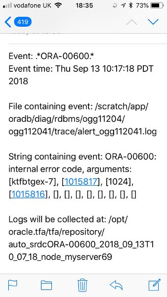

This section helps you manage Oracle Trace File Analyzer daemon, diagnostic collections, and the collection repository.

- Querying Oracle Trace File Analyzer Status and Configuration
  Use the `print` command to query the status or configuration.
- Managing the Oracle Trace File Analyzer Daemon
  Oracle Trace File Analyzer runs from `init` on UNIX systems or `init/upstart/systemd` on Linux, or Microsoft Windows uses a Windows Service so that Oracle Trace File Analyzer starts automatically whenever a node starts.
- Managing the Repository
  Oracle Trace File Analyzer stores all diagnostic collections in the repository.
- Managing Collections
  Manage directories configured in Oracle Trace File Analyzer and diagnostic collections.
- Configuring the Host
  You must have `root` or `sudo` access to `tfactl` to add hosts to Oracle Trace File Analyzer configuration.
- Configuring the Ports
  The Oracle Trace File Analyzer daemons in a cluster communicate securely over ports 5000 to 5005.
- Configuring SSL and SSL Certificates
  View and restrict SSL/TLS protocols. Configure Oracle Trace File Analyzer to use self-signed or CA-signed certificates.
- Configuring Email Notification Details
  Configure Oracle Trace File Analyzer to send an email to the registered email address after an automatic collection completes.

**Parent topic:** [Collecting Diagnostic Data and Triaging, Diagnosing, and Resolving Issues](diagnose-troubleshoot-issues-errors.md)

### 19.1 Querying Oracle Trace File Analyzer Status and Configuration

Use the `print` command to query the status or configuration.

Table 19-1 Configuration Listing and Descriptions

| Configuration Listing                            | Default Value                                                   | Description                                                                                                                                                                                                                                                                          |
|:-------------------------------------------------|:----------------------------------------------------------------|:-------------------------------------------------------------------------------------------------------------------------------------------------------------------------------------------------------------------------------------------------------------------------------------|
| Automatic diagnostic collection                  | ON                                                              | Triggers a collection if a significant problem occurs. Possible values: • ON • OFF                                                                                                                                                                                          |
| Trimming of files during diagnostic collection   | ON                                                              | Trims the log files to only entries within the time range of the collection. Possible values: • ON • OFF                                                                                                                                                                    |
| Repository maximum size in MB                    | Smaller of either 10GB or 50% of free space in the file system. | The largest size the repository can be.                                                                                                                                                                                                                                              |
| Trace Level                                      | 1                                                               | Increases the level of verbosity. Possible values: • 1 • 2 • 3 • 4 A value of 1 results in the least amount of trace. A value of 4 results in the most amount of trace. Oracle recommends changing the trace level value only at the request of Oracle Support. |
| Automatic Purging                                | ON                                                              | Purges collections when: Free space in the repository falls below 1GB. Or Before closing the repository. Purging removes collections from largest size through to smallest. Purging continues until the repository has enough space to open.                             |
| Minimum Age of Collections to Purge (Hours)      | 12                                                              | The least number of hours to keep a collection, after which it is eligible for purging.                                                                                                                                                                                              |
| Minimum Space free to enable Alert Log Scan (MB) | 500                                                             | Suspends log scanning if free space in the `tfa_home` falls below this value.                                                                                                                                                                                                        |

Example 19-1 Print Configuration

    $ tfactl print config
    .------------------------------------------------------------------------.
    |                             node1                                       |
    +-----------------------------------------------------------+------------+
    | Configuration Parameter                                   | Value      |
    +-----------------------------------------------------------+------------+
    | TFA Version                                               |12.2.1.0.0  |
    | Java Version                                              | 1.8        |
    | Public IP Network                                         | true       |
    | Automatic Diagnostic Collection                           | true       |
    | Alert Log Scan                                            | true       |
    | Disk Usage Monitor                                        | true       |
    | Managelogs Auto Purge                                     | false      |
    | Trimming of files during diagcollection                   | true       |
    | Inventory Trace level                                     | 1          |
    | Collection Trace level                                    | 1          |
    | Scan Trace level                                          | 1          |
    | Other Trace level                                         | 1          |
    | Repository current size (MB)                              | 447        |
    | Repository maximum size (MB)                              | 10240      |
    | Max Size of TFA Log (MB)                                  | 50         |
    | Max Number of TFA Logs                                    | 10         |
    | Max Size of Core File (MB)                                | 20         |
    | Max Collection Size of Core Files (MB)                    | 200        |
    | Minimum Free Space to enable Alert Log Scan (MB)          | 500        |
    | Time interval between consecutive Disk Usage Snapshot(minutes)  | 60   |
    | Time interval between consecutive Managelogs Auto Purge(minutes)| 60   |
    | Logs older than the time period will be auto purged(days[d]|hours[h])|30d|
    | Automatic Purging                                         | true       |
    | Age of Purging Collections (Hours)                        | 12         |
    | TFA IPS Pool Size                                         | 5          |
    '-----------------------------------------------------------+------------'

**Related Topics**

- [tfactl print](running-administration-commands.md)

**Parent topic:** Managing and Configuring Oracle Trace File Analyzer

### 19.2 Managing the Oracle Trace File Analyzer Daemon

Oracle Trace File Analyzer runs from `init` on UNIX systems or `init/upstart/systemd` on Linux, or Microsoft Windows uses a Windows Service so that Oracle Trace File Analyzer starts automatically whenever a node starts.

#### To manage Oracle Trace File Analyzer daemon:

The `init` control file `/etc/init.d/init.tfa` is platform dependant.

1.  To start or stop Oracle Trace File Analyzer manually:
    - `tfactl start`: Starts the Oracle Trace File Analyzer daemon

    - `tfactl stop`: Stops the Oracle Trace File Analyzer daemon

    If the Oracle Trace File Analyzer daemon fails, then the operating system restarts the daemon automatically.
2.  To enable or disable automatic restarting of the Oracle Trace File Analyzer daemon:
    - `tfactl disable`: Disables automatic restarting of the Oracle Trace File Analyzer daemon.

    - `tfactl enable`: Enables automatic restarting of the Oracle Trace File Analyzer daemon.

**Parent topic:** Managing and Configuring Oracle Trace File Analyzer

### 19.3 Managing the Repository

Oracle Trace File Analyzer stores all diagnostic collections in the repository.

The repository size is the maximum space Oracle Trace File Analyzer is able to use on disk to store collections.

- Purging the Repository Automatically
- Purging the Repository Manually

**Parent topic:** Managing and Configuring Oracle Trace File Analyzer

#### 19.3.1 Purging the Repository Automatically

Oracle Trace File Analyzer closes the repository, if:

- Free space in `TFA_HOME`  is less than 100 MB, also stops indexing

- Free space in `ORACLE_BASE`  is less than 100 MB, also stops indexing

- Free space in the repository is less than 1 GB

- Current size of the repository is greater than the repository max size (`reposizeMB`)

The Oracle Trace File Analyzer daemon monitors and automatically purges the repository when the free space falls below 1 GB or before closing the repository. Purging removes collections from largest size through to smallest until the repository has enough space to open.

Oracle Trace File Analyzer automatically purges only the collections that are older than `minagetopurge`. By default, `minagetopurge`  is 12 hours.

##### To purge the repository automatically

1.  To change the minimum age to purge:
        set minagetopurge=number of hours

    For example:
        $ tfactl set minagetopurge=48

    Purging the repository automatically is enabled by default.
2.  To disable or enable automatic purging:
        set autopurge=ON|OFF

    For example:
        $ tfactl set autopurge=ON
3.  To change the location of the repository:
        set repositorydir=dir

    For example:
        $ tfactl set repositorydir=/opt/mypath
4.  To change the size of the repository:
        set reposizeMB

    For example:
        $ tfactl set reposizeMB=20480

**Related Topics**

- [tfactl set](running-administration-commands.md)

**Parent topic:** Managing the Repository

#### 19.3.2 Purging the Repository Manually

##### To purge the repository manually:

1.  To view the status of the Oracle Trace File Analyzer repository:
        tfactl print repository
2.  To view statistics about collections:
        tfactl print collections
3.  To manually purge collections that are older than a specific time:
        tfactl purge -older number[h|d] [-force]

**Related Topics**

- [tfactl purge](running-diagnostic-collection-commands.md)
- [tfactl print](running-administration-commands.md)

**Parent topic:** Managing the Repository

### 19.4 Managing Collections

Manage directories configured in Oracle Trace File Analyzer and diagnostic collections.

- Including Directories
  Add directories to the Oracle Trace File Analyzer configuration to include the directories in diagnostic collections.
- Managing the Size of Collections
  Use the Oracle Trace File Analyzer configuration options `trimfiles`, `maxcorefilesize`, `maxcorecollectionsize`, and `diagcollect` `-nocores` to reduce the size of collections.

**Parent topic:** Managing and Configuring Oracle Trace File Analyzer

#### 19.4.1 Including Directories

Add directories to the Oracle Trace File Analyzer configuration to include the directories in diagnostic collections.

Oracle Trace File Analyzer then stores diagnostic collection metadata about the:

- Directory

- Subdirectories

- Files in the directory and all sub directories

All Oracle Trace File Analyzer users can add directories they have read access to.

##### To manage directories:

1.  To view the current directories configured in Oracle Trace File Analyzer
        tfactl print directories [ -node all | local | n1,n2,... ]
        [ -comp component_name1,component_name2,.. ]
        [ -policy  exclusions | noexclusions ]
        [ -permission public | private ]
2.  To add directories:
        tfactl directory add dir
        [ -public ]
        [ -exclusions | -noexclusions | -collectall ]
        [ -node all | n1,n2,... ]
3.  To remove a directory from being collected:
        tfactl directory remove dir [ -node all | n1,n2,... ]

**Related Topics**

- [tfactl directory](running-diagnostic-collection-commands.md)
- [tfactl print](running-administration-commands.md)

**Parent topic:** Managing Collections

#### 19.4.2 Managing the Size of Collections

Use the Oracle Trace File Analyzer configuration options `trimfiles`, `maxcorefilesize`, `maxcorecollectionsize`, and `diagcollect` `-nocores` to reduce the size of collections.

##### To manage the size of collections:

1.  To trim files during diagnostic collection:
        tfactl set trimfiles=ON|OFF

    - When set to ON (default), Oracle Trace File Analyzer trims files to include data around the time of the event

    - When set to OFF, any file that was written to at the time of the event is collected in its entirety
2.  To set the maximum size of core file to n MB (default 20 MB):
        tfactl set maxcorefilesize=n

    Oracle Trace File Analyzer skips core files that are greater than `maxcorefilesize`.
3.  To set the maximum collection size of core files to n MB (default 200 MB):
        tfactl set maxcorecollectionsize=n

    Oracle Trace File Analyzer skips collecting core files after `maxcorecollectionsize` is reached.
4.  To prevent the collection of core files with diagnostic collections:
        tfactl diagcollect -nocores

**Related Topics**

- [tfactl diagcollect](running-diagnostic-collection-commands.md)
- [tfactl set](running-administration-commands.md)

**Parent topic:** Managing Collections

### 19.5 Configuring the Host

You must have `root` or `sudo` access to `tfactl` to add hosts to Oracle Trace File Analyzer configuration.

#### To add, remove, and replace SSL certificates:

1.  To view the list of current hosts in the Oracle Trace File Analyzer configuration:
        tfactl print hosts
2.  To add a host to the Oracle Trace File Analyzer configuration for the first time:
    1.  If necessary, install and start Oracle Trace File Analyzer on the new host.
    2.  From the existing host, synchronize authentication certificates for all hosts by running:
            tfactl syncnodes

        If needed, then Oracle Trace File Analyzer displays the current node list it is aware of and prompts you to update this node list.
    3.  Select Y, and then enter the name of the new host.
        Oracle Trace File Analyzer contacts Oracle Trace File Analyzer on the new host to synchronize certificates and add each other to their respective hosts lists.
3.  To remove a host:
        tfactl host remove host
4.  To add a host and the certificates that are already synchronized:
        tfactl host add host

    Oracle Trace File Analyzer generates self-signed SSL certificates during install. Replace those certificates with one of the following:

    - Personal self-signed certificate

    - CA-signed certificate

**Parent topic:** Managing and Configuring Oracle Trace File Analyzer

### 19.6 Configuring the Ports

The Oracle Trace File Analyzer daemons in a cluster communicate securely over ports 5000 to 5005.

If the port range is not available on your system, then replace it with the ports available on your system.

#### To change the ports:

1.   To set the primary port use the `tfactl set port` command:
        tfactl set port=port_1

    Or, specify a comma-delimited list of sequentially numbered ports to use. You can specify a maximum of five ports.
        tfactl set port=port_1,port_2,port_3,port_4,port_5
2.  Restart Oracle Trace File Analyzer on all nodes:
        tfactl stop

        tfactl start

**Parent topic:** Managing and Configuring Oracle Trace File Analyzer

### 19.7 Configuring SSL and SSL Certificates

View and restrict SSL/TLS protocols. Configure Oracle Trace File Analyzer to use self-signed or CA-signed certificates.

- Configuring SSL/TLS Protocols
  The Oracle Trace File Analyzer daemons in a cluster communicate securely using the SSL/TLS protocols.
- Configuring Self-Signed Certificates
  Use `Java keytool` to replace self-signed SSL certificates with personal self-signed certificates.
- Configuring CA-Signed Certificates
  Use `Java keytool` and `openssl` to replace self-signed SSL certificates with the Certificate Authority (CA) signed certificates.
- Configuring SSL Cipher Suite
  The cipher suite is a set of cryptographic algorithms used by the TLS/SSL protocols to create keys and encrypt data.

**Parent topic:** Managing and Configuring Oracle Trace File Analyzer

#### 19.7.1 Configuring SSL/TLS Protocols

The Oracle Trace File Analyzer daemons in a cluster communicate securely using the SSL/TLS protocols.

The SSL protocols available for use by Oracle Trace File Analyzer are:

- `TLSv1.2`

- `TLCv1.1`

- `TLSv1`

Oracle Trace File Analyzer always restricts use of older the protocols `SSLv3` and `SSLv2Hello`.

##### To view and restrict protocols:

1.  To view the available and restricted protocols:
        tfactl print protocols

    For example:
        $ tfactl print protocols
        .---------------------------------------.
        |                 node1                 |
        +---------------------------------------+
        | Protocols                             |
        +---------------------------------------+
        | Available : [TLSv1, TLSv1.2, TLSv1.1] |
        | Restricted : [SSLv3, SSLv2Hello]      |
        '---------------------------------------'
2.  To restrict the use of certain protocols:
        tfactl restrictprotocol [-force] protocol

    For example:
        $ tfactl restrictprotocol TLSv1

**Parent topic:** Configuring SSL and SSL Certificates

#### 19.7.2 Configuring Self-Signed Certificates

Use `Java keytool` to replace self-signed SSL certificates with personal self-signed certificates.

##### To configure Oracle Trace File Analyzer to use self-signed certificates:

1.  Create a private key and keystore file containing the self-signed certificate for the server:
        $ keytool -genkey -alias server_full -keyalg RSA -keysize 2048 -validity 18263 -keystore myserver.jks
2.  Create a private key and keystore file containing the private key and self signed-certificate for the client:
        $ keytool -genkey -alias client_full -keyalg RSA -keysize 2048 -validity 18263 -keystore myclient.jks
3.  Export the server public key certificate from the server keystore:
        $ keytool -export -alias server_full -file myserver_pub.crt -keystore myserver.jks -storepass password
4.  Export the client public key certificate from the server keystore:
        $ keytool -export -alias client_full -file myclient_pub.crt -keystore myclient.jks -storepass password
5.  Import the server public key certificate into the client keystore:
        $ keytool -import -alias server_pub -file myserver_pub.crt -keystore myclient.jks -storepass password
6.  Import the client public key certificate into the server keystore:
        $ keytool -import -alias client_pub -file myclient_pub.crt  -keystore myserver.jks -storepass password
7.  Restrict the permissions on the keystores to `root`  `read-only`.
        $ chmod 400 myclient.jks myserver.jks
8.  Copy the keystores (`jks` files) to each node.
9.  Configure Oracle Trace File Analyzer to use the new certificates:
        $ tfactl set sslconfig
10. Restart the Oracle Trace File Analyzer process to start using new certificates:
        $ tfactl stop
        $ tfactl start

**Parent topic:** Configuring SSL and SSL Certificates

#### 19.7.3 Configuring CA-Signed Certificates

Use `Java keytool` and `openssl` to replace self-signed SSL certificates with the Certificate Authority (CA) signed certificates.

##### To configure Oracle Trace File Analyzer to use CA-signed certificates:

1.  Create a private key for the server request:
        $ openssl genrsa -aes256 -out myserver.key 2048
2.  Create a private key for the client request:
        $ openssl genrsa -aes256 -out myclient.key 2048
3.  Create a Certificate Signing Request (CSR) for the server:
        $ openssl req -key myserver.key -new -sha256 -out myserver.csr
4.  Create a Certificate Signing Request (CSR) for the client:
        $ openssl req -key myclient.key -new -sha256 -out myclient.csr
5.  Send the resulting CSR for the client and the server to the relevant signing authority.
    The signing authority sends back the signed certificates:

    - `myserver.cert`

    - `myclient.cert`

    - CA root certificate
6.  Convert the certificates to JKS format for the server and the client:
        $ openssl pkcs12 -export -out serverCert.pkcs12 -in myserver.cert -inkey myserver.key

        $ keytool -v -importkeystore -srckeystore serverCert.pkcs12 -srcstoretype PKCS12 -destkeystore myserver.jks -deststoretype JKS

        $ openssl pkcs12 -export -out clientCert.pkcs12 -in myclient.cert -inkey myclient.key

        $ keytool -v -importkeystore -srckeystore clientCert.pkcs12 -srcstoretype PKCS12 -destkeystore myclient.jks -deststoretype JKS
7.  Import the server public key into to the client `jks` file:
        $ keytool -import -v -alias server-ca -file myserver.cert -keystore myclient.jks
8.  Import the client public key to the server `jks` file:
        $ keytool -import -v -alias client-ca -file myclient.cert -keystore myserver.jks
9.  Import the CA root certificate from the signing authority into the Oracle Trace File Analyzer server certificate:
        $ keytool -importcert -trustcacerts -alias inter -file caroot.cert -keystore myserver.jks
10. Restrict the permissions on the keystores to `root`  `read-only`:
        $ chmod 400 myclient.jks myserver.jks
11. Copy the keystores (`jks` files) to each node.
12. Configure Oracle Trace File Analyzer to use the new certificates:
        $ tfactl set sslconfig
13. Restart the Oracle Trace File Analyzer process to start using the new certificates.
        $ tfactl stop
        $ tfactl start

**Parent topic:** Configuring SSL and SSL Certificates

#### 19.7.4 Configuring SSL Cipher Suite

The cipher suite is a set of cryptographic algorithms used by the TLS/SSL protocols to create keys and encrypt data.

Oracle Trace File Analyzer supports any of the cipher suites used by JRE 1.8.

The default cipher suite used is `TLS_RSA_WITH_AES_128_CBC_SHA256`.

1.  You can change the cipher suite with the command:
        tfactl set ciphersuite=cipher_suite

    For example:
        tfactl set ciphersuite=TLS_RSA_WITH_AES_128_GCM_SHA256

    For a list of JRE cipher suites, see:
    <https://docs.oracle.com/javase/8/docs/technotes/guides/security/SunProviders.html#SunJSSEProvider>

**Parent topic:** Configuring SSL and SSL Certificates

### 19.8 Configuring Email Notification Details

Configure Oracle Trace File Analyzer to send an email to the registered email address after an automatic collection completes.

To send emails, configure the system on which Oracle Trace Analyzer is running. You must configure notification with a user email address to enable it to work.

#### To configure email notification details:

1.  To set the notification email to use for a specific `ORACLE_HOME`, include the operating system owner in the command:
        tfactl set notificationAddress=os_user:email

    For example:
        tfactl set notificationAddress=oracle:some.body@example.com
2.  To set the notification email to use for any `ORACLE_HOME`:
        tfactl set notificationAddress=email

    For example:
        tfactl set notificationAddress=another.body@example.com
3.  Configure the SMTP server using `tfactl set smtp`.
    Set the SMTP parameters when prompted.

    Table 19-2 tfactl diagnosetfa Command Parameters

    | Parameter       | Description                                             |
    |:----------------|:--------------------------------------------------------|
    | `smtp.host`     | Specify the SMTP server host name.                      |
    | `smtp.port`     | Specify the SMTP server port.                           |
    | `smtp.user`     | Specify the SMTP user.                                  |
    | `smtp.password` | Specify password for the SMTP user.                     |
    | `smtp.auth`     | Set the Authentication flag to true or false.           |
    | `smtp.ssl`      | Set the SSL flag to true or false.                      |
    | `smtp.from`     | Specify the from mail ID.                               |
    | `smtp.to`       | Specify the comma-delimited list of recipient mail IDs. |
    | `smtp.cc`       | Specify the comma-delimited list of CC mail IDs.        |
    | `smtp.bcc`      | Specify the comma-delimited list of BCC mail IDs.       |
    | `smtp.debug`    | Set the Debug flag to true or false.                    |

    **Note:**

    You can view current SMTP configuration details using `tfactl print smtp`.
4.  Verify SMTP configuration by sending a test email using `tfactl sendmail ``email_address`.
    When Oracle Trace File Analyzer detects a significant error has occurred it will send an email notification as follows:

    Figure 19-1 Email Notification

    
    [Description of "Figure 19-1 Email Notification"](img_text/ora600-notification.md)
5.  Do the following after receiving the notification email:
    1.  To find the root cause, inspect the referenced collection details.
    2.  If you can fix the issue, then resolve the underlying cause of the problem.
    3.  If you do not know the root cause of the problem, then log an SR with Oracle Support, and upload the collection details.

Example 19-2 tfactl set smtp

    # /u01/app/11.2.0.4/grid/bin/tfactl set smtp

    .---------------------------.
    | SMTP Server Configuration |
    +---------------+-----------+
    | Parameter | Value |
    +---------------+-----------+
    | smtp.auth | false |
    | smtp.from | tfa |
    | smtp.user | - |
    | smtp.cc | - |
    | smtp.port | 25 |
    | smtp.bcc | - |
    | smtp.password | ******* |
    | smtp.host | localhost |
    | smtp.to | - |
    | smtp.debug | true |
    | smtp.ssl | true |
    '---------------+-----------'

    Enter the SMTP property you want to update : smtp.host

    Enter value for smtp.host : myhost.domain.com

    SMTP Property smtp.host updated with myhost.domain.com

    Do you want to continue ? [Y]|N : N

    #

**Parent topic:** Managing and Configuring Oracle Trace File Analyzer
