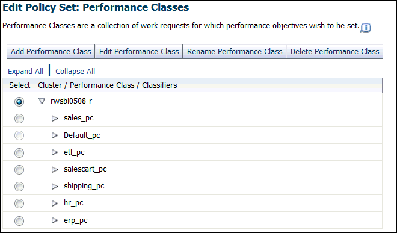
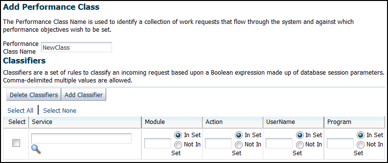

Each policy set contains one or more performance classes. Each performance class defines a type of workload on your servers.

- Creating a Performance Class
- Deleting a Performance Class
  You can delete a Performance Class that is no longer needed.
- Renaming a Performance Class
  You can rename a Performance Class using the Edit Policy Set wizard.
- Editing an Existing Performance Class
  When editing Performance Classes, you can create, edit, rename, or delete performance classes for the system.
- Specifying the Evaluation Order of the Classifiers
  The classifiers generate Boolean expressions that are evaluated each time a work request enters the system.

**Parent topic:** [Administering the Oracle Database QoS Management System](administering-oracle-database-qos-management-system.md)

### 9.5.1 Creating a Performance Class

To create or edit the Performance Classes and the classifiers they use, perform the following tasks:

1.  Start the Policy Set Editor wizard. From the cluster target page in Oracle Enterprise Manager Cloud Control, select Administration, then Quality of Service Management, then Edit Policy Set.
2.  Go to the second screen in the wizard.
    On the Edit Policy Set: Performance Classes page, the available Performance Classes are displayed. If this is the first time configuring the system, then a Performance Class for each database service is shown along with a Default Performance Class.

    
    [Description of the illustration cc12_policy_edit_2.gif](img_text/cc12_policy_edit_2.md)
    To specify a classifier for a work request, you must specify at least one service name. If you specify multiple services, then use a comma-delimited list. Optionally, you can also specify any of the following filters:

    - A comma-delimited list of module names and whether the work request uses a module in this list

    - A comma-delimited list of actions, and whether the work request performs an action in this list

    - A comma-delimited list of user names, and whether the work request uses a user name in this list

    - A comma-delimited list of programs, and whether the work request is running a program in this list
3.  Click Add Performance Class, and the Performance Class creation page is displayed. In the Performance Class Name text field, enter a name for the Performance Class.
    
    [Description of the illustration cc12_add_perf_class_1.gif](img_text/cc12_add_perf_class_1.md)
4.  In the Classifiers section, enter information to define a rule for classifying work requests. First select a database service, then specify matching values (In Set) for the [module](glossary.md), [action](glossary.md), [UserName](glossary.md), or [program name](glossary.md) that is associated with the work request using the specified database service. You can also specify exclusion values (Not In Set) for these attributes.
    If you want to add multiple classifiers for the Performance Class, then click the Add Classifier button and enter in the appropriate information.

    **Note:**

    When evaluating a classifier for a Performance Class, all of the specified values are compared to the work request attributes using an AND operation; if you specify multiple classifiers for the Performance Class, then the results of each classifier evaluation for that Performance Class are combined using an OR operation.
5.  After you have defined all the classifiers for the Performance Class, click the Next button until you reach the end of the wizard. Review the information you specified, then click Submit Policy Set.

**Parent topic:** Managing Performance Classes

### 9.5.2 Deleting a Performance Class

You can delete a Performance Class that is no longer needed.

1.  Start the Edit Policy wizard.
2.  Go to the second screen in the wizard.
    On the Edit Policy Set: Performance Classes page, the available Performance Classes are displayed.
3.  Select a Performance Class and click Delete Performance Class.
4.  Advance to the end of the Edit Policy Set wizard, and click Submit Policy Set to make the change permanent.

**Parent topic:** Managing Performance Classes

### 9.5.3 Renaming a Performance Class

You can rename a Performance Class using the Edit Policy Set wizard.

1.  Start the Edit Policy wizard.
2.  Go to the second screen in the wizard.
    On the Edit Policy Set: Performance Classes page, the available Performance Classes are displayed.
3.  Select a Performance Class and click Rename Performance Class.
4.  On the Rename Performance Class page, enter the new name of the Performance Class, then click OK.
5.  Advance to the end of the Edit Policy Set wizard, and click Submit Policy Set to make the change permanent.

**Parent topic:** Managing Performance Classes

### 9.5.4 Editing an Existing Performance Class

When editing Performance Classes, you can create, edit, rename, or delete performance classes for the system.

You can use the Edit Performance Class button to modify the classifiers for an existing performance class.

1.  Start the Policy Set Editor wizard.
    1.  From the cluster target page in Oracle Enterprise Manager Cloud Control, select Administration.
    2.  Select Quality of Service Management.
    3.  Select Edit Policy Set.
2.  Go to the second screen in the wizard.
    On the Edit Policy Set: Performance Classes page, the available Performance Classes are displayed.
3.  Select the Performance Class you want to modify and click Edit Performance Class.
4.  When you are finished making changes, click OK.
5.  Advance to the last page of the Policy Set Editor and click Submit Policy Set.

- Adding Classifiers
- Changing Classifiers
- Deleting Classifiers

**Parent topic:** Managing Performance Classes

#### 9.5.4.1 Adding Classifiers

To add a classifier to a Performance Class, perform the following steps:

1.  Start the Policy Set Editor wizard.
2.  Go to the second screen in the wizard, the Edit Policy Set: Performance Classes page.
3.  Select the Performance Class to modify, then click Edit Performance Class.
4.  In the Classifiers section on the Edit Performance Class page, click the Add Classifier button and enter in the appropriate information. When finished, click OK.
5.  You then advance to the end of the Edit Policy Set wizard, and click Submit Policy Set to make the change permanent.

**Parent topic:** Editing an Existing Performance Class

#### 9.5.4.2 Changing Classifiers

To modify one or more classifiers for a Performance Class, perform the following steps:

1.  Start the Policy Set Editor wizard.
2.  Go to the second screen in the wizard, the Edit Policy Set: Performance Classes page.
3.  Select the Performance Class for which you want to change the classifiers, then click Edit Performance Class.
4.  In the Classifiers section on the Edit Performance Class page, modify the classifier information, then click OK.
5.  You then advance to the end of the Edit Policy Set wizard, and click Submit Policy Set to make the change permanent.

**Parent topic:** Editing an Existing Performance Class

#### 9.5.4.3 Deleting Classifiers

To delete one or more classifiers for a Performance Class, perform the following steps:

1.  Start the Policy Set Editor wizard.
2.  Go to the second screen in the wizard, the Edit Policy Set: Performance Classes page.
3.  Select the Performance Class for which you want to delete the classifiers, then click Edit Performance Class.
4.  In the Classifiers section on the Edit Performance Class page, select the classifiers you want to delete, then click Delete Classifiers. When finished, click OK.
5.  You then advance to the end of the Edit Policy Set wizard, and click Submit Policy Set to make the change permanent.

**Parent topic:** Editing an Existing Performance Class

### 9.5.5 Specifying the Evaluation Order of the Classifiers

The classifiers generate Boolean expressions that are evaluated each time a work request enters the system.

The first classifier that evaluates to TRUE determines the Performance Class for that work request. To ensure that the work requests are put in the correct Performance Classes, you must be careful in specifying the order in which the classifiers are evaluated.

To set the order of evaluation for the classifiers, perform the following steps:

1.  Start the Policy Set Editor wizard.
2.  Proceed to the third page in the wizard, which is titled Edit Policy Set: Classifier Ordering.
3.  Use the arrow keys to the right of a classifier to move the classifier up or down in the list. The classifiers for the Performance Classes at the top of the list are evaluated first. If the work request does not match the classifiers for that Performance Class, then evaluation continues with the next Performance Class in the list, until there are no further evaluations to be made. If a work request matches the classifiers for a Performance Class, then the work request is associated with that Performance Class and evaluation stops.
    For proper classification of work requests, you should put the Performance Classes with the strictest classifiers at the top of the list, and the Performance Classes with most lax classifiers near the bottom of the list. The `Default_pc` Performance Class, which has the most general classifiers, should always be at the bottom of the list.
4.  You then advance to the end of the Edit Policy Set wizard, and click Submit Policy Set to make the change permanent.

**Parent topic:** Managing Performance Classes
