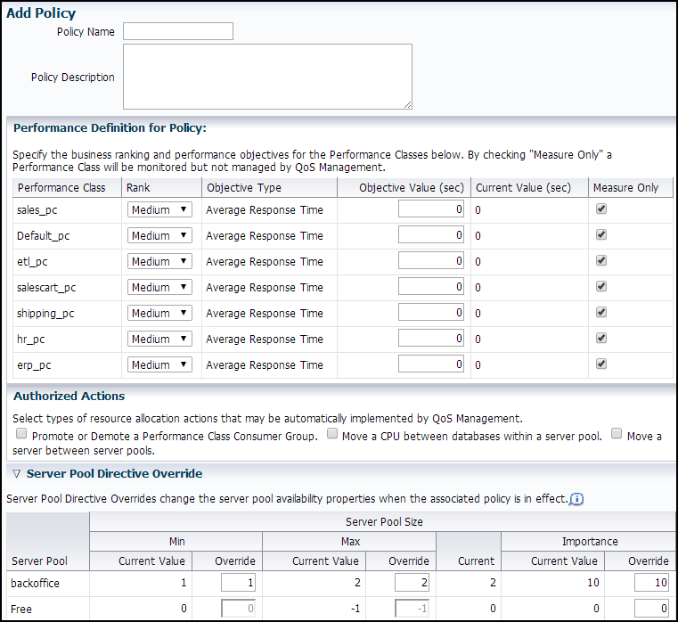
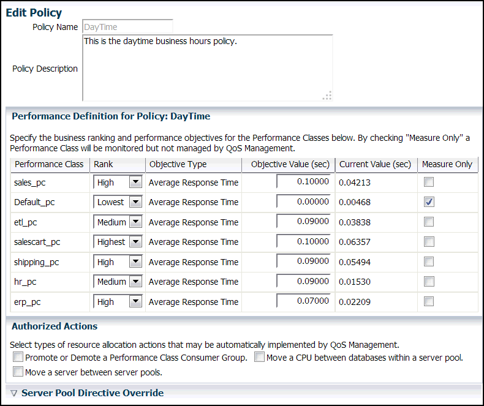
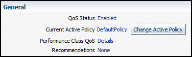
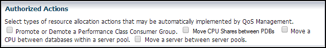
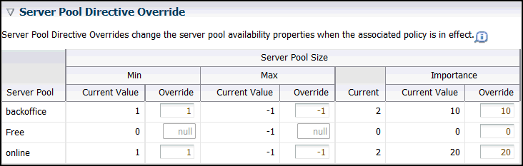

- Creating a Performance Policy and Specifying Performance Objectives
  Use Oracle Enterprise Manager Cloud Control to create a Performance Policy.
- Editing an Existing Performance Policy
  On the Edit Policy page, you can change the rank of each Performance Class, or change the Measure Only setting for a Performance Class.
- Copying a Performance Policy
- Setting the Current Performance Policy
- Deleting a Performance Policy
- Automatically Implementing Recommendations for a Performance Policy
- Setting Server Pool Directive Overrides
  A server pool directive override gives you the ability to enforce different settings for server pool sizes, or change the importance of server pools.

**Parent topic:** [Administering the Oracle Database QoS Management System](administering-oracle-database-qos-management-system.md)

### 9.6.1 Creating a Performance Policy and Specifying Performance Objectives

Use Oracle Enterprise Manager Cloud Control to create a Performance Policy.

To create and configure a Performance Policy, perform the following steps:

1.  Start the Policy Set Editor wizard.
2.  Proceed to the fourth page in the wizard, which is titled Edit Policy Set: Performance Policies.
3.  Click the Add Policy button to create a Performance Policy. The Add Policy page appears.
    
    [Description of the illustration cc12102_add_perf_policy.png](img_text/cc12102_add_perf_policy.md)
    For each Performance Policy you must specify a unique name. You can also provide a description of the policy and its intent. Then you must configure the Performance Classes for the policy.

    To configure the Performance Classes, you must do the following:

    - Set the rank for each Performance Class, from highest to lowest. A higher rank gives that Performance Class higher priority when there is contention for resources.

    - Specify a value for the Performance Objective.

      The Performance Objective value is the appropriate length of time in seconds in which the work request, or database request, should complete, for example, 0.008 seconds, or eight milliseconds.

      **Note:**

      You should not use the service-level agreements (SLAs) or target response times as the Performance Objective values. Instead, choose a value that is reasonable, sustainable, and greater than your target response time. Using a higher value gives you time to implement the recommendations from Oracle Database QoS Management regarding the allocation of resources before the Performance Objective is exceeded.

      You can also select whether the Performance Class is only measured or monitored, not managed. If you select Measure Only, then Oracle Database QoS Management measures or monitors the Performance Class, but does not provide any recommendations for improving performance.
4.  **Optional:** Specify which actions can be performed automatically by QoS Management.
5.  **Optional:** Configure server pool directive overrides.
6.  Advance to the end of the Edit Policy Set wizard. Click Submit Policy Set to make the change permanent.

**Related Topics**

- [Monitoring Performance with Oracle Database QoS Management](monitoring-performance-qos-management.md)
- Automatically Implementing Recommendations for a Performance Policy
- Setting Server Pool Directive Overrides

**Parent topic:** Managing Performance Policies

### 9.6.2 Editing an Existing Performance Policy

On the Edit Policy page, you can change the rank of each Performance Class, or change the Measure Only setting for a Performance Class.

You can also select the type of resource allocation actions that can be automatically implemented by QoS Management and set server pool directive overrides.

1.  On the Edit Policy Set: Performance Policies page, select the Performance Policy you want to modify and click Edit.
    
    [Description of the illustration cc12102_edit_perf_policy_1.png](img_text/cc12102_edit_perf_policy_1.md)
2.  Specify the new ranks or objective values for the Performance Classes, or enable or disable the Measure Only setting for a Performance Class.
3.  When you have finished making your changes, click OK to return to the Policy Set Editor wizard.
4.  Click Next until you reach the end of the wizard. Review your changes, then click Submit Policy Set.

**Related Topics**

- [Monitoring Performance with Oracle Database QoS Management](monitoring-performance-qos-management.md)
- Setting Server Pool Directive Overrides

**Parent topic:** Managing Performance Policies

### 9.6.3 Copying a Performance Policy

Instead of creating a new Performance Policy, you can instead copy an existing Performance Policy. A copied Performance Policy is identical to the original Performance Policy. You can then simply rename and edit the copy instead of re-creating all the details in a new Performance Policy.

**Parent topic:** Managing Performance Policies

### 9.6.4 Setting the Current Performance Policy

A Performance Policy is a collection of Performance Objectives, one for each Performance Class, that are in force at the same time. There are multiple ways to modify the active Performance Policy for Oracle Database QoS Management.

- Changing the Active Performance Policy from the Dashboard
- Changing the Active Performance Policy from the Policy Set Editor Wizard
- Changing the Active Performance Policy using a Script

**Parent topic:** Managing Performance Policies

#### 9.6.4.1 Changing the Active Performance Policy from the Dashboard

1.  On the Dashboard page, in the General section, click the button Change Active Policy.
    
    [Description of the illustration check_enabled_status.png](img_text/check_enabled_status.md)
2.  On the Set Policy page, select the Performance Policy you want to use, then click OK.

**Parent topic:** Setting the Current Performance Policy

#### 9.6.4.2 Changing the Active Performance Policy from the Policy Set Editor Wizard

You can change the Performance Policy that will be active when you submit the Policy Set to Oracle Database QoS Management.

1.  Start the Policy Set Editor wizard.
2.  Proceed to the fifth page in the wizard, which is titled Edit Policy Set: Set Policy.
3.  Select the Performance Policy you want enforced, and click Set Policy.

At the end of the Policy Set Editor wizard, you can review the settings you specified, then click Submit Policy Set to configure Oracle Database QoS Management.

**Parent topic:** Setting the Current Performance Policy

#### 9.6.4.3 Changing the Active Performance Policy using a Script

Many Oracle Database QoS Management policies are calendar based. You can switch the active performance policy automatically through a job scheduler such as Enterprise Manager Cloud Control, Task Scheduler or CRON by using a QOSCTL command to set the active policy.

1.  Log in to the operating system user as the Clusterware administrator.
2.  At the command line, or within a script, use the `qosctl` command with the `-activatepolicy` option. The command must use the following syntax:
        qosctl qos_admin_username -activatepolicy policy_name

    If the Performance Policy name includes spaces, then you must enclose the Performance Policy name within double quotes, for example:

        qosctl qosadmin -activatepolicy "Business Hours"

**Related Topics**

- [QOSCTL Utility Reference](creating-administrative-users-qos-management.md)

**Parent topic:** Setting the Current Performance Policy

### 9.6.5 Deleting a Performance Policy

To delete a Performance Policy, perform the following steps:

1.  Start the Policy Set Editor wizard.
2.  Proceed to the fourth page in the wizard, which is titled Edit Policy Set: Performance Policies.
3.  Click the Delete Policy button to delete a Performance Policy.
4.  You then advance to the end of the Edit Policy Set wizard, and click Submit Policy Set to make the change permanent.

**Parent topic:** Managing Performance Policies

### 9.6.6 Automatically Implementing Recommendations for a Performance Policy

You can use the appropriate check boxes to specify which of the following actions can be implemented automatically by Oracle Database QoS Management:

- Promote or demote a performance class consumer group

- Move a CPU between databases within a server pool

- Move CPU shares between PDBs

- Move a server between server pools

[Description of the illustration enabling_authorized_actions.png](img_text/enabling_authorized_actions.md)

If you do not authorize any of these actions, then Oracle Database QoS Management does not implement any changes to the active system until you review the current Recommendations for a Performance Class and click the Implement button.

**Parent topic:** Managing Performance Policies

### 9.6.7 Setting Server Pool Directive Overrides

A server pool directive override gives you the ability to enforce different settings for server pool sizes, or change the importance of server pools.

For example, if you are expecting a surge in demand, such as during an advertised sale period, then you could use a server pool directive override to allocate more resources to the accounting applications. Server pool directive overrides should be used only when necessary. Instead of using a server pool directive override, you should monitor the system over time and modify the server pool settings as needed. Using a server pool directive override can result in unexpected changes in resource allocations. For example, assume you have server pools named `webapps`, `HR`, and `payroll`. You create a server pool directive override to increase the minimum server pool size for the `payroll` server pool. When the server pool directive override is active, a server could be removed from the `HR` or `webapps` server pool to satisfy the higher minimum server requirement of the `payroll` server pool.

1.  Start the Policy Set Editor wizard.
2.  Proceed to the fourth page in the wizard, which is titled Edit Policy Set: Performance Policies.
3.  Click the Edit Policy button to edit a Performance Policy.
    The Edit policy page appears.
4.  Expand the Server Pool Directive Override section, if necessary.
    
    [Description of the illustration cc12_server_pool_overrides.gif](img_text/cc12_server_pool_overrides.md)
5.  To set server pool directive overrides, perform the following:
    - To override the current value for the minimum number of servers in a server pool, enter a new value in the Min:Override field for that server pool. Valid values are 0 to the maximum number of servers in that server pool.

    - To override the current value for the maximum number of servers in a server pool, enter a new value in the Max:Override field for that server pool. Valid values are from the minimum number of servers in that server pool to the size of the cluster.

    - To override the current value for the Importance of the server pool, enter a new value in the Importance:Override field for that server pool. Valid values are 0 to 1000; higher values indicate greater importance.
6.  After you have finished entering the server pool directive override values, click OK to implement the changes.
7.  Advance to the end of the Edit Policy Set wizard, and click Submit Policy Set to make the change permanent.

**Related Topics**

- [Modifying Server Pool Settings](administering-policy-set.md)

**Parent topic:** Managing Performance Policies
