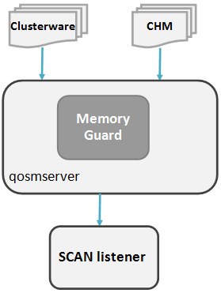

Memory Guard is implemented as a daemon running as an MBean in a J2EE container managed by Cluster Ready Services (CRS).

Memory Guard is hosted on the `qosmserver` resource that runs on any cluster node for high availability.

Figure 11-1 Memory Guard Architecture

[Description of "Figure 11-1 Memory Guard Architecture"](img_text/mg-architecture.md)

Cluster Health Monitor sends a metrics stream to Memory Guard that provides real-time information about memory resources for the cluster nodes. This information includes the following:

- Amount of available memory

- Amount of memory currently in use

After getting memory resource information, Memory Guard collects the cluster topology from Oracle Clusterware. Memory Guard uses cluster topology and memory metrics to identify database nodes that have memory stress. Memory is considered stressed when the free memory is less than a certain threshold.

Memory Guard then stops the database services managed by Oracle Clusterware on the stressed node transactionally. Memory Guard relieves the memory stress without affecting already running sessions and their associated transactions. After completion, the memory used by these processes starts freeing up and adding to the pool of the available memory on the node. When Memory Guard detects that the amount of available memory is more than the threshold, it restarts the services on the affected node.

While a service is stopped on a stressed node, the listener redirects new connections for that service to other nodes that provide the same service for non-singleton database instances. However, for the policy-managed databases, the last instance of a service is not stopped to ensure availability.

**Note:**

Memory Guard can start or stop the services for databases in the **Open** state. Memory Guard does not manage the default database service and does not act while upgrading or downgrading a database.

**Parent topic:** [Resolving Memory Stress](purpose-memory-guard.md)
