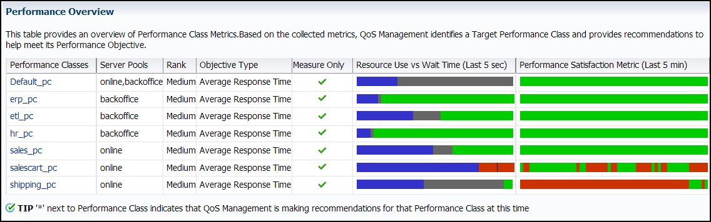

After you have enabled Oracle Database QoS Management and created a default policy set, you can start to use Oracle Database QoS Management to monitor the performance of your system.

In Measure-only and Monitor modes, all the Performance Classes in user-defined Performance Policies have the measure-only box checked. You can set Performance Objectives, and Oracle Database QoS Management displays the Performance Satisfaction Metric (PSM) on the dashboard. If the response time of the system exceeds the Performance Objective specified, the PSM bar changes to red and an optional alert generated, as shown in "Performance Satisfaction Metrics for Measure-Only Performance Classes". Oracle Database QoS Management does not make recommendations if the measure-only check box is selected.

Figure 9-1 Performance Satisfaction Metrics for Measure-Only Performance Classes

[Description of "Figure 9-1 Performance Satisfaction Metrics for Measure-Only Performance Classes "](img_text/cc12102_measure_only_psm.md)

Running Oracle Database QoS Management in Measure-only or Monitor mode allows you to understand how various workloads perform when sharing resources. Only measure-only mode assists in determining the baseline Performance Objectives. In monitor mode, you can actually set the performance objectives, and monitor the workload performance against that performance objective. You can also use these modes to identify performance bottlenecks in your system.

Starting with the Oracle Database 12c release 2 (12.2.0.1) release, you can use Oracle Database QoS Management with Oracle RAC on systems in full management mode in both policy- and administrator-managed deployments. Oracle Database QoS Management also supports the full management of multitenant databases in both policy- and administrator-managed deployments. Earlier releases only support measure-only and monitor modes on Oracle RAC multitenant and administrator-managed deployments.

**Related Topics**

- [Creating a Performance Policy and Specifying Performance Objectives](managing-performance-policies.md)
- [Enabling Oracle Database QoS Management](configuring-qos-management-manage-db-workloads.md)
- [Reviewing Performance Metrics](reviewing-performance-metrics.md)

**Parent topic:** [Administering the Oracle Database QoS Management System](administering-oracle-database-qos-management-system.md)
