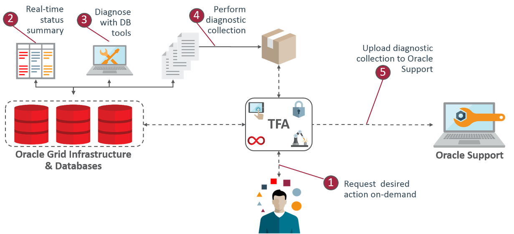

Run Oracle Trace File Analyzer on demand using `tfactl` command-line tool.

- Collecting Diagnostics and Analyzing Logs On-Demand
  The `tfactl` command can use a combination of different database command tools when it performs analysis.
- Viewing System and Cluster Summary
  The summary command gives you a real-time report of system and cluster status.
- Investigating Logs for Errors
  Use Oracle Trace File Analyzer to analyze all your logs across your cluster to identify recent errors.
- Analyzing Logs Using the Included Tools
  Oracle Database support tools bundle is available only when you download Oracle Trace File Analyzer from My Oracle Support note 1513912.1.
- Searching Oracle Trace File Analyzer Metadata
  You can search all metadata stored in the Oracle Trace File Analyzer index using `tfactl search -showdatatypes|-json [json_details]`.
- Collecting Diagnostic Data and Using One Command Service Request Data Collections
- Uploading Collections to Oracle Support
  To enable collection uploads, configure Oracle Trace File Analyzer with your My Oracle Support user name and password.
- [Changing Oracle Grid Infrastructure Trace Levels](changing-clusterware-trace-levels.md)
  Enabling trace levels enables you to collect enough diagnostics to diagnose the cause of the problem.

**Parent topic:** [Collecting Diagnostic Data and Triaging, Diagnosing, and Resolving Issues](diagnose-troubleshoot-issues-errors.md)

### 15.1 Collecting Diagnostics and Analyzing Logs On-Demand

The `tfactl` command can use a combination of different database command tools when it performs analysis.

The `tfactl` command enables you to access all tools using common syntax. Using common syntax hides the complexity of the syntax differences between the tools.

Use the Oracle Trace File Analyzer tools to perform analysis and resolve problems. If you need more help, then use the `tfactl` command to collect diagnostics for Oracle Support.

Oracle Trace File Analyzer does the following:

- Collects all relevant log data from a time of your choosing.

- Trims log files around the time, collecting only what is necessary for diagnosis.

- Packages all diagnostics on the node where `tfactl` was run from.

Figure 15-1 On-Demand Collections

[Description of "Figure 15-1 On-Demand Collections"](img_text/tfa-demand-collections-18c.md)

**Parent topic:** On-demand Analysis and Diagnostic Collection

### 15.2 Viewing System and Cluster Summary

The summary command gives you a real-time report of system and cluster status.

#### Syntax

`tfactl summary [options]`

For more help use:

    tfactl summary -help

**Parent topic:** On-demand Analysis and Diagnostic Collection

### 15.3 Investigating Logs for Errors

Use Oracle Trace File Analyzer to analyze all your logs across your cluster to identify recent errors.

1.  To find all errors in the last one day:
        $ tfactl analyze –last 1d
2.  To find all errors over a specified duration:
        $ tfactl analyze –last 18h
3.  To find all occurrences of a specific error on any node, for example, to report `ORA-00600` errors:
        $ tfactl analyze -search “ora-00600" -last 8h

Example 15-1 Analyzing logs

    tfactl analyze –last 14d

    Jun/02/2016 11:44:39 to Jun/16/2016 11:44:39 tfactl> analyze -last 14d
    INFO: analyzing all (Alert and Unix System Logs) logs for the last 20160 minutes...  Please wait...
    INFO: analyzing host: myserver69

                            Report title: Analysis of Alert,System Logs
                       Report date range: last ~14 day(s)
              Report (default) time zone: EST - Eastern Standard Time
                     Analysis started at: 16-Jun-2016 02:45:02 PM EDT
                   Elapsed analysis time: 0 second(s).
                      Configuration file:
    /u01/app/tfa/myserver69/tfa_home/ext/tnt/conf/tnt.prop
                     Configuration group: all
                     Total message count:            957, from 02-May-2016
    09:04:07 PM EDT to 16-Jun-2016 12:45:41 PM EDT
       Messages matching last ~14 day(s):            225, from 03-Jun-2016
    02:17:32 PM EDT to 16-Jun-2016 12:45:41 PM EDT
             last ~14 day(s) error count:              2, from 09-Jun-2016
    09:56:47 AM EDT to 09-Jun-2016 09:56:58 AM EDT last ~14 day(s) ignored error count: 0
      last ~14 day(s) unique error count: 2

    Message types for last ~14 day(s)
        Occurrences percent  server name          type
        ----------- -------  -------------------- -----
                223   99.1%  myserver69           generic
                  2    0.9%  myserver69           ERROR
        ----------- -------
                225  100.0%

    Unique error messages for last ~14 day(s)
        Occurrences percent  server name          error
        ----------- -------  -------------------- -----
                  1   50.0%  myserver69           Errors in file
    /u01/app/racusr/diag/rdbms/rdb11204/RDB112041/trace/RDB112041_ora_25401.trc
    (incident=6398):
                                                  ORA-07445: exception
    encountered: core dump [] [] [] [] [] []
                                                  Incident details in:
    /u01/app/racusr/diag/rdbms/rdb11204/RDB112041/incident/incdir_6398/RDB112041_ora_25401_i6398.trc

                                                  Use ADRCI or Support Workbench to package the incident.
                                                  See Note 411.1 at My Oracle Support for error and packaging details.

                  1   50.0%  myserver69           Errors in file
    /u01/app/racusr/diag/rdbms/rdb11204/RDB112041/trace/RDB112041_ora_25351.trc
    (incident=6394):
                                                  ORA-00700: soft internal error, arguments: [kgerev1], [600], [600], [700], [], [], [], [], [], [], [], []
                                                  Incident details in:
    /u01/app/racusr/diag/rdbms/rdb11204/RDB112041/incident/incdir_6394/RDB112041_ora_25351_i6394.trc

                                                  Errors in file /u01/app/racusr/diag/rdbms/rdb11204/RDB112041/trace/RDB112041_ora_25351.trc
    (incident=6395):
                                                  ORA-00600: internal error code, arguments: [], [], [], [], [], [], [], [], [], [], [], []
                                                  Incident details in:
    /u01/app/racusr/diag/rdbms/rdb11204/RDB112041/incident/incdir_6395/RDB112041_ora_25351_i6395.trc

                                                  Dumping diagnostic data in directory=[cdmp_20160609095648], requested by (instance=1, osid=25351), summary=[incident=6394].
                                                  Use ADRCI or Support Workbench to package the incident.
                                                  See Note 411.1 at My Oracle Support for error and packaging details.

        ----------- -------
                  2  100.0%
     See Change Which Directories Get Collected for more details.

**Related Topics**

- [tfactl summary](running-summary-and-analysis-commands.md)
- [tfactl analyze](running-summary-and-analysis-commands.md)

**Parent topic:** On-demand Analysis and Diagnostic Collection

### 15.4 Analyzing Logs Using the Included Tools

Oracle Database support tools bundle is available only when you download Oracle Trace File Analyzer from My Oracle Support note 1513912.1.

Oracle Trace File Analyzer with Oracle Database support tools bundle includes the following tools:

Table 15-1 Tools included in Linux and UNIX

| Tool                 | Description                                                                                                                                                                                                                                                    |
|:---------------------|:---------------------------------------------------------------------------------------------------------------------------------------------------------------------------------------------------------------------------------------------------------------|
| `orachk` or `exachk` | Provides health checks for the Oracle stack. Oracle Trace File Analyzer installs either Oracle EXAchk for engineered systems or Oracle ORAchk for all non-engineered systems. For more information, see My Oracle Support notes 1070954.1 and 1268927.2. |
| `oswatcher`          | Collects and archives operating system metrics. These metrics are useful for instance or node evictions and performance Issues. For more information, see My Oracle Support note 301137.1.                                                                  |
| `procwatcher`        | Automates and captures database performance diagnostics and session level hang information. For more information, see My Oracle Support note 459694.1.                                                                                                      |
| `oratop`             | Provides near real-time database monitoring. For more information, see My Oracle Support note 1500864.1.                                                                                                                                                    |
| `alertsummary`       | Provides summary of events for one or more database or ASM alert files from all nodes.                                                                                                                                                                         |
| `ls`                 | Lists all files Oracle Trace File Analyzer knows about for a given file name pattern across all nodes.                                                                                                                                                         |
| `pstack`             | Generates the process stack for the specified processes across all nodes.                                                                                                                                                                                      |
| `grep`               | Searches for a given string in the alert or trace files with a specified database.                                                                                                                                                                             |
| `summary`            | Provides high-level summary of the configuration.                                                                                                                                                                                                              |
| `vi`                 | Opens alert or trace files for viewing a given database and file name pattern in the `vi` editor.                                                                                                                                                              |
| `tail`               | Runs a tail on an alert or trace files for a given database and file name pattern.                                                                                                                                                                             |
| `param`              | Shows all database and operating system parameters that match a specified pattern.                                                                                                                                                                             |
| `dbglevel`           | Sets and unsets multiple CRS trace levels with one command.                                                                                                                                                                                                    |
| `history`            | Shows the shell history for the `tfactl` shell.                                                                                                                                                                                                                |
| `changes`            | Reports changes in the system setup over a given time period. The report includes database parameters, operating system parameters, and the patches applied.                                                                                                   |
| `calog`              | Reports major events from the cluster event log.                                                                                                                                                                                                               |
| `events`             | Reports warnings and errors seen in the logs.                                                                                                                                                                                                                  |
| `managelogs`         | Shows disk space usage and purges ADR log and trace files.                                                                                                                                                                                                     |
| `ps`                 | Finds processes.                                                                                                                                                                                                                                               |
| `triage`             | Summarizes `oswatcher` or `exawatcher` data.                                                                                                                                                                                                                   |

Table 15-2 Tools included in Microsoft Windows

| Tool         | Description                                                                                                                                              |
|:-------------|:---------------------------------------------------------------------------------------------------------------------------------------------------------|
| `calog`      | Reports major events from the cluster event log.                                                                                                         |
| `changes`    | Reports changes in the system setup over a given time period. The report includes database parameters, operating system parameters, and patches applied. |
| `dir`        | Lists all files Oracle Trace File Analyzer knows about for a given file name pattern across all nodes.                                                   |
| `events`     | Reports warnings and errors seen in the logs.                                                                                                            |
| `findstr`    | Searches for a given string in the alert or trace files with a specified database.                                                                       |
| `history`    | Shows the shell history for the `tfactl` shell.                                                                                                          |
| `managelogs` | Shows disk space usage and purges ADR log and trace files.                                                                                               |
| `notepad`    | Opens alert or trace files for viewing a given database and file name pattern in the `notepad` editor.                                                   |
| `param`      | Shows all database and operating system parameters that match a specified pattern.                                                                       |
| `summary`    | Provides high-level summary of the configuration.                                                                                                        |
| `tasklist`   | Finds processes.                                                                                                                                         |

To verify which tools you have installed:

    $ tfactl toolstatus

You can run each tool using `tfactl` either in command line or shell mode.

To run a tool from the command line:

    $ tfactl run tool

The following example shows how to use `tfactl` in shell mode. Running the command starts `tfactl`, connects to the database MyDB, and then runs `oratop`:

    $ tfactl
    tfactl > database MyDB
    MyDB tfactl > oratop

**Related Topics**

- [https://support.oracle.com/rs?type=doc&amp;id=1513912.1](https://support.oracle.com/rs?type=doc&amp;amp;id=1513912.1)
- [https://support.oracle.com/rs?type=doc&amp;id=1070954.1](https://support.oracle.com/rs?type=doc&amp;amp;id=1070954.1)
- [https://support.oracle.com/rs?type=doc&amp;id=1268927.2](https://support.oracle.com/rs?type=doc&amp;amp;id=1268927.2)
- [https://support.oracle.com/rs?type=doc&amp;id=301137.1](https://support.oracle.com/rs?type=doc&amp;amp;id=301137.1)
- [https://support.oracle.com/rs?type=doc&amp;id=459694.1](https://support.oracle.com/rs?type=doc&amp;amp;id=459694.1)
- [https://support.oracle.com/rs?type=doc&amp;id=1500864.1](https://support.oracle.com/rs?type=doc&amp;amp;id=1500864.1)
- [https://support.oracle.com/rs?type=doc&amp;id=215187.1](https://support.oracle.com/rs?type=doc&amp;amp;id=215187.1)

**Parent topic:** On-demand Analysis and Diagnostic Collection

### 15.5 Searching Oracle Trace File Analyzer Metadata

You can search all metadata stored in the Oracle Trace File Analyzer index using `tfactl search -showdatatypes|-json [json_details]`.

You can search for all events for a particular Oracle Database between certain dates, for example,

    tfactl search -json
    '{
      "data_type":"event",
      "content":"oracle",
      "database":"rac11g",
      "from":"01/20/2017 00:00:00",
      "to":"12/20/2018 00:00:00"
     }'

To list all index events: `tfactl search -json '{"data_type":"event"}'`

To list all available datatypes: `tfactl search -showdatatypes`

**Parent topic:** On-demand Analysis and Diagnostic Collection

### 15.6 Collecting Diagnostic Data and Using One Command Service Request Data Collections

To perform an on-demand diagnostic collection:

    $ tfactl diagcollect

Running the command trims and collects all important log files updated in the past 12 hours across the whole cluster. Oracle Trace File Analyzer stores collections in the repository directory. You can change the `diagcollect` timeframe with the `–last ``n`` h|d` option.

Oracle Support often asks you to run a Service Request Data Collection (SRDC). The SRDC depends on the type of problem you experienced. It is a series of many data gathering instructions aimed at diagnosing your problem. Collecting the SRDC manually can be difficult, with many different steps required.

Oracle Trace File Analyzer can run SRDC collections with a single command:

    $ tfactl diagcollect -srdc srdc_type –sr sr_number

To run SRDCs, use one of the Oracle privileged user accounts:

- `ORACLE_HOME` owner

- `GRID_HOME` owner

Table 15-3 One Command Service Request Data Collections

| Type of Problem                                                                                                                                             | Available SRDCs                                                                                                                     | Collection Scope                                                                                                                    |            |
|:------------------------------------------------------------------------------------------------------------------------------------------------------------|:------------------------------------------------------------------------------------------------------------------------------------|:------------------------------------------------------------------------------------------------------------------------------------|:-----------|
| ORA Errors                                                                                                                                                  | `ORA-00020` `ORA-00060` `ORA-00600` `ORA-00700` `ORA-01031` `ORA-01555` `ORA-01578` `ORA-01628` `ORA-04030` | `ORA-04031` `ORA-07445` `ORA-08102` `ORA-08103` `ORA-27300` `ORA-27301` `ORA-27302` `ORA-29548` `ORA-30036` | Local-only |
| Oracle Database performance problems                                                                                                                        | `dbperf`                                                                                                                            | Cluster-wide                                                                                                                        |            |
| Data Pump Import performance problems                                                                                                                       | `dbimpdpperf`                                                                                                                       | Local-only                                                                                                                          |            |
| SQL performance problems                                                                                                                                    | `dbsqlperf`                                                                                                                         | Local-only                                                                                                                          |            |
| Transparent Data Encryption (TDE) problems                                                                                                                  | `dbtde`                                                                                                                             | Local-only                                                                                                                          |            |
| Oracle Database resource problems                                                                                                                           | `dbunixresources`                                                                                                                   | Local-only                                                                                                                          |            |
| Other internal Oracle Database errors                                                                                                                       | `internalerror`                                                                                                                     | Local-only                                                                                                                          |            |
| Oracle Database patching problems                                                                                                                           | `dbpatchinstall` `dbpatchconflict`                                                                                               | Local-only                                                                                                                          |            |
| Original Oracle Database Export (exp)                                                                                                                       | `dbexp` `dbexpdp` `dbexpdpapi` `dbexpdpperf` `dbexpdptts`                                                               | Local-only                                                                                                                          |            |
| Original Oracle Database Import (imp)                                                                                                                       | `dbimp` `dbimpdp` `dbimpdpperf`                                                                                               | Local-only                                                                                                                          |            |
| RMAN                                                                                                                                                        | `dbrman` `dbrman600` `dbrmanperf`                                                                                             | Local-only                                                                                                                          |            |
| System change number                                                                                                                                        | `dbscn`                                                                                                                             | Local-only                                                                                                                          |            |
| Oracle GoldenGate                                                                                                                                           | `dbggclassicmode` `dbggintegratedmode`                                                                                           | Local-only                                                                                                                          |            |
| Oracle Database install / upgrade problems                                                                                                                  | `dbinstall` `dbupgrade` `dbpreupgrade`                                                                                        | Local-only                                                                                                                          |            |
| Oracle Database storage problems                                                                                                                            | `dbasm`                                                                                                                             | Local-only                                                                                                                          |            |
| Excessive SYSAUX space is used by the Automatic Workload Repository (AWR)                                                                                   | `dbawrspace`                                                                                                                        | Local-only                                                                                                                          |            |
| Oracle Database startup / shutdown problems                                                                                                                 | `dbshutdown` `dbstartup`                                                                                                         |                                                                                                                                     |            |
| XDB Installation or invalid object problems                                                                                                                 | `dbxdb`                                                                                                                             | Local-only                                                                                                                          |            |
| Oracle Data Guard problems                                                                                                                                  | `dbdataguard`                                                                                                                       | Local-only                                                                                                                          |            |
| Alert log messages of `Corrupt block relative dba` problems                                                                                                 | `dbblockcorruption`                                                                                                                 | Local-only                                                                                                                          |            |
| ASM / DBFS / DNFS / ACFS problems                                                                                                                           | `dnfs`                                                                                                                              | Local-only                                                                                                                          |            |
| Create / maintain partitioned / subpartitioned table / index problems                                                                                       | `dbpartition`                                                                                                                       | Local-only                                                                                                                          |            |
| Slow `Create` / `Alter` / `Drop` commands against partitioned table / index                                                                                 | `dbpartitionperf`                                                                                                                   | Local-only                                                                                                                          |            |
| SQL performance problems                                                                                                                                    | `dbsqlperf`                                                                                                                         | Local-only                                                                                                                          |            |
| UNDO corruption problems                                                                                                                                    | `dbundocorruption`                                                                                                                  | Local-only                                                                                                                          |            |
| Listener errors: `TNS-12516` / `TNS-12518` / `TNS-12519` / `TNS-12520`                                                                                      | `listener_services`                                                                                                                 | Local-only                                                                                                                          |            |
| Naming service errors: `ORA-12154` / `ORA-12514` / `ORA-12528`                                                                                              | `naming_services`                                                                                                                   | Local-only                                                                                                                          |            |
| Standard information for Oracle Database auditing                                                                                                           | `dbaudit`                                                                                                                           | Local-only                                                                                                                          |            |
| Enterprise Manager tablespace usage metric problems                                                                                                         | `emtbsmetrics`                                                                                                                      | Local-only (on Enterprise Manager Agent target)                                                                                     |            |
| Enterprise Manager general metrics page or threshold problems                                                                                               | `emmetricalert`                                                                                                                     | Local-only (on Enterprise Manager Agent target and repository database)                                                             |            |
| Enterprise Manager debug log collection Run `emdebugon`, reproduce the problem then run `emdebugoff`, which disables debug again and collects debug logs | `emdebugon` `emdebugoff`                                                                                                         | Local-only (on Enterprise Manager Agent target and Oracle Management Service)                                                       |            |
| Enterprise Manager target discovery / add problems                                                                                                          | `emcliadd` `emclusdisc` `emdbsys` `emgendisc` `emprocdisc`                                                              | Local-only                                                                                                                          |            |
| Enterprise Manager OMS restart problems                                                                                                                     | `emrestartoms`                                                                                                                      | Local-only                                                                                                                          |            |
| Enterprise Manager Agent performance problems                                                                                                               | `emagentperf`                                                                                                                       | Local-only                                                                                                                          |            |
| Enterprise Manager OMS Crash problems                                                                                                                       | `emomscrash`                                                                                                                        | Local-only                                                                                                                          |            |
| Enterprise Manager Java heap usage or performance problems                                                                                                  | `emomsheap`                                                                                                                         | Local-only                                                                                                                          |            |
| Enterprise Manager OMS crash, restart or performance problems                                                                                               | `emomshungcpu`                                                                                                                      | Local-only                                                                                                                          |            |
| Oracle Exalogic full Exalogs data collection information                                                                                                    | `esexalogic`                                                                                                                        | Local-only                                                                                                                          |            |

For more information about SRDCs, run `tfactl diagcollect –srdc -help`.

What the SRDCs collect varies for each type, for example:

Table 15-4 SRDC collections

| Command                                | What gets collected                                                                                                                                                                                                                                                  |
|:---------------------------------------|:---------------------------------------------------------------------------------------------------------------------------------------------------------------------------------------------------------------------------------------------------------------------|
| `$ tfactl diagcollect –srdc ORA-04031` | • IPS package • Patch listing • AWR report • Memory information • RDA HCVE output                                                                                                                                                                        |
| `$ tfactl diagcollect –srdc dbperf`    | • ADDM report • AWR for good period and problem period • AWR Compare Period report • ASH report for good and problem period • OSWatcher • IPS package (if there are any errors during problem period) • Oracle ORAchk (performance-related checks) |

Oracle Trace File Analyzer prompts you to enter the information required based on the SRDC type.

For example, when you run `ORA-4031` SRDC:

    $ tfactl diagcollect –srdc ORA-04031

Oracle Trace File Analyzer prompts to enter event date/time and database name.

1.  Oracle Trace File Analyzer scans the system to identify recent events in the system (up to 10).

2.  Once the relevant event is chosen, Oracle Trace File Analyzer then proceeds with diagnostic collection.

3.  Oracle Trace File Analyzer identifies all the required files.

4.  Oracle Trace File Analyzer trims all the files where applicable.

5.  Oracle Trace File Analyzer packages all data in a zip file ready to provide to support.

You can also run an SRDC collection in non-interactive silent mode. Provide all the required parameters up front as follows:

    $ tfactl diagcollect –srdc srdc_type -database db -from "date time" -to "date time"

Example 15-2 Diagnostic Collection

    $ tfactl diagcollect

    Collecting data for the last 12 hours for all components...
    Collecting data for all nodes

    Collection Id : 20160616115923myserver69

    Detailed Logging at :
    /u01/app/tfa/repository/collection_Thu_Jun_16_11_59_23_PDT_2016_node_all/diagcollect_20160616115923_myserver69.log
    2016/06/16 11:59:27 PDT : Collection Name :
    tfa_Thu_Jun_16_11_59_23_PDT_2016.zip
    2016/06/16 11:59:28 PDT : Collecting diagnostics from hosts :
    [myserver70, myserver71, myserver69]
    2016/06/16 11:59:28 PDT : Scanning of files for Collection in progress...
    2016/06/16 11:59:28 PDT : Collecting additional diagnostic information...
    2016/06/16 11:59:33 PDT : Getting list of files satisfying time range
    [06/15/2016 23:59:27 PDT, 06/16/2016 11:59:33 PDT]
    2016/06/16 11:59:37 PDT : Collecting ADR incident files...
    2016/06/16 12:00:32 PDT : Completed collection of additional diagnostic information...
    2016/06/16 12:00:39 PDT : Completed Local Collection
    2016/06/16 12:00:40 PDT : Remote Collection in Progress...
    .--------------------------------------.
    |          Collection Summary          |
    +------------+-----------+------+------+
    | Host       | Status    | Size | Time |
    +------------+-----------+------+------+
    | myserver71 | Completed | 15MB |  64s |
    | myserver70 | Completed | 14MB |  67s |
    | myserver69 | Completed | 14MB |  71s |
    '------------+-----------+------+------'

    Logs are being collected to:
    /u01/app/tfa/repository/collection_Thu_Jun_16_11_59_23_PDT_2016_node_all
    /u01/app/tfa/repository/collection_Thu_Jun_16_11_59_23_PDT_2016_node_all/myserver71.tfa_Thu_Jun_16_11_59_23_PDT_2016.zip
    /u01/app/tfa/repository/collection_Thu_Jun_16_11_59_23_PDT_2016_node_all/myserver69.tfa_Thu_Jun_16_11_59_23_PDT_2016.zip
    /u01/app/tfa/repository/collection_Thu_Jun_16_11_59_23_PDT_2016_node_all/myserver70.tfa_Thu_Jun_16_11_59_23_PDT_2016.zip

Example 15-3 One command SRDC

    $ tfactl diagcollect –srdc ora600
    Enter value for EVENT_TIME [YYYY-MM-DD HH24:MI:SS,<RETURN>=ALL] :
    Enter value for DATABASE_NAME [<RETURN>=ALL] :

    1. Jun/09/2016 09:56:47 : [rdb11204] ORA-00600: internal error code,
    arguments: [], [], [], [], [], [], [], [], [], [], [], [] 2. May/19/2016 14:19:30 : [rdb11204] ORA-00600: internal error code,
    arguments: [], [], [], [], [], [], [], [], [], [], [], [] 3. May/13/2016 10:14:30 : [rdb11204] ORA-00600: internal error code,
    arguments: [], [], [], [], [], [], [], [], [], [], [], [] 4. May/13/2016 10:14:09 : [rdb11204] ORA-00600: internal error code,
    arguments: [], [], [], [], [], [], [], [], [], [], [], []

    Please choose the event : 1-4 [1] 1
    Selected value is : 1 ( Jun/09/2016 09:56:47 ) Collecting data for local node(s) Scanning files
    from Jun/09/2016 03:56:47 to Jun/09/2016 15:56:47

    Collection Id : 20160616115820myserver69

    Detailed Logging at :
    /u01/app/tfa/repository/srdc_ora600_collection_Thu_Jun_16_11_58_20_PDT_2016_node_local/diagcollect_20160616115820_myserver69.log
    2016/06/16 11:58:23 PDT : Collection Name :
    tfa_srdc_ora600_Thu_Jun_16_11_58_20_PDT_2016.zip
    2016/06/16 11:58:23 PDT : Scanning of files for Collection in progress...
    2016/06/16 11:58:23 PDT : Collecting additional diagnostic information...
    2016/06/16 11:58:28 PDT : Getting list of files satisfying time range
    [06/09/2016 03:56:47 PDT, 06/09/2016 15:56:47 PDT]
    2016/06/16 11:58:30 PDT : Collecting ADR incident files...
    2016/06/16 11:59:02 PDT : Completed collection of additional diagnostic information...
    2016/06/16 11:59:06 PDT : Completed Local Collection
    .---------------------------------------.
    |           Collection Summary          |
    +------------+-----------+-------+------+
    | Host       | Status    | Size  | Time |
    +------------+-----------+-------+------+
    | myserver69 | Completed | 7.9MB |  43s |
    '------------+-----------+-------+------'

**Note:**

For more information about how to diagnose and resolve ORA-00600 errors using Oracle Trace File Analyzer diagnostics, see ORA-600 (ORA-00600 Internal Error) Detection, Diagnosis & Resolution.

**Related Topics**

- [ORA-600 (ORA-00600 Internal Error) Detection, Diagnosis & Resolution](https://community.oracle.com/community/support/support-blogs/database-support-blog/blog/2018/09/19/ora-600-ora-00600-internal-error-detection-diagnosis-resolution)

**Parent topic:** On-demand Analysis and Diagnostic Collection

### 15.7 Uploading Collections to Oracle Support

To enable collection uploads, configure Oracle Trace File Analyzer with your My Oracle Support user name and password.

For example:

    tfactl setupmos

Oracle Trace File Analyzer stores your login details securely within an encrypted wallet. You can store only a single user’s login details.

1.  Run a diagnostic collection using the `–sr sr_number` option.
        tfactl diagcollect diagcollect options -sr sr_number

    At the end of collection, Oracle Trace File Analyzer automatically uploads all collections to your Service Request.

Oracle Trace File Analyzer can also upload any other file to your Service Request.

You can upload using the wallet, which was setup previously by `root` using `tfactl setupmos`.

    tfactl upload -sr sr_number -wallet space-separated list of files to upload

You can also upload without the wallet. When uploading without the wallet `tfactl` prompts for the password.

    tfactl upload -sr sr_number -user user_id space-separated list of files to upload

    -bash-4.1# tfactl setupmos
    Enter User Id: john.doe@oracle.com
    Enter Password:
    Wallet does not exist ... creating
    Wallet created successfully
    USER details added/updated in the wallet
    PASSWORD details added/updated in the wallet
    SUCCESS - CERTIMPORT - Successfully imported certificate
    -bash-4.1# su - oradb

    -bash-4.1$ /opt/oracle.tfa/tfa/myserver69/tfa_home/bin/tfactl diagcollect -srdc ORA-00600 -sr 3-15985570811
    Enter the time of the ORA-00600 [YYYY-MM-DD HH24:MI:SS,RETURN=ALL] :
    Enter the Database Name [RETURN=ALL] :

    1. Oct/23/2017 03:03:40 : [ogg11204] ORA-00600: internal error code, arguments: [gc_test_error], [0], [0], [], [], [], [], [], [], [], [], []
    2. Sep/26/2017 10:03:10 : [ogg11204] ORA-00600: internal error code, arguments: [], [], [], [], [], [], [], [], [], [], [], []
    3. Sep/26/2017 10:02:49 : [ogg11204] ORA-00600: internal error code, arguments: [], [], [], [], [], [], [], [], [], [], [], []
    4. Sep/26/2017 10:02:33 : [ogg11204] ORA-00600: internal error code, arguments: [], [], [], [], [], [], [], [], [], [], [], []
    5. Jan/09/2016 13:01:02 : [+ASM1] ORA-00600: internal error code, arguments: [ksdhng:msg_checksum], [9070324609822233070], [15721744232659255108], [0x7FFBDC07A9E8], [], [], [], [], [], [], [], []

    Please choose the event : 1-5 [1] 1
    Selected value is : 1 ( Oct/23/2017 03:03:40 )
    Scripts to be run by this srdc: ipspack rdahcve1210 rdahcve1120 rdahcve1110
    Components included in this srdc: OS CRS DATABASE NOCHMOS
    Use of uninitialized value $db_home in length at /opt/oracle.tfa/tfa/myserver69/tfa_home/bin/common/dbutil.pm line 186.
    Collecting data for local node(s)
    Scanning files from Oct/22/2017 21:03:40 to Oct/23/2017 09:03:40

    Collection Id : 20180430080045myserver69

    Detailed Logging at : /opt/oracle.tfa/tfa/repository/srdc_ora600_collection_Mon_Apr_30_08_00_45_PDT_2018_node_local/diagcollect_20180430080045_myserver69.log
    2018/04/30 08:00:50 PDT : NOTE : Any file or directory name containing the string .com will be renamed to replace .com with dotcom
    2018/04/30 08:00:50 PDT : Collection Name : tfa_srdc_ora600_Mon_Apr_30_08_00_45_PDT_2018.zip
    2018/04/30 08:00:50 PDT : Scanning of files for Collection in progress...
    2018/04/30 08:00:50 PDT : Collecting additional diagnostic information...
    2018/04/30 08:01:15 PDT : Getting list of files satisfying time range [10/22/2017 21:03:40 PDT, 10/23/2017 09:03:40 PDT]
    2018/04/30 08:01:34 PDT : Collecting ADR incident files...
    2018/04/30 08:02:21 PDT : Completed collection of additional diagnostic information...
    2018/04/30 08:02:24 PDT : Completed Local Collection
    2018/04/30 08:02:24 PDT : Uploading collection to SR - 3-15985570811
    2018/04/30 08:02:27 PDT : Successfully uploaded collection to SR
    .---------------------------------------.
    |           Collection Summary          |
    +------------+-----------+-------+------+
    | Host       | Status    | Size  | Time |
    +------------+-----------+-------+------+
    | myserver69 | Completed | 559kB |  94s |
    '------------+-----------+-------+------'

    Logs are being collected to: /opt/oracle.tfa/tfa/repository/srdc_ora600_collection_Mon_Apr_30_08_00_45_PDT_2018_node_local
    /opt/oracle.tfa/tfa/repository/srdc_ora600_collection_Mon_Apr_30_08_00_45_PDT_2018_node_local/myserver69.tfa_srdc_ora600_Mon_Apr_30_08_00_45_PDT_2018.zip

**Parent topic:** On-demand Analysis and Diagnostic Collection
