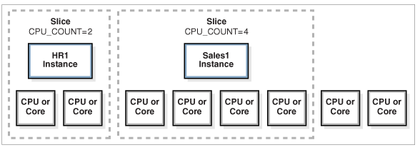
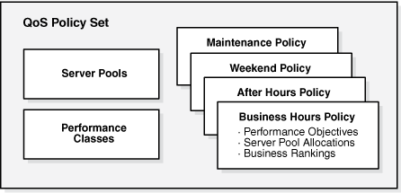
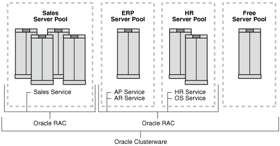
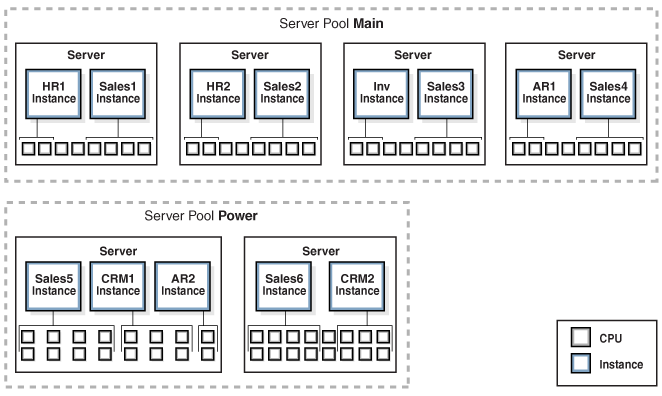
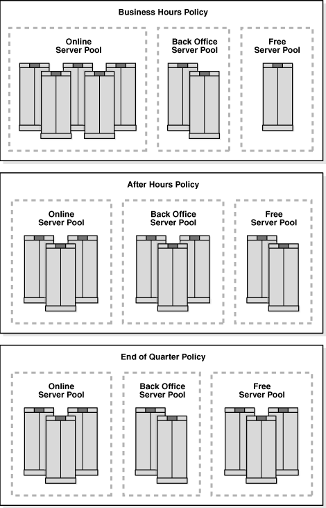
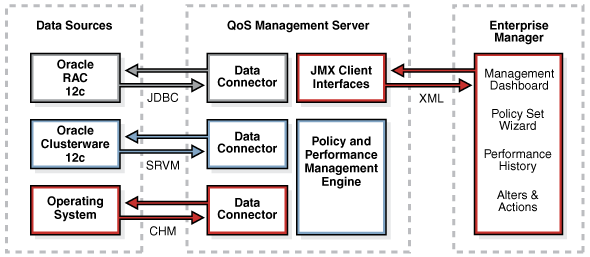
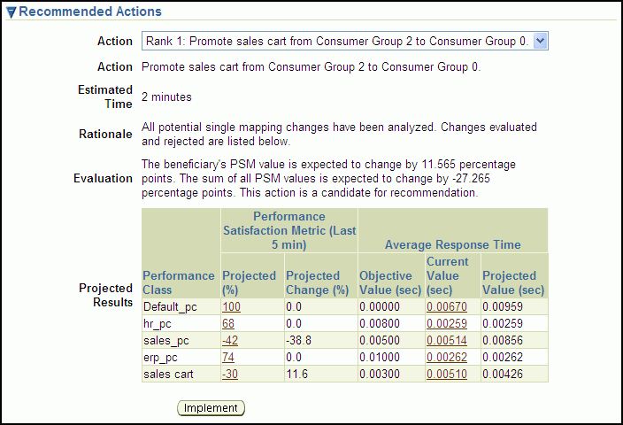

This section provides a basic description of how Oracle Database QoS Management works, and of how it evaluates the performance of workloads on your system.

- How Does Oracle Database QoS Management Work?
  With Oracle Database, you can use services to manage the workload on your system by starting services on groups of servers that are dedicated to particular workloads.
- Overview of Policy Sets
  A Policy Set enables you to specify your resources, Performance Classes (workloads), and one or more Performance Policies that specify the Performance Objective for each Performance Class.
- Overview of Server Pools
  With the introduction of server pools to logically divide a cluster, you can achieve the benefit of physical consolidation and resource agility while maintaining workload isolation.
- How Server Pools Are Used by Oracle Database QoS Management
  You should create one or more server pools depending on the workloads that need to be managed.
- Overview of Performance Classes
  A Policy Set contains Performance Objectives for various Performance Classes, or workloads, that run on your cluster.
- Overview of Performance Policies and Performance Objectives
  To manage the various Performance Objectives, you define one or more Performance Policies.
- How Oracle Database QoS Management Collects and Analyzes Performance Data
  The Oracle Database QoS Management Server retrieves metrics data from Oracle Real Application Clusters (Oracle RAC) and Oracle RAC One Node databases in the cluster.
- Overview of Recommendations
  Oracle Database QoS Management enables you to manage excess capacity to meet specific performance goals through its recommendations.

**Parent topic:** [Introduction to Oracle Database QoS Management](introduction-oracle-database-qos-management.md)

### 6.3.1 How Does Oracle Database QoS Management Work?

With Oracle Database, you can use services to manage the workload on your system by starting services on groups of servers that are dedicated to particular workloads.

At the database tier, for example, you could dedicate one group of servers to online transaction processing (OLTP), dedicate another group of servers to application testing, and dedicate a third group of servers for internal applications. The system administrator can allocate resources to specific workloads by manually changing the number of servers on which a database service is allowed to run.

Using groups of servers in this way isolates the workloads from each other to prevent demand surges, failures, and other problems in one workload from affecting the other workloads. However, in this type of deployment, you must separately provision the servers to each group to satisfy the peak demand of each workload because resources are not shared.

Oracle Database QoS Management performs the following actions:

1.  Uses a policy created by the QoS administrator to do the following:

    - Assign each work request to a [Performance Class](glossary.md) by using the attributes of the incoming work requests (such as the database service to which the application connects).

    - Determine the target response times ([Performance Objectives](glossary.md)) for each Performance Class.

    - Determine which Performance Classes are the most critical to your business

2.  Monitors the resource usage and resource wait times for all the Performance Classes.

3.  Analyzes the average response time for a Performance Class against the Performance Objective in effect for that Performance Class

4.  Produces recommendations for reallocating resources to improve the performance of a Performance Class that is exceeding its target response time, and provides an analysis of the predicted impact to performance levels for each Performance Class if that recommendation is implemented.

5.  Implements the actions listed in the recommendation when directed to by the Oracle Database QoS Management administrator, then evaluates the system to verify that each Performance Class is meeting its Performance Objective after the resources have been reallocated.

- Oracle Database QoS Management and Server Pools
  You can use server pools to create groups of servers within a cluster to provide workload isolation.
- Oracle Database QoS Management and Instance Caging
  When multiple database instances share a single server, they must share its CPU, memory, and I/O bandwidth.
- Oracle Database QoS Management and Services
  Oracle Database QoS Management uses database services to monitor and manage client and application workloads.

**Parent topic:** Overview of Oracle Database QoS Management

#### 6.3.1.1 Oracle Database QoS Management and Server Pools

You can use server pools to create groups of servers within a cluster to provide workload isolation.

A server can only belong to one server pool at any time. You can create an Oracle Database in a single server pool, or across multiple server pools. Oracle Database QoS Management can make recommendations to move a server from one server pool to another based on the measured and projected demand. Oracle Database QoS Management can also relocate servers to satisfy the Performance Objectives currently in effect.

**Related Topics**

- [Oracle Clusterware Administration and Deployment Guide](../cwadd/policy-based-cluster-and-capacity-management.md)

**Parent topic:** How Does Oracle Database QoS Management Work?

#### 6.3.1.2 Oracle Database QoS Management and Instance Caging

When multiple database instances share a single server, they must share its CPU, memory, and I/O bandwidth.

Instance Caging limits the amount of CPU an Oracle database instance consumes by using the Oracle Database Resource Manager and the `CPU_COUNT` database initialization parameter. When using Oracle Database QoS Management, the sum of the values for `CPU_COUNT` for all instances of the server must be less than or equal to the total number of physical CPUs. Also, each CPU partition, or slice, must be uniform in thickness (number of CPUs) for each instance of a database within a server pool. These requirements help to ensure predictable and isolated performance of each database.

Figure 6-1 Instance Caging and CPU Slices

[Description of "Figure 6-1 Instance Caging and CPU Slices"](img_text/apqos008.md)

When you implement instance caging, Oracle Database QoS Management can provide recommendations to reallocate CPU resources from one slice to another slice within the same server pool. If you choose to implement the recommendation to modify the instance caging settings, then Oracle Database QoS Management modifies the `CPU_COUNT` parameter uniformly for all the database instances running on servers in the server pool.

Modifying the `CPU_COUNT` parameter and configuring Oracle Database QoS Management so that a Resource Plan is activated enables the Instance Caging feature. When you use Instance Caging to constrain CPU usage for an instance, that instance could become CPU-bound. This is when the Resource Manager begins to do its work, allocating CPU shares among the various database sessions according to the active resource plan.

**Parent topic:** How Does Oracle Database QoS Management Work?

#### 6.3.1.3 Oracle Database QoS Management and Services

Oracle Database QoS Management uses database services to monitor and manage client and application workloads.

In an Oracle RAC cluster, Oracle Database QoS Management monitors the server pools and nodes on which the database services are offered. A service can run in only one server pool. If the database spans multiple server pools, then you must create multiple services to access the instances in all server pools.

In the case of Administrator-Managed databases, all instances run in the Generic server pool and services run on specific instances, but still within a single pool.

Workload is monitored for clients and applications that connect to the database using database services that are managed by Oracle Clusterware. The connections must use Java Database Connectivity (JDBC) (thick or thin), or Oracle Call Interface (OCI). Connections should use services with its run-time goal for the load balancing advisory set to `SERVICE_TIME`, and the connection load balancing goal set to `LONG`. For example:

    srvctl modify service -db db_name -service service_name -rlbgoal SERVICE_TIME
    -clbgoal LONG -cardinality UNIFORM

You must define the cardinality of database services as follows:

- If the server pool that the service runs in has a maximum size greater than 1 (or UNLIMITED), then set the cardinality of the service to `UNIFORM`.

- If the server pool that the service runs in has a maximum size of 1, then set the cardinality of the service to `SINGLETON`.

**Related Topics**

- [Oracle Real Application Clusters Administration and Deployment Guide](../racad/workload-management-with-dynamic-database-services.md)

**Parent topic:** How Does Oracle Database QoS Management Work?

### 6.3.2 Overview of Policy Sets

A Policy Set enables you to specify your resources, Performance Classes (workloads), and one or more Performance Policies that specify the Performance Objective for each Performance Class.

The central concept in Oracle Database QoS Management is the [Policy Set](glossary.md). A Policy Set enables you to specify your resources, Performance Classes (workloads), and one or more Performance Policies that specify the Performance Objective for each Performance Class. A Policy Set can also specify constraints for resource availability. Oracle Database QoS Management Performance Policies manage the availability of resources system wide for each Performance Class so that the system is able to satisfy the Performance Objectives you set in the Performance Policy.

When you use Oracle Enterprise Manager to create a new Default Policy for your system, Oracle Database QoS Management provides default classification rules and associated Performance Class names. For example, when you create the initial Policy Set, Oracle Database QoS Management discovers all database services in a cluster, and creates a Performance Class for each service. The Performance Class is named by appending `_pc` to the service name. For example, if the name of a service is `sales`, then the name assigned to the Performance Class for that service is `sales_pc`.

Only one Performance Policy in the Policy Set can be active at any time. You can activate Performance policies to respond to particular requirements by using calendar schedules, maintenance windows, events, and so on.

When you create a Policy Set, you specify which server pools in the cluster should be managed by Oracle Database QoS Management. You also define Performance Classes (used to categorize workloads with similar performance requirements). You then create a Performance Policy to specify which Performance Classes have the highest priority and the Performance Objectives of each Performance Class. To satisfy the Performance Objectives, Oracle Database QoS Management makes recommendations for reallocating resources when needed, and predicts what effect the recommended actions will have on the ability of each Performance Class to meet its Performance Objective.

For example, you could create a policy to manage your application workloads during business hours. The applications used by customers to buy products or services are of the highest priority to your business during this time. You also give high priority to order fulfillment and billing applications. Human resource and enterprise resource planning (ERP) applications are of a lower priority during this time. If your online sales applications experience a surge in demand, then Oracle Database QoS Management might recommend that more resources be allocated to the sales applications and taken away from applications of lesser importance. The recommendation also includes a prediction of the change in performance (positive or negative) for each Performance Class.

A Policy Set, as shown in Figure 6-2, consists of the following:

- The server pools that are being managed by Oracle Database QoS Management

- Performance Classes, which are groups of work requests with similar performance objectives

- Performance policies, which describe how resources should be allocated to the Performance Classes by using:

  - [Performance Objectives](glossary.md)

  - [Performance Class ranks](glossary.md)

  - [server pool directive overrides](glossary.md)

Figure 6-2 Elements of an Oracle Database QoS Management Policy Set

[Description of "Figure 6-2 Elements of an Oracle Database QoS Management Policy Set"](img_text/apqos005.md)

**Related Topics**

- Overview of Performance Policies and Performance Objectives
- Applying Classifiers to Work Requests
- [Create an Initial Policy Set](configuring-qos-management-manage-db-workloads.md)
- Overview of Recommendations
- [Administering the Policy Set](administering-policy-set.md)

**Parent topic:** Overview of Oracle Database QoS Management

### 6.3.3 Overview of Server Pools

With the introduction of server pools to logically divide a cluster, you can achieve the benefit of physical consolidation and resource agility while maintaining workload isolation.

When deciding how many clusters to create for your business, you need to compare the possible cost savings through consolidation of servers with the risk that the consolidated workloads will interfere with each other in some significant way. With the introduction of server pools to logically divide a cluster, you can achieve the benefit of physical consolidation and resource agility while maintaining workload isolation.

As the administrator, you can define the workloads that can run in various server pools, as shown in Figure 6-3. Applications that connect to your Oracle RAC database use a service that runs only on the servers currently allocated to that server pool. For example, in Figure 6-3, connections and applications that use the OS service access only the servers in the HR server pool, so that work done by those connections does not interfere with the applications using the Sales service. Oracle Database QoS Management can assist you with managing the resource allocations within each of those groups to meet your service levels, and can redistribute resources automatically to meet changes in your business requirements.

Figure 6-3 Diagram of Server Pools, Oracle Databases, and Database Services

[Description of "Figure 6-3 Diagram of Server Pools, Oracle Databases, and Database Services"](img_text/apqos003.md)

With server pools, you can now create groups of servers that can be managed as a single entity. Databases can be created to run in these server pools. If each server runs only a single instance of a database, then if the database needs more resources, an additional server can be allocated to the server pool. If multiple database instances run on a single server, then they must compete for the shared resources of that server, such as memory and CPU. If one of the database instances is experiencing a much higher workload than the other instances, then that database instance can significantly degrade the performance of the other instances running on the same server.

You can use Instance Caging to limit the amount of CPU an Oracle Database instance consumes. By setting the `CPU_COUNT` parameter to limit the maximum number of CPUs an instance can use, you partition the CPUs among the database instances on a server, thus preventing them from using excessive amounts of CPU resources. The `CPU_COUNT` setting must be the same for each instance of a database within a server pool. Oracle Database QoS Management can monitor the CPU usage among all the database instances in the server pool, and recommend changes to the current settings if needed.

Figure 6-4 Server Pools and CPU Slices

[Description of "Figure 6-4 Server Pools and CPU Slices"](img_text/apqos009.md)

Instead of using a single server pool, Oracle recommends that you manage services by creating multiple server pools, and relocate services between them. Using this configuration provides the following benefits:

- Different types of workloads require different configurations, and have different tuning goals. For example, a customer using your OLTP applications to purchase goods or services expects the shipping and payment information screens to respond quickly. If your applications take too long to process the order, then the customer can lose interest, and your company might lose a sale. By contrast, an employee using an internal HR application is motivated to continue using HR screens, even if they do not respond quickly. If your HR applications take longer than expected to process an online task, the employee is unlikely to quit.

- Applications can have various resource requirements throughout the day, week, or month to meet your business objectives. You can use server pools to divide the resources among the application workloads. To meet the Performance Objectives of a given time period, you could use server pool directive overrides in a Performance Policy to change the default attributes (such as Max or Min) for a server pool.

  For example, if your company has an online tax filing application, then the application must prepare and file the tax statements for your customers before the government-specified deadline. In the timeframe immediately preceding a filing deadline, applications related to tax statement preparation and filing require more resources than they do at other times of the year. To ensure you meet this service requirement, you can create a Performance Policy named QuarterlyFilings to override the standard server pool directive, and specify that when QuarterlyFilings is active, the server pool used by the tax preparation applications should have a minimum of four servers instead of two to handle the additional workload. When the QuarterlyFilings Performance Policy is not in effect, your default Performance Policy is in effect, and the minimum number of servers in that server pool is two.

- Because Oracle Database QoS Management regulates the number of servers that support a workload, application users experience a consistent level of performance, even in the presence of changing demand levels. This prevents performance expectations of your customers from being reset when workload levels change from low to high demand.

  For example, assume your company sells a new consumer product that is in high demand, and your company advertises that they have large quantities of that product for sale at a reduced price. As a result, many new customers create orders for this product, and your OLTP applications must process a rapidly increasing number of transactions (a demand surge occurs). New customers do not know what to expect with regards to the OLTP application performance. However, existing customers can react negatively if their online shopping experience is impacted by the flood of new customers. Also, if your OLTP application cannot process all the incoming orders, then some of the new customers might quit the application and place their order with a different company, or visit a retail store instead.

  Oracle Database QoS Management helps you to manage the reallocation of available resources to meet the demand surge without sacrificing the quality of service of your other applications.

- Some workloads do not scale well but still benefit from the high availability of a cluster environment. Deploying these workloads in a fixed-size server pool offers both performance manageability and high availability.

  For example, if you run an ERP application in a server pool with a fixed size of one server, then the maximum size of the server pool and the minimum size of the server pool are both set to one. If the server in that server pool fails, then Oracle Clusterware automatically allocates a new server to the server pool to maintain the minimum size of one server. Any instances and services located on the failed server are restarted on the new server, so the applications using these instances and services remains available.

**See Also:**

- [Oracle Clusterware Administration and Deployment Guide](../cwadd/policy-based-cluster-and-capacity-management.md) for more information about server pools

- [Oracle Real Application Clusters Administration and Deployment Guide](../racad/introduction-to-oracle-rac.md) for more information about policy-managed Oracle RAC databases

- [Oracle Database Concepts](../cncpt/topics-for-database-administrators-and-developers.md) for a description of an OLTP system

**Parent topic:** Overview of Oracle Database QoS Management

### 6.3.4 How Server Pools Are Used by Oracle Database QoS Management

You should create one or more server pools depending on the workloads that need to be managed.

When you first install Oracle Grid Infrastructure for a cluster, a default server pool (the Free pool) is created. All servers are initially placed in this server pool. When you create a new server pool, the servers that you assign to that server pool are automatically moved out of the Free pool and placed in the newly created server pool. At this point, you can install a database to run in that server pool, and create database services that are managed by Oracle Clusterware for applications to connect to that database.

For an Oracle RAC database to take advantage of the flexibility of server pools, the database must be created using the policy-managed deployment option, which places the database in one or more server pools.

In Oracle Database 12c release 1 (12.1.0.2), Oracle Database Quality of Service (QoS) Management supported administrator-managed Oracle RAC and Oracle RAC One Node databases in Measure-Only and Monitor modes. Starting with Oracle Database 12c release 2 (12.2.0.1), you can use Oracle Database QoS Management in Management mode with Oracle RAC and Oracle RAC One Node databases that are policy-managed or administrator-managed.

**Caution:**

If you use candidate server lists (`server_names` attribute) or categories when creating server pools, then the ability for Oracle Database Quality of Service (QoS) Management to expand the server pool will be limited by those restrictions as non-eligible servers cannot be used.

**Related Topics**

- [Oracle Real Application Clusters Installation Guide for Linux and UNIX](../rilin/using-server-pools-with-oracle-rac.md)
- [Oracle Real Application Clusters Administration and Deployment Guide](../racad/administering-database-instances-and-cluster-databases.md)

**Parent topic:** Overview of Oracle Database QoS Management

### 6.3.5 Overview of Performance Classes

A Policy Set contains Performance Objectives for various Performance Classes, or workloads, that run on your cluster.

Oracle Database QoS Management uses a set of classification rules defined in the Policy Set to categorize work requests into a Performance Class. The fundamental classifier used to assign work requests to Performance Classes is the name of the service that is used to connect to the database.

- Performance Class Tags
  The classification of work requests applies a user-defined name tag that identifies the Performance Class to which the work request belongs.
- Applying Classifiers to Work Requests
  Classification occurs wherever new work enters the system.
- Using Additional Filters for Classifying Work Requests
  A single application can support work requests of many types, with a range of performance characteristics.
- Deciding to Create New Performance Classes
  Over time, your workload and performance goals can change.

**Parent topic:** Overview of Oracle Database QoS Management

#### 6.3.5.1 Performance Class Tags

The classification of work requests applies a user-defined name tag that identifies the Performance Class to which the work request belongs.

All work requests that are grouped into a particular Performance Class have the same [performance objectives](glossary.md). In effect, the ([tag](glossary.md)) connects the work request to the Performance Objective for the associated Performance Class. Oracle Database QoS Management assigns tags to each work request so that every component of the system can take measurements, and provide data to Oracle Database QoS Management for evaluation against the applicable Performance Objectives.

**Parent topic:** Overview of Performance Classes

#### 6.3.5.2 Applying Classifiers to Work Requests

Classification occurs wherever new work enters the system.

When a work request arrives at a server, the work request is checked for a tag. If the work request has a tag, then the server concludes that this work request has already been classified, and the tag is not changed. If the work request does not include a tag, then the [classifiers](glossary.md) are checked, and a tag for the matching Performance Class is attached to the work request.

To illustrate how work requests are classified, consider an application that connects to an Oracle RAC database. The application uses the database service `sales`. The Oracle Database QoS Management administrator specified during the initial configuration of Oracle Database QoS Management that the `sales_pc` Performance Class should contain work requests that use the `sales` service. When a connection request is received by the database, Oracle Database QoS Management checks for a tag. If a tag is not found, then Oracle Database QoS Management compares the information in the connection request with the classifiers specified for each Performance Class, in the order specified in the Performance Policy. If the connection request being classified is using the `sales` service, then when the classifiers in the `sales_pc` Performance Class are compared to the connection request information, a match is found, and the database work request is assigned a tag for the `sales_pc` Performance Class.

**Parent topic:** Overview of Performance Classes

#### 6.3.5.3 Using Additional Filters for Classifying Work Requests

A single application can support work requests of many types, with a range of performance characteristics.

By extending and refining the default classification rules, the Oracle Database QoS Management administrator can write multiple Performance Objectives for a single application. For example, the administrator may decide that a web-based application should have separate Performance Objectives for work requests related to logging in, browsing, searching, and purchasing.

Oracle Database QoS Management supports user-defined combinations of connection parameters to map Performance Classes to the actual workloads running in the database. These connection parameters belong to two general classes, and can be combined to create fine-grained Boolean expressions:

- Configuration Parameters: The supported configuration parameters are `SERVICE_NAME` and `USERNAME`. Each classifier in a Performance Class must specify the name of a database service. Additional granularity can be achieved by identifying the name of the user that is making the database connection from either a client or the middle tier. The advantage of using these classifiers is that they do not require application code changes to associate different workloads with separate Performance Classes.

- Application Parameters: The supported application parameters are `MODULE`, `ACTION`, and `PROGRAM`. These are optional parameters. The values for `MODULE` and `ACTION` must be set within the application. Depending on the type of application, you can set these parameters as follows:

  - OCI: Use `OCI_ATTR_MODULE` and `OCI_ATTR_ACTION`.

  - Oracle Data Provider for .NET (ODP.NET): Specify the `ModuleName` and `ActionName` properties on the `OracleConnection` object.

  - JDBC: Set `MODULE` and `ACTION` in `SYS_CONTEXT`.

The `PROGRAM` parameter is set or derived differently for each database driver and platform. Consult the appropriate Oracle Database developer's guide for further details and examples.

To manage the workload for an application, the application code makes database connections using a particular service. To provide more precise control over the workload generated by various parts of the application, you can create additional Performance Classes, and use classifiers that include `PROGRAM`, `MODULE`, or `ACTION` in addition to the service or user name. For example, you could specify that all connections to your cluster that use the `sales` service belong to the `sales_pc` Performance Class, but connections that use the `sales` service and have a user name of `APPADMIN` belong to `sales_admin` Performance Class.

**Related Topics**

- [Oracle Call Interface Programmer's Guide](../lnoci/handle-and-descriptor-attributes.md)
- [Oracle Data Provider for .NET Developer's Guide for Microsoft Windows](../odpnt/ConnectionProperties.md)
- [Oracle Database JDBC Developer’s Guide](../jjdbc/JDBC-DMS-Metrics.md)

**Parent topic:** Overview of Performance Classes

#### 6.3.5.4 Deciding to Create New Performance Classes

Over time, your workload and performance goals can change.

The Performance Classes in use at a particular data center are expected to change over time. For example, you might need to modify the Performance Objectives for one part of your application. In this case you would create a new Performance Class with additional classifiers to identify the target work requests, and update your Performance Policy to add a new Performance Objective for this Performance Class. In other words, you replace a single Performance Objective with one or more finer-grained Performance Objectives, and divide the work requests for one Performance Class into multiple Performance Classes.

Application developers can suggest which Performance Classes to use. Specifically, an application developer can suggest ways to identify different application workloads, and you can use these suggestions to create classifiers for Performance Classes so that each type of work request is managed separately.

You can create additional Performance Classes to specify acceptable response times for different application workloads. For example, a Performance Objective might indicate that a work request performing the `checkout` action for the `sales_pc_checkout` Performance Class should not take more than one millisecond to complete, and a work request performing the `browse` action for the `sales_pc_browse` Performance Class can take 100 milliseconds second to complete.

**Related Topics**

- [Managing Performance Classes](managing-performance-classes.md)

**Parent topic:** Overview of Performance Classes

### 6.3.6 Overview of Performance Policies and Performance Objectives

To manage the various Performance Objectives, you define one or more Performance Policies.

A [Performance Policy](glossary.md) is a collection of Performance Objectives, and a measure of how critical they are to your business. For example, you could define a Performance Policy for normal business hours, another for weekday nonbusiness hours, one for weekend operations, and another to be used during processing for the quarter-end financial closing. At any given time, a single Performance Policy is in effect as specified by the Oracle Database QoS Management administrator. Within each Performance Policy, the criticalness, or ranking, of the Performance Objectives can be different, enabling you to give more priority to certain workloads during specific time periods.

A Performance Policy has a collection of Performance Objectives in effect at the same time; there is one or more Performance Objectives for each application or workload that runs on the cluster. Some workloads and their Performance Objectives are more critical to the business than others. Some Performance Objectives can be more critical at certain times, and less critical at other times.

- Overview of Performance Objectives
  You create Performance Objectives for each Performance Class to specify the target performance level for all work requests that are assigned to each Performance Class.
- Overview of Server Pool Directive Overrides
  A server pool directive override sets the availability properties of Min, Max, and Importance for a server pool when the Performance Policy is in effect.
- Overview of Performance Class Ranks
  Specifying a rank for Performance Classes helps to prioritize work.
- Oracle Database QoS Management Policy Workload Criticality Determines Database Startup Order
  If a user-created Oracle Database QoS Management policy is active, then the ranked order of the performance classes determines the order in which the associated Oracle RAC databases start or request real-time LMS process slots.

**Parent topic:** Overview of Oracle Database QoS Management

#### 6.3.6.1 Overview of Performance Objectives

You create Performance Objectives for each Performance Class to specify the target performance level for all work requests that are assigned to each Performance Class.

[Performance Objectives](glossary.md) specify both the business requirement (the target performance level) and the work to which that Performance Objective applies (the Performance Class). For example, a Performance Objective could specify that work requests in the `hr_pc` Performance Class should have an average response time of less than 0.2 seconds.

Performance Objectives are specified with Performance Policies. Each Performance Policy includes a Performance Objective for each and every Performance Class, unless the Performance Class is marked Measure-Only. In this release, Oracle Database QoS Management supports only one type of Performance Objective, [average response time](glossary.md).

The response time for a workload is based upon database client requests. Response time measures the time from when the cluster receives the request over the network to the time the request leaves the cluster. Response time does not include the time required to send the information over the network to or from the client. The response time for all database client requests in a Performance Class is averaged and presented as average response time, measured in seconds for a database request.

**Related Topics**

- [Creating a Performance Policy and Specifying Performance Objectives](managing-performance-policies.md)

**Parent topic:** Overview of Performance Policies and Performance Objectives

#### 6.3.6.2 Overview of Server Pool Directive Overrides

A server pool directive override sets the availability properties of Min, Max, and Importance for a server pool when the Performance Policy is in effect.

A Performance Policy can include a set of [server pool directive overrides](glossary.md). Server pool directive overrides serve as constraints on the allocation changes that Oracle Database QoS Management recommends, because the server pool directive overrides are honored during the activation period of the Performance Policy. For example, Oracle Database QoS Management never recommends moving a server out of a server pool if doing so results in the server pool having less than its specified minimum number of servers.

You could create Performance Policies for your system to manage workload based on the time of year or time of day, as shown in Figure 6-5. Under normal conditions, these Performance Policies keep your database workload running at a steady rate. If the workload requests for a database increase suddenly, then a particular server pool might require additional resources beyond what is specified by the Performance Policy.

Figure 6-5 Baseline Resource Management by Performance Policy

[Description of "Figure 6-5 Baseline Resource Management by Performance Policy"](img_text/apqos004.md)

For example, assume your business takes orders over the telephone, and creates orders using a sales application. Your telephone sales department is only open during regular business hours, but customers can also place orders themselves over the Internet. During the day, more orders are placed so the sales applications need more resources to handle the workload. This configuration is managed by creating the Business Hours Performance Policy, and specifying that the Back Office server pool can have a maximum of two servers, enabling Oracle Database QoS Management to move servers to the Online server pool, as needed. After the telephone sales department closes, the workload for the sales applications decreases. To manage this configuration you create the After Hours Performance Policy and specify that the Back Office server pool can have a maximum of four servers, enabling your internal applications to acquire the additional resources that they need to complete their workloads before the next business day.

In this scenario, the Business Hours and After Hours Performance Policies can contain server pool directive overrides. When a Performance Policy contains a server pool directive override, the current settings of Max, Min, and Importance for the specified server pool are overridden while that Performance Policy is in effect. This enables additional servers to be placed in the Sales server pool to give the online sales applications the resources they need and to limit the resources used by the Back Office server pool, so that its workload does not interfere with the Sales workload.

**Related Topics**

- [Setting Server Pool Directive Overrides](managing-performance-policies.md)

**Parent topic:** Overview of Performance Policies and Performance Objectives

#### 6.3.6.3 Overview of Performance Class Ranks

Specifying a rank for Performance Classes helps to prioritize work.

Within a Performance Policy, you can assign a level of business criticalness (a rank) to each Performance Class to give priority to meeting the Performance Objectives for a more critical Performance Class over a less critical one. When there are not enough resources available to meet all the Performance Objectives for all Performance Classes at the same time, the Performance Objectives for the more critical Performance Classes must be met at the expense of the less critical Performance Objectives. The Performance Policy specifies the business criticalness of each Performance Class, which can be Highest, High, Medium, Low, or Lowest.

**Note:**

Priority access to resources, based on rank, does not apply to single-instance Oracle RAC databases or Oracle RAC One Node.

For example, using the Performance Policies illustrated in Figure 6-5, when the Business Hours Performance Policy is in effect, the sales applications, which access the Online server pool, have the highest rank. If there are not enough resources available to meet the Performance Objectives of all the Performance Classes, then the applications that use the Online server pool will get priority access to any available resources, even if the applications using the Back Office server pool are not meeting their Performance Objectives.

You can have multiple Performance Classes at the same rank. If Oracle Database QoS Management detects more than one Performance Class not meeting its Performance Objective and the Performance Classes are assigned the same rank in the active Performance Policy, then Oracle Database QoS Management recommends a change to give the Performance Class closest to meeting its Performance Objective more resources. After implementing the recommended action, when the Performance Class is no longer below its target performance level, Oracle Database QoS Management performs a new evaluation of the system performance.

**Related Topics**

- [Managing Performance Classes](managing-performance-classes.md)

**Parent topic:** Overview of Performance Policies and Performance Objectives

#### 6.3.6.4 Oracle Database QoS Management Policy Workload Criticality Determines Database Startup Order

If a user-created Oracle Database QoS Management policy is active, then the ranked order of the performance classes determines the order in which the associated Oracle RAC databases start or request real-time LMS process slots.

Using the performance class rankings ensures that mission critical databases running in a consolidated environment have their LMS processes run in real-time, thus eliminating a resource bottleneck within inter-node communication. Because the Oracle Database QoS Management policy specifies the rank of each workload, using the value of Max(Ranks) for each database provides a consistent expression of the expressed business criticality of each database.

**Parent topic:** Overview of Performance Policies and Performance Objectives

### 6.3.7 How Oracle Database QoS Management Collects and Analyzes Performance Data

The Oracle Database QoS Management Server retrieves metrics data from Oracle Real Application Clusters (Oracle RAC) and Oracle RAC One Node databases in the cluster.

The data are correlated by Performance Class every five seconds. The data include many metrics such as database request arrival rate, CPU use, CPU wait time, I/O use, I/O wait time, Global Cache use and Global Cache wait times. Information about the current topology of the cluster and the health of the servers is added to the data. The Policy and Performance Management engine of Oracle Database QoS Management (illustrated in Figure 6-6) analyzes the data to determine the overall performance profile of the system for the current Performance Objectives established by the active Performance Policy.

The performance evaluation occurs once a minute, and results in a recommendation if any Performance Class does not meet its objectives. The recommendation specifies which resource is the [bottleneck](glossary.md). Specific corrective actions are included in the recommendation, if possible. The recommendation also includes a listing of the projected impact on all Performance Classes in the system if you decide to implement the recommended action.

Figure 6-6 diagrams the collection of data from various data sources and shows how that information is used by Oracle Enterprise Manager. In this figure, CHM refers to Oracle Cluster Health Monitor and Server Manager (SRVM) is a component of Oracle Clusterware.

Figure 6-6 Diagram of Oracle Database QoS Management Server Architecture

[Description of "Figure 6-6 Diagram of Oracle Database QoS Management Server Architecture"](img_text/apqos002.md)

**Related Topics**

- [Interpreting the Performance Overview Graphs](using-qos-management-dashboard.md)
- [Reviewing Performance Metrics](reviewing-performance-metrics.md)

**Parent topic:** Overview of Oracle Database QoS Management

### 6.3.8 Overview of Recommendations

Oracle Database QoS Management enables you to manage excess capacity to meet specific performance goals through its recommendations.

If your business experiences periodic demand surges or must support an [open workload](glossary.md), then to retain performance levels for your applications you can design your system to satisfy the peak workload. Creating a system capable of handling the peak workload typically means acquiring additional hardware to be available when needed and sit idle when not needed. Instead of having servers remain idle except when a demand surge occurs, you could decide to use those servers to run other application workloads. However, if the servers are busy running other applications when a demand surge hits, then your system might not be able to satisfy the peak workload and your main business applications do not perform as expected.

- How Oracle Database QoS Management Generates Recommendations
  If a performance objective is not being met, then Oracle Database QoS Management evaluates several possible solutions and presents the most effective solutions as Recommendations.
- Types of Recommendations
  If Performance Objectives are not being met for a Performance Class, then Oracle Database Quality of Service Management issues recommendations to rebalance the use of resources to alleviate bottlenecks.
- Choosing the Best Recommendation
  Oracle Database Quality of Service Management can offer multiple recommendations for improving workload performance.
- Contents of a Recommendation
  Each recommendation is comprised of several pieces of information.
- Overview of Implementing Recommendations
  Oracle Database QoS Management does not implement the recommendations automatically.
- Example: How Recommendations Are Generated

**Parent topic:** Overview of Oracle Database QoS Management

#### 6.3.8.1 How Oracle Database QoS Management Generates Recommendations

If a performance objective is not being met, then Oracle Database QoS Management evaluates several possible solutions and presents the most effective solutions as Recommendations.

When you use Oracle Database QoS Management, your system is continuously monitored in an iterative process to see if the Performance Objectives in the active Performance Policy are being met. Performance data are sent to Oracle Enterprise Manager for display in the Oracle Database QoS Management Dashboard (the Dashboard) and Performance History pages.

When one or more Performance Objectives are not being met, after evaluating the performance of your system, Oracle Database QoS Management seeks to improve the performance of a single Performance Objective: usually the highest ranked Performance Objective that is currently not being satisfied. If all Performance Objectives are satisfied with capacity to spare for both the current and projected workload, then Oracle Database QoS Management signals "No action required: all Performance Objectives are being met."

**Related Topics**

- [Viewing Recommendations](using-qos-management-dashboard.md)
- [Using the Oracle Database QoS Management Dashboard](using-qos-management-dashboard.md)
- [Reviewing Performance Metrics](reviewing-performance-metrics.md)

**Parent topic:** Overview of Recommendations

#### 6.3.8.2 Types of Recommendations

If Performance Objectives are not being met for a Performance Class, then Oracle Database Quality of Service Management issues recommendations to rebalance the use of resources to alleviate bottlenecks.

Oracle Database QoS Management evaluates several possible solutions and then chooses the solution that:

- Offers the best overall system improvement

- Causes the least system disruption

- Helps the highest ranked violating performance class

The types of recommendations that Oracle Database QoS Management can make are:

- Promoting and Demoting Consumer Groups
  If Performance Objectives are not being met for a Performance Class, and the Performance Class accesses the same database as other Performance Classes, then Oracle Database QoS Management can recommend consumer group mapping changes.
- Modifying the CPU Count
  If you have multiple database instances running on servers in a server pool, Oracle Database QoS Management can recommend that CPU resources used by a database instance in one slice on the server be donated to a slice that needs more CPU resources.
- Moving Servers Between Server Pools
  Another recommended action that Oracle Database QoS Management can display is to move a server from one server pool to another to provide additional resources to meet the Performance Objectives for a Performance Class.
- Modifying CPU Shares Assigned to Pluggable Databases
  Oracle Database Quality of Service (QoS) Management manages the CPU resources used across pluggable databases (PDBs) in a multitenant database.

**Parent topic:** Overview of Recommendations

##### 6.3.8.2.1 Promoting and Demoting Consumer Groups

If Performance Objectives are not being met for a Performance Class, and the Performance Class accesses the same database as other Performance Classes, then Oracle Database QoS Management can recommend consumer group mapping changes.

Changing the consumer group mappings gives more access to the CPU resource to the Performance Class that is not meeting is Performance Objective. Oracle Database QoS Management issues consumer group mapping recommendations only for Performance Classes that are competing for resources in the same database and server pool.

**Parent topic:** Types of Recommendations

##### 6.3.8.2.2 Modifying the CPU Count

If you have multiple database instances running on servers in a server pool, Oracle Database QoS Management can recommend that CPU resources used by a database instance in one slice on the server be donated to a slice that needs more CPU resources.

If there is a Performance Class that is not meeting its Performance Objective, and there is another slice on the system that has available headroom, or the Performance Classes that use that slice are of a lower rank, then Oracle Database QoS Management can recommend moving a CPU from the idle slice to the overloaded slice. If this recommendation is implemented, then the `CPU_COUNT` parameter is adjusted downwards for the idle instance and upwards for the overworked instance on all servers in the server pool.

**Parent topic:** Types of Recommendations

##### 6.3.8.2.3 Moving Servers Between Server Pools

Another recommended action that Oracle Database QoS Management can display is to move a server from one server pool to another to provide additional resources to meet the Performance Objectives for a Performance Class.

If all the server pools in the cluster are at their specified minimum size, or if the server pool needing the resource is at its maximum size, then Oracle Database QoS Management can no longer recommend removing servers from server pools. In this situation the Dashboard displays "No recommended action at this time."

**Note:**

This type of recommendation is not available for administrator-managed databases.

The minimum size of a server pool is the number of servers that that server pool is required to have. If you add the values for the server pool minimum attribute for each server pool in your cluster, then the difference between this sum and the total number of servers in the cluster represents shared servers that can move between server pools (or float) to meet changes in demand. For example, if your cluster has 10 servers and two server pools, and each server pool has a minimum size of four, then your system has two servers that can be moved between server pools. These servers can be moved if the target server pool has not reached its maximum size. Oracle Database QoS Management always honors the Min and Max size constraints set in a policy when making Move Server recommendations.

If you set the minimum size of a server pool to zero and your system experiences a demand surge, then Oracle Database QoS Management can recommend moving all the servers out of that server pool so that the server pool is at its minimum size. This results in the Performance Classes that use that server pool being completely starved of resources, and essentially being shut down. A server pool with a minimum size of zero should only host applications that are of low business criticalness and Performance Classes that are assigned a low rank in the Performance Policy.

**Parent topic:** Types of Recommendations

##### 6.3.8.2.4 Modifying CPU Shares Assigned to Pluggable Databases

Oracle Database Quality of Service (QoS) Management manages the CPU resources used across pluggable databases (PDBs) in a multitenant database.

Each pluggable database is managed independently. If Performance Objectives are not being met for a Performance Class that utilizes a pluggable database, then Oracle Database QoS Management can recommend that the CPU shares assigned to the pluggable database be increased. The assignment of CPU shares is implemented through Database Resource Manager consumer group mappings in the resource plan. When a CDB is managed, each PDB has its shares increased to 50 from 1. They are then reallocated as needed from there.

The Resource Manager plan for CDBs manages resources at two levels:

- Assigning CPU shares among all the PDBs

- Prioritizing CPU access between Consumer Groups within each PDB

**Parent topic:** Types of Recommendations

#### 6.3.8.3 Choosing the Best Recommendation

Oracle Database Quality of Service Management can offer multiple recommendations for improving workload performance.

When trying to relieve a resource bottleneck for a particular Performance Class, Oracle Database QoS Management recommends adding more of the resource (such as CPU time) for that Performance Class or making the resource available more quickly to work requests in the Performance Class. The recommendations take the form of promoting the target Performance Class to a higher Consumer Group, demoting competing Performance Classes within the resource plan, adjusting CPU resources shared between different slices in a server pool, or moving servers between server pools.

Implementing a recommended action makes the resource less available to other Performance Classes. When generating recommendations, Oracle Database QoS Management evaluates the impact to system performance as a whole. If a possible recommendation for changing the allocation of resources provides a small improvement in the response time of one Performance Class, but results in a large decrease in the response time of another Performance Class, then Oracle Database QoS Management reports that the performance gain is too small, and the change is not recommended.

Oracle Database QoS Management can issue recommendations that involve a negative impact to the performance of a Performance Class if:

- The negative impact on the Performance Class from which the resource is taken is projected not to cause a Performance Objective violation and a positive impact is projected for the Performance Class that gets better access to resources

- The Performance Class from which the resource is taken is lower ranked, and thus less critical to your business, than the Performance Class being helped

If the resource bottleneck can be resolved in multiple ways, then Oracle Database QoS Management recommends an action that is projected to improve the performance of the highest ranked Performance Class that is violating its objective. You can also view the alternative recommendations generated by Oracle Database QoS Management and see whether the action was recommended for implementation. For example, one possible solution to resolving a bottleneck on the CPU resource is to demote the Consumer Group associated with the Performance Class that is using the CPU the most. By limiting access to the CPU for the work requests in this Performance Class, the work requests in the other Performances Classes for that database get a larger share of the CPU time. However, Oracle Database QoS Management might decide not to recommend this action because the gain in response time for the target Performance Class is too small.

**Related Topics**

- [Viewing Recommendations](using-qos-management-dashboard.md)
- [Viewing Recommendation Details](using-qos-management-dashboard.md)

**Parent topic:** Overview of Recommendations

#### 6.3.8.4 Contents of a Recommendation

Each recommendation is comprised of several pieces of information.

The analysis data for a recommendation include the projected change in response time for each Performance Class, the projected change in the [Performance Satisfaction Metric](glossary.md) (PSM) for each Performance Class, and the reason this action is chosen among other alternative actions, as shown in Figure 6-7. In this example, if you implement the recommended action, then Oracle Database QoS Management predicts that the `sales cart` Performance Class, which has the highest ranking, will have an improvement in response time from 0.00510 seconds for database requests to 0.00426 seconds, which equates to an 11.6% gain in its PSM. The other Performance Classes are not affected by the change because they use a different server pool.

Figure 6-7 Example of the Analysis for a Recommended Action

[Description of "Figure 6-7 Example of the Analysis for a Recommended Action"](img_text/apqos_recmnd_detail2a_02.md)

**Related Topics**

- [Performance Satisfaction Metrics](overview-metrics.md)
- [Using Metrics to Identify Performance Issues](overview-metrics.md)
- [Viewing Recommendations](using-qos-management-dashboard.md)

**Parent topic:** Overview of Recommendations

#### 6.3.8.5 Overview of Implementing Recommendations

Oracle Database QoS Management does not implement the recommendations automatically.

The recommended actions are performed only after the QoS Administrator clicks the Implement button. After the Oracle Database QoS Management administrator implements a recommendation, the system performance is reevaluated for the specified settling time before any new recommendations are made. You can also configure Enterprise Manager to generate alerts based upon the duration that a Performance Class has not been meeting its objective.

**Related Topics**

- [Viewing Recommendations](using-qos-management-dashboard.md)
- [Using the Oracle Database QoS Management Dashboard](using-qos-management-dashboard.md)
- [Reviewing Performance Metrics](reviewing-performance-metrics.md)

**Parent topic:** Overview of Recommendations

#### 6.3.8.6 Example: How Recommendations Are Generated

Consider a system that has two servers in an Online server pool, and two servers in a Back Office server pool. The Online server pool hosts two workloads: the `sales_pc` Performance Class and the `sales_cart` Performance Class. The minimum size of the Online server pool is two. The Back Office server pool hosts two internal applications: a human resources (HR) application and an enterprise resource planning (ERP) application. The Back Office server pool has a minimum size of one. The `sales_cart` Performance Class has the highest rank and the `erp_pc` Performance Class has the lowest rank. The `sales_pc` Performance Class is ranked higher than the `hr_pc` Performance Class.

In this scenario, if the `sales_pc` workload surges, causing contention for resources and causing the `sales_cart` Performance Class to violate its Performance Objective, then this could lead to a service-level agreement (SLA) violation for the OLTP application. Oracle Database QoS Management issues a recommendation to increase access to the CPU for the `sales_cart` Performance Class at the expense of the `sales_pc` workload, because the `sales_cart` Performance Class is of a higher rank; a higher rank indicates that satisfying the Performance Objective for the `sales_cart` Performance Class is more important than satisfying the Performance Objective for the `sales_pc` Performance Class.

If, after you implement the recommendation, the sales_cart and `sales_pc` Performance Classes are still not satisfying their Performance Objectives, then Oracle Database QoS Management issues a recommendation to increase the number of servers in the Online server pool by moving a server from the Back Office server pool, or a server pool that hosts less critical workloads or workloads with more headroom. In this scenario, a server can be moved from the Back Office server pool, because the Back Office server pool is currently above its minimum size of one. If the Back Office server pool had a minimum size of two, then Oracle Database QoS Management would have to find an available server in a different server pool; Oracle Database QoS Management does not recommend to move a server from a server pool if doing so will cause a server pool to drop below its minimum size.

If you implement the recommended action, and your applications use Cluster Managed Services and Client Run-time Load Balancing, then the application users should not see a service disruption due to this reallocation. The services are shut down transactionally on the server being moved. After the server has been added to the stressed server pool, all database instances and their offered services are started on the reallocated server. At this point, sessions start to gradually switch to using the new server in the server pool, relieving the bottleneck.

Using the same scenario, if the `sales_pc` Performance Class and `hr_pc` Performance Class both require additional servers to meet their Performance Objectives, then Oracle Database QoS Management first issues recommendations to improve the performance of the `sales_pc` Performance Class, because the `sales_pc` Performance Class is ranked higher than the `hr_pc` Performance Class. When the `sales_pc` Performance Class is satisfying its Performance Objectives, then Oracle Database QoS Management makes recommendations to improve the performance of the `hr_pc` Performance Class.

**Parent topic:** Overview of Recommendations
