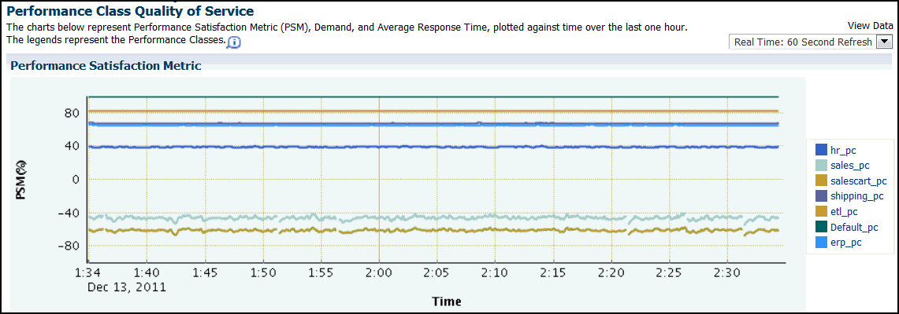
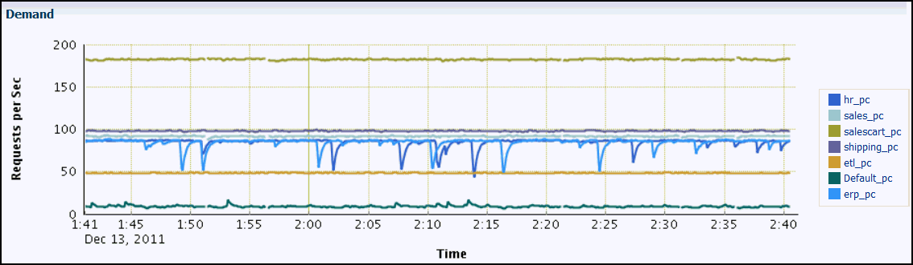
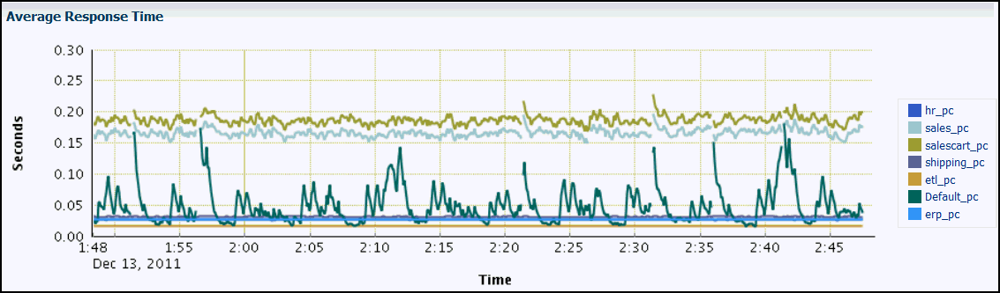
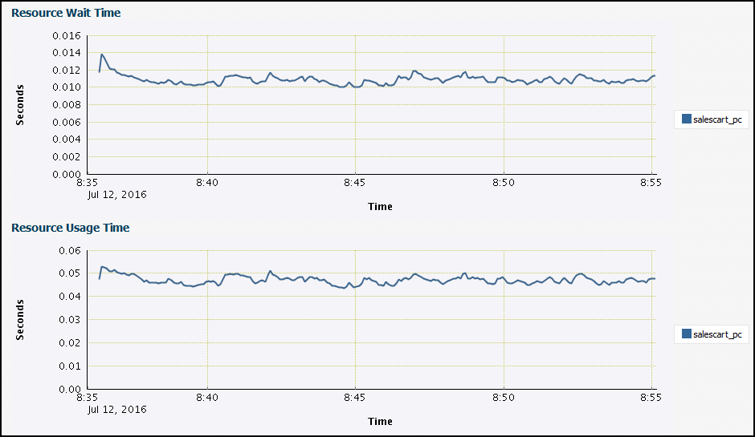
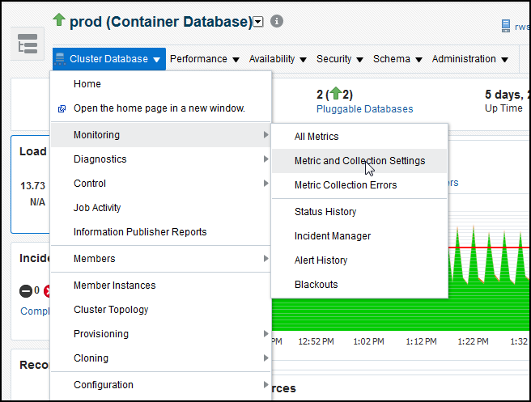
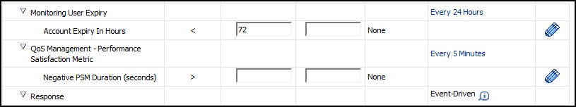
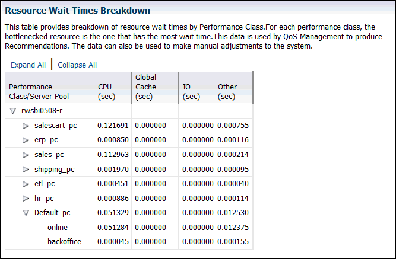

You can view a variety of performance metrics for the Oracle Database QoS Management system as a whole, or for individual Performance Classes.

- Viewing Performance Metrics for All Performance Classes
  You can view the performance metrics for your system on the Performance Class Quality of Service page.
- Viewing Performance Metrics for Individual Performance Classes
  After you have configured Oracle Database Quality of Service Management, and a short period of time has passed, you can view the performance metrics for a specific Performance Class.
- Configuring Alerts for Quality of Service Management Events
  It is not convenient or efficient to require constant manual monitoring of the Quality of Service Management Dashboard. Instead you can use the Enterprise Manager Cloud Control notification system for reporting negative Performance Satisfaction Metrics (PSMs) that persist for user-specified times.
- Viewing the Resource Wait Times Breakdown

**Parent topic:** [Administering the Oracle Database QoS Management System](administering-oracle-database-qos-management-system.md)

### 9.7.1 Viewing Performance Metrics for All Performance Classes

You can view the performance metrics for your system on the Performance Class Quality of Service page.

After you have configured Oracle Database QoS Management, a short period of time is required for Oracle Database QoS Management to gather performance data and evaluate the performance of the system. After this period of time has passed, you can view the performance metrics for your system. To view the current performance metrics, perform the following steps:

1.  Log in to Oracle Enterprise Manager Cloud Control as the cluster administrator. Go to the cluster target page.

2.  From the cluster target menu, select Administration, then Quality of Service Management, then View Performance Class Quality of Service.

3.  The Performance Class Quality of Service page displays three charts measuring the current performance of each Performance Class that is being monitored:

    1.  The Performance Satisfaction Metric chart

        
        [Description of the illustration cc12_psm_perf_chart.gif](img_text/cc12_psm_perf_chart.md)

    2.  The Demand chart

        
        [Description of the illustration cc12_pc_demand_chart.gif](img_text/cc12_pc_demand_chart.md)

    3.  The Average Response Time chart

        
        [Description of the illustration cc12_avg_resp_time_cht.gif](img_text/cc12_avg_resp_time_cht.md)

**Parent topic:** Reviewing Performance Metrics

### 9.7.2 Viewing Performance Metrics for Individual Performance Classes

After you have configured Oracle Database Quality of Service Management, and a short period of time has passed, you can view the performance metrics for a specific Performance Class.

To view the current performance metrics for a Performance Class, perform the following steps:

1.  Log in to Oracle Enterprise Manager Cloud Control as the cluster administrator.
2.  Select the cluster target page that is configured for QoS Management.
3.  From the cluster target menu, select Administration, then Quality of Service Management, then View Performance Class Quality of Service.
4.  On the right-hand side of any graph, in the legend box, click the link that corresponds to the Performance Class for which you want to view the performance metrics.
    When you view the performance metrics for an individual Performance Class, you can see two additional graphs:
    - Resource Usage Time

    - Resource Wait Time

    Figure 9-5 Resource Wait Time and Resource Usage Time Charts for a Performance Class

    
    [Description of "Figure 9-5 Resource Wait Time and Resource Usage Time Charts for a Performance Class"](img_text/performance_class_resource_charts.md)

**Parent topic:** Reviewing Performance Metrics

### 9.7.3 Configuring Alerts for Quality of Service Management Events

It is not convenient or efficient to require constant manual monitoring of the Quality of Service Management Dashboard. Instead you can use the Enterprise Manager Cloud Control notification system for reporting negative Performance Satisfaction Metrics (PSMs) that persist for user-specified times.

Both warning and critical levels can be alerted based upon specified durations for each performance class by setting up alert thresholds and notifications. The alerts are configured against the databases that offer the services being monitored

1.  Start Enterprise Manager Cloud Control.
2.  Navigate to the database for which you want to configure the alert.
3.  From the Cluster Database menu select Monitoring and then select\| Metric and Collection Settings.
    
    [Description of the illustration cc13_metrics_and_collections_db.png](img_text/cc13_metrics_and_collections_db.md)
4.  Under the Metrics tab, edit the metrics in the categoryQoS Management – Performance Satisfaction Metrics.
    
    [Description of the illustration modify_qos_mgmt_performance_metric.png](img_text/modify_qos_mgmt_performance_metric.md)
    For example, if Quality of Service Management uses the database service `sales_svc_pc`, then under Negative PSM Duration (seconds), for that service, you might configure a warning alert when the duration is more than 120 seconds and a critical alert if the duration is more than 180 seconds.

The configured alerts will appear on the Database Home page of Enterprise Manager if a violation is detected.

**Parent topic:** Reviewing Performance Metrics

### 9.7.4 Viewing the Resource Wait Times Breakdown

At the bottom of the Dashboard is the Resource Wait Times Breakdown table. This table provides breakdown of resource wait times by Performance Class. For each Performance Class, the bottlenecked resource is the one that has the most wait time. This data is used by Oracle Database QoS Management to produce recommendations. You can also use this data to make manual adjustments to your system.

[Description of the illustration cc12_res_wait_table.gif](img_text/cc12_res_wait_table.md)

**Parent topic:** Reviewing Performance Metrics
