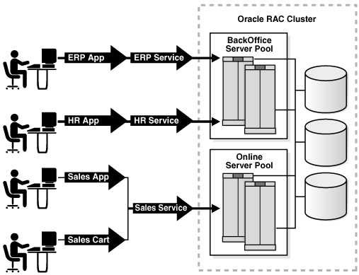

This section describes a sample implementation of Oracle Database QoS Management. The process by which Oracle Database QoS Management manages performance is described.

- Description of the Demo System
  The sample implementation uses a four-node cluster running on Linux.
- Description of the System Workload
  There are many different types of workloads for a database.
- Initial Oracle Database QoS Management Configuration
  You must configure Oracle Database QoS Management before you can use it.

**Parent topic:** [Supported Workloads and Strategies](supported-workloads-and-strategies.md)

### 7.4.1 Description of the Demo System

The sample implementation uses a four-node cluster running on Linux.

The nodes are named `test_rac1` to `test_rac4`. In normal operation, each node does the following:

| Node        | Purpose                                                                                                      | Services                 |
|:------------|:-------------------------------------------------------------------------------------------------------------|:-------------------------|
| `test_rac1` | Runs Oracle Grid Infrastructure for a cluster and the first database instance for the `backoffice` database  | `HR` and `ERP`           |
| `test_rac2` | Runs Oracle Grid Infrastructure for a cluster and the second database instance for the `backoffice` database | `HR` and `ERP`           |
| `test_rac3` | Runs Oracle Grid Infrastructure for a cluster and the first database instance for the `online` database      | `Sales` and `Sales_Cart` |
| `test_rac4` | Runs Oracle Grid Infrastructure for a cluster and the second database instance for the `online` database     | `Sales` and `Sales_Cart` |

The cluster is logically divided into two server pools with the following constraints:

| Name         | Min Size | Max Size | Current Size | Importance |
|:-------------|:---------|:---------|:-------------|:-----------|
| `backoffice` | 1        | -1       | 2            | 1          |
| `online`     | 1        | -1       | 2            | 2          |
| `Free`       | 0        | -1       | 0            | 0          |

The server pool constraints as shown here guarantee that at least one server is allocated to each of the server pools (and the databases that run in those server pools) and the remaining servers can be shared on a demand basis to manage service levels. The `online` server pool hosts the most critical workloads, because it has the highest value for Importance. If a server failure occurs, then maintaining the minimum size for the `online` server pool takes priority over maintaining the minimum size of the other server pools.

**Parent topic:** Sample Implementation of Oracle Database QoS Management

### 7.4.2 Description of the System Workload

There are many different types of workloads for a database.

This release of Oracle Database QoS Management focuses on managing OLTP workloads, which are the type most likely to have an [open workload](glossary.md) (workloads for which demand remains constant even as system performance degrades) and be vulnerable to outages due to workload surges. For this demonstration, assume there is a combination of internal and external workloads hosted in the same cluster so the resources can be shared.

There are four types of workloads demonstrated for this demo system, as illustrated in Figure 7-1:

- An ERP application based on J2EE that connects to the database instances in the `backoffice` server pool using the `ERP` service

- An internal HR application based on Oracle C Interface (OCI) that connects to the database instances in the `backoffice` server pool using the `HR` service

- An external Sales application based on J2EE that connects to the database instances in the `online` server pool using the `Sales` service

- An external Sales checkout application (Sales Cart) based on J2EE that connects to database instances through a specific database user in the `online` server pool using the `Sales` service

Figure 7-1 Illustration of a Sample Workload

[Description of "Figure 7-1 Illustration of a Sample Workload"](img_text/apqos001.md)

By using two server pools, the workloads and their dependent databases are logically separated but can readily share resources between them.

**Parent topic:** Sample Implementation of Oracle Database QoS Management

### 7.4.3 Initial Oracle Database QoS Management Configuration

You must configure Oracle Database QoS Management before you can use it.

At first, there is no Oracle Database QoS Management configured for this system. Using Oracle Enterprise Manager Cloud Control, there are two configuration workflows to complete to enable Oracle Database QoS Management for the cluster. The first workflow configures each database for Oracle Database QoS Management and the second workflow configures and enables Oracle Database QoS Management for the cluster.

After you create a default Policy Set, using the database services that are discovered automatically, Oracle Database QoS Management can be fine-tuned to align the workloads with their respective service-level agreements or objectives.

**Related Topics**

- [Enabling Oracle Database QoS Management](configuring-qos-management-manage-db-workloads.md)

**Parent topic:** Sample Implementation of Oracle Database QoS Management
