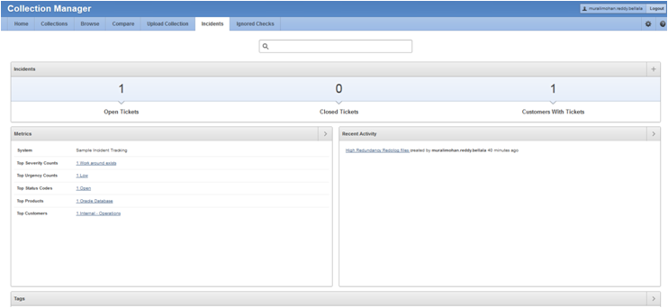

The Incidents tab gives you a complete system for tracking support incidents.

- Specify contact details of each customer, products and categories, and then set up values to limit status codes, severity, and urgency attributes for an incident

- Raise a new ticket by clicking the Delta (Δ) symbol. Oracle Health Check Collections Manager displays the delta symbol only in the Collections and Browse tabs

- The Browse tab enables you to create a new ticket on individual checks

- The Collections tab enables you to create a single ticket for entire the collection

- Delta (Δ) symbol is color coded red, blue, and green based on the ticket status

  - RED (No Incident ticket exists): Initiates the process to create a new incident ticket for the collection or individual checks

  - BLUE (An open Incident ticket exists): Opens the incident ticket for editing

  - GREEN (A closed Incident ticket exists): Opens the closed incident ticket for viewing

- Track the progress of the ticket in an update area of the ticket, or add attachments and links to the incident

- Use tags to classify incidents and use the resulting tag cloud in your reports

- Incident access and management happen only within your access control range

**Note:**

Incident Tracking feature is a basic stand-alone system and it is not designed for integration with other commercial enterprise-level trouble ticketing systems.

Figure 2-7 Incidents Tab

[Description of "Figure 2-7 Incidents Tab"](img_text/incidents-tab.md)

### Incident Tracking Features

- Search options

- Track and analyze incident tickets

- Flexible and updateable incident status

- Robust reporting

- Link, Note, and File Attachments

- Flexible Access Control (reader, contributor, administrator model)

**Related Topics**

- [Creating or Editing Incidents Tickets](collection-manager.md)
- [Oracle ORAchk and EXAchk User’s Guide](https://docs.oracle.com/pls/topic/lookup?ctx=en/database/oracle/oracle-database/19/atnms&id=OEXUG-GUID-BC64F401-438E-4CE5-914C-577BD3A12EB1)

**Parent topic:** [Analyzing Risks and Complying with Best Practices](purpose-oracle-orachk-and-oracle-exachk.md)
