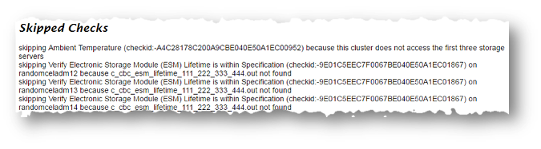

To troubleshoot and fix Oracle ORAchk and Oracle EXAchk issues, follow the steps explained in this section.

- How to Troubleshoot Oracle ORAchk and Oracle EXAchk Issues
  To troubleshoot Oracle ORAchk and Oracle EXAchk issues, follow the steps explained in this section.
- How to Capture Debug Output
  Follow these steps to capture debug information.
- Remote Login Problems
  If Oracle ORAChk and Oracle EXAchk tools have problem locating and running SSH or SCP, then the tools cannot run any remote checks.
- Permission Problems
  You must have sufficient directory permissions to run Oracle ORAchk and Oracle EXAchk.
- Slow Performance, Skipped Checks and Timeouts
  Follow these steps to fix slow performance and other issues.

**Related Topics**

- [Oracle ORAchk and EXAchk User’s Guide](https://docs.oracle.com/pls/topic/lookup?ctx=en/database/oracle/oracle-database/19/atnms&id=OEXUG-GUID-42FF19CB-58B3-4BDB-946C-F5147E1F4D2B)

**Parent topic:** [Analyzing Risks and Complying with Best Practices](purpose-oracle-orachk-and-oracle-exachk.md)

### 2.16.1 How to Troubleshoot Oracle ORAchk and Oracle EXAchk Issues

To troubleshoot Oracle ORAchk and Oracle EXAchk issues, follow the steps explained in this section.

#### To troubleshoot Oracle ORAchk and Oracle EXAchk:

1.  Ensure that you are using the correct tool.
    Use Oracle EXAchk for Oracle Engineered Systems except for Oracle Database Appliance. For all other systems, use Oracle ORAchk.
2.  Ensure that you are using the latest versions of Oracle ORAchk and Oracle EXAchk.
    1.  Check the version using the `–v` option.
            $ ./orachk –v

            $ ./exachk –v
    2.  Compare your version with the latest version available here:
        - For Oracle ORAchk, refer to My Oracle Support Note 1268927.2.

        - For Oracle EXAchk, refer to My Oracle Support Note 1070954.1.
3.  Check the FAQ  for similar problems in My Oracle Support Note 1070954.1.
4.  Review the files within the `log` directory.
    - Check the applicable `error.log` files for relevant errors.

      The `error.log` files contain `stderr` output captured during the run.

      - `output_dir``/log/orachk _error.log`

      - `output_dir``/log/exachk _error.log`

    - Check the applicable log for other relevant information.

      - `output_dir``/log/orachk.log`

      - `output_dir``/log/exachk.log`
5.  Review My Oracle Support Notes for similar problems.
6.  For Oracle ORAchk issues, check ORAchk (MOSC) in My Oracle Support Community (MOSC).
7.  If necessary, capture the debug output, and then log an SR and attach the resulting `zip` file.

**Related Topics**

- <https://support.oracle.com/rs?type=doc&id=1268927.2>
- <https://support.oracle.com/rs?type=doc&id=1070954.1>

**Parent topic:** Troubleshooting Oracle ORAchk and Oracle EXAchk

### 2.16.2 How to Capture Debug Output

Follow these steps to capture debug information.

#### To capture debug output:

1.  Reproduce the problem with fewest runs before enabling debug.
    Debug captures a lot and the resulting `zip` file can be large so try to narrow down the amount of run necessary to reproduce the problem.

    Use command-line options to limit the scope of checks.
2.  Enable debug.
    If you are running the tool in on-demand mode, then use the `–debug` option:
        $ ./orachk –debug

        $ ./exachk –debug

    When you enable debug, Oracle ORAchk and Oracle EXAchk create a new debug log file in:

    - `output_dir``/log/orachk _debug_``date_stamp``_``time_stamp``.log`

    - `output_dir``/log/exachk _debug_``date_stamp``_``time_stamp``.log`

    The `output_dir` directory retains various other temporary files used during health checks.

    If you run health checks using the daemon, then restart the daemon with the `–d start –debug` option.

    Running this command generates both debug for daemon and include debug in all client runs:
        $ ./orachk –d start –debug

        $ ./exachk –d start –debug

    When debug is run with the daemon, Oracle ORAchk and Oracle EXAchk create a daemon debug log file in the directory in which the daemon was started:
        orachk_daemon_debug.log

        exachk_daemon_debug.log
3.  Collect the resulting output `zip` file and the daemon debug log file, if applicable.

**Parent topic:** Troubleshooting Oracle ORAchk and Oracle EXAchk

### 2.16.3 Remote Login Problems

If Oracle ORAChk and Oracle EXAchk tools have problem locating and running SSH or SCP, then the tools cannot run any remote checks.

Also, the `root` privileged commands do not work if:

- Passwordless remote `root` login is not permitted over SSH

- Expect utility is not able to pass the `root` password

1.  Verify that the SSH and SCP commands can be found.
    - The SSH commands return the error, `-bash: /usr/bin/ssh -q: No such file or directory`, if SSH is not located where expected.

      Set the `RAT_SSHELL` environment variable pointing to the location of SSH:

          $ export RAT_SSHELL=path to ssh

    - The SCP commands return the error, `/usr/bin/scp -q: No such file or directory`, if SCP is not located where expected.

      Set the `RAT_SCOPY` environment variable pointing to the location of SCP:
          $ export RAT_SCOPY=path to scp
2.  Verify that the user you are running as, can run the following command manually from where you are running Oracle ORAchk and Oracle EXAchk to whichever remote node is failing.
        $ ssh root@remotehostname "id"
        root@remotehostname's password:
        uid=0(root) gid=0(root) groups=0(root),1(bin),2(daemon),3(sys),4(adm),6(disk),10(wheel)

    - If you face any problems running the command, then contact the systems administrators to correct temporarily for running the tool.

    - Oracle ORAchk and Oracle EXAchk search for the prompts or traps in remote user profiles. If you have prompts in remote profiles, then comment them out at least temporarily and test run again.

    - If you can configure passwordless remote `root` login, then edit the `/etc/ssh/sshd_config` file as follows:
          n to yes

      Now, run the following command as `root` on all nodes of the cluster:
          hd restart
3.  Enable Expect debugging.
    - Oracle ORAchk uses the Expect utility when available to answer password prompts to connect to remote nodes for password validation. Also, to run `root` collections without logging the actual connection process by default.

    - Set environment variables to help debug remote target connection issues.

      - `RAT_EXPECT_DEBUG`: If this variable is set to `-d` , then the Expect command tracing is activated. The trace information is written to the standard output.

        For example:
            export RAT_EXPECT_DEBUG=-d

      - `RAT_EXPECT_STRACE_DEBUG`: If this variable is set to `strace`, `strace` calls the Expect command. The trace information is written to the standard output.

        For example:
            export RAT_EXPECT_STRACE_DEBUG=strace

    - By varying the combinations of these two variables, you can get three levels of Expect connection trace information.

**Note:**

Set the `RAT_EXPECT_DEBUG` and `RAT_EXPECT_STRACE_DEBUG` variables only at the direction of Oracle support or development. The `RAT_EXPECT_DEBUG` and `RAT_EXPECT_STRACE_DEBUG`variables are used with other variables and user interface options to restrict the amount of data collected during the tracing. The `script` command is used to capture standard output.

As a temporary workaround while you resolve remote problems, run reports local on each node then merge them together later.

On each node, run:

    ./orachk -local

    ./exachk -local

Then merge the collections to obtain a single report:

    ./orachk –merge zipfile 1  zip file 2 > zip file 3 > zip file ...

    ./exachk –merge zipfile 1  zip file 2 > zip file 3 > zip file ...

**Parent topic:** Troubleshooting Oracle ORAchk and Oracle EXAchk

### 2.16.4 Permission Problems

You must have sufficient directory permissions to run Oracle ORAchk and Oracle EXAchk.

1.  Verify that the permissions on the tools scripts `orachk` and `exachk`  are set to `755 (-rwxr-xr-x)`.
    If the permissions are not set, then set the permissions as follows:
        $ chmod 755 orachk

        $ chmod 755 exachk
2.  If you install Oracle ORAchk and Oracle EXAchk as `root`  and run the tools as a different user, then you may not have the necessary directory permissions.
        [root@randomdb01 exachk]# ls -la
        total 14072
        drwxr-xr-x  3 root root    4096 Jun  7 08:25 .
        drwxrwxrwt 12 root root    4096 Jun  7 09:27 ..
        drwxrwxr-x  2 root root    4096 May 24 16:50 .cgrep
        -rw-rw-r--  1 root root 9099005 May 24 16:50 collections.dat
        -rwxr-xr-x  1 root root  807865 May 24 16:50 exachk
        -rw-r--r--  1 root root 1646483 Jun  7 08:24 exachk.zip
        -rw-r--r--  1 root root    2591 May 24 16:50 readme.txt
        -rw-rw-r--  1 root root 2799973 May 24 16:50 rules.dat
        -rw-r--r--  1 root root     297 May 24 16:50 UserGuide.txt

In which case, you must run as `root`  or unzip again as the Oracle software install user.

**Parent topic:** Troubleshooting Oracle ORAchk and Oracle EXAchk

### 2.16.5 Slow Performance, Skipped Checks and Timeouts

Follow these steps to fix slow performance and other issues.

When Oracle ORAchk and Oracle EXAchk run commands, a child process is spawned to run the command and a watchdog daemon monitors the child process. If the child process is slow or hung, then the watchdog kills the child process and the check is registered as skipped:

Figure 2-27 Skipped Checks

[Description of "Figure 2-27 Skipped Checks"](img_text/skipped-checks.md)

The `watchdog.log` file also contains entries similar to killing stuck command.

Depending on the cause of the problem, you may not see skipped checks.

1.  Determine if there is a pattern to what is causing the problem.
    - EBS checks, for example, depend on the amount of data present and may take longer than the default timeout.

    - Remote checks may timeout and be killed and skipped, if there are prompts in the remote profile. Oracle ORAchk and Oracle EXAchk search for prompts or traps in the remote user profiles. If you have prompts in remote profiles, then comment them out at least temporarily and test run again.
2.  Increase the default timeout.
    - Override the default timeout by setting the environment variables.

      Table 2-7 Timeout Controlling

      | Timeout Controlling            | Default Value (seconds) | Environment Variable        |
      |:-------------------------------|:------------------------|:----------------------------|
      | Checks not run by root (most). | 90                      | `RAT_TIMEOUT`               |
      | Collection of all root checks. | 300                     | `RAT_ROOT_TIMEOUT`          |
      | SSH login DNS handshake.       | 1                       | `RAT_PASSWORDCHECK_TIMEOUT` |

    - The default timeouts are designed to be lengthy enough for most cases. If the timeout is not long enough, then it is possible you are experiencing a system performance problem. Many timeouts can be indicative of a non-Oracle ORAchk and Oracle EXAchk problem in the environment.
3.  If it is not acceptable to increase the timeout to the point where nothing fails, then try excluding problematic checks running separately with a large enough timeout and then merging the reports back together.
4.  If the problem does not appear to be down to slow or skipped checks but you have a large cluster, then try increasing the number of slave processes user for parallel database run.
    - Database collections are run in parallel. The default number of slave processes used for parallel database run is calculated automatically. Change the default number using the options:`-dbparallel ``slave processes`, or `–dbparallelmax`

    **Note:**

    The higher the parallelism the more resources are consumed. However, the elapsed time is reduced.

    Raise or lower the number of parallel slaves beyond the default value.

    After the entire system is brought up after maintenance, but before the users are permitted on the system, use a higher number of parallel slaves to finish a run as quickly as possible.

    On a busy production system, use a number less than the default value yet more than running in serial mode to get a run more quickly with less impact on the running system.

    Turn off the parallel database run using the `-dbserial` option.

**Parent topic:** Troubleshooting Oracle ORAchk and Oracle EXAchk
