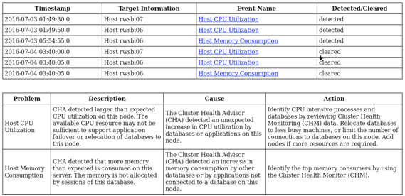

Oracle Cluster Health Advisor raises and clears problems autonomously and stores the history in the Grid Infrastructure Management Repository (GIMR).

The Oracle Grid Infrastructure user can query the stored information using CHACTL.

### To query the diagnostic data:

1.  To query currently open problems, run the following command:
        chactl query diagnosis -db db_unique_name -start time -end time

    In the syntax example, db_unique_name is the name of your database instance. You also specify the start time and end time for which you want to retrieve data. Specify date and time in the `YYYY-MM-DD HH24:MI:SS` format.
2.  Use the `-htmlfile ``file_name` option to save the output in HTML format.

Example 3-1 Cluster Health Advisor Output Examples in Text and HTML Format

This example shows the default text output for the `chactl query diagnosis` command for a database named `oltpacbd`.

    $ chactl query diagnosis -db oltpacdb -start "2016-02-01 02:52:50" -end "2016-02-01 03:19:15"
    2016-02-01 01:47:10.0  Database oltpacdb  DB Control File IO Performance (oltpacdb_1) [detected]
    2016-02-01 01:47:10.0  Database oltpacdb  DB Control File IO Performance (oltpacdb_2) [detected]
    2016-02-01 02:52:15.0  Database oltpacdb  DB CPU Utilization (oltpacdb_2) [detected]
    2016-02-01 02:52:50.0  Database oltpacdb  DB CPU Utilization (oltpacdb_1) [detected]
    2016-02-01 02:59:35.0  Database oltpacdb  DB Log File Switch (oltpacdb_1) [detected]
    2016-02-01 02:59:45.0  Database oltpacdb  DB Log File Switch (oltpacdb_2) [detected]

    Problem: DB Control File IO Performance
    Description: CHA has detected that reads or writes to the control files are slower than expected.
    Cause: The Cluster Health Advisor (CHA) detected that reads or writes to the control files were slow
    because of an increase in disk IO.
    The slow control file reads and writes may have an impact on checkpoint and Log Writer (LGWR) performance.
    Action: Separate the control files from other database files and move them to faster disks or Solid State Devices.

    Problem: DB CPU Utilization
    Description: CHA detected larger than expected CPU utilization for this database.
    Cause: The Cluster Health Advisor (CHA) detected an increase in database CPU utilization
    because of an increase in the database workload.
    Action: Identify the CPU intensive queries by using the Automatic Diagnostic and Defect Manager (ADDM) and
    follow the recommendations given there. Limit the number of CPU intensive queries or
    relocate sessions to less busy machines. Add CPUs if the CPU capacity is insufficent to support
    the load without a performance degradation or effects on other databases.

    Problem: DB Log File Switch
    Description: CHA detected that database sessions are waiting longer than expected for log switch completions.
    Cause: The Cluster Health Advisor (CHA) detected high contention during log switches
    because the redo log files were small and the redo logs switched frequently.
    Action: Increase the size of the redo logs.

The timestamp displays date and time when the problem was detected on a specific host or database.

**Note:**

The same problem can occur on different hosts and at different times, yet the diagnosis shows complete details of the problem and its potential impact. Each problem also shows targeted corrective or preventive actions.

Here is an example of what the output looks like in the HTML format.

    $ chactl query diagnosis -start "2016-07-03 20:50:00" -end "2016-07-04 03:50:00" -htmlfile ~/chaprob.html

Figure 3-2 Cluster Health Advisor Diagnosis HTML Output

[Description of "Figure 3-2 Cluster Health Advisor Diagnosis HTML Output"](img_text/cha-diagnosis-html-output.md)

**Related Topics**

- [chactl query diagnosis](chactl-query-diagnosis.md)

**Parent topic:** [Proactively Detecting and Diagnosing Performance Issues for Oracle RAC](purpose-cluster-health-advisor.md)
