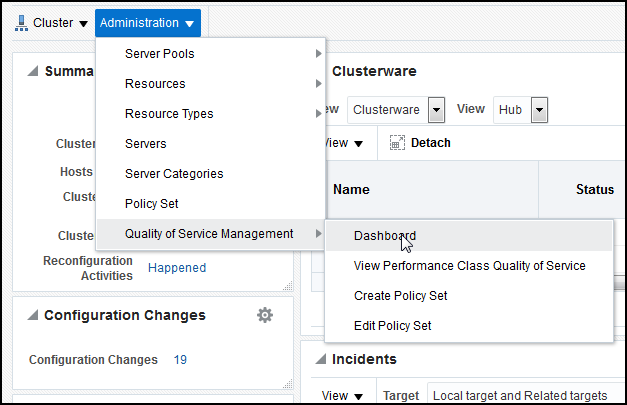
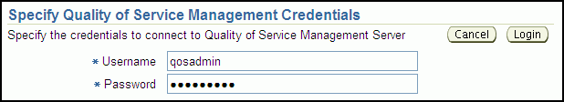
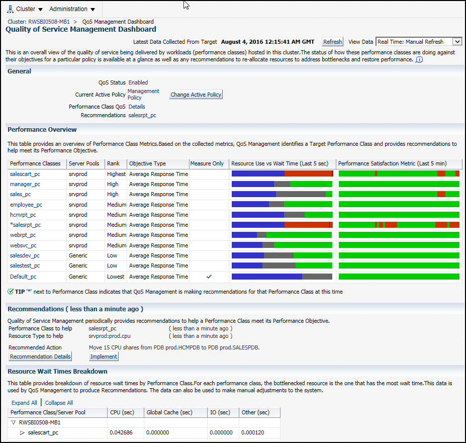
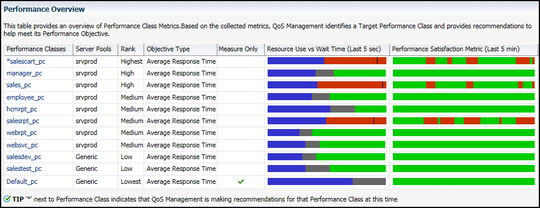
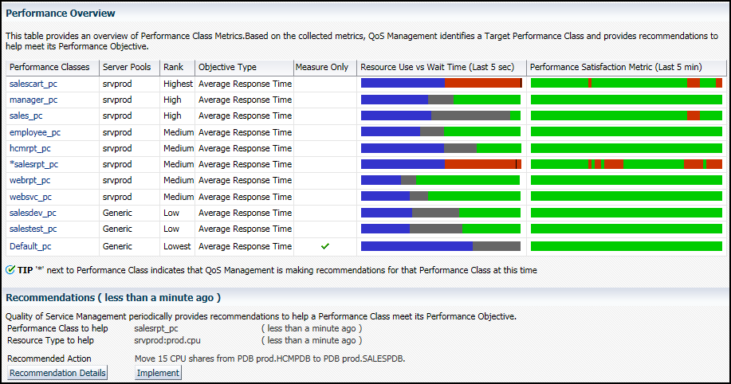
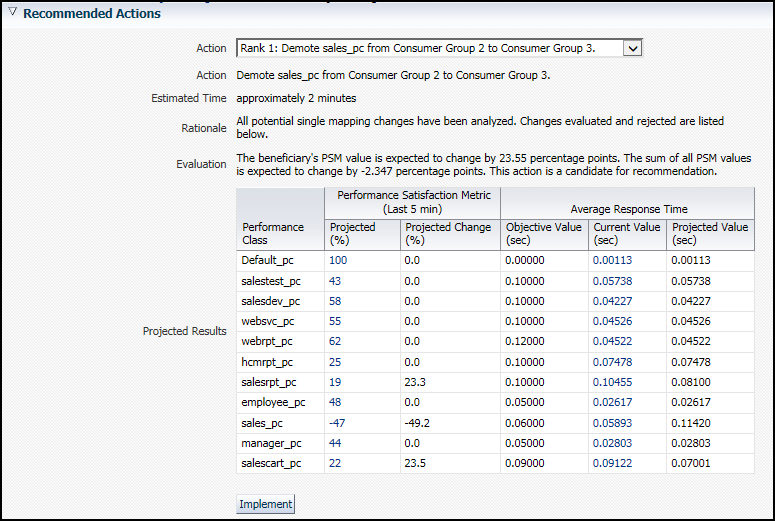
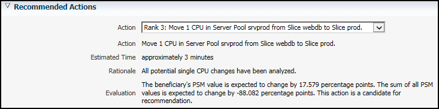
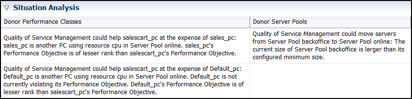

The Oracle Database QoS Management Dashboard (the Dashboard) provides an easy to use interface for managing the Oracle Database QoS Management system.

- Accessing the Oracle Database QoS Management Dashboard
  The dashboard provides you with an overall view of the quality of service being delivered by the workloads in your system.
- Enabling Oracle Database QoS Management for a Cluster
- Disabling Oracle Database QoS Management for a Cluster
- Interpreting the Performance Overview Graphs
- Viewing Recommendations
- Viewing Recommendation Details
- Implementing Recommendations
  By default, Oracle Database QoS Management does not automatically implement recommendations.

**Parent topic:** [Administering the Oracle Database QoS Management System](administering-oracle-database-qos-management-system.md)

### 9.3.1 Accessing the Oracle Database QoS Management Dashboard

The dashboard provides you with an overall view of the quality of service being delivered by the workloads in your system.

The Dashboard has four main sections:

- General

- Performance Overview

- Recommendations

- Resource Wait Time Breakdown

The General section of the Dashboard gives you a quick overview of the system. This section lists the QoS Status (Enabled or Disabled), the Current Active Policy, a link for checking the Performance Class details, and a notification for available recommendations. There is also a button that enables you to quickly change the current active policy.

In the Performance Overview section, there is a table that lists the Performance Classes, the server pools where work is occurring, their rank, the Performance Objective being measured, and whether the Performance Objectives are being monitored only, or are being monitored and managed. For each Performance Class there are bar graphs that provide an overview of the Performance Class metrics.

In the Recommendation section you can view the recommendations that are available when a Performance Class is not meeting its Performance Objectives. You can also view any violations that prevent the recommendations from being made.

At the bottom of the Dashboard is the Resource Wait Times Breakdown section. This section contains a table that provides a breakdown of resource wait times by Performance Class. For each Performance Class, the blocking resource is the one that has the most wait time. This data is used by QoS Management to produce Recommendations. The data can also be used to make manual adjustments to the system. If you expand each Performance Class listed in the table, then you can see the server pools for that Performance class, and the resource wait times for each server pool.

1.  Log in to Cloud Control and select the cluster target to check.
2.  From the target's menu, select Administration, then Quality of Service Management, and then Dashboard.
    
    [Description of the illustration select-dashboard-menu.png](img_text/select-dashboard-menu.md)
3.  A login screen appears, prompting you for the Oracle Database QoS Management administrator (QoSAdmin) credentials. After typing in the user name and password, click Login.
    
    [Description of the illustration appqos_login_02.gif](img_text/appqos_login_02.md)
4.  The Quality of Service Management Dashboard page, shown in Figure 9-2, is displayed after the correct credentials are entered.
    Figure 9-2 Oracle Database Quality of Service Management Dashboard

    
    [Description of "Figure 9-2 Oracle Database Quality of Service Management Dashboard"](img_text/dashboard-complete.md)

**Related Topics**

- Interpreting the Performance Overview Graphs

**Parent topic:** Using the Oracle Database QoS Management Dashboard

### 9.3.2 Enabling Oracle Database QoS Management for a Cluster

1.  On the Dashboard, in the General section, next to QoS Status, click Disabled.
2.  On the Enable / Disable Quality of Service Management page, click Enable QoS Management.

**Parent topic:** Using the Oracle Database QoS Management Dashboard

### 9.3.3 Disabling Oracle Database QoS Management for a Cluster

1.  On the Dashboard, in the General section, next to QoS Status, click Enabled.
2.  On the Enable / Disable Quality of Service Management page, click Disable QoS Management.

**Parent topic:** Using the Oracle Database QoS Management Dashboard

### 9.3.4 Interpreting the Performance Overview Graphs

On the Dashboard, in the Performance Overview section, there is a list of the current Performance Classes, some basic information about each Performance Class, and two bar graphs that show the most recent trend for the performance metrics for that class, as shown in "Example of the Performance Overview Graphs".

Figure 9-3 Example of the Performance Overview Graphs

[Description of "Figure 9-3 Example of the Performance Overview Graphs"](img_text/dashboard-performance_ovrvw_chart.md)

Figure 9-3 shows the Performance Overview section of the Dashboard, which consists of a table with embedded bar graphs. The rows in the table list each performance class, the server pools associated with that performance class, its rank and objective types. Also included in the row for each performance class are two bar graphs, one showing the resource use compared to the wait time, and the other graph showing the performance satisfaction metric over the last 5 minutes. The Resource Use vs. Wait Time bar graph has three sections of varying size and color that illustrate the resource usage (blue), wait time (gray or red), and headroom (green) portions of the Performance Objective. The Performance Satisfaction Metric bar graph is displayed as a single bar, growing from left to right, with the green and red segments representing five second time slices in which the performance class was either exceeding (green) or violating (red) its performance objectives. If you place your cursor over a section of the Resource Use vs. Wait Time bar graph, then a description of that measurement appears by your cursor.

#### Resource Use vs. Wait Time

The Resource Use vs. Wait Time graph is refreshed only when you refresh the page contents. In this graph:

- The blue section represents the portion of the average time spent for all database requests by that Performance Class that are using resources in the last five seconds

- The gray section represents the portion of the average time spent for all database requests by that Performance Class that are waiting on resources in the last five seconds

- The green section represents the headroom for that Performance Class (proportion of the average time for all database requests below the specified Performance Objective) in the last five seconds

- If a Performance Class is not meeting its Performance Objectives, then the gray and green sections disappear and the resource wait time is shown in red with a line to indicate where the Performance Objective is relative to the actual response time.

- If you place your mouse cursor over any section of this bar graph, then the actual values of Use, Wait and Headroom are displayed

The point between the gray and the green sections of the bar graph is the Performance Objective value. If you set this value below the resource use time, then you will never meet that objective. When configuring the Performance Objectives for a Performance Class, you must set the Performance Objective high enough to produce sufficient headroom (shown in green) to be able to share resources between Performance Classes to meet service levels as demand changes.

If a red section appears in the bar graph for a Performance Class, then you know that the Performance Class is not meeting its Performance Objectives. Oracle Database QoS Management issues a recommendation and an action to implement, if possible, to correct the problem. The recommendations generated by Oracle Database QoS Management occur once each minute, so they correspond to an earlier time than the current Performance Overview graphs.

#### Performance Satisfaction Metric

The Performance Satisfaction Metric changes to show red and green segments for specific five second samples. Using this you can spot trends in the performance of your system.

For the Performance Satisfaction Metric bar graph:

- The red section represents the periods of time the Performance Class was not meeting its Performance Objectives during the sampling period

- The green section represents the periods of time the Performance Class was meeting its Performance Objectives during the sampling period

**Parent topic:** Using the Oracle Database QoS Management Dashboard

### 9.3.5 Viewing Recommendations

When viewing recommendations, there are three possible results.

1.  If the Performance Classes are meeting their Performance Objective, then a recommendation is displayed which states "No action required: all Performance Objectives are being met."
2.  If Oracle Database QoS Management determines that a Performance Class is not meeting its Performance Objective and has a recommended action for improving performance, then the Dashboard places an asterisk ('\*') in front of the Performance Class name in the Performance Overview chart and displays a Recommended Action.
3.  If more than one Performance Class is not meeting its Performance Objective as shown in Figure 9-4, then only the target Performance Class displays an asterisk and a recommendation. If the recommendation has an associated action, then an Implement button appears, which you can click to have the action implemented.
    If there are no recommended actions, then you can click the Details button to view the results of the latest analysis. Oracle Database QoS Management shows what possible actions could be taken, and why these actions were not chosen.

Example 9-1 Example Output For Performance Overview Page and Recommended Actions

The screenshot shows two performance classes are not meeting their performance objectives, salescart_pc and salesrpt_pc. As a result, Oracle Database QoS Management has generated a recommended action to move 15 CPU shares from the pluggable database prod.HCMPDB to the pluggable database prod.SALESPDB. Implementing this action will provide more CPU to the workload associated with the salescart_pc performance class.

Figure 9-4 Performance Classes Not Meeting Their Performance Objectives

[Description of "Figure 9-4 Performance Classes Not Meeting Their Performance Objectives"](img_text/desc-illust-dashboard-perf-ovrvw-chart-recommend.md)

**Parent topic:** Using the Oracle Database QoS Management Dashboard

### 9.3.6 Viewing Recommendation Details

If Oracle Database QoS Management has generated a recommendation, then you can click the Recommendation Details button to view more information about why the recommendation was made, and the expected performance improvements to be gained if you implement the recommendations.

[Description of the illustration recommend_actions_details.png](img_text/recommend_actions_details.md)

You can select different recommendations using the Action drop-down list. Oracle Database QoS Management tries to provide the best recommendation to the QoS administrator, but you could decide that a different action would produce quicker results. If you select a different action, then the information in the Recommendation Actions and the Situation Analysis sections are updated to reflect the impact of the alternate recommendation. You cannot implement an alternate recommendation if that recommendation has been rejected by the Oracle Database QoS Management System for not providing enough benefit to the system as a whole.

[Description of the illustration recommendation_alternate_rank3_move_cpu.png](img_text/recommendation_alternate_rank3_move_cpu.md)

The Recommended Actions page also has a section called Situation Analysis. If you display the output in this section, then you can see a description the projected impact implementing the Recommendation will have on the Performance Classes and the server pool, as shown in the following screenshot.

[Description of the illustration cc12_recommend_deets_2c.gif](img_text/cc12_recommend_deets_2c.md)

**Parent topic:** Using the Oracle Database QoS Management Dashboard

### 9.3.7 Implementing Recommendations

By default, Oracle Database QoS Management does not automatically implement recommendations.

1.  If there is a Recommended Action, and you decide to implement the action, then simply click the Implement button on the Dashboard or the Details page.
    After you have implemented a recommendation, the display on the Dashboard changes to show that there is an action in progress. No new recommendations are displayed until the system has settled after the resource change. You can determine the amount of time you have to wait before any new recommendations are made available by viewing the Details page before you implement a recommendation.
2.  After implementing a Recommended Action, view the Performance Overview charts on the Dashboard to determine if the Performance Class is now meeting its Performance Objectives.

**Related Topics**

- [Automatically Implementing Recommendations for a Performance Policy](managing-performance-policies.md)

**Parent topic:** Using the Oracle Database QoS Management Dashboard
