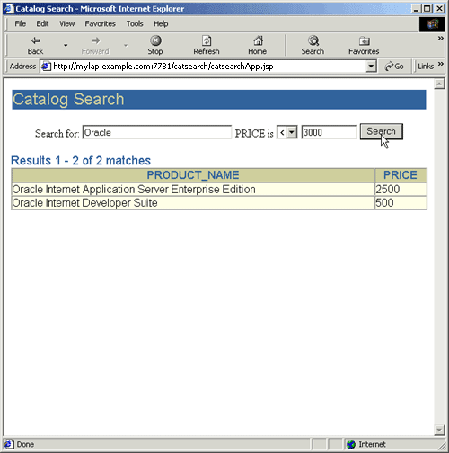

This appendix describes how to build a simple web search application by using the `CATSEARCH` index type.

This appendix contains the following topics:

- CATSEARCH Web Query Application Overview

- The JSP Web Application

### B.1 CATSEARCH Web Query Application Overview

The `CTXCAT` index type is well suited for merchandise catalogs that have short, descriptive text fragments and associated structured data. This appendix describes how to build a browser-based bookstore catalog that users can search to find titles and prices.

This application is written in JavaServer Pages (JSP).

### B.2 The JSP Web Application

This application is based on JavaServer pages (JSP) and has the following requirements:

- Your Oracle Database must be up and running.

- A web server such as Apache Tomcat, which is can run JSP scripts that connect to the Oracle Database by using Java Database Connectivity (JDBC).

**See Also:**

Oracle Database 2 Day + PHP Developer's Guide for information about installing Apache HTTP Server

This section contains the following topics:

- Building the JSP Web Application

- JSP Web Application Sample Code

#### B.2.1 Building the JSP Web Application

This application models an online bookstore, where you can look up book titles and prices.

To create the JavaServer Pages (JSP) web application:

1.  Create your table.
    You must create the table to store such book information as title, publisher, and price. From SQL\*Plus:

        sqlplus>create table book_catalog (
                  id        numeric,
                  title     varchar2(80),
                  publisher varchar2(25),
                  price     numeric )
2.  Load data by using SQL\*Loader.
    Load the book data from the operating system command line with SQL\*Loader:

        % sqlldr userid=ctxdemo/ctxdemo control=loader.ctl
3.  Create the index set.
    You can create the index set from SQL\*Plus:

        sqlplus>begin
                  ctx_ddl.create_index_set('bookset');
                  ctx_ddl.add_index('bookset','price');
                  ctx_ddl.add_index('bookset','publisher');
                end;
        /
4.  Create the `CTXCAT` index.
    You can create the `CTXCAT` index from SQL\*Plus as follows:

        sqlplus>create index book_idx on book_catalog (title)
                indextype is ctxsys.ctxcat
                parameters('index set bookset');
5.  Try a simple search by using `CATSEARCH.`
    You can test the newly created index in SQL\*Plus as follows:

        sqlplus>select id, title from book_catalog
                where catsearch(title,'Java','price > 10 order by price') > 0
6.  Copy the `catalogSearch.jsp` file to your JSP directory.
    When you do so, you can access the application from a browser. The URL is `http://`localhost`:`port`/`path`/catalogSearch.jsp.`

    The application displays a query field in your browser and returns the query results as a list of HTML links. See Figure B-1.

Figure B-1 Screenshot of the Web Query Application

[Description of "Figure B-1 Screenshot of the Web Query Application"](img_text/qcatwiz1_newb.md)

#### B.2.2 JSP Web Application Sample Code

This section lists the code used to build the example web application. It includes the following files:

- loader.ctl

- loader.dat

- catalogSearch.jsp

  **See Also:**

  [`http://www.oracle.com/technetwork/indexes/downloads/index.html`](http://www.oracle.com/technetwork/indexes/downloads/index.html)

##### B.2.2.1 loader.ctl

          LOAD DATA
            INFILE 'loader.dat'
            INTO TABLE book_catalog
            REPLACE
            FIELDS TERMINATED BY ';'
            (id, title, publisher, price)

##### B.2.2.2 loader.dat

    1; A History of Goats; SPINDRIFT BOOKS; 50
    2; Robust Recipes Inspired by Eating Too Much; SPINDRIFT BOOKS; 28
    3; Atlas of Greenland History; SPINDRIFT BOOKS; 35
    4; Bed and Breakfast Guide to Greenland; SPINDRIFT BOOKS; 37
    5; Quitting Your Job and Running Away; SPINDRIFT BOOKS; 25
    6; Best Noodle Shops of Omaha; SPINDRIFT BOOKS; 28
    7; Complete Book of Toes; SPINDRIFT BOOKS; 16
    8; Complete Idiot's Guide to Nuclear Technology; SPINDRIFT BOOKS; 28
    9; Java Programming for Woodland Animals; BIG LITTLE BOOKS; 10
    10; Emergency Surgery Tips and Tricks; SPOT-ON PUBLISHING; 10
    11; Programming with Your Eyes Shut; KLONDIKE BOOKS; 10
    12; English in Twelve Minutes; WRENCH BOOKS 11
    13; Spanish in Twelve Minutes; WRENCH BOOKS 11
    14; C++ Programming for Woodland Animals; CALAMITY BOOKS; 12
    15; Oracle Internet Application Server, Enterprise Edition; KANT BOOKS; 12
    16; Oracle Internet Developer Suite; SPAMMUS BOOK CO;13
    17; Telling the Truth to Your Pets; IBEX BOOKS INC; 13
    18; Go Ask Alice's Restaurant; HUMMING BOOKS;    13
    19; Life Begins at 93;  CALAMITY BOOKS;   17
    20; Python Programming for Snakes;  BALLAST BOOKS;  14
    21; The Second-to-Last Mohican; KLONDIKE BOOKS;  14
    22; Eye of Horus; An Oracle of Ancient Egypt; BIG LITTLE BOOKS;     15
    23; Introduction to Sitting Down; IBEX BOOKS INC;  15

##### B.2.2.3 catalogSearch.jsp

    <%@ page import="java.sql.* , oracle.jsp.dbutil.*" %>
    <jsp:useBean id="name" class="oracle.jsp.jml.JmlString" scope="request" >
    <jsp:setProperty name="name" property="value" param="v_query" />
    </jsp:useBean>

    <%
      String connStr="jdbc:oracle:thin:@machine-domain-name:1521:dev";

      java.util.Properties info = new java.util.Properties();

      Connection conn = null;
      ResultSet  rset = null;
      Statement  stmt = null;

           if (name.isEmpty() ) {

    %>
               <html>
                 <title>Catalog Search</title>
                 <body>
                 

                   <form method=post>
                   Search for book title:
                   <input type=text name="v_query" size=10>
                   where publisher is
                   <select name="v_publisher">
                      <option value="ADDISON WESLEY">ADDISON WESLEY
                      <option value="HUMMING BOOKS">HUMMING BOOKS
                      <option value="WRENCH BOOKS">WRENCH BOOKS
                      <option value="SPOT-ON PUBLISHING">SPOT-ON PUBLISHING
                      <option value="SPINDRIFT BOOKS">SPINDRIFT BOOKS
                      <option value="KLONDIKE BOOKS">KLONDIKE BOOKS
                      <option value="CALAMITY BOOKS">CALAMITY BOOKS
                      <option value="IBEX BOOKS INC">IBEX BOOKS INC
                      <option value="BIG LITTLE BOOKS">BIG LITTLE BOOKS
                   </select>
                   and price is
                   <select name="v_op">
                     <option value="=">=
                     <option value="&lt;">&lt;
                     <option value="&gt;">&gt;
                   </select>
                   <input type=text name="v_price" size=2>
                   <input type=submit value="Search">
                   </form>
                 

                 

                 </body>
               </html>

    <%
          }
          else {

             String v_query = request.getParameter("v_query");
         String v_publisher = request.getParameter("v_publisher");
             String v_price = request.getParameter("v_price");
             String v_op    = request.getParameter("v_op");
    %>

             <html>
               <title>Catalog Search</title>
               <body>
               

                <form method=post action="catalogSearch.jsp">
                Search for book title:
                <input type=text name="v_query" value=
                <%= v_query %>
                size=10>
                where publisher is
                <select name="v_publisher">
                      <option value="ADDISON WESLEY">ADDISON WESLEY
                      <option value="HUMMING BOOKS">HUMMING BOOKS
                      <option value="WRENCH BOOKS">WRENCH BOOKS
                      <option value="SPOT-ON PUBLISHING">SPOT-ON PUBLISHING
                      <option value="SPINDRIFT BOOKS">SPINDRIFT BOOKS
                      <option value="KLONDIKE BOOKS">KLONDIKE BOOKS
                      <option value="CALAMITY BOOKS">CALAMITY BOOKS
                      <option value="IBEX BOOKS INC">IBEX BOOKS INC
                      <option value="BIG LITTLE BOOKS">BIG LITTLE BOOKS
                </select>
                and price is
                <select name="v_op">
                   <option value="=">=
                   <option value="&lt;">&lt;
                   <option value="&gt;">&gt;
                </select>
                <input type=text name="v_price" value=
                <%= v_price %> size=2>
                <input type=submit value="Search">
                </form>
                

    <%
         try {

           DriverManager.registerDriver(new oracle.jdbc.driver.OracleDriver() );
           info.put ("user", "ctxdemo");
           info.put ("password","ctxdemo");
           conn = DriverManager.getConnection(connStr,info);

             stmt = conn.createStatement();
             String theQuery = request.getParameter("v_query");
             String thePrice = request.getParameter("v_price");

     // select id,title
     // from book_catalog
     // where catsearch (title,'Java','price >10 order by price') > 0

     // select title
     // from book_catalog
     // where catsearch(title,'Java','publisher = ''CALAMITY BOOKS''
              and price < 40 order by price' )>0

             String myQuery = "select title, publisher, price from book_catalog
                 where catsearch(title, '"+theQuery+"',
                 'publisher = ''"+v_publisher+"'' and price "+v_op+thePrice+"
                 order by price' ) > 0";
             rset = stmt.executeQuery(myQuery);

             String color = "ffffff";

             String myTitle = null;
             String myPublisher = null;
             int myPrice = 0;
             int items = 0;

             while (rset.next()) {
                myTitle     = (String)rset.getString(1);
            myPublisher = (String)rset.getString(2);
                myPrice     = (int)rset.getInt(3);
                items++;

                if (items == 1) {
    %>
                   

                      <table border="0">
                         <tr bgcolor="#6699CC">
                           <th>Title</th>
                   <th>Publisher</th>
                   <th>Price</th>
                         </tr>
    <%
                }
    %>
                <tr bgcolor="#<%= color %>">
                 <td> <%= myTitle %></td>
                 <td> <%= myPublisher %></td>
             <td> $<%= myPrice %></td>
                </tr>
    <%
                if (color.compareTo("ffffff") == 0)
                   color = "eeeeee";
                 else
                   color = "ffffff";

          }

       } catch (SQLException e) {

    %>

          <b>Error: </b> <%= e %>

    <%

      } finally {
           if (conn != null) conn.close();
           if (stmt != null) stmt.close();
           if (rset != null) rset.close();
       }

    %>
        </table>
        

       </body>
       </html>
    <%
     }
    %>
