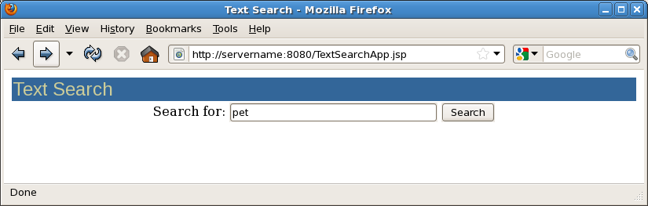
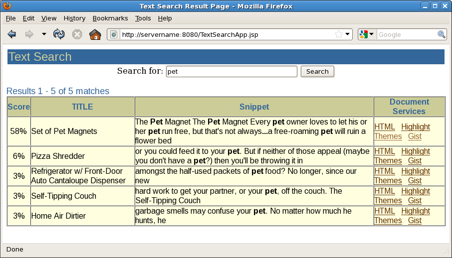
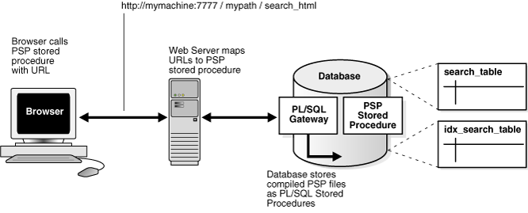

This appendix describes how to build a simple web search application by using the `CONTEXT` index type.

This appendix contains the following topics:

- Web Query Application Overview

- The PL/SQL Server Pages (PSP) Web Application

- The Java Server Pages (JSP) Web Application

### A.1 Web Query Application Overview

A common use of Oracle Text is to index HTML files on websites and provide search capabilities to users. The sample application in this appendix indexes a set of HTML files stored in the database. It also uses a web server connected to Oracle Database to provide the search service.

This appendix describes two versions of the Web query application:

- One using PL/SQL Server Pages (PSP)

- One using Java Server Pages (JSP)

Figure A-1 shows the JSP version of the text query application.

Figure A-1 The Text Query Application

[Description of "Figure A-1 The Text Query Application"](img_text/search01b.md)

Figure A-2 shows the results of the text query.

Figure A-2 Text Query Application with Results

[Description of "Figure A-2 Text Query Application with Results"](img_text/search02b.md)

The application returns links to documents containing the search term. Each document has four links:

- The HTML link displays the document.

  Graphics are not displayed in the filtered document.

- The Highlight link displays the document with the search term highlighted.

- The Theme link shows the top 50 themes associated with the document.

  The Gist link displays a short summary of the document.

### A.2 The PL/SQL Server Pages (PSP) Web Application

The PSP web application is based on PL/SQL server pages. Figure A-3 illustrates how the browser calls the PSP-stored procedure on Oracle Database through a web server.

This section contains the following topics:

- PSP Web Application Prerequisites

- Building the PSP Web Application

- PSP Web Application Sample Code

Figure A-3 The PSP Web Application

[Description of "Figure A-3 The PSP Web Application"](img_text/ccapp012.md)

#### A.2.1 PSP Web Application Prerequisites

The PSP web application has the following requirements.

- Your Oracle Database must be up and running.

  For a connection example, see [Oracle Database SQLJ Developer's Guide](../jsqlj/key-programming-considerations.md).

- The SCOTT account is unlocked with its password, and the account has `CREATE`, `RESOURCE`, and `CTXAPP` privileges.

- The Oracle PL/SQL gateway must be running.

  For complete information about setting up the PL/SQL gateway and developing PL/SQL web applications, see [Oracle Database Development Guide](../adfns/web-applications.md).

- A web server such as Apache is up and running and is correctly configured to send requests to Oracle Database.

  For information about installing Apache HTTP Server, see Oracle Database 2 Day + PHP Developer's Guide.

#### A.2.2 Building the PSP Web Application

To create PSP web application:

1.  Create your text tables.
    You must create text tables with the `CREATE` `TABLE` command to store your HTML files. These examples create the `output_table,` `gist_table,` and `theme_table` tables:

        CREATE TABLE output_table  (query_id NUMBER, document CLOB);
        CREATE TABLE gist_table  (query_id NUMBER, pov VARCHAR2(80), gist CLOB);
        CREATE TABLE theme_table  (query_id NUMBER, theme VARCHAR2(2000), weight NUMBER);
2.  Load HTML documents into the table by using SQL\*Loader.
    You must load the text tables with the HTML files. This example uses the loader.ctl control file to load the files named in loader.dat. The SQL\*Loader statement is as follows:

        % sqlldr userid=scott/password control=loader.ctl
3.  Create the `CONTEXT` index.
    Index the HTML files by creating a `CONTEXT` index on the text column, as shown here. Because you are indexing HTML, this example uses the `NULL_FILTER` preference type for no filtering, and it uses the `HTML_SECTION_GROUP` type, as follows:

        create index idx_search_table on search_table(text)
          indextype is ctxsys.context parameters
          ('filter ctxsys.null_filter section group CTXSYS.HTML_SECTION_GROUP');
4.  Compile the `search_htmlservices` package in Oracle Database.
    The application must present selected documents to the user. To do so, Oracle Database must read the documents from the character large object `(CLOB)` in `search_table` and output the result for viewing. To do that, call procedures in the `search_htmlservices` package. Compile the file search_htmlservices.sql file at the SQL\*Plus prompt as follows:

        SQL> @search_htmlservices.sql

        Package created.
5.  Compile the `search_html` PSP page with loadpsp.
    The search page is invoked by calling search_html.psp from a browser. You compile search_html in Oracle Database with the `loadpsp` command-line program as follows:

        % loadpsp -replace -user scott/password search_html.psp

    The output appears as:

        "search_html.psp": procedure "search_html" created.

    **See Also:**

    Oracle Database 11g Release 2 (11.2) of Oracle Database Development Guide for more information about using PSP
6.  Configure your web server.
    You must configure your web server to accept client PSP requests as a URL. Your web server forwards these requests to Oracle Database and returns server output to the browser. See Figure A-3.

    You can use the Oracle WebDB web listener or Oracle Application Server, which includes the Apache web server.
7.  Enter the query from a browser.
    You can access the query application from a browser by using a URL. You configure the URL with your web server. An example URL might look like the following:

        http://server.example.com:7777/mypath/search_html

    The application displays a query entry box in your browser and returns the query results as a list of HTML links, as shown in Figure A-1 and Figure A-2.

#### A.2.3 PSP Web Application Sample Code

This section lists the code used to build the example Web application. It includes the following files:

- loader.ctl

- loader.dat

- search_htmlservices.sql

- search_html.psp

##### A.2.3.1 loader.ctl

This example shows a sample `loader.ctl` file. It is used by `sqlldr` to load the `loader.dat` data file.

    LOAD DATA
            INFILE 'loader.dat'
            INTO TABLE search_table
            REPLACE
            FIELDS TERMINATED BY ';'
            (tk             INTEGER,
             title          CHAR,
             text_file      FILLER CHAR,
             text           LOBFILE(text_file) TERMINATED BY EOF)

##### A.2.3.2 loader.dat

This example shows a sample `loader.dat` file. Each row contains three fields: a reference number for the document, a label (or "title"), and the name of the HTML document to load into the text column of `search_table.` The file has been truncated for this example.

    1;   Pizza Shredder;Pizza.html
    2;   Refrigerator w/ Front-Door Auto Cantaloupe Dispenser;Cantaloupe.html
    3;   Self-Tipping Couch;Couch.html
    4;   Home Air Dirtier;Mess.html
    5;   Set of Pet Magnets;Pet.html
    6;   Esteem-Building Talking Pillow;Snooze.html

##### A.2.3.3 HTML Files for loader.dat Example

The HTML files that are named and loaded into `loader.dat` are included here for your reference.

- Pizza.html

- Cantaloupe.html

- Couch.html

- Mess.html

- Pet.html

- Snooze.html

##### Pizza.html

    <html>
    <header>
    <title>The Pizza Shredder</title>
    </header>
    <body>

    <h2>The Pizza Shredder</h2>
    <h4>Keeping your pizza preferences secure</h4>

    So it's the end of a long evening. Beer has been drunk, pizza has been eaten.
    

    But there's leftover pizza - what are you going to do with it?

    

    You could save it for the morning, or you could feed it to your pet.  But if neither of those appeal (maybe you don't have a pet?) then
    you'll be throwing it in the trash.

    

    But wait a minute - anybody could look through your trash, and figure out what kind of pizza you've been eating! "No big deal," I hear you
    say. But it is! After they've figured out that your favorite pizza is pepperoni, then it's only a short step to figuring out that
    your top-secret online banking password is "pepperoni_pizza."

    

    Get one over the dumpster-divers with our new patent-pending "Mk III Pizza Shredder." Cross-cut blades ensure that your pizza will be rendered
    unreadable, and nobody will be able to identify the original toppings. Also doubles as a lettuce-shredder and may also be used for removing
    unwanted fingertips.

    <h2>Model Comparison</h2>

    <table border="1">
      <tr><th>Model</th><th>Blades0</th><th>Pizza Thickness</th><th>Price</th></tr>
      <tr><td>Mk I</td><td>Plastic</td><td>1/2 inch (Thin Crust)</td><td>$69.99</td></tr>
      <tr><td>Mk II</td><td>Brass</td><td>1 inch (Deep Pan)</td><td>$99.99</td></tr>
      <tr><td>Mk III</td><td>Carbon Steel</td><td>2 inch (Calzoni)</td><td>$129.99</td></tr>
    </table>

    </body>
    </html>

##### Cantaloupe.html

    <html>
    <header>
    <title>The Fridge with a Cantaloupe Dispenser</title>
    </header>
    <body>
    <h2>The Fridge with a Cantaloupe Dispenser</h2>
    <h4>A nice cold melon at the touch of a button</h4>

    Does your refrigerator only have a boring water dispenser in the door?

    

    When you're hungry for a cantaloupe, do you have to expend valuable energy opening the fridge door and fishing around amongst the half-used
     packets of pet food?

    

    Do your friends complain that they wish there was an effortless way to get cantaloupes from your fridge? Do you overhear them saying they're
    tired of always having to rummage through your moldy leftovers and seal-a-meals to get to the cold melons?

    

    What you need is the convenience of a built-in cantaloupe dispenser.

    

    Impress your friends. Win praise from your neighbors. Become a legendary host!

    

    <b>Try our new <i>Melonic 2000</i> model!</b>

    

    Works with honeydews and small crenshaws too.

    

    Let the <i>Melonic 2000</i> go to work for you. Order one now at your local store.

    </body>
    </html>

##### Couch.html

    <html>
    <header>
    <title>The Self-Tipping Couch</title>
    </header>
    <body>
    <h2>The Self-Tipping Couch</h2>

    <h4>Sometimes it's hard work to get off the couch</h4>

    

    Sometimes it's hard work to get your partner, or your pet, off the couch.

    

    The <b>Self-Tipping Couch</b> solves these problems for you. At the touch of a button it will deposit the contents of the couch onto the
     floor in front of it.

    

    The <b>Self-Tipping Couch</b> has been proven to boost communication with stubborn spouses, children, and relatives.

    

    You will never again need to yell, "Get off the couch!" Simply press a button and all those couch hoggers are gently
    dumped onto your carpet.

    

    Get your own <b>Self-Tipping Couch</b> TODAY!

    </body>
    </html>

##### Mess.html

    <html>
    <header>
    <title>Home Air Dirtier</title>
    </header>
    <body>
    <h2>Home Air Dirtier</h2>
    <h4>Missing your home in the middle of the city?</h4>

    

    Like many ex-city-dwellers, you might be finding that the air in the countryside is just too clean.

    

    You can remedy this right now with the <i>UltraAppliance</i> <b>Home Air Dirtier</b>.

    

    Simply insert our patented <i>CityFilth</i> cartridge,
    and soon you'll be enjoying the aromas of vehicle fumes and decaying garbage that you're used to from home.

    

    <b>Please note:</b> Decaying garbage smells may confuse your pet.
    We recommend adding genuine garbage to your environment if this is a concern.

    </body>
    </html>

##### Pet.html

    <html>
    <header>
    <title>The Pet Magnet</title>
    </header>
    <body>
    <h2>The Pet Magnet</h2>

    <h4>Every pet owner loves to let the pet run free, but that's not always possible</h4>

    

    Sometimes local laws require pets to be on leashes. Sometimes a free-roaming pet will ruin a flower bed, leave a "calling card" on the
    sidewalk, or chew through another pet. In the case of extremely smart pets, like chimpanzees or dolphins, the unattended pet may get
    away and run up hundreds of dollars of long-distance charges on your phone.

    

    But leashes aren't always a practical answer. They can be too confining, or too big, or can tug uncomfortably at the pet's neck. They
    may get tangled, or wrapped around poles or passersby. Pets may chew through the leash, or, again, in the case of extremely smart pets,
    burn through it with an acetylene torch. In the case of cats, leashes simply look ridiculous, as though the pet owner really wanted to
    own a dog but got confused at the pet store.

    

    The <b>Hold 'Em 2000 Pet Magnet</b> from <i>UltraAppliance</i> is the answer. Instead of old-fashioned leashes, the
    <b>Hold 'Em 2000 Pet Magnet</b> keeps your pet under control in a simple way.

    

    Here's how it works. Dozens of small magnets are placed underneath the coat of your pet, where they remain painlessly invisible. Any time
    you need to recall your animal, you merely activate the handy, massive Hold 'Em 2000 Pet Magnet electromagnet (fits inside any extremely
    oversized purse) and your pet is gently and painlessly dragged to you from up to 100 yards. It's a must-have for any pet owner!

    

    <blockquote>
    <i>
    "The <b>Hold 'Em 2000 Pet Magnet</b> not only keeps my dog from running away, but the electromagnet also comes in very handy if I need to
    find a needle in a haystack"</i>
    -- Anonymous Celebrity
    </blockquote>
    </body>
    </html>

##### Snooze.html

    <html>
    <header>
    <title>Esteem-building Talking Pillow</title>
    </header>
    <body>
    <h2>Esteem-building Talking Pillow</h2>
    <h4>Do you feel less than your true potential when you wake up in the morning?</h4>

    

    We searched for a way to capture the wasted time spent sleeping and to use this precious time to build motivation, character, and self-esteem.

    

    We are proud to announce the <b>Esteem-building Talking Pillow</b>. Our pride in this wonderful invention glows even more because:
    <i>We use our own invention every night!</i>

    

    Only you will know that you are sleeping with the <b>Esteem-building Talking Pillow</b> because only you can hear the soothing
    affirmations that gently enter your brain through the discreet speaker.

    

    You will wake up refreshed and raring to go with a new sense of pride and enthusiasm for any task the day may bring.

    

    Be the first to own the <b>Esteem-building Talking Pillow</b>! Your friends and fellow workers will be amazed when you no longer
    cower in the corner. Now you will join in every conversation.

    

    <b>Disclaimer:</b> Not responsible for narcissism and hyberbolic statements. May cause extreme behavior with overuse.

    </body>
    </html>

##### A.2.3.4 search_htmlservices.sql

    set define off

    create or replace package search_htmlServices as
      procedure showHTMLDoc (p_id in numeric);
      procedure showDoc  (p_id in varchar2, p_query in varchar2);
    end search_htmlServices;
    /
    show errors;

    create or replace package body search_htmlServices as

      procedure showHTMLDoc (p_id in numeric) is
        v_clob_selected   CLOB;
        v_read_amount     integer;
        v_read_offset     integer;
        v_buffer          varchar2(32767);
       begin

         select text into v_clob_selected from search_table where tk = p_id;
         v_read_amount := 32767;
         v_read_offset := 1;
       begin
        loop
          dbms_lob.read(v_clob_selected,v_read_amount,v_read_offset,v_buffer);
          htp.print(v_buffer);
          v_read_offset := v_read_offset + v_read_amount;
          v_read_amount := 32767;
        end loop;
       exception
       when no_data_found then
         null;
       end;
     end showHTMLDoc;

    procedure showDoc (p_id in varchar2, p_query in varchar2) is

     v_clob_selected   CLOB;
     v_read_amount     integer;
     v_read_offset     integer;
     v_buffer          varchar2(32767);
     v_query           varchar(2000);
     v_cursor          integer;

     begin
       htp.p('<html><title>HTML version with highlighted terms</title>');
       htp.p('<body bgcolor="#ffffff">');
       htp.p('<b>HTML version with highlighted terms</b>');

       begin
         ctx_doc.markup (index_name => 'idx_search_table',
                         textkey    => p_id,
                         text_query => p_query,
                         restab     => v_clob_selected,
                         starttag   => '<i>',
                         endtag     => '</i>');

         v_read_amount := 32767;
         v_read_offset := 1;
         begin
          loop
            dbms_lob.read(v_clob_selected,v_read_amount,v_read_offset,v_buffer);
            htp.print(v_buffer);
            v_read_offset := v_read_offset + v_read_amount;
            v_read_amount := 32767;
          end loop;
         exception
          when no_data_found then
             null;
         end;

         exception
          when others then
            null; --showHTMLdoc(p_id);
       end;
    end showDoc;
    end search_htmlServices;
    /
    show errors

    set define on

##### A.2.3.5 search_html.psp

    <%@ plsql procedure="search_html" %>
    <%@ plsql parameter="query" default="null" %>
    <%! v_results number := 0; %>

    <html>
    <head>
      <title>search_html Search </title>
    </head>
    <body>

    <%

    IF query IS NULL THEN
    %>

      

        <form method="post" action="search_html">
         <b>Search for: </b>
         <input type="text" name="query" size="30">&nbsp;
         <input type="submit" value="Search">
      

    

    <%
      ELSE
    %>

       

       <%!
          color varchar2(6) := 'ffffff';
       %>

       

         <form method="post" action="search_html">
          <b>Search for:</b>
          <input type="text" name="query" size="30" value="<%= query %>">
          <input type="submit" value="Search">
         </form>
       

       

       

       <%
         -- select statement
        FOR DOC IN (
                    SELECT /*+ DOMAIN_INDEX_SORT */ rowid, tk, title, score(1) scr
                    FROM search_table
                    WHERE CONTAINS(text, query,1) >0
                    ORDER BY score(1) DESC
                   )
             LOOP
               v_results := v_results + 1;
               IF v_results = 1 THEN

       %>

                 

                  <table border="0">
                    <tr bgcolor="#6699CC">
                      <th>Score</th>
                      <th>Title</th>
                    </tr>

      <%      END IF; %>
              <tr bgcolor="#<%= color %>">
               <td> <%= doc.scr %>% </td>
               <td> <%= doc.title %>
               [">HTML]
               [&p_query=<%= query %>">Highlight]
               </td>
             </tr>

       <%
              IF (color = 'ffffff') THEN
                   color := 'eeeeee';
                 ELSE
                   color := 'ffffff';
              END IF;

         END LOOP;
       %>

        </table>
       

    <%
      END IF;
    %>
    </body>
    </html>

### A.3 The Java Server Pages (JSP) Web Application

Creating the JSP-based web application involves most of the same steps as those used in building the PSP-based application. See "Building the PSP Web Application" for more information. You can use the same `loader.dat` and `loader.ctl` files. However, with the JSP-based application, you do not need to do the following:

- Compile the `search_htmlservices` package

- Compile the `search_html` PSP page with `loadpsp`

This section contains the following topics:

- JSP Web Application Prerequisites

- JSP Web Application Sample Code

#### A.3.1 JSP Web Application Prerequisites

The JSP web application has the following requirements:

- Your Oracle Database must be up and running.

- You have a web server such as Apache Tomcat, which can run JavaServer Pages (JSP) scripts that connect to the Oracle Database by using Java Database Connectivity (JDBC).

**See Also:**

Oracle Database 2 Day + PHP Developer's Guide for information about installing Apache HTTP Server

#### A.3.2 JSP Web Application Sample Code

This section lists the Java code used to build the example web application, as shown in the `TextSearchApp.jsp` file.

    <%@page language="java" pageEncoding="utf-8" contentType="text/html; charset=utf-8" %>
    <%@ page import="java.sql.*, java.util.*, java.net.*,
       oracle.jdbc.*, oracle.sql.*, oracle.jsp.dbutil.*" %>

    <%
    // Change these details to suit your database and user details

    String connStr = "jdbc:oracle:thin:@//servername:1521/pdb1";
    String dbUser  = "scott";
    String dbPass  = "tiger";

    // The table we're running queries against is called SEARCH_TABLE.
    // It must have columns:
    //  tk     number  primary key,     (primary key is important for document services)
    //  title  varchar2(2000),
    //  text   clob
    // There must be a CONTEXT index called IDX_SEARCH_TABLE on the text column

    request.setCharacterEncoding("UTF-8");

    java.util.Properties info=new java.util.Properties();
    Connection conn  = null;
    ResultSet rset   = null;
    OracleCallableStatement callStmt = null;
    Statement stmt   = null;
    String userQuery = null;
    String myQuery   = null;
    String action    = null;
    String theTk     = null;
    URLEncoder myEncoder;
    int count=0;
    int loopNum=0;
    int startNum=0;

    userQuery     =   request.getParameter("query");
    action        =   request.getParameter("action");
    theTk         =   request.getParameter("tk");

    if (action == null)  action = "";

    // Connect to database

    try {
      DriverManager.registerDriver(new oracle.jdbc.driver.OracleDriver() );
      info.put ("user",     dbUser);
      info.put ("password", dbPass);
      conn      = DriverManager.getConnection(connStr,info);
    }
      catch (SQLException e) {
    %>    <b>Error: </b> <%= e %>
  <%
      }

    if ( action.equals("doHTML") ) {
      // Directly display the text of the document
      try {

        // not attempting to share the output table for this example, we'll truncate it each time
        conn.createStatement().execute("truncate table OUTPUT_TABLE");

        String sql = "{ call ctx_doc.filter( index_name=>'IDX_SEARCH_TABLE', textkey=> '" + theTk + "', restab=>'OUTPUT_TABLE',
                      plaintext=>false ) }";
        PreparedStatement s = conn.prepareCall( sql );
        s.execute();

        sql = "select document from output_table where rownum = 1";
        stmt = conn.createStatement();
        rset = stmt.executeQuery(sql);

        rset.next();
        oracle.sql.CLOB res = (oracle.sql.CLOB) rset.getClob(1);
        // should fetch from clob piecewise, but to keep it simple we'll just fetch 32K to a string
        String txt = res.getSubString(1, 32767);
        out.println(txt);
      }
      catch (SQLException e) {
    %>    <b>Error: </b> <%= e %>
 <%
      }
    }
    else if ( action.equals("doHighlight") ) {
      // Display the text of the document with highlighting from the "markup" function
      try {

        // not attempting to share the output table for this example, we'll truncate it each time
        conn.createStatement().execute("truncate table OUTPUT_TABLE");

        String sql = "{ call ctx_doc.markup( index_name=>'IDX_SEARCH_TABLE', textkey=> '" + theTk + "', text_query => '" + userQuery + "',
                      restab=>'OUTPUT_TABLE', plaintext=>false, starttag => '<i>', endtag => '</i>' ) }";
        PreparedStatement s = conn.prepareCall( sql );
        s.execute();

        sql = "select document from output_table where rownum = 1";
        stmt = conn.createStatement();
        rset = stmt.executeQuery(sql);

        rset.next();
        oracle.sql.CLOB res = (oracle.sql.CLOB) rset.getClob(1);
        // should fetch from clob piecewise, but to keep it simple we'll just fetch 32K to a string
        String txt = res.getSubString(1, 32767);
        out.println(txt);
      }
      catch (SQLException e) {
    %>    <b>Error: </b> <%= e %>
 <%
      }
    }

    else if ( action.equals("doThemes") ) {
      // Display the text of the document with highlighting from the "markup" function
      try {

        // not attempting to share the output table for this example, we'll truncate it each time
        conn.createStatement().execute("truncate table THEME_TABLE");

        String sql = "{ call ctx_doc.themes( index_name=>'IDX_SEARCH_TABLE', textkey=> '" + theTk + "', restab=>'THEME_TABLE') }";
        PreparedStatement s = conn.prepareCall( sql );
        s.execute();

        sql = "select * from ( select theme, weight from theme_table order by weight desc ) where rownum <= 20";
        stmt = conn.createStatement();
        rset = stmt.executeQuery(sql);
        int    weight = 0;
        String theme  = "";
    %>
        <h2>The top 20 themes of the document</h2>
        <table BORDER=1 CELLSPACING=0 CELLPADDING=0"
           <tr bgcolor="#CCCC99">
           <th>Theme</th>
           <th>Weight</th>
           </tr>
    <%
        while ( rset.next() ) {

          theme  = rset.getString(1);
          weight = (int)rset.getInt(2);
    %>
           <tr bgcolor="ffffe0">
             <td align="center"><b> <%= theme  %> </b></td>
             <td align="center"> <%= weight %></td>
           </tr>
    <%
        }

    %>
    </table>
    <%
      }
      catch (SQLException e) {
    %>    <b>Error: </b> <%= e %>
 <%
      }
    }
    else if ( action.equals("doGists") ) {
      // Display the text of the document with highlighting from the "markup" function
      try {

        // not attempting to share the output table for this example, we'll truncate it each time
        conn.createStatement().execute("truncate table GIST_TABLE");

        String sql = "{ call ctx_doc.gist( index_name=>'IDX_SEARCH_TABLE', textkey=> '" + theTk + "', restab=>'GIST_TABLE', query_id=>1) }";
        PreparedStatement s = conn.prepareCall( sql );
        s.execute();

        sql = "select pov, gist from gist_table where pov = 'GENERIC' and query_id = 1";
        stmt = conn.createStatement();
        rset = stmt.executeQuery(sql);
        String pov   = "";
        String gist  = "";

        while ( rset.next() ) {

          pov   = rset.getString(1);
          oracle.sql.CLOB gistClob = (oracle.sql.CLOB) rset.getClob(2);

          out.println("<h3>Document Gist for Point of View: " + pov + "</h3>");
          gist = gistClob.getSubString(1, 32767);
          out.println(gist);

        }

    %>
    </table>
    <%
      }
      catch (SQLException e) {
    %>    <b>Error: </b> <%= e %>
 <%
      }
    }

    if ( (action.equals("")) && ( (userQuery == null) || (userQuery.length() == 0) ) ) {
    %>
      <html>
        <title>Text Search</title>
        <body>
          <table width="100%">
            <tr bgcolor="#336699">
              <td>Text Search</td>
            </tr>
          </table>
        

          <form method = post>
          Search for:
          <input type="text" name="query" size = "30">
          <input type="submit" value="Search">
          </form>
        

        </body>
      </html>
    <%
    }
    else if (action.equals("") ) {
    %>
      <html>
        <title>Text Search Result Page</title>
        <body text="#000000" bgcolor="#FFFFFF" link="#663300"
              vlink="#996633" alink="#ff6600">
          <table width="100%">
            <tr bgcolor="#336699">
              <td>Text Search</td>
            </tr>
          </table>
        

          <form method = post action="TextSearchApp.jsp">
          Search for:
          <input type=text name="query" value="<%= userQuery %>" size = 30>
          <input type=submit value="Search">
          </form>
        

    <%
      myQuery   =   URLEncoder.encode(userQuery);
      try {

        stmt      = conn.createStatement();

        String numStr =   request.getParameter("sn");
        if(numStr!=null)
          startNum=Integer.parseInt(numStr);
        String theQuery =   translate(userQuery);

        callStmt =(OracleCallableStatement)conn.prepareCall("begin "+
             "?:=ctx_query.count_hits(index_name=>'IDX_SEARCH_TABLE', "+
             "text_query=>?"+
             "); " +
             "end; ");
        callStmt.setString(2,theQuery);
        callStmt.registerOutParameter(1, OracleTypes.NUMBER);
        callStmt.execute();
        count=((OracleCallableStatement)callStmt).getNUMBER(1).intValue();
        if(count>=(startNum+20)){
    %>
        Results
               <%=startNum+1%> - <%=startNum+20%> of <%=count%> matches
    <%
        }
        else if(count>0){
    %>
        Results
               <%=startNum+1%> - <%=count%> of <%=count%> matches
    <%
        }
        else {
    %>
        No match found
    <%
        }
    %>
      <table width="100%">
      <TR ALIGN="RIGHT">
    <%
      if((startNum>0)&(count<=startNum+20))
      {
    %>
        <TD ALIGN="RIGHT">
        &query=
                <%=myQuery %>">previous20
        </TD>
    <%
      }
      else if((count>startNum+20)&(startNum==0))
      {
    %>
        <TD ALIGN="RIGHT">
        &query=<%=myQuery %>">next20
        </TD>
    <%
      }
      else if((count>startNum+20)&(startNum>0))
      {
    %>
        <TD ALIGN="RIGHT">
        &query=
                  <%=myQuery %>">previous20
        &query=
                  <%=myQuery %>">next20
        </TD>
    <%
      }
    %>
      </TR>
      </table>
    <%
        String ctxQuery =
            " select /*+ FIRST_ROWS */ " +
            "   tk, TITLE, score(1) scr, " +
            "   ctx_doc.snippet ('IDX_SEARCH_TABLE', tk, '" + theQuery + "') " +
            " from search_table " +
            " where contains(TEXT, '"+theQuery+"',1 ) > 0 " +
            " order by score(1) desc";
        rset = stmt.executeQuery(ctxQuery);
        String   tk           = null;
        String[] colToDisplay = new String[1];
        int      myScore      = 0;
        String   snippet      = "";
        int      items        = 0;
        while (rset.next()&&items< 20) {
          if(loopNum>=startNum)
          {
            tk = rset.getString(1);
            colToDisplay[0] = rset.getString(2);
            myScore         = (int)rset.getInt(3);
            snippet         = rset.getString(4);
            items++;
            if (items == 1) {
    %>
            

              <table BORDER=1 CELLSPACING=0 CELLPADDING=0 width="100%"
                <tr bgcolor="#CCCC99">
                  <th>Score</th>
                  <th>TITLE</th>
                  <th>Snippet</th>
                  <th> Document Services</th>
                </tr>
    <%   } %>
          <tr bgcolor="#FFFFE0">
            <td ALIGN="CENTER"> <%= myScore %>%</td>
            <td> <%= colToDisplay[0] %> </td>
            <td> <%= snippet %> </td>
            <td>
              ">HTML &nbsp;
              &query=<%= theQuery %>">Highlight &nbsp;
              &query=<%= theQuery %>">Themes &nbsp;
              ">Gist &nbsp;
            </td>
          </tr>
    <%
          }
          loopNum++;
        }
    } catch (SQLException e) {
    %>
        <b>Error: </b> <%= e %>

    <%
    } finally {
      if (conn != null) conn.close();
      if (stmt != null) stmt.close();
      if (rset != null) rset.close();
      }
    %>
      </table>
      

      <table width="100%">
      <TR ALIGN="RIGHT">
    <%
      if((startNum>0)&(count<=startNum+20))
      {
    %>
        <TD ALIGN="RIGHT">
        &query=
                   <%=myQuery %>">previous20
        </TD>
    <%
      }
      else if((count>startNum+20)&(startNum==0))
      {
    %>
        <TD ALIGN="RIGHT">
        &query=
              <%=myQuery %>">next20
        </TD>
    <%
      }
      else if((count>startNum+20)&(startNum>0))
      {
    %>
        <TD ALIGN="RIGHT">
        &query=
              <%=myQuery %>">previous20
        &query=
              <%=myQuery %>">next20
        </TD>
    <%
      }
    %>
      </TR>
      </table>
      </body></html>
    <%}

    %>
    <%!
       public String translate (String input)
       {
          Vector reqWords = new Vector();
          StringTokenizer st = new StringTokenizer(input, " '", true);
          while (st.hasMoreTokens())
          {
            String token = st.nextToken();
            if (token.equals("'"))
            {
               String phrase = getQuotedPhrase(st);
               if (phrase != null)
               {
                  reqWords.addElement(phrase);
               }
            }
            else if (!token.equals(" "))
            {
               reqWords.addElement(token);
            }
          }
          return getQueryString(reqWords);
       }

       private String getQuotedPhrase(StringTokenizer st)
       {
          StringBuffer phrase = new StringBuffer();
          String token = null;
          while (st.hasMoreTokens() && (!(token = st.nextToken()).equals("'")))
          {
            phrase.append(token);
          }
          return phrase.toString();
       }

       private String getQueryString(Vector reqWords)
       {
          StringBuffer query = new StringBuffer("");
          int length = (reqWords == null) ? 0 : reqWords.size();
          for (int ii=0; ii < length; ii++)
          {
             if (ii != 0)
             {
               query.append(" & ");
             }
             query.append("{");
             query.append(reqWords.elementAt(ii));
             query.append("}");
          }
          return query.toString();
       }
    %>
