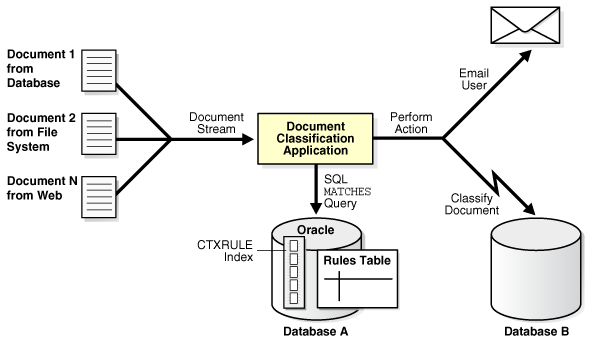

Oracle Text offers various approaches to document classification.

This chapter contains the following topics:

- Overview of Document Classification

- Classification Applications

- Classification Solutions

- Rule-Based Classification

- Supervised Classification

- Unsupervised Classification (Clustering)

- Unsupervised Classification (Clustering) Example

### 9.1 Overview of Document Classification

Each theme is a single word, a single phrase, or a hierarchical list of parent themes.

To sift through numerous documents you can use keyword search engines. However, keyword searches have limitations. One major drawback is that keyword searches do not discriminate by context. In many languages, a word or phrase may have multiple meanings, so a search may result in many matches that are not about the specific topic. For example, a query on the phrase river bank might return documents about the Hudson River Bank & Trust Company, because the word bank has two meanings.

Alternatively, you can sort through documents and classify them by content. This approach is not feasible for very large volumes of documents.

Oracle Text offers various approaches to document classification. Under rule-based classification (sometimes called simple classification), you write the classification rules yourself. With supervised classification, Oracle Text creates classification rules based on a set of sample documents that you preclassify. Finally, with unsupervised classification (also known as clustering), Oracle Text performs all steps, from writing the classification rules to classifying the documents, for you.

### 9.2 Classification Applications

Oracle Text enables you to build document classification applications that perform some action based on document content. Actions include assigning category IDs to a document for future lookup or sending a document to a user. The result is a set or stream of categorized documents. Figure 9-1 illustrates how the classification process works.

Oracle Text enables you to create document classification applications in different ways. This chapter defines a typical classification scenario and shows how you can use Oracle Text to build a solution.

Figure 9-1 Overview of a Document Classification Application

[Description of "Figure 9-1 Overview of a Document Classification Application"](img_text/ccapp_pb_018a.md)

### 9.3 Classification Solutions

Oracle Text enables you to classify documents in the following ways:

- Rule-Based Classification. For this solution, you group your documents, choose categories, and formulate the rules that define those categories; these rules are actually query phrases. You then index the rules and use the `MATCHES` operator to classify documents.

  Advantages: This solution is very accurate for small document sets. Results are always based on what you define, because you write the rules.

  Disadvantages: Defining rules can be tedious for large document sets with many categories. As your document set grows, you may need to write correspondingly more rules.

- Supervised Classification. This solution is similar to rule-based classification, but the rule-writing step is automated with `CTX_CLS.TRAIN.` This procedure formulates a set of classification rules from a sample set of preclassified documents that you provide. As with rule-based classification, you use the `MATCHES` operator to classify documents.

  Oracle Text offers two versions of supervised classification, one using the `RULE_CLASSIFIER` preference and one using the `SVM_CLASSIFIER` preference. These preferences are discussed in "Supervised Classification".

  Advantages: Rules are written for you automatically. This method is useful for large document sets.

  Disadvantages: You must assign documents to categories before generating the rules. Rules may not be as specific or accurate as those you write yourself.

- Unsupervised Classification (Clustering). All steps, from grouping your documents to writing the category rules, are automated with `CTX_CLS.CLUSTERING.` Oracle Text statistically analyzes your document set and correlates them with clusters according to content.

  Advantages:

  - You do not need to provide the classification rules or the sample documents as a training set.

  - This solution helps to discover overlooked patterns and content similarities in your document set.

    In fact, you can use this solution when you do not have a clear idea of rules or classifications. For example, use it to provide an initial set of categories and to build on the categories through supervised classification.

  Disadvantages:

  - Clustering is based on an internal solution. It might result in unexpected groupings, because the clustering operation is not user-defined.

  - You do not see the rules that create the clusters.

  - The clustering operation is CPU-intensive and can take at least the same time as indexing.

### 9.4 Rule-Based Classification

Rule-based classification is the basic solution for creating an Oracle Text classification application.

The basic steps for rule-based classification are as follows. Specific steps are explored in greater detail in the example.

1.  Create a table for the documents to be classified, and then populate it.

2.  Create a rule table (also known as a category table). The rule table consists of categories that you name, such as "medicine" or "finance," and the rules that sort documents into those categories.

    These rules are actually queries. For example, you define the "medicine" category as documents that include the words "hospital," "doctor," or "disease." Therefore, you would set up a rule in the form of "hospital OR doctor OR disease."

3.  Create a `CTXRULE` index on the rule table.

4.  Classify the documents.

**See Also:**

"CTXRULE Parameters and Limitations" for information on which operators are allowed for queries

#### 9.4.1 Rule-Based Classification Example

In this example, you gather news articles about different subjects and then classify them. After you create the rules, you can index them and then use the `MATCHES` statement to classify documents.

To classify documents:

1.  Create the schema to store the data.
    The `news_table` stores the documents to be classified. The `news_categories` table stores the categories and rules that define the categories. The `news_id_cat` table stores the document IDs and their associated categories after classification.

        create table news_table (
               tk number primary key not null,
               title varchar2(1000),
               text clob);

        create table news_categories (
                queryid  number primary key not null,
                category varchar2(100),
                query    varchar2(2000));

        create table news_id_cat (
                tk number,
                category_id number);
2.  Load the documents with SQLLDR.
    Use the `SQLLDR` program to load the HTML news articles into the `news_table.` The file names and titles are read from `loader.dat.`

        LOAD DATA
             INFILE 'loader.dat'
             INTO TABLE news_table
             REPLACE
             FIELDS TERMINATED BY ';'
             (tk         INTEGER EXTERNAL,
              title      CHAR,
              text_file  FILLER CHAR,
              text       LOBFILE(text_file) TERMINATED BY EOF)
3.  Create the categories and write the rules for each category.
    The defined categories are Asia, Europe, Africa, Middle East, Latin America, United States, Conflicts, Finance, Technology, Consumer Electronics, World Politics, U.S. Politics, Astronomy, Paleontology, Health, Natural Disasters, Law, and Music News.

    A rule is a query that selects documents for the category. For example, the 'Asia' category has a rule of 'China or Pakistan or India or Japan'. Insert the rules in the `news_categories` table.

        insert into news_categories values
          (1,'United States','Washington or George Bush or Colin Powell');

        insert into news_categories values
          (2,'Europe','England or Britain or Germany');

        insert into news_categories values
          (3,'Middle East','Israel or Iran or Palestine');

        insert into news_categories values(4,'Asia','China or Pakistan or India or Japan');

        insert into news_categories values(5,'Africa','Egypt or Kenya or Nigeria');

        insert into news_categories values
          (6,'Conflicts','war or soldiers or military or troops');

        insert into news_categories values(7,'Finance','profit or loss or wall street');
        insert into news_categories values
          (8,'Technology','software or computer or Oracle
           or Intel or IBM or Microsoft');

        insert into news_categories values
          (9,'Consumer electronics','HDTV or electronics');

        insert into news_categories values
          (10,'Latin America','Venezuela or Colombia
           or Argentina or Brazil or Chile');

        insert into news_categories values
          (11,'World Politics','Hugo Chavez or George Bush
           or Tony Blair or Saddam Hussein or United Nations');

        insert into news_categories values
          (12,'US Politics','George Bush or Democrats or Republicans
           or civil rights or Senate');

        insert into news_categories values
          (13,'Astronomy','Jupiter or Earth or star or planet or Orion
           or Venus or Mercury or Mars or Milky Way
           or Telescope or astronomer
           or NASA or astronaut');

        insert into news_categories values
          (14,'Paleontology','fossils or scientist
           or paleontologist or dinosaur or Nature');

        insert into news_categories values
          (15,'Health','stem cells or embryo or health or medical
           or medicine or World Health Organization
           or virus or centers for disease control or vaccination');

        insert into news_categories values
          (16,'Natural Disasters','earthquake or hurricane or tornado');

        insert into news_categories values
          (17,'Law','Supreme Court or legislation');

        insert into news_categories values
          (18,'Music News','piracy or anti-piracy
           or Recording Industry Association of America
           or copyright or copy-protection or CDs
           or music or artist or song');

        commit;
4.  Create the `CTXRULE` index on the `news_categories` query column.
        create index news_cat_idx on news_categories(query)
        indextype is ctxsys.ctxrule;
5.  To classify the documents, use the `CLASSIFIER.THIS` PL/SQL procedure (a simple procedure designed for this example).
    The procedure scrolls through the `news_table,` matches each document to a category, and writes the categorized results into the `news_id_cat` table.

        create or replace package classifier as procedure this;end;/

        show errors

        create or replace package body classifier as

         procedure this
         is
          v_document    clob;
          v_item        number;
          v_doc         number;
         begin

          for doc in (select tk, text from news_table)
             loop
                v_document := doc.text;
                v_item := 0;
                v_doc  := doc.tk;
                for c in (select queryid, category from news_categories
                     where matches(query, v_document) > 0 )
                  loop
                    v_item := v_item + 1;
                    insert into news_id_cat values (doc.tk,c.queryid);
                  end loop;
           end loop;

         end this;

        end;
        /
        show errors
        exec classifier.this

#### 9.4.2 CTXRULE Parameters and Limitations

The following considerations apply to indexing a `CTXRULE` index:

- If you use the `SVM_CLASSIFIER` classifier, then you may use the `BASIC_LEXER,` `CHINESE_LEXER,` `JAPANESE_LEXER,` or `KOREAN_MORPH_LEXER` lexers. If you do not use `SVM_CLASSIFIER,` then you can use only the `BASIC_LEXER` lexer type to index your query set.

- Filter, memory, datastore, and \[no\]populate parameters are not applicable to the `CTXRULE` index type.

- The `CREATE` `INDEX` storage clause is supported for creating the index on the queries.

- Wordlists are supported for stemming operations on your query set.

- Queries for `CTXRULE` are similar to the `CONTAINS` queries. Basic phrasing ("dog house") is supported, as are the following `CONTAINS` operators: `ABOUT,` `AND,` `NEAR,` `NOT,` `OR,` `STEM,` `WITHIN,` and `THESAURUS.` Section groups are supported for using the `MATCHES` operator to classify documents. Field sections are also supported; however, `CTXRULE` does not directly support field queries, so you must use a query rewrite on a `CONTEXT` query.

- You must drop the `CTXRULE` index before exporting or downgrading the database.

**See Also:**

- [Oracle Text Reference](../ccref/oracle-text-indexing-elements.md) for more information on lexer and classifier preferences

- "[Creating a CTXRULE Index](creating-oracle-text-indexes.md)"

### 9.5 Supervised Classification

With supervised classification, you use the [`CTX_CLS.TRAIN`](../ccref/CTX_CLS-package.md) procedure to automate the rule-writing step. `CTX_CLS.TRAIN` uses a training set of sample documents to deduce classification rules. This training set is the major advantage over rule-based classification, where you must write the classification rules.

However, before you can run the `CTX_CLS.TRAIN` procedure, you must manually create categories and assign each document in the sample training set to a category.

**See Also:**

[Oracle Text Reference](../ccref/CTX_CLS-package.md) for more information on `CTX_CLS.TRAIN`

When the rules are generated, you index them to create a `CTXRULE` index. You can then use the `MATCHES` operator to classify an incoming stream of new documents.

You can select one of the following classification algorithms for supervised classification:

- Decision Tree Supervised Classification

  The advantage of this classification is that the generated rules are easily observed (and modified).

- SVM-Based Supervised Classification

  This classification uses the Support Vector Machine (SVM) algorithm for creating rules. The advantage of this classification is that it is often more accurate than the Decision Tree classification. The disadvantage is that it generates binary rules, so the rules themselves are opaque.

**See Also:**

- "Decision Tree Supervised Classification Example"

- "SVM-Based Supervised Classification Example"

#### 9.5.1 Decision Tree Supervised Classification

To use Decision Tree classification, you set the preference argument of `CTX_CLS.TRAIN` to `RULE_CLASSIFIER.`

This form of classification uses a decision tree algorithm for creating rules. Generally speaking, a decision tree is a method of deciding between two (or more, but usually two) choices. In document classification, the choices are "the document matches the training set" or "the document does not match the training set."

A decision tree has a set of attributes that can be tested. In this case, the attributes include:

- words from the document

- stems of words from the document (for example, the stem of running is run)

- themes from the document (if themes are supported for the language in use)

The learning algorithm in Oracle Text builds one or more decision trees for each category provided in the training set. These decision trees are then coded into queries that are suitable for use by a `CTXRULE` index. For example, one category has a training document for "Japanese beetle," and another category has a document for "Japanese currency." The algorithm may create decision trees based on "Japanese," "beetle," and "currency," and then classify documents accordingly.

The decision trees include the concept of confidence. Each generated rule is allocated a percentage value that represents the accuracy of the rule, given the current training set. In trivial examples, the accuracy is almost always 100 percent, but this percentage merely represents the limitations of the training set. Similarly, the rules generated from a trivial training set may seem to be less than what you might expect, but they sufficiently distinguish the different categories in the current training set.

The advantage of the Decision Tree classification is that it can generate rules that users can easily inspect and modify. The Decision Tree classification makes sense when you want to the computer to generate the bulk of the rules, but you want to fine-tune them afterward by editing the rule sets.

#### 9.5.2 Decision Tree Supervised Classification Example

The following SQL example steps through creating your document and classification tables, classifying the documents, and generating the rules. It then goes on to generate rules with `CTX_CLS.TRAIN`.

Rules are then indexed to create `CTXRULE` index and new documents are classified with `MATCHES`.

The `CTX_CLS.TRAIN` procedure requires an input training document set. A training set is a set of documents that have already been assigned a category.

After you generate the rules, you can test them by first indexing them and then using `MATCHES` to classify new documents.

To create and index the category rules:

1.  Create and load a table of training documents.

    This example uses a simple set of three fast food documents and three computer documents.

        create table docs (
          doc_id number primary key,
          doc_text   clob);

        insert into docs values
        (1, 'MacTavishes is a fast-food chain specializing in burgers, fries and -
        shakes. Burgers are clearly their most important line.');
        insert into docs values
        (2, 'Burger Prince are an up-market chain of burger shops, who sell burgers -
        and fries in competition with the likes of MacTavishes.');
        insert into docs values
        (3, 'Shakes 2 Go are a new venture in the low-cost restaurant arena,
        specializing in semi-liquid frozen fruit-flavored vegetable oil products.');
        insert into docs values
        (4, 'TCP/IP network engineers generally need to know about routers,
        firewalls, hosts, patch cables networking etc');
        insert into docs values
        (5, 'Firewalls are used to protect a network from attack by remote hosts,
         generally across TCP/IP');

2.  Create category tables, category descriptions and IDs.

        ----------------------------------------------------------------------------

        -- Create category tables
        -- Note that "category_descriptions" isn't really needed for this demo -
        -- it just provides a descriptive name for the category numbers in
        -- doc_categories
        ----------------------------------------------------------------------------

        create table category_descriptions (
          cd_category    number,
          cd_description varchar2(80));

        create table doc_categories (
          dc_category    number,
          dc_doc_id      number,
          primary key (dc_category, dc_doc_id))
          organization index;

        -- descriptions for categories

        insert into category_descriptions values (1, 'fast food');
        insert into category_descriptions values (2, 'computer networking');

3.  Assign each document to a category.

    In this case, the fast food documents all go into category 1, and the computer documents go into category 2.

        insert into doc_categories values (1, 1);
        insert into doc_categories values (1, 2);
        insert into doc_categories values (1, 3);
        insert into doc_categories values (2, 4);
        insert into doc_categories values (2, 5);

4.  Create a `CONTEXT` index to be used by `CTX_CLS.TRAIN.`

    To experiment with the effects of turning themes on and off, create an Oracle Text preference for the index.

        exec ctx_ddl.create_preference('my_lex', 'basic_lexer');
        exec ctx_ddl.set_attribute    ('my_lex', 'index_themes', 'no');
        exec ctx_ddl.set_attribute    ('my_lex', 'index_text',   'yes');

        create index docsindex on docs(doc_text) indextype is ctxsys.context
        parameters ('lexer my_lex');

5.  Create the rules table that will be populated by the generated rules.

        create table rules(
          rule_cat_id     number,
          rule_text       varchar2(4000),
          rule_confidence number
        );

6.  Generate category rules.

    All arguments are the names of tables, columns, or indexes previously created in this example. The `rules` table now contains the rules, which you can view.

        begin
          ctx_cls.train(
            index_name => 'docsindex',
            docid      => 'doc_id',
            cattab     => 'doc_categories',
            catdocid   => 'dc_doc_id',
            catid      => 'dc_category',
            restab     => 'rules',
            rescatid   => 'rule_cat_id',
            resquery   => 'rule_text',
            resconfid  => 'rule_confidence'
          );
        end;
        /

7.  Fetch the generated rules, viewed by category.

    For convenience's sake, the `rules` table is joined with `category_descriptions` so that you can see the category that each rule applies to.

        select cd_description, rule_confidence, rule_text from rules,
        category_descriptions where cd_category = rule_cat_id;

8.  Use the `CREATE INDEX` statement to create the `CTXRULE` index on the previously generated rules.

        create index rules_idx on rules (rule_text) indextype is ctxsys.ctxrule;

9.  Test an incoming document by using `MATCHES.`

        set serveroutput on;

        declare
           incoming_doc clob;
        begin
           incoming_doc
               := 'I have spent my entire life managing restaurants selling burgers';
           for c in
             ( select distinct cd_description from rules, category_descriptions
               where cd_category = rule_cat_id
               and matches (rule_text, incoming_doc) > 0) loop
             dbms_output.put_line('CATEGORY: '||c.cd_description);
           end loop;
        end;
        /

#### 9.5.3 SVM-Based Supervised Classification

The second method that you can use for training purposes is Support Vector Machine (SVM) classification. SVM is a type of machine learning algorithm derived from statistical learning theory. A property of SVM classification is the ability to learn from a very small sample set.

Using the SVM classifier is much the same as using the Decision Tree classifier, except for the following differences:

- In the call to `CTX_CLS.TRAIN,` use the `SVM_CLASSIFIER` preference instead of the `RULE_CLASSIFIER` preference. (If you do not want to modify any attributes, use the predefined `CTXSYS.SVM_CLASSIFIER` preference.)

- Use the `NOPOPULATE` keyword if you do not want to populate the `CONTEXT` index on the table. The classifier uses it only to find the source of the text, by means of datastore and filter preferences, and to determine how to process the text through lexer and sectioner preferences.

- In the generated rules table, use at least the following columns:

      cat_id      number,
      type        number,
      rule        blob;

As you can see, the generated rule is written into a `BLOB` column. It is therefore opaque to the user, and unlike Decision Tree classification rules, it cannot be edited or modified. The trade-off here is that you often get considerably better accuracy with SVM than with Decision Tree classification.

With SVM classification, allocated memory has to be large enough to load the SVM model; otherwise, the application built on SVM incurs an out-of-memory error. Here is how to calculate the memory allocation:

    Minimum memory request (in bytes) = number of unique categories x number of features
                                        example: (value of MAX_FEATURES attributes) x 8

If necessary to meet the minimum memory requirements, increase one of the following memories:

- SGA (if in shared server mode)

- PGA (if in dedicated server mode)

#### 9.5.4 SVM-Based Supervised Classification Example

This example uses SVM-based classification. The steps are essentially the same as the Decision Tree example, except for the following differences:

- Set the `SVM_CLASSIFIER` preference with `CTX_DDL.CREATE_PREFERENCE` rather than setting it in `CTX_CLS.TRAIN.` (You can do it either way.)

- Include category descriptions in the category table. (You can do it either way.)

- Because rules are opaque to the user, use fewer arguments in `CTX_CLS.TRAIN.`

To create a SVM-based supervised classification:

1.  Create and populate the training document table.

        create table doc (id number primary key, text varchar2(2000));
        insert into doc values(1,'1 2 3 4 5 6');
        insert into doc values(2,'3 4 7 8 9 0');
        insert into doc values(3,'a b c d e f');
        insert into doc values(4,'g h i j k l m n o p q r');
        insert into doc values(5,'g h i j k s t u v w x y z');

2.  Create and populate the category table.

        create table testcategory (
                doc_id number,
                cat_id number,
                cat_name varchar2(100)
                 );
        insert into testcategory values (1,1,'number');
        insert into testcategory values (2,1,'number');
        insert into testcategory values (3,2,'letter');
        insert into testcategory values (4,2,'letter');
        insert into testcategory values (5,2,'letter');

3.  Create the `CONTEXT` index on the document table without populating it.

        create index docx on doc(text) indextype is ctxsys.context
               parameters('nopopulate');

4.  Set the `SVM_CLASSIFIER.`

    You can also set it in `CTX.CLS_TRAIN.`

        exec ctx_ddl.create_preference('my_classifier','SVM_CLASSIFIER');
        exec ctx_ddl.set_attribute('my_classifier','MAX_FEATURES','100');

5.  Create the result (rule) table.

        create table restab (
          cat_id number,
          type number(3) not null,
          rule blob
         );

6.  Perform the training.

        exec ctx_cls.train('docx', 'id','testcategory','doc_id','cat_id',
             'restab','my_classifier');

7.  Create a `CTXRULE` index on the rules table.

        exec ctx_ddl.create_preference('my_filter','NULL_FILTER');
        create index restabx on restab (rule)
               indextype is ctxsys.ctxrule
               parameters ('filter my_filter classifier my_classifier');

Now you can classify two unknown documents, as follows:

    select cat_id, match_score(1) from restab
           where matches(rule, '4 5 6',1)>50;

    select cat_id, match_score(1) from restab
           where matches(rule, 'f h j',1)>50;

    drop table doc;
    drop table testcategory;
    drop table restab;
    exec ctx_ddl.drop_preference('my_classifier');
    exec ctx_ddl.drop_preference('my_filter');

### 9.6 Unsupervised Classification (Clustering)

With Rule-Based Classification, you write the rules for classifying documents yourself. With Supervised Classification, Oracle Text writes the rules for you, but you must provide a set of training documents that you preclassify. With unsupervised classification (also known as clustering), you do not have to provide a training set of documents.

Clustering is performed with the `CTX_CLS.CLUSTERING` procedure. `CTX_CLS.CLUSTERING` creates a hierarchy of document groups, known as clusters, and, for each document, returns relevancy scores for all leaf clusters.

For example, suppose that you have a large collection of documents about animals. `CTX_CLS.CLUSTERING` creates one leaf cluster about dogs, another about cats, another about fish, and a fourth about bears. (The first three might be grouped under a node cluster about pets.) Suppose further that you have a document about one breed of dogs, such as Chihuahuas. `CTX_CLS.CLUSTERING` assigns the dog cluster to the document with a very high relevancy score, whereas the cat cluster is assigned a lower score and the fish and bear clusters are still assigned lower scores. After scores for all clusters are assigned to all documents, an application can then take action based on the scores.

As noted in "Decision Tree Supervised Classification", attributes used for determining clusters may consist of simple words (or tokens), word stems, and themes (where supported).

`CTX_CLS.CLUSTERING` assigns output to two tables (which may be in-memory tables):

- A document assignment table showing the document’s similarity to each leaf cluster. This information takes the form of document identification, cluster identification, and a similarity score between the document and a cluster.

- A cluster description table containing information about a generated cluster. This table contains cluster identification, cluster description text, a suggested cluster label, and a quality score for the cluster.

`CTX_CLS.CLUSTERING` uses a `K-MEAN` algorithm to perform clustering. Use the `KMEAN_CLUSTERING` preference to determine how `CTX_CLS.CLUSTERING` works.

**See Also:**

[Oracle Text Reference](../ccref/oracle-text-indexing-elements.md) for more information on cluster types and hierarchical clustering

### 9.7 Unsupervised Classification (Clustering) Example

This SQL example creates a small collection of documents in the collection table and creates a `CONTEXT` index. It then creates a document assignment and cluster description table, which are populated with a call to the `CLUSTERING` procedure. The output is then viewed with a select statement:

    set serverout on

    /* collect document into a table */
    create table collection (id number primary key, text varchar2(4000));
    insert into collection values (1, 'Oracle Text can index any document or textual content.');
    insert into collection values (2, 'Ultra Search uses a crawler to access documents.');
    insert into collection values (3, 'XML is a tag-based markup language.');
    insert into collection values (4, 'Oracle Database 11g XML DB treats XML
    as a native datatype in the database.');
    insert into collection values (5, 'There are three Oracle Text index types to cover
    all text search needs.');
    insert into collection values (6, 'Ultra Search also provides API
    for content management solutions.');

    create index collectionx on collection(text)
       indextype is ctxsys.context parameters('nopopulate');

    /* prepare result tables, if you omit this step, procedure will create table automatically */
    create table restab (
           docid NUMBER,
           clusterid NUMBER,
           score NUMBER);

    create table clusters (
           clusterid NUMBER,
           descript varchar2(4000),
           label varchar2(200),
           size   number,
           quality_score number,
           parent number);

    /* set the preference */
    exec ctx_ddl.drop_preference('my_cluster');
    exec ctx_ddl.create_preference('my_cluster','KMEAN_CLUSTERING');
    exec ctx_ddl.set_attribute('my_cluster','CLUSTER_NUM','3');

    /* do the clustering */
    exec ctx_output.start_log('my_log');
    exec ctx_cls.clustering('collectionx','id','restab','clusters','my_cluster');
    exec ctx_output.end_log;

**See Also:**

[Oracle Text Reference](../ccref/CTX_CLS-package.md) for `CTX_CLS.CLUSTERING` syntax and examples
